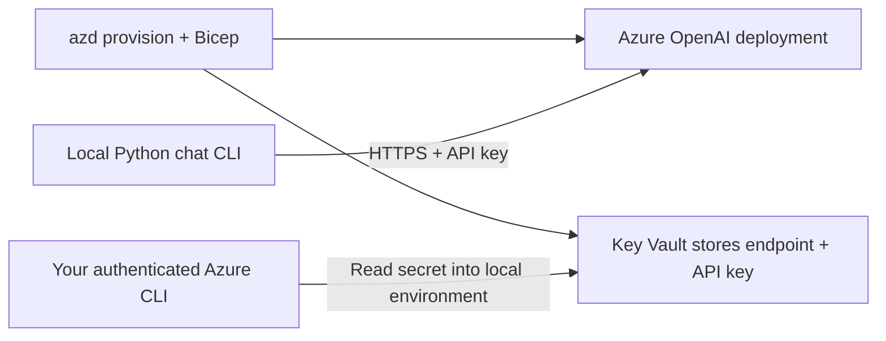

# Azure OpenAI Chat — CLI מקומי ותשתית AZD

**רמה:** בינוני · **זמן:** 35–60 דקות כולל התקנה

דוגמה זו מתבססת משאב **Azure OpenAI ומאגר מפתחות**, ואז מפעילה
CLI שיחת פייתון אינטראקטיבי **על המחשב שלך**. היא אינה מארחת יישום רשת
או אפליקציית מכולה. הדגם הבסיסי הוא `gpt-4.1`, גרסה `2025-04-14`, עם
קיבולת פריסה `GlobalStandard` של 20. בדוק זמינות נוכחית ומכסה באזור שנבחר
לפני ההקצאה; תאריכי מחזור חיים של הדגם יכולים להשתנות.

## מטרות הלמידה

- פריסת תשתית עם Bicep ו-azd.
- שליפת מפתח API מ-Key Vault מבלי להכניסו לפלט ההפקה.
- שליחת בקשות Chat Completions ושמירת היסטוריית שיחה.
- פרשנות של ספירת טוקנים ומגבלות של הערכות עלות.



אין אינטגרציה של זיהוי מנוהל בזמן ריצה, כשל רב-אזורי, מגביל קצב מותאם אישית, מצב סטרימינג או חישוב מתארח בדוגמה זו. SDK של OpenAI
מבצע עד שתי ניסיונות מחדש לכשלים הניתנים לניסיון חוזר; ה-CLI מדווח על שגיאות שנותרו.


## דרישות מוקדמות

- גרסה יציבה נוכחית של [azd](https://learn.microsoft.com/azure/developer/azure-developer-cli/install-azd)
  (גרסה מפורסמת בזמן הסקירה: 1.37.2).
- [Azure CLI](https://learn.microsoft.com/cli/azure/install-azure-cli).
- Python **3.10+** (מומלץ 3.11) וסביבה וירטואלית.
- מנוי Azure עם הרשאה ליצירת משאבי Cognitive Services ו-Key Vault,
  לפריסת מודלים ולקריאת הסודות במאגר.
- זמינות לפי אזור ו`GlobalStandard` למכסת `gpt-4.1`. דרישות הגישה
  תלויות במנוי ובתכונה; אין פרק זמן מובטח לאישור.

```bash
azd version
az version
python --version
azd auth login
az login
```

אלו הן הפעלות אימות נפרדות. יש לבחור את אותו מנוי בשני
הכלים לפני הרצת הפקודות מטה.

## התחלה מהירה (Bash)

הרץ משורש המאגר:

```bash
cd examples/azure-openai-chat
azd env new myopenai
azd provision
```

בחר אזור נתמך. ההקצאה יוצרת קבוצת משאבים, חשבון OpenAI,
פריסת מודל, Key Vault, ואת הסודות `openai-endpoint`/`openai-api-key`.
אין **שירותים לפרוס** ב-`azure.yaml`.

טען את הפלטים הלא-סודיים ושלוף את הסוד לקליפה הנוכחית שלך:

```bash
export AZURE_OPENAI_ENDPOINT="$(azd env get-value AZURE_OPENAI_ENDPOINT)"
export AZURE_OPENAI_MODEL="$(azd env get-value AZURE_OPENAI_MODEL)"
KV_NAME="$(azd env get-value AZURE_KEY_VAULT_NAME)"
export AZURE_OPENAI_API_KEY="$(az keyvault secret show \
  --vault-name "$KV_NAME" --name openai-api-key --query value --output tsv)"

python -m venv .venv
source .venv/bin/activate
python -m pip install -r src/requirements.txt
python src/chat.py
```

ב-PowerShell, הפעל עם `.\.venv\Scripts\Activate.ps1` והקצה משתני סביבה
עם `$env:AZURE_OPENAI_ENDPOINT = azd env get-value AZURE_OPENAI_ENDPOINT`
(ובאופן דומה עבור המודל). שלוף את מפתח ה-API באמצעות
`$env:AZURE_OPENAI_API_KEY = az keyvault secret show --vault-name $KV_NAME --name openai-api-key --query value -o tsv`.
הגדר את `$KV_NAME = azd env get-value AZURE_KEY_VAULT_NAME` תחילה.

אל תדפיס, תבצע commit, או תדביק את מפתח ה-API בדיווחי בעיות. ה-CLI קורא משתני סביבה של התהליך;
הוא **לא** מושך סודות מ-Key Vault או טוען קבצי `.env`.
`config.py` מאמת נקודת קצה, מגבלת אסימון וטמפרטורה בעת ההפעלה.

פלט צפוי (התוכן והשימוש משתנים):

```text
Azure OpenAI Chat Application
Model: gpt-4.1
...
You: Say hello in one sentence.
Assistant: Hello! How can I help you today?
[Tokens: ... | Cost: $...]
```

פקודות: `stats` מציג סך הכל, `clear` מנקה את היסטוריית השיחה, ו-
`quit`/`exit` מסיימים את המפגש. אין פקודות `--stream`, `--show-tokens`, `tokens`,
או `cost`.

## אמת את הפריסה

לאחר טעינת משתני Shell שלמעלה:

```bash
curl --fail-with-body \
  "${AZURE_OPENAI_ENDPOINT%/}/openai/deployments/${AZURE_OPENAI_MODEL}/chat/completions?api-version=2024-10-21" \
  -H "Content-Type: application/json" \
  -H "api-key: $AZURE_OPENAI_API_KEY" \
  -d '{"messages":[{"role":"user","content":"Say hello!"}],"max_tokens":50}'

az keyvault secret list --vault-name "$KV_NAME" --query "[].name" -o table
```

הצלחה: ה-API מחזיר HTTP 200 עם `choices[0].message.content` ו-`usage`;
הארון מפרט את `openai-api-key` ו-`openai-endpoint`. פריסת ARM מוצלחת
לבדה אינה מאמתת את המסקנה.

## קבצים וקונפיגורציה

```text
azure.yaml                         # Infrastructure-only AZD project
infra/main.bicep                   # Subscription deployment
infra/main.parameters.json         # Environment, location, principal ID
infra/resources/openai.bicep       # Account + model
infra/resources/keyvault.bicep     # Vault + deploying user's secret access policy
infra/resources/secrets.bicep      # Writes secrets, no key output
src/chat.py                        # Interactive CLI
src/config.py                      # Environment validation
src/requirements.txt               # Python packages
```

לשנות את הדגם/הגרסה/הקיבולת שסופקו, ערוך את ברירות המחדל ב-
`infra/main.bicep` והרץ את `azd provision`. הגדרת `AZURE_OPENAI_MODEL` ב-
ה-shell שלך בוחרת רק **שם פריסה קיים**; זה לא מפרוס דגם אחר.

| משתנה ב-runtime | ברירת מחדל / מקור |
|---|---|
| `AZURE_OPENAI_ENDPOINT` | דרוש; פלט azd שאינו סודי |
| `AZURE_OPENAI_API_KEY` | דרוש; יש להשיג מ-Key Vault |
| `AZURE_OPENAI_MODEL` | `gpt-4.1`; שם פריסת Azure |
| `AZURE_OPENAI_MAX_TOKENS` | 800 (טווח אימות 1–4096) |
| `AZURE_OPENAI_TEMPERATURE` | 0.7 (טווח 0–2) |
| `AZURE_OPENAI_INPUT_PRICE_PER_1K` | 0.002 דולר; שיעור קלט לא מקונן להמחשה |
| `AZURE_OPENAI_OUTPUT_PRICE_PER_1K` | 0.008 דולר; שיעור פלט להמחשה |

## עלויות ומגבלות אבטחה

תצוגת העלות היא **הערכה**, לא חיוב של Azure. היא מכפילה את שימוש ב-API token
לפי השיעורים המוגדרים ואינה מתחשבת בהנחות קלט מקוננות,
הבדלים אזוריים/SKU, מיסים, שינויים במחיר, או שיחות שנכשלו/ניסו שוב.
יש לדרוס **את שני השיעורים** בעת שימוש בדגם או SKU אחר ואמת את
[תמחור Azure OpenAI](https://azure.microsoft.com/pricing/details/cognitive-services/openai-service/) הנוכחי.

להמחשה, 100 בקשות המשתמשות ב-500 טוקנים של קלט לא מקונן ו-200 טוקנים של פלט כל אחת
בעלויות ברירת המחדל הן `100 × (500/1000 × .002 + 200/1000 × .008) = $0.26`.
פעולות/אחסון ב-Key Vault גורמות לחיובים נפרדים. אין חיוב חודשי קבוע של 50$ 
עבור CLI מקומי זה ואין מחשוב מתארח בתבנית.

הכיפה משתמשת במדיניות גישה למוביל; זה אינו דוגמה ל-RBAC או
ליישום זהות מנוהלת. נקודות קצה ציבוריות ואימות מפתח API 
משמשים ללמידה. הגבילו הרשאות והוסיפו בקרות זהות/רשת מתאימות לפני שתתאימו לשימוש בפרודקשן.


## תרגילים מעשיים

### 1. אמת הקשר ואפס אותו

**התחלה:** מפעיל CLI. **מטרה:** התבוננות בהיסטוריה.
אמור "זכור את המילה ארז," ואז שאל "איזו מילה ביקשתי ממך לזכור?"
הפעל `stats`; שני סבבים מוצלחים צריכים להיחשב כשתי הודעות שהוחלפו.
הפעל `clear` ו-`stats`; ההודעות שהוחלפו אמורות להיות אפס (סך הטוקנים נשאר).
הניסוח המדויק של המודל אינו דטרמיניסטי.

### 2. שנה את מגבלת התגובה

**התחל:** צא מ-CLI, תוך שמירת אותה מעטפת.
הפעל `export AZURE_OPENAI_MAX_TOKENS=100`, הפעל מחדש את `python src/chat.py`, ובקש
הסבר קצר על azd. בדוק שהבאנר מציג 100.
שחזר עם `unset AZURE_OPENAI_MAX_TOKENS`. הגבלת תגובה קטנה יותר לא
מפחיתה את אסימוני ההיסטוריה שכבר נשלחו.

### בעיות נפוצות

- **משתני סביבה חסרים:** הפרוביזיונינג לא מייצא ערכי shell;
  חזור על צעדי הייצוא. טרמינל חדש זקוק להם שוב.
- **403 קריאת Key Vault:** אמת את ההרשאה והכניסה של Azure CLI ואת הראשי במדיניות הגישה לאוצר.
  שינויים במדיניות יכולים לקחת זמן להתפשט.
- **404 הסקה:** בדוק את שם הפריסה, נקודת הקצה, ומצב הפריסה.
- **429 הסקה:** המתן לאיפוס מגבלות קצב; אמת מכסת דגם אזורית.
  ה-CLI מסיר סיבובים שנכשלו מההיסטוריה כדי שניסיון חוזר לא יכפיל אותם.
- **אורך הקשר:** הדוגמה אינה קוצצת שיחות ארוכות; השתמש ב-`clear`.
- **דגם לא זמין/פורש:** עיין בזמינות הדגם הנוכחית ועדכן
  דגם/גרסה/SKU יחד; גרסת ה-API וגרסת הדגם הן הגדרות שונות.

## ניקוי וצעדים הבאים

```bash
azd down
unset AZURE_OPENAI_API_KEY
```

שמירת המחקה בעבור Key Vault היא שבעה ימים; ניקוי דורש הרשאות נפרדות.
אין ערכת בדיקה מחויבת; אל תפעיל פקודת `pytest tests/` שאינה קיימת.
הוסף בדיקות API מדומות לפני הרחבת הקוד.

[דוגמאות למיכלים](../../../../examples/container-app) · [מפת ארכיטקטורת קמעונאות](../retail-scenario.md) ·
[עמוד הקורס](../../README.md) · [דווח על בעיה](https://github.com/microsoft/AZD-for-beginners/issues)

---

<!-- CO-OP TRANSLATOR DISCLAIMER START -->
**כתב ויתור**:
מסמך זה תורגם באמצעות שירות תרגום אוטומטי [Co-op Translator](https://github.com/Azure/co-op-translator). למרות שאנו שואפים לדיוק, יש לקחת בחשבון שתרגומים אוטומטיים עלולים להכיל שגיאות או אי-דיוקים. יש להחשיב את המסמך המקורי בשפתו הטבעית כמקור הסמכות. למידע קריטי מומלץ להשתמש בתרגום מקצועי על ידי מתרגם אדם. אנו לא אחראים לכל אי-הבנה או פירוש שגוי הנובע מהשימוש בתרגום זה.
<!-- CO-OP TRANSLATOR DISCLAIMER END -->