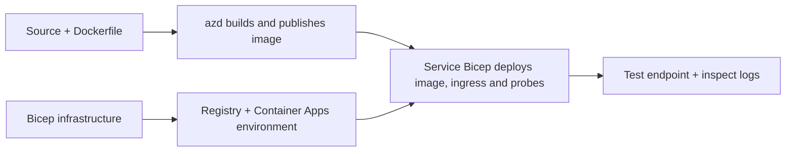

# דוגמאות לפריסת Container App עם AZD

תיקייה זו מכילה שני דוגמאות ללמידה עם קוד מקור, Dockerfiles,
תשתית Bicep, ו-`azure.yaml`. אף אחת מהן אינה משופרת לפרודקשן.

## בחר דוגמה

| דוגמה | מה מיושם | דרישות מוקדמות |
|---|---|---|
| [Simple Flask API](../../../../examples/container-app/simple-flask-api) | API בודד עם Python CRUD, פריטים בזיכרון, בדיקות בריאות, גמישות HTTP | ידע בסיסי ב-CLI ו-HTTP |
| [Two-service microservices](../../../../examples/container-app/microservices) | שער Node.js, שירות מוצר Python לקריאה בלבד פנימי, טלמטריה וגמישות | סיים קודם את הדוגמה של שירות בודד |

אפשר 30–60 דקות כולל ההתקנה והאימות. זמני הפריסה ב-Azure משתנים.

## דרישות מוקדמות

- [Azure Developer CLI](https://learn.microsoft.com/azure/developer/azure-developer-cli/install-azd)
- [Azure CLI](https://learn.microsoft.com/cli/azure/install-azure-cli) לפקודות אימות
- Docker עם הדימון שלו פועל לבניית תמונות ה-container הללו
- מנוי Azure עם הרשאות יצירת משאבים ומכסת אזור מספקת
- Bash עבור הדוגמאות בשורת הפקודה, או פקודות PowerShell שוות ערך

```bash
azd version
az version
docker info
azd auth login
az login
```

לכלי הפיתוח שני מושבי כניסה נפרדים. השתמש ב-azd יציב נוכחי; הגרסה
המפורסמת הנוכחית בזמן הסקירה היא 1.37.2. דרישות גרסה מינימליות ישנות אינן
ערבות תאימות.

## התחלה מהירה

משורש המאגר:

```bash
cd examples/container-app/simple-flask-api
azd env new flask-demo
azd up
API_URL=$(azd env get-value API_ENDPOINT)
curl --fail-with-body "${API_URL}/health"
```

צפוי: HTTP 200 עם `"status": "healthy"`. עקוב אחרי דוגמת README כדי ליצור,
לקרוא, לעדכן ולמחוק פריט, ולבדוק לוגים.



האספקה הראשונית משתמשת בתמונה ציבורית של hello-world על פורט 80. שירות מסוים
קבצי פרמטרים של Bicep מאפשרים ל-`azd deploy` להחליף אותה בתמונת היישום שנבנתה
ובפורט/בדיקות הנכונים של היישום (8000 עבור Flask/מוצר, 8080 עבור השער).
שמור קבצים אלה עם ההגדרות של `azure.yaml` `module`.

## תצורה: מה משנה מה

`azure.yaml` בוחר תיקיות מקור, שפות, מארחים, ומודולי פריסה.
מעבד מרכזי/זיכרון למכולה, כניסה, בדיקות, מספר שכפולים, וכללים להרחבה מוגדרים
ב-**Bicep**, לא בתכונות שירות שרירותיות של `resources`, `scale`, או `regions`.

`azd env set SOME_VALUE ...` שומר ערך באופן מקומי. הוא משנה רק משאב מופעל
כאשר פרמטר, מיפוי סביבה, או ווּק צורכים במפורש ערך זה.
דוגמאות אלה אינן צורכות `MAX_REPLICAS`, `SCALE_TO_ZERO_TIMEOUT`,
`CONTAINER_APP_REPLICA_TYPE`, או הגדרות canary מותאמות אישית מערכי הסביבה של azd.
ערוך את Bicep הרלוונטי והרץ `azd up` כדי לאספק מחדש ולפרוס.

אל תשים את קוד המקור של היישום תחת `infra/`. `project` חייב להצביע על תיקיית המקור
שמכילה את Dockerfile והמאפיין להסתמכויות.

## ניטור ועלויות

- `azd monitor --logs` פותח תצוגת פורטל; זה לא זרם לוגים של טרמינל.
  השתמש ב-`az containerapp logs show --follow` עם שם המשאב בפועל.
- ה-API הפשוט כותב לוגים ל-stdout הנאספים דרך Container Apps/Log Analytics.
  משאב Application Insights שנאסף אינו מאופשר אוטומטית.
- שער המיקרו-שירותים משתמש ב-SDK של Node.js ל-Application Insights; שירות ה-Python
  מייצא מעקבי לוג של אפליקציה. מעקב מלא של בקשות/תלות ב-Python
  אינו מוגדר.
- Scale-to-zero יכול להפחית את חיובי המחשוב, אך רישום וקליטת/אחסון לוגים
  עדיין יכולים לעלות כסף. ברירות המחדל של המיקרו-שירותים שומרות על הרפליקות פועלות.
  העריכו את האזור והשימוש שלכם ב-
  [מחשבון התמחור של Azure](https://azure.microsoft.com/pricing/calculator/).

## דפוסים מתקדמים — לא יישומים מופיעים כאן

אלה הם כיווני עיצוב, לא פרויקטים מקומיים נוספים או סניפטים של העתק-הדבק:

- **נתונים מתמשכים ואימות:** החליפו מאגרי זיכרון פנימיים והוסיפו
  אימות/הרשאה של Microsoft Entra ID לפני הייצור.
- **כחול-ירוק/קנרית:** השתמשו במצב רב-גרסאות של Container Apps, תוויות גרסאות,
  משקלי תנועה, אימות בריאות, ונהלי שקיעה (rollback).
  אין תצורת `deploymentStrategy: canary` azd בדוגמאות אלו.
  ראו [ניהול גרסאות](https://learn.microsoft.com/azure/container-apps/revisions).
- **רב-אזורי:** צרו סביבות ואפליקציות נפרדות ב-Bicep ועצבו
  ניתוב גלובלי ועקביות נתונים. רשימת שירותים `regions` אינה מנגנון פריסת azd.
- **עובדי תור:** הוסיפו מקור עובד, תלות, משאבי תור, ניהול
- **עובדי תור:** הוסף מקור עובד, תלותים, משאבי תור, ניהול מנוהל
  זהות עם תפקידי data-plane, וכלל סקלינג מאומת. אל תעתיק
  נתיב `src/worker` ריק ותחכה לפרויקט שניתן להרצה.
- **Dapr:** אספקת רכיבים, קביעת תצורה ל-sidecar, התקנת SDK המתאים,
  ויישום טיפול בשגיאות במצב/pub-sub.
- **Secrets:** השתמש בזהות מנוהלת ובהקצאות תפקידים כאשר ניתן. יצירת Key Vault בלבד
  אינה מעניקה גישה ליישומים או טוענת סודות.

## ניקוי

מתיקיית הדוגמא:

```bash
azd down
```

בדוק את הודעות המחיקה ואשר שקבוצת המשאבים הייעודית הוסרה.
אל תשתמש בדוגמאות אלו כבסיס יצור ללא עיצוב נוסף ובדיקות.

[מפתח דוגמאות](../README.md) · [דף הבית של הקורס](../../README.md) ·
[תיעוד אפליקציות מכולות](https://learn.microsoft.com/azure/container-apps/) ·
[דווח על תקלה](https://github.com/microsoft/AZD-for-beginners/issues)

---

<!-- CO-OP TRANSLATOR DISCLAIMER START -->
**כתב ויתור**:
מסמך זה תורגם באמצעות שירות תרגום אוטומטי [Co-op Translator](https://github.com/Azure/co-op-translator). למרות שאנו שואפים לדיוק, יש לקחת בחשבון שתרגומים אוטומטיים עלולים להכיל שגיאות או אי-דיוקים. יש להחשיב את המסמך המקורי בשפתו הטבעית כמקור הסמכות. למידע קריטי מומלץ להשתמש בתרגום מקצועי על ידי מתרגם אדם. אנו לא אחראים לכל אי-הבנה או פירוש שגוי הנובע מהשימוש בתרגום זה.
<!-- CO-OP TRANSLATOR DISCLAIMER END -->