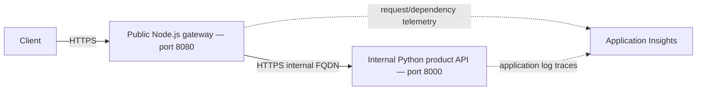

# מיקרו-שירותים עם שני שירותים — Azure Container Apps

**רמה:** בינונית · **זמן:** 45–60 דקות כולל ההתקנה

דוגמת למידה זו מממשת **שער API ב-Node.js** ו-**שירות מוצר לקריאה בלבד ב-Python**. הקוד המקור, קבצי Docker, Bicep, וקונפיגורציית azd כלולים.

זהו אינו מערכת המותאמת לפרודקשן.

## מה תלמדו

- פריסת שני שירותים באופן עצמאי.
- שימוש ב-FQDN פנימי על HTTPS.
- אימות תגובות הצלחה, לא נמצא, ושירות לא זמין.
- הבנת טלמטריה וגבולות סקיילינג עצמאיים.



קטלוג המוצרים מכיל חמישה מוצרים קבועים בזיכרון. אין **מטפלי POST,
PUT, או DELETE**, בסיס נתונים, Service Bus, שירות הזמנות/משתמש/הודעות,
קוד C# או Go. אלה רעיונות לפיתוח עתידי, לא תכונות כלולות.
השער אינו מאמת משתמשים; כניסה פנימית אינה תחליף לאישור אפליקציה.


## דרישות מוקדמות

השלם את ה-[Flask API בודד](../../../../../examples/container-app/simple-flask-api) תחילה.
התקן גרסת יציבה עדכנית של azd (גרסת שחרור זמינה בזמן הסקירה: 1.37.2), Azure CLI,
ואת Docker כשהדימון פעיל. דרושה לך מנוי Azure, הרשאות יצירת משאבים,
וזכאות אזורית ל-Container Apps.

```bash
azd version
az version
docker info
azd auth login
az login
```

השתמש באותו מנוי בשני כלי שורת הפקודה. הפקודות להלן משתמשות ב-Bash.

## פריסה ואימות

משורש הריפוזיטורי:

```bash
cd examples/container-app/microservices
azd env new microservices-demo
azd up
GATEWAY_URL=$(azd env get-value API_GATEWAY_URL)
RG_NAME=$(azd env get-value AZURE_RESOURCE_GROUP)
GATEWAY_NAME=$(azd env get-value API_GATEWAY_NAME)
PRODUCT_NAME=$(azd env get-value PRODUCT_SERVICE_NAME)

curl --fail-with-body "${GATEWAY_URL}/health"
curl --fail-with-body "${GATEWAY_URL}/api/products"
curl --fail-with-body "${GATEWAY_URL}/api/products/1"
curl -i "${GATEWAY_URL}/api/products/999"
```

**הצלחה:** status 200 לבריאות; status 200 לרשימה עם **חמישה** מוצרים; מוצר 1 הוא מחשב נייד
במחיר 999.99 עם מלאי 50; מוצר לא ידוע מחזיר 404.
תיאורים כלולים בתגובות; התאריכים משתנים.

הפריסה הראשונית משתמשת בתמונות ציבוריות של hello-world על הפורט 80 ולכן אינה מנסה
למשוך תמונות שאינן קיימות ממאגר ריק. מודולי Bicep ספציפיים לשירות
וקבצי פרמטרים מחליפים אותם בתמונות שנבנו וביציאות/בדיקות אפליקציה במהלך ה-
`azd deploy`. הפרמטרים הראשיים משמרים את שמות התמונות שפורסמו לפריסה עתידית.

## שירותים ורשתות

| שירות | נקודות קצה חשופות | משאבים ברירת מחדל |
|---|---|---|
| Gateway | GET `/`, `/health`, `/api/products`, `/api/products/:id` | 1 vCPU, 2 GiB, 2–20 שכפולים |
| Product | GET `/`, `/health`, `/products`, `/products/<id>` | 0.5 vCPU, 1 GiB, 1–10 שכפולים |

ל-Product ingress יש `external: false` ו-`allowInsecure: false`. Bicep מזריק
`PRODUCT_SERVICE_URL=https://<actual-internal-fqdn>` אל ה-Gateway. HTTP היה
מפנה מחדש; HTTPS מתאים ל-ingress שהוגדר. שם DNS קצר חייב להתאים
**לשם האפליקציה Container App בפועל**, לא למפתח השירות הלוגי `product-service`.
אל תנסה לגשת לכתובת URL פנימית ישירות מהמחשב הנייד שלך.

ל-Gateway יש זמן חיבור של חמישה שניות לקריאות מוצר. מזהי מוצרים חסרים
מתפשטים כ-404; כשלים בתעבורה/שגיאות ב-backend מחזירים 503. ה-
`/health` של Gateway בודק רק את ה-Gateway, לא את זמינות ה-backend.

## קבצים וקונפיגורציה

```text
azure.yaml
infra/main.bicep
infra/main.parameters.json
infra/abbreviations.json
infra/core/container-apps-environment.bicep
infra/core/monitor.bicep
infra/app/api-gateway.bicep
infra/app/api-gateway.parameters.json
infra/app/product-service.bicep
infra/app/product-service.parameters.json
src/api-gateway/{app.js,package.json,Dockerfile}
src/product-service/{main.py,requirements.txt,Dockerfile}
```

סקיילינג, CPU/זיכרון, יציאות, ובדיקות מוגדרים ב-`infra/app/*.bicep`. שנה קבצים אלה
והריץ `azd up` כדי להחיל תשתית ולפרוס מחדש. אין כאן פרמטר של
`GATEWAY_MAX_REPLICAS` כמשתנה סביבה בדוגמה זו.

עבור שינויים בקוד בלבד:

```bash
azd deploy product-service
azd deploy api-gateway
```

תמונת ה-Node משתמשת ב-Node 22; תמונת ה-Python משתמשת ב-Python 3.11. שתיהן קשורות ל-
`0.0.0.0`. Ingress/בדיקות משתמשים בפורט 8080 (gateway) ו-8000 (product), בהתאמה.

## פיתוח מקומי עם Docker

הרץ מקטלוג הדוגמה הזה. השתמש ברשת שהוגדרה על ידי המשתמש, **לא ב-`localhost`
כדי שמכלי אחד יוכל להגיע לשני**:

```bash
docker network create azd-microservices-demo
docker build -t local-product ./src/product-service
docker build -t local-gateway ./src/api-gateway
docker run -d --name azd-product --network azd-microservices-demo local-product
docker run -d --name azd-gateway --network azd-microservices-demo \
  -p 8080:8080 -e PRODUCT_SERVICE_URL=http://azd-product:8000 local-gateway
curl --fail-with-body http://localhost:8080/api/products
```

הצפוי: חמישה מוצרים. HTTP משמש רק לרשת Docker המקומית הזו.

```bash
docker stop azd-product azd-gateway
docker rm azd-product azd-gateway
docker network rm azd-microservices-demo
```

## ניטור

```bash
az containerapp logs show --name "$GATEWAY_NAME" --resource-group "$RG_NAME" --follow
# In a separate terminal:
az containerapp logs show --name "$PRODUCT_NAME" --resource-group "$RG_NAME" --tail 100
```

`azd monitor --logs` פותח תצוגת פורטל; אינו משדר לוגים מהטרמינל.
SDK של Node אוסף בקשות/תלויות ל-Gateway. ה-`AzureLogHandler` של Python
מייצא **עקבות לוג**, לא בקשות Flask אוטומטיות, SQL תלויות, או עקבות מבוזרות מלאות.
OpenCensus הוא SDK מיושן; העדף את Azure Monitor OpenTelemetry
כשהדוגמה הזו מורחבת.

ב-Application Insights Logs, הפק בקשות ובחן:

```kusto
requests
| where timestamp > ago(1h)
| where name contains "products"
| summarize RequestCount=count(), AvgDuration=avg(duration) by bin(timestamp, 5m)
```

עבור הודעות אפליקציית Python:

```kusto
traces
| where timestamp > ago(1h)
| where message contains "products"
| project timestamp, message, severityLevel
```

אפשר השהיית עיבוד ודגימה; אל תצפה לספירת בקשות מדויקת או לאיחור מובטח.
אין התראות מותאמות אישית או לוחות מחוונים מוגדרים.

## תרגילים מעשיים

### תרגיל 1: שנה את הקטלוג

**נקודת התחלה:** `src/product-service/main.py`.
**מטרה:** לאמת פריסה עצמאית של שירות.
שנה את המלאי של המחשב הנייד מ-50 ל-49 ברשימה הקבועה `products`, הרץ
`azd deploy product-service`, ואז בקש `${GATEWAY_URL}/api/products/1`.

**קריטריוני הצלחה / פתרון:** HTTP 200 עם `"stock":49`. החזר ל-50 ופרוס מחדש.
**בעיה נפוצה:** עריכת ה-Gateway במקום השירות שבבעלותו הקטלוג.
זה משנה נתוני מקור, לא מסד נתונים מתמיד למלאי.

### תרגיל 2: אמת את תצורת השכפולים

**נקודת התחלה:** `infra/app/product-service.bicep`.
**מטרה:** להבחין בשינוי תשתיתי בלי לנחש את סקיילינג האוטומטי.
שנה את `minReplicas: 1` ל-`minReplicas: 2`, הרץ `azd up`, ואז:

```bash
az containerapp show --name "$PRODUCT_NAME" --resource-group "$RG_NAME" \
  --query properties.template.scale -o json
```

**קריטריוני הצלחה:** המינימום שהוגדר הוא 2 והמקסימום נשאר 10.
החזר את המינימום ל-1 והרץ `azd up`.
**בעיה נפוצה:** `azd deploy` לבדו אינו מיישם שינויים בתשתית משותפת לא קשורה.
אל תכנס `maxReplicas` לאפס כסימולציית כישלון.
זה מאמת תצורה, לא בדיקת עומס או ספירת שכפולים מובטחת מיידית.

### תרגיל 3: בדוק טיפול בשירות לא זמין מקומית

**נקודת התחלה:** שני מכלי Docker המקומיים למעלה פועלים.
**מטרה:** להבדיל בין כישלון backend למוצר חסר.
עצור רק את מכל המוצר:

```bash
docker stop azd-product
curl -i http://localhost:8080/api/products
docker start azd-product
curl --fail-with-body http://localhost:8080/api/products
```

**קריטריוני הצלחה:** בעת עצירה, ה-Gateway מחזיר 503 עם
`"error":"Product service unavailable"`; לאחר הפעלה מחדש, הרשימה מחזירה 200.
נסה שוב לאחר השהיית אתחול קצרה אם יש צורך.
**בעיה נפוצה:** עצירת ה-Gateway בודקת כישלון אחר (אין תגובת HTTP).

## עלויות ופערים בפרודקשן

שכפולים מינימליים כבר שומרים על הפעלת המחשוב. גם הרישום והניטור גורמים
לחיובים. אין סיכום חודשי של $50 מאומת: הערך חישוב CPU/זיכרון אזורי,
שעות שכפול, בקשות, רישום ואחזקת לוגים ב-
[מחשב המחירים של Azure](https://azure.microsoft.com/pricing/calculator/).
מחק משאבים ללמידה במהירות.

עבודה בפרודקשן כוללת אימות/הרשאה, זהויות מנוהלות בתחום,
נתונים מתמשכים, אימות קלט/תגובה, כלי ניתוח נתונים נתמכים,
בדיקות עומס/כשל, CI/CD, התראות ונהלי התאוששות. הוספת שירות הזמנות,
תור, או מסד נתונים היא משימה נפרדת, לא תרגיל מוגמר או תכונה זמינה כאן.


## פתרון תקלות וניקוי

- **תמונה לא נמצאה במהלך פריסה ראשונית:** האתחול צריך להשתמש בתמונה הציבורית;
  אשרר את ערכי ברירת המחדל של פרמטר התמונה הראשי ומיפויי המודול לפריסה.
- **503 מוצרים:** בדוק לוגים של מוצר, גרסת תמונה, וכתובת HTTPS פנימית שהוזרקה.
- **404 נתיב בלתי צפוי:** ה-API של מוצר לקריאה בלבד; אשרר את הנתיב, לא מנפיק CRUD לא קיים.
- **אין טלמטריה:** בדוק מחרוזות חיבור ריצה מבלי לחשוף אותן ו
  אפשר השהיית עיבוד. טבלאות בקשות Python אינן מלאות על ידי מנהל הלוג שלה.

מתיקיית הדוגמה הזו:

```bash
azd down
```

בדוק הנחיות מחיקה ואשר שהקבוצת משאבים הייעודית הוסרה.

[קודם: Flask API](../../../../../examples/container-app/simple-flask-api) · [הבא: אפליקציית מסד נתונים](../../../../../examples/database-app) ·
[פיתוח AI](../../../docs/chapter-02-ai-development/README.md) ·
[בית הקורס](../../../README.md) · [דווח על תקלה](https://github.com/microsoft/AZD-for-beginners/issues)

---

<!-- CO-OP TRANSLATOR DISCLAIMER START -->
**כתב ויתור**:
מסמך זה תורגם באמצעות שירות תרגום אוטומטי [Co-op Translator](https://github.com/Azure/co-op-translator). למרות שאנו שואפים לדיוק, יש לקחת בחשבון שתרגומים אוטומטיים עלולים להכיל שגיאות או אי-דיוקים. יש להחשיב את המסמך המקורי בשפתו הטבעית כמקור הסמכות. למידע קריטי מומלץ להשתמש בתרגום מקצועי על ידי מתרגם אדם. אנו לא אחראים לכל אי-הבנה או פירוש שגוי הנובע מהשימוש בתרגום זה.
<!-- CO-OP TRANSLATOR DISCLAIMER END -->