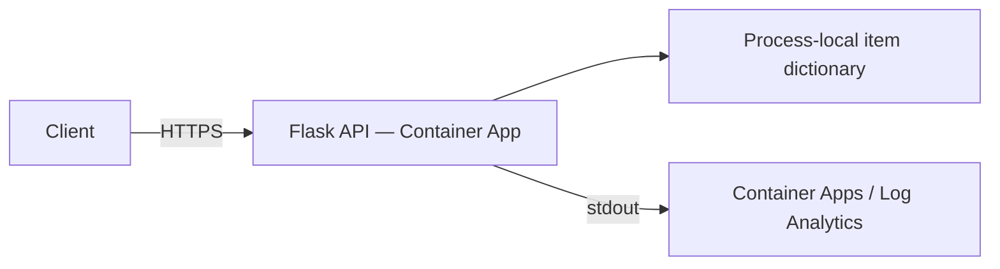

# ממשק API פשוט של Flask — אפליקציות מכולה באז׳ור

**רמה:** מתחילים · **זמן:** 30–45 דקות כולל התקנה

פרוס ממשק CRUD של Python Flask עם Azure Developer CLI (azd). הכולל מקור, Dockerfile,
Bicep, ופרמטרים לפריסה. זהו **דוגמת לימוד**, לא
ממשק API מוכן לייצור.

## מה תלמדו

- בנייה ופרסום מכולה דרך azd.
- הגדרת כניסה ובדיקות חיים/מוכנות.
- אימות תגובות CRUD ובדיקת לוגים של היישום.
- הבנת מדוע נתונים בזיכרון אינם מתאימים ליישומים עמידים.



**חשוב:** הפריטים מוחזקים בתהליך אחד. ברירת המחדל היא **עובד Gunicorn אחד,
0–1 שכפולים**, בכוונה כדי למנוע חוסר עקביות בנתונים בין עובדים/שכפולים.
הפריטים אובדים עם אתחול מחדש, שינוי גרסה, או קנה מידה לאפס. הגדלת מספר השכפולים
דורשת אחסון מתמיד משותף. לממשק אין אימות או הרשאות.

## דרישות מוקדמות

- [azd היציבה הנוכחית](https://learn.microsoft.com/azure/developer/azure-developer-cli/install-azd)
  (הגרסה שפורסמה בזמן הסקירה: 1.37.2).
- [Azure CLI](https://learn.microsoft.com/cli/azure/install-azure-cli) לאימות.
- Docker עם הדימון שלו פועל; נדרש לבניית תמונה מקומית ברירת מחדל.
- מנוי Azure, הרשאות יצירת משאבים, ומכסת אזור אפליקציות מכולה.
- Bash עבור הפקודות למטה (או PowerShell מקביל).
- Python 3.11 לפיתוח מקומי אופציונלי.

```bash
azd version
az version
docker info
azd auth login
az login
```

לכלי שורת הפקודה יש מושבי התחברות נפרדים. השתמש באותו מנוי בשניהם.

## התחלה מהירה

מליבת מאגר הקוד:

```bash
cd examples/container-app/simple-flask-api
azd env new flask-demo
azd up
API_URL=$(azd env get-value API_ENDPOINT)
RG_NAME=$(azd env get-value AZURE_RESOURCE_GROUP)
API_NAME=$(azd env get-value API_NAME)
curl --fail-with-body "${API_URL}/health"
```

צפוי: HTTP 200 ו-JSON עם `"status":"healthy"`,
`"service":"simple-flask-api"`, וטיימסטמפ UTC נוכחי.
פריסה ובניית תמונה בדרך כלל לוקחות מספר דקות; הזמנים משתנים.

הפריסה הראשונית משתמשת בתמונה ציבורית hello-world שמאזינה ב-port 80.
`azure.yaml` בוחרת ב-`infra/app/api.bicep` ואת קובץ הפרמטרים התואם לפריסת שירות,
שמשנה את התמונה, כניסה והבדיקות ל-port 8000.
אל תמחק את פרמטרי הפריסה הללו.

## אימות CRUD

הפעל את הפקודות הבאות ברצף כל עוד אותו שכפל פעיל:

```bash
# Create: HTTP 201; note the returned id (1 for a fresh process).
curl -i -X POST "${API_URL}/api/items" \
  -H "Content-Type: application/json" \
  -d '{"name":"Test Item","description":"My first item"}'

# Read list: HTTP 200, total 1 in a fresh process.
curl --fail-with-body "${API_URL}/api/items"

# Replace 1 if your create response returned another id.
curl --fail-with-body "${API_URL}/api/items/1"
curl -i -X PUT "${API_URL}/api/items/1" \
  -H "Content-Type: application/json" -d '{"name":"Updated Item"}'
curl -i -X DELETE "${API_URL}/api/items/1"
curl -i "${API_URL}/api/items/1"
```

הצלחה: POST 201, קריאות/PUT 200, DELETE 204 ללא גוף, ואז פריט חסר 404.
JSON עם פורמט שגוי/שאינו אובייקט או שם ריק מחזיר 400.
אם פריט נעלם בין הבקשות, בדוק אתחול מחדש או קנה מידה לאפס;
זו הגבלה מכוונת בזיכרון, לא אחסון מתמיד.

| נקודת קצה | מתודות |
|---|---|
| `/` | GET — מידע על השירות |
| `/health` | GET — בדיקות חיים/מוכנות |
| `/api/items` | GET, POST |
| `/api/items/{id}` | GET, PUT, DELETE |

## לוגים וקונפיגורציה

```bash
az containerapp logs show --name "$API_NAME" --resource-group "$RG_NAME" --follow
```

צפוי: הפעלת Gunicorn, לוגי גישה לבקשות, והודעות היישום.
`azd monitor --logs` פותח תצוגת פורטל; הוא לא משדר לטרמינל.
Application Insights מופעל אך **לא באינסטורומנטציה של קוד Flask זה**;
השתמש ב-Container Apps/Log Analytics ללוגי stdout.

ערוך את `infra/app/api.bicep` עבור CPU/זיכרון, הגבלות שכפול, או כללי קנה מידה, ואז
הרץ את `azd up`. ברירות המחדל הן 0.5 vCPU, 1 GiB, מינימום 0 / מקסימום 1 שכפל,
וסף HTTP של 50 בקשות בו-זמנית. קנה מידה לאפס יכול להוסיף השהיית התחלה קרה.

ערכי `azd env set MAX_REPLICAS`, `API_KEY`, `LOG_LEVEL`, או
`SCALE_TO_ZERO_TIMEOUT` אקראיים **אינם מחוברים לתבנית או לאפליקציה זו**.
הגדרת ערך אינה הופכת אותו אוטומטית למשתנה סביבת ריצה.
התמונה מחייבת בפורט 8000 במפורש; עדכן את Dockerfile, ה-Bicep ingress, ואת הבדיקות
יחד אם משנים את הפורט.

## קבצים

```text
azure.yaml
infra/main.bicep
infra/main.parameters.json
infra/app/container-apps.bicep       # Environment, registry, monitoring
infra/app/api.bicep                  # App, ingress, probes, scale settings
infra/app/api.parameters.json        # Image and resource values for azd deploy
src/app.py
src/Dockerfile
src/requirements.txt
```

## פיתוח מקומי

מתוך ספרייה לדוגמה זו:

```bash
python -m venv .venv
source .venv/bin/activate  # PowerShell: .\.venv\Scripts\Activate.ps1
python -m pip install -r src/requirements.txt
python src/app.py
```

במסוף אחר, בדוק את `http://localhost:8000/health` ואת נקודות הקצה CRUD.
או בנה והפעל את התמונה עצמה:

```bash
docker build -t flask-api:local ./src
docker run --rm -p 8000:8000 flask-api:local
```

לשינויים בקוד בלבד לאחר הפריסה הראשונה, הרץ את `azd deploy api`.
לשינויים ב-Bicep, הרץ את `azd up` כדי לפרוס מחדש ולפרסם.

## תרגילים מעשיים

### 1. אימות דחיית קלט

**נקודת התחלה:** API מתפרס, `API_URL` לעיל.
**מטרה:** לאמת שה-API דוחה צורות JSON לא תקינות ושמות חסרים.

```bash
curl -i -X POST "${API_URL}/api/items" \
  -H "Content-Type: application/json" -d '[]'
curl -i -X POST "${API_URL}/api/items" \
  -H "Content-Type: application/json" -d '{"name":""}'
```

**קריטריוני הצלחה / פתרון:** שניהם מחזירים 400 עם שגיאת JSON, לא 500.
**בעיה נפוצה:** היעדר ההדר של type-content JSON.

### 2. הוספת נקודת קצה לקריאה בלבד

**נקודת התחלה:** `src/app.py`. **מטרה:** להרחיב ולפרוס מחדש את ה-API.
הוסף זאת לפני בלוק `if __name__ == '__main__':`:

```python
@app.route('/version', methods=['GET'])
def version():
    return jsonify({'version': '1.0.0'})
```

הרץ את `azd deploy api`, ואז `curl --fail-with-body "${API_URL}/version"`.
**קריטריוני הצלחה:** HTTP 200 ו-`{"version":"1.0.0"}`.
**בעיה נפוצה:** הכנסת הנתיב אחרי הקריאה החוסמת `app.run()` כאשר
מבצעים בדיקה עם `python src/app.py`.

### נקודת בדיקת ידע

מדוע עובד אחד אינו מספיק לנתונים עמידים? כי אפילו תהליך אחד מאבד
את המילון שלו בעת הפעלה מחדש. גרסה לפרודקשן דורשת אחסון משותף עמיד,
אימות, הרשאות, הגירות, בדיקות ומעקב תפעולי.

## עלויות ופתרון תקלות

זו אינה פריסה מובטחת בעלות $0: רישום בסיסי ואחסון/קליטת לוגים
יכולים לגרום לתשלומים גם כאשר חישוב האפליקציה הוא אפס. השתמש ב-
[מחשבון המחירים](https://azure.microsoft.com/pricing/calculator/) עבור האזור שלך.

- **כשל בבנייה של Docker:** אשר את `docker info`, גישת רשת, ותלויות.
- **אפליקציה לא בריאה:** בדוק את יומני הקונסולה/המערכת ואמת את פורט התמונה, ה-ingress,
  והבדיקות. אסור לבדוק דמויות בפורט Flask.
- **403/הרשאות:** אשר הרשאות מנוי ויצירת משאבים.
- **פריטים נעלמים:** מצב בזיכרון מתאפס בעת אתחול/קנה מידה לאפס; הוסף מסד נתונים
  להתנהגות עמידה.

## ניקוי ושלבים הבאים

```bash
azd down
```

סקור את בקשת ההסרה ואמת כי קבוצת המשאבים המיועדת הוסרה.
אל תשתמש בניקוי הרסני כלפי קבוצת משאבים המכילה נתונים לא קשורים.

[הבא: אפליקציית מסד נתונים](../../../../../examples/database-app) · [מיקרו-שירותים](../../../../../examples/container-app/microservices) ·
[סקירת מכולות](../README.md) · [עמוד הקורס](../../../README.md) ·
[דווח על בעיה](https://github.com/microsoft/AZD-for-beginners/issues)

---

<!-- CO-OP TRANSLATOR DISCLAIMER START -->
**כתב ויתור**:
מסמך זה תורגם באמצעות שירות תרגום אוטומטי [Co-op Translator](https://github.com/Azure/co-op-translator). למרות שאנו שואפים לדיוק, יש לקחת בחשבון שתרגומים אוטומטיים עלולים להכיל שגיאות או אי-דיוקים. יש להחשיב את המסמך המקורי בשפתו הטבעית כמקור הסמכות. למידע קריטי מומלץ להשתמש בתרגום מקצועי על ידי מתרגם אדם. אנו לא אחראים לכל אי-הבנה או פירוש שגוי הנובע מהשימוש בתרגום זה.
<!-- CO-OP TRANSLATOR DISCLAIMER END -->