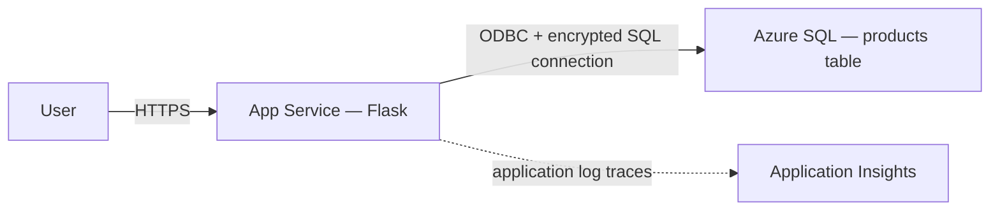

# Flask ו-Azure SQL ב-App Service  

**רמה:** בינוני · **זמן:** 30–60 דקות כולל דרישות מוקדמות  

דוגמה זו מפרסת API לקריאה ב-Python Flask ל-**Linux App Service** ולמסד נתונים בסיסי  
של Azure SQL. כלול קוד מקור, Bicep והגדרות azd. זהו  
יישום למידה, ולא ארכיטקטורת מסד נתונים מוכנה לייצור.  

## מה תלמדו  

- פריסת App Service, SQL ומשאבי ניטור ב-Bicep.  
- הקמת חיבור SQL מוצפן ללא התחייבות של אישורים.  
- איתחול סכימה לפני התחלת עובדי Gunicorn.  
- אימות נתוני זריעה, תגובות לא נמצאו, ובריאות מסד הנתונים.  


  
משאבים: קבוצת משאבים ייעודית, תכנית Linux App Service B1, Web App ב-Python 3.11,  
שרת SQL ומסד נתונים Basic בנפח 2GB, Application Insights ו-Log Analytics.  
ה-Web App משתמש בפריסת מקור/ZIP והתקנת תלות Oryx;  
`azd deploy` אינו בונה או מפרס את קובץ ה-Dockerfile האופציונלי.  

## דרישות מוקדמות  

- גרסת היציבות הנוכחית של [azd](https://learn.microsoft.com/azure/developer/azure-developer-cli/install-azd)
  (גרסה שפורסמה בזמן הביקורת: 1.37.2).
- [Azure CLI](https://learn.microsoft.com/cli/azure/install-azure-cli) לאימות.
- מנוי Azure, הרשאות ליצירת המשאבים הרשומים, ומכסת אזור.
- Python **3.11** לפיתוח מקומי; ה-`pyodbc==5.0.1` המופקד עשוי לדרוש
  כלים לבנייה מקומיים בגרסאות Python חדשות יותר.
- Microsoft ODBC Driver 18 (או 17) עבור SQL Server במכונות מקומיות. `pip install
  pyodbc` אינו מתקין את מנהל ההתקן במערכת. ראה
  [התקנת ODBC](https://learn.microsoft.com/sql/connect/odbc/download-odbc-driver-for-sql-server).
- Docker רק אם בודקים את המכולה האופציונלית באופן מקומי.

```bash
azd version
az version
azd auth login
az login
```

השתמש באותו מנוי בשני הכלים. הפקודות למטה משתמשות ב-Bash.

## פריסה

משורש המאגר:

```bash
cd examples/database-app
azd env new sql-demo
azd provision
azd deploy
WEB_URL=$(azd env get-value WEB_APP_URI)
WEB_NAME=$(azd env get-value WEB_APP_NAME)
RG_NAME=$(azd env get-value AZURE_RESOURCE_GROUP)
```

בחר אזור נתמך. ברירת המחדל של `sqlAdminLogin` היא `sqladmin`; ה-
`sqlAdminPassword` הנדרש הוא פרמטר מאובטח. ספק סיסמה חזקה כאשר מתבקש.
שמור אישורי פריסה מחוץ ל-Git ודוחות ניירת. האינטרפולציה של מחרוזת החיבור הנוכחית
מצפה לסיסמה ללא תווי גבול מחרוזת חיבור כגון
`;`; בצע התאמת בריחה לפני השימוש בערכים כאלה.

Bicep מגדיר פקודת הפעלה שמריצה את `init_database()` **לפני** שהעובדים של Gunicorn
מתחילים. זה נחוץ כי ייבוא `app:app` אינו מבצע את
בלוק `if __name__ == '__main__'` של Python. בבסיס נתונים חדש, ההתחלה
יוצרת `products` ומכניסה חמישה רשומות. זהו דוגמת הגשה פשוטה, לא
מסגרת הגירה בו-זמנית; השתמש בהגירות נכונות לפני הרחבת המקרים.

האפליקציה בוחרת במנהל Microsoft ODBC Driver 18 המותקן, ואחריו 17, אם מחרוזת החיבור
אינה מציינת מפורשות מנהל. אם אף אחד מהם אינו קיים, ההפעלה נכשלת עם
שגיאה ברורה של התקנה. אמת זמינות מנהל ב-App Service runtime שבחרת במקום להניח זאת.


## אימות

```bash
curl --fail-with-body "${WEB_URL}/"
curl --fail-with-body "${WEB_URL}/health"
curl --fail-with-body "${WEB_URL}/products"
curl --fail-with-body "${WEB_URL}/products/1"
curl -i "${WEB_URL}/products/999"
```

צפוי:

- `/` מחזיר מידע על נקודת הקצה.
- `/health` מחזיר 200 עם `{"status":"healthy","database":"connected"}`.
- `/products` מחזיר חמישה מוצרים מיושרים בבסיס נתונים חדש.
- `/products/1` מחזיר Laptop עם מחיר 1299.99.
- מוצר לא קיים מחזיר 404 עם `{"error":"Product not found"}`.

ה-API לקריאה בלבד. אין נתיב POST/PUT/DELETE או ממשק דפדפן.
כישלון חיבור לבסיס נתונים מחזיר 503 מ-`/health`; זה אינו הצלחה.

## קבצים וקונפיגורציה

```text
azure.yaml                         # Python App Service source deployment
infra/main.bicep
infra/main.parameters.json
infra/abbreviations.json
infra/resources/sql-server.bicep
infra/resources/sql-database.bicep
infra/resources/app-service-plan.bicep
infra/resources/web-app.bicep       # Settings + initialization/startup command
infra/resources/app-insights.bicep
src/web/app.py
src/web/requirements.txt
src/web/Dockerfile                 # Optional local container, not the azd target
.env.sample
```

`SQL_CONNECTION_STRING` מועבר כפרמטר מאובטח של Bicep למודול Web App
ונשמר בהגדרות App Service, לא בתוצאות פריסה.
`APPLICATIONINSIGHTS_CONNECTION_STRING` מכוון ייצוא לוגים.
`SCM_DO_BUILD_DURING_DEPLOYMENT=true` מפעיל התקנת תלות בצד השרת.
הגדרת ערכי `azd env` שרירותיים אינה משנה אוטומטית הגדרות אפליקציה.

כלל ה-firewall של SQL `0.0.0.0` מאפשר חיבורים מ-**שירותי Azure,
כולל מנויים של לקוחות אחרים**, בכפוף לאימות SQL. הוא
אינו מוגבל לאפליקציה או מנוי זה. גישת רשת ציבורית ל-SQL מופעלת.
השתמש ברשתות ממוקדות ובזהות אפליקציה שאינה מנהלתית לפני ההפצה.

## פיתוח מקומי

השתמש ב-Python 3.11 ובנהג Microsoft SQL ODBC מותקן:

```bash
python -m venv .venv
source .venv/bin/activate  # PowerShell: .\.venv\Scripts\Activate.ps1
python -m pip install -r src/web/requirements.txt
export SQL_CONNECTION_STRING='Server=tcp:YOUR_SERVER.database.windows.net,1433;Database=YOUR_DATABASE;UID=YOUR_USER;PWD=YOUR_PASSWORD;Encrypt=yes;TrustServerCertificate=no;Connection Timeout=30;'
python src/web/app.py
```

החלף את מקומות האחסון בצורה מאובטחת. קובץ `.env` שהועתק **אינו נטען אוטומטית**
על ידי יישום זה. במקום זאת, ייצא משתנים במעטפת הנוכחית שלך.
עבור Azure SQL ממחשב נייד, אפשר זמנית רק את כתובת ה-IP הציבורית שלך:

```bash
SQL_SERVER=$(azd env get-value SQL_SERVER_NAME)
MY_IP=YOUR_PUBLIC_IP
az sql server firewall-rule create -g "$RG_NAME" -s "$SQL_SERVER" \
  -n AllowMyLearningIP --start-ip-address "$MY_IP" --end-ip-address "$MY_IP"
```

הסר את הכלל לאחר הבדיקה:

```bash
az sql server firewall-rule delete -g "$RG_NAME" -s "$SQL_SERVER" -n AllowMyLearningIP
```

בדיקה אופציונלית במכולה מתיקיית הדוגמה הזו:

```bash
docker build -t sql-flask:local src/web
docker run --rm -p 8000:8000 -e SQL_CONNECTION_STRING sql-flask:local
```

תמונה זו מתקינה את Driver 18 באמצעות מאגר החבילות של Debian 12 התואם ל
בסיס Bookworm שלה, מאתחלת את בסיס הנתונים פעם אחת, ואז מפעילה את Gunicorn.

## ניטור וטיפול בבעיות

הפעל/עקוב אחרי יומני המערכת של מערכת קבצי שירות היישומים בעת אבחון התחלה:

```bash
az webapp log config --name "$WEB_NAME" --resource-group "$RG_NAME" \
  --application-logging filesystem --level information
az webapp log tail --name "$WEB_NAME" --resource-group "$RG_NAME"
```

קוד זה מייצא **עקבות יומן** יישום דרך מטפל OpenCensus מיושן.
הוא אינו מגדיר מעקב אוטומטי של בקשות Flask/תלויות, Live Metrics,
ביקורת SQL, הגדרות אבחון או התרעות. אלה דורשים הגדרה נפרדת.
עבור כלים חדשים, העדף את Azure Monitor OpenTelemetry.

ביומני Application Insights, לאחר ביצוע בקשות API:

```kusto
traces
| where timestamp > ago(1h)
| where message contains "products" or message contains "Health check"
| project timestamp, message, severityLevel
```

אפשר עיכוב בקליטה. פעילות בטבלת הבקשות או ב-Live Metrics אינה תנאי סיום
לאינטרומנטציה זו שמתמקדת ביומנים בלבד.

- **נהג חסר:** בדוק את `pyodbc.drivers()` בזמן הריצה והתקן
  נהג Microsoft ODBC נתמך. חבילת Python לבד אינה מספיקה.
- **כשל חיבור:** בדוק את הגדרות SQL, האישורים, חומת האש, והבחירה
  מנוי. אל תכבה הצפנה כדי לעקוף שגיאה.
- **טבלת מוצרים חסרים:** אשר שפקודת ההפעלה של Bicep הוטמעה;
  הפעלה של `gunicorn app:app` לבד מדלגת על אתחול.
- **כשל בבניית החבילה:** השתמש ב-Python 3.11 או ספק דרישות קדם לבנייה מקומית.
- **נתוני מחיר אפס:** אפס הוא מחיר עשרוני תקין; יש לסדר אותו כסיריאליזציה כ-0.0,
  לא `null`.

## תרגילים מעשיים

### תרגיל 1: אימות התנהגות מוצר חסר

**נקודת התחלה:** API ו-`WEB_URL` המפורסמים לעיל.
**מטרה:** להבדיל בין שורה חסרה לבין מסד נתונים שבור.
בקש `/health` ו-`/products/999` באמצעות הפקודות שלמעלה.
**קריטריוני הצלחה / תשובה:** בריאות 200, מוצר לא קיים 404 (לא 500 או 503).
**בעיה נפוצה:** הנחה שתשובת "לא נמצא" מוכיחה שחיבור SQL שבור.

### תרגיל 2: שינוי ערך מראש

**נקודת התחלה:** עורך שאילתות Azure SQL, מחובר למסד הנתונים המדגים.
**מטרה:** להראות ש-data של ה-API מאוחסן ב-SQL ולא בזיכרון התהליך.

```sql
UPDATE products SET price = 0 WHERE id = 1;
SELECT id, name, price FROM products WHERE id = 1;
```

בקש `${WEB_URL}/products/1`. **קריטריון הצלחה:** המחיר הוא `0.0`, לא `null`.
שחזר את הערך:

```sql
UPDATE products SET price = 1299.99 WHERE id = 1;
```

**בעיה נפוצה:** עריכת רשימת האילוצים של Python לא מעדכנת שורות שכבר נמצאות ב-SQL.
אל תריץ תרגילי סכימה/נתונים מול מסד נתונים בייצור.

### תרגיל 3: הוספת נקודת קצה קריאה בלבד לספירה

**נקודת התחלה:** `src/web/app.py`.
**מטרה:** להרחיב את ה-API באמצעות שאילתת סיכום ללא פרמטרים.
הוסף זאת לפני בלוק `if __name__ == '__main__':`:

```python
@app.route('/product-count')
def product_count():
    from contextlib import closing
    with closing(get_db_connection()) as conn, closing(conn.cursor()) as cursor:
        cursor.execute("SELECT COUNT(*) FROM products")
        return jsonify({'count': cursor.fetchone()[0]})
```

הרץ `azd deploy web`, ואז בקש `${WEB_URL}/product-count`.
**קריטריוני הצלחה:** 200 עם `{"count":5}` על מסד הנתונים הזרוע שלא השתנה.
**בעיה נפוצה:** שינוי הנתיב ושכחת לפרוס מחדש.
עבור ייצור, הוסף טיפול בשגיאות/בדיקות; התרגיל הקצר הזה מתמקד בשאילתה.

## עלויות, פערי ייצור וניקוי

שירות אפליקציות B1 ומסד הנתונים הבסיסי מחויבים כל עוד הם מוקצים. עצירת
יישום אינטרנט לא עוצרת את חיוב תכנית שירות האפליקציות. יומנים ואחסון יכולים להוסיף עלויות.
השתמש במחשבון התמחור של [Azure pricing calculator](https://azure.microsoft.com/pricing/calculator/)
עבור המחירים האזוריים הנוכחיים. מעבר ל-F1 מצריך גם השבתת `alwaysOn`;
זה לא תחליף חד-שורה מיידי. SQL serverless אינו חינמי אוטומטית.

עבודות ייצור כוללות זהות אפליקציה עם הרשאות מינימליות (לא מנהל SQL),
אימות/הרשאה, רשת פרטית, הגירות בטוחות, סקירת מחזור חיים/בריכות חיבור,
טלמטריה, ביקורת, התראות, בדיקות ונהלי התאוששות.
מטמון Redis וטבלאות נוספות הם רעיונות לפיתוח, לא תרגילים מיושמים.

מספריית הדוגמה הזו:

```bash
azd down
```

בדוק את הבקשה למחיקה ותוודא שקבוצת המשאבים הייעודית נמחקת.
אל תמחק קבוצות הכוללות נתונים לא קשורים.

[דוגמאות מכולות](../../../../examples/container-app) ·
[פיתוח AI](../../docs/chapter-02-ai-development/README.md) ·
[דף הקורס](../../README.md) · [דווח על בעיה](https://github.com/microsoft/AZD-for-beginners/issues)

---

<!-- CO-OP TRANSLATOR DISCLAIMER START -->
**כתב ויתור**:
מסמך זה תורגם באמצעות שירות תרגום אוטומטי [Co-op Translator](https://github.com/Azure/co-op-translator). למרות שאנו שואפים לדיוק, יש לקחת בחשבון שתרגומים אוטומטיים עלולים להכיל שגיאות או אי-דיוקים. יש להחשיב את המסמך המקורי בשפתו הטבעית כמקור הסמכות. למידע קריטי מומלץ להשתמש בתרגום מקצועי על ידי מתרגם אדם. אנו לא אחראים לכל אי-הבנה או פירוש שגוי הנובע מהשימוש בתרגום זה.
<!-- CO-OP TRANSLATOR DISCLAIMER END -->