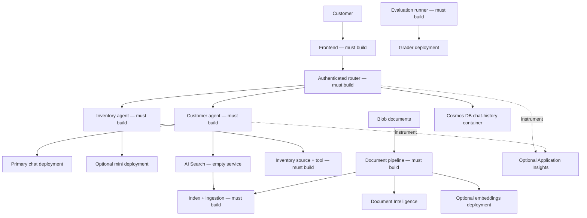

# תמיכה רב-סוכנית בלקוחות — תכנית ארכיטקטורת קמעונאות

**פרק 5: פתרונות בינה מלאכותית רב-סוכניים**

- [עמוד הבית של הקורס](../README.md)
- [פרק 5](../docs/chapter-05-multi-agent/README.md)
- [דרישה מוקדמת: אינטגרציית בינה מלאכותית](../docs/chapter-02-ai-development/microsoft-foundry-integration.md)
- [הבא: תכנון קיבולת](../docs/chapter-06-pre-deployment/capacity-planning.md)
- [שלד תשתית ARM](retail-multiagent-arm-template/README.md)

> **מדריך ארכיטקטורה, לא יישום עובד.** קבצי היישום היחידים בתחום הקמעונאות
> הם `azuredeploy.json`, `azuredeploy.parameters.json`, ו-`deploy.sh` בתוך
> `retail-multiagent-arm-template/`. מכלי הנתב/ממשק המשתמש הם מקום האחזקה hello-world.
> לא קיימים סוכן קמעונאות, ממשק משתמש, צינור הזנה, מעריך, סורק או
> מערכת בדיקות ליישום בסביבה המקומית.

## סקירה כללית

**מטרה:** לתכנן מערכת תמיכה בלקוחות הכוללת סוכן לקוחות וסוכן מלאי,
לזהות מה התשתית מספקת, ולתכנן את חוזי היישום החסרים ואימותם.


**קהל יעד:** מפתחים שסיימו את ההתקנה המקומית
[דוגמת צ'אט](../../../examples/azure-openai-chat) ו-[דוגמת מכולה עם שני שירותים](../../../examples/container-app/microservices).
אפשרו 2–3 שעות ללימוד ארכיטקטוני. בניית היישום היא פרויקט נפרד:
ההערכה לתכנון ממחישה 80–120 שעות פיתוח למפתחים מנוסים,
**ולא הבטחה למסירה**; יישור קו הייצור, בדיקות, סקירת אבטחה
ותפעול דורשים עבודה נוספת.

### תוצאות למידה

- הסבר על ניתוב, עיגון, הרשאות כלים ובעלות שיחה.
- הבחנה בין מזהי מודלים, שמות פריסה, גרסאות API וגרסאות ARM.
- תכנון קליטת מסמכים ושליפתם עם מימדי וקטור תואמים.
- הגדרת דרישות פונקציונליות, הערכה והתאוששות מכשל שניתנות לאימות.
- הפרדת מטרות ארכיטקטוניות אופציונליות מהמשאבים שהוקצו באמת.

## ארכיטקטורת הפתרון



זוהי **ארכיטקטורת יישום יעד**, לא דיאגרמת שירותי סוכן שפועלים.
שלדת ARM יוצרת רק את השירותים התחתוניים ושתי מכולות מייצגות בלבד.
Front Door, רישום, זהויות מנוהלות, הקצאות תפקידים,
נקודות קצה פרטיות, failover, אינסטרומנטציה של היישום והתראות אינם כלולים.

### תחומי אחריות וחוזים

| רכיב | התנהגות נדרשת | ראיות לפני סיום |
|---|---|---|
| Frontend | לאמת משתמשים, להציג צ'אט, להעלות מסמכים בבטחה | בדיקות UI והעלאה, שגיאות נגישות |
| Router | לאשר בקשות, לבחור סוכן, מגבלות קריאות כלים/זמנים | בדיקות ניתוב, בדיקות הרשאה, בדיקות כישלון |
| סוכן לקוח | לעגן מדיניות/תשובות מוצר במקורות מאושרים | הפניות נכונות, הימנעות כשאין נתונים |
| כלי מלאי | לקרוא מלאי מוסמך עם הרשאות ממוקדות | בדיקות מלאי דטרמיניסטיות; ללא המצאות זמינות |
| צינור מסמכים | לשלוף, לחתוך, להטמיע, לאנדקס, לעדכן/למחוק | מתאמים ממאגרי נתונים והתנהגות retry/dead-letter |
| אחסון שיחה | לבודד משתמשים, לאכוף שמירת נתונים | בדיקות הרשאה בין משתמשים ו-TTL |
| מפעיל הערכה | להשוות תפוקות לאמת ולטבלת ניקוד | כיסוי, ספירת כישלונות, דו"חות ניתן לשחזור |

ראו את ה-router כדלפק קבלה ואת הכלים כמערכות פנימיות מוגבלות:
בחירת מומחה אינה הרשאה לגישה לכל הרשומות של הלקוח.
אכפו זהות והרשאות בקוד היישום ובשירותי נתונים, לא בהנחיות.

## תשתית מול יישום

קראו את [קובץ README של השלד](retail-multiagent-arm-template/README.md) לפני
הפריסה. הוא מפרט משאבים מדויקים, מצבים, עלויות ומגבלות.

| שימוש לוגי | שם פריסת ARM | דגם / גרסה | אזור ברירת מחדל |
|---|---|---|---|
| שיחת לקוח | `gpt-4.1-chat` | `gpt-4.1` / `2025-04-14` | `eastus2` |
| מלאי | `gpt-4.1-mini-inventory` | `gpt-4.1-mini` / `2025-04-14` | `westus2`, אופציונלי |
| אמבדינגים | `text-embedding-ada-002` | `text-embedding-ada-002` / `2` | `francecentral`, אופציונלי |
| הערכה | `gpt-4.1-grader` | `gpt-4.1` / `2025-04-14` | אזור ראשי כברירת מחדל |

בדקו זמינות ומכסת דגם/גרסה/SKU ב**כל אזור**. שימוש בצ'אט/מיני/מדרג
משתמש ב-`GlobalStandard`; אמבדינגים משתמשים ב-`Standard`. ממפות יחידות קיבולת ל-TPM
הם ספציפיות לדגם. אל תוסיפו יחידות קיבולת שונות כמכסת אחריות אוניברסלית.

ארגומנט `model` בבקשת Azure OpenAI הוא **שם הפריסה**, לא בהכרח
מזהה מודל הקטלוג. גרסת ה-API של מישור הנתונים `2024-10-21`
שונה מגרסת המודל `2025-04-14` ומשאב ARM `apiVersion`.
לא ניתן לתקן מודל שאינו זמין על ידי שינוי גרסת מישור הנתונים בלבד.

`--no-multi-region` מדלג על חשבונות משניים וחשבון אנבדים. נשאר חשבון שיחה ראשי
וחשבון בוחן עצמאי. חשבונות מודל נפרדים אינם מספקים כשל אוטומטי;
זה דורש ניתוב יישומים, פריסות תואמות, בדיקות בריאות, הגבלות ניסיונות,
וסקירת מיקום הנתונים.

## מפת דרכים ליישום

### 1. התחל באינטראקציה אחת שנבדקה

לפני הפריסה של השלד הגדול, השתמש בדוגמת השיחה המקומית כדי לקבוע
את הקישוריות לאינפרנס. הגדר שאלה מייצגת אחת של לקוח, מקור התשובה המאושר,
הציטוט הצפוי, והתנהגות נכשל כאשר מקור זה חסר.

### 2. הגדר גבולות ניתוב וכלים

צור מקור ניתוב משלך, רשימת תלות, Dockerfile ומבחנים. חוזה מדגים יכול להיות
`POST /chat` עם `{"message":"...","conversation_id":"..."}`.
**נקודת הקצה הזו היא הצעת תכנון; היא לא מיושמת על ידי תבנית ARM.**

אמת סוגים/מגבלות גוף, הפק זהות משתמש מאימות, אכוף בעלות שיחה,
החל מגבלת זמן לבקשות, והחזר קודי שגיאה משמעותיים.
אל תטפל בכשלי HTTP או בתגובות ריקות כתוצאות סוכנות מוצלחות.

### 3. יישם עיגון וטעינה

תבנית ARM אינה יוצרת אינדקס חיפוש. זהו **קטע JSON להנחיה להתאמה בהגדרת האינדקס שלך**, 
לא קובץ שכבר במאגר:

```json
{
  "name": "retail-product-index",
  "fields": [
    {"name": "id", "type": "Edm.String", "key": true},
    {"name": "title", "type": "Edm.String", "searchable": true},
    {"name": "content", "type": "Edm.String", "searchable": true},
    {"name": "category", "type": "Edm.String", "filterable": true},
    {
      "name": "content_vector",
      "type": "Collection(Edm.Single)",
      "searchable": true,
      "dimensions": 1536,
      "vectorSearchProfile": "retail-profile"
    }
  ],
  "vectorSearch": {
    "algorithms": [{"name": "retail-hnsw", "kind": "hnsw"}],
    "profiles": [{"name": "retail-profile", "algorithm": "retail-hnsw"}]
  }
}
```

הפרופיל מקשר את שדה הווקטור לאלגוריתם שלו. המידות חייבות להתאים
לפלט האמבידינג בפועל (1536 עבור פריסת `ada-002` זו). עבור שליפת פייתון,
השתמש ב-`azure.search.documents.models.VectorizedQuery` במקום מילון חלקי
שחסר את סוג שאילתת הווקטור שלו:

```python
# Reference function only: supply an authenticated async SearchClient and an embedding.
from azure.search.documents.models import VectorizedQuery

async def retrieve(search_client, embedding):
    results = await search_client.search(
        search_text=None,
        vector_queries=[VectorizedQuery(
            vector=embedding,
            k_nearest_neighbors=5,
            fields="content_vector"
        )],
        select=["id", "title", "content"]
    )
    return [document async for document in results]
```

צור יישום טעינה נפרד ש:

1. מאשר גישה להעלאה ומאמת סוג ותכולת גודל.
2. קורא בלובים פרטיים באמצעות קריאות SDK מאומתות. URL של בלוב פרטי בפני עצמו
   **אינו** קלט קריא ל-Document Intelligence; שלח את הבייטים שהורדו עם
   `AnalyzeDocumentRequest(bytes_source=...)` או השתמש ב-SAS קצר טווח עם תחום מתאים
   לאחר סקירת דרישות גישה.
3. מחלץ טקסט, מפצל אותו בהתאם למגבלות אמבידינג, ומייצר אמבידינגים.
4. יוצר מפתחות מסמכים יציבים ובטוחים ומעלה חלקים עם וקטורים תואמים.
5. בודק תוצאות אינדוקס לכל מסמך, מטפל בניסיונות חוזרים, ומעדכן/מוחק נתונים מיושנים.

אל תשלב מפתחות/ערכי משתמש שרירותיים בפילטרים של OData. אפשר רק שדות ברשימה לבנה,
אמת סוגי ערכים, וברח מרכאות מחרוזות. פילטרים בוליאניים ונומריים צריכים
להיות מילים מסוג שאינן מחרוזות ממוסגרות.

### 4. עיגון רשת

**Bing Search v7 פורש ב-11 באוגוסט 2025.** המשאב הישן `Microsoft.Bing/accounts`
והדוגמאות `api.bing.microsoft.com/v7.0/search` אינם נתיב יישום נתמך.
הערך אינטגרציה לעיגון נתמכת כעת ב-Microsoft Foundry ו-SDK שלה, הרשאות,
חיובים ודרישות ציטוט; אף אחד מהם לא מיושם כאן. זה אינו תחליף מיידי לנקודת קצה שפורשה.


### 5. הוסף טלאמטריה והערכה

יצירת Application Insights אינה מתיזמת קוד. השתמש ב-OpenTelemetry הנתמך של Azure Monitor בעת בניית יישום חדש, הפץ מעקב
אינסטרומנטציה של OpenTelemetry בעת בניית יישום חדש, הפצת מעקב
הקשר בין שירותים, והימנעות מלוג אירועים של בקשות לקוח, מסמכים או סודות.
קיצוץ שאילתה **אינו** מאנונן אותה.

מדוד משך בקשה, כשלי ניתוב/כלים, רלוונטיות של אחזור, נכונות ציטוט,
שימוש בטוקנים, והימנעות. אחסן עובדות מדיניות/מלאי אמיתיות
לצד מקרים להערכה: מעריך אינו יכול לקבוע מהימנות עובדתית
רק משאלה ותשובה.

פריסת מעריך אינה מפעיל הערכה. יישם סקלת ציון עם גרסאות,
פלט מובנה/אימות סכימה, בדיקות טווח ניקוד, ספירת כשלי תקשורת,
ומקרים שבחנו אנשים. דווח על מקרים לא שלמים/עם שגיאות בנפרד; אל תמיר
אותם לציוני הצלחה או כלול אותם בשקט כתגובות דגם באיכות אפס.

באותה מידה, מספר בדיקות מילות מפתח אינן תעודת אבטחה. בקשת HTTP שנכשלה,
אסטרטגיית בדיקה חסרה, או תגובה ריקה חייבים להפוך את המבחן **ללא מסקנה או
כושל**, לא להניב ניקוד "100% מאובטח". בצע בדיקות מורשות עם
כלי מתאים וביקורת אנושית לפני כל טענה על מוכנות לייצור.

### 6. פרוס את היישום שלך

צור תיקיות מקור, מניפסטים, בדיקות, רישום, והרשאות משיכת תמונות משלך.
החלף תווים ממלאים בתמונות שנבנו ועדכן ingress/probes כדי להתאים
כל יציאת האזנה של היישום. הגדר משתני סביבה בעת ריצה בביספ
או במיפוי מפורש נתמך של סביבת azd.

אין מילון כללי של `config` תחת שירות azd שיוצר אוטומטית
משתני סביבה בעת ריצה. `azd env set` משנה רק משאבים
הצורכים במפורש ערכים אלו. אין יישום של קנרית, רשימת אזורים, או וו כוונון
בסקאפלד זה.

## תרגול עיצוב מעשי

אלו **תרגילי ארכיטקטורה**, לא טענות לקוד התחלה סחיר להפעלה.

### תרגיל 1: אימות הקצה

**נקודת התחלה:** שלושת הקבצים ב-`retail-multiagent-arm-template/`.
**מטרה:** להבחין בין הפרוביזנינג לפונקציונליות היישום.
פתח את `azuredeploy.json`, אתר תמונות מכולה וערכי `targetPort`,
ואז פרט את רכיבי היישום החסרים מהמאגרים.

**קריטריוני הצלחה / תשובה:** שתי התמונות הן תווי מילוי hello-world המאזינים
על יציאה 80; סוכנים, ממשק שיחה, מטפלי ניתוב, אינדקס/קליטה, מעריך וסורק
חסרים. בקשת שורש תווי מילוי מוצלחת לא מאמתת את `/chat`.
**בעיית נפוצה:** פירוש שמות משאבים כמו `retail-router` כקוד עובד.

### תרגיל 2: ניתוח תצורת הווקטור

**נקודת התחלה:** אינדקס JSON לעיל.
**מטרה:** הבנת הקשר שדה → פרופיל → אלגוריתם.
זהה אילו ערכים חייבים להשתנות בעת החלפה לדגם הטמעה עם
מימד פלט שונה, ואז בחן את פונקציית `retrieve`.

**קריטריוני הצלחה / תשובה:** שנה את שדה `dimensions` לאורך וקטור אמיתי;
שמור את `vectorSearchProfile` מיושר עם פרופיל והאלגוריתם שהוכרזו;
שאילתא `fields` חייבת לציין את שדה הווקטור. צור מחדש וקטורים למסמכים קיימים
כשדגם ההטמעה משתנה.
**בעיית נפוצה:** שינוי רק שם הדגם תוך שמירה על וקטורים לא תואמים.

### תרגיל 3: הגדר מבחן כשל

**נקודת התחלה:** טבלת אחריות.
**מטרה:** למנוע הצלחה שגויה.
כתוב התנהגות צפויה עבור API מלאי לא זמין, אינדקס חיפוש ללא
מסמכים תואמים, ובקשת הערכה שמחזירה HTTP 503.

**קריטריוני הצלחה / תשובה:** ללא ערכי מלאי מומצאים; הימנעות מפורשת או
הסלמה כאשר ההקשר חסר; הדיווח על הערכה הוא על כישלון תעבורה ולא על מעבר איכות או אבטחה.
הוסף בדיקות הניתנות להרצה כאשר אתה בונה את היישום.
**בעיה נפוצה:** לתפוס כל חריגה ולהמשיך עם תשובה ריקה.

## עלויות, פתרון בעיות וניקוי

- לתשתית יש חיובים שוטפים גם עם אינדקסי חיפוש ריקים ויישומי מימוש.
  השתמש במחירים אזוריים נוכחיים; לא "מינימלי" ולא רב-אזורי מרמזים על חינם.
- עלויות הטוקנים תלויות במודל, קלט מטמון/ללא מטמון, פלט ו-SKU של פריסה.
  ניתוב יכול לחסוך כסף רק אם העומס הנמדד ותוצאות האיכות מצדיקים זאת;
  חסכון קבוע של 60–80% אינו מובטח.
- בדוק זמינות ומכסה של המודל לפני הפריסה; הבדל בין הרשאות,
  שם פריסה, אזור, גרסת מודל וגרסת API.
- אל תפעיל `setup-data.sh` חסרים, כלי שורת הפקודה של מעריך, או פקודות `pytest tests/`.
  היישומים שלהם הינם חלק מרשימת הפיתוח שלך.
- השלד הוא רק ל-ARM: עקוב אחרי
  [הוראות אימות וניקוי](retail-multiagent-arm-template/README.md).
  `azd down` אינו מנהל את המשאבים הללו.

## משאבים קשורים

- [דוגמת צ'אט מקומית עובדת](../../../examples/azure-openai-chat)
- [דוגמת מכולת שני שירותים עובדת](../../../examples/container-app/microservices)
- [אינדקסי וקטור לחיפוש AI](https://learn.microsoft.com/azure/search/vector-search-how-to-create-index)
- [תיעוד יישומי מכולות](https://learn.microsoft.com/azure/container-apps/)
- [פתרון בעיות](../docs/chapter-07-troubleshooting/common-issues.md)
- [דווח על בעיה](https://github.com/microsoft/AZD-for-beginners/issues)

---

<!-- CO-OP TRANSLATOR DISCLAIMER START -->
**כתב ויתור**:
מסמך זה תורגם באמצעות שירות תרגום אוטומטי [Co-op Translator](https://github.com/Azure/co-op-translator). למרות שאנו שואפים לדיוק, יש לקחת בחשבון שתרגומים אוטומטיים עלולים להכיל שגיאות או אי-דיוקים. יש להחשיב את המסמך המקורי בשפתו הטבעית כמקור הסמכות. למידע קריטי מומלץ להשתמש בתרגום מקצועי על ידי מתרגם אדם. אנו לא אחראים לכל אי-הבנה או פירוש שגוי הנובע מהשימוש בתרגום זה.
<!-- CO-OP TRANSLATOR DISCLAIMER END -->