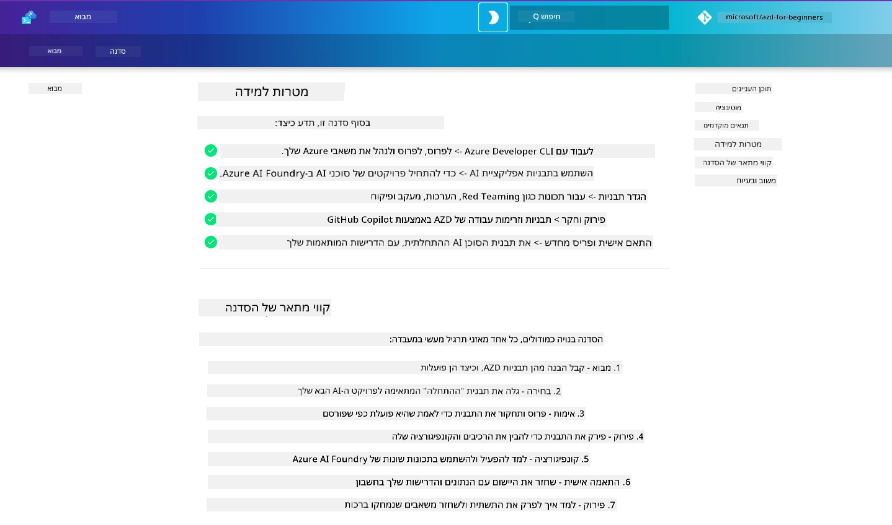

<div align="center">
  <div style="background: linear-gradient(135deg, #0078d4, #106ebe); border-radius: 10px; padding: 20px; margin: 20px 0; box-shadow: 0 4px 15px rgba(0, 120, 212, 0.3); border: 2px solid #005a9e;">
    <h2 style="color: white; margin: 0; font-size: 24px; text-shadow: 1px 1px 2px rgba(0,0,0,0.3);">
      🎯 סדנת AZD למפתחי בינה מלאכותית
    </h2>
    <p style="color: white; margin: 10px 0 0 0; font-size: 16px; text-shadow: 1px 1px 2px rgba(0,0,0,0.3);">
      <strong>סדנה מעשית לבניית יישומי בינה מלאכותית עם Azure Developer CLI.</strong><br>
      סיימו 7 מודולים כדי לשלוט בתבניות AZD ובזרימות עבודה לפריסת AI.
    </p>
    <div style="margin-top: 15px;">
      <span style="background: rgba(255,255,255,0.2); padding: 5px 10px; border-radius: 15px; color: white; font-size: 14px;">
        📅 הנחיית מקור שנבדקה: נובמבר 2026
      </span>
    </div>
  </div>
</div>

# סדנת AZD למפתחי בינה מלאכותית

ברוכים הבאים לסדנה המעשית ללימוד Azure Developer CLI (AZD) עם דגש על פריסת יישומי בינה מלאכותית. סדנה זו תסייע לכם להשיג הבנה מעשית של תבניות AZD בשלושה שלבים:

1. **גילוי** - מצא את התבנית שמתאימה לך.
1. **פריסה** - פרוס ואמת שזה עובד
1. **התאמה אישית** - שנה ופתח כדי להפוך את זה לשייך לך!

במהלך הסדנה גם תכירו כלים וזרימות עבודה בסיסיות למפתחים, שיעזרו לכם לייעל את מסע הפיתוח מקצה לקצה.

<br/>

## מדריך מבוסס דפדפן

שיעורי הסדנה נמצאים במרק\דאון. ניתן לנווט בהם ישירות ב-GitHub - או להפעיל תצוגה מקדימה מבוססת דפדפן כפי שמוצג בצילום המסך למטה.



כדי להשתמש באפשרות זו - עצב את המאגר לפרופיל שלך, והפעל GitHub Codespaces. לאחר שטרמינל VS Code פעיל, הקלד את הפקודה הבאה:

תצוגה מקדימה זו בדפדפן עובדת ב-GitHub Codespaces, מכולות פיתוח (dev containers) או העתקה מקומית עם Python ו-MkDocs מותקנים.

```bash title="" linenums="0"
python -m pip install -r requirements-dev.txt
python -m mkdocs serve --config-file workshop/mkdocs.yml
```

הרץ פקודות אלו מ**שורש מאגר הקורס**, לא מהדוגמה AI שהופעלה בנפרד. שמור על התצוגה מקדימה ברקע כדי שהשגיאות יישארו נראות; עצור אותה עם Ctrl+C. כדי לבדוק את האתר בלי להפעיל שרת, הרץ `python -m mkdocs build --strict --config-file workshop/mkdocs.yml`.

תוך מספר שניות תראה תיבת דו-שיח קופצת. בחר באפשרות `Open in browser`. המדריך מבוסס הדפדפן ייפתח בכרטיסייה חדשה. כמה יתרונות של תצוגה מקדימה זו:

1. **חיפוש מובנה** - מצא מילות מפתח או שיעורים במהירות.
1. **אייקון העתקה** - העבר את העכבר מעל בלוקים של קוד כדי לראות אופציה זו
1. **החלפת נושא** - החלף בין נושאים כהים ובהירים
1. **קבל עזרה** - לחץ על אייקון Discord בכותרת התחתונה כדי להצטרף!

<br/>

## מבט כולל על הסדנה

**משך:** 3-4 שעות  
**רמה:** מתחילים עד בינוניים  
**דרישות מוקדמות:** היכרות עם Azure, מושגי AI, VS Code וכלי שורת פקודה.

זוהי סדנה מעשית שבה לומדים בעשייה. לאחר שתסיים את התרגילים, מומלץ לעבור על תכנית הלימודים AZD למתחילים כדי להמשיך את מסע הלמידה שלך לפרקטיקות אבטחה ופרודוקטיביות.

| זמן| מודול  | מטרה |
|:---|:---|:---|
| 15 דקות | [מבוא](docs/instructions/0-Introduction.md) | קביעת ההקשר, הבנת המטרות |
| 30 דקות | [בחר תבנית AI](docs/instructions/1-Select-AI-Template.md) | בחן אפשרויות ובחר התחלה | 
| 30 דקות | [אמת תבנית AI](docs/instructions/2-Validate-AI-Template.md) | פרוס פתרון ברירת מחדל ל-Azure |
| 30 דקות | [פרק תבנית AI](docs/instructions/3-Deconstruct-AI-Template.md) | חקור מבנה ותצורה |
| 30 דקות | [הגדר תבנית AI](docs/instructions/4-Configure-AI-Template.md) | הפעל ונסה תכונות זמינות |
| 30 דקות | [התאם אישית תבנית AI](docs/instructions/5-Customize-AI-Template.md) | הפוך את התבנית לצרכים שלך |
| 30 דקות | [פירוק תשתית](docs/instructions/6-Teardown-Infrastructure.md) | נקה ושחרר משאבים |
| 15 דקות | [סיום ושלבים הבאים](docs/instructions/7-Wrap-up.md) | משאבי למידה, אתגר הסדנה |

<br/>

## מה תלמדו

חשוב על תבנית AZD כסביבת לימוד לחקור יכולות שונות וכלים לפיתוח מקצה לקצה על Microsoft Foundry. בסיום הסדנה, אמורה להיות לך תחושה אינטואיטיבית לגבי כלים ומושגים בהקשר זה.

| מושג  | מטרה |
|:---|:---|
| **Azure Developer CLI** | הבנת פקודות הכלי וזרימות עבודה |
| **תבניות AZD**| הבנת מבנה ותצורת הפרויקט |
| **סוכן Azure AI**| פריסה והפעלת פרויקט Microsoft Foundry  |
| **Azure AI Search**| הפעלת הנדסת הקשר עם סוכנים |
| **תצפית**| חקור מעקב, ניטור והערכות |
| **בדיקות אדברסאריות (Red Teaming)**| חקור בדיקות נגדיות ופתרונות |

<br/>

## מבנה הסדנה

הסדנה בנויה לקחת אתכם במסע מגילוי תבניות, דרך פריסה, פירוק והתאמה אישית - תוך שימוש בתבנית הפתיחה הרישמית [Getting Started with AI Agents](https://github.com/Azure-Samples/get-started-with-ai-agents).

### [מודול 1: בחר תבנית AI](docs/instructions/1-Select-AI-Template.md) (30 דקות)

- מהן תבניות AI?
- היכן ניתן למצוא תבניות AI?
- איך ניתן להתחיל לבנות סוכני AI?
- **מעבדה**: התחלה מהירה ב-Codespaces או במכולת פיתוח

### [מודול 2: אמת תבנית AI](docs/instructions/2-Validate-AI-Template.md) (30 דקות)

- מהי אדריכלות תבנית ה-AI?
- מהי זרימת העבודה של פיתוח AZD?
- איך ניתן לקבל עזרה בפיתוח ב-AZD?
- **מעבדה**: פרוס ואמת תבנית סוכני AI

### [מודול 3: פרק תבנית AI](docs/instructions/3-Deconstruct-AI-Template.md) (30 דקות)

- חקור את הסביבה שלך ב`.azure/` 
- חקור את הגדרות המשאבים שלך ב`infra/` 
- חקור את תצורת AZD שלך ב`azure.yaml`s
- **מעבדה**: שנה משתני סביבה ופרוס מחדש

### [מודול 4: הגדר תבנית AI](docs/instructions/4-Configure-AI-Template.md) (30 דקות)
- חקור: יצירת תחזוק מבוסס שליפה
- חקור: הערכה של סוכן ובדיקות אדברסאריות
- חקור: מעקב וניטור
- **מעבדה**: חקור סוכן AI + תצפית

### [מודול 5: התאם אישית תבנית AI](docs/instructions/5-Customize-AI-Template.md) (30 דקות)
- הגדר: PRD עם דרישות תרחיש
- הגדר: משתני סביבה ל-AZD
- מימוש: Lifecycle Hooks למשימות נוספות
- **מעבדה**: התאם אישית תבנית לתרחיש שלי

### [מודול 6: פירוק תשתית](docs/instructions/6-Teardown-Infrastructure.md) (30 דקות)
- סיכום: מהן תבניות AZD?
- סיכום: למה להשתמש ב-Azure Developer CLI?
- שלבים הבאים: נסה תבנית אחרת!
- **מעבדה**: הפסקת תשתית וניקוי

<br/>

## אתגר הסדנה

רוצה לאתגר את עצמך לעשות יותר? הנה כמה הצעות לפרויקטים - או שתשתף אותנו ברעיונות שלך!

| פרויקט | תיאור |
|:---|:---|
|1. **פירוק תבנית AI מורכבת** | השתמש בזרימת העבודה והכלים שתיארנו ונסה לפרוס, לאמת ולהתאים אישית תבנית פתרון AI שונה. _מה למדת?_|
|2. **התאם אישית לתרחיש שלך**  | נסה לכתוב PRD (מסמך דרישות מוצר) לתרחיש שונה. לאחר מכן השתמש ב-GitHub Copilot במאגר התבנית שלך במודל סוכן - ובקש לייצר זרימת עבודה להתאמה אישית עבורך. _מה למדת? איך תוכל לשפר את ההצעות האלה?_|
| | |

## יש לך משוב?

1. פתח issue במאגר הזה - תתייג אותו `Workshop` לנוחות.
1. הצטרף ל-Discord של Microsoft Foundry - התקשר עם עמיתים!


| | | 
|:---|:---|
| **📚 דף הבית של הקורס**| [AZD למתחילים](../README.md)|
| **📖 תיעוד** | [התחל עם תבניות AI](https://learn.microsoft.com/en-us/azure/ai-foundry/how-to/develop/ai-template-get-started)|
| **🛠️תבניות AI** | [תבניות Microsoft Foundry](https://ai.azure.com/templates) |
|**🚀 שלבים הבאים** | [התחל סדנה](#workshop-overview) |
| | |

<br/>

---

**ניווט:** [הקורס הראשי](../README.md) | [מבוא](docs/instructions/0-Introduction.md) | [מודול 1: בחר תבנית](docs/instructions/1-Select-AI-Template.md)

**מוכן להתחיל לבנות יישומי בינה מלאכותית עם AZD?**

[התחל סדנה: מבוא →](docs/instructions/0-Introduction.md)

---

<!-- CO-OP TRANSLATOR DISCLAIMER START -->
**כתב ויתור**:
מסמך זה תורגם באמצעות שירות תרגום אוטומטי [Co-op Translator](https://github.com/Azure/co-op-translator). למרות שאנו שואפים לדיוק, יש לקחת בחשבון שתרגומים אוטומטיים עלולים להכיל שגיאות או אי-דיוקים. יש להחשיב את המסמך המקורי בשפתו הטבעית כמקור הסמכות. למידע קריטי מומלץ להשתמש בתרגום מקצועי על ידי מתרגם אדם. אנו לא אחראים לכל אי-הבנה או פירוש שגוי הנובע מהשימוש בתרגום זה.
<!-- CO-OP TRANSLATOR DISCLAIMER END -->