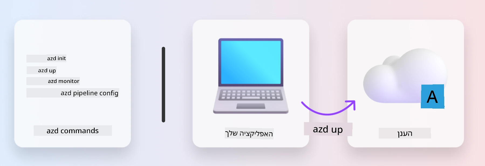
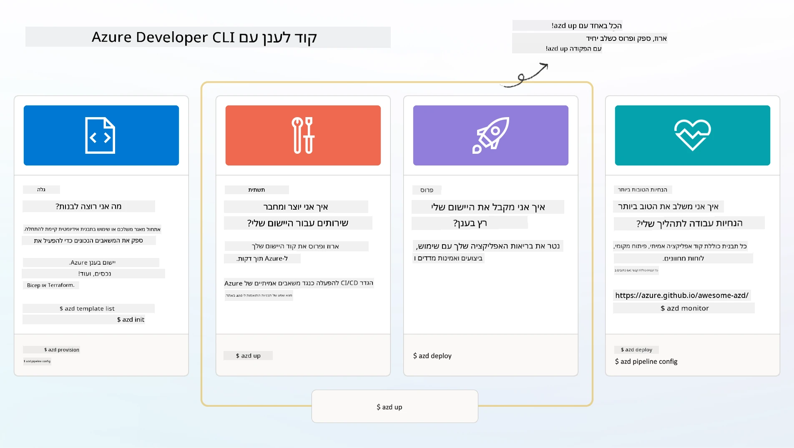

# 1. בחר תבנית

!!! tip "בסיום המודול הזה תוכל/י"

    - [ ] Describe what AZD templates are
    - [ ] Discover and use AZD templates for AI
    - [ ] Get started with the AI Agents template
    - [ ] **Lab 1:** AZD Quickstart in Codespaces or a dev container

---

## 1. אנלוגיה לבונה

בניית אפליקציית AI מודרנית ומוכנה לארגון _מאפס_ יכולה להיות מאתגרת. זה קצת כמו לבנות את ביתך החדש בעצמך, לבנה אחר לבנה. כן, אפשר לעשות זאת! אבל זו לא הדרך היעילה ביותר להשיג את התוצאה הרצויה!

במקום זאת, לרוב נתחיל עם _תכנית עיצוב_ קיימת, ונעבוד עם אדריכל כדי להתאים אותה לדרישות האישיות שלנו. וזה בדיוק הגישה שיש לנקוט בבניית אפליקציות חכמות. קודם כל, מצא ארכיטקטורת עיצוב טובה שמתאימה לתחום הבעיה שלך. ואז עבוד עם אדריכל פתרונות כדי להתאים ולפתח את הפתרון לתרחיש הספציפי שלך.

אבל איפה אפשר למצוא את תכניות העיצוב האלה? ואיך מוצאים אדריכל שמוכן ללמד אותנו איך להתאים ולפרוס את התכניות האלו בעצמנו? בסדנה זו, אנו עונים על שאלות אלה על ידי הצגת שלוש טכנולוגיות:

1. [Azure Developer CLI](https://aka.ms/azd) - כלי קוד פתוח המזרז את נתיב המפתח מהפיתוח המקומי (build) לפריסת ענן (ship).
1. [Microsoft Foundry Templates](https://ai.azure.com/templates) - מאגרי קוד סטנדרטיים בקוד פתוח הכוללים דוגמות קוד, קבצי תשתית וקונפיגורציה לפריסת ארכיטקטורת פתרון AI.
1. [GitHub Copilot Agent Mode](https://code.visualstudio.com/docs/copilot/chat/chat-agent-mode) - סוכן קוד המבוסס על ידע של Azure, שיכול להנחות אותנו בניווט בקוד וביצוע שינויים - באמצעות שפה טבעית.

עם הכלים האלה בידינו, נוכל כעת _לגלות_ את התבנית הנכונה, _לפרוס_ אותה כדי לוודא שהיא פועלת, ו-_להתאים_ אותה לצרכים הספציפיים שלנו. בואו נצלול ונלמד איך זה עובד.


---

## 2. Azure Developer CLI

ה-[Azure Developer CLI](https://learn.microsoft.com/en-us/azure/developer/azure-developer-cli/) (או `azd`) הוא כלי שורת פקודה בקוד פתוח שיכול להאיץ את המסע שלך מהקוד לענן עם אוסף פקודות ידידותיות למפתח שעובדות בעקביות ב-IDE שלך (פיתוח) ובסביבות CI/CD (דב אופס).

עם `azd`, מסלול הפריסה שלך יכול להיות פשוט כמו:

- `azd init` - מאתחל פרויקט AI חדש מתבנית AZD קיימת.
- `azd up` - מספק תשתית ומפרסם את האפליקציה שלך בשלב אחד.
- `azd monitor` - מקבל ניטור בזמן אמת ואבחון לאפליקציה שהופעלה.
- `azd pipeline config` - מגדיר צינורות CI/CD לאוטומציה של הפריסה ל-Azure.

**🎯 | תרגיל**: <br/> חקור כעת את כלי שורת הפקודה `azd` בסביבת העבודה הנוכחית שלך. זו יכולה להיות סביבה של GitHub Codespaces, מכולת dev, או עותק מקומי עם ההתקנות המוקדמות. התחל בהקלדת הפקודה הזו כדי לראות מה יכול הכלי לעשות:

```bash title="" linenums="0"
azd help
```



---

## 3. תבנית AZD

עבור `azd` כדי להשיג זאת, היא צריכה לדעת את התשתית שיש לספק, את הגדרות הקונפיגורציה ליישם, ואת האפליקציה לפרוס. כאן נכנסות לתמונה [תבניות AZD](https://learn.microsoft.com/en-us/azure/developer/azure-developer-cli/azd-templates?tabs=csharp).

תבניות AZD הן מאגרים בקוד פתוח שמשלבים קוד לדוגמה עם קבצי תשתית וקונפיגורציה הדרושים לפריסת ארכיטקטורת הפתרון.
על ידי שימוש בגישת _תשתית כקוד_ (IaC), הן מאפשרות להגדיר משאבי תבנית והגדרות קונפיגורציה להיות בשליטת גירסאות (כמו בקוד המקור של האפליקציה) - ויוצרות זרימות עבודה חוזרות ועקביות בין משתמשי הפרויקט.

כאשר יוצרים או משתמשים מחדש בתבנית AZD לתרחיש ה-_שלך_, שקול שאלות אלו:

1. מה אתה בונה? → האם קיימת תבנית עם קוד התחלתי לתרחיש זה?
1. איך הארכיטקטורה של הפתרון שלך? → האם יש תבנית עם המשאבים הנחוצים?
1. איך הפתרון שלך מתפרס? → חשוב על `azd deploy` עם חיבורים לעיבוד מקדים/לאחר מכן!
1. איך תוכל לייעל את זה עוד? → חשב על ניטור מובנה וצינורות אוטומציה!

**🎯 | תרגיל**: <br/> 
בקרו בגלריית [Awesome AZD](https://azure.github.io/awesome-azd/) והשתמשו במסננים כדי לחקור את ה-250+ תבניות הזמינות כיום. בדקו אם תוכלו למצוא אחת שמתאימה לדרישות התרחיש של _השלך_.



---

## 4. תבניות אפליקציות AI

עבור אפליקציות מונעות AI, מיקרוסופט מספקת תבניות מתמחות הכוללות **Microsoft Foundry** ו-**Foundry Agents**. תבניות אלה מאיצות את דרכך לבניית אפליקציות אינטיליגנטיות ומוכנות לייצור.

### תבניות Microsoft Foundry & Foundry Agents

בחר תבנית מטה לפריסה. כל תבנית זמינה ב-[Awesome AZD](https://azure.github.io/awesome-azd/) וניתן לאתחל אותה בפקודה אחת.

| תבנית | תיאור | פקודת פריסה |
|----------|-------------|----------------|
| **[AI Chat with RAG](https://github.com/Azure-Samples/azure-search-openai-demo)** | אפליקציית צ’אט מבוססת חיפוש | `azd init -t Azure-Samples/azure-search-openai-demo .` |
| **[Get Started with AI Agents](https://github.com/Azure-Samples/get-started-with-ai-agents)** | אפליקציית צ’אט הנתמכת בסוכנים; משמשת לאורך הסדנה | `azd init -t Azure-Samples/get-started-with-ai-agents .` |
| **[Get Started with AI Chat](https://github.com/Azure-Samples/get-started-with-ai-chat)** | אפליקציית צ’אט AI התחלתית | `azd init -t Azure-Samples/get-started-with-ai-chat .` |

אלה הן האלטרנטיבות: אתחל **תבנית אחת** בתיקיה ריקה משלה. הוספת `.` בסוף בוחרת תיקיה זו; השמטתה בגרסאות AZD הנוכחיות יוצרת תיקיית משנה בשם התבנית. האתחול מוריד פרויקט; `azd up` מבצע את הפריסה החייבת תשלום אחרי שבדקת דרישות מוקדמות, משאבים, תמיכת אזור ומכסה.

### התחלה מהירה

1. **עיין בתבניות**: בקר ב-[https://azure.github.io/awesome-azd/](https://azure.github.io/awesome-azd/) וסנן לפי `AI`, `Agents` או `Microsoft Foundry`
2. **בחר את התבנית שלך**: בחר אחת שמתאימה למקרה השימוש שלך
3. **אתחל**: הרץ את פקודת `azd init` עבור התבנית שבחרת
4. **פרוס**: הרץ `azd up` כדי לספק ולפרוס

**🎯 | תרגיל**: <br/>
בחר אחת מהתבניות למעלה על פי התרחיש שלך:

- **ממשיך בסדנה זו?** → בחר **Get Started with AI Agents**
- **בונה צ’אט מבוסס חיפוש?** → חקור בנפרד את **AI Chat with RAG**
- **צריך ארכיטקטורה אחרת?** → חפש בגלריה ואמת את המאגר בפועל, סטטוס היישום ודרישות מוקדמות

```bash title="Initialize the workshop template in an empty directory" linenums="0"
azd init -t Azure-Samples/get-started-with-ai-agents .
azd auth login
azd up
```

!!! info "חקור תבניות נוספות"
    גלריית [Awesome AZD](https://azure.github.io/awesome-azd/) מכילה מעל 250 תבניות. השתמש במסננים כדי למצוא תבניות המתאימות לדרישות המפורטות שלך בשפה, מסגרת עבודה ושירותי Azure.

---

<!-- CO-OP TRANSLATOR DISCLAIMER START -->
**כתב ויתור**:
מסמך זה תורגם באמצעות שירות תרגום אוטומטי [Co-op Translator](https://github.com/Azure/co-op-translator). למרות שאנו שואפים לדיוק, יש לקחת בחשבון שתרגומים אוטומטיים עלולים להכיל שגיאות או אי-דיוקים. יש להחשיב את המסמך המקורי בשפתו הטבעית כמקור הסמכות. למידע קריטי מומלץ להשתמש בתרגום מקצועי על ידי מתרגם אדם. אנו לא אחראים לכל אי-הבנה או פירוש שגוי הנובע מהשימוש בתרגום זה.
<!-- CO-OP TRANSLATOR DISCLAIMER END -->