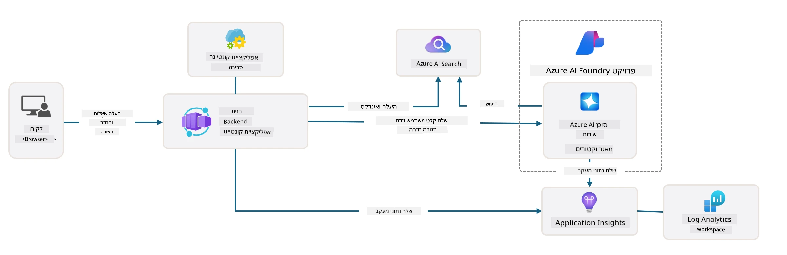
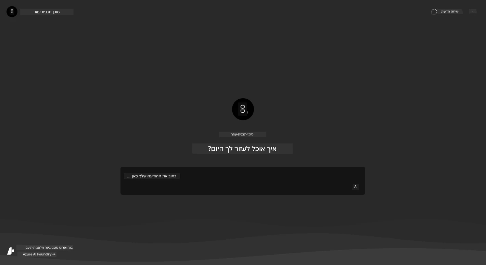

# 2. אימות תבנית

> ההדרכה נבדקה לפי AZD 1.37.2 ודוגמת הקוד הנוכחית ב-4 בנובמבר 2026. צילומי המסך הם להמחשה בלבד; הניווט בפורטל, ברירות המחדל של התבנית וזמינות השירות עלולים להשתנות. סקירה זו לא ביצעה פריסה חיה ב-Azure.

!!! tip "בסיום מודול זה תוכל ל"

    - [ ] Identify the sample's prerequisites and intended resources
    - [ ] Deploy the selected template into an intentional environment
    - [ ] Verify the application and agent behavior separately from deployment success
    - [ ] **Lab 2:** Record evidence of a working baseline, or an actionable deployment blocker

---

## 1. בדיקת דרישות מוקדמות

ה-[Azure Developer CLI](https://learn.microsoft.com/azure/developer/azure-developer-cli/) מנהל פריסת אפליקציה באמצעות קונפיגורציית התבנית, התשתית והקוד. בדוק את הגרסה המותקנת שלך:

```bash
azd version
```

השתמש ב-[הוראות ההתקנה/עדכון הנוכחיות](https://learn.microsoft.com/azure/developer/azure-developer-cli/install-azd) במידת הצורך. הדוגמה הנבדקת מציינת AZD `>=1.14.0`, אבל מומלץ להשתמש בגרסה נתמכת עדכנית. תוספי ה-AI האופציונליים דורשים גרסאות שונות; זרימת העבודה הרגילה `azd up` בדוגמה זו אינה דורשת את תוסף הסוכנים.

לפני הפריסה, קרא את [הגדרת חשבון Azure](https://github.com/Azure-Samples/get-started-with-ai-agents/blob/main/docs/azure_account_setup.md) ומדריך הפריסה [deployment guide](https://github.com/Azure-Samples/get-started-with-ai-agents/blob/main/docs/deployment.md) של הדוגמה. אשר את המנוי, ההרשאות, זמינות המודל, מכסת האזור והחיובים הצפויים. חשבון Azure חינמי אינו מבטיח גישה או שימוש חינמי בכל שירות נדרש.

## 2. פתח את הדוגמה שנבחרה

השתמש במחסן [Get Started with AI Agents](https://github.com/Azure-Samples/get-started-with-ai-agents) שהופעל במודול 1. אם לא הפעלת אותו, בחר באחת מהאפשרויות הבאות:

- פתח [קודספייס עבור הדוגמה](https://github.com/codespaces/new/Azure-Samples/get-started-with-ai-agents).
- שכפל את הדוגמה ופעל לפי הגדרת הסביבה המקומית/קונטיינר לפיתוח.
- בתיקיה **ריקה**, הרץ:

```bash
azd init --template Azure-Samples/get-started-with-ai-agents .
```

אל תאתחל תבנית שנייה מעל פרויקט קיים. הרץ פקודות נוספות משורש הדוגמה שמכיל `azure.yaml`, לא משורש מחסן הקורס.

הדוגמה מארחת אפליקציית צ'אט מבוססת סוכן ב-Container Apps ומספקת משאבי Foundry תומכים. בדוק את המבנה הנוכחי והשירותים האופציונליים במקום להתייחס לצילום מסך ישן כמלאי המשאבים המדויק.



## 3. פרוס בכוונה

```bash
azd auth login
azd up
```

בדוק את ההנחיות:

1. בחר שם ייחודי לסביבת AZD.
2. בחר את המנוי המתאים, לא סתם את המנוי שמוצע ראשון.
3. בחר אזור שנתמך על ידי המודל/גרסה/SKU הנדרשים והמכסה שלך.
4. קרא את הפלט של ההקמה, הפריסה ומשימות לאחר הפריסה.

ברירות המחדל שבדקנו כוללות `gpt-5-mini`, גרסה `2025-08-07`, ו-`GlobalStandard`. בדוק את התבנית שהפעלת ואת הצירופים הנתמכים של מודל ואזור ב-[supported model/region combinations](https://learn.microsoft.com/azure/ai-services/agents/concepts/model-region-support). אף אזור אינו מובטח לעבוד תמיד.

משך הפריסה משתנה. אם הפריסה נכשלת, שמור על השגיאה ותתקן את הסיבה לפני ניסיון חוזר. אל תמחק את הפריסה או תמחק משאבים לצמיתות כצעד בדיקה כללי.

## 4. אמת את האפליקציה

```bash
azd show
```

פתח את נקודת הקצה של `api_and_frontend`, או מצא את ה-Container App בקבוצת המשאבים של הפריסה ב-[Azure portal](https://portal.azure.com/). עקוב אחר הוראות הגישה/האימות של הדוגמה אם נדרש כניסה; אל תבטל אימות כדי שהבדיקה תעבור.



נסה כמה [שאלות לדוגמה](https://github.com/Azure-Samples/get-started-with-ai-agents/blob/main/docs/sample_questions.md):

- שאלה עובדתית כללית.
- שאלה שהתשובה לה אמורה להיות במסמכים שהועלו בדוגמה.
- שאלה שאין לה תשובה מהמסמכים האלו.

ודא שהממשק נטען, ה-API מגיב, השליפה משתמשת בנתונים הצפויים, הציטוטים מתאימים לתוכן המקור, ושאלות לא נתמכות מטופלות כראוי. הודעת `azd up` בלבד אינה מבטיחה את התוצאות האלה.

## 5. בדוק את הסוכן שפורס

פתח את הפרויקט שלך ב-[Foundry portal](https://ai.azure.com/). בזרימת הפורטל הנבדקת, בחר **Build**, אחר כך **Agents**, ומצא את הסוכן שנוצר על ידי הדוגמה. תוויות ניווט עלולות להשתנות.

רשום:

- שם הסוכן והגרסה שלו.
- הפריסה המוגדרת של המודל.
- ההוראות והכלים שהופעלו בפועל.
- אילו קבצים או אינדקס חיפוש מחוברים, והאם ההגדרה הושלמה בהצלחה.

הדוגמה שבדקנו משתמשת במזהה סוכן בצורת `agent_name:agent_version` לבדיקות הערכה. אל תעתיק מזהה סוכן/שרשור ישן מצילום מסך ישן לזרימת עבודה חדשה ב-API.

השווה מסמכים שהועלו עם `src/files/` בגירסת השינויים שהפעלת. צילומי מסך מוקדמים הראו 32 קבצים; ספירה זו אינה ברירת מחדל עדכנית מובטחת. אמת כל תשובה בנוגע ללקוחות/מוצרים של הדוגמה מול נתוני המקור הסינתטיים, ואל תעלה נתוני לקוחות אמיתיים לתרגיל זה.

## 6. השווה עם המגרש (playground)

פתח את מגרש המשחקים של הסוכן שנבחר ב-Foundry ושאל את אותה שאלה של שליפה. השווה את גרסת הסוכן המוגדרת, הכלים, הציטוטים ואיכות התשובה עם האפליקציה שפורסה.

התגובות הן הסתברותיות; התאמה מילה במילה איננה המדד. אם התוצאות שונות משמעותית, בדוק שהאפליקציה והמגרש פונים לאותו פרויקט, לגרסה וסוכן זהים, ולמקור מידע זהה.

## 7. בדוק דרישות מוקדמות לתצפית

מדריך התצפית של הדוגמה נמצא ב-[observability guide](https://github.com/Azure-Samples/get-started-with-ai-agents/blob/main/docs/observability.md).

בברירות המחדל לתשתית שנבדקה, Application Insights פעיל אך **מעקב לקוח כבוי** (`ENABLE_AZURE_MONITOR_TRACING=false`). יצירת משאב ניטור אינה מראה שהאפליקציה מייצאת עקבות. מודול 5 עוסק בהפעלת מעקב ויצירת בקשת בדיקה.

השתמש ביומני האפליקציה של Container App כדי לבדוק שגיאות הפעלה/API. ב-Foundry בדוק את תצוגות המעקב והניטור הזמינות לסוכן. רשומות הערכה דורשות קונפיגורציה הרלוונטית, מעריכים/אזור נתמך, ובקשות בפועל; אינן מובטחות להופיע אוטומטית בכל ריצה.

השאר את הלכידה של תוכן ההנחיה/תגובה כבויה אלא אם דרישות הפרטיות, השימור, הגישה והטשטוש שלה נבדקו.

## 8. הבן ערכי סביבה

AZD שומר את הסביבה הנבחרת תחת `.azure/<environment-name>/`. ניתן לקרוא קלטים מתמידים ופלטי פריסה עם:

```bash
azd env list
azd env get-value AZURE_ENV_NAME
azd env get-value AZURE_LOCATION
```

`azd env get-values` מפרט את כל הערכים, שיכולים לכלול קונפיגורציה רגישות. אל תדביק פלט זה לבעיות ציבוריות או יומנים.

AZD משתמש בסביבה הנבחרת כשמריץ את הפקודות/המשימות, בעוד שמשתני סביבה בתהליך יכולים להשפיע גם הם על פקודות ותבניות. זה **לא** מייצא ערכים לקליפה הראשית שלך או לכל תהליך Python עצמאי שמופעל. עקוב אחר הוראות הפיתוח המקומיות של הדוגמה ב-[local development instructions](https://github.com/Azure-Samples/get-started-with-ai-agents/blob/main/docs/local_development.md).

ברירות המחדל בתבנית יכולות להיות מיושמות ב-`infra/main.parameters.json` מבלי להופיע כערכים מקומיים מפורשים. הגדרת משתנה שרירותי אינה משנה תשתית אלא אם התבנית צורכת אותו.

לדוגמה, כדי לבחור במפורש את ברירות המחדל של המודל שנבדק:

```bash
azd env set AZURE_AI_AGENT_MODEL_NAME gpt-5-mini
azd env set AZURE_AI_AGENT_MODEL_VERSION 2025-08-07
azd env set AZURE_AI_AGENT_DEPLOYMENT_SKU GlobalStandard
azd provision --preview
azd up
```

בדוק תאימות,קיבולת, זמינות, ושינויים מתוכננים תחילה. עדכוני תשתית דורשים הקמה; `azd deploy` בלבד אינו מספיק. שינויים נתמכים במודל בדרך כלל אינם דורשים פירוק מלא של האפליקציה.

`azd env refresh` מחלץ פלטי פריסה לסביבה נגישה; אינו משחזר את כל הקלטים המותאמים אישית, מסנכרן סודות, או מחליף ניהול קונפיגורציה.

## 9. רשום את הקו הבסיסי שלך

- [ ] אימות סביבה, מנוי, אזור ומודל נכונים.
- סיום משימות הקמה, פריסה ונדרשות ללא שגיאות לא פתורות.
- בדיקת גישה לאפליקציה, צ'אט, שליפה וציטוטים.
- זיהוי סוכן/גרסה ומקור ידע.
- תיעוד דרישות מוקדמות לתצפית וכל חסמים שנותרו.

המשך ל-[פירוק תבנית](3-Deconstruct-AI-Template.md).

---

<!-- CO-OP TRANSLATOR DISCLAIMER START -->
**כתב ויתור**:
מסמך זה תורגם באמצעות שירות תרגום אוטומטי [Co-op Translator](https://github.com/Azure/co-op-translator). למרות שאנו שואפים לדיוק, יש לקחת בחשבון שתרגומים אוטומטיים עלולים להכיל שגיאות או אי-דיוקים. יש להחשיב את המסמך המקורי בשפתו הטבעית כמקור הסמכות. למידע קריטי מומלץ להשתמש בתרגום מקצועי על ידי מתרגם אדם. אנו לא אחראים לכל אי-הבנה או פירוש שגוי הנובע מהשימוש בתרגום זה.
<!-- CO-OP TRANSLATOR DISCLAIMER END -->