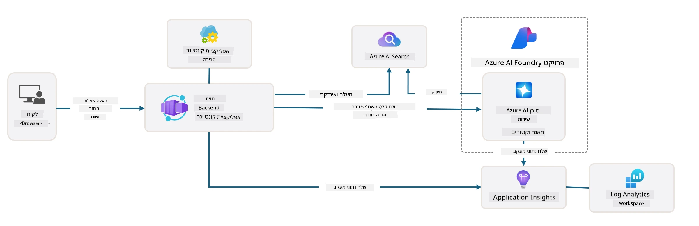

# 3. לפרק תבנית

!!! tip "בסוף מודול זה תוכל ל"

    - [ ] Use GitHub Copilot and optional MCP tools for Azure documentation and read-only exploration
    - [ ] Identify the template's application, infrastructure, configuration, and test entry points
    - [ ] Verify generated explanations against actual repository files
    - [ ] **Lab 3:** Trace one request and one configuration input through the project

---

## 1. הפעל את GitHub Copilot

פתח את הדוגמה הראשונית שהופעלה ב-VS Code והפעל את [GitHub Copilot](https://code.visualstudio.com/docs/copilot/chat/chat-agent-mode). היכנס עם חשבון שיש לו תוכנית מתאימה; מגבלות השימוש משתנות. בקש מ-Copilot להסביר את המאגר לפני שתאשר שינויים.

### שרתי MCP אופציונליים

שירותים אלה יכולים לספק כלים נוספים:

- [שרת Azure MCP](https://learn.microsoft.com/azure/developer/azure-mcp-server/overview)
- [שרת Microsoft Learn MCP](https://learn.microsoft.com/training/support/mcp)

ב-VS Code, סקור את [הנחיית התצורה של MCP](https://code.visualstudio.com/docs/copilot/chat/mcp-servers) ויצר `.vscode/mcp.json` לפי הצורך:

```json
{
  "servers": {
    "Azure MCP Server": {
      "type": "stdio",
      "command": "npx",
      "args": ["-y", "@azure/mcp@latest", "server", "start"]
    },
    "microsoft.docs.mcp": {
      "type": "http",
      "url": "https://learn.microsoft.com/api/mcp"
    }
  }
}
```

הפקודה `npx` דורשת התקנת Node.js/npm נתמכת ומורידה קוד שניתן להרצה. סקור את החבילה ונעץ גרסה מאושרת לצורך הקמת צוות הניתנת לשחזור. הפעל את השרתים באמצעות כלי ה-MCP של VS Code ובדוק את הכלים הזמינים שלהם; שמות עשויים להשתנות בין גרסאות.

**האימות הוא נפרד.** השתמש ב-`azd auth login` עבור AZD. פעל לפי זרם האימות המתועד של Azure MCP עבור הכלים שלו; כניסת AZD לבדה אינה יוצרת הפעלת MCP. השתמש ב-`az login` בנפרד כאשר תרגיל או קרס מתריעים ל-Azure CLI.

נסה הוראות קריאה בלבד:

1. "השתמש ב-Microsoft Learn MCP כדי למצוא את תיעוד התצורה של Azure Developer CLI."
2. "הסבר את `azure.yaml` של מאגר זה; ציין את הקבצים שמיישמים כל קרס."
3. "באמצעות הכלים הזמינים של Azure MCP, רשם את המשאבים המוצבים שלי ללא שינוי דבר."

בדוק את הטנט/המנוי שנבחר ואת כל קריאות הכלים המוצעות. אל תאשר יצירת משאבים, מחיקה או שינוי גישה רק כדי לחקור את הארכיטקטורה.

## 2. הבן את הארכיטקטורה

הדוגמה מארחת backend ב-Python FastAPI ו-frontend ב-React/TypeScript ב-Azure Container Apps. ה-backend מתקשר עם סוכן בפרויקט Microsoft Foundry. השליפה והתצפית תלויות בתכונות התבנית המופעלות וההקמה המוצלחת; הן אינן מובטחות רק מפני שהתוכנית הוצבה.



השווה דיאגרמה זו עם [מדריך הפריסה העדכני](https://github.com/Azure-Samples/get-started-with-ai-agents/blob/main/docs/deployment.md) והמשאבים בפועל שלך. בדוק את פריסת המודל המוגדרת, כלים של הסוכן, זהות מנוהלת, הקצאות תפקידים, ומשאבי Azure Search/Application Insights האופציונליים.

**תרגיל:** בקש מ-Copilot לעקוב אחר בקשת צ'אט מה-frontend דרך ה-API ל-Foundry, עם הפניות לקבצים ולפונקציות. פתח את ההפניות וודא את ההסבר. אל תשער אימות, ניתוב או הרשאות מיושמים רק מדיאגרמה.

## 3. מבנה המאגר

הנתיבים הנבחרים הבאים נבדקו מול הדוגמה ב-4 בנובמבר 2026. הגרסה הראשונית שלך נשארת המקור האמין:

```text
get-started-with-ai-agents/
  azure.yaml
  docker-compose.yaml
  requirements-dev.txt
  .devcontainer/
  infra/
    main.bicep
    main.parameters.json
    api.bicep
    core/
  src/
    Dockerfile
    pyproject.toml
    requirements.txt
    api/
      main.py
      routes.py
      search_index_manager.py
    frontend/
      package.json
      src/
    files/
  scripts/
    validate_env_vars.sh
    validate_env_vars.ps1
    postdeploy.sh
    postdeploy.ps1
  tests/
    test_evaluation.py
    test_red_teaming.py
  docs/
    deployment.md
    deploy_customization.md
    ai_search.md
    observability.md
    local_development.md
    troubleshooting.md
```

### תשתית ותצורה

`infra/main.bicep` מארגן את המשאבים; `main.parameters.json` מחבר קלטי תבנית לערכי סביבה ב-AZD. `azure.yaml` בוחר את שירות האפליקציה וקרסי מחזור חיים. עקוב אחר קלט כמו `USE_AZURE_AI_SEARCH_SERVICE` בקבצים אלה כדי למצוא מה באמת משתנה.

### אפליקציה וזהות

קרא את `src/api/` ו-`src/frontend/` יחד. זהה איפה הסוכן נוצר או נקרא, איפה מוגדרים ההוראות/כלים, ואיזו זהות כל קריאת Azure משתמשת. קבצי הדוגמה תחת `src/files/` הם נתוני הדגמה, לא קטלוג ייצור או דגם הרשאה.

### בדיקות ותצפית

נקודות הכניסה הנוכחיות להערכה וצוותות אדומת תחת `tests/`; הפניות לתיקיות ישנות `evals/` ו-`airedteaming/` אינן רלוונטיות לדוגמה זו. קרא את `docs/observability.md` לדרישות מוקדמות ולעלויות לפני הרצת בדיקות ענן. בדיקות Python אלו נפרדות מהרחבת AZD האופציונלית `azure.ai.evaluations`.

## 4. אמת את הממצאים שלך

- זהה את מסלול ה-API, אינטראקציית הסוכן, וקוד השליפה לשאלה לדוגמה אחת.
- הסבר איזו זהות ניגשת ל-Foundry ואיזו תצורה בוחרת את נקודת הקצה שלו.
- מצא את הסקריפטים האמיתיים לפני ההפעלה ואחרי הפריסה ואת התנהגות טיפול השגיאות שלהם.
- רשם כל תלות או תכונות אופציונליות החסרות בפריסתך.

המשך ל-[הגדר תבנית](4-Configure-AI-Template.md).

---

<!-- CO-OP TRANSLATOR DISCLAIMER START -->
**כתב ויתור**:
מסמך זה תורגם באמצעות שירות תרגום אוטומטי [Co-op Translator](https://github.com/Azure/co-op-translator). למרות שאנו שואפים לדיוק, יש לקחת בחשבון שתרגומים אוטומטיים עלולים להכיל שגיאות או אי-דיוקים. יש להחשיב את המסמך המקורי בשפתו הטבעית כמקור הסמכות. למידע קריטי מומלץ להשתמש בתרגום מקצועי על ידי מתרגם אדם. אנו לא אחראים לכל אי-הבנה או פירוש שגוי הנובע מהשימוש בתרגום זה.
<!-- CO-OP TRANSLATOR DISCLAIMER END -->