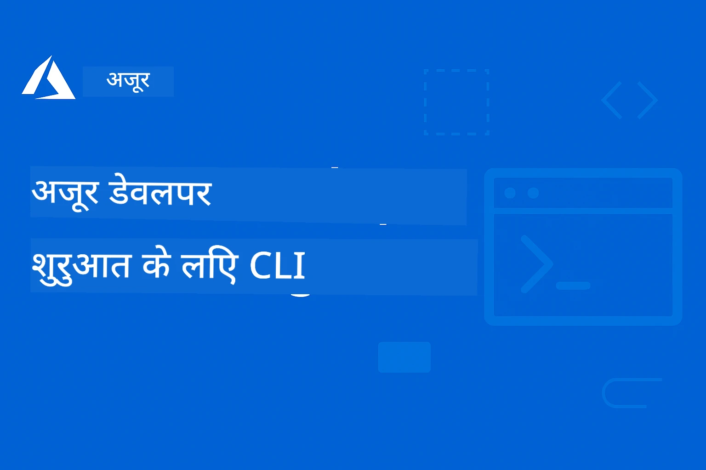

# AZD शुरुआती के लिए: एक संरचित सीखने की यात्रा

 

[](https://github.com/microsoft/AZD-for-beginners)
[](https://GitHub.com/microsoft/azd-for-beginners/network/)
[](https://github.com/microsoft/AZD-for-beginners)

[](https://discord.com/invite/nkVh3dp)
[](https://discord.gg/nTYy5BXMWG)

---

### स्वचालित अनुवाद (हमेशाअप-टू-डेट)

<!-- CO-OP TRANSLATOR LANGUAGES TABLE START -->
[Arabic](../ar/README.md) | [Bengali](../bn/README.md) | [Bulgarian](../bg/README.md) | [Burmese (Myanmar)](../my/README.md) | [Chinese (Simplified)](../zh-CN/README.md) | [Chinese (Traditional, Hong Kong)](../zh-HK/README.md) | [Chinese (Traditional, Macau)](../zh-MO/README.md) | [Chinese (Traditional, Taiwan)](../zh-TW/README.md) | [Croatian](../hr/README.md) | [Czech](../cs/README.md) | [Danish](../da/README.md) | [Dutch](../nl/README.md) | [Estonian](../et/README.md) | [Finnish](../fi/README.md) | [French](../fr/README.md) | [German](../de/README.md) | [Greek](../el/README.md) | [Hebrew](../he/README.md) | [Hindi](./README.md) | [Hungarian](../hu/README.md) | [Indonesian](../id/README.md) | [Italian](../it/README.md) | [Japanese](../ja/README.md) | [Kannada](../kn/README.md) | [Khmer](../km/README.md) | [Korean](../ko/README.md) | [Lithuanian](../lt/README.md) | [Malay](../ms/README.md) | [Malayalam](../ml/README.md) | [Marathi](../mr/README.md) | [Nepali](../ne/README.md) | [Nigerian Pidgin](../pcm/README.md) | [Norwegian](../no/README.md) | [Persian (Farsi)](../fa/README.md) | [Polish](../pl/README.md) | [Portuguese (Brazil)](../pt-BR/README.md) | [Portuguese (Portugal)](../pt-PT/README.md) | [Punjabi (Gurmukhi)](../pa/README.md) | [Romanian](../ro/README.md) | [Russian](../ru/README.md) | [Serbian (Cyrillic)](../sr/README.md) | [Slovak](../sk/README.md) | [Slovenian](../sl/README.md) | [Spanish](../es/README.md) | [Swahili](../sw/README.md) | [Swedish](../sv/README.md) | [Tagalog (Filipino)](../tl/README.md) | [Tamil](../ta/README.md) | [Telugu](../te/README.md) | [Thai](../th/README.md) | [Turkish](../tr/README.md) | [Ukrainian](../uk/README.md) | [Urdu](../ur/README.md) | [Vietnamese](../vi/README.md)

> **स्थानीय रूप से क्लोन करना पसंद है?**
>
> इस रिपॉजिटरी में 50+ भाषा के अनुवाद शामिल हैं जो डाउनलोड आकार को काफी बढ़ाते हैं। बिना अनुवाद के क्लोन करने के लिए, sparse चेकआउट का उपयोग करें:
>
> **Bash / macOS / Linux:**
> ```bash
> git clone --filter=blob:none --sparse https://github.com/microsoft/AZD-for-beginners.git
> cd AZD-for-beginners
> git sparse-checkout set --no-cone '/*' '!translations' '!translated_images'
> ```
>
> **CMD (Windows):**
> ```cmd
> git clone --filter=blob:none --sparse https://github.com/microsoft/AZD-for-beginners.git
> cd AZD-for-beginners
> git sparse-checkout set --no-cone "/*" "!translations" "!translated_images"
> ```
>
> यह आपको ऐसा सब कुछ देता है जो कोर्स पूरा करने के लिए आवश्यक है, बहुत तेज डाउनलोड के साथ।
<!-- CO-OP TRANSLATOR LANGUAGES TABLE END -->

## 🆕 आज azd में नया क्या है

> 📌 **AI CLI रिलीज समीक्षा (2026-11-04):** गाइडेंस को प्रकाशित **`azd 1.37.2`**, **agents `1.0.0-beta.23`**, और **evaluations `1.0.0-beta.2`** दस्तावेज़/स्रोत के खिलाफ जांचा गया। संयोजित वर्कफ़्लो के लिए `azd >= 1.37.0` का उपयोग करें। विस्तार से पहले `azd version` चलाएं और [कोर CLI अपडेट करें](https://learn.microsoft.com/azure/developer/azure-developer-cli/install-azd)। देखें [रिलीज़ बदलाव और सुधार](docs/chapter-08-production/production-ai-practices.md#recent-release-changes-and-fixes)। यह पूरे कोर्स की लाइव डिप्लॉयमेंट वैलिडेशन नहीं है।

Azure Developer CLI कई प्रकार के एप्लिकेशन का समर्थन करता है, जिनमें वेब ऐप्स, API, और AI एजेंट्स शामिल हैं, समर्थित होस्ट, टेम्पलेट्स, और एक्सटेंशन्स के ज़रिए।

इसका मतलब आपके लिए यह है:

- **AI एजेंट अब प्रथामिक azd वर्कलोड हैं।** आप AI एजेंट प्रोजेक्ट्स को उसी `azd init` → `azd up` वर्कफ़्लो का उपयोग करके इनिशियलाइज़, डिप्लॉय, और मैनेज कर सकते हैं जिसे आप पहले से जानते हैं।
- **दो एक्सटेंशनों में एक एजेंट लाइफसायकल।** एजेंट्स को इनिशियलाइज़, इनवोक, ऑप्टिमाइज़, और रिटायर करने के लिए `azure.ai.agents` का उपयोग करें। **`azure.ai.evaluations`** को अलग से इंस्टॉल करें `azd ai eval init`, `generate`, और `run start` के लिए। एजेंट्स बीटा.22 ने लेगसी इवैल्युएशन वर्कफ्लो को रिप्लेस किया और ऑप्टिमाइज़ेशन कॉन्फ़िगरेशन को बदला; [माइग्रेशन गाइड](docs/chapter-08-production/production-ai-practices.md#evaluation-migration-and-quality-checks) का पालन करें।
- **और अधिक AI बिल्डिंग ब्लॉक्स।** नए प्रीव्यू एक्सटेंशन—`azure.ai.skills` और `azure.ai.connections`—आपको एजेंट कौशल और फाउंड्री कनेक्शनों को सीधे azd के साथ मैनेज करने देते हैं।
- **Microsoft Foundry इंटीग्रेशन** मॉडल डिप्लॉयमेंट, एजेंट होस्टिंग, और AI सेवा कॉन्फ़िगरेशन को सीधे azd टेम्प्लेट ईकोसिस्टम में लाता है।
- **रोज़मर्रा के बेसिक्स को और स्मूद बनाया।** हाल के रिलीज़ में `azd init` को इडेम्पोटेंट (दोबारा सुरक्षित रूप से चलाने योग्य), `azd auth login` को पुराने टोकन स्वचालित रूप से साफ़ करने वाला, और एक फ्रेंडली `azd tool` फर्स्ट-रन सेटअप प्रॉम्प्ट जोड़ा गया।
- **कोर वर्कफ्लो नहीं बदला है।** चाहे आप एक टु-डू ऐप, माइक्रोसर्विस, या मल्टी-एजेंट AI सॉल्यूशन तैनात कर रहे हों, कमांड समान हैं।

> **Aspire उपयोगकर्ताओं के लिए नोट:** Microsoft अब इस उत्पाद को सरलता से **Aspire** कहता है (पूर्व में ".NET Aspire")। azd का Aspire सपोर्ट अपरिवर्तित है—सिर्फ नाम अपडेट हुआ है।

यदि आपने पहले azd का उपयोग किया है, तो AI सपोर्ट एक स्वाभाविक विस्तार है—कोई अलग टूल या उन्नत ट्रैक नहीं। यदि आप नया शुरू कर रहे हैं, तो आप एक ही वर्कफ्लो सीखेंगे जो सब कुछ के लिए काम करता है।

---

## 🚀 Azure Developer CLI (azd) क्या है?

**Azure Developer CLI (azd)** एक डेवलपर-फ्रेंडली कमांड-लाइन टूल है जो Azure पर एप्लिकेशन डिप्लॉयमेंट को सरल बनाता है। दर्जनों Azure संसाधनों को मैन्युअली बनाने और कनेक्ट करने के बजाय, आप एक ही कमांड से पूरे एप्लिकेशन डिप्लॉय कर सकते हैं।

### `azd up` का जादू

```bash
# This single command does everything:
# ✅ Creates all Azure resources  
# ✅ Configures networking and security
# ✅ Builds your application code
# ✅ Deploys to Azure
# ✅ Gives you a working URL
azd up
```

टेम्प्लेट एप्लिकेशन और इन्फ्रास्ट्रक्चर कॉन्फ़िगरेशन प्रदान करता है। सफल डिप्लॉयमेंट के लिए समर्थित सेवाओं/मॉडल, पर्याप्त कोटा और अनुमतियाँ, सही इनपुट, और डिप्लॉय किए गए एप्लिकेशन का सत्यापन आवश्यक है। `azd up` स्वचालित रूप से एक टेम्प्लेट को सुरक्षित, अनुपालन योग्य, या प्रोडक्शन-तैयार नहीं बनाता है।

---

## ❓ Azure Developer CLI और Azure CLI में क्या अंतर है?

यह शुरुआती लोगों का सबसे आम सवाल है। सरल उत्तर यहां है:

| फीचर | **Azure CLI (`az`)** | **Azure Developer CLI (`azd`)** |
|---------|---------------------|--------------------------------|
| **उद्देश्य** | व्यक्तिगत Azure संसाधनों का प्रबंधन | पूरी एप्लिकेशन डिप्लॉयमेंट |
| **दृष्टिकोण** | इन्फ्रास्ट्रक्चर-केंद्रित | एप्लिकेशन-केंद्रित |
| **उदाहरण** | `az webapp create --name myapp...` | `azd up` |
| **सीखने की कठिनाई** | Azure सेवाओं को जानना जरूरी है | बस अपने ऐप को जानें |
| **सर्वोत्तम के लिए** | DevOps, इन्फ्रास्ट्रक्चर | डेवलपर्स, प्रोटोटाइपिंग |

### सरल रूपक

- **Azure CLI** ऐसे है जैसे घर बनाने के लिए सभी टूल—हथौड़ा, आरी, कीलें—मौजूद हों। आप कुछ भी बना सकते हैं, लेकिन आपको निर्माण पता होना चाहिए।
- **Azure Developer CLI** ऐसे है जैसे ठेकेदार से काम लेना—आप अपनी आवश्यकताएँ बताते हैं, वे निर्माण सम्भाल लेते हैं।

### कब क्या उपयोग करें

| स्थिति | उपयोग करें |
|----------|----------|
| "मैं अपना वेब ऐप जल्दी डिप्लॉय करना चाहता हूं" | `azd up` |
| "मुझे सिर्फ एक स्टोरेज अकाउंट बनाना है" | `az storage account create` |
| "मैं एक पूरा AI एप्लिकेशन बना रहा हूं" | `azd init --template azure-search-openai-demo` |
| "मुझे एक विशिष्ट Azure संसाधन डिबग करना है" | `az resource show` |
| "मैं अपने कॉन्फ़िगर किए गए प्रोडक्शन एनवायरनमेंट में डिप्लॉय करना चाहता हूं" | डिप्लॉय से पहले कॉन्फ़िगरेशन, एक्सेस, लागत, और ऑपरेशनल गेट्स की समीक्षा करें `azd up --environment production` |

### वे साथ काम करते हैं!

AZD और Azure CLI के अलग-अलग प्रमाणीकरण और कॉन्फ़िगरेशन होते हैं। AZD के लिए `azd auth login` और जब हुक या डायग्नोस्टिक कमांड को स्पष्ट रूप से Azure CLI की आवश्यकता हो तो `az login` का उपयोग करें। आप दोनों का उपयोग कर सकते हैं:
```bash
# Deploy your app with AZD
azd up

# Then fine-tune specific resources with Azure CLI
az webapp config set --name myapp --always-on true
```

---

## 🌟 Awesome AZD में टेम्प्लेट खोजें

शून्य से शुरू न करें! **Awesome AZD** तैनाती के लिए तैयार टेम्प्लेट का समुदाय संग्रह है:

| संसाधन | विवरण |
|----------|-------------|
| 🔗 [**Awesome AZD Gallery**](https://azure.github.io/awesome-azd/) | 200+ टेम्प्लेट एक-क्लिक डिप्लॉय के साथ ब्राउज़ करें |
| 🔗 [**Submit a Template**](https://github.com/Azure/awesome-azd/issues) | अपनी स्वयं की टेम्प्लेट समुदाय में योगदान दें |
| 🔗 [**GitHub Repository**](https://github.com/Azure/awesome-azd) | स्रोत को स्टार करें और एक्सप्लोर करें |

### Awesome AZD के लोकप्रिय AI टेम्प्लेट

हर एक टेम्प्लेट अपनी खाली निर्देशिका में चुनें; नीचे दिए गए कमांड विकल्प हैं। अंत में `.` उस निर्देशिका को इनिशियलाइज़ करता है।

```bash
# RAG Chat with Microsoft Foundry Models + AI Search
azd init --template azure-search-openai-demo .

# Quick AI Chat Application
azd init --template openai-chat-app-quickstart .

# AI Agents with Foundry Agents
azd init --template get-started-with-ai-agents .
```

---

## 🎯 3 चरणों में शुरुआत

शुरू करने से पहले, सुनिश्चित करें कि आपकी मशीन उस टेम्प्लेट के लिए तैयार है जिसे आप डिप्लॉय करना चाहते हैं:

**Windows:**
```powershell
.\validate-setup.ps1
```

**macOS / Linux:**
```bash
bash ./validate-setup.sh
```

यदि कोई आवश्यक जांच विफल होती है, तो पहले उसे ठीक करें फिर क्विक स्टार्ट जारी रखें।

### चरण 1: AZD इंस्टॉल करें (2 मिनट)

**Windows:**
```powershell
winget install microsoft.azd
```

**macOS:**
```bash
brew tap azure/azd && brew install azd
```

**Linux:**
```bash
curl -fsSL https://aka.ms/install-azd.sh | bash
```

### चरण 2: AZD के लिए प्रमाणीकृत करें

```bash
# Optional if you plan to use Azure CLI commands directly in this course
az login

# Required for AZD workflows
azd auth login
```

यदि आप निश्चित नहीं हैं कि आपको कौन सा चाहिए, तो [इंस्टॉलेशन और सेटअप](docs/chapter-01-foundation/installation.md#authentication-setup) में पूरा सेटअप फ़्लो फॉलो करें।

### चरण 3: अपना पहला ऐप डिप्लॉय करें

```bash
# Initialize from a template
azd init --template todo-nodejs-mongo .

# Deploy to Azure (creates everything!)
azd up
```

**🎉 बस इतना ही!** आपका ऐप अब Azure पर लाइव है।

### क्लीन अप (मत भूलें!)

```bash
# Remove all resources when done experimenting
azd down --force --purge
```

---

## 📚 इस कोर्स का उपयोग कैसे करें

यह कोर्स **प्रोग्रेसिव लर्निंग** के लिए डिज़ाइन किया गया है—जहां आप सहज हों वहां से शुरू करें और आगे बढ़ें:

| आपका अनुभव | यहां से शुरू करें |
|-----------------|------------|
| **Azure में नए हैं** | [अध्या 1: आधार](#-chapter-1-foundation--quick-start) |
| **Azure जानते हैं, AZD नए हैं** | [अध्या 1: आधार](#-chapter-1-foundation--quick-start) |
| **AI ऐप्स तैनात करना चाहते हैं** | [अध्या 2: AI-फर्स्ट डेवलपमेंट](#-chapter-2-ai-first-development-recommended-for-ai-developers) |
| **हैंड्स-ऑन प्रैक्टिस चाहते हैं** | [🎓 इंटरेक्टिव वर्कशॉप](workshop/README.md) - 3-4 घंटे गाइडेड लैब |
| **प्रोडक्शन पैटर्न चाहिए** | [अध्या 8: प्रोडक्शन और एंटरप्राइज़](#-chapter-8-production--enterprise-patterns) |

### त्वरित सेटअप

1. **इस रिपॉजिटरी को फोर्क करें**: [](https://GitHub.com/microsoft/azd-for-beginners/fork)
2. **क्लोन करें**: `git clone https://github.com/YOUR-USERNAME/azd-for-beginners.git`
3. **मदद पाएं**: [Azure Discord Community](https://discord.com/invite/ByRwuEEgH4)

> **लोकल क्लोन करना पसंद है?**

> यह रिपॉजिटरी 50+ भाषा अनुवादों के साथ आती है जो डाउनलोड साइज को काफी बढ़ाती है। अनुवादों के बिना क्लोन करने के लिए sparse checkout का उपयोग करें:
> ```bash
> git clone --filter=blob:none --sparse https://github.com/microsoft/AZD-for-beginners.git
> cd AZD-for-beginners
> git sparse-checkout set --no-cone '/*' '!translations' '!translated_images'
> ```
> इससे आपको तेज डाउनलोड के साथ पूरा कोर्स पूरा करने के लिए सब कुछ मिल जाता है।


## कोर्स अवलोकन

संरचित अध्यायों के माध्यम से Master Azure Developer CLI (azd) को प्रगतिशील सीखने के लिए डिजाइन किया गया है। **Microsoft Foundry एकीकरण के साथ AI एप्लिकेशन परिनियोजन पर विशेष ध्यान।**

### यह कोर्स आधुनिक डेवलपर्स के लिए क्यों आवश्यक है

AI वर्कलोड तैनात करने वाले डेवलपर्स को आमतौर पर निम्नलिखित पर मार्गदर्शन की आवश्यकता होती है:
- जटिल मल्टी-सर्विस AI वास्तुकला
- उत्पादन AI परिनियोजन सर्वोत्तम अभ्यास  
- Azure AI सेवा एकीकरण और विन्यास
- AI वर्कलोड के लिए लागत अनुकूलन
- AI-विशिष्ट परिनियोजन समस्याओं का निवारण

### सीखने के लक्ष्य

इस संरचित कोर्स को पूरा करके, आप:
- **AZD के मूल सिद्धांत में महारत हासिल करें**: कोर अवधारणाएं, स्थापना, और विन्यास
- **AI एप्लिकेशन तैनात करें**: Microsoft Foundry सेवाओं के साथ AZD का उपयोग करें
- **Infrastructure as Code लागू करें**: Bicep टेम्पलेट्स के साथ Azure संसाधनों का प्रबंधन करें
- **परिनियोजन में समस्या निवारण करें**: सामान्य समस्याओं को हल करें और समस्याओं का डिबग करें
- **उत्पादन के लिए अनुकूलित करें**: सुरक्षा, स्केलिंग, निगरानी, और लागत प्रबंधन
- **मल्टी-एजेंट समाधान बनाएं**: जटिल AI वास्तुकला तैनात करें

## शुरू करने से पहले: खाते, पहुँच, और मान्यताएं

अध्याय 1 शुरू करने से पहले, सुनिश्चित करें कि आपके पास निम्नलिखित हैं। इस मार्गदर्शिका में बाद के स्थापना चरण इन मूल बातों को पहले से निपटाया हुआ मानते हैं।

- **एक Azure सब्सक्रिप्शन**: आप अपने कार्य या निजी खाते से मौजूदा सब्सक्रिप्शन का उपयोग कर सकते हैं, या शुरू करने के लिए [फ्री ट्रायल](https://aka.ms/azurefreetrial) बना सकते हैं।
- **Azure संसाधन बनाने की अनुमति**: अधिकांश अभ्यासों के लिए, आपके पास लक्षित सब्सक्रिप्शन या संसाधन समूह में कम से कम **Contributor** एक्सेस होना चाहिए। कुछ अध्याय यह भी मान सकते हैं कि आप संसाधन समूह, प्रबंधित पहचान और RBAC असाइनमेंट बना सकते हैं।
- [**एक GitHub खाता**](https://github.com): यह रिपॉजिटरी को फोर्क करने, अपने स्वयं के परिवर्तनों को ट्रैक करने, और कार्यशाला के लिए GitHub Codespaces का उपयोग करने में उपयोगी है।
- **टेम्पलेट रनटाइम पूर्वापेक्षाएं**: कुछ टेम्पलेट के लिए स्थानीय टूल जैसे Node.js, Python, Java, या Docker आवश्यक हैं। शुरुआत करने से पहले सेटअप वैलिडेटर चलाएँ ताकि आप जल्दी से आवश्यक टूल की कमी पकड़ सकें।
- **मूल टर्मिनल परिचितता**: आपको विशेषज्ञ होने की आवश्यकता नहीं है, लेकिन आपको `git clone`, `azd auth login`, और `azd up` जैसे कमांड चलाने में सहज होना चाहिए।

> **क्या आप किसी एंटरप्राइज सब्सक्रिप्शन में काम कर रहे हैं?**
> यदि आपका Azure वातावरण किसी व्यवस्थापक द्वारा प्रबंधित किया जाता है, तो पहले से सुनिश्चित करें कि आप उस सब्सक्रिप्शन या संसाधन समूह में संसाधन तैनात कर सकते हैं जिसका आप उपयोग करने की योजना बना रहे हैं। यदि नहीं, तो शुरू करने से पहले सैंडबॉक्स सब्सक्रिप्शन या Contributor एक्सेस का अनुरोध करें।

> **Azure में नए हैं?**
> अपने स्वयं के Azure ट्रायल या पे-एज-यू-गो सब्सक्रिप्शन के साथ शुरुआत करें https://aka.ms/azurefreetrial ताकि आप कार्यों को अंत तक बिना टेनेंट-स्तर अनुमोदनों के पूरा कर सकें।

## 🗺️ कोर्स मानचित्र: अध्याय द्वारा त्वरित नेविगेशन

हर अध्याय में समर्पित README है जिसमें सीखने के लक्ष्य, त्वरित शुरुआत, और अभ्यास शामिल हैं:

| अध्याय | विषय | पाठ | अवधि | जटिलता |
|---------|-------|---------|----------|------------|
| **[च 1: आधार](docs/chapter-01-foundation/README.md)** | शुरुआत | [AZD मूल बातें](docs/chapter-01-foundation/azd-basics.md) &#124; [स्थापना](docs/chapter-01-foundation/installation.md) &#124; [पहला प्रोजेक्ट](docs/chapter-01-foundation/first-project.md) | 30-45 मिनट | ⭐ |
| **[च 2: AI विकास](docs/chapter-02-ai-development/README.md)** | AI-प्रथम एप्लिकेशन | [Foundry एकीकरण](docs/chapter-02-ai-development/microsoft-foundry-integration.md) &#124; [AI एजेंट](docs/chapter-02-ai-development/agents.md) &#124; [मॉडल तैनाती](docs/chapter-02-ai-development/ai-model-deployment.md) &#124; [कार्यशाला](docs/chapter-02-ai-development/ai-workshop-lab.md) | 1-2 घंटे | ⭐⭐ |
| **[च 3: विन्यास](docs/chapter-03-configuration/README.md)** | प्रमाणीकरण और सुरक्षा | [विन्यास](docs/chapter-03-configuration/configuration.md) &#124; [प्रमाणीकरण और सुरक्षा](docs/chapter-03-configuration/authsecurity.md) | 45-60 मिनट | ⭐⭐ |
| **[च 4: अवसंरचना](docs/chapter-04-infrastructure/README.md)** | IaC और परिनियोजन | [परिनियोजन मार्गदर्शिका](docs/chapter-04-infrastructure/deployment-guide.md) &#124; [प्रावधान](docs/chapter-04-infrastructure/provisioning.md) | 1-1.5 घंटे | ⭐⭐⭐ |
| **[च 5: मल्टी-एजेंट](docs/chapter-05-multi-agent/README.md)** | AI एजेंट समाधान | [खुदरा परिदृश्य](examples/retail-scenario.md) &#124; [समन्वय पैटर्न](docs/chapter-06-pre-deployment/coordination-patterns.md) | 2-3 घंटे | ⭐⭐⭐⭐ |
| **[च 6: प्री-परिनियोजन](docs/chapter-06-pre-deployment/README.md)** | योजना और सत्यापन | [प्रीफ्लाइट चेक](docs/chapter-06-pre-deployment/preflight-checks.md) &#124; [क्षमता योजना](docs/chapter-06-pre-deployment/capacity-planning.md) &#124; [SKU चयन](docs/chapter-06-pre-deployment/sku-selection.md) &#124; [एप इन्साइट्स](docs/chapter-06-pre-deployment/application-insights.md) | 1 घंटा | ⭐⭐ |
| **[च 7: समस्या निवारण](docs/chapter-07-troubleshooting/README.md)** | डिबग और सुधार | [सामान्य समस्याएं](docs/chapter-07-troubleshooting/common-issues.md) &#124; [डिबगिंग](docs/chapter-07-troubleshooting/debugging.md) &#124; [AI मुद्दे](docs/chapter-07-troubleshooting/ai-troubleshooting.md) | 1-1.5 घंटे | ⭐⭐ |
| **[च 8: उत्पादन](docs/chapter-08-production/README.md)** | एंटरप्राइज पैटर्न | [उत्पादन अभ्यास](docs/chapter-08-production/production-ai-practices.md) | 2-3 घंटे | ⭐⭐⭐⭐ |
| **[🎓 कार्यशाला](workshop/README.md)** | व्यावहारिक प्रयोगशाला | [परिचय](workshop/docs/instructions/0-Introduction.md) &#124; [चयन](workshop/docs/instructions/1-Select-AI-Template.md) &#124; [सत्यापन](workshop/docs/instructions/2-Validate-AI-Template.md) &#124; [विखंडन](workshop/docs/instructions/3-Deconstruct-AI-Template.md) &#124; [विन्यास](workshop/docs/instructions/4-Configure-AI-Template.md) &#124; [अनुकूलन](workshop/docs/instructions/5-Customize-AI-Template.md) &#124; [समापन](workshop/docs/instructions/6-Teardown-Infrastructure.md) &#124; [Wrap-up](workshop/docs/instructions/7-Wrap-up.md) | 3-4 घंटे | ⭐⭐ |

**कुल कोर्स अवधि:** ~10-14 घंटे | **कौशल प्रगति:** शुरुआती → उत्पादन-तैयार

---

## 📚 सीखने के अध्याय

*अपने अनुभव स्तर और लक्ष्यों के आधार पर अपनी सीखने की राह चुनें*

### 🚀 अध्याय 1: आधार और त्वरित शुरुआत
**पूर्वापेक्षाएं**: Azure सब्सक्रिप्शन, बुनियादी कमांड लाइन ज्ञान  
**अवधि**: 30-45 मिनट  
**जटिलता**: ⭐

#### आप क्या सीखेंगे
- Azure Developer CLI के मूल सिद्धांत समझना
- अपने प्लेटफ़ॉर्म पर AZD स्थापित करना
- आपकी पहली सफल परिनियोजन

#### सीखने के संसाधन
- **🎯 यहाँ से शुरू करें**: [Azure Developer CLI क्या है?](#-what-is-azure-developer-cli-azd)
- **📖 सिद्धांत**: [AZD मूल बातें](docs/chapter-01-foundation/azd-basics.md) - कोर अवधारणाएं और पदावली
- **⚙️ सेटअप**: [स्थापना और सेटअप](docs/chapter-01-foundation/installation.md) - प्लेटफ़ॉर्म-विशिष्ट गाइड
- **🛠️ व्यावहारिक**: [आपका पहला प्रोजेक्ट](docs/chapter-01-foundation/first-project.md) - चरण-दर-चरण ट्यूटोरियल
- **📋 त्वरित संदर्भ**: [कमांड चीट शीट](resources/cheat-sheet.md)

#### व्यावहारिक अभ्यास
```bash
# Quick installation check
azd version

# Deploy your first application
azd init --template todo-nodejs-mongo .
azd up
```

**💡 अध्याय परिणाम**: AZD का उपयोग करके एक सरल वेब एप्लिकेशन को Azure पर सफलतापूर्वक तैनात करें

**✅ सफलता की पुष्टि:**
```bash
# After completing Chapter 1, you should be able to:
azd version              # Shows installed version
azd init --template todo-nodejs-mongo  # Initializes project
azd up                  # Deploys to Azure
azd show                # Displays running app URL
# Application opens in browser and works
azd down --force --purge  # Cleans up resources
```

**📊 समय निवेश:** 30-45 मिनट  
**📈 बाद का कौशल स्तर:** स्वतंत्र रूप से बुनियादी अनुप्रयोग तैनात कर सकता है

---

### 🤖 अध्याय 2: AI-प्रथम विकास (AI डेवलपर्स के लिए अनुशंसित)
**पूर्वापेक्षाएं**: अध्याय 1 पूर्ण  
**अवधि**: 1-2 घंटे  
**जटिलता**: ⭐⭐

#### आप क्या सीखेंगे
- Microsoft Foundry का AZD के साथ एकीकरण
- AI-संचालित एप्लिकेशन को तैनात करना
- AI सेवा विन्यासों को समझना

#### सीखने के संसाधन
- **🎯 यहाँ से शुरू करें**: [Microsoft Foundry एकीकरण](docs/chapter-02-ai-development/microsoft-foundry-integration.md)
- **🤖 AI एजेंट**: [AI एजेंट गाइड](docs/chapter-02-ai-development/agents.md) - AZD के साथ बुद्धिमान एजेंट तैनात करें
- **📖 पैटर्न्स**: [AI मॉडल तैनाती](docs/chapter-02-ai-development/ai-model-deployment.md) - AI मॉडल तैनात और प्रबंधित करें
- **🛠️ कार्यशाला**: [AI कार्यशाला प्रयोगशाला](docs/chapter-02-ai-development/ai-workshop-lab.md) - अपने AI समाधान AZD-तैयार बनाएं
- **🎥 इंटरैक्टिव गाइड**: [कार्यशाला सामग्री](workshop/README.md) - MkDocs * DevContainer वातावरण के साथ ब्राउज़र-आधारित सीखना
- **📋 टेम्पलेट्स**: [Microsoft Foundry टेम्पलेट्स](#featured-microsoft-foundry-templates)
- **📝 उदाहरण**: [AZD तैनाती उदाहरण](examples/README.md)

#### व्यावहारिक अभ्यास
```bash
# Deploy your first AI application
azd init --template azure-search-openai-demo .
azd up

# Try additional AI templates
azd init --template openai-chat-app-quickstart .
azd init --template agent-openai-python-prompty .
```

**💡 अध्याय परिणाम**: RAG क्षमताओं के साथ एक AI-संचालित चैट एप्लिकेशन तैनात और विन्यस्त करें

**✅ सफलता की पुष्टि:**
```bash
# After Chapter 2, you should be able to:
azd init --template azure-search-openai-demo .
azd up
# Test the AI chat interface
# Ask questions and get AI-powered responses with sources
# Verify search integration works
azd monitor  # Check Application Insights shows telemetry
azd down --force --purge
```

**📊 समय निवेश:** 1-2 घंटे  
**📈 बाद का कौशल स्तर:** AI सीखने वाले अनुप्रयोग तैनात कर सकता है और अतिरिक्त उत्पादन-तैयारी आवश्यकताओं की पहचान कर सकता है
**💰 लागत की समझ:** $80-150/माह विकास लागत, $300-3500/माह उत्पादन लागत को समझें

#### 💰 AI परिनियोजन के लिए लागत विचार

**विकास पर्यावरण (अनुमानित $80-150/माह):**
- Microsoft Foundry मॉडल (Pay-as-you-go): $0-50/माह (टोकन उपयोग के आधार पर)
- AI सर्च (बेसिक टियर): $75/माह
- कंटेनर ऐप्स (उपभोग): $0-20/माह
- स्टोरेज (स्टैंडर्ड): $1-5/माह

**उत्पादन पर्यावरण (अनुमानित $300-3,500+/माह):**
- Microsoft Foundry मॉडल (PTU के लिए निरंतर प्रदर्शन): $3,000+/माह या उच्च वॉल्यूम के साथ Pay-as-go
- AI सर्च (स्टैंडर्ड टियर): $250/माह
- कंटेनर ऐप्स (डेडिकेटेड): $50-100/माह
- एप्लिकेशन इन्साइट्स: $5-50/माह
- स्टोरेज (प्रीमियम): $10-50/माह

**💡 लागत अनुकूलन सुझाव:**
- मॉडल अनुमान मूल्य निर्धारण और खाते-विशेष क्रेडिट जांचें; Azure OpenAI में एक सार्वभौमिक 50,000-टोकन मासिक मुफ्त आवंटन शामिल नहीं है
- जब संसाधनों की ज़रूरत न हो, तो उन्हें हटाने के लिए `azd down` चलाएँ, चयनित पर्यावरण की समीक्षा के बाद
- उपभोग-आधारित बिलिंग के साथ शुरू करें, केवल उत्पादन के लिए PTU में अपग्रेड करें
- योजना बनाई गई अवसंरचना का निरीक्षण करने के लिए `azd provision --preview` का उपयोग करें, फिर Azure मूल्य निर्धारण कैलकुलेटर से संसाधनों के मूल्यांकन करें
- ऑटो-स्केलिंग सक्षम करें: केवल वास्तविक उपयोग के लिए भुगतान करें

**लागत निगरानी:**
```bash
# Inspect planned resources (this does not calculate prices)
azd provision --preview

# Monitor actual costs in Azure Portal
az consumption budget list --resource-group <your-rg>
```

---

### ⚙️ अध्याय 3: विन्यास और प्रमाणीकरण
**पूर्वापेक्षाएं**: अध्याय 1 पूर्ण  
**अवधि**: 45-60 मिनट  
**जटिलता**: ⭐⭐

#### आप क्या सीखेंगे
- पर्यावरण विन्यास और प्रबंधन
- प्रमाणीकरण और सुरक्षा सर्वोत्तम अभ्यास
- संसाधन नामकरण और संगठन

#### सीखने के संसाधन
- **📖 विन्यास**: [विन्यास मार्गदर्शिका](docs/chapter-03-configuration/configuration.md) - पर्यावरण सेटअप
- **🔐 सुरक्षा**: [प्रमाणीकरण पैटर्न और प्रबंधित पहचान](docs/chapter-03-configuration/authsecurity.md) - प्रमाणीकरण पैटर्न
- **📝 उदाहरण**: [डाटाबेस ऐप उदाहरण](examples/database-app/README.md) - AZD डाटाबेस उदाहरण

#### व्यावहारिक अभ्यास
- कई परिवेशों को विन्यस्त करें (डेव, स्टेजिंग, प्रोड)
- प्रबंधित पहचान प्रमाणीकरण सेटअप करें
- पर्यावरण-विशेष विन्यास लागू करें

**💡 अध्याय परिणाम**: उचित प्रमाणीकरण और सुरक्षा के साथ कई परिवेशों का प्रबंधन करें

---

### 🏗️ अध्याय 4: Infrastructure as Code & परिनियोजन
**पूर्वापेक्षाएं**: अध्याय 1-3 पूर्ण  
**अवधि**: 1-1.5 घंटे  
**जटिलता**: ⭐⭐⭐

#### आप क्या सीखेंगे
- उन्नत परिनियोजन पैटर्न
- Bicep के साथ Infrastructure as Code
- संसाधन प्रावधान रणनीतियाँ

#### सीखने के संसाधन
- **📖 परिनियोजन**: [परिनियोजन मार्गदर्शिका](docs/chapter-04-infrastructure/deployment-guide.md) - पूर्ण वर्कफ्लो
- **🏗️ प्रावधान**: [संसाधन प्रावधान](docs/chapter-04-infrastructure/provisioning.md) - Azure संसाधन प्रबंधन
- **📝 उदाहरण**: [कंटेनर ऐप उदाहरण](../../examples/container-app) - कंटेनरीकृत परिनियोजन

#### व्यावहारिक अभ्यास
- कस्टम Bicep टेम्पलेट बनाएं
- मल्टी-सर्विस एप्लिकेशन तैनात करें
- ब्लू-ग्रीन परिनियोजन रणनीतियां लागू करें

**💡 अध्याय परिणाम**: कस्टम अवसंरचना टेम्पलेट्स का उपयोग करके जटिल मल्टी-सर्विस एप्लिकेशन तैनात करें

---

### 🎯 अध्याय 5: मल्टी-एजेंट AI समाधान (उन्नत)
**पूर्वापेक्षाएं**: अध्याय 1-2 पूर्ण  
**अवधि**: 2-3 घंटे  
**जटिलता**: ⭐⭐⭐⭐

#### आप क्या सीखेंगे
- मल्टी-एजेंट वास्तुकला पैटर्न
- एजेंट समन्वय और समन्वयन
- उत्पादन-तैयार AI परिनियोजन

#### सीखने के संसाधन
- **🤖 विशेष डिजाइन**: [खुदरा मल्टी-एजेंट समाधान](examples/retail-scenario.md) - वास्तुकला ब्लूप्रिंट, पूर्ण एप्लिकेशन नहीं
- **🛠️ ARM टेम्पलेट्स**: [ARM टेम्पलेट पैकेज](../../examples/retail-multiagent-arm-template) - इंफ्रास्ट्रक्चर स्कैफ़ोल्ड; पूर्व आवश्यकताएँ और अनुप्रयोग घटकों की समीक्षा करें
- **📖 आर्किटेक्चर**: [मल्टी-एजेंट समन्वय पैटर्न](docs/chapter-06-pre-deployment/coordination-patterns.md) - पैटर्न

#### व्यावहारिक अभ्यास
```bash
# Inspect the retail infrastructure scaffold before choosing to deploy it
cd examples/retail-multiagent-arm-template
cat README.md

# After an intentional deployment, inspect infrastructure state
az deployment group show --resource-group <rg-name> --name <deployment-name>
```

**💡 अध्याय परिणाम**: मल्टी-एजेंट डिज़ाइन को समझें और इंफ्रास्ट्रक्चर स्कैफ़ोल्ड से परे लागूकरण, सत्यापन, और संचालन कार्य पहचानें

---

### 🔍 अध्याय 6: पूर्व-डिप्लॉयमेंट सत्यापन और योजना
**पूर्व आवश्यकताएँ**: अध्याय 4 पूर्ण  
**अवधि**: 1 घंटा  
**जटिलता**: ⭐⭐

#### आप क्या सीखेंगे
- क्षमता नियोजन और संसाधन सत्यापन
- SKU चयन रणनीतियाँ
- प्री-फ्लाइट चेक और स्वचालन

#### सीखने के संसाधन
- **📊 योजना**: [क्षमता नियोजन](docs/chapter-06-pre-deployment/capacity-planning.md) - संसाधन सत्यापन
- **💰 चयन**: [SKU चयन](docs/chapter-06-pre-deployment/sku-selection.md) - लागत-कुशल विकल्प
- **✅ सत्यापन**: [प्री-फ्लाइट चेक](docs/chapter-06-pre-deployment/preflight-checks.md) - स्वचालित स्क्रिप्ट्स

#### व्यावहारिक अभ्यास
- क्षमता सत्यापन स्क्रिप्ट्स चलाएँ
- लागत के लिए SKU चयन अनुकूलित करें
- स्वचालित पूर्व-डिप्लॉयमेंट जांच लागू करें

**💡 अध्याय परिणाम**: निष्पादन से पहले डिप्लॉयमेंट को सत्यापित और अनुकूलित करें

---

### 🚨 अध्याय 7: समस्या निवारण और डिबगिंग
**पूर्व आवश्यकताएँ**: किसी भी डिप्लॉयमेंट अध्याय को पूरा किया हो  
**अवधि**: 1-1.5 घंटे  
**जटिलता**: ⭐⭐

#### आप क्या सीखेंगे
- प्रणालीगत डिबगिंग विधियाँ
- सामान्य समस्याएँ और समाधान
- एआई-विशिष्ट समस्या निवारण

#### सीखने के संसाधन
- **🔧 सामान्य समस्याएँ**: [सामान्य समस्याएँ](docs/chapter-07-troubleshooting/common-issues.md) - FAQ और समाधान
- **🕵️ डिबगिंग**: [डिबगिंग गाइड](docs/chapter-07-troubleshooting/debugging.md) - चरण-दर-चरण रणनीतियाँ
- **🤖 एआई समस्याएँ**: [एआई-विशिष्ट समस्या निवारण](docs/chapter-07-troubleshooting/ai-troubleshooting.md) - एआई सेवा समस्याएँ

#### व्यावहारिक अभ्यास
- डिप्लॉयमेंट विफलताओं का निदान करें
- प्रमाणीकरण समस्याओं का समाधान करें
- एआई सेवा कनेक्टिविटी डिबग करें

**💡 अध्याय परिणाम**: स्वतंत्र रूप से सामान्य डिप्लॉयमेंट समस्याओं का निदान और समाधान करें

---

### 🏢 अध्याय 8: उत्पादन और एंटरप्राइज पैटर्न
**पूर्व आवश्यकताएँ**: अध्याय 1-4 पूर्ण  
**अवधि**: 2-3 घंटे  
**जटिलता**: ⭐⭐⭐⭐

#### आप क्या सीखेंगे
- उत्पादन डिप्लॉयमेंट रणनीतियाँ
- एंटरप्राइज सुरक्षा पैटर्न
- निगरानी और लागत अनुकूलन

#### सीखने के संसाधन
- **🏭 उत्पादन**: [उत्पादन एआई सर्वोत्तम प्रथाएँ](docs/chapter-08-production/production-ai-practices.md) - एंटरप्राइज पैटर्न
- **📝 उदाहरण**: [माइक्रोसर्विसेज़ उदाहरण](../../examples/microservices) - जटिल आर्किटेक्चर
- **📊 निगरानी**: [एप्लिकेशन इनसाइट्स एकीकरण](docs/chapter-06-pre-deployment/application-insights.md) - निगरानी

#### व्यावहारिक अभ्यास
- एंटरप्राइज सुरक्षा पैटर्न लागू करें
- व्यापक निगरानी सेट अप करें
- उचित शासन के साथ उत्पादन में तैनात करें

**💡 अध्याय परिणाम**: पूर्ण उत्पादन क्षमताओं के साथ एंटरप्राइज-तैयार अनुप्रयोग तैनात करें

---

## 🎓 कार्यशाला अवलोकन: व्यावहारिक सीखने का अनुभव

> **⚠️ कार्यशाला स्थिति: सक्रिय विकास**  
> कार्यशाला सामग्री वर्तमान में विकसित और परिष्कृत की जा रही हैं। मुख्य मॉड्यूल कार्यशील हैं, लेकिन कुछ उन्नत भाग अधूरे हैं। हम सभी सामग्री को पूरा करने के लिए सक्रिय रूप से काम कर रहे हैं। [प्रगति ट्रैक करें →](workshop/README.md)

### इंटरैक्टिव कार्यशाला सामग्री
**ब्राउज़र-आधारित उपकरणों और मार्गदर्शित अभ्यास के साथ व्यापक व्यावहारिक सीखना**

हमारी कार्यशाला सामग्री अध्याय-आधारित पाठ्यक्रम को पूरक एक संरचित, इंटरैक्टिव सीखने का अनुभव प्रदान करती हैं। यह कार्यशाला स्व-अध्ययन और प्रशिक्षक-निर्देशित सत्र दोनों के लिए डिज़ाइन की गई है।

#### 🛠️ कार्यशाला सुविधाएँ
- **ब्राउज़र-आधारित इंटरफ़ेस**: खोज, कॉपी, और थीम सुविधाओं के साथ पूर्ण MkDocs- संचालित कार्यशाला
- **GitHub Codespaces एकीकरण**: एक-क्लिक विकास पर्यावरण सेटअप
- **संरचित सीखने का पथ**: 8-मॉड्यूल मार्गदर्शित अभ्यास (कुल 3-4 घंटे)
- **प्रगतिशील पद्धति**: परिचय → चयन → सत्यापन → विघटन → विन्यास → अनुकूलन → बंद करना → समापन
- **इंटरैक्टिव DevContainer पर्यावरण**: पूर्व सेट किए गए टूल और निर्भरताएँ

#### 📚 कार्यशाला मॉड्यूल संरचना
कार्यशाला एक **8-मॉड्यूल प्रगतिशील पद्धति** का अनुसरण करती है जो आपको खोज से तैनाती में विशेषज्ञता तक ले जाती है:

| मॉड्यूल | विषय | आप क्या करेंगे | अवधि |
|--------|-------|----------------|----------|
| **0. परिचय** | कार्यशाला अवलोकन | सीखने के उद्देश्य, पूर्व आवश्यकताएँ, और कार्यशाला संरचना समझें | 15 मिनट |
| **1. चयन** | टेम्पलेट खोज | AZD टेम्पलेट्स एक्सप्लोर करें और अपनी स्थिति के लिए सही AI टेम्पलेट चुनें | 20 मिनट |
| **2. सत्यापन** | तैनात करें और सत्यापित करें | `azd up` के साथ टेम्पलेट तैनात करें और इंफ्रास्ट्रक्चर काम करता है यह सत्यापित करें | 30 मिनट |
| **3. विघटन** | संरचना समझें | GitHub Copilot का उपयोग कर टेम्पलेट आर्किटेक्चर, Bicep फ़ाइलें, और कोड संगठन खोजें | 30 मिनट |
| **4. विन्यास** | azure.yaml गहरी समझ | `azure.yaml` विन्यास, लाइफसाइकल हुक, और एनवायरनमेंट वेरिएबल्स में विशेषज्ञ बनें | 30 मिनट |
| **5. अनुकूलन** | इसे अपना बनाएं | AI Search, ट्रेसिंग, मूल्यांकन सक्षम करें और अपनी स्थिति के लिए अनुकूलित करें | 45 मिनट |
| **6. बंद करना** | साफ-सफाई करें | सुरक्षित रूप से संसाधन बंद करें `azd down --purge` के साथ | 15 मिनट |
| **7. समापन** | अगले कदम | उपलब्धियों, प्रमुख अवधारणाओं की समीक्षा करें और अपनी सीखने की यात्रा जारी रखें | 15 मिनट |

**कार्यशाला प्रवाह:**
```
Introduction → Selection → Validation → Deconstruction → Configuration → Customization → Teardown → Wrap-up
     ↓            ↓           ↓              ↓               ↓              ↓            ↓           ↓
  Overview    Find the     Deploy &      Explore        Master         Customize     Clean up    Review &
             right        verify        code &        azure.yaml      for your      resources   next steps
             template                   structure                     scenario
```

#### 🚀 कार्यशाला शुरू करना
```bash
# Option 1: GitHub Codespaces (Recommended)
# Click "Code" → "Create codespace on main" in the repository

# Option 2: Local Development
git clone https://github.com/microsoft/azd-for-beginners.git
cd azd-for-beginners/workshop
# Follow the setup instructions in workshop/README.md
```

#### 🎯 कार्यशाला सीखने के परिणाम
कार्यशाला पूरी करने पर, प्रतिभागी:
- **उत्पादन AI अनुप्रयोग तैनात करें**: Microsoft Foundry सेवाओं के साथ AZD का उपयोग करें
- **मल्टी-एजेंट आर्किटेक्चर में महारत हासिल करें**: समन्वित AI एजेंट समाधानों को लागू करें
- **सुरक्षा सर्वोत्तम प्रथाओं को लागू करें**: प्रमाणीकरण और पहुंच नियंत्रण का विन्यास करें
- **मापक के लिए अनुकूलित करें**: लागत-कुशल, प्रदर्शनशील डिप्लॉयमेंट डिज़ाइन करें
- **डिप्लॉयमेंट समस्या निवारण करें**: सामान्य समस्याओं को स्वतंत्र रूप से हल करें

#### 📖 कार्यशाला संसाधन
- **🎥 इंटरैक्टिव गाइड**: [कार्यशाला सामग्री](workshop/README.md) - ब्राउज़र-आधारित सीखने का पर्यावरण
- **📋 मॉड्यूल-दर-मॉड्यूल निर्देश**:
  - [0. परिचय](workshop/docs/instructions/0-Introduction.md) - कार्यशाला अवलोकन और उद्देश्य
  - [1. चयन](workshop/docs/instructions/1-Select-AI-Template.md) - AI टेम्पलेट खोजें और चुनें
  - [2. सत्यापन](workshop/docs/instructions/2-Validate-AI-Template.md) - टेम्पलेट तैनात करें और सत्यापित करें
  - [3. विघटन](workshop/docs/instructions/3-Deconstruct-AI-Template.md) - टेम्पलेट आर्किटेक्चर खोजें
  - [4. विन्यास](workshop/docs/instructions/4-Configure-AI-Template.md) - azure.yaml मास्टर करें
  - [5. अनुकूलन](workshop/docs/instructions/5-Customize-AI-Template.md) - अपनी स्थिति के लिए अनुकूलित करें
  - [6. बंद करना](workshop/docs/instructions/6-Teardown-Infrastructure.md) - संसाधनों की सफाई करें
  - [7. समापन](workshop/docs/instructions/7-Wrap-up.md) - समीक्षा और अगले कदम
- **🛠️ AI कार्यशाला लैब**: [AI कार्यशाला लैब](docs/chapter-02-ai-development/ai-workshop-lab.md) - AI-केंद्रित अभ्यास
- **💡 त्वरित शुरुआत**: [कार्यशाला सेटअप गाइड](workshop/README.md#browser-based-guide) - पर्यावरण विन्यास

**उपयुक्त है**: कॉर्पोरेट प्रशिक्षण, विश्वविद्यालय पाठ्यक्रम, स्वयं-गति सीखना और डेवलपर बूटकैम्प।

---

## 📖 गहरी समझ: AZD क्षमताएँ

बुनियादी से परे, AZD उत्पादन तैनातियों के लिए शक्तिशाली सुविधाएँ प्रदान करता है:

- **टेम्पलेट-आधारित डिप्लॉयमेंट** - सामान्य एप्लिकेशन पैटर्न के लिए प्री-बिल्ट टेम्पलेट्स का उपयोग करें
- **कोड के रूप में इंफ्रास्ट्रक्चर** - Bicep या Terraform का उपयोग करके Azure संसाधनों का प्रबंधन करें  
- **एकीकृत वर्कफ़्लो** - निर्बाध रूप से एप्लिकेशन की प्रोविजनिंग, तैनाती और निगरानी करें
- **डेवलपर-अनुकूल** - डेवलपर उत्पादकता और अनुभव के लिए अनुकूलित

### **AZD + Microsoft Foundry: AI तैनातियों के लिए उपयुक्त**

**एआई समाधानों के लिए AZD क्यों?** AZD मुख्य चुनौतियों को संबोधित करता है जिनका AI डेवलपर्स सामना करते हैं:

- **AI-तैयार टेम्पलेट्स** - Microsoft Foundry मॉडल्स, Azure AI सेवाएं, और ML वर्कलोड्स के लिए पूर्व-कॉन्फ़िगर किए गए टेम्पलेट्स
- **सुरक्षित AI तैनातियाँ** - AI सेवाओं, API कुंजी, और मॉडल एंडपॉइंट्स के लिए अंतर्निहित सुरक्षा पैटर्न  
- **उत्पादन AI पैटर्न** - स्केलेबल, लागत-कुशल AI एप्लिकेशन तैनातियों के लिए सर्वोत्तम प्रथाएँ
- **एंड-टू-एंड AI वर्कफ़्लो** - मॉडल विकास से लेकर उत्पादन तैनाती तक उचित निगरानी के साथ
- **लागत अनुकूलन** - AI वर्कलोड्स के लिए स्मार्ट संसाधन आवंटन और स्केलिंग रणनीतियाँ
- **Microsoft Foundry एकीकरण** - Microsoft Foundry मॉडल कैटलॉग और एंडपॉइंट्स से निर्बाध कनेक्शन

---

## 🎯 टेम्पलेट्स और उदाहरण पुस्तकालय

### प्रमुख: Microsoft Foundry टेम्पलेट्स
**यदि आप AI एप्लिकेशन तैनात कर रहे हैं तो यहाँ से शुरू करें!**

> **नोट:** ये टेम्पलेट्स विभिन्न AI पैटर्न दर्शाते हैं। कुछ बाहरी Azure सैम्पल हैं, कुछ स्थानीय कार्यान्वयन हैं।

| टेम्पलेट | अध्याय | जटिलता | सेवाएँ | प्रकार |
|----------|---------|------------|----------|------|
| [**AI चैट के साथ शुरू करें**](https://github.com/Azure-Samples/get-started-with-ai-chat) | अध्याय 2 | ⭐⭐ | AzureOpenAI + Azure AI मॉडल इन्फरेंस API + Azure AI सर्च + Azure कंटेनर ऐप्स + एप्लिकेशन इनसाइट्स | बाहरी |
| [**AI एजेंट्स के साथ शुरू करें**](https://github.com/Azure-Samples/get-started-with-ai-agents) | अध्याय 2 | ⭐⭐ | Foundry एजेंट्स + AzureOpenAI + Azure AI सर्च + Azure कंटेनर ऐप्स + एप्लिकेशन इनसाइट्स| बाहरी |
| [**Azure सर्च + OpenAI डेमो**](https://github.com/Azure-Samples/azure-search-openai-demo) | अध्याय 2 | ⭐⭐ | Azure OpenAI + Azure AI सर्च + कंटेनर ऐप्स (डिफ़ॉल्ट) + स्टोरेज | बाहरी |
| [**OpenAI चैट ऐप क्विकस्टार्ट**](https://github.com/Azure-Samples/openai-chat-app-quickstart) | अध्याय 2 | ⭐ | AzureOpenAI + कंटेनर ऐप्स + एप्लिकेशन इनसाइट्स | बाहरी |
| [**एजेंट OpenAI पाइथन प्रॉम्प्टी**](https://github.com/Azure-Samples/agent-openai-python-prompty) | अध्याय 5 | ⭐⭐⭐ | AzureOpenAI + Azure फ़ंक्शंस + प्रॉम्प्टी | बाहरी |
| [**कॉन्टोसो चैट RAG**](https://github.com/Azure-Samples/contoso-chat) | अध्याय 8 | ⭐⭐⭐⭐ | AzureOpenAI + AI सर्च + कॉस्मॉस DB + कंटेनर ऐप्स | बाहरी |
| [**रिटेल मल्टी-एजेंट समाधान**](examples/retail-scenario.md) | अध्याय 5 | ⭐⭐⭐⭐ | प्रस्तावित आर्किटेक्चर और इंफ्रास्ट्रक्चर स्कैफ़ोल्ड; अनुप्रयोग लागूकरण आवश्यक | **स्थानीय ब्लूप्रिंट** |

### प्रमुख: पूर्ण सीखने के परिदृश्य
**उत्पादन-तैयार एप्लिकेशन टेम्पलेट्स जो सीखने के अध्यायों से मैप किए गए हैं**

| टेम्पलेट | सीखने का अध्याय | जटिलता | प्रमुख सीखना |
|----------|------------------|------------|--------------|
| [**openai-chat-app-quickstart**](https://github.com/Azure-Samples/openai-chat-app-quickstart) | अध्याय 2 | ⭐ | मूल AI तैनाती पैटर्न |
| [**azure-search-openai-demo**](https://github.com/Azure-Samples/azure-search-openai-demo) | अध्याय 2 | ⭐⭐ | RAG कार्यान्वयन Azure AI सर्च के साथ |
| [**get-started-with-ai-agents**](https://github.com/Azure-Samples/get-started-with-ai-agents) | अध्याय 2 | ⭐⭐ | एजेंट समर्थित चैट और उदाहरण-विशिष्ट मूल्यांकन परीक्षण |
| [**agent-openai-python-prompty**](https://github.com/Azure-Samples/agent-openai-python-prompty) | अध्याय 5 | ⭐⭐⭐ | एजेंट फ्रेम워크 और फ़ंक्शन कॉलिंग |
| [**contoso-chat**](https://github.com/Azure-Samples/contoso-chat) | अध्याय 8 | ⭐⭐⭐ | एंटरप्राइज AI ओरकेस्ट्रेशन |
| [**retail-multi-agent-solution**](examples/retail-scenario.md) | अध्याय 5 | ⭐⭐⭐⭐ | मल्टी-एजेंट आर्किटेक्चर ग्राहक और इन्वेंटरी एजेंट्स के साथ |

### उदाहरण प्रकार से सीखना

> **📌 स्थानीय बनाम बाहरी उदाहरण:**  
> **स्थानीय उदाहरण** (इस रिपोज़िटरी में) = कार्यान्वयन स्थिति और पूर्व आवश्यकताओं के लिए उदाहरण का README निरीक्षण करें
> **बाहरी उदाहरण** (Azure सैम्पल) = लिंक की गई रिपोज़िटरी से क्लोन करें

#### स्थानीय उदाहरण (तैयार उपयोग के लिए)
- [**रिटेल मल्टी-एजेंट समाधान**](examples/retail-scenario.md) - आर्किटेक्चर ब्लूप्रिंट के साथ ARM इंफ्रास्ट्रक्चर स्कैफ़ोल्ड
  - प्रस्तावित ग्राहक और इन्वेंटरी एजेंट रोल्स
  - निगरानी, मूल्यांकन, और अनुप्रयोग कोड को लागू करना और सत्यापित करना आवश्यक है
  - केवल संसाधन प्रोविजनिंग एक कार्यशील रिटेल एप्लिकेशन प्रदान नहीं करती

#### स्थानीय उदाहरण - कंटेनर एप्लिकेशन (अध्याय 2-5)
**इस रिपोज़िटरी में व्यापक कंटेनर तैनाती उदाहरण:**
- [**कंटेनर ऐप उदाहरण**](examples/container-app/README.md) - कंटेनरयुक्त तैनातियों के लिए पूर्ण मार्गदर्शिका
  - [सरल Flask API](../../examples/container-app/simple-flask-api) - स्केल-टू-ज़ीरो के साथ मूल REST API
  - [माइक्रोसर्विसेज आर्किटेक्चर](../../examples/container-app/microservices) - दो-सेवा सीखने का नमूना; उत्पादन हार्डनिंग अतिरिक्त कार्य है
  - क्विक स्टार्ट, उत्पादन, और उन्नत तैनाती पैटर्न
  - निगरानी, सुरक्षा, और लागत अनुकूलन मार्गदर्शन

#### बाहरी उदाहरण - सरल एप्लिकेशन (अध्याय 1-2)
**शुरुआत के लिए इन Azure सैम्पल रिपोज़िटरीज़ को क्लोन करें:**
- [सरल वेब ऐप - Node.js + MongoDB](https://github.com/Azure-Samples/todo-nodejs-mongo) - मूल तैनाती पैटर्न
- [स्थिर वेबसाइट - React SPA](https://github.com/Azure-Samples/todo-csharp-sql-swa-func) - स्थिर सामग्री तैनाती
- [कंटेनर ऐप - Python Flask](https://github.com/Azure-Samples/container-apps-store-api-microservice) - REST API तैनाती

#### बाहरी उदाहरण - डेटाबेस इंटीग्रेशन (अध्याय 3-4)  
- [डेटाबेस एप - C# + SQL](https://github.com/Azure-Samples/todo-csharp-sql) - डेटाबेस कनेक्टिविटी पैटर्न
- [फंक्शंस + कॉस्मॉस DB](https://github.com/Azure-Samples/todo-python-mongo-swa-func) - सर्वरलेस डेटा वर्कफ्लो

#### बाहरी उदाहरण - उन्नत पैटर्न (अध्याय 4-8)
- [जावा माइक्रोसर्विसेज](https://github.com/Azure-Samples/java-microservices-aca-lab) - मल्टी-सेवा आर्किटेक्चर
- [कंटेनर ऐप्स जॉब्स](https://github.com/Azure-Samples/container-apps-jobs) - पृष्ठभूमि प्रसंस्करण  
- [एंटरप्राइज ML पाइपलाइन](https://github.com/Azure/mlops-v2) - MLOps संदर्भ पैटर्न; AZD टेम्प्लेट नहीं

### बाहरी टेम्प्लेट संग्रह
- [**आधिकारिक AZD टेम्प्लेट गैलरी**](https://azure.github.io/awesome-azd/) - आधिकारिक और सामुदायिक टेम्प्लेट का चयनित संग्रह
- [**एज़्योर डेवलपर CLI टेम्प्लेट्स**](https://learn.microsoft.com/en-us/azure/developer/azure-developer-cli/azd-templates) - Microsoft Learn टेम्प्लेट दस्तावेज़ीकरण
- [**उदाहरण निर्देशिका**](examples/README.md) - स्थानीय शिक्षण उदाहरण विस्तृत व्याख्याओं के साथ

---

## 📚 सीखने के संसाधन और संदर्भ

### त्वरित संदर्भ
- [**कमांड चीट शीट**](resources/cheat-sheet.md) - अध्याय के अनुसार व्यवस्थित आवश्यक azd कमांड
- [**शब्दावली**](resources/glossary.md) - Azure और azd शब्दावली  
- [**सामान्य प्रश्न**](resources/faq.md) - अध्याय के अनुसार व्यवस्थित सामान्य प्रश्न
- [**अध्ययन मार्गदर्शिका**](resources/study-guide.md) - व्यापक अभ्यास व्यायाम

### प्रायोगिक कार्यशालाएँ
- [**AI कार्यशाला लैब**](docs/chapter-02-ai-development/ai-workshop-lab.md) - अपने AI समाधान AZD-डिप्लॉय करने योग्य बनाएं (2-3 घंटे)
- [**इंटरएक्टिव कार्यशाला**](workshop/README.md) - MkDocs और GitHub Codespaces के साथ 8-मॉड्यूल निर्देशित अभ्यास
  - अनुसरण करता है: परिचय → चयन → सत्यापन → विघटन → कॉन्फ़िगरेशन → अनुकूलन → समापन → सारांश

### बाहरी सीखने के संसाधन
- [Azure Developer CLI Documentation](https://learn.microsoft.com/en-us/azure/developer/azure-developer-cli/)
- [Azure Architecture Center](https://learn.microsoft.com/en-us/azure/architecture/)
- [Azure Pricing Calculator](https://azure.microsoft.com/pricing/calculator/)
- [Azure Status](https://status.azure.com/)

### आपके संपादक के लिए AI एजेंट कौशल
- [**Microsoft Azure Skills on skills.sh**](https://skills.sh/microsoft/github-copilot-for-azure) - Azure AI, Foundry, डिप्लॉयमेंट, निदान, लागत अनुकूलन और अधिक के लिए 37 खुले एजेंट कौशल। इन्हें GitHub Copilot, Cursor, Claude Code, या किसी समर्थित एजेंट में इंस्टॉल करें:
  ```bash
  npx skills add microsoft/github-copilot-for-azure
  ```

---

## 🔧 त्वरित समस्या निवारण गाइड

**शुरुआत करने वालों के आम मुद्दे और त्वरित समाधान:**

<details>
<summary><strong>❌ "azd: कमांड नहीं मिला"</strong></summary>

```bash
# Install AZD first
# Windows (PowerShell):
winget install microsoft.azd

# macOS:
brew tap azure/azd && brew install azd

# Linux:
curl -fsSL https://aka.ms/install-azd.sh | bash

# Verify installation
azd version
```
</details>

<details>
<summary><strong>❌ "कोई सदस्यता नहीं मिली" या "सदस्यता सेट नहीं है"</strong></summary>

```bash
# List available subscriptions
az account list --output table

# Set default subscription
az account set --subscription "<subscription-id-or-name>"

# Set for AZD environment
azd env set AZURE_SUBSCRIPTION_ID "<subscription-id>"

# Verify
az account show
```
</details>

<details>
<summary><strong>❌ "अपर्याप्त कोटा" या "कोटा सीमा पार"</strong></summary>

```bash
# Try different Azure region
azd env set AZURE_LOCATION "westus2"
azd up

# Or use smaller SKUs in development
# Edit infra/main.parameters.json:
{
  "sku": "B1"  // Instead of "P1V2"
}
```
</details>

<details>
<summary><strong>❌ "azd up" आधे में विफल</strong></summary>

```bash
# Option 1: Inspect the error and retry after correcting its cause
azd show
azd up --debug

# Option 2: Just fix infrastructure
azd provision

# Option 3: Check detailed status
azd show

# Option 4: Check logs in Azure Monitor
azd monitor --logs
```
</details>

<details>
<summary><strong>❌ "प्रमाणीकरण विफल" या "टोकन समाप्त"</strong></summary>

```bash
# Re-authenticate for AZD
azd auth logout
azd auth login

# Optional: refresh Azure CLI too if you are running az commands
az logout
az login

# Verify authentication
az account show
```
</details>

<details>
<summary><strong>❌ "संसाधन पहले से मौजूद है" या नामकरण संघर्ष</strong></summary>

```bash
# Inspect the conflicting resource before changing or deleting anything.
# For an isolated new deployment, create a separate environment:
azd env new dev-v2
azd up
```
</details>

<details>
<summary><strong>❌ टेम्प्लेट डिप्लॉयमेंट में अधिक समय लगना</strong></summary>

**सामान्य प्रतीक्षा समय:**
- सरल वेब ऐप: 5-10 मिनट
- डेटाबेस के साथ ऐप: 10-15 मिनट
- AI एप्लिकेशन: 15-25 मिनट (OpenAI प्रावधान धीमा है)

```bash
# Check progress
azd show

# If stuck >30 minutes, check Azure Portal:
azd monitor --overview
# Look for failed deployments
```
</details>

<details>
<summary><strong>❌ "अनुमति अस्वीकृत" या "प्रतिबंधित"</strong></summary>

```bash
# Check your Azure role
az role assignment list --assignee $(az account show --query user.name -o tsv)

# You need at least "Contributor" role
# Ask your Azure admin to grant:
# - Contributor (for resources)
# - User Access Administrator (for role assignments)
```
</details>

<details>
<summary><strong>❌ डिप्लॉय किए गए ऐप्लिकेशन URL नहीं मिल रहा</strong></summary>

```bash
# Show all service endpoints
azd show

# Or open Azure Portal
azd monitor

# Check specific service
azd env get-values
# Look for *_URL variables
```
</details>

### 📚 पूर्ण समस्या निवारण संसाधन

- **सामान्य समस्या गाइड:** [विस्तृत समाधान](docs/chapter-07-troubleshooting/common-issues.md)
- **AI-विशिष्ट समस्याएं:** [AI समस्या निवारण](docs/chapter-07-troubleshooting/ai-troubleshooting.md)
- **डिबगिंग गाइड:** [चरण-दर-चरण डिबगिंग](docs/chapter-07-troubleshooting/debugging.md)
- **मदद प्राप्त करें:** [Azure Discord](https://discord.gg/microsoft-azure) #azure-developer-cli

---

## 🎓 पाठ्यक्रम पूर्णता और प्रमाणन

### प्रगति ट्रैकिंग
प्रत्येक अध्याय के माध्यम से अपनी सीख की प्रगति ट्रैक करें:

- [ ] **अध्याय 1**: नींव और त्वरित आरंभ ✅
- [ ] **अध्याय 2**: AI-प्रथम विकास ✅  
- [ ] **अध्याय 3**: कॉन्फ़िगरेशन और प्रमाणीकरण ✅
- [ ] **अध्याय 4**: इन्फ्रास्ट्रक्चर ऐज़ कोड और डिप्लॉयमेंट ✅
- [ ] **अध्याय 5**: मल्टी-एजेंट AI समाधान ✅
- [ ] **अध्याय 6**: प्री-डिप्लॉयमेंट सत्यापन और योजना ✅
- [ ] **अध्याय 7**: समस्या निवारण और डिबगिंग ✅
- [ ] **अध्याय 8**: उत्पादन और एंटरप्राइज़ पैटर्न ✅

### सीखने का सत्यापन
प्रत्येक अध्याय पूरा करने के बाद, अपनी जानकारी सत्यापित करें:
1. **प्रायोगिक अभ्यास**: अध्याय के हैंड्स-ऑन डिप्लॉयमेंट को पूरा करें
2. **ज्ञान जांच**: अपने अध्याय के FAQ अनुभाग की समीक्षा करें
3. **सामुदायिक चर्चा**: Azure Discord में अपना अनुभव साझा करें
4. **अगला अध्याय**: अगली जटिलता स्तर पर जाएं

### पाठ्यक्रम पूरा करने के लाभ
सभी अध्याय पूरा करने पर, आपके पास होगा:
- **उत्पादन अनुभव**: Azure पर वास्तविक AI एप्लिकेशन डिप्लॉय किए
- **पेशेवर कौशल**: उद्योग-तैयार डिप्लॉयमेंट क्षमताएं  
- **सामुदायिक मान्यता**: Azure डेवलपर समुदाय के सक्रिय सदस्य
- **कैरियर उन्नति**: मांग में AZD और AI डिप्लॉयमेंट विशेषज्ञता

---

## 🤝 समुदाय और सहायता

### सहायता और समर्थन प्राप्त करें
- **तकनीकी समस्याएं**: [बग रिपोर्ट करें और फीचर रिक्वेस्ट करें](https://github.com/microsoft/azd-for-beginners/issues)
- **सीखने के प्रश्न**: [Microsoft Azure Discord Community](https://discord.gg/microsoft-azure) और [](https://discord.gg/nTYy5BXMWG)
- **एआई-विशिष्ट मदद**: जुड़ें [](https://discord.gg/nTYy5BXMWG)
- **दस्तावेज़ीकरण**: [अधिकृत Azure Developer CLI दस्तावेज़ीकरण](https://learn.microsoft.com/en-us/azure/developer/azure-developer-cli/)

### Microsoft Foundry Discord से समुदाय की अंतर्दृष्टि

**सामुदाय द्वारा चर्चा किए गए विषय:**
- मल्टी-सर्विस डिप्लॉयमेंट्स, क्रेडेंशियल प्रबंधन, और उत्पादन तैयार की स्थिति
- एआई-विशिष्ट टेम्पलेट्स, समस्या निवारण गाइड, और सर्वोत्तम प्रथाएं

**हमारे समुदाय में शामिल हों ताकि आप:**
- अपने AZD + AI अनुभव साझा करें और मदद प्राप्त करें
- नए AI टेम्पलेट्स के प्रारंभिक पूर्वावलोकन तक पहुँच पाएं
- AI डिप्लॉयमेंट सर्वोत्तम प्रथाओं में योगदान करें
- भविष्य के AI + AZD फीचर विकास को प्रभावित करें

### कोर्स में योगदान करना
हम योगदानों का स्वागत करते हैं! कृपया हमारे [योगदान गाइड](CONTRIBUTING.md) को पढ़ें जिसके अंदर शामिल हैं:
- **सामग्री सुधार**: मौजूदा अध्यायों और उदाहरणों को बेहतर बनाएं
- **नए उदाहरण**: वास्तविक दुनिया के परिदृश्य और टेम्पलेट्स जोड़ें  
- **अनुवाद**: बहुभाषी समर्थन बनाए रखने में सहायता करें
- **बग रिपोर्ट्स**: सटीकता और स्पष्टता सुधारें
- **सामुदायिक मानक**: हमारे समावेशी समुदाय दिशानिर्देशों का पालन करें

---

## 📄 कोर्स जानकारी

### लाइसेंस
इस प्रोजेक्ट का लाइसेंस MIT लाइसेंस के तहत है - विवरण के लिए [LICENSE](../../LICENSE) फाइल देखें।

### संबंधित Microsoft लर्निंग संसाधन

हमारी टीम अन्य व्यापक लर्निंग कोर्स बनाती है:

<!-- CO-OP TRANSLATOR OTHER COURSES START -->
### LangChain
[](https://aka.ms/langchain4j-for-beginners)
[](https://aka.ms/langchainjs-for-beginners?WT.mc_id=m365-94501-dwahlin)
[](https://github.com/microsoft/langchain-for-beginners?WT.mc_id=m365-94501-dwahlin)
---

### Azure / Edge / MCP / एजेंट्स
[](https://github.com/microsoft/AZD-for-beginners?WT.mc_id=academic-105485-koreyst)
[](https://github.com/microsoft/edgeai-for-beginners?WT.mc_id=academic-105485-koreyst)
[](https://github.com/microsoft/mcp-for-beginners?WT.mc_id=academic-105485-koreyst)
[](https://github.com/microsoft/ai-agents-for-beginners?WT.mc_id=academic-105485-koreyst)

---
 
### जनरेटिव AI श्रृंखला
[](https://github.com/microsoft/generative-ai-for-beginners?WT.mc_id=academic-105485-koreyst)
[-9333EA?style=for-the-badge&labelColor=E5E7EB&color=9333EA)](https://github.com/microsoft/Generative-AI-for-beginners-dotnet?WT.mc_id=academic-105485-koreyst)
[-C084FC?style=for-the-badge&labelColor=E5E7EB&color=C084FC)](https://github.com/microsoft/generative-ai-for-beginners-java?WT.mc_id=academic-105485-koreyst)
[-E879F9?style=for-the-badge&labelColor=E5E7EB&color=E879F9)](https://github.com/microsoft/generative-ai-with-javascript?WT.mc_id=academic-105485-koreyst)

---
 
### कोर लर्निंग
[](https://aka.ms/ml-beginners?WT.mc_id=academic-105485-koreyst)
[](https://aka.ms/datascience-beginners?WT.mc_id=academic-105485-koreyst)
[](https://aka.ms/ai-beginners?WT.mc_id=academic-105485-koreyst)
[](https://github.com/microsoft/Security-101?WT.mc_id=academic-96948-sayoung)
[](https://aka.ms/webdev-beginners?WT.mc_id=academic-105485-koreyst)
[](https://aka.ms/iot-beginners?WT.mc_id=academic-105485-koreyst)
[](https://github.com/microsoft/xr-development-for-beginners?WT.mc_id=academic-105485-koreyst)

---
 
### कोपायलट श्रृंखला
[](https://aka.ms/GitHubCopilotAI?WT.mc_id=academic-105485-koreyst)
[](https://github.com/microsoft/mastering-github-copilot-for-dotnet-csharp-developers?WT.mc_id=academic-105485-koreyst)
[](https://github.com/microsoft/CopilotAdventures?WT.mc_id=academic-105485-koreyst)
<!-- CO-OP TRANSLATOR OTHER COURSES END -->

---

## 🗺️ कोर्स नेविगेशन

**🚀 सीखना शुरू करने के लिए तैयार हैं?**

**शुरुआती**: से शुरू करें [अध्याय 1: आधार एवं त्वरित प्रारंभ](#-chapter-1-foundation--quick-start)  
**एआई डेवलपर्स**: सीधा जाएँ [अध्याय 2: एआई-फर्स्ट विकास](#-chapter-2-ai-first-development-recommended-for-ai-developers)  
**अनुभवी डेवलपर्स**: शुरू करें [अध्याय 3: कॉन्फ़िगरेशन एवं प्रमाणीकरण](#️-chapter-3-configuration--authentication)

**अगले कदम**: [अध्याय 1 - AZD मूल बातें शुरू करें](docs/chapter-01-foundation/azd-basics.md) →

---

<!-- CO-OP TRANSLATOR DISCLAIMER START -->
**अस्वीकरण**:
इस दस्तावेज़ का अनुवाद AI अनुवाद सेवा [Co-op Translator](https://github.com/Azure/co-op-translator) का उपयोग करके किया गया है। जबकि हम सटीकता के लिए प्रयास करते हैं, कृपया ध्यान दें कि स्वचालित अनुवादों में त्रुटियाँ या अशुद्धियाँ हो सकती हैं। मूल दस्तावेज़ अपनी मूल भाषा में ही प्रामाणिक स्रोत माना जाना चाहिए। महत्वपूर्ण जानकारी के लिए, पेशेवर मानव अनुवाद की सिफारिश की जाती है। इस अनुवाद के उपयोग से उत्पन्न किसी भी गलतफहमी या गलत व्याख्या के लिए हम उत्तरदायी नहीं हैं।
<!-- CO-OP TRANSLATOR DISCLAIMER END -->