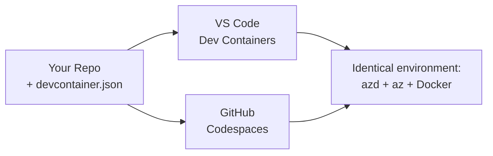

# azd के लिए Dev Containers & GitHub Codespaces

**अध्याय नेविगेशन:**
- **📚 कोर्स होम**: [AZD शुरुआती के लिए](../../README.md)
- **📖 वर्तमान अध्याय**: अध्याय 1 - आधार और त्वरित शुरुआत
- **⬅️ पिछला**: [अपना ऐप लाएँ](bring-your-own-app.md)
- **🚀 अगला अध्याय**: [अध्याय 2: AI-फर्स्ट विकास](../chapter-02-ai-development/README.md)

> कमांड और कॉन्फ़िगरेशन समीक्षा लक्ष्य: `azd 1.37.2` (नवंबर 2026)। इस समीक्षा के हिस्से के रूप में कंटेनर निर्माण और Azure तैनाती निष्पादित नहीं की गई।

## परिचय

azd, सही भाषा रनटाइम, Docker, और Azure CLI को हर मशीन पर इंस्टॉल करना एक कठिन काम है—और यही नंबर-वन कारण है कि एक ट्यूटोरियल जो "मेरी मशीन पर काम करता है" वह किसी और के लिए विफल होता है। एक **डेव कंटेनर** इसे हल करता है, जो आपकी पूरी टूलचेन को एक फ़ाइल में वर्णित करता है। जो भी परियोजना को VS Code या GitHub Codespaces में खोलता है, उसे बिल्कुल वही वातावरण प्राप्त होता है, जिसमें पहले से azd इंस्टॉल होता है। यह पाठ आपको एक जोड़ने का तरीका दिखाता है।

## सीखने के लक्ष्य

इस पाठ के अंत तक, आप:
- समझेंगे कि डेवलपमेंट कंटेनर क्या है और यह azd के साथ मदद क्यों करता है
- किसी प्रोजेक्ट में एक मिनिमल `.devcontainer/devcontainer.json` जोड़ेंगे
- azd, Azure CLI, और Docker को Dev Container *विशेषताओं* के माध्यम से शामिल करेंगे
- प्रोजेक्ट को GitHub Codespaces या VS Code में खोलेंगे

## सीखने के परिणाम

इस पाठ को पूरा करने के बाद, आप सक्षम होंगे:
- azd प्रोजेक्ट के लिए एक `devcontainer.json` लिखने में
- बिना मैनुअल इंस्टॉल के azd और Azure टूलिंग जोड़ने में
- कंटेनर या Codespace के अंदर से `azd up` चलाने में

---

## डेवलपमेंट कंटेनर क्या है?

एक डेवलपमेंट कंटेनर आपके रिपॉजिटरी में एक `.devcontainer/devcontainer.json` फ़ाइल द्वारा परिभाषित एक Docker-आधारित विकास परिवेश है। जब आप प्रोजेक्ट खोलते हैं:

- **VS Code** (Dev Containers एक्सटेंशन के साथ) कंटेनर बनाता है और उससे जुड़ जाता है।
- **GitHub Codespaces** क्लाउड में वही कंटेनर बनाता है और आपको ब्राउज़र-आधारित एडिटर देता है।

किसी भी स्थिति में, हर योगदानकर्ता को समान टूल मिलते हैं—कोई "क्या आपने azd इंस्टॉल किया?" जैसी समस्या नहीं होती।



---

## चरण 1: devcontainer फ़ाइल बनाएं

अपने प्रोजेक्ट की रूट में `.devcontainer/devcontainer.json` बनाएँ:

```json
{
  "name": "azd-project",
  "image": "mcr.microsoft.com/devcontainers/base:bookworm",
  "features": {
    "ghcr.io/devcontainers/features/azure-cli:1": {},
    "ghcr.io/azure/azure-dev/azd:0": { "version": "1.37.2" },
    "ghcr.io/devcontainers/features/docker-in-docker:2": {},
    "ghcr.io/devcontainers/features/node:1": {}
  },
  "customizations": {
    "vscode": {
      "extensions": [
        "ms-azuretools.azure-dev",
        "ms-azuretools.vscode-bicep"
      ]
    }
  },
  "forwardPorts": [3000],
  "postCreateCommand": "azd version"
}
```

प्रत्येक भाग का कार्य:

| कुंजी | उद्देश्य |
|-----|---------|
| `image` | कंटेनर के लिए मूल OS |
| `features` | पूर्वनिर्मित इंस्टॉलर—यहाँ: Azure CLI, **azd**, Docker, और Node.js |
| `customizations.vscode.extensions` | azd और Bicep VS Code एक्सटेंशन्स को स्वचालित रूप से इंस्टॉल करता है |
| `forwardPorts` | आपके ऐप का पोर्ट आपके ब्राउज़र के सामने एक्सपोज़ करता है |
| `postCreateCommand` | कंटेनर बनने के बाद एक बार चलाता है (यहाँ, एक जांच) |

> फीचर संस्करण (`azd:0`) और इंस्टॉल किए गए CLI संस्करण अलग हैं। CLI को पिन करने के लिए फीचर के `version` विकल्प को `"1.37.2"` पर सेट करें; CLI संस्करण को फीचर टैग के रूप में उपयोग न करें।

---

## चरण 2: फीचर को अपने ऐप की भाषा से मिलाएं

अपनी ऐप जो उपयोग करती है उसके लिए `node` फीचर को बदलें:

```jsonc
// Python project
"ghcr.io/devcontainers/features/python:1": {},

// .NET project
"ghcr.io/devcontainers/features/dotnet:2": {},

// Java project
"ghcr.io/devcontainers/features/java:1": {},

// Go project
"ghcr.io/devcontainers/features/go:1": {}
```

कंटेनर होस्ट के लिए स्थानीय रूप से इमेज बनाते समय `docker-in-docker` रखें। एक कॉन्फ़िगर किया गया रिमोट ACR बिल्ड (`docker.remoteBuild: true`) विकल्प है; केवल होस्ट प्रकार हमेशा स्थानीय Docker की आवश्यकता नहीं होती।

---

## चरण 3: इसे खोलें

**VS Code में:**
1. **Dev Containers** एक्सटेंशन इंस्टॉल करें।
2. प्रोजेक्ट फ़ोल्डर खोलें।
3. संकेत मिलने पर **Reopen in Container** पर क्लिक करें (या *Dev Containers: Reopen in Container* चलाएं)।

**GitHub Codespaces में:**
1. रिपॉजिटरी को GitHub पर पुश करें।
2. **Code → Codespaces → Create codespace on main** पर क्लिक करें।
3. कंटेनर के बनने का इंतजार करें—azd टर्मिनल में तैयार है।

---

## चरण 4: कंटेनर के अंदर से तैनात करें

कंटेनर में azd पहले से इंस्टॉल है, इसलिए सामान्य कार्यप्रवाह बस काम करता है:

```bash
azd auth login --use-device-code   # device code is handy inside Codespaces
azd up
```

> **क्यों `--use-device-code`?** एक रिमोट कंटेनर या Codespace में कोई स्थानीय ब्राउज़र रीडायरेक्ट नहीं होता, इसलिए डिवाइस-कोड लॉगिन विश्वसनीय होता है। आप लॉगिन पूरा करने के लिए ब्राउज़र टैब में एक कोड पेस्ट करेंगे।

---

## सामान्य गलतियाँ

| समस्या | समाधान |
|---------|-----|
| `azd up` इमेज नहीं बना सकता | `docker-in-docker` फीचर जोड़ें |
| Codespaces में ब्राउज़र लॉगिन फंस जाता है | `azd auth login --use-device-code` का उपयोग करें |
| टीम के सदस्यों के बीच टूल्स अलग हैं | azd फीचर के `version` विकल्प के माध्यम से CLI पिन करें और भाषा रनटाइम पिन करें |
| ऐप ब्राउज़र में उपलब्ध नहीं | पोर्ट को `forwardPorts` में जोड़ें |

---

## सारांश

- एक डेवलपमेंट कंटेनर आपके azd टूलचेन को सभी के लिए पुनरुत्पादन योग्य बनाता है।
- Dev Container *विशेषताओं* के माध्यम से azd, Azure CLI, और Docker जोड़ें।
- अपनी ऐप की भाषा फीचर से मेल खाएं और कंटेनर होस्ट के लिए `docker-in-docker` रखें।
- Codespaces के अंदर चलते समय डिवाइस-कोड लॉगिन का उपयोग करें।

---

## 🔗 नेविगेशन

| दिशा | संसाधन |
|-----------|----------|
| **पिछला** | [अपना ऐप लाएँ](bring-your-own-app.md) |
| **अध्याय होम** | [अध्याय 1: आधार और त्वरित शुरुआत](README.md) |
| **अगला अध्याय** | [अध्याय 2: AI-फर्स्ट विकास](../chapter-02-ai-development/README.md) |

## 📖 संबंधित संसाधन

- [इंस्टॉलेशन और सेटअप](installation.md)
- [कमांड चीट शीट](../../resources/cheat-sheet.md)
- [अधिकारिक Dev Containers विनिर्देश](https://containers.dev/)
- [azd Dev Container फीचर](https://github.com/Azure/azure-dev/tree/main/ext/devcontainer)

---

<!-- CO-OP TRANSLATOR DISCLAIMER START -->
**अस्वीकरण**:
इस दस्तावेज़ का अनुवाद AI अनुवाद सेवा [Co-op Translator](https://github.com/Azure/co-op-translator) का उपयोग करके किया गया है। जबकि हम सटीकता के लिए प्रयास करते हैं, कृपया ध्यान दें कि स्वचालित अनुवादों में त्रुटियाँ या अशुद्धियाँ हो सकती हैं। मूल दस्तावेज़ अपनी मूल भाषा में ही प्रामाणिक स्रोत माना जाना चाहिए। महत्वपूर्ण जानकारी के लिए, पेशेवर मानव अनुवाद की सिफारिश की जाती है। इस अनुवाद के उपयोग से उत्पन्न किसी भी गलतफहमी या गलत व्याख्या के लिए हम उत्तरदायी नहीं हैं।
<!-- CO-OP TRANSLATOR DISCLAIMER END -->