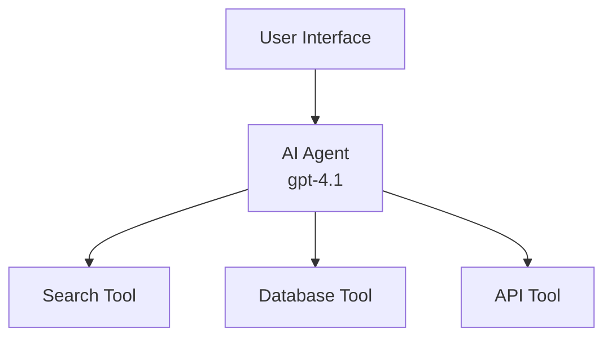
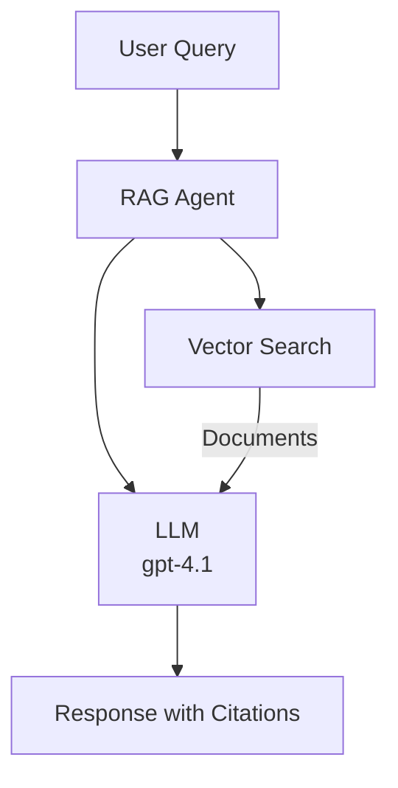
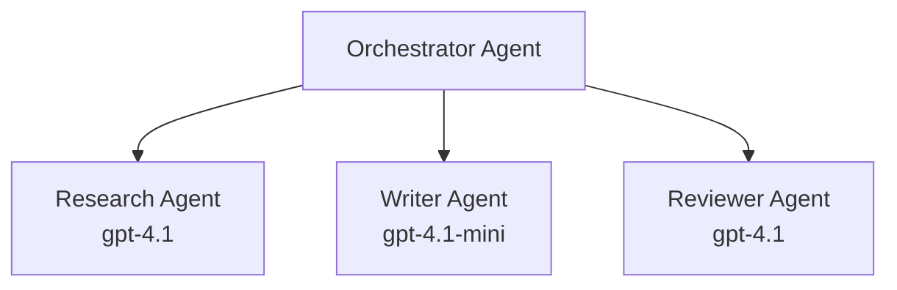

# Azure Developer CLI के साथ AI एजेंट

**अध्याय नेविगेशन:**
- **📚 कोर्स होम**: [AZD For Beginners](../../README.md)
- **📖 वर्तमान अध्याय**: अध्याय 2 - AI-प्रथम विकास
- **⬅️ पिछला**: [Microsoft Foundry Integration](microsoft-foundry-integration.md)
- **➡️ अगला**: [AI Model Deployment](ai-model-deployment.md)
- **🚀 उन्नत**: [मल्टी-एजेंट समाधान](../../examples/retail-scenario.md)

---

## परिचय

AI एजेंट स्वायत्त प्रोग्राम होते हैं जो अपने पर्यावरण को समझ सकते हैं, निर्णय ले सकते हैं, और विशिष्ट लक्ष्यों को प्राप्त करने के लिए कार्रवाई कर सकते हैं। साधारण चैटबोट जो केवल संकेतों पर प्रतिक्रिया देते हैं, के विपरीत, एजेंट कर सकते हैं:

- **उपकरणों का उपयोग करें** - API कॉल करें, डेटाबेस खोजें, कोड निष्पादित करें
- **योजना बनाएं और तर्क करें** - जटिल कार्यों को चरणों में विभाजित करें
- **संदर्भ से सीखें** - मेमोरी बनाए रखें और व्यवहार को अनुकूलित करें
- **सहयोग करें** - अन्य एजेंटों के साथ काम करें (मल्टी-एजेंट सिस्टम)

यह गाइड आपको Azure Developer CLI (azd) का उपयोग करके Azure पर AI एजेंट तैनात करना दिखाता है।

वार्तालाप संदर्भ का उपयोग करना मॉडल प्रशिक्षण नहीं है: स्थायी मेमोरी, अभिगम नियंत्रण, और प्रतिधारण को एप्लिकेशन द्वारा लागू/कॉन्फ़िगर किया जाना चाहिए।

> **Foundry GA अपडेट (2026-11-09):** सामान्य रूप से उपलब्ध `microsoft.foundry` 1.0 बंडल को `azd >= 1.37.0` के साथ इंस्टॉल करें। मूल्यांकन अलग से स्थापित होते हैं; वैकल्पिक प्रीव्यू फीचर्स और नीचे दिया गया क्लासिक SDK भाग बंडल घोषणा द्वारा GA के लिए प्रमोट नहीं किए गए हैं। यह मार्गदर्शन [GA घोषणा](https://devblogs.microsoft.com/azure-sdk/microsoft-foundry-azure-developer-cli-ga/) और दस्तावेज़ीकरण पर आधारित है, न कि लाइव Azure तैनाती पर।

## सीखने के लक्ष्य

इस गाइड को पूरा करके, आप:
- समझेंगे कि AI एजेंट क्या हैं और वे चैटबोट्स से कैसे भिन्न होते हैं
- AZD का उपयोग करके प्री-बिल्ट AI एजेंट टेम्प्लेट तैनात करेंगे
- कस्टम एजेंट्स के लिए Foundry Agents को कॉन्फ़िगर करेंगे
- बुनियादी एजेंट पैटर्न लागू करेंगे (उपकरण उपयोग, RAG, मल्टी-एजेंट)
- तैनात एजेंट्स की निगरानी और डिबगिंग करेंगे

## सीखने के परिणाम

पूरा करने के बाद, आप सक्षम होंगे:
- एक कमांड के साथ Azure पर AI एजेंट एप्लिकेशन तैनात करना
- एजेंट उपकरणों और क्षमताओं को कॉन्फ़िगर करना
- एजेंट्स के साथ पुनःप्राप्ति-वर्धित जेनरेशन (RAG) लागू करना
- जटिल वर्कफ़्लोज़ के लिए मल्टी-एजेंट आर्किटेक्चर डिजाइन करना
- सामान्य एजेंट तैनाती समस्याओं का समाधान करना

---

## 🤖 एजेंट और चैटबोट में क्या अंतर है?

| विशेषता | चैटबोट | AI एजेंट |
|---------|---------|----------|
| **व्यवहार** | संकेतों का जवाब देता है | स्वायत्त क्रियाएँ करता है |
| **उपकरण** | पुनःप्राप्ति या उपकरण उपयोग कर सकता है | आमतौर पर लक्ष्य-निर्दिष्ट लूप में उपकरणों का उपयोग करता है |
| **मेमोरी** | एप्लिकेशन-निर्भर | केवल तब स्थायी मेमोरी जब स्पष्ट रूप से लागू की गई हो |
| **योजना** | एकल प्रतिक्रिया | बहु-चरण तर्क |
| **सहयोग** | एकल इकाई | अन्य एजेंटों के साथ काम कर सकता है |

### सरल उपमाएँ

- **चैटबोट** = एक सहायक व्यक्ति जो सूचना काउंटर पर प्रश्नों का उत्तर देता है
- **AI एजेंट** = एक व्यक्तिगत सहायक जो कॉल कर सकता है, नियुक्तियाँ बुक कर सकता है, और आपके लिए कार्य पूरा कर सकता है

---

## 🚀 त्वरित शुरुआत: अपना पहला एजेंट तैनात करें

एक **नई खाली वर्किंग डायरेक्टरी** में एक विकल्प चुनें। ट्रेलिंग `.` वहां इनिशियलाइज़ करता है; बिना कोई स्पष्ट गंतव्य के, वर्तमान AZD एक टेम्पलेट-नामित सबडायरेक्टरी बना सकता है और आपकी शेल की डायरेक्टरी नहीं बदलता। अलग-अलग टेम्पलेट/पर्यावरणों को अलग-अलग डायरेक्टरियों में रखें।

नीचे दिए गए समय/लागत रेंज उदाहरणात्मक हैं, सत्यापित उद्धरण नहीं। तैनाती से पहले प्रत्येक नमूने की वर्तमान पूर्वापेक्षाएं, मूल्य निर्धारण, मॉडल कोटा, और वैकल्पिक सेवाओं की जांच करें।

### विकल्प 1: Foundry Agents टेम्पलेट (अनुशंसित)

```bash
# Initialize the AI agents template
azd init --template get-started-with-ai-agents .

# Deploy to Azure
azd up
```

**क्या तैनात होता है:** नमूने की वर्तमान अवसंरचना और चुने गए विकल्प मॉडल, टूल्स, होस्टिंग, और निगरानी संसाधनों को निर्धारित करते हैं। प्रावधान करने से पहले इसके README और `infra/` की समीक्षा करें; हर एजेंट टेम्पलेट में Search या एक वेब इंटरफ़ेस शामिल होना जरूरी नहीं है।

**समय:** ~15-20 मिनट
**लागत:** ~$100-150/महीना (विकास)

### विकल्प 2: Prompty के साथ Creative Writing Agents

```bash
# Initialize the Prompty-based agent template
azd init --template https://github.com/Azure-Samples/contoso-creative-writer .

# Deploy to Azure
azd up
```

**क्या तैनात होता है:** Azure OpenAI, Bing Grounding, और Azure AI Search का उपयोग करने वाला एक FastAPI/Prompty मल्टी-एजेंट लेखन नमूना। पूर्व का `agent-openai-python-prompty` रिपॉजिटरी यहां रीडायरेक्ट करता है; यह एक न्यूनतम Azure Functions वेदर-एजेंट टेम्पलेट नहीं है। होस्टिंग, मॉडल कोटा, और Bing Grounding की पूर्वशर्तों के लिए इसके वर्तमान README का पालन करें।

**समय:** ~10-15 मिनट
**लागत:** ~$50-100/महीना (विकास)

### विकल्प 3: RAG चैट एजेंट

```bash
# Initialize RAG chat template
azd init --template azure-search-openai-demo .

# Deploy to Azure
azd up
```

**क्या तैनात होता है:**
- ✅ Microsoft Foundry मॉडल्स
- ✅ Azure AI Search नमूना डेटा के साथ
- ✅ दस्तावेज़ प्रसंस्करण पाइपलाइन
- ✅ उद्धरणों के साथ चैट इंटरफ़ेस

**समय:** ~15-25 मिनट
**लागत:** ~$80-150/माह (विकास)

### विकल्प 4: GA Foundry बंडल के साथ होस्टेड एजेंट

बुनियादी Python एजेंट फ्रेमवर्क प्रतिक्रियाएं API नमूने के लिए [पूर्ण होस्टेड-एजेंट वॉकथ्रू](microsoft-foundry-integration.md#hosted-agent-walkthrough-ga) का उपयोग करें। इस कोड-डिप्लॉयमेंट पथ को Python 3.13+, वर्तमान uv, Foundry अनुमतियाँ, और क्षेत्रीय मॉडल कोटा की ज़रूरत होती है। Azure CLI क्रेडेंशियल का उपयोग करते समय लोकल SDK कॉल्स को अलग से प्रमाणित करें।

```bash
azd auth login
azd ext install microsoft.foundry
```

खाली निर्देशिका में, नमूना प्रारंभ करें:

```text
azd ai agent init --template https://github.com/microsoft-foundry/foundry-samples/blob/main/samples/python/hosted-agents/agent-framework/responses/01-basic/azure.yaml --deploy-mode code --src .
```

एक नया या मौजूदा प्रोजेक्ट चुनें, `azure.yaml` की समीक्षा करें, और `azd provision` चलाएं। एजेंट इंस्पेक्टर खोलने के लिए `azd ai agent run` का उपयोग करें और उस निर्देशिका में एक अन्य टर्मिनल से `azd ai agent invoke --local "Explain how this agent is hosted."` चलाएं। स्थानीय सत्यापन के बाद, डिप्लॉय की गई प्रतिक्रिया की तुलना के लिए `azd deploy` और `azd ai agent invoke "Explain how this agent is hosted."` का उपयोग करें। Foundry अपलोड किए गए स्रोत को दूरस्थ रूप से बनाता है; स्थानीय कंटेनर निर्माण आवश्यक नहीं है।

**कब `azd ai agent init` का उपयोग करें और कब `azd init --template`:**

| दृष्टिकोण | सर्वोत्तम के लिए | यह कैसे काम करता है |
|----------|----------|------|
| `azd init --template` | एक काम करने वाले नमूना ऐप से शुरुआत | कोड + इन्फ्रा के साथ एक पूर्ण टेम्पलेट रिपो क्लोन करता है |
| `azd ai agent init --template` | मौजूदा Foundry एजेंट प्रोजेक्ट को अपनाना | एक `azure.yaml` प्रोजेक्ट दस्तावेज़ और इसकी परिभाषाओं का उपयोग करता है |

> **टिप:** विकल्प 1-3 पूर्ण एप्लिकेशन टेम्प्लेट से शुरू होते हैं; विकल्प 4 GA होस्टेड-एजेंट वर्कफ़्लो सिखाता है। कोई भी इनिशियलाइज़ेशन कमांड स्वचालित रूप से लेगेसी एजेंट मैनिफेस्ट को माइग्रेट नहीं करता। किसी मौजूदा प्रोजेक्ट में सीधे एजेंट परिभाषा जोड़ने के लिए, [इनिशियलाइज़ेशन और माइग्रेशन गाइडेंस](../chapter-08-production/production-ai-practices.md#initializing-agent-projects-with-azd-ai-agent-init) देखें।

अलग से `azure.ai.evaluations` इंस्टॉल करें ताकि टेस्ट डेटा/रुब्रिक्स जनरेट और समीक्षा की जा सके, एक मूल्यांकन कॉन्फ़िगर किया जा सके, और इसे `azd ai eval` का उपयोग करके चलाया जा सके। ऑप्टिमाइज़ेशन किसी संगत मूल्यांकन का पुन: उपयोग कर सकता है; स्पष्ट रूप से तैनात करने से पहले उम्मीदवारों की समीक्षा करें। पुराने उदाहरणों का पुन: उपयोग करने से पहले [मूल्यांकन वर्कफ़्लो](../chapter-08-production/production-ai-practices.md#evaluation-migration-and-quality-checks) और [ऑप्टिमाइज़ेशन माइग्रेशन](../chapter-08-production/production-ai-practices.md#optimization-configuration-migration) का पालन करें। सफाई के लिए, पुन: उपयोग किए गए Foundry प्रोजेक्ट के संसाधन `azd down` के बाद बने रहते हैं; नए बनाए गए प्रोजेक्ट के संसाधन समूह को हटा दिया जाता है। [वॉकथ्रू क्लीनअप गाइडेंस](microsoft-foundry-integration.md#7-clean-up-deliberately) देखें।

---

## 🏗️ एजेंट आर्किटेक्चर पैटर्न

### पैटर्न 1: टूल्स के साथ एकल एजेंट

सबसे सरल एजेंट पैटर्न - एक एजेंट जो कई टूल्स का उपयोग कर सकता है।



**इसके लिए सर्वोत्तम:**
- ग्राहक सहायता बॉट्स
- अनुसंधान सहायक
- डेटा विश्लेषण एजेंट

**संबंधित अनुप्रयोग नमूना:** `azure-search-openai-demo` RAG प्रदर्शित करता है, सामान्य मनमाने टूल एजेंट लूप नहीं।

### पैटर्न 2: RAG एजेंट (रिकवरी-अगमेंटेड जनरेशन)

एक एजेंट जो प्रतिक्रियाएँ उत्पन्न करने से पहले संबंधित दस्तावेज़ पुनः प्राप्त करता है।



**सर्वोत्तम के लिए:**
- एंटरप्राइज़ नॉलेज बेस
- दस्तावेज़ प्रश्नोत्तरी प्रणाली
- अनुपालन और कानूनी शोध

**AZD टेम्पलेट:** `azure-search-openai-demo`

### पैटर्न 3: मल्टी-एजेंट सिस्टम

एक साथ मिलकर जटिल कार्यों पर काम करने वाले कई विशेषज्ञ एजेंट।



**इसके लिए सबसे अच्छा:**
- जटिल सामग्री निर्माण
- बहु-चरण कार्यप्रवाह
- विभिन्न विशेषज्ञता की मांग वाले कार्य

**अधिक जानें:** [मल्टी-एजेंट समन्वय पैटर्न](../chapter-06-pre-deployment/coordination-patterns.md)

---

## ⚙️ एजेंट टूल्स का कॉन्फ़िगर करना

टूल्स का उपयोग करने पर एजेंट अधिक सक्षम बनते हैं। यहां सामान्य टूल्स को कॉन्फ़िगर करने का तरीका है:

### Foundry एजेंट्स में टूल कॉन्फ़िगरेशन

यह **क्लासिक एजेंट सर्विस SDK फ्रैगमेंट** `azure-ai-projects==1.0.0` और `azure-ai-agents==1.1.0` को `azure-identity` के साथ लक्षित करता है। यह कुछ मौजूदा Foundry टेम्प्लेट्स द्वारा उपयोग किए जाने वाले नए versioned-agent/Responses API या `azure.ai.agents` AZD एक्सटेंशन (एक अलग पैकेज) नहीं है। इन API पीढ़ियों को मिलाएं नहीं। `PROJECT_ENDPOINT` को क्लासिक Foundry प्रोजेक्ट एंडपॉइंट पर सेट करें और `MODEL_DEPLOYMENT_NAME` को मौजूदा समर्थित मॉडल डिप्लॉयमेंट पर सेट करें; स्थानीय रूप से `az login` के साथ प्रमाणित करें और आवश्यक प्रोजेक्ट अनुमतियाँ दें।

```python
# agent_config.py
import os
from azure.ai.projects import AIProjectClient
from azure.ai.agents.models import FunctionTool
from azure.identity import DefaultAzureCredential

def search_knowledge_base(query: str) -> str:
    """Search the demonstration knowledge base.

    :param query: Search text.
    :return: Matching demonstration information.
    """
    # Local fixture only, not a production search implementation.
    return "Demo policy: returns are accepted within 30 days."

project_client = AIProjectClient(
    endpoint=os.environ["PROJECT_ENDPOINT"],
    credential=DefaultAzureCredential(),
)
search_tool = FunctionTool(functions={search_knowledge_base})
project_client.agents.enable_auto_function_calls(search_tool)
agent = project_client.agents.create_agent(
    model=os.environ["MODEL_DEPLOYMENT_NAME"],
    name="Support Agent",
    instructions="Use search_knowledge_base for policy questions. Label results as demo data.",
    tools=search_tool.definitions,
)
```

एक फंक्शन स्कीमा को पंजीकृत करने से सर्विस पर Python निष्पादित नहीं होता। इस SDK में, `enable_auto_function_calls` के साथ `agents.runs.create_and_process(...)` आपके क्लाइंट प्रक्रिया में पंजीकृत कॉलबैक्स चलाता है। देखें [प्रकाशित SDK उदाहरण](https://github.com/Azure/azure-sdk-for-python/blob/azure-ai-agents_1.1.0/sdk/ai/azure-ai-agents/samples/agents_tools/sample_agents_auto_function_call.py)। समाप्त होने पर क्लाइंट बंद करें और डेमोंस्ट्रेशन एजेंट्स/थ्रेड्स हटाएं।

### पर्यावरण कॉन्फ़िगरेशन

निम्नलिखित नाम **प्रतीकात्मक कस्टम-टेम्प्लेट इनपुट** हैं, बिल्ट-इन AZD स्विच नहीं। पहले हर मान को `infra/main.parameters.json`, इन्फ्रास्ट्रक्चर, और एप्लिकेशन कोड के माध्यम से वायर करें। केवल `azd env set` एजेंट के टूल्स या निर्देशों को नहीं बदलता।

```bash
# Set up agent-specific environment variables
azd env set AZURE_OPENAI_MODEL "gpt-4.1"
azd env set AGENT_INSTRUCTIONS "You are a helpful assistant..."
azd env set ENABLE_CODE_INTERPRETER "true"
azd env set ENABLE_FILE_SEARCH "true"

# Apply wired infrastructure and application changes
azd up
```

---

## 📊 मॉनिटरिंग एजेंट्स

### एप्लिकेशन इनसाइट्स एकीकरण

यदि आपके चयनित टेम्पलेट में एप्लिकेशन इनसाइट्स की प्रोविजनिंग और इंस्ट्रूमेंटेशन कॉन्फ़िगरेशन शामिल है:

```bash
# Open monitoring dashboard
azd monitor --overview

# Open the Application Insights logs view (not a streaming log tail)
azd monitor --logs

# View live metrics
azd monitor --live
```

### ट्रैक करने के लिए मुख्य मेट्रिक्स

| मेट्रिक | विवरण | लक्ष्य |
|--------|-------------|--------|
| प्रतिक्रिया विलम्ब | प्रतिक्रिया जनरेट करने का समय | < 5 सेकंड |
| टोकन उपयोग | प्रति अनुरोध टोकन | लागत के लिए मॉनिटर करें |
| टूल कॉल सफलता दर | सफल टूल निष्पादनों का % | > 95% |
| त्रुटि दर | असफल एजेंट अनुरोध | < 1% |
| उपयोगकर्ता संतुष्टि | प्रतिक्रिया स्कोर | > 4.0/5.0 |

### एजेंट्स के लिए कस्टम लॉगिंग

```python
import os
from azure.monitor.opentelemetry import configure_azure_monitor
from opentelemetry import trace

# Configure Azure Monitor with OpenTelemetry
configure_azure_monitor(
    connection_string=os.environ["APPLICATIONINSIGHTS_CONNECTION_STRING"]
)

tracer = trace.get_tracer(__name__)

def log_agent_interaction(user_query, agent_response, tools_used, latency_ms):
    with tracer.start_as_current_span("agent_interaction") as span:
        span.set_attributes({
            "query_length": len(user_query),  # Do not log raw prompts or personal data
            "response_length": len(agent_response),
            "tools_used": tools_used,
            "latency_ms": latency_ms
        })
```

> **नोट:** आवश्यक पैकेज इंस्टॉल करें: `pip install azure-monitor-opentelemetry`। यह OpenTelemetry निर्भरताएं लाता है; आयात namespace एक पैकेज नामित `opentelemetry` को इंस्टॉल करने की आवश्यकता नहीं है।

---

## 💰 लागत पर विचार

### पैटर्न के अनुसार अनुमानित मासिक लागत

ये उदाहरणात्मक योजना रेंज हैं, कोट्स या खर्च की सीमा नहीं। क्षेत्र, मॉडल टोकन, Search/compute SKUs, टूल सेशन, भंडारण, और ट्रैफ़िक इन्हें पार कर सकते हैं। नमूने की लागत मार्गदर्शन और Azure मूल्य निर्धारण की जाँच करें इससे पहले कि `azd up`।

| पैटर्न | विकास वातावरण | प्रोडक्शन |
|---------|-----------------|------------|
| एकल एजेंट | $50-100 | $200-500 |
| RAG एजेंट | $80-150 | $300-800 |
| मल्टी-एजेंट (2-3 एजेंट्स) | $150-300 | $500-1,500 |
| एंटरप्राइज मल्टी-एजेंट | $300-500 | $1,500-5,000+ |

### लागत अनुकूलन सुझाव

1. **सरल कार्यों के लिए gpt-4.1-mini का उपयोग करें** (यदि आपका टेम्पलेट इस इनपुट का उपयोग करता है)
   ```bash
   azd env set AZURE_OPENAI_MODEL "gpt-4.1-mini"
   ```

2. **सुरक्षित, बार-बार प्रश्नों के लिए स्कोप्ड कैशिंग लागू करें।** टेनेंट/उपयोगकर्ता प्राधिकरण, मॉडल डिप्लॉयमेंट, निर्देश, और पुनःप्राप्ति संस्करण को कैश कुंजी में शामिल करें; एक समाप्ति सेट करें। निजी संवाद प्रतिक्रियाएं प्रक्रिया-व्यापी केवल-क्वेरी कैश के माध्यम से साझा न करें। SDK एजेंट ऑब्जेक्ट में कोई सामान्य `agent.run()` मेथड नहीं है।

3. **प्रति रन टोकन सीमा सेट करें**
   ```python
   # Set max_completion_tokens when running the agent, not during creation
   run = project_client.agents.runs.create_and_process(
       thread_id=thread.id,
       agent_id=agent.id,
       max_completion_tokens=1000  # Budget across the run; may finish as incomplete
   )
   ```

4. **जब उपयोग में न हों तो पात्र कंटेनर ऐप्स को शून्य तक स्केल करें**
   ```bash
   # Custom-template input: must map to template.scale.minReplicas
   azd env set MIN_REPLICAS "0"
   ```
   इन्फ्रास्ट्रक्चर परिवर्तन लागू करें `azd provision` या `azd up` के साथ। शून्य तक स्केल करना उपयुक्त ट्रिगर की आवश्यकता होती है और यह Search, स्टोरेज, या मॉडल/टूल शुल्क को नहीं रोकता।

---

## 🔧 एजेंट्स समस्या निवारण

### सामान्य समस्याएँ और समाधान

<details>
<summary><strong>❌ एजेंट टूल कॉल का जवाब नहीं दे रहा है</strong></summary>

```bash
# Inspect the application deployment (not the agent's registered tools)
azd show

# Verify OpenAI deployment
az cognitiveservices account deployment list \
  --name $AZURE_OPENAI_NAME \
  --resource-group $RG_NAME

# Check agent logs
azd monitor --logs
```

**सामान्य कारण:**
- टूल फंक्शन सिग्नेचर में असंगति
- आवश्यक अनुमतियाँ गायब
- API एन्डपॉइंट तक पहुँच नहीं
</details>

<details>
<summary><strong>❌ एजेंट प्रतिक्रियाओं में उच्च विलम्ब</strong></summary>

```bash
# Check Application Insights for bottlenecks
azd monitor --live

# Consider using a faster model
azd env set AZURE_OPENAI_MODEL "gpt-4.1-mini"
azd up
```

**अनुकूलन सुझाव:**
- स्ट्रीमिंग प्रतिक्रियाओं का उपयोग करें
- प्रतिक्रिया कैशिंग लागू करें
- संदर्भ विंडो आकार कम करें
</details>

<details>
<summary><strong>❌ एजेंट गलत या भ्रमित जानकारी दे रहा है</strong></summary>

```python
# Improve with better system prompts
instructions = """
You are a helpful assistant. IMPORTANT:
- Only answer based on provided context
- If you don't know, say "I don't know"
- Always cite your sources
- Never make up information
"""

# Use these instructions in the agent definition.
# For classic file search, first upload/index documents in a vector store,
# then use FileSearchTool(vector_store_ids=[...]) and pass both its
# .definitions and .resources when creating the agent.
```
 निर्देश और पुनःप्राप्ति जोखिम कम करते हैं; कोई भी तथ्यात्मक उत्तर की गारंटी नहीं देता। ज्ञात उत्तरों के विरुद्ध ग्राउंडेड और आउट-ऑफ-स्कोप प्रश्नों का मूल्यांकन करें।
</details>

<details>
<summary><strong>❌ टोकन सीमा अधिकतम त्रुटियां</strong></summary>

```python
# Implement context window management
def truncate_context(messages, max_tokens=8000, model="gpt-4.1"):
    """Approximate content-only budget for objects with .content strings."""
    import tiktoken
    encoding = tiktoken.encoding_for_model(model)
    total_tokens = 0
    truncated = []
    
    for msg in reversed(messages):
        msg_tokens = len(encoding.encode(msg.content))
        if total_tokens + msg_tokens > max_tokens:
            break
        truncated.insert(0, msg)
        total_tokens += msg_tokens
    
    return truncated
```
यह सहायक रोल/टूल स्कीमाओं, सिस्टम निर्देशों, छवि टोकन, और प्रोटोकॉल ओवरहेड को बाहर करता है। उनके लिए और पूर्णता के लिए स्थान आरक्षित करें; टूल-कॉल/परिणाम जोड़ों को विभाजित न करें या आवश्यक सिस्टम निर्देशों को नष्ट न करें। `tiktoken` को अलग से स्थापित करें। यह एक सामान्य संदर्भ-विंडो सत्यापक नहीं है।
</details>

---

## 🎓 व्यावहारिक अभ्यास

### अभ्यास 1: एक बुनियादी एजेंट तैनात करें (20 मिनट)

**लक्ष्य:** AZD का उपयोग करके अपना पहला AI एजेंट तैनात करें

```bash
# Step 1: Initialize template
azd init --template get-started-with-ai-agents .

# Step 2: Login to Azure
azd auth login
# If you work across tenants, add --tenant-id <tenant-id>

# Step 3: Deploy
azd up

# Step 4: Test the agent
# Expected output after deployment:
#   Deployment Complete!
#   Endpoint: https://<app-name>.<region>.azurecontainerapps.io
# Open the URL shown in the output and try asking a question

# Step 5: View monitoring
azd monitor --overview

# Step 6: Review the listed resources and confirm cleanup
azd down
```

**सफलता मानदंड:**
- [ ] एजेंट प्रश्नों का उत्तर देता है
- [ ] `azd monitor` के माध्यम से मॉनिटरिंग डैशबोर्ड तक पहुंच सकता है
- [ ] संसाधनों को सफलतापूर्वक साफ़ किया गया

### अभ्यास 2: एक कस्टम टूल जोड़ें (30 मिनट)

**लक्ष्य:** एजेंट को एक कस्टम टूल के साथ बढ़ाएं

**शुरुआती बिंदु:** विभिन्न SDK जनरेशन वाले मनमाने टेम्पलेट के बजाय [टूल कॉन्फ़िगरेशन](#tool-configuration-in-foundry-agents) से क्लासिक SDK क्लाइंट का उपयोग करें।

1. इस निर्धारित फिक्स्चर को `agent_config.py` में जोड़ें:
   ```python
   def get_weather(location: str) -> str:
       """Return demonstration weather, not live conditions.

       :param location: City name.
       :return: A clearly labelled fixture.
       """
       print(f"TOOL_CALLED: {location}")
       return f"Demo weather in {location}: Sunny, 72°F (fixture, not live)"
   ```
2. खोज-टूल पंजीकरण और निर्माण ब्लॉक को निम्नलिखित से बदलें:
   ```python
   weather_tool = FunctionTool(functions={get_weather})
   project_client.agents.enable_auto_function_calls(weather_tool)
   agent = project_client.agents.create_agent(
       model=os.environ["MODEL_DEPLOYMENT_NAME"],
       name="Weather Agent",
       instructions="Call get_weather for weather questions; explain that it returns demo data.",
       tools=weather_tool.definitions,
   )
   thread = project_client.agents.threads.create()
   try:
       project_client.agents.messages.create(
           thread_id=thread.id, role="user", content="Use get_weather for Seattle."
       )
       run = project_client.agents.runs.create_and_process(
           thread_id=thread.id, agent_id=agent.id
       )
       if run.status != "completed":
           raise RuntimeError(f"Run status: {run.status}; error: {run.last_error}")
       for message in project_client.agents.messages.list(thread_id=thread.id):
           for text in message.text_messages:
               print(text.text.value)
   finally:
       project_client.agents.threads.delete(thread.id)
       project_client.agents.delete_agent(agent.id)
       project_client.close()
   ```
3. स्थानीय रूप से चलाएं (यह मौजूदा Azure प्रोजेक्ट को कॉल करता है और मॉडल शुल्क लागू होते हैं):
   ```bash
   python agent_config.py
   # Expected: TOOL_CALLED: Seattle, then a completed answer labelled demo data.
   ```

**सफलता मानदंड:**
- [ ] एजेंट मौसम-संबंधी प्रश्नों को पहचानता है
- [ ] टूल सही तरीके से कॉल किया जाता है
- [ ] प्रतिक्रिया में मौसम की जानकारी शामिल होती है

### अभ्यास 3: एक RAG एजेंट बनाएं (45 मिनट)

**लक्ष्य:** एक ऐसा एजेंट बनाएं जो आपके दस्तावेज़ों से प्रश्नों का उत्तर देता हो

```bash
# Step 1: Deploy RAG template
azd init --template azure-search-openai-demo .
azd up

# Step 2: Upload your documents
# For the sample's local ingestion path, place supported files in data/.
# Run from the sample root after following its Python environment setup:
./scripts/prepdocs.sh
# Windows PowerShell equivalent: .\\scripts\\prepdocs.ps1

# Step 3: Test with domain-specific questions
# Open the web app URL from the azd up output
# Ask questions about your uploaded documents
# Responses should include citation references like [doc.pdf]
```

**सफलता मानदंड:**
- [ ] एजेंट अपलोड किए गए दस्तावेज़ों से उत्तर देता है
- [ ] प्रतिक्रियाओं में संदर्भ शामिल हैं
- [ ] सीमा से बाहर के परीक्षण प्रश्नों को बिना असमर्थित दावों के संभाला जाता है (हर भविष्य के प्रश्न के लिए गारंटी नहीं)

यदि `USE_CLOUD_INGESTION=true`, तो नमूने के क्लाउड इनजेशन/अपलोड वर्कफ़्लो का उपयोग करें; स्थानीय रैपर जानबूझकर इनजेशन छोड़ देता है। परीक्षण के बाद, RAG पर्यावरण में `azd down` चलाएं और हटाए जाने वाले संसाधनों की समीक्षा करें।

---

## 📚 अगले कदम

अब जब आप AI एजेंटों को समझते हैं, तो इन उन्नत विषयों का अन्वेषण करें:

| विषय | विवरण | लिंक |
|-------|-------------|------|
| **मल्टी-एजेंट सिस्टम्स** | कई सहयोगी एजेंटों के साथ सिस्टम बनाएं | [रिटेल मल्टी-एजेंट उदाहरण](../../examples/retail-scenario.md) |
| **समन्वय पैटर्न** | ऑर्केस्ट्रेशन और संचार पैटर्न सीखें | [समन्वय पैटर्न](../chapter-06-pre-deployment/coordination-patterns.md) |
| **प्रोडक्शन डिप्लॉयमेंट** | एंटरप्राइज़-तैयार एजेंट डिप्लॉयमेंट | [प्रोडक्शन AI प्रैक्टिसेज](../chapter-08-production/production-ai-practices.md) |
| **एजेंट मूल्यांकन** | एजेंट के प्रदर्शन का परीक्षण और मूल्यांकन करें | [AI ट्रबलशूटिंग](../chapter-07-troubleshooting/ai-troubleshooting.md) |
| **AI वर्कशॉप लैब** | व्यावहारिक: अपनी AI सॉल्यूशन को AZD-रेडी बनाएं | [AI वर्कशॉप लैब](ai-workshop-lab.md) |

---

## 📖 अतिरिक्त संसाधन

### आधिकारिक दस्तावेज़
- [Microsoft Foundry Agent Service](https://learn.microsoft.com/azure/ai-services/agents/)
- [Microsoft Foundry Agent Service Quickstart](https://learn.microsoft.com/azure/ai-services/agents/quickstart)
- [Semantic Kernel Agent Framework](https://learn.microsoft.com/semantic-kernel/)

### एजेंटों के लिए AZD टेम्पलेट्स
- [AI एजेंटों के साथ शुरुआत करें](https://github.com/Azure-Samples/get-started-with-ai-agents)
- [Prompty के साथ क्रिएटिव राइटिंग एजेंट](https://github.com/Azure-Samples/contoso-creative-writer)
- [Azure Search OpenAI डेमो](https://github.com/Azure-Samples/azure-search-openai-demo)

### समुदाय संसाधन
- [Awesome AZD - एजेंट टेम्पलेट](https://azure.github.io/awesome-azd/?tags=ai-agents)
- [Azure AI Discord](https://discord.gg/microsoft-azure)
- [Microsoft Foundry Discord](https://discord.gg/nTYy5BXMWG)

### आपके संपादक के लिए एजेंट कौशल
- [**Microsoft Azure एजेंट स्किल्स**](https://skills.sh/microsoft/github-copilot-for-azure) - Azure विकास के लिए GitHub Copilot, Cursor, या किसी भी समर्थित एजेंट में पुन: प्रयोगयोग्य AI एजेंट स्किल्स इंस्टॉल करें। इसमें [Azure AI](https://skills.sh/microsoft/github-copilot-for-azure/azure-ai), [Microsoft Foundry](https://skills.sh/microsoft/github-copilot-for-azure/microsoft-foundry), [deployment](https://skills.sh/microsoft/github-copilot-for-azure/azure-deploy), और [diagnostics](https://skills.sh/microsoft/github-copilot-for-azure/azure-diagnostics) के लिए स्किल्स शामिल हैं:
  ```bash
  npx skills add microsoft/github-copilot-for-azure
  ```

---

**नेविगेशन**
- **पिछला पाठ**: [Microsoft Foundry Integration](microsoft-foundry-integration.md)
- **अगला पाठ**: [AI Model Deployment](ai-model-deployment.md)

---

<!-- CO-OP TRANSLATOR DISCLAIMER START -->
**अस्वीकरण**:
इस दस्तावेज़ का अनुवाद AI अनुवाद सेवा [Co-op Translator](https://github.com/Azure/co-op-translator) का उपयोग करके किया गया है। जबकि हम सटीकता के लिए प्रयास करते हैं, कृपया ध्यान दें कि स्वचालित अनुवादों में त्रुटियाँ या अशुद्धियाँ हो सकती हैं। मूल दस्तावेज़ अपनी मूल भाषा में ही प्रामाणिक स्रोत माना जाना चाहिए। महत्वपूर्ण जानकारी के लिए, पेशेवर मानव अनुवाद की सिफारिश की जाती है। इस अनुवाद के उपयोग से उत्पन्न किसी भी गलतफहमी या गलत व्याख्या के लिए हम उत्तरदायी नहीं हैं।
<!-- CO-OP TRANSLATOR DISCLAIMER END -->