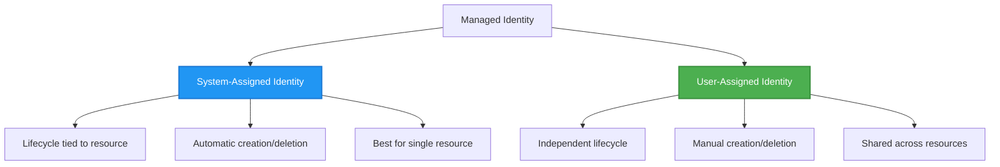

# प्रमाणीकरण पैटर्न और प्रबंधित पहचान

⏱️ **अनुमानित समय**: 45-60 मिनट पढ़ने के लिए; अभ्यासों को एकीकृत करने के लिए अतिरिक्त समय दें | 💰 **लागत प्रभाव**: पहचान/RBAC मुफ्त हैं; तैनात कंप्यूट, स्टोरेज, और Key Vault बिल योग्य हैं | ⭐ **जटिलता**: मध्यवर्ती

> का समीक्षा `azd 1.37.2` (नवंबर 2026) के खिलाफ किया गया। यह पाठ **चित्रात्मक एकीकरण टुकड़े प्रदान करता है, पूर्ण डाउनलोड करने योग्य `secure-app` टेम्पलेट नहीं।** संदर्भित फाइलें बनाएँ, मेल खाने वाले इन्फ्रास्ट्रक्चर उपलब्ध कराएँ, और डिप्लॉयमेंट से पहले प्लेसहोल्डर्स को बदलें। समीक्षा के दौरान कोई Azure संसाधन प्रदान नहीं किए गए।

**📚 सीखने का मार्ग:**
- ← पिछला: [कॉन्फ़िगरेशन प्रबंधन](configuration.md) - पर्यावरण चर और गुप्त जानकारी प्रबंधन
- 🎯 **आप यहाँ हैं**: प्रमाणीकरण और सुरक्षा (प्रबंधित पहचाना, की वाल्ट, सुरक्षित पैटर्न)
- → अगला: [कोड के रूप में इन्फ्रास्ट्रक्चर](../chapter-04-infrastructure/README.md) - संसाधनों को प्राविजन और डिप्लॉय करें
- 🏠 [कोर्स होम](../../README.md)

---

## आप क्या सीखेंगे

इस पाठ को पूरा करके, आप:
- Azure प्रमाणीकरण पैटर्न समझेंगे (कीज़, कनेक्शन स्ट्रिंग्स, प्रबंधित पहचाना)
- पासवर्डलेस प्रमाणीकरण के लिए **प्रबंधित पहचाना** लागू करेंगे
- **Azure Key Vault** एकीकरण के साथ गुप्त जानकारी सुरक्षित करेंगे
- AZD डिप्लॉयमेंट के लिए **भूमिका-आधारित पहुँच नियंत्रण (RBAC)** कॉन्फ़िगर करेंगे
- कंटेनर ऐप्स और Azure सेवाओं में सुरक्षा सर्वोत्तम प्रथाएँ लागू करेंगे
- कुंजी-आधारित से पहचान-आधारित प्रमाणीकरण में माइग्रेट करेंगे

## प्रबंधित पहचाना क्यों महत्वपूर्ण है

### समस्या: पारंपरिक प्रमाणीकरण

**प्रबंधित पहचाना से पहले:**
```javascript
// ❌ SECURITY RISK: Hardcoded secrets in code
const connectionString = "Server=mydb.database.windows.net;User=admin;Password=P@ssw0rd123";
const storageKey = "xK7mN9pQ2wR5tY8uI0oP3aS6dF1gH4jK...";
const cosmosKey = "C2x7B9n4M1p8Q5w3E6r0T2y5U8i1O4p7...";
```

**समस्याएँ:**
- 🔴 कोड, कॉन्फ़िगरेशन फाइलों, पर्यावरण चर में **प्रकट गुप्त जानकारी**
- 🔴 **प्रमाणीकरण जानकारी का परिवर्तन** कोड में बदलाव और पुनःडिप्लॉयमेंट की आवश्यकता
- 🔴 **ऑडिट समस्याएँ** - किसने कब क्या एक्सेस किया?
- 🔴 **विस्तार** - गुप्त जानकारियाँ कई सिस्टमों में फैली हुई हैं
- 🔴 **अनुपालन जोखिम** - सुरक्षा ऑडिट में विफलता

### समाधान: प्रबंधित पहचाना

**मैनेज्ड आइडेंटिटी के बाद:**
```javascript
// ✅ SECURE: No secrets in code
const credential = new DefaultAzureCredential();
const client = new BlobServiceClient(
  "https://mystorageaccount.blob.core.windows.net",
  credential  // Azure automatically handles authentication
);
```

**लाभ:**
- ✅ **कोड या कॉन्फ़िगरेशन में ज़ीरो सीक्रेट्स**
- ✅ **स्वचालित रोटेशन** - Azure इसे संभालता है
- ✅ **पूर्ण ऑडिट ट्रेल** Microsoft Entra ID लॉग्स में
- ✅ **केंद्रीकृत सुरक्षा** - Azure पोर्टल में प्रबंधित करें
- ✅ **अनुपालन तैयार** - सुरक्षा मानकों को पूरा करता है

**उदाहरण**: पारंपरिक प्रमाणीकरण कई भौतिक चाबियाँ ले जाने जैसा है जो अलग-अलग दरवाज़ों के लिए होती हैं। मैनेज्ड आइडेंटिटी एक सुरक्षा बैज की तरह है जो आपके आधार पर स्वचालित रूप से पहुंच देती है—कोई चाबियाँ खोने, कॉपी करने या घुमाने की जरूरत नहीं।

---

## वास्तुकला अवलोकन

### मैनेज्ड आइडेंटिटी के साथ प्रमाणीकरण प्रवाह

```mermaid
sequenceDiagram
    participant App as Your Application<br/>(Container App)
    participant MI as Managed Identity<br/>(Microsoft Entra ID)
    participant KV as Key Vault
    participant Storage as Azure Storage
    participant DB as Azure SQL
    
    App->>MI: Request access token<br/>(automatic)
    MI->>MI: Verify identity<br/>(no password needed)
    MI-->>App: Return token for requested audience<br/>(lifetime varies)
    
    App->>KV: Get secret<br/>(using token)
    KV->>KV: Check RBAC permissions
    KV-->>App: Return secret value
    
    App->>Storage: Upload blob<br/>(using token)
    Storage->>Storage: Check RBAC permissions
    Storage-->>App: Success
    
    App->>DB: Query data<br/>(using token)
    DB->>DB: Check SQL permissions
    DB-->>App: Return results
    
    Note over App,DB: Request a separate token for each service audience;<br/>SDK credentials handle caching and renewal
```

### मैनेज्ड आइडेंटिटी के प्रकार



| विशेषता | सिस्टम-असाइन की गई | उपयोगकर्ता-असाइन की गई |
|---------|----------------|---------------|
| **जीवन चक्र** | संसाधन से जुड़ी हुई | स्वतंत्र |
| **निर्माण** | संसाधन के साथ स्वचालित | मैनुअल निर्माण |
| **हटाना** | संसाधन के साथ हटाई जाती है | संसाधन हटाने के बाद भी बनी रहती है |
| **साझा करना** | केवल एक संसाधन के लिए | कई संसाधनों के लिए |
| **उपयोग केस** | सरल परिदृश्य | जटिल मल्टी-रिसोर्स परिदृश्य |
| **टेम्पलेट विकल्प** | अवसंरचना में परिभाषित | अवसंरचना में परिभाषित |

---

## पूर्वापेक्षाएँ

### आवश्यक उपकरण

आपको ये पहले के पाठ से पहले ही इंस्टॉल किए होने चाहिए:

```bash
# Verify Azure Developer CLI
azd version
# ✅ Expected: azd version 1.0.0 or higher

# Verify Azure CLI
az --version
# ✅ Expected: azure-cli 2.50.0 or higher
```

### Azure आवश्यकताएँ

- सक्रिय Azure सदस्यता
- अनुमति:
  - मैनेज्ड आइडेंटिटीज़ बनाना
  - RBAC भूमिकाएं असाइन करना
  - की वॉल्ट संसाधन बनाना
  - कंटेनर ऐप्स को तैनात करना

### ज्ञान की पूर्वापेक्षाएँ

आपको पूरा किया होना चाहिए:
- [स्थापना गाइड](../chapter-01-foundation/installation.md) - AZD सेटअप
- [AZD मूल बातें](../chapter-01-foundation/azd-basics.md) - कोर अवधारणाएँ
- [कॉन्फ़िगरेशन प्रबंधन](configuration.md) - पर्यावरण चर

---

## पाठ 1: प्रमाणीकरण पैटर्न को समझना

### पैटर्न 1: कनेक्शन स्ट्रिंग्स (पुराना - बचें)

**कैसे काम करता है:**
```bash
# Connection string contains credentials
STORAGE_CONNECTION_STRING="DefaultEndpointsProtocol=https;AccountName=myaccount;AccountKey=xK7mN9pQ2wR5..."
COSMOS_CONNECTION_STRING="AccountEndpoint=https://myaccount.documents.azure.com:443/;AccountKey=C2x7..."
SQL_CONNECTION_STRING="Server=myserver.database.windows.net;User=admin;Password=P@ssw0rd..."
```

**समस्याएँ:**
- ❌ पर्यावरण चर में सीक्रेट्स दिखाई देते हैं
- ❌ तैनाती प्रणालियों में लॉग हो जाते हैं
- ❌ रोटेट करना मुश्किल है
- ❌ एक्सेस का कोई ऑडिट ट्रेल नहीं है

**कब उपयोग करें:** जब लक्ष्य सेवा को कुंजी-आधारित प्रमाणीकरण की आवश्यकता हो। समर्थन होने पर पहचान का उपयोग करना प्राथमिकता दें; अन्यथा कुंजियों को सुरक्षित रूप से स्टोर करें और उन्हें घुमाएं, उत्पादन में भी।

---

### पैटर्न 2: की वॉल्ट संदर्भ (बेहतर)

**कैसे काम करता है:**
**आंशिक बाइसप फ्रैगमेंट्स:** आवश्यक वॉल्ट फ़ील्ड, कंटेनर एप पहचान, और इसका `configuration.secrets` प्रवेश शामिल नहीं हैं। `secretRef` एक कंटेनर एप सीक्रेट का नाम है; यह **स्वयं** की वॉल्ट यूआरआई नहीं है। की वॉल्ट का उपयोग करने के लिए, उस नामित सीक्रेट को `keyVaultUrl` के साथ परिभाषित करें और एक अधिकृत `identity` प्रदान करें।

```bicep
// Store secret in Key Vault
resource keyVault 'Microsoft.KeyVault/vaults@2023-02-01' = {
  name: 'mykv'
  properties: {
    enableRbacAuthorization: true
  }
}

// Reference in Container App
env: [
  {
    name: 'STORAGE_KEY'
    secretRef: 'storage-key'  // References Key Vault
  }
]
```

**लाभ:**
- ✅ की वॉल्ट में सुरक्षित रूप से स्टोर किए गए सीक्रेट्स
- ✅ केंद्रीकृत सीक्रेट प्रबंधन
- ✅ कोड परिवर्तनों के बिना रोटेशन

**सीमाएँ:**
- ⚠️ अभी भी कुंजी/पासवर्ड उपयोग कर रहे हैं
- ⚠️ की वॉल्ट एक्सेस का प्रबंधन आवश्यक है

**कब उपयोग करें:** कनेक्शन स्ट्रिंग्स से प्रबंधित पहचान में संक्रमण चरण।

---

### पैटर्न 3: प्रबंधित पहचान (सर्वश्रेष्ठ अभ्यास)

**कैसे काम करता है:**
**आंशिक बाइसप:** पहचान ब्लॉक को पूर्ण कंटेनर एप में मर्ज करें और `storageAccount` तथा भूमिका परिभाषा प्रदान करें। एक भूमिका असाइनमेंट में एक निर्धारक `name` भी आवश्यक है।

```bicep
// Enable managed identity
resource containerApp 'Microsoft.App/containerApps@2023-05-01' = {
  name: 'myapp'
  identity: {
    type: 'SystemAssigned'  // Automatically creates identity
  }
}

// Grant permissions
resource roleAssignment 'Microsoft.Authorization/roleAssignments@2022-04-01' = {
  name: guid(storageAccount.id, containerApp.id, storageBlobDataContributorRole)
  scope: storageAccount
  properties: {
    roleDefinitionId: storageBlobDataContributorRole
    principalId: containerApp.identity.principalId
    principalType: 'ServicePrincipal'
  }
}
```

**एप्लिकेशन कोड:**
```javascript
// No secrets needed!
const { DefaultAzureCredential } = require('@azure/identity');
const { BlobServiceClient } = require('@azure/storage-blob');

const credential = new DefaultAzureCredential();
const blobServiceClient = new BlobServiceClient(
  'https://mystorageaccount.blob.core.windows.net',
  credential
);
```

**लाभ:**
- ✅ कोड/कॉन्फ़िग में शून्य सीक्रेट्स
- ✅ स्वचालित प्रमाणीकरण रोटेशन
- ✅ पूर्ण ऑडिट ट्रेल
- ✅ RBAC-आधारित अनुमतियाँ
- ✅ अनुपालन के लिए तैयार

**कब उपयोग करें:** Azure-होस्टेड अनुप्रयोगों के लिए प्राथमिकता जो Microsoft Entra प्रमाणीकरण का समर्थन करते हैं।

---

### पैटर्न 4: सेवा प्रिंसिपल्स (CI/CD और ऑटोमेशन)

प्रबंधित पहचान *Azure के अंदर चलने वाले संसाधनों* के लिए स्वर्ण मापदंड है। लेकिन Azure के बाहर चलने वाली चीज़ों का क्या—जैसे बिuld एजेंट पर एक CI/CD पाइपलाइन, या आपकी लैपटॉप पर एक स्क्रिप्ट जो आपकी इंटरैक्टिव लॉगिन उपयोग नहीं कर सकती? वहां एक **सेवा प्रिंसिपल** आता है: एक गैर-मानव पहचान जिसके अपने क्रेडेंशियल होते हैं जिन्हें एक स्वचालित प्रक्रिया के रूप में साइन इन कर सकता है।

**कैसे काम करता है:**

एक सेवा प्रिंसिपल बनाएं जो एक रिसोर्स समूह के लिए सीमित हो (न्यूनतम विशेषाधिकार):

```bash
az ad sp create-for-rbac \
  --name "myapp-cicd" \
  --role contributor \
  --scopes "/subscriptions/<sub-id>/resourceGroups/<rg-name>"
```

यह एक क्लाइंट आईडी, क्लाइंट सीक्रेट, और टेनेंट आईडी प्रिंट करता है। azd उनके साथ गैर-इंटरैक्टिव रूप से साइन इन कर सकता है:

```bash
azd auth login \
  --client-id "<appId>" \
  --client-secret "<password>" \
  --tenant-id "<tenant>"
```

**सीक्रेट्स की तुलना में फेडरेटेड क्रेडेंशियल्स (OIDC) पसंद करें।** लंबे समय तक चलने वाले क्लाइंट सीक्रेट के बजाय, एक फेडरेटेड क्रेडेंशियल कॉन्फ़िगर करें ताकि पाइपलाइन एक अल्पकालिक टोकन का आदान-प्रदान करे—कोई सीक्रेट नहीं लीक या रोटेट करने के लिए:

```bash
azd auth login \
  --client-id "<appId>" \
  --federated-credential-provider "github" \
  --tenant-id "<tenant>"
```

> `azd pipeline config` इसे आपके लिए स्वचालित रूप से सेट अप करता है। [अध्याय 8](../chapter-08-production/production-ai-practices.md) में CI/CD वॉकथ्रू देखें।

**लाभ:**
- ✅ Azure के बाहर काम करता है (बिल्ड एजेंट्स, ऑन-प्रिम, अन्य क्लाउड)
- ✅ एक ही रोल के साथ एकल रिसोर्स ग्रुप तक सीमित किया जा सकता है
- ✅ फ़ेडरेटेड (OIDC) वैरियंट में कोई संग्रहीत सीक्रेट नहीं होता

**ट्रेड-ऑफ़्स:**
- ⚠️ सीक्रेट-आधारित वैरियंट सावधानी से स्टोर और रोटेट करने की मांग करता है
- ⚠️ अगर सीक्रेट लीक हो जाता है तो SP जितना कर सकता है उतना कर सकता है—स्कोप को सख्त रखें

**कब उपयोग करें:** CI/CD पाइपलाइंस और ऑटोमेशन जो मैनेज्ड आइडेंटिटी का उपयोग नहीं कर सकते। हमेशा **फ़ेडरेटेड/OIDC** वैरियंट को क्लाइंट सीक्रेट पर प्राथमिकता दें, और जब भी वर्कलोड Azure के अंदर चले तो मैनेज्ड आइडेंटिटी को प्राथमिकता दें।

**क्रेडेंशियल्स को सुरक्षित रूप से स्टोर करना:**
- कभी भी सीक्रेट्स कमिट न करें—अपने पाइपलाइन के सीक्रेट स्टोर का उपयोग करें (GitHub Actions सीक्रेट्स, Azure DevOps वेरिएबल समूह / Key Vault)।
- SP को उसके न्यूनतम रोल और रिसोर्स ग्रुप तक सीमित करें जिसकी उसे आवश्यकता है।
- एक समाप्ति तिथि सेट करें और रोटेट करें, या OIDC के साथ सीक्रेट को पूरी तरह हटा दें।

---

## पाठ 2: AZD के साथ मैनेज्ड आइडेंटिटी को लागू करना

### कदम-ब-कदम कार्यान्वयन

निम्न खंड दिखाते हैं कि कैसे मैनेज्ड आइडेंटिटी को कंटेनर ऐप प्रोजेक्ट में एकीकृत करें। वे **कॉपी-और-रन स्टार्टर नहीं हैं**: स्टोरेज मॉड्यूल, पूर्ण मैनेज्ड एनवायरनमेंट/रजिस्ट्री अवसंरचना, Dockerfile, और पैरामीटर फाइल यहाँ पूरी तरह नहीं दी गई हैं। एक कार्यशील कंटेनर ऐप्स टेम्पलेट से शुरू करें और इन पैटर्न्स को मर्ज करें, इसके रजिस्ट्री कॉन्फ़िगरेशन और सर्विस टैग्स को बनाए रखते हुए।

### प्रोजेक्ट संरचना

```
secure-app/
├── azure.yaml                 # AZD configuration
├── infra/
│   ├── main.bicep            # Main infrastructure
│   ├── core/
│   │   ├── identity.bicep    # Managed identity setup
│   │   ├── keyvault.bicep    # Key Vault configuration
│   │   └── storage.bicep     # Storage with RBAC
│   └── app/
│       └── container-app.bicep
└── src/
    ├── app.js                # Application code
    ├── package.json
    └── Dockerfile
```

### 1. AZD कॉन्फ़िगर करें (azure.yaml)

```yaml
name: secure-app
metadata:
  template: secure-app@1.0.0

services:
  api:
    project: ./src
    language: js
    host: containerapp

# Managed identity must be enabled in the infrastructure, not by this YAML.
```

### 2. इंफ्रास्ट्रक्चर: मैनेज्ड आइडेंटिटी सक्षम करें

**फाइल: `infra/main.bicep`**

```bicep
targetScope = 'subscription'

param environmentName string
param location string = 'eastus'
param containerAppsEnvironmentId string
param containerImage string

var tags = { 'azd-env-name': environmentName }

// Resource group
resource rg 'Microsoft.Resources/resourceGroups@2021-04-01' = {
  name: 'rg-${environmentName}'
  location: location
  tags: tags
}

// Storage Account
module storage './core/storage.bicep' = {
  name: 'storage'
  scope: rg
  params: {
    name: 'st${uniqueString(rg.id)}'
    location: location
    tags: tags
  }
}

// Key Vault
module keyVault './core/keyvault.bicep' = {
  name: 'keyvault'
  scope: rg
  params: {
    name: 'kv-${uniqueString(rg.id)}'
    location: location
    tags: tags
  }
}

// Container App with Managed Identity
module containerApp './app/container-app.bicep' = {
  name: 'container-app'
  scope: rg
  params: {
    name: 'ca-${environmentName}'
    location: location
    tags: tags
    storageAccountName: storage.outputs.name
    keyVaultName: keyVault.outputs.name
    containerAppsEnvironmentId: containerAppsEnvironmentId
    containerImage: containerImage
  }
}

// Grant Container App access to Storage
module storageRoleAssignment './core/role-assignment.bicep' = {
  name: 'storage-role'
  scope: rg
  params: {
    principalId: containerApp.outputs.identityPrincipalId
    roleDefinitionId: 'ba92f5b4-2d11-453d-a403-e96b0029c9fe'  // Storage Blob Data Contributor
    targetResourceType: 'storage'
    targetResourceName: storage.outputs.name
  }
}

// Grant Container App access to Key Vault
module kvRoleAssignment './core/role-assignment.bicep' = {
  name: 'kv-role'
  scope: rg
  params: {
    principalId: containerApp.outputs.identityPrincipalId
    roleDefinitionId: '4633458b-17de-408a-b874-0445c86b69e6'  // Key Vault Secrets User
    targetResourceType: 'keyvault'
    targetResourceName: keyVault.outputs.name
  }
}

// Outputs
output AZURE_STORAGE_ACCOUNT_NAME string = storage.outputs.name
output AZURE_KEY_VAULT_NAME string = keyVault.outputs.name
output APP_URL string = containerApp.outputs.url
```

### 3. सिस्टम-असाइन्ड आइडेंटिटी के साथ कंटेनर ऐप

**फाइल: `infra/app/container-app.bicep`**

```bicep
param name string
param location string
param tags object = {}
param storageAccountName string
param keyVaultName string
param containerAppsEnvironmentId string
param containerImage string

resource containerApp 'Microsoft.App/containerApps@2023-05-01' = {
  name: name
  location: location
  tags: union(tags, { 'azd-service-name': 'api' })
  identity: {
    type: 'SystemAssigned'  // 🔑 Enable managed identity
  }
  properties: {
    managedEnvironmentId: containerAppsEnvironmentId
    configuration: {
      ingress: {
        external: true
        targetPort: 3000
      }
    }
    template: {
      containers: [
        {
          name: 'api'
          image: containerImage // Must exist; configure registry credentials for private images
          resources: {
            cpu: json('0.5')
            memory: '1Gi'
          }
          env: [
            {
              name: 'AZURE_STORAGE_ACCOUNT_NAME'
              value: storageAccountName
            }
            {
              name: 'AZURE_KEY_VAULT_NAME'
              value: keyVaultName
            }
            // 🔑 No secrets - managed identity handles authentication!
          ]
        }
      ]
    }
  }
}

// Output the identity for RBAC assignments
output identityPrincipalId string = containerApp.identity.principalId
output id string = containerApp.id
output url string = 'https://${containerApp.properties.configuration.ingress.fqdn}'
```

### 4. RBAC रोल असाइनमेंट मॉड्यूल

**फाइल: `infra/core/role-assignment.bicep`**

```bicep
param principalId string
param roleDefinitionId string  // Azure built-in role ID
@allowed(['storage', 'keyvault'])
param targetResourceType string
param targetResourceName string

// Typed existing resources give Bicep a valid resource scope, not a string ID.
resource storageTarget 'Microsoft.Storage/storageAccounts@2023-01-01' existing = {
  name: targetResourceName
}
resource vaultTarget 'Microsoft.KeyVault/vaults@2023-02-01' existing = {
  name: targetResourceName
}

resource storageAssignment 'Microsoft.Authorization/roleAssignments@2022-04-01' = if (targetResourceType == 'storage') {
  name: guid(storageTarget.id, principalId, roleDefinitionId)
  scope: storageTarget
  properties: {
    roleDefinitionId: subscriptionResourceId('Microsoft.Authorization/roleDefinitions', roleDefinitionId)
    principalId: principalId
    principalType: 'ServicePrincipal'
  }
}

resource vaultAssignment 'Microsoft.Authorization/roleAssignments@2022-04-01' = if (targetResourceType == 'keyvault') {
  name: guid(vaultTarget.id, principalId, roleDefinitionId)
  scope: vaultTarget
  properties: {
    roleDefinitionId: subscriptionResourceId('Microsoft.Authorization/roleDefinitions', roleDefinitionId)
    principalId: principalId
    principalType: 'ServicePrincipal'
  }
}

// This module assigns at the target resource scope, not the whole resource group.
```

### 5. मैनेज्ड आइडेंटिटी के साथ एप्लिकेशन कोड

**फाइल: `src/app.js`**

```javascript
const express = require('express');
const { DefaultAzureCredential } = require('@azure/identity');
const { BlobServiceClient } = require('@azure/storage-blob');
const { SecretClient } = require('@azure/keyvault-secrets');

const app = express();
const PORT = process.env.PORT || 3000;

// 🔑 Initialize credential (works automatically with managed identity)
const credential = new DefaultAzureCredential();

// Azure Storage setup
const storageAccountName = process.env.AZURE_STORAGE_ACCOUNT_NAME;
const blobServiceClient = new BlobServiceClient(
  `https://${storageAccountName}.blob.core.windows.net`,
  credential  // No keys needed!
);

// Key Vault setup
const keyVaultName = process.env.AZURE_KEY_VAULT_NAME;
const secretClient = new SecretClient(
  `https://${keyVaultName}.vault.azure.net`,
  credential  // No keys needed!
);

// Health check
app.get('/health', (req, res) => {
  res.json({ status: 'healthy', authentication: 'managed-identity' });
});

// Upload file to blob storage
app.post('/upload', async (req, res) => {
  try {
    const containerClient = blobServiceClient.getContainerClient('uploads');
    await containerClient.createIfNotExists();
    
    const blobName = `file-${Date.now()}.txt`;
    const blockBlobClient = containerClient.getBlockBlobClient(blobName);
    
    const content = 'Hello from managed identity!';
    await blockBlobClient.upload(content, Buffer.byteLength(content));
    
    res.json({
      success: true,
      blobName: blobName,
      message: 'File uploaded using managed identity!'
    });
  } catch (error) {
    console.error('Upload error:', error);
    res.status(500).json({ error: error.message });
  }
});

// Get secret from Key Vault
app.get('/secret/:name', async (req, res) => {
  try {
    const secretName = req.params.name;
    const secret = await secretClient.getSecret(secretName);
    
    res.json({
      name: secretName,
      retrieved: secret.value !== undefined, // Never return the secret value to callers
      message: 'Secret retrieved using managed identity!'
    });
  } catch (error) {
    console.error('Secret error:', error);
    res.status(500).json({ error: error.message });
  }
});

// List blob containers (demonstrates read access)
app.get('/containers', async (req, res) => {
  try {
    const containers = [];
    for await (const container of blobServiceClient.listContainers()) {
      containers.push(container.name);
    }
    
    res.json({
      containers: containers,
      count: containers.length,
      message: 'Containers listed using managed identity!'
    });
  } catch (error) {
    console.error('List error:', error);
    res.status(500).json({ error: error.message });
  }
});

app.listen(PORT, () => {
  console.log(`Secure API listening on port ${PORT}`);
  console.log('Authentication: Managed Identity (passwordless)');
});
```

**फाइल: `src/package.json`**

```json
{
  "name": "secure-app",
  "version": "1.0.0",
  "dependencies": {
    "express": "^4.18.2",
    "@azure/identity": "^4.0.0",
    "@azure/storage-blob": "^12.17.0",
    "@azure/keyvault-secrets": "^4.7.0"
  },
  "scripts": {
    "start": "node app.js"
  }
}
```

### 6. डिप्लॉय और टेस्ट करें

केवल तब इन कमांड्स को चलाएं **जब** आपने अपनी इंफ्रास्ट्रक्चर, Dockerfile, और मिलते-जुलते `main.parameters.json` को अपने प्रोजेक्ट में पूरा कर लिया हो। azd को `azd auth login` के साथ ऑथेंटिकेट करें; बाद में Azure CLI चेक के लिए अलग से `az login` के साथ साइन-इन करें। दिखाए गए एंडपॉइंट डेमो हैं और सार्वजनिक उपयोग से पहले उचित एक्सेस नियंत्रण की आवश्यकता है।

```bash
# Initialize AZD environment
azd init

# Deploy infrastructure and application
azd up

# Get the app URL
APP_URL=$(azd env get-value APP_URL)

# Test health check
curl $APP_URL/health
```

**✅ अपेक्षित आउटपुट:**
```json
{
  "status": "healthy",
  "authentication": "managed-identity"
}
```

**ब्लॉब अपलोड टेस्ट करें:**
```bash
curl -X POST $APP_URL/upload
```

**✅ अपेक्षित आउटपुट:**
```json
{
  "success": true,
  "blobName": "file-1700404800000.txt",
  "message": "File uploaded using managed identity!"
}
```

**कंटेनर लिस्टिंग टेस्ट करें:**
```bash
curl $APP_URL/containers
```

**✅ अपेक्षित आउटपुट:**
```json
{
  "containers": ["uploads"],
  "count": 1,
  "message": "Containers listed using managed identity!"
}
```

---

## सामान्य Azure RBAC रोल्स

### मैनेज्ड आइडेंटिटी के लिए बिल्ट-इन रोल आईडी

| सेवा | रोल नाम | रोल आईडी | अनुमतियाँ |
|---------|-----------|---------|-------------|
| **Storage** | Storage Blob Data Reader | `2a2b9908-6ea1-4ae2-8e65-a410df84e7d1` | ब्लॉब और कंटेनर पढ़ें |
| **Storage** | Storage Blob Data Contributor | `ba92f5b4-2d11-453d-a403-e96b0029c9fe` | ब्लॉब पढ़ें, लिखें, हटाएं |
| **Storage** | Storage Queue Data Contributor | `974c5e8b-45b9-4653-ba55-5f855dd0fb88` | क्व्यूज़/मैसेज पढ़ें, लिखें, हटाएं |
| **Key Vault** | कुंजी वाल्ट सीक्रेट्स उपयोगकर्ता | `4633458b-17de-408a-b874-0445c86b69e6` | सीक्रेट पढ़ें |
| **Key Vault** | कुंजी वाल्ट सीक्रेट्स अधिकारी | `b86a8fe4-44ce-4948-aee5-eccb2c155cd7` | सीक्रेट पढ़ें, लिखें, हटाएं |
| **Cosmos DB** | Cosmos DB अंतर्निर्मित डेटा रीडर | `00000000-0000-0000-0000-000000000001` | Cosmos DB डाटा पढ़ें |
| **Cosmos DB** | Cosmos DB अंतर्निर्मित डेटा योगदानकर्ता | `00000000-0000-0000-0000-000000000002` | Cosmos DB डेटा पढ़ें, लिखें |
| **SQL Database** | SQL DB सहयोगी | `9b7fa17d-e63e-47b0-bb0a-15c516ac86ec` | डेटाबेस संसाधनों का प्रबंधन; SQL डेटा एक्सेस प्रदान नहीं करता |
| **Service Bus** | Azure सर्विस बस डेटा स्वामी | `090c5cfd-751d-490a-894a-3ce6f1109419` | संदेश भेजें, प्राप्त करें, प्रबंधित करें |

### भूमिका आईडी कैसे खोजें

Cosmos DB for NoSQL की ऊपर दी गई दो आईडी **नेटिव Cosmos डेटा-प्लेन भूमिका परिभाषाएं** हैं, Azure RBAC सदस्यता भूमिका आईडी नहीं। इन्हें असाइन करने के लिए `az cosmosdb sql role assignment create` (या `Microsoft.DocumentDB/databaseAccounts/sqlRoleAssignments`) का उपयोग करें, `az role assignment create` का नहीं। SQL डेटा एक्सेस के लिए Entra डेटाबेस उपयोगकर्ता और SQL अनुमतियाँ आवश्यक हैं।

```bash
# List all built-in roles
az role definition list --query "[].{Name:roleName, ID:name}" --output table

# Search for specific role
az role definition list --query "[?contains(roleName, 'Storage Blob')].{Name:roleName, ID:name}" --output table

# Get role details
az role definition list --name "Storage Blob Data Contributor"
```

---

## व्यावहारिक अभ्यास

**तीनों अभ्यासों के लिए एकीकरण पूर्वापेक्षाएं:** अपने प्रोजेक्ट में एक कार्यशील कंटेनर ऐप टेम्पलेट, मेल खाते हुए Bicep संसाधन, Azure CLI/azd साइन-इन, और आवश्यक भूमिकाएं असाइन करने का अधिकार। ये मार्गदर्शित अनुकूलन हैं, स्वतंत्र स्थानीय स्टार्टर नहीं; नमूना संसाधन नामों को अपने नियोजित नामों से बदलें।

### अभ्यास 1: मौजूदा ऐप के लिए प्रबंधित पहचान सक्षम करें ⭐⭐ (मध्यम)

**लक्ष्य**: मौजूदा कंटेनर ऐप डिप्लॉयमेंट में प्रबंधित पहचान जोड़ें

**परिदृश्य**: आपका कंटेनर ऐप कनेक्शन स्ट्रिंग्स का उपयोग करता है। इसे प्रबंधित पहचान में परिवर्तित करें।

**प्रारंभिक स्थिति**: इस कॉन्फ़िगरेशन के साथ कंटेनर ऐप:

```bicep
// ❌ Current: Using connection string
env: [
  {
    name: 'STORAGE_CONNECTION_STRING'
    secretRef: 'storage-connection'
  }
]
```

**कदम:**

1. **Bicep में प्रबंधित पहचान सक्षम करें:**

```bicep
resource containerApp 'Microsoft.App/containerApps@2023-05-01' = {
  name: 'myapp'
  identity: {
    type: 'SystemAssigned'  // Add this
  }
  // ... rest of configuration
}
```

2. **स्टोरेज एक्सेस प्रदान करें:**

```bicep
// Get storage account reference
resource storageAccount 'Microsoft.Storage/storageAccounts@2023-01-01' existing = {
  name: storageAccountName
}

// Assign role
resource roleAssignment 'Microsoft.Authorization/roleAssignments@2022-04-01' = {
  name: guid(containerApp.id, 'ba92f5b4-2d11-453d-a403-e96b0029c9fe', storageAccount.id)
  scope: storageAccount
  properties: {
    roleDefinitionId: subscriptionResourceId('Microsoft.Authorization/roleDefinitions', 'ba92f5b4-2d11-453d-a403-e96b0029c9fe')
    principalId: containerApp.identity.principalId
    principalType: 'ServicePrincipal'
  }
}
```

3. **एप्लिकेशन कोड अपडेट करें:**

**पहले (कनेक्शन स्ट्रिंग):**
```javascript
const { BlobServiceClient } = require('@azure/storage-blob');

const blobServiceClient = BlobServiceClient.fromConnectionString(
  process.env.STORAGE_CONNECTION_STRING
);
```

**बाद में (प्रबंधित पहचान):**
```javascript
const { DefaultAzureCredential } = require('@azure/identity');
const { BlobServiceClient } = require('@azure/storage-blob');

const credential = new DefaultAzureCredential();
const blobServiceClient = new BlobServiceClient(
  `https://${process.env.STORAGE_ACCOUNT_NAME}.blob.core.windows.net`,
  credential
);
```

4. **पर्यावरण चर अपडेट करें:**

```bicep
env: [
  {
    name: 'STORAGE_ACCOUNT_NAME'
    value: storageAccountName  // Just the name, no secrets!
  }
  // Remove STORAGE_CONNECTION_STRING
]
```

5. **डिप्लॉय करें और परीक्षण करें:**

```bash
# Redeploy
azd up

# Test that it still works
APP_URL=$(azd show --output json | jq -er '.services.api.ingressUrl')
curl --fail -X POST "$APP_URL/upload"
```

**✅ सफलता के मानदंड:**
- ✅ एप्लिकेशन बिना त्रुटि के डिप्लॉय हो जाए
- ✅ स्टोरेज संचालन काम करें (अपलोड, सूची, डाउनलोड)
- ✅ पर्यावरण चर में कोई कनेक्शन स्ट्रिंग नहीं हो
- ✅ Azure पोर्टल में "Identity" ब्लेड के तहत पहचान दिखाई दे

**सत्यापन:**

```bash
# Check managed identity is enabled
az containerapp show \
  --name myapp \
  --resource-group rg-myapp \
  --query "identity.type"
# ✅ Expected: "SystemAssigned"

# Check role assignment
az role assignment list \
  --assignee $(az containerapp show --name myapp --resource-group rg-myapp --query "identity.principalId" -o tsv) \
  --scope /subscriptions/{sub-id}/resourceGroups/rg-myapp/providers/Microsoft.Storage/storageAccounts/mystorageaccount
# ✅ Expected: Shows "Storage Blob Data Contributor" role
```

**समय**: 20-30 मिनट

---

### अभ्यास 2: उपयोगकर्ता-असाइन की गई पहचान के साथ मल्टी-सर्विस एक्सेस ⭐⭐⭐ (उन्नत)

**लक्ष्य**: एक उपयोगकर्ता-असाइन की गई पहचान बनाएं जिसे कई कंटेनर ऐप्स साझा करें

**परिदृश्य**: आपके पास 3 माइक्रोसर्विस हैं जिन्हें एक ही स्टोरेज अकाउंट और की वॉल्ट तक पहुंच चाहिए।

**कदम:**

1. **उपयोगकर्ता-असाइन की गई पहचान बनाएँ:**

**फ़ाइल: `infra/core/identity.bicep`**

```bicep
param name string
param location string
param tags object = {}

resource userAssignedIdentity 'Microsoft.ManagedIdentity/userAssignedIdentities@2023-01-31' = {
  name: name
  location: location
  tags: tags
}

output id string = userAssignedIdentity.id
output principalId string = userAssignedIdentity.properties.principalId
output clientId string = userAssignedIdentity.properties.clientId
```

2. **उपयोगकर्ता-असाइन की गई पहचान को भूमिका असाइन करें:**

```bicep
// In main.bicep
module userIdentity './core/identity.bicep' = {
  name: 'user-identity'
  scope: rg
  params: {
    name: 'id-${environmentName}'
    location: location
    tags: tags
  }
}

// Grant Storage access
resource storageRoleAssignment 'Microsoft.Authorization/roleAssignments@2022-04-01' = {
  name: guid(storageAccount.id, environmentName, 'storage-contributor')
  scope: storageAccount
  properties: {
    roleDefinitionId: subscriptionResourceId('Microsoft.Authorization/roleDefinitions', 'ba92f5b4-2d11-453d-a403-e96b0029c9fe')
    principalId: userIdentity.outputs.principalId
    principalType: 'ServicePrincipal'
  }
}

// Grant Key Vault access
resource kvRoleAssignment 'Microsoft.Authorization/roleAssignments@2022-04-01' = {
  name: guid(keyVault.id, environmentName, 'kv-secrets-user')
  scope: keyVault
  properties: {
    roleDefinitionId: subscriptionResourceId('Microsoft.Authorization/roleDefinitions', '4633458b-17de-408a-b874-0445c86b69e6')
    principalId: userIdentity.outputs.principalId
    principalType: 'ServicePrincipal'
  }
}
```

3. **कई कंटेनर ऐप्स को पहचान सौंपें:**

```bicep
resource apiGateway 'Microsoft.App/containerApps@2023-05-01' = {
  name: 'api-gateway'
  identity: {
    type: 'UserAssigned'
    userAssignedIdentities: {
      '${userIdentity.outputs.id}': {}
    }
  }
  // ... rest of config
}

resource productService 'Microsoft.App/containerApps@2023-05-01' = {
  name: 'product-service'
  identity: {
    type: 'UserAssigned'
    userAssignedIdentities: {
      '${userIdentity.outputs.id}': {}
    }
  }
  // ... rest of config
}

resource orderService 'Microsoft.App/containerApps@2023-05-01' = {
  name: 'order-service'
  identity: {
    type: 'UserAssigned'
    userAssignedIdentities: {
      '${userIdentity.outputs.id}': {}
    }
  }
  // ... rest of config
}
```

4. **एप्लिकेशन कोड (सभी सेवाएं समान पैटर्न का उपयोग करती हैं):**

```javascript
const { ManagedIdentityCredential } = require('@azure/identity');
const { BlobServiceClient } = require('@azure/storage-blob');

// For user-assigned identity, specify the client ID
const credential = new ManagedIdentityCredential(
  process.env.AZURE_CLIENT_ID  // User-assigned identity client ID
);

// Alternative (choose ONE credential declaration):
// const { DefaultAzureCredential } = require('@azure/identity');
// const credential = new DefaultAzureCredential({
//   managedIdentityClientId: process.env.AZURE_CLIENT_ID
// });

const blobServiceClient = new BlobServiceClient(
  `https://${process.env.STORAGE_ACCOUNT_NAME}.blob.core.windows.net`,
  credential
);
```

प्रत्येक कंटेनर ऐप के रनटाइम `AZURE_CLIENT_ID` को बीसप में `userIdentity.outputs.clientId` पर सेट करें और `STORAGE_ACCOUNT_NAME` को अपने स्टोरेज नाम पर। केवल पहचान निर्दिष्ट करना या `azd env set` चलाना इन रनटाइम मानों को कॉन्फ़िगर नहीं करता है।

5. **तैनात करें और सत्यापित करें:**

```bash
azd up

# Test all services can access storage
# Replace with the actual ingress URLs reported for your three services
curl --fail -X POST "$API_GATEWAY_URL/upload"
curl --fail -X POST "$PRODUCT_SERVICE_URL/upload"
curl --fail -X POST "$ORDER_SERVICE_URL/upload"
```

**✅ सफलता के मानदंड:**
- ✅ 3 सेवाओं में एक साझा पहचान
- ✅ सभी सेवाएं स्टोरेज और की वॉल्ट तक पहुँच सकती हैं
- ✅ एक सेवा को हटाने पर भी पहचान बनी रहती है
- ✅ केंद्रीकृत अनुमति प्रबंधन

**उपयोगकर्ता-नियुक्त पहचान के लाभ:**
- प्रबंधन के लिए एकल पहचान
- सेवाओं में सुसंगत अनुमतियां
- सेवा हटाने पर बचती है
- जटिल वास्तुकला के लिए बेहतर

**समय**: 30-40 मिनट

---

### अभ्यास 3: की वॉल्ट सीक्रेट रोटेशन लागू करें ⭐⭐⭐ (उन्नत)

**लक्ष्य**: की वॉल्ट में थर्ड-पार्टी API कुंजी संग्रहीत करें और प्रबंधित पहचान का उपयोग करके उन तक पहुँचें

**परिदृश्य**: आपका ऐप एक बाहरी API (OpenAI, Stripe, SendGrid) को कॉल करता है जिसे API कुंजी की आवश्यकता होती है।

**चरण:**

1. **RBAC के साथ की वॉल्ट बनाएँ:**

**फ़ाइल: `infra/core/keyvault.bicep`**

```bicep
param name string
param location string
param tags object = {}

resource keyVault 'Microsoft.KeyVault/vaults@2023-02-01' = {
  name: name
  location: location
  tags: tags
  properties: {
    enableRbacAuthorization: true  // Use RBAC instead of access policies
    sku: {
      family: 'A'
      name: 'standard'
    }
    tenantId: subscription().tenantId
    enableSoftDelete: true
    softDeleteRetentionInDays: 90
  }
}

// Allow Container App to read secrets
output id string = keyVault.id
output name string = keyVault.name
output uri string = keyVault.properties.vaultUri
```

2. **की वॉल्ट में गुप्त जानकारी संग्रहित करें:**

```bash
# Get Key Vault name
KV_NAME=$(azd env get-value AZURE_KEY_VAULT_NAME)

# Store third-party API keys
az keyvault secret set \
  --vault-name $KV_NAME \
  --name "OpenAI-ApiKey" \
  --value "sk-proj-xxxxxxxxxxxxx"

az keyvault secret set \
  --vault-name $KV_NAME \
  --name "Stripe-ApiKey" \
  --value "sk_live_xxxxxxxxxxxxx"

az keyvault secret set \
  --vault-name $KV_NAME \
  --name "SendGrid-ApiKey" \
  --value "SG.xxxxxxxxxxxxx"
```

3. **गुप्त जानकारी प्राप्त करने के लिए एप्लिकेशन कोड:**

**फ़ाइल: `src/config.js`**

```javascript
const { DefaultAzureCredential } = require('@azure/identity');
const { SecretClient } = require('@azure/keyvault-secrets');

class Config {
  constructor() {
    this.credential = new DefaultAzureCredential();
    this.secretClient = new SecretClient(
      `https://${process.env.AZURE_KEY_VAULT_NAME}.vault.azure.net`,
      this.credential
    );
    this.cache = {};
  }

  async getSecret(secretName) {
    // Check cache first
    if (this.cache[secretName]) {
      return this.cache[secretName];
    }

    try {
      const secret = await this.secretClient.getSecret(secretName);
      this.cache[secretName] = secret.value;
      console.log(`✅ Retrieved secret: ${secretName}`);
      return secret.value;
    } catch (error) {
      console.error(`❌ Failed to get secret ${secretName}:`, error.message);
      throw error;
    }
  }

  async getOpenAIKey() {
    return this.getSecret('OpenAI-ApiKey');
  }

  async getStripeKey() {
    return this.getSecret('Stripe-ApiKey');
  }

  async getSendGridKey() {
    return this.getSecret('SendGrid-ApiKey');
  }
}

module.exports = new Config();
```

4. **एप्लिकेशन में गुप्त जानकारी का उपयोग करें:**

**फ़ाइल: `src/app.js`**

यह **प्रतिस्थापन एप्लिकेशन खंड** को `npm install openai`, एक वास्तविक थर्ड-पार्टी कुंजी, एक सुलभ मॉडल, और आपके कार्यशील प्रोजेक्ट की बुनियादी संरचना की आवश्यकता है। यह सीधे OpenAI को कॉल करता है, Azure OpenAI डिप्लॉयमेंट को नहीं। नीचे दिया गया प्लेसहोल्डर कुंजी अनुरोध को अधिकृत नहीं करता।

```javascript
const express = require('express');
const config = require('./config');
const { OpenAI } = require('openai');

const app = express();

// Initialize OpenAI with key from Key Vault
let openaiClient;

async function initializeServices() {
  const openaiKey = await config.getOpenAIKey();
  openaiClient = new OpenAI({ apiKey: openaiKey });
  console.log('✅ Services initialized with secrets from Key Vault');
}

app.post('/chat', async (req, res) => {
  try {
    const completion = await openaiClient.chat.completions.create({
      model: 'gpt-4.1',
      messages: [{ role: 'user', content: 'Hello!' }]
    });
    
    res.json({
      response: completion.choices[0].message.content,
      authentication: 'Key from Key Vault via Managed Identity'
    });
  } catch (error) {
    res.status(500).json({ error: error.message });
  }
});

// Start listening only after initialization succeeds.
initializeServices().then(() => {
  app.listen(3000, () => console.log('Key Vault demo running'));
}).catch(error => {
  console.error('Initialization failed:', error.message);
  process.exitCode = 1;
});
```

5. **तैनात करें और परीक्षण करें:**

```bash
azd up

# Test that API keys work
curl -X POST https://myapp.azurecontainerapps.io/chat \
  -H "Content-Type: application/json" \
  -d '{"message":"Hello AI"}'
```

**✅ सफलता के मानदंड:**
- ✅ कोड या पर्यावरण वेरिएबल्स में कोई API कुंजी नहीं
- ✅ एप्लिकेशन की वॉल्ट से कुंजी प्राप्त करता है
- ✅ थर्ड-पार्टी APIs सही से काम करते हैं
- ✅ कुंजी बिना कोड परिवर्तन के घुमा सकते हैं

**एक गुप्त जानकारी घुमाएँ:**

```bash
# Update secret in Key Vault
az keyvault secret set \
  --vault-name $KV_NAME \
  --name "OpenAI-ApiKey" \
  --value "sk-proj-NEW_KEY_HERE"

# Find the active revision name, then restart it to clear the in-process cache
az containerapp revision list --name myapp --resource-group rg-myapp --output table
az containerapp revision restart \
  --name myapp \
  --resource-group rg-myapp \
  --revision "<active-revision-name>"
```

**समय**: 25-35 मिनट

---

## ज्ञान जांच बिंदु

### 1. प्रमाणिकता पैटर्न ✓

अपनी समझ की जांच करें:

- [ ] **प्रश्न 1**: तीन मुख्य प्रमाणिकता पैटर्न कौन से हैं? 
  - **उत्तर**: कनेक्शन स्ट्रिंग्स (पुराना), की वॉल्ट संदर्भ ( संक्रमण), प्रबंधित पहचान (सर्वोत्तम)

- [ ] **प्रश्न 2**: प्रबंधित पहचान कनेक्शन स्ट्रिंग्स से बेहतर क्यों है?
  - **उत्तर**: कोड में कोई गुप्त जानकारी नहीं, स्वचालित घुमाव, पूर्ण ऑडिट ट्रेल, RBAC अनुमतियां

- [ ] **प्रश्न 3**: आप सिस्टम नियुक्त के बजाय उपयोगकर्ता-नियुक्त पहचान कब उपयोग करेंगे?
  - **उत्तर**: जब एक से अधिक संसाधनों के बीच पहचान साझा करनी हो या पहचान जीवनचक्र संसाधन जीवनचक्र से स्वतंत्र हो

**प्रायोगिक सत्यापन:**
```bash
# Check what type of identity your app uses
az containerapp show \
  --name myapp \
  --resource-group rg-myapp \
  --query "identity.type"

# List all role assignments for the identity
az role assignment list \
  --assignee $(az containerapp show --name myapp --resource-group rg-myapp --query "identity.principalId" -o tsv)
```

---

### 2. RBAC और अनुमतियां ✓

अपनी समझ की जांच करें:

- [ ] **प्रश्न 1**: "Storage Blob Data Contributor" के लिए भूमिका आईडी क्या है?
  - **उत्तर**: `ba92f5b4-2d11-453d-a403-e96b0029c9fe`

- [ ] **प्रश्न 2**: "Key Vault Secrets User" क्या अनुमतियां प्रदान करता है?
  - **उत्तर**: केवल पढ़ने का एक्सेस (नहीं बना सकता, अपडेट या हटा सकता है)

- [ ] **प्रश्न 3**: आप कंटेनर ऐप को Azure SQL तक कैसे पहुँच प्रदान करते हैं?
  - **उत्तर**: Microsoft Entra प्रमाणिकता कॉन्फ़िगर करें, पहचान को डेटाबेस उपयोगकर्ता के रूप में बनाएं, और आवश्यक SQL अनुमतियां दें। "SQL DB Contributor" केवल Azure संसाधन प्रबंधन करता है; यह क्वेरी को अधिकृत नहीं करता।

**प्रायोगिक सत्यापन:**
```bash
# Find specific role
az role definition list --name "Storage Blob Data Contributor"

# Check what roles are assigned to your identity
PRINCIPAL_ID=$(az containerapp show --name myapp --resource-group rg-myapp --query "identity.principalId" -o tsv)
az role assignment list --assignee $PRINCIPAL_ID --output table
```

---

### 3. की वॉल्ट एकीकरण ✓

अपनी समझ की जांच करें:

- [ ] **प्रश्न 1**: की वॉल्ट के लिए एक्सेस नीतियों की बजाय RBAC कैसे सक्षम करें?
  - **उत्तर**: बीसप में `enableRbacAuthorization: true` सेट करें

- [ ] **प्रश्न 2**: प्रबंधित पहचान प्रमाणिकता को कौन सी Azure SDK लाइब्रेरी संभालती है?
  - **उत्तर**: `@azure/identity` के साथ `DefaultAzureCredential` क्लास

- [ ] **प्रश्न 3**: की वॉल्ट के गुप्त जानकारी कितने समय कैश में रहती है?
  - **उत्तर**: एप्लिकेशन-निर्भर; अपनी कॅशिंग रणनीति लागू करें

**प्रायोगिक सत्यापन:**
```bash
# Test Key Vault access
az keyvault secret show \
  --vault-name $KV_NAME \
  --name "OpenAI-ApiKey" \
  --query "{name:name,enabled:attributes.enabled}"

# Check RBAC is enabled
az keyvault show \
  --name $KV_NAME \
  --query "properties.enableRbacAuthorization"
# ✅ Expected: true
```

---

## सुरक्षा सर्वोत्तम प्रथाएं

### ✅ करें:

1. **उत्पादन में हमेशा प्रबंधित पहचान का उपयोग करें**
   ```bicep
   identity: {
     type: 'SystemAssigned'
   }
   ```

2. **न्यूनतम-अधिकार RBAC भूमिकाओं का उपयोग करें**
   - जब संभव हो "Reader" भूमिका का उपयोग करें
   - जब तक आवश्यक न हो "Owner" या "Contributor" से बचें

3. **थर्ड-पार्टी कुंजी की वॉल्ट में संग्रहित करें**
   ```javascript
   const apiKey = await secretClient.getSecret('ThirdPartyApiKey');
   ```

4. **ऑडिट लॉगिंग सक्षम करें** (आंशिक संसाधन खंड; अपनी वॉल्ट और कार्यस्थल घोषणाओं के साथ विलय करें)
   ```bicep
   resource vaultDiagnostics 'Microsoft.Insights/diagnosticSettings@2021-05-01-preview' = {
     name: 'vault-audit'
     scope: keyVault
     properties: {
       workspaceId: logAnalytics.id
       logs: [{ category: 'AuditEvent', enabled: true }]
     }
   }
   ```

5. **डेव/स्टेजिंग/प्रोड के लिए अलग-अलग पहचान का उपयोग करें**
   ```bash
   azd env new dev
   azd env new staging
   azd env new prod
   ```

6. **गुप्त जानकारी नियमित रूप से घुमाएँ**
   - की वॉल्ट गुप्त जानकारी पर समाप्ति तिथि सेट करें
   - Azure Functions के साथ घुमाव स्वचालित करें

### ❌ न करें:

1. **कभी भी गुप्त जानकारी हार्डकोड न करें**
   ```javascript
   // ❌ BAD
   const apiKey = "sk-proj-xxxxxxxxxxxxx";
   ```

2. **उत्पादन में कनेक्शन स्ट्रिंग्स का उपयोग न करें**
   ```javascript
   // ❌ BAD
   BlobServiceClient.fromConnectionString(process.env.STORAGE_CONNECTION_STRING)
   ```

3. **अत्यधिक अनुमतियां न दें**
   ```bicep
   // ❌ BAD - too much access
   roleDefinitionId: subscriptionResourceId('Microsoft.Authorization/roleDefinitions', '8e3af657-a8ff-443c-a75c-2fe8c4bcb635')
   
   // ✅ GOOD - least privilege
   roleDefinitionId: subscriptionResourceId('Microsoft.Authorization/roleDefinitions', '2a2b9908-6ea1-4ae2-8e65-a410df84e7d1')
   ```

4. **गुप्त जानकारी का लॉग न बनाएं**
   ```javascript
   // ❌ BAD
   console.log('API Key:', apiKey);
   
   // ✅ GOOD
   console.log('API Key retrieved successfully');
   ```

5. **उत्पादन पहचान को वातावरणों में साझा न करें**
   ```bicep
   // ❌ BAD - same identity for dev and prod
   // ✅ GOOD - separate identities per environment
   ```

---

## समस्या निवारण गाइड

### समस्या: Azure Storage तक पहुँचने पर "Unauthorized"

**लक्षण:**
```
Error: Unauthorized (403)
AuthorizationPermissionMismatch: This request is not authorized to perform this operation
```

**निदान:**

```bash
# Check if managed identity is enabled
az containerapp show \
  --name myapp \
  --resource-group rg-myapp \
  --query "identity.type"
# ✅ Expected: "SystemAssigned" or "UserAssigned"

# Check role assignments
PRINCIPAL_ID=$(az containerapp show --name myapp --resource-group rg-myapp --query "identity.principalId" -o tsv)
az role assignment list --assignee $PRINCIPAL_ID

# Expected: Should see "Storage Blob Data Contributor" or similar role
```

**समाधान:**

1. **सही RBAC भूमिका दें:**
```bash
STORAGE_ID=$(az storage account show --name mystorageaccount --resource-group rg-myapp --query "id" -o tsv)
az role assignment create \
  --assignee $PRINCIPAL_ID \
  --role "Storage Blob Data Contributor" \
  --scope $STORAGE_ID
```

2. **प्रसार के लिए प्रतीक्षा करें (5-10 मिनट लग सकते हैं):**
```bash
# Check role assignment status
az role assignment list --assignee $PRINCIPAL_ID --scope $STORAGE_ID
```

3. **सत्यापित करें कि एप्लिकेशन कोड सही क्रेडेंशियल का उपयोग करता है:**
```javascript
// Make sure you're using DefaultAzureCredential
const credential = new DefaultAzureCredential();
```

---

### समस्या: की वॉल्ट पहुँच अस्वीकृत

**लक्षण:**
```
Error: Forbidden (403)
The user, group or application does not have secrets get permission
```

**निदान:**

```bash
# Check Key Vault RBAC is enabled
az keyvault show \
  --name $KV_NAME \
  --query "properties.enableRbacAuthorization"
# ✅ Expected: true

# Check role assignments
az role assignment list \
  --assignee $PRINCIPAL_ID \
  --scope /subscriptions/{sub-id}/resourceGroups/rg-myapp/providers/Microsoft.KeyVault/vaults/$KV_NAME
```

**समाधान:**

1. **की वॉल्ट पर RBAC सक्षम करें:**
```bash
az keyvault update \
  --name $KV_NAME \
  --enable-rbac-authorization true
```

2. **की वॉल्ट सीक्रेट्स यूज़र भूमिका दें:**
```bash
KV_ID=$(az keyvault show --name $KV_NAME --query "id" -o tsv)
az role assignment create \
  --assignee $PRINCIPAL_ID \
  --role "Key Vault Secrets User" \
  --scope $KV_ID
```

---

### समस्या: DefaultAzureCredential स्थानीय रूप से विफल होता है

**लक्षण:**
```
Error: DefaultAzureCredential failed to retrieve a token
CredentialUnavailableError: No credential available
```

**निदान:**

```bash
# Check if you're logged in
az account show

# Check Azure CLI authentication
az ad signed-in-user show
```

**समाधान:**

1. **Azure CLI में लॉगिन करें:**
```bash
az login
```

2. **Azure सब्सक्रिप्शन सेट करें:**
```bash
az account set --subscription "Your Subscription Name"
```

3. **स्थानीय विकास के लिए पर्यावरण वेरिएबल का उपयोग करें:**
```bash
export AZURE_TENANT_ID="your-tenant-id"
export AZURE_CLIENT_ID="your-client-id"
export AZURE_CLIENT_SECRET="your-client-secret"
```

4. **या स्थानीय रूप से अलग क्रेडेंशियल का उपयोग करें:**
```javascript
const { DefaultAzureCredential, AzureCliCredential } = require('@azure/identity');

// Use AzureCliCredential for local dev
const credential = process.env.NODE_ENV === 'production' 
  ? new DefaultAzureCredential()
  : new AzureCliCredential();
```

---

### समस्या: भूमिका असाइनमेंट प्रसार में बहुत समय लेता है

**लक्षण:**
- भूमिका सफलतापूर्वक असाइन हो गयी
- फिर भी 403 त्रुटियां आती हैं
- बीच-बीच में एक्सेस (कभी काम करता है, कभी नहीं)

**व्याख्या:**
Azure RBAC परिवर्तन वैश्विक स्तर पर प्रसार में 5-10 मिनट ले सकते हैं।

**समाधान:**

```bash
# Wait and retry
echo "Waiting for RBAC propagation..."
sleep 300  # Wait 5 minutes

# Test access
curl --fail -X POST "$APP_URL/upload"

# If still failing, restart the app
az containerapp revision restart \
  --name myapp \
  --resource-group rg-myapp \
  --revision "<active-revision-name>"
```

---

## लागत विचार

### प्रबंधित पहचान लागत

| संसाधन | लागत |
|----------|------|
| **प्रबंधित पहचान** | 🆓 **मुफ़्त** - कोई शुल्क नहीं |
| **RBAC भूमिका असाइनमेंट** | 🆓 **मुफ़्त** - कोई शुल्क नहीं |
| **Microsoft Entra ID टोकन अनुरोध** | 🆓 **मुफ़्त** - सम्मिलित |
| **की वॉल्ट संचालन** | $0.03 प्रति 10,000 संचालन |
| **की वॉल्ट गुप्त संग्रहण** | वर्तमान मूल्य जांचें; प्रति-गुप्त मासिक संग्रहण शुल्क लागू न मानें |

**प्रबंधित पहचान पैसे बचाती है:**
- ✅ सेवा-से-सेवा प्रमाणीकरण के लिए की वॉल्ट संचालन को समाप्त करके
- ✅ सुरक्षा घटनाओं को कम करके (कोई लीक्ड क्रेडेंशियल नहीं)
- ✅ परिचालन ओवरहेड को घटाकर (कोई मैनुअल घुमाव नहीं)

एप्लिकेशन अनुरोध संख्या की वॉल्ट संचालन संख्या के बराबर नहीं होती: कैशिंग और घुमाव पैटर्न गुप्त-पढ़ने की लागत निर्धारित करते हैं। पहचान कंप्यूट/स्टोरेज शुल्क नहीं हटाती। अपने क्षेत्र के लिए [की वॉल्ट मूल्य निर्धारण](https://azure.microsoft.com/pricing/details/key-vault/) और Azure मूल्य गणक जांचें, केवल अनुरोध गणना से मासिक बचत न समझें।

---

## अधिक जानें

### आधिकारिक दस्तावेज़
- [Azure Managed Identity](https://learn.microsoft.com/entra/identity/managed-identities-azure-resources/overview)
- [Azure RBAC](https://learn.microsoft.com/azure/role-based-access-control/overview)
- [Azure Key Vault](https://learn.microsoft.com/azure/key-vault/general/overview)
- [DefaultAzureCredential](https://learn.microsoft.com/dotnet/api/azure.identity.defaultazurecredential)

### SDK दस्तावेज़
- [@azure/identity (Node.js)](https://www.npmjs.com/package/@azure/identity)
- [Azure.Identity (C#)](https://www.nuget.org/packages/Azure.Identity/)
- [azure-identity (Python)](https://pypi.org/project/azure-identity/)

### इस पाठ्यक्रम में अगले कदम
- ← पिछला: [Configuration Management](configuration.md)
- → अगला: [Infrastructure as Code](../chapter-04-infrastructure/README.md)
- 🏠 [कोर्स होम](../../README.md)

### संबंधित उदाहरण
- [Microsoft Foundry Models Chat Example](../../../../examples/azure-openai-chat) - Microsoft Foundry Models के लिए प्रबंधित पहचान का उपयोग करता है
- [Microservices Example](../../../../examples/microservices) - बहु-सेवा प्रमाणिकता पैटर्न

---

## सारांश

**आपने सीखा:**
- ✅ तीन प्रमाणिकता पैटर्न (कनेक्शन स्ट्रिंग्स, की वॉल्ट, प्रबंधित पहचान)
- ✅ AZD में प्रबंधित पहचान सक्षम और कॉन्फ़िगर करना
- ✅ Azure सेवाओं के लिए RBAC भूमिका असाइनमेंट
- ✅ थर्ड-पार्टी गुप्त के लिए की वॉल्ट एकीकरण
- ✅ उपयोगकर्ता-नियुक्त बनाम सिस्टम-नियुक्त पहचान
- ✅ सुरक्षा सर्वोत्तम प्रथाएं और समस्या निवारण

**मुख्य निष्कर्ष:**
1. **उत्पादन में हमेशा प्रबंधित पहचान का उपयोग करें** - कोई गुप्त जानकारी नहीं, स्वचालित घुमाव
2. **न्यूनतम-अधिकार RBAC भूमिकाओं का उपयोग करें** - केवल आवश्यक अनुमतियां दें
3. **थर्ड-पार्टी कुंजी की वॉल्ट में संग्रहित करें** - केंद्रीकृत गुप्त प्रबंधन
4. **पर्यावरण के अनुसार अलग-अलग पहचान रखें** - देव, स्टेजिंग, प्रोड पृथक्करण
5. **ऑडिट लॉगिंग सक्षम करें** - यह ट्रैक करता है कि किसने क्या एक्सेस किया

**अगले कदम:**
1. ऊपर के व्यावहारिक अभ्यास पूरे करें
2. एक मौजूदा ऐप को कनेक्शन स्ट्रिंग्स से प्रबंधित पहचान पर माइग्रेट करें
3. शुरुआती तैनाती प्रवाह फिर देखें: [पहला प्रोजेक्ट](../chapter-01-foundation/first-project.md)

---

<!-- CO-OP TRANSLATOR DISCLAIMER START -->
**अस्वीकरण**:
इस दस्तावेज़ का अनुवाद AI अनुवाद सेवा [Co-op Translator](https://github.com/Azure/co-op-translator) का उपयोग करके किया गया है। जबकि हम सटीकता के लिए प्रयास करते हैं, कृपया ध्यान दें कि स्वचालित अनुवादों में त्रुटियाँ या अशुद्धियाँ हो सकती हैं। मूल दस्तावेज़ अपनी मूल भाषा में ही प्रामाणिक स्रोत माना जाना चाहिए। महत्वपूर्ण जानकारी के लिए, पेशेवर मानव अनुवाद की सिफारिश की जाती है। इस अनुवाद के उपयोग से उत्पन्न किसी भी गलतफहमी या गलत व्याख्या के लिए हम उत्तरदायी नहीं हैं।
<!-- CO-OP TRANSLATOR DISCLAIMER END -->