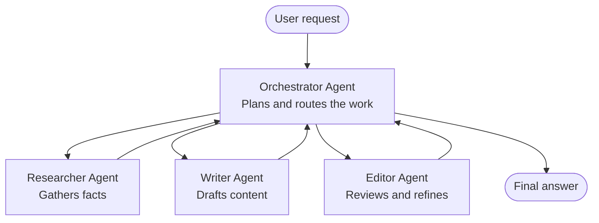

# मल्टी-एजेंट बेसिक्स - आपका पहला समन्वित AI सिस्टम तैनात करें

**अध्याय नेविगेशन:**
- **📚 कोर्स होम**: [शुरुआती के लिए AZD](../../README.md)
- **📖 वर्तमान अध्याय**: अध्याय 5 - मल्टी-एजेंट AI समाधान
- **⬅️ पिछला**: [अध्याय 4: इन्फ्रास्ट्रक्चर](../chapter-04-infrastructure/README.md)
- **➡️ अगला**: [समन्वय पैटर्न](../chapter-06-pre-deployment/coordination-patterns.md)

> कमांड मार्गदर्शन जारी किए गए `azd 1.37.2` संदर्भ के खिलाफ समीक्षा की गई। क्लाउड तैनातियाँ निष्पादित नहीं की गईं।

## परिचय

पिछले अध्यायों में आपने एक एकल एप्लिकेशन को तैनात किया—और अध्याय 2 में आपने एक AI एजेंट को तैनात किया। यह पाठ अगला कदम है: एक **मल्टी-एजेंट सिस्टम** तैनात करना, जहां कई विशेषज्ञ एजेंट मिलकर एक समस्या को हल करते हैं जिसे कोई एकल एजेंट अकेले कुशलता से संभाल नहीं सकता।

शुरुआती के लिए अच्छी खबर: **आपको नए कमांड की जरूरत नहीं है।** मल्टी-एजेंट समाधान अभी भी एक azd प्रोजेक्ट है। आप `azd init`, `azd up`, टेस्ट, और `azd down` करेंगे—बिलकुल वही कार्यप्रवाह जो आप पहले से जानते हैं। बदलाव ऐप के *आकार* में होता है।

## सीखने के लक्ष्य

इस पाठ के अंत तक, आप:
- समझ पाएंगे कि "मल्टी-एजेंट" का क्या मतलब है और कब यह अतिरिक्त जटिलता के लायक होता है
- एक मल्टी-एजेंट सिस्टम में सामान्य भूमिकाओं को पहचान पाएंगे (ओर्केस्ट्रेटर + विशेषज्ञ)
- एक वास्तविक, काम करता हुआ मल्टी-एजेंट टेम्पलेट तैनात करेंगे `azd up` के साथ
- वह Azure संसाधन समझेंगे जो मल्टी-एजेंट ऐप का समर्थन करते हैं
- समाधान को सुरक्षित रूप से सत्यापित, अनुकूलित, और हटाने का तरीका जानेंगे

## सीखने के परिणाम

इस पाठ को पूरा करने के बाद, आप सक्षम होंगे:
- एकल एजेंट और मल्टी-एजेंट सिस्टम के बीच अंतर समझाने में
- एक टूल्स के साथ एकल एजेंट और एक सच्चे मल्टी-एजेंट डिज़ाइन के बीच चयन करने में
- azd के साथ एक मल्टी-एजेंट टेम्पलेट को अंत से अंत तक तैनात और परीक्षण करने में
- पहचानने में कि प्रत्येक एजेंट कहाँ चलता है और वे कैसे संवाद करते हैं
- सभी संसाधनों को साफ़ करने में ताकि लगातार लागत से बचा जा सके

---

## मल्टी-एजेंट सिस्टम क्या है?

एक एकल AI एजेंट एक मॉडल होता है जिसमें निर्देशों का एक सेट और (वैकल्पिक रूप से) कुछ उपकरण होते हैं। यह केंद्रित कार्यों के लिए अच्छा काम करता है। लेकिन जैसे-जैसे कार्य बढ़ता है—अनुसंधान, फिर लेखन, फिर संपादन, फिर तथ्य-जांच—सब कुछ एक प्रॉम्प्ट में डालने से एजेंट धीमा, कम विश्वसनीय, और डिबग करने में कठिन हो जाता है।

एक **मल्टी-एजेंट सिस्टम** काम को विशेषज्ञों में विभाजित करता है जो हर एक काम को अच्छी तरह से करते हैं, जिन्हें एक ओर्केस्ट्रेटर द्वारा समन्वित किया जाता है:



### जो दो भूमिकाएँ आप हमेशा देखेंगे

| भूमिका | काम | उदाहरण |
|------|-----|---------|
| **ओर्केस्ट्रेटर** | तय करता है *अगला क्या होगा* और एजेंटों के बीच काम को मार्गित करता है | "पहले अनुसंधान, फिर लेखन, फिर संपादन" |
| **विशेषज्ञ** | एक केंद्रित काम करता है और परिणाम लौटाता है | एक "शोधकर्ता" जो केवल तथ्य एकत्र करता है |

### क्या आपको वास्तव में कई एजेंटों की ज़रूरत है?

सरल से शुरू करें। केवल तब मल्टी-एजेंट का उपयोग करें जब इनमें से कोई सत्य हो:

- ✅ कार्य के **अलग चरण** हों जिनमें अलग निर्देश उपयोगी हों (अनुसंधान बनाम लेखन बनाम समीक्षा)
- ✅ आप समय बचाने के लिए विशेषज्ञों को **समानांतर** चलाना चाहते हैं
- ✅ अलग-अलग चरणों के लिए **अलग उपकरण या डेटा स्रोत** की जरूरत हो
- ✅ आपको हर चरण को **स्वतंत्र रूप से परीक्षण और डिबग करने योग्य** बनाना हो

यदि आपका कार्य एकल प्रश्न-उत्तर या एक साधारण उपकरण कॉल है, तो एक **टूल्स वाले एकल एजेंट** (अध्याय 2) सरल, सस्ता, और संचालन में आसान है।

> **शुरुआती टिप:** "ज्यादा एजेंट" का मतलब "बेहतर" नहीं है। हर एजेंट विलंबता, लागत, और निगरानी के लिए एक नया तत्व जोड़ता है। एजेंट तभी जोड़ें जब समस्या स्पष्ट रूप से भागों में विभाजित हो।

---

## Azure पर मल्टी-एजेंट बनाने के दो तरीके

| तरीका | यह क्या है | सबसे अच्छा है |
|----------|-----------|----------|
| **एकल एजेंट + टूल्स** | एक फाउंडरी एजेंट जो फंक्शन/टूल्स कॉल करता है | सरल वर्कफ़्लोज़, शुरुआत करना |
| **कई समन्वित एजेंट** | कई एजेंट जिनके बीच एक ओर्केस्ट्रेटर होता है | अलग-अलग चरण, समानांतर कार्य, विशेषज्ञता |

यह पाठ दूसरे तरीके पर केंद्रित है जो एक **तैयार टेम्पलेट** का उपयोग करता है, ताकि आप अपना खुद का बनाएं उससे पहले एक वास्तविक मल्टी-एजेंट सिस्टम चलाते हुए देख सकें।

---

## हैंड्स-ऑन: एक काम करता हुआ मल्टी-एजेंट ऐप तैनात करें

हम **Contoso Creative Writer** को तैनात करेंगे, एक आधिकारिक Azure नमूना जो अनुसंधान, उत्पाद, लेखन, और संपादन एजेंटों का समन्वय करता है ताकि एक लेख तैयार किया जा सके। आगे बढ़ने से पहले, [नमूने की पूर्वापेक्षाएँ और लागतें](https://github.com/Azure-Samples/contoso-creative-writer#azure-account-requirements) जांचें: इसमें मॉडल कोटा, Azure AI सर्च, Bing ग्राउंडिंग एक्सेस, पाइथन, डॉकर, और Bash-संगत हुक्स चाहिए। मॉडल और क्षेत्र की उपलब्धता आपकी सदस्यता पर निर्भर करती है; किसी निश्चित क्षेत्र का चयन करने से तैनाती की गारंटी नहीं है।

### चरण 1: टेम्पलेट प्रारंभ करें

```bash
# Create a working folder
mkdir creative-writer && cd creative-writer

# Initialize from the official multi-agent template
azd init --template Azure-Samples/contoso-creative-writer .
```

> आप [Awesome AZD AI गैलरी](https://azure.github.io/awesome-azd/?tags=ai) में किसी भी समय अधिक मल्टी-एजेंट टेम्पलेट ब्राउज़ कर सकते हैं। अन्य शुरुआती-अनुकूल विकल्पों में `get-started-with-ai-agents` और `azure-ai-travel-agents` शामिल हैं।

### चरण 2: प्रमाणीकरण करें

```bash
# Required for azd workflows
azd auth login

# Also required by this sample's Azure CLI hooks
az login
```

### चरण 3: पर्यावरण जांचें

```bash
# init normally creates/selects an environment; confirm it before proceeding
azd env list
# Only if you need an additional environment:
# azd env new dev
```

### चरण 4: पूर्वावलोकन करें, फिर तैनात करें

```bash
# See what will be created before spending anything (recommended)
azd provision --preview

# Provision infrastructure and deploy all agents in one step
azd up
```

`azd up` पूछेगा यदि सदस्यता और क्षेत्र सेटिंग्स गायब हों, फिर संसाधन प्रोविजन और ऐप्लिकेशन तैनात करेगा। पूर्वावलोकन कोई कोटा आरक्षित नहीं करता या सफलता की गारंटी नहीं देता; टेम्पलेट हुक्स एक प्रोविजनिंग पूर्वावलोकन के दौरान भी चल सकते हैं, इसलिए पहले उन्हें जांचें। प्रत्येक **सेवा तैनाती** (मॉडल प्रोविजनिंग नहीं) के लिए azd कितनी देर तक इंतजार करता है यह बढ़ाने के लिए:

```bash
azd deploy --timeout 1800
```

टाइमआउट azd के इंतजार को रोकता है; यह Azure में तैनाती को रद्द नहीं करता। पुनः प्रयास से पहले संसाधन की स्थिति जांचें।

> **लागत और क्षमता पर ध्यान दें:** मल्टी-एजेंट एप्लिकेशन ऐसे AI मॉडल तैनात करते हैं जो कोटा उपभोग करते हैं और लागत लगाते हैं। यदि `azd up` मॉडल कोटा पर विफल होता है, तो क्षेत्र और कोटा सुधार के लिए [AI समस्या निवारण](../chapter-07-troubleshooting/ai-troubleshooting.md) देखें, और अध्याय 6 [क्षमता योजना](../chapter-06-pre-deployment/capacity-planning.md)।

---

## आपने जो तैनात किया उसे समझना

इस तरह का एक सामान्य मल्टी-एजेंट ऐप Azure संसाधनों का एक सेट प्रोविजन करता है जो ऊपर दिए गए आरेख में जिम्मेदारियों से सीधे मेल खाता है:

| संसाधन | यहाँ क्यों है |
|----------|----------------|
| **Microsoft Foundry / मॉडल** | हर एजेंट द्वारा उपयोग किए जाने वाले भाषा मॉडल की मेजबानी करता है |
| **Azure AI Search** | शोधकर्ता एजेंट को जमीनी डेटा खोजने की सुविधा देता है |
| **Container Apps** (या App Service) | ओर्केस्ट्रेटर और एजेंट कोड की होस्टिंग करता है |
| **Cosmos DB** (कुछ नमूनों में) | एजेंटों के बीच साझा स्थिति/मेमोरी संग्रहीत करता है |
| **Application Insights** | एजेंटों के *बीच* अनुरोधों का पता लगाता है ताकि आप फ़्लो को डिबग कर सकें |

### एजेंट कैसे एक-दूसरे से बात करते हैं

अधिकांश azd मल्टी-एजेंट नमूनों में, **ओर्केस्ट्रेटर आपके एप्लिकेशन कोड में चलता है** (उदाहरण के लिए, Semantic Kernel या Microsoft Agent Framework जैसे फ्रेमवर्क का उपयोग करके)। ओर्केस्ट्रेटर प्रत्येक विशेषज्ञ एजेंट को क्रम से कॉल करता है, परिणाम पास करता है, और अंतिम उत्तर तैयार करता है। एजेंट साझा संदर्भ के माध्यम से संवाद करते हैं:

- **फंक्शन/टूल कॉल्स** — ओर्केस्ट्रेटर एक विशेषज्ञ को कॉल करता है और परिणाम वापस पाता है
- **साझा मेमोरी** — एक डेटाबेस (अक्सर Cosmos DB) ऐसे राज्य को रखता है जिसे दोनों एजेंट पढ़ सकते हैं
- **संदेश/ईवेंट्स** — ढीले संचार के लिए, एजेंट कतार या सर्विस बस के माध्यम से संवाद करते हैं

> **डिबगिंग के लिए यह महत्वपूर्ण है:** क्योंकि हर चरण अलग है, Application Insights आपको दिखाता है कि *कौन सा* एजेंट धीमा था या विफल रहा। यही मल्टी-एजेंट में काम विभाजित करने का मुख्य कारण है।

---

## तैनाती सत्यापित करें

आगे बढ़ने से पहले पुष्टि करें कि सिस्टम वास्तव में काम कर रहा है:

```bash
# Show the deployed endpoints
azd show

# Open the app's monitoring dashboard
azd monitor

# Open Application Insights Logs (not a terminal log stream)
azd monitor --logs
```

फिर `azd show` से ऐप URL खोलें और एक संक्षिप्त लेख का अनुरोध करें। नमूने के डिबग दृश्य का उपयोग करके इसके एजेंट वर्कफ़्लो का निरीक्षण करें। Application Insights लेनदेन खोज केवल तब व्यक्तिगत चरण दिखा सकता है जब नमूना उन्हें इंस्ट्रूमेंट और सहसंबंधित करता है; azd स्वतः एजेंट स्पैन नहीं जोड़ता।

**सफलता मानदंड:**
- ✅ `azd show` एक पहुँच योग्य एंडपॉइंट सूचीबद्ध करता है
- ✅ एक अनुरोध ऐसा परिणाम देता है जो स्पष्ट रूप से कई चरणों से गुज़रा हो
- ✅ डिबग दृश्य कई एजेंट चरण दिखाता है; यदि ट्रेसिंग सक्षम है, तो निगमन के बाद संबंधित टेलीमेट्री सत्यापित करें

---

## अनुकूलन: एक एजेंट जोड़ें या समायोजित करें

क्योंकि प्रत्येक एजेंट केवल निर्देशों और टूल्स का संयोजन है, अनुकूलन सरल है:

1. **एजन्ट परिभाषाएं खोजें** टेम्पलेट में (अक्सर `prompts/`, `agents/`, या `*.prompty` फ़ाइलों का सेट)।
2. **एजन्ट के निर्देशों को ट्यून करें** — उदाहरण के लिए, संपादक एजेंट को एक विशिष्ट टोन या शब्द संख्या लागू करने के लिए कहें।
3. **केवल कोड को पुनः तैनात करें** (इन्फ्रास्ट्रक्चर अपरिवर्तित है):

   ```bash
   azd deploy
   ```

अपने *अपने* Foundry एजेंट प्रोजेक्ट के साथ आगे बढ़ने के लिए, AZD 1.37.0+ के साथ GA बंडल को एक अलग खाली निर्देशिका में उपयोग करें:

```bash
azd ext install microsoft.foundry
azd ai agent init
azd up
azd ai agent invoke      # test, with response timing
```

एजेंट इन्स्पेक्टर स्थानीय परीक्षण, रिमोट कोड तैनाती, और सफाई स्वामित्व के लिए [GA होस्टेड-एजेंट वॉकथ्रू](../chapter-02-ai-development/microsoft-foundry-integration.md#hosted-agent-walkthrough-ga) देखें। [AZD AI CLI संदर्भ](../chapter-08-production/production-ai-practices.md#azd-ai-cli-commands-and-extensions) अलग-अलग मूल्यांकन एक्सटेंशन, अनुकूलन, और एजेंट विलोपन को भी कवर करता है।

---

## सफाई करें

मल्टी-एजेंट ऐप्स कई बिल योग्य सेवाएं चलाते हैं। जब आप समाप्त करें तो सब कुछ खत्म कर दें:

```bash
# Review the resources and confirm deletion interactively
azd down
```

विलोपन विनाशकारी है। एक अस्थायी लैब के लिए, `azd down --force --purge` विलोपन को छोड़ देता है और समर्थित सॉफ़्ट-डिलीट पर्ज पुष्टिकरण; सैनिटेशन अपरिवर्तनीय है जहाँ समर्थित है और पर्ज सुरक्षा द्वारा अवरुद्ध किया जा सकता है। सॉफ्ट डिलीशन पुनर्प्राप्ति/नाम-पुन: उपयोग चिंता है, स्वयं में निरंतर शुल्क का प्रमाण नहीं। सफाई के बाद रखे गए संसाधन और बिलिंग की जांच करें।

यदि आपने मौजूदा Foundry प्रोजेक्ट के विरुद्ध एक होस्टेड एजेंट भी आरंभ किया है, तो `azd down` उस प्रोजेक्ट के एजेंट और अन्य संसाधनों को स्थान पर छोड़ देता है। केवल उन अवांछित संसाधनों को अलग से हटाएं जिनके आप मालिक हैं। AZD वातावरण द्वारा बनाए गए एक नए Foundry प्रोजेक्ट के लिए, `azd down` संसाधन समूह और उसमें सब कुछ हटा देता है।

---

## उत्पादन मल्टी-एजेंट सिस्टम पर एक नोट

इस रिपो में [Retail Multi-Agent Solution](../../examples/retail-scenario.md) एक **आर्किटेक्चर ब्लूप्रिंट** है, एक एक-कमान्ड टेम्पलेट नहीं — यह दस्तावेज करता है कि एक उत्पादन रिटेल सिस्टम *कैसे* बनाया जाएगा (और स्पष्ट करता है कि एक पूर्ण निर्माण एक महत्वपूर्ण प्रयास है)। इसका उपयोग एक डिजाइन संदर्भ के रूप में करें *उसके बाद* जब आपने यहाँ एक कामकाजी नमूना तैनात किया हो। उत्पादन चिंताओं (लचीलापन, लागत, निगरानी, प्रशासन) के लिए, आगे बढ़ें [अध्याय 8: उत्पादन एआई प्रथाएँ](../chapter-08-production/production-ai-practices.md)।

---

## सारांश

- एक मल्टी-एजेंट सिस्टम विशेषज्ञों के बीच कार्य विभाजित करता है जिसे एक ऑर्केस्ट्रेटर द्वारा समन्वित किया जाता है।
- इसका उपयोग केवल तब करें जब कार्य के स्पष्ट चरण, समानांतरता, या प्रत्येक चरण के लिए अलग-अलग उपकरण हों—अन्यथा एक एजेंट को प्राथमिकता दें।
- azd वर्कफ़्लो अपरिवर्तित है: `azd init` → `azd up` → परीक्षण → `azd down`।
- एक वास्तविक टेम्पलेट जैसे `contoso-creative-writer` आपको आज एक कामकाजी मल्टी-एजेंट ऐप देखने और अनुकूलित करने देता है।
- एजेंटों के बीच Application Insights ट्रेसिंग मल्टी-एजेंट डिज़ाइन के सबसे बड़े व्यावहारिक लाभों में से एक है।

---

## 🔗 नेविगेशन

| दिशा | पाठ |
|-----------|--------|
| **पिछला** | [अध्याय 4: इन्फ्रास्ट्रक्चर](../chapter-04-infrastructure/README.md) |
| **अगला** | [समन्वय पैटर्न](../chapter-06-pre-deployment/coordination-patterns.md) |

## 📖 संबंधित संसाधन

- [AI एजेंट गाइड](../chapter-02-ai-development/agents.md)
- [समन्वय पैटर्न](../chapter-06-pre-deployment/coordination-patterns.md)
- [उत्पादन AI प्रथाएँ](../chapter-08-production/production-ai-practices.md)
- [AI समस्या निवारण](../chapter-07-troubleshooting/ai-troubleshooting.md)

---

<!-- CO-OP TRANSLATOR DISCLAIMER START -->
**अस्वीकरण**:
इस दस्तावेज़ का अनुवाद AI अनुवाद सेवा [Co-op Translator](https://github.com/Azure/co-op-translator) का उपयोग करके किया गया है। जबकि हम सटीकता के लिए प्रयास करते हैं, कृपया ध्यान दें कि स्वचालित अनुवादों में त्रुटियाँ या अशुद्धियाँ हो सकती हैं। मूल दस्तावेज़ अपनी मूल भाषा में ही प्रामाणिक स्रोत माना जाना चाहिए। महत्वपूर्ण जानकारी के लिए, पेशेवर मानव अनुवाद की सिफारिश की जाती है। इस अनुवाद के उपयोग से उत्पन्न किसी भी गलतफहमी या गलत व्याख्या के लिए हम उत्तरदायी नहीं हैं।
<!-- CO-OP TRANSLATOR DISCLAIMER END -->