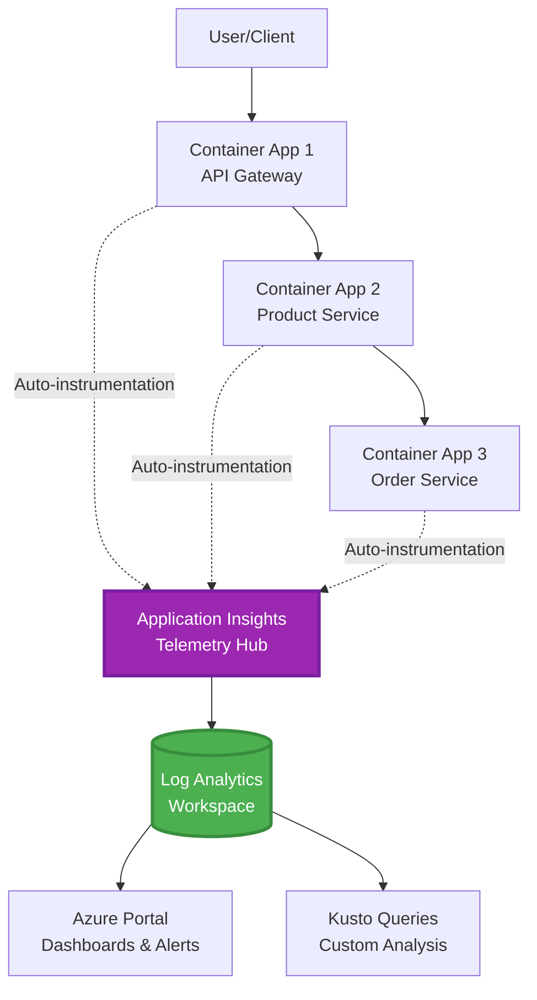
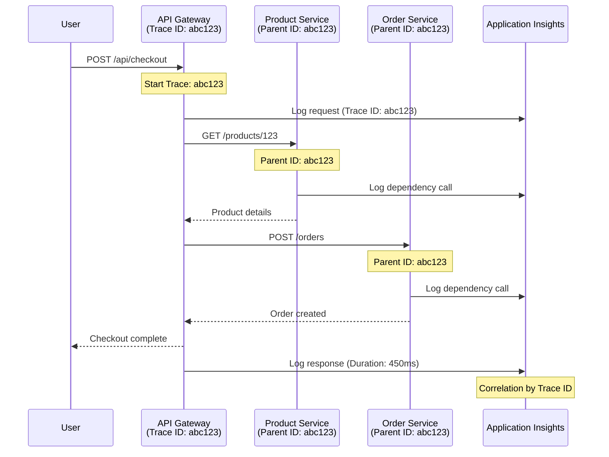

# AZD के साथ एप्लिकेशन इनसाइट्स एकीकरण

⏱️ **अनुमानित समय**: 40-50 मिनट | 💰 **लागत प्रभाव**: लगभग $5-15/महीना | ⭐ **जटिलता**: मध्यवर्ती

**📚 सीखने का मार्ग:**
- ← पिछला: [पूर्व-उड़ान जांच](preflight-checks.md) - प्री-डिप्लॉयमेंट सत्यापन
- 🎯 **आप यहाँ हैं**: एप्लिकेशन इनसाइट्स एकीकरण (मॉनिटरिंग, टेलीमेट्री, डिबगिंग)
- → अगला: [तैनाती मार्गदर्शिका](../chapter-04-infrastructure/deployment-guide.md) - Azure पर डिप्लॉय करें
- 🏠 [कोर्स होम](../../README.md)

---

## आप क्या सीखेंगे

इस पाठ को पूरा करने पर, आप:
- AZD इंफ्रास्ट्रक्चर में **एप्लिकेशन इनसाइट्स** घोषित करेंगे और SDK इंस्ट्रूमेंटेशन कॉन्फ़िगर करेंगे
- माइक्रोसर्विसेज के लिए **डिस्ट्रिब्यूटेड ट्रेसिंग** कॉन्फ़िगर करेंगे
- **कस्टम टेलीमेट्री** (मेट्रिक्स, इवेंट्स, डिपेंडेंसीज) लागू करेंगे
- रियल-टाइम मॉनिटरिंग के लिए **लाइव मेट्रिक्स** सेटअप करेंगे
- AZD डिप्लॉइमेंट्स से **अलर्ट्स और डैशबोर्ड** बनाएंगे
- **टेलीमेट्री क्वेरीज** के साथ प्रोडक्शन समस्याओं का डिबगिंग करेंगे
- **लागत और सैंपलिंग** रणनीतियों का अनुकूलन करेंगे
- **AI/LLM एप्लिकेशन** (टोकन, लेटेंसी, लागत) की निगरानी करेंगे

## AZD के साथ एप्लिकेशन इनसाइट्स क्यों महत्वपूर्ण है

### चुनौती: प्रोडक्शन ऑब्जर्वेबिलिटी

**बिना एप्लिकेशन इनसाइट्स के:**
```
❌ No visibility into production behavior
❌ Manual log aggregation across services
❌ Reactive debugging (wait for customer complaints)
❌ No performance metrics
❌ Cannot trace requests across services
❌ Unknown failure rates and bottlenecks
```

**एप्लिकेशन इनसाइट्स + AZD के साथ:**
```
✅ Automatic telemetry collection
✅ Centralized logs from all services
✅ Proactive issue detection
✅ End-to-end request tracing
✅ Performance metrics and insights
✅ Real-time dashboards
✅ AZD provisions the monitoring declared in your templates
```

**समानता**: एप्लिकेशन इनसाइट्स आपके एप्लिकेशन के लिए एक "ब्लैक बॉक्स" फ्लाइट रिकॉर्डर + कॉकपिट डैशबोर्ड की तरह है। आप रियल-टाइम में सब कुछ देख सकते हैं और किसी भी घटना को पुनः चला सकते हैं।

---

## आर्किटेक्चर अवलोकन

### AZD आर्किटेक्चर में एप्लिकेशन इनसाइट्स



### क्या स्वतः मॉनिटर किया जाता है

समर्थित ऑटो-इंस्ट्रूमेंटेशन इंस्ट्रूमेंटेड लाइब्रेरीज़ के लिए अनुरोध/निर्भरता कैप्चर करता है। कस्टम इवेंट्स और मेट्रिक्स के लिए एप्लिकेशन कोड आवश्यक है; उपलब्धता परीक्षणों को अलग से कॉन्फ़िगर करना होता है। यह निचे दिए गए हर रिकॉर्ड को तभी नहीं लेता जब तक संसाधन मौजूद न हो।

| टेलीमेट्री प्रकार | क्या कैप्चर करता है | उपयोग मामला |
|----------------|------------------|----------|
| **अनुरोध** | HTTP अनुरोध, स्थिति कोड, अवधि | API प्रदर्शन मॉनिटरिंग |
| **निर्भरता** | बाहरी कॉल्स (DB, APIs, स्टोरेज) | बॉटलनेक्स पहचानना |
| **अपवाद** | अनहैंडल्ड त्रुटियाँ स्टैक ट्रेस के साथ | विफलताओं का डिबगिंग |
| **कस्टम इवेंट्स** | व्यावसायिक इवेंट्स (साइनअप, खरीदारी) | एनालिटिक्स और फ़नेल्स |
| **मेट्रिक्स** | प्रदर्शन काउंटर, कस्टम मेट्रिक्स | क्षमता योजना |
| **ट्रेस** | गंभीरता के साथ लॉग संदेश | डिबगिंग और लेखा परीक्षा |
| **उपलब्धता** | अपटाइम और प्रतिक्रिया समय परीक्षण | SLA मॉनिटरिंग |

---

## पूर्वापेक्षाएँ

### आवश्यक उपकरण

```bash
# Verify Azure Developer CLI
azd version
# Command reference baseline: azd 1.37.2

# Verify Azure CLI
az --version
# ✅ Expected: azure-cli 2.50.0 or higher
```

### Azure आवश्यकताएँ

- सक्रिय Azure सदस्यता
- बनाने की अनुमति:
  - एप्लिकेशन इनसाइट्स संसाधन
  - लॉग एनालिटिक्स वर्कस्पेस
  - कंटेनर ऐप्स
  - संसाधन समूह

### ज्ञान की पूर्वापेक्षाएँ

आपको निम्न पूरा करना चाहिए:
- [AZD मूल बातें](../chapter-01-foundation/azd-basics.md) - मुख्य AZD अवधारणाएँ
- [कॉन्फ़िगरेशन](../chapter-03-configuration/configuration.md) - पर्यावरण सेटअप
- [प्रथम प्रोजेक्ट](../chapter-01-foundation/first-project.md) - बुनियादी तैनाती

---

## पाठ 1: AZD के साथ स्वचालित एप्लिकेशन इनसाइट्स

### AZD एप्लिकेशन इनसाइट्स कैसे प्रोविजन करता है

AZD प्रावधान करता है Application Insights **केवल तब जब प्रोजेक्ट की इन्फ्रास्ट्रक्चर इसे घोषित करती है**। `azure.yaml` अपने आप में निगरानी या एप्लिकेशन कोड इंस्ट्रूमेंट नहीं बनाता है।

> **उदाहरण दायरा:** यह पाठ एकीकृत खंडों को शामिल करता है, इस रिपॉजिटरी में एक पूरा `monitored-app` प्रोजेक्ट नहीं। मुख्य टेम्प्लेट और पैरामीटर मैपिंग, कंटेनर ऐप्स पर्यावरण, रजिस्ट्री/इमेज और पहचान कॉन्फ़िगरेशन, Dockerfile, और सेवा टैग तैनात करने से पहले प्रदान करें। बाद के पाठ वैकल्पिक/विस्तार खंड दिखाते हैं, वे फ़ाइलें नहीं जिन्हें बिना बदले साथ में पेस्ट किया जा सके। चलाने लायक आधार के लिए [माइक्रोसर्विसेज़ उदाहरण](../../../../examples/microservices) के साथ शुरुआत करें।

### प्रोजेक्ट संरचना

```
monitored-app/
├── azure.yaml                     # AZD configuration
├── infra/
│   ├── main.bicep                # Main infrastructure
│   ├── core/
│   │   └── monitoring.bicep      # Application Insights + Log Analytics
│   └── app/
│       └── api.bicep             # Container App with monitoring
└── src/
    ├── app.py                    # Application with telemetry
    ├── requirements.txt
    └── Dockerfile
```

---

### चरण 1: AZD कॉन्फ़िगर करें (azure.yaml)

**फ़ाइल: `azure.yaml`**

```yaml
name: monitored-app
metadata:
  template: monitored-app@1.0.0

services:
  api:
    project: ./src
    language: python
    host: containerapp

# Monitoring must be declared in infra/ and enabled in application code.
```

यह तैनात की जाने योग्य सेवा घोषित करता है। निम्न Bicep और SDK कॉन्फ़िगरेशन निगरानी प्रदान करते हैं; azd इन्हें अप्रत्यक्ष रूप से नहीं जोड़ता है।

---

### चरण 2: निगरानी इन्फ्रास्ट्रक्चर (Bicep)

**फ़ाइल: `infra/core/monitoring.bicep`**

```bicep
param logAnalyticsName string
param applicationInsightsName string
param location string = resourceGroup().location
param tags object = {}

// Log Analytics Workspace (required for Application Insights)
resource logAnalytics 'Microsoft.OperationalInsights/workspaces@2022-10-01' = {
  name: logAnalyticsName
  location: location
  tags: tags
  properties: {
    sku: {
      name: 'PerGB2018'  // Pay-as-you-go pricing
    }
    retentionInDays: 30  // Keep logs for 30 days
    features: {
      enableLogAccessUsingOnlyResourcePermissions: true
    }
  }
}

// Application Insights
resource applicationInsights 'Microsoft.Insights/components@2020-02-02' = {
  name: applicationInsightsName
  location: location
  tags: tags
  kind: 'web'
  properties: {
    Application_Type: 'web'
    WorkspaceResourceId: logAnalytics.id
    IngestionMode: 'LogAnalytics'
    publicNetworkAccessForIngestion: 'Enabled'
    publicNetworkAccessForQuery: 'Enabled'
  }
}

// Outputs for Container Apps
output logAnalyticsWorkspaceId string = logAnalytics.id
output logAnalyticsWorkspaceName string = logAnalytics.name
output applicationInsightsConnectionString string = applicationInsights.properties.ConnectionString
output applicationInsightsInstrumentationKey string = applicationInsights.properties.InstrumentationKey
output applicationInsightsName string = applicationInsights.name
output applicationInsightsId string = applicationInsights.id
```

---

### चरण 3: कंटेनर ऐप को Application Insights से जोड़ें

**फ़ाइल: `infra/app/api.bicep`**

```bicep
param name string
param location string
param tags object = {}
param containerAppsEnvironmentId string
param containerImage string
param applicationInsightsConnectionString string

resource containerApp 'Microsoft.App/containerApps@2023-05-01' = {
  name: name
  location: location
  tags: tags
  properties: {
    managedEnvironmentId: containerAppsEnvironmentId
    configuration: {
      ingress: {
        external: true
        targetPort: 8000
      }
      secrets: [
        {
          name: 'appinsights-connection-string'
          value: applicationInsightsConnectionString
        }
      ]
    }
    template: {
      containers: [
        {
          name: 'api'
          image: containerImage // Supply an accessible image and registry authentication
          resources: {
            cpu: json('0.5')
            memory: '1Gi'
          }
          env: [
            {
              name: 'APPLICATIONINSIGHTS_CONNECTION_STRING'
              secretRef: 'appinsights-connection-string'
            }
            {
              name: 'APPLICATIONINSIGHTS_ENABLED'
              value: 'true'
            }
          ]
        }
      ]
    }
  }
}

output uri string = 'https://${containerApp.properties.configuration.ingress.fqdn}'
```

---

### चरण 4: टेलीमेट्री के साथ एप्लिकेशन कोड

**फ़ाइल: `src/app.py`**

```python
from flask import Flask, request, jsonify
from azure.monitor.opentelemetry import configure_azure_monitor
import logging
import os

app = Flask(__name__)

# Get Application Insights connection string
connection_string = os.environ.get('APPLICATIONINSIGHTS_CONNECTION_STRING')

if connection_string:
    # Azure Monitor OpenTelemetry instruments supported libraries, including Flask.
    configure_azure_monitor(
        connection_string=connection_string,
        logger_name=__name__,
        enable_live_metrics=True
    )
    logger = logging.getLogger(__name__)
    logger.setLevel(logging.INFO)
    
    print("✅ Application Insights enabled")
else:
    logger = logging.getLogger(__name__)
    logger.setLevel(logging.INFO)
    print("⚠️ Application Insights not configured")

@app.route('/health')
def health():
    logger.info('Health check endpoint called')
    return jsonify({'status': 'healthy', 'monitoring': 'enabled' if connection_string else 'disabled'})

@app.route('/api/products')
def get_products():
    logger.info('Fetching products')
    
    # In-memory fixture: this is not a database dependency call.
    products = [
        {'id': 1, 'name': 'Laptop', 'price': 999.99},
        {'id': 2, 'name': 'Mouse', 'price': 29.99},
        {'id': 3, 'name': 'Keyboard', 'price': 79.99}
    ]
    
    logger.info(f'Returned {len(products)} products')
    return jsonify(products)

@app.route('/api/error-test')
def error_test():
    """Test error tracking"""
    logger.error('Testing error tracking')
    try:
        raise ValueError('This is a test exception')
    except Exception as e:
        logger.exception('Exception occurred in error-test endpoint')
        return jsonify({'error': str(e)}), 500

@app.route('/api/slow')
def slow_endpoint():
    """Test performance tracking"""
    import time
    logger.info('Slow endpoint called')
    time.sleep(3)  # Simulate slow operation
    logger.warning('Endpoint took 3 seconds to respond')
    return jsonify({'message': 'Slow operation completed'})

if __name__ == '__main__':
    app.run(host='0.0.0.0', port=8000)
```

**फ़ाइल: `src/requirements.txt`**

```txt
Flask
azure-monitor-opentelemetry
gunicorn
requests
openai
```

अपने प्रोजेक्ट में इन निर्भरताओं को हल करें, उन्हें एक साथ परीक्षण करें, और परिणामस्वरूप संस्करण लॉक करें। नए प्रोजेक्ट्स को Azure Monitor OpenTelemetry का उपयोग करना चाहिए, न कि बंद हो चुके OpenCensus Python exporters का।

---

### चरण 5: तैनात करें और सत्यापित करें

```bash
# Deploy only after completing and wiring the infrastructure fragments above
azd up

# Get app URL
APP_URL=$(azd env get-value API_URL) # Requires this output in main.bicep

# Generate telemetry
curl $APP_URL/health
curl $APP_URL/api/products
curl $APP_URL/api/error-test
curl $APP_URL/api/slow
```

**✅ अपेक्षित आउटपुट:**
```json
{
  "status": "healthy",
  "monitoring": "enabled"
}
```

---

### चरण 6: Azure पोर्टल में टेलीमेट्री देखें

```bash
# Get Application Insights details
azd env get-values | grep APPLICATIONINSIGHTS

# Open in Azure Portal
az monitor app-insights component show \
  --app $(azd env get-values | grep APPLICATIONINSIGHTS_NAME | cut -d '=' -f2 | tr -d '"') \
  --resource-group $(azd env get-values | grep AZURE_RESOURCE_GROUP | cut -d '=' -f2 | tr -d '"') \
  --query "appId" -o tsv
```

**Azure पोर्टल → एप्लिकेशन इनसाइट्स → ट्रांजैक्शन खोज पर जाएं**

आपको निम्न दिखना चाहिए:
- ✅ स्थिति कोड के साथ HTTP अनुरोध
- ✅ अनुरोध अवधि (3+ सेकंड के लिए `/api/slow`)
- ✅ `/api/error-test` से अपवाद विवरण
- ✅ कस्टम लॉग संदेश

---

## पाठ 2: कस्टम टेलीमेट्री और ईवेंट्स

### व्यवसायिक ईवेंट्स ट्रैक करें

चलिए व्यावसायिक रूप से महत्वपूर्ण ईवेंट्स के लिए कस्टम टेलीमेट्री जोड़ते हैं।

**फ़ाइल: `src/telemetry.py`**

```python
from contextlib import contextmanager
from azure.monitor.opentelemetry import configure_azure_monitor
from opentelemetry import metrics, trace
from opentelemetry.trace import SpanKind
import logging
import os

class TelemetryClient:
    """Custom telemetry client for Application Insights"""
    
    def __init__(self, connection_string=None):
        self.connection_string = connection_string or os.environ.get('APPLICATIONINSIGHTS_CONNECTION_STRING')
        
        # Configure once per process. If app.py already calls this, keep only
        # one configure_azure_monitor call and use logger_name='telemetry'.
        if self.connection_string:
            configure_azure_monitor(
                connection_string=self.connection_string,
                logger_name=__name__,
                enable_live_metrics=True
            )
        self.logger = logging.getLogger(__name__)
        self.logger.setLevel(logging.INFO)
        self.tracer = trace.get_tracer(__name__)
        self.meter = metrics.get_meter(__name__)
        self.instruments = {}
    
    def track_event(self, event_name: str, properties: dict = None):
        """Track custom business event"""
        properties = properties or {}
        self.logger.info(
            f"CustomEvent: {event_name}",
            extra={
                # OTel log attributes become customDimensions in App Insights.
                    'event_name': event_name,
                    **properties
            }
        )
    
    def track_metric(self, metric_name: str, value: float, properties: dict = None):
        """Track custom metric"""
        properties = properties or {}
        if metric_name not in self.instruments:
            self.instruments[metric_name] = self.meter.create_histogram(metric_name)
        self.instruments[metric_name].record(value, attributes=properties)
    
    @contextmanager
    def track_dependency(self, name: str):
        """Time the real operation inside a client span; exceptions mark failure."""
        with self.tracer.start_as_current_span(name, kind=SpanKind.CLIENT) as span:
            yield span

# Global telemetry client
telemetry = TelemetryClient()
```

### एप्लिकेशन को कस्टम ईवेंट्स के साथ अपडेट करें

**फ़ाइल: `src/app.py` (सुधारित)**

इन रूट्स को मौजूदा Flask एप्लिकेशन में जोड़ें; पहले के स्वास्थ्य/टेस्ट रूट्स रखें। नीचे छोटा ब्लॉक स्पष्टता के लिए अलग ऐप दिखाता है। टेलीमेट्री इनिशियलाइजेशन अब `telemetry.py` में रहती है—एक्सपोर्टर्स को दो बार इनिशियलाइज न करें।

```python
from flask import Flask, request, jsonify
from telemetry import telemetry
import time
import random
import os

app = Flask(__name__)

@app.route('/api/purchase', methods=['POST'])
def purchase():
    """Track purchase event with custom telemetry"""
    data = request.get_json(silent=True) or {}
    product_id = data.get('product_id')
    quantity = data.get('quantity', 1)
    price = data.get('price', 0)
    if not isinstance(quantity, int) or quantity < 1 or \
       not isinstance(price, (int, float)) or price < 0:
        return jsonify({'error': 'quantity and price must be non-negative numbers; quantity >= 1'}), 400
    
    # Track business event
    telemetry.track_event('Purchase', {
        'product_id': product_id,
        'quantity': quantity,
        'total_amount': price * quantity,
        'user_id': request.headers.get('X-User-Id', 'anonymous')
    })
    
    # Track revenue metric
    telemetry.track_metric('Revenue', price * quantity, {
        'product_id': product_id,
        'currency': 'USD'
    })
    
    return jsonify({
        'order_id': f'ORD-{random.randint(1000, 9999)}',
        'status': 'confirmed',
        'total': price * quantity
    })

@app.route('/api/search')
def search():
    """Track search queries"""
    query = request.args.get('q', '')
    
    start_time = time.time()
    
    # Simulate search (would be real database query)
    results = [{'id': 1, 'name': f'Result for {query}'}]
    
    duration = (time.time() - start_time) * 1000  # Convert to ms
    
    # Track search event
    telemetry.track_event('Search', {
        'query': query,
        'results_count': len(results),
        'duration_ms': duration
    })
    
    # Track search performance metric
    telemetry.track_metric('SearchDuration', duration, {
        'query_length': len(query)
    })
    
    return jsonify({'results': results, 'count': len(results)})

@app.route('/api/external-call')
def external_call():
    """Track external API dependency"""
    import requests
    
    try:
        # Set an actual test endpoint; api.example.com is not a working API.
        with telemetry.track_dependency('ExternalAPI'):
            response = requests.get(os.environ['EXTERNAL_API_URL'], timeout=5)
            response.raise_for_status()
            result = response.json()
    except Exception as e:
        return jsonify({'error': 'External dependency failed'}), 502
    
    return jsonify(result)

if __name__ == '__main__':
    app.run(host='0.0.0.0', port=8000)
```

### कस्टम टेलीमेट्री का परीक्षण करें

```bash
# Track purchase event
curl -X POST $APP_URL/api/purchase \
  -H "Content-Type: application/json" \
  -H "X-User-Id: user123" \
  -d '{"product_id": 1, "quantity": 2, "price": 29.99}'

# Track search event
curl "$APP_URL/api/search?q=laptop"

# Track external dependency
curl $APP_URL/api/external-call
```

**Azure पोर्टल में देखें:**

एप्लिकेशन इनसाइट्स → लॉग्स पर जाएं, फिर चलाएँ:

```kusto
// View purchase events
traces
| where customDimensions.event_name == "Purchase"
| project 
    timestamp,
    product_id = tostring(customDimensions.product_id),
    total_amount = todouble(customDimensions.total_amount),
    user_id = tostring(customDimensions.user_id)
| order by timestamp desc

// Revenue recorded in Purchase events (not a billing ledger)
traces
| where customDimensions.event_name == "Purchase"
| summarize TotalRevenue = sum(todouble(customDimensions.total_amount)) by bin(timestamp, 1h)
| render timechart

// View search performance
traces
| where customDimensions.event_name == "Search"
| summarize 
    AvgDuration = avg(todouble(customDimensions.duration_ms)),
    SearchCount = count()
  by bin(timestamp, 5m)
| render timechart
```

---

## पाठ 3: माइक्रोसर्विसेज के लिए वितरित ट्रेसिंग

### क्रॉस-सर्विस ट्रेसिंग सक्षम करें

संगत इंस्ट्रूमेंटेशन और W3C ट्रेस-कॉन्टेक्स्ट प्रसारण के साथ, एप्लिकेशन इनसाइट्स विभिन्न सेवाओं में अनुरोधों को संबद्ध करता है। केवल कनेक्शन स्ट्रिंग साझा करना पैरेंट-चाइल्ड स्पैन्स स्थापित नहीं करता है। निम्न वास्तुकला खंड उन मॉड्यूल का संदर्भ देता है जिन्हें आपको लागू करना होगा।

**फ़ाइल: `infra/main.bicep`**

```bicep
targetScope = 'subscription'

param environmentName string
param location string = 'eastus'

var tags = { 'azd-env-name': environmentName }

resource rg 'Microsoft.Resources/resourceGroups@2021-04-01' = {
  name: 'rg-${environmentName}'
  location: location
  tags: tags
}

// Monitoring (shared by all services)
module monitoring './core/monitoring.bicep' = {
  name: 'monitoring'
  scope: rg
  params: {
    logAnalyticsName: 'log-${environmentName}'
    applicationInsightsName: 'appi-${environmentName}'
    location: location
    tags: tags
  }
}

// API Gateway
module apiGateway './app/api-gateway.bicep' = {
  name: 'api-gateway'
  scope: rg
  params: {
    name: 'ca-gateway-${environmentName}'
    location: location
    tags: union(tags, { 'azd-service-name': 'gateway' })
    applicationInsightsConnectionString: monitoring.outputs.applicationInsightsConnectionString
  }
}

// Product Service
module productService './app/product-service.bicep' = {
  name: 'product-service'
  scope: rg
  params: {
    name: 'ca-products-${environmentName}'
    location: location
    tags: union(tags, { 'azd-service-name': 'products' })
    applicationInsightsConnectionString: monitoring.outputs.applicationInsightsConnectionString
  }
}

// Order Service
module orderService './app/order-service.bicep' = {
  name: 'order-service'
  scope: rg
  params: {
    name: 'ca-orders-${environmentName}'
    location: location
    tags: union(tags, { 'azd-service-name': 'orders' })
    applicationInsightsConnectionString: monitoring.outputs.applicationInsightsConnectionString
  }
}

output APPLICATIONINSIGHTS_CONNECTION_STRING string = monitoring.outputs.applicationInsightsConnectionString
output GATEWAY_URL string = apiGateway.outputs.uri
```

### एंड-टू-एंड लेनदेन देखें



**क्वेरी एंड-टू-एंड ट्रेस:**

```kusto
// Find complete request flow
let traceId = "abc123...";  // Copy operation_Id from a request in Application Insights
dependencies
| union requests
| where operation_Id == traceId
| project 
    timestamp,
    type = itemType,
    name,
    duration,
    success,
    cloud_RoleName
| order by timestamp asc
```

---

## पाठ 4: लाइव मेट्रिक्स और रियल-टाइम मॉनिटरिंग

### लाइव मेट्रिक्स स्ट्रीम सक्षम करें

लाइव मेट्रिक्स एसडीके द्वारा समर्थित और सक्षम होने पर लगभग वास्तविक समय टेलीमेट्री प्रदान करता है। यह एक विलंबता SLA नहीं है। ऊपर उल्लिखित Python OpenTelemetry सेटअप में `enable_live_metrics=True` के साथ ऑप्ट-इन किया गया है।

**लाइव मेट्रिक्स तक पहुँचें:**

```bash
# Get Application Insights resource
APPI_NAME=$(azd env get-values | grep APPLICATIONINSIGHTS_NAME | cut -d '=' -f2 | tr -d '"')

# Get resource group
RG_NAME=$(azd env get-values | grep AZURE_RESOURCE_GROUP | cut -d '=' -f2 | tr -d '"')

echo "Navigate to: Azure Portal → Resource Groups → $RG_NAME → $APPI_NAME → Live Metrics"
```

**आप वास्तविक समय में क्या देखेंगे:**
- ✅ आने वाली अनुरोध दर (अनुरोध/सेकंड)
- ✅ आउटगोइंग निर्भरता कॉल
- ✅ अपवाद गिनती
- ✅ CPU और मेमोरी उपयोग
- ✅ सक्रिय सर्वर गिनती
- ✅ सैंपल टेलीमेट्री

### परीक्षण के लिए लोड उत्पन्न करें

```bash
# Generate load to see live metrics
for i in {1..100}; do
  curl --silent --max-time 10 "$APP_URL/api/products"
  curl --silent --max-time 10 "$APP_URL/api/search?q=test$i"
done

# Watch live metrics in Azure Portal
# You should see request rate spike
```

---

## व्यावहारिक अभ्यास

### अभ्यास 1: अलर्ट सेट करें ⭐⭐ (मध्यम)

**लक्ष्य**: उच्च त्रुटि दर और धीमी प्रतिक्रियाओं के लिए अलर्ट बनाएं।

**कदम:**

1. **त्रुटि दर के लिए अलर्ट बनाएं:**

```bash
# Get Application Insights resource ID
APPI_ID=$(az monitor app-insights component show \
  --app $APPI_NAME \
  --resource-group $RG_NAME \
  --query "id" -o tsv)

# Create metric alert for failed requests
az monitor metrics alert create \
  --name "High-Error-Rate" \
  --resource-group $RG_NAME \
  --scopes $APPI_ID \
  --condition "count requests/failed > 10" \
  --window-size 5m \
  --evaluation-frequency 1m \
  --description "Alert when failed request count exceeds 10 per 5 minutes"
```

2. **धीमी प्रतिक्रियाओं के लिए अलर्ट बनाएं:**

```bash
az monitor metrics alert create \
  --name "Slow-Responses" \
  --resource-group $RG_NAME \
  --scopes $APPI_ID \
  --condition "avg requests/duration > 3000" \
  --window-size 5m \
  --evaluation-frequency 1m \
  --description "Alert when average response time exceeds 3 seconds"
```

3. **Bicep के माध्यम से अलर्ट बनाएं (AZD के लिए पसंदीदा):**

**फ़ाइल: `infra/core/alerts.bicep`**

```bicep
param applicationInsightsId string
param actionGroupId string = ''
param location string = resourceGroup().location

// High error rate alert
resource errorRateAlert 'Microsoft.Insights/metricAlerts@2018-03-01' = {
  name: 'high-error-rate'
  location: 'global'
  properties: {
    description: 'Alert when error rate exceeds threshold'
    severity: 2
    enabled: true
    scopes: [
      applicationInsightsId
    ]
    evaluationFrequency: 'PT1M'
    windowSize: 'PT5M'
    criteria: {
      'odata.type': 'Microsoft.Azure.Monitor.SingleResourceMultipleMetricCriteria'
      allOf: [
        {
          name: 'Error rate'
          metricName: 'requests/failed'
          operator: 'GreaterThan'
          threshold: 10
          timeAggregation: 'Count'
        }
      ]
    }
    actions: actionGroupId != '' ? [
      {
        actionGroupId: actionGroupId
      }
    ] : []
  }
}

// Slow response alert
resource slowResponseAlert 'Microsoft.Insights/metricAlerts@2018-03-01' = {
  name: 'slow-responses'
  location: 'global'
  properties: {
    description: 'Alert when response time is too high'
    severity: 3
    enabled: true
    scopes: [
      applicationInsightsId
    ]
    evaluationFrequency: 'PT1M'
    windowSize: 'PT5M'
    criteria: {
      'odata.type': 'Microsoft.Azure.Monitor.SingleResourceMultipleMetricCriteria'
      allOf: [
        {
          name: 'Response duration'
          metricName: 'requests/duration'
          operator: 'GreaterThan'
          threshold: 3000
          timeAggregation: 'Average'
        }
      ]
    }
  }
}

output errorAlertId string = errorRateAlert.id
output slowResponseAlertId string = slowResponseAlert.id
```

4. **अलर्ट का परीक्षण करें:**

```bash
# Generate errors
for i in {1..20}; do
  curl $APP_URL/api/error-test
done

# Generate slow responses
for i in {1..10}; do
  curl $APP_URL/api/slow
done

# Check rule configuration (not fired/resolved alert-instance history)
az monitor metrics alert list \
  --resource-group $RG_NAME \
  --query "[].{Name:name, Enabled:enabled}" \
  --output table
```

**✅ सफलता मानदंड:**
- ✅ अलर्ट सफलतापूर्वक बनाए गए
- ✅ थ्रेशोल्ड पार होने पर अलर्ट सक्रिय होते हैं
- ✅ Azure पोर्टल में अलर्ट इतिहास देख सकते हैं
- ✅ AZD परिनियोजन के साथ एकीकृत

**समय**: 20-25 मिनट

---

### अभ्यास 2: कस्टम डैशबोर्ड बनाएँ ⭐⭐ (मध्यम)

**लक्ष्य**: मुख्य अनुप्रयोग मेट्रिक्स दिखाने वाला डैशबोर्ड बनाएं।

**कदम:**

1. **Azure पोर्टल के माध्यम से डैशबोर्ड बनाएं:**

नेविगेट करें: Azure पोर्टल → डैशबोर्ड → नया डैशबोर्ड

2. **मुख्य मेट्रिक्स के लिए टाइल्स जोड़ें:**

- अनुरोध गिनती (पिछले 24 घंटे)
- औसत प्रतिक्रिया समय
- त्रुटि दर
- शीर्ष 5 धीमी ऑपरेशन
- उपयोगकर्ताओं का भौगोलिक वितरण

3. **Bicep के माध्यम से डैशबोर्ड बनाएं:**

**फ़ाइल: `infra/core/dashboard.bicep`**

```bicep
param dashboardName string
param applicationInsightsId string
param location string = resourceGroup().location

resource dashboard 'Microsoft.Portal/dashboards@2020-09-01-preview' = {
  name: dashboardName
  location: location
  properties: {
    lenses: [
      {
        order: 0
        parts: [
          // Request count
          {
            position: {
              x: 0
              y: 0
              rowSpan: 4
              colSpan: 6
            }
            metadata: {
              type: 'Extension/Microsoft_OperationsManagementSuite_Workspace/PartType/LogsDashboardPart'
              inputs: [
                {
                  name: 'resourceId'
                  value: applicationInsightsId
                }
                {
                  name: 'query'
                  value: '''
                    requests
                    | summarize RequestCount = count() by bin(timestamp, 1h)
                    | render timechart
                  '''
                }
              ]
            }
          }
          // Error rate
          {
            position: {
              x: 6
              y: 0
              rowSpan: 4
              colSpan: 6
            }
            metadata: {
              type: 'Extension/Microsoft_OperationsManagementSuite_Workspace/PartType/LogsDashboardPart'
              inputs: [
                {
                  name: 'resourceId'
                  value: applicationInsightsId
                }
                {
                  name: 'query'
                  value: '''
                    requests
                    | summarize 
                        Total = count(),
                        Failed = countif(success == false)
                    | extend ErrorRate = (Failed * 100.0) / Total
                    | project ErrorRate
                  '''
                }
              ]
            }
          }
        ]
      }
    ]
  }
}

output dashboardId string = dashboard.id
```

4. **डैशबोर्ड तैनात करें:**

```bicep
// Add to a subscription-scoped main.bicep with rg and monitoring declared
module dashboard './core/dashboard.bicep' = {
  name: 'dashboard'
  scope: rg
  params: {
    dashboardName: 'dashboard-${environmentName}'
    applicationInsightsId: monitoring.outputs.applicationInsightsId
    location: location
  }
}
```

```bash
# Deploy
azd up
```

**✅ सफलता मानदंड:**
- ✅ डैशबोर्ड मुख्य मेट्रिक्स दिखाता है
- ✅ Azure पोर्टल होम में पिन कर सकते हैं
- ✅ वास्तविक समय में अपडेट होता है
- ✅ AZD के माध्यम से तैनात करने योग्य

**समय**: 25-30 मिनट

---

### अभ्यास 3: AI/LLM अनुप्रयोग की निगरानी करें ⭐⭐⭐ (उन्नत)

**लक्ष्य**: Microsoft Foundry मॉडल के उपयोग (टोकन, लागत, विलंबता) को ट्रैक करें।

**कदम:**

1. **AI मॉनिटरिंग रैपर बनाएं:**

**फ़ाइल: `src/ai_telemetry.py`**

```python
from telemetry import telemetry
from openai import AzureOpenAI
import time

class MonitoredAzureOpenAI:
    """Microsoft Foundry Models client with automatic telemetry"""
    
    def __init__(self, api_key, endpoint, input_usd_per_million,
                 output_usd_per_million, api_version="2024-10-21"):
        self.client = AzureOpenAI(
            api_key=api_key,
            api_version=api_version,
            azure_endpoint=endpoint
        )
        self.input_rate = input_usd_per_million
        self.output_rate = output_usd_per_million
    
    def chat_completion(self, model: str, messages: list, **kwargs):
        """Track chat completion with telemetry"""
        start_time = time.time()
        
        try:
            # Call Microsoft Foundry Models
            response = self.client.chat.completions.create(
                model=model,
                messages=messages,
                **kwargs
            )
            
            duration = (time.time() - start_time) * 1000  # ms
            
            # Extract usage
            usage = response.usage
            prompt_tokens = usage.prompt_tokens
            completion_tokens = usage.completion_tokens
            total_tokens = usage.total_tokens
            
            # Approximation: supply actual deployment/region/contract rates.
            # Cached input, batch, provisioned and other charges need separate accounting.
            prompt_cost = (prompt_tokens / 1_000_000) * self.input_rate
            completion_cost = (completion_tokens / 1_000_000) * self.output_rate
            total_cost = prompt_cost + completion_cost
            
            # Track custom event
            telemetry.track_event('OpenAI_Request', {
                'model': model,
                'prompt_tokens': prompt_tokens,
                'completion_tokens': completion_tokens,
                'total_tokens': total_tokens,
                'duration_ms': duration,
                'cost_usd': total_cost,
                'success': True
            })
            
            # Track metrics
            telemetry.track_metric('OpenAI_Tokens', total_tokens, {
                'model': model,
                'type': 'total'
            })
            
            telemetry.track_metric('OpenAI_Cost', total_cost, {
                'model': model,
                'currency': 'USD'
            })
            
            telemetry.track_metric('OpenAI_Duration', duration, {
                'model': model
            })
            
            return response
            
        except Exception as e:
            duration = (time.time() - start_time) * 1000
            
            telemetry.track_event('OpenAI_Request', {
                'model': model,
                'duration_ms': duration,
                'success': False,
                'error': str(e)
            })
            
            raise
```

2. **मॉनिटर किए गए क्लाइंट का उपयोग करें:**

```python
from flask import Flask, request, jsonify
from ai_telemetry import MonitoredAzureOpenAI
import os

app = Flask(__name__)

# Initialize monitored OpenAI client
openai_client = MonitoredAzureOpenAI(
    api_key=os.environ['AZURE_OPENAI_API_KEY'],
    endpoint=os.environ['AZURE_OPENAI_ENDPOINT'],
    input_usd_per_million=float(os.environ['INPUT_USD_PER_MILLION']),
    output_usd_per_million=float(os.environ['OUTPUT_USD_PER_MILLION'])
)

@app.route('/api/chat', methods=['POST'])
def chat():
    data = request.json
    user_message = data.get('message')
    
    # Call with automatic monitoring
    response = openai_client.chat_completion(
        model=os.environ['AZURE_OPENAI_DEPLOYMENT'], # Deployment name, not catalog ID
        messages=[
            {'role': 'user', 'content': user_message}
        ]
    )
    
    return jsonify({
        'response': response.choices[0].message.content,
        'tokens': response.usage.total_tokens
    })
```

3. **AI मेट्रिक्स क्वेरी करें:**

```kusto
// Total AI spend over time
traces
| where customDimensions.event_name == "OpenAI_Request"
| where tobool(customDimensions.success) == true
| summarize TotalCost = sum(todouble(customDimensions.cost_usd)) by bin(timestamp, 1h)
| render timechart

// Token usage by model
traces
| where customDimensions.event_name == "OpenAI_Request"
| summarize 
    TotalTokens = sum(toint(customDimensions.total_tokens)),
    RequestCount = count()
  by Model = tostring(customDimensions.model)

// Average latency
traces
| where customDimensions.event_name == "OpenAI_Request"
| summarize AvgDuration = avg(todouble(customDimensions.duration_ms))
| project AvgDurationSeconds = AvgDuration / 1000

// Cost per request
traces
| where customDimensions.event_name == "OpenAI_Request"
| extend Cost = todouble(customDimensions.cost_usd)
| summarize 
    TotalCost = sum(Cost),
    RequestCount = count(),
    AvgCostPerRequest = avg(Cost)
```

**✅ सफलता मानदंड:**
- ✅ हर OpenAI कॉल का स्वचालित ट्रैकिंग
- ✅ टोकन उपयोग और लागत दिखाई देते हैं
- ✅ विलंबता मॉनिटर की जाती है
- ✅ बजट अलर्ट सेट कर सकते हैं

**समय**: 35-45 मिनट

---

## लागत अनुकूलन

### सैंपलिंग रणनीतियाँ

टेलीमेट्री को सैंपलिंग करके लागत को नियंत्रित करें:

```python
import os

# Configure before the one configure_azure_monitor() call in your process.
os.environ["OTEL_TRACES_SAMPLER"] = "microsoft.fixed_percentage"
os.environ["OTEL_TRACES_SAMPLER_ARG"] = "0.1" # 10% trace sampling
```

ट्रेस सैंपलिंग हर टेलीमेट्री श्रेणी को 90% तक कम नहीं करता है। मेट्रिक्स और स्वतंत्र रूप से ईमिट किए गए लॉग्स को अपनी स्वयं की मात्रा नियंत्रण की आवश्यकता होती है। दर का चयन देखभाल जरूरतों के अनुसार करें, न कि आमतौर पर उत्पादन पर प्रतिबंध के रूप में।

SDK सैंपलिंग स्पष्ट रूप से सेट करें; कंपोनेंट की `SamplingPercentage` प्रॉपर्टी Python OpenTelemetry सैंपलर को कॉन्फ़िगर करने के विकल्प के रूप में नहीं है।

### डेटा अवधारण

```bicep
resource logAnalytics 'Microsoft.OperationalInsights/workspaces@2022-10-01' = {
  name: logAnalyticsName
  properties: {
    retentionInDays: 30  // Minimum (cheapest)
    // Options: 30, 31, 60, 90, 120, 180, 270, 365, 550, 730
  }
}
```

### मासिक लागत का अनुमान

| डेटा मात्रा | अवधारण | मासिक लागत |
|-------------|-----------|--------------|
| 1 GB/माह | 30 दिन | ~$2-5 |
| 5 GB/माह | 30 दिन | ~$10-15 |
| 10 GB/माह | 90 दिन | ~$25-40 |
| 50 GB/माह | 90 दिन | ~$100-150 |

ये आंकड़े केवल उदाहरण हैं, उद्धरण नहीं। अपने क्षेत्र और समझौते में इन्गेस्टन, अवधारण, अलर्ट, और परीक्षण मूल्य निर्धारण की पुष्टि करें; मुक्त आवंटन Azure Monitor कीमतों के अनुसार साझा/स्कोप किए जाते हैं, न कि किसी Application Insights संसाधन के लिए गारंटीशुदा मुफ्त SKU।

---

## ज्ञान जांच बिंदु

### 1. मूल एकीकरण ✓

अपनी समझ का परीक्षण करें:

- [ ] **प्रश्न 1**: AZD Application Insights कैसे प्रोविज़न करता है?
  - **उत्तर**: यह परियोजना के Bicep/Terraform टेम्प्लेट्स द्वारा स्पष्ट रूप से घोषित मॉनिटरिंग संसाधनों को तैनात करता है।

- [ ] **प्रश्न 2**: Application Insights कौन सा पर्यावरण चर सक्षम करता है?
  - **उत्तर**: `APPLICATIONINSIGHTS_CONNECTION_STRING`

- [ ] **प्रश्न 3**: तीन मुख्य टेलीमेट्री प्रकार क्या हैं?
  - **उत्तर**: अनुरोध (HTTP कॉल), निर्भरताएँ (बाहरी कॉल), अपवाद (त्रुटियाँ)

**व्यावहारिक सत्यापन:**
```bash
# Check if Application Insights is configured
azd env get-values | grep APPLICATIONINSIGHTS

# Verify telemetry is flowing
az monitor app-insights metrics show \
  --app $APPI_NAME \
  --resource-group $RG_NAME \
  --metric "requests/count"
```

---

### 2. कस्टम टेलीमेट्री ✓

अपनी समझ का परीक्षण करें:

- [ ] **प्रश्न 1**: आप कस्टम व्यवसाय घटनाओं को कैसे ट्रैक करते हैं?
  - **उत्तर**: इस पाठ का रैपर `event_name` विशेषताओं के साथ संरचित OTel लॉग्स लिखता है, जिन्हें `traces` में क्वेरी किया जा सकता है; ये स्वतः `customEvents` नहीं होते।

- [ ] **प्रश्न 2**: घटनाओं और मेट्रिक्स में क्या अंतर है?
  - **उत्तर**: घटनाएँ विशिष्ट घटनाएँ होती हैं, मेट्रिक्स संख्यात्मक मापन होते हैं।

- [ ] **प्रश्न 3**: आप सेवाओं के बीच टेलीमेट्री को कैसे सहसंबंधित करते हैं?
  - **उत्तर**: Application Insights स्वचालित रूप से सहसंबंध के लिए `operation_Id` का उपयोग करता है।

**व्यावहारिक सत्यापन:**
```kusto
// Verify custom events
traces
| where customDimensions.event_name != ""
| summarize count() by tostring(customDimensions.event_name)
```

---

### 3. उत्पादन निगरानी ✓

अपनी समझ का परीक्षण करें:

- [ ] **प्रश्न 1**: सैंपलिंग क्या है और इसे क्यों उपयोग करते हैं?
  - **उत्तर**: सैंपलिंग केवल टेलीमेट्री के एक प्रतिशत को कैप्चर करके डेटा मात्रा (और लागत) कम करता है।

- [ ] **प्रश्न 2**: आप अलर्ट्स कैसे सेट करते हैं?
  - **उत्तर**: Application Insights मेट्रिक्स के आधार पर Bicep या Azure पोर्टल में मेट्रिक अलर्ट्स का उपयोग करें।

- [ ] **प्रश्न 3**: Log Analytics और Application Insights में क्या अंतर है?
  - **उत्तर**: Application Insights डेटा को Log Analytics वर्कस्पेस में संग्रहित करता है; App Insights आवेदन-विशिष्ट दृश्य प्रदान करता है।

**व्यावहारिक सत्यापन:**
```bash
# Check the sampler configured for the running application, not only the ARM component.
az containerapp show --name "$APP_NAME" --resource-group "$RG_NAME" \
  --query "properties.template.containers[].env[?starts_with(name, 'OTEL_TRACES_SAMPLER')]"
```

---

## सर्वोत्तम प्रथाएँ

### ✅ करें:

1. **सहसंबंध ID का उपयोग करें**
   ```python
   logger.info('Processing order', extra={
           'order_id': order_id,
           'user_id': user_id
   })
   ```

2. **महत्वपूर्ण मेट्रिक्स के लिए अलर्ट सेट करें**
   ```bicep
   // Error rate, slow responses, availability
   ```

3. **संरचित लॉगिंग का उपयोग करें**
   ```python
   # ✅ GOOD: Structured
   logger.info('User signup', extra={'user_id': 'pseudonymous-id'})
   
   # ❌ BAD: Unstructured
   logger.info(f'User 123 signed up')
   ```

4. **निर्भरताओं की निगरानी करें**
   ```python
   # Automatically track database calls, HTTP requests, etc.
   ```

5. **डिप्लॉयमेंट के दौरान लाइव मेट्रिक्स का उपयोग करें**

### ❌ न करें:

1. **संवेदी डेटा लॉग न करें**
   ```python
   # ❌ BAD
   logger.info(f'Login: {username}:{password}')
   
   # ✅ GOOD
   logger.info('Login attempt', extra={'result': 'failed'})
   ```

2. **मात्रा और निदान आवश्यकताओं को मापे बिना सैंप्लिंग न चुनें**
   ```python
   # ❌ Expensive
   # 100% traces may be appropriate for a small workload or investigation.
   
   # ✅ Cost-effective
   # A lower trace rate reduces visibility; validate coverage before enabling.
   ```

3. **डेड लेटर क्यूज़ को नज़रअंदाज़ न करें**

4. **डेटा प्रतिधारण सीमाएँ सेट करना न भूलें**

---

## समस्या निवारण

### समस्या: कोई टेलीमेट्री दिखाई नहीं दे रही

**निदान:**
```bash
# Check connection string is set
azd env get-values | grep APPLICATIONINSIGHTS

# Check application logs via Azure Monitor
azd monitor --logs

# Or use Azure CLI for Container Apps:
az containerapp logs show --name $APP_NAME --resource-group $RG_NAME --tail 50
```

**समाधान:**
```bash
# Verify connection string in Container App
az containerapp show \
  --name $APP_NAME \
  --resource-group $RG_NAME \
  --query "properties.template.containers[0].env" \
  | grep -i applicationinsights
```

---

### समस्या: उच्च लागतें

**निदान:**
```bash
# Query ingestion volume in the linked Log Analytics workspace.
# WORKSPACE_ID is the workspace customer ID (GUID), not its ARM resource ID.
az monitor log-analytics query --workspace "$WORKSPACE_ID" \
  --analytics-query "Usage | where TimeGenerated > ago(30d) | where IsBillable == true | summarize IngestedMB=sum(Quantity) by DataType"
```

**समाधान:**
- सैंप्लिंग दर कम करें
- प्रतिधारण अवधि घटाएं
- विस्तृत लॉगिंग हटाएं

---

## और जानें

### आधिकारिक दस्तावेज़
- [Application Insights Overview](https://learn.microsoft.com/azure/azure-monitor/app/app-insights-overview)
- [Azure Monitor OpenTelemetry setup](https://learn.microsoft.com/azure/azure-monitor/app/opentelemetry-enable?tabs=python)
- [Kusto Query Language](https://learn.microsoft.com/azure/data-explorer/kusto/query/)
- [AZD Monitoring](https://learn.microsoft.com/azure/developer/azure-developer-cli/monitor-your-app)

### इस पाठ्यक्रम में अगले कदम
- ← पिछला: [Preflight Checks](preflight-checks.md)
- → अगला: [Deployment Guide](../chapter-04-infrastructure/deployment-guide.md)
- 🏠 [कोर्स होम](../../README.md)

### संबंधित उदाहरण
- [Microsoft Foundry Models Example](../../../../examples/azure-openai-chat) - AI टेलीमेट्री
- [Microservices Example](../../../../examples/microservices) - वितरित ट्रेसिंग

---

## सारांश

**आपने सीखा:**
- ✅ AZD के साथ स्वचालित Application Insights प्रावधान
- ✅ कस्टम टेलीमेट्री (इवेंट्स, मेट्रिक्स, डिपेंडेंसीज़)
- ✅ माइक्रोसर्विसेज के बीच वितरित ट्रेसिंग
- ✅ लाइव मेट्रिक्स और वास्तविक समय की निगरानी
- ✅ अलर्ट और डैशबोर्ड
- ✅ AI/LLM एप्लिकेशन निगरानी
- ✅ लागत अनुकूलन रणनीतियाँ

**मुख्य सीख:**
1. **निगरानी को स्पष्ट रूप से घोषित करें** - AZD आपके टेम्प्लेट्स को तैनात करता है; SDK इंस्ट्रूमेंटेशन टेलीमेट्री भेजता है
2. **संरचित लॉगिंग का उपयोग करें** - क्वेरी करना आसान बनाता है
3. **व्यावसायिक घटनाओं को ट्रैक करें** - केवल तकनीकी मेट्रिक्स नहीं
4. **AI लागतों की निगरानी करें** - टोकन और खर्च को ट्रैक करें
5. **अलर्ट सेट करें** - प्रतिक्रियाशील न होकर सक्रिय रहें
6. **लागतों का अनुकूलन करें** - सैंप्लिंग और प्रतिधारण सीमाओं का उपयोग करें

**अगले कदम:**
1. व्यावहारिक अभ्यास पूरा करें
2. अपने AZD प्रोजेक्ट्स में Application Insights जोड़ें
3. अपनी टीम के लिए कस्टम डैशबोर्ड बनाएं
4. जानें [तैनाती गाइड](../chapter-04-infrastructure/deployment-guide.md)

---

<!-- CO-OP TRANSLATOR DISCLAIMER START -->
**अस्वीकरण**:
इस दस्तावेज़ का अनुवाद AI अनुवाद सेवा [Co-op Translator](https://github.com/Azure/co-op-translator) का उपयोग करके किया गया है। जबकि हम सटीकता के लिए प्रयास करते हैं, कृपया ध्यान दें कि स्वचालित अनुवादों में त्रुटियाँ या अशुद्धियाँ हो सकती हैं। मूल दस्तावेज़ अपनी मूल भाषा में ही प्रामाणिक स्रोत माना जाना चाहिए। महत्वपूर्ण जानकारी के लिए, पेशेवर मानव अनुवाद की सिफारिश की जाती है। इस अनुवाद के उपयोग से उत्पन्न किसी भी गलतफहमी या गलत व्याख्या के लिए हम उत्तरदायी नहीं हैं।
<!-- CO-OP TRANSLATOR DISCLAIMER END -->