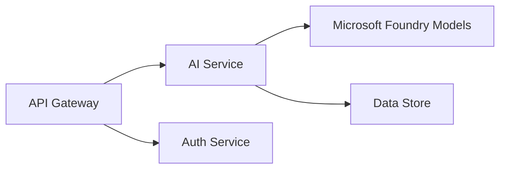

# अध्याय 8: प्रोडक्शन और एंटरप्राइज पैटर्न

**📚 पाठ्यक्रम**: [AZD के लिए शुरुआती](../../README.md) | **⏱️ अवधि**: 2-3 घंटे | **⭐ जटिलता**: उन्नत

---

## अवलोकन

यह अध्याय एंटरप्राइज-तैयार तैनाती पैटर्न, सुरक्षा कड़ाई, निगरानी, और उत्पादन AI वर्कलोड्स के लिए लागत अनुकूलन को कवर करता है।

यह एक स्थापत्य संदर्भ है, पूर्ण डिप्लॉय करने योग्य उत्पादन टेम्पलेट नहीं। उदाहरणों में समेकन विवरण शामिल नहीं हैं जिन्हें आपकी अपनी एप्लिकेशन में प्रदान किया जाना और परीक्षण किया जाना चाहिए; चेकलिस्ट पढ़ना उत्पादन जागरूकता प्रमाणित नहीं करता।

> **रिलीज समीक्षा (2026-11-04):** AI CLI मार्गदर्शन को `azd 1.37.2`, एजेंट्स `1.0.0-beta.23`, और मूल्यांकन `1.0.0-beta.2` दस्तावेज़/स्रोत के साथ जांचा गया। संगतता आवश्यकताओं और माइग्रेशन विवरण के लिए [रिलीज़ बदलाव और सुधार](production-ai-practices.md#recent-release-changes-and-fixes) देखें; यह लाइव तैनाती सत्यापन नहीं है।

## सीखने के उद्देश्य

इस अध्याय को पूरा करके, आप:
- मल्टी-रीजन रेजिलिएंट ऐप्लिकेशन तैनात करेंगे
- एंटरप्राइज सुरक्षा पैटर्न लागू करेंगे
- व्यापक निगरानी सेटअप करेंगे
- पैमाने पर लागत अनुकूलित करेंगे
- AZD के साथ CI/CD पाइपलाइन सेटअप करेंगे

---

## 📚 पाठ

| # | पाठ | विवरण | समय |
|---|--------|-------------|------|
| 1 | [प्रोडक्शन AI प्रथाएँ](production-ai-practices.md) | एंटरप्राइज तैनाती पैटर्न | 90 मिनट |

---

## 🚀 प्रोडक्शन चेकलिस्ट

- [ ] रेजिलिएंस के लिए मल्टी-रीजन तैनाती
- [ ] प्रमाणीकरण के लिए प्रबंधित पहचान (कोई कुंजी नहीं)
- [ ] निगरानी के लिए एप्लिकेशन इनसाइट्स
- [ ] लागत बजट और अलर्ट कॉन्फ़िगर किए गए
- [ ] सुरक्षा स्कैनिंग सक्षम
- [ ] CI/CD पाइपलाइन समाकालन
- [ ] आपदा पुनर्प्राप्ति योजना

---

## 🏗️ आर्किटेक्चर पैटर्न

### पैटर्न 1: माइक्रोसर्विसेज AI



### पैटर्न 2: इवेंट-चालित AI


---

## 🔐 सुरक्षा सर्वोत्तम प्रथाएँ

```bicep
// Illustrative properties from different resources, NOT a standalone Bicep file.
// Attach identity to the application host:
identity: {
  type: 'SystemAssigned'
}

// AI account properties (also require private endpoints, DNS and app connectivity):
properties: {
  publicNetworkAccess: 'Disabled'
  networkAcls: {
    defaultAction: 'Deny'
  }
}
```

---

## 💰 लागत अनुकूलन

| रणनीति | मुख्य प्रतिबंध |
|----------|---------|
| शून्य तक स्केल (कंटेनर ऐप्स) | उपयुक्त ट्रिगर आवश्यक; अन्य सेवाएँ लागत उत्पन्न करती हैं |
| विकास के लिए खपत स्तर का उपयोग करें | चयनित सेवा मूल्य निर्धारण और वर्कलोड की तुलना करें |
| शेड्यूल्ड स्केलिंग | समर्थित अवसंरचना/स्वचालन के माध्यम से स्केल करें |
| आरक्षण/प्राविजन की गई क्षमता | केवल जब समर्थित हो; प्रतिबद्धताएँ निष्क्रिय लागत बढ़ा सकती हैं |

वैध प्रारंभ तिथि, बिलिंग स्कोप, प्राप्तकर्ताओं और अनुमतियों के साथ [पूर्ण बजट संसाधन पैटर्न](production-ai-practices.md#2-cost-monitoring-and-budgets) का उपयोग करें। बजट अलर्ट भेजता है; यह खर्च को सीमा में नहीं रखता। बचत मापी गई उपयोगिता पर निर्भर करती है और गारंटीकृत प्रतिशत नहीं होती।

---

## 📊 निगरानी सेटअप

```bash
# Open the Application Insights logs view (requires configured monitoring)
azd monitor --logs

# Check Application Insights
azd monitor --overview

# View metrics
az monitor metrics list --resource <resource-id>
```

---

## 🔗 नेविगेशन

| दिशा | अध्याय |
|-----------|---------|
| **पिछला** | [अध्याय 7: समस्या निवारण](../chapter-07-troubleshooting/README.md) |
| **पाठ्यक्रम पूरा** | [पाठ्यक्रम होम](../../README.md) |

---

## 📖 संबंधित संसाधन

- [AI एजेंट गाइड](../chapter-02-ai-development/agents.md)
- [एप्लिकेशन इनसाइट्स](../chapter-06-pre-deployment/application-insights.md)
- [मल्टी-एजेंट सॉल्यूशंस](../chapter-05-multi-agent/README.md)
- [माइक्रोसर्विसेज उदाहरण](../../examples/microservices/README.md)

---

<!-- CO-OP TRANSLATOR DISCLAIMER START -->
**अस्वीकरण**:
इस दस्तावेज़ का अनुवाद AI अनुवाद सेवा [Co-op Translator](https://github.com/Azure/co-op-translator) का उपयोग करके किया गया है। जबकि हम सटीकता के लिए प्रयास करते हैं, कृपया ध्यान दें कि स्वचालित अनुवादों में त्रुटियाँ या अशुद्धियाँ हो सकती हैं। मूल दस्तावेज़ अपनी मूल भाषा में ही प्रामाणिक स्रोत माना जाना चाहिए। महत्वपूर्ण जानकारी के लिए, पेशेवर मानव अनुवाद की सिफारिश की जाती है। इस अनुवाद के उपयोग से उत्पन्न किसी भी गलतफहमी या गलत व्याख्या के लिए हम उत्तरदायी नहीं हैं।
<!-- CO-OP TRANSLATOR DISCLAIMER END -->