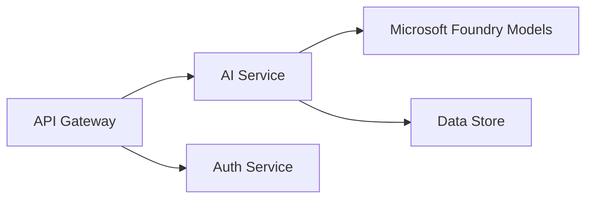

# अध्याय 8: उत्पादन और उद्यम पैटर्न

**📚 पाठ्यक्रम**: [AZD For Beginners](../../README.md) | **⏱️ अवधि**: 2-3 घंटे | **⭐ जटिलता**: उन्नत

---

## अवलोकन

यह अध्याय उद्यम-तैयार तैनाती पैटर्न, सुरक्षा सख्ती, निगरानी, और उत्पादन AI वर्कलोड के लिए लागत अनुकूलन को कवर करता है।

यह एक वास्तुशिल्प संदर्भ है, पूर्ण तैनात करने योग्य उत्पादन टेम्पलेट नहीं। उदाहरण उन एकीकरण विवरणों को छोड़ देते हैं जिन्हें आपके अपने अनुप्रयोग में प्रदान और परीक्षण किया जाना चाहिए; चेकलिस्ट पढ़ना उत्पादन तत्परता का प्रमाण नहीं है।

> **Foundry GA अपडेट (2026-11-09):** Foundry वर्कफ़्लो के लिए `azd >= 1.37.0` और सामान्य रूप से उपलब्ध `microsoft.foundry` 1.0 बंडल का उपयोग करें; मूल्यांकन अलग से स्थापित किए जाते हैं। देखें [रिलीज़ स्कोप और माइग्रेशन](production-ai-practices.md#recent-release-changes-and-fixes) और [प्रमाणीकृत पाइपलाइन उदाहरण](production-ai-practices.md#cicd-pipeline-configuration)। यह एक दस्तावेज़ समीक्षा है, लाइव तैनाती प्रमाणीकरण या वैकल्पिक पूर्वावलोकन सुविधाओं के लिए सार्वभौमिक GA स्थिति नहीं है।

## सीखने के उद्देश्य

इस अध्याय को पूरा करने पर आप:
- मल्टी-रीजन लचीले अनुप्रयोग तैनात करेंगे
- उद्यम सुरक्षा पैटर्न लागू करेंगे
- व्यापक निगरानी कॉन्फ़िगर करेंगे
- बड़े पैमाने पर लागत अनुकूलित करेंगे
- AZD के साथ CI/CD पाइपलाइनों को सेट अप करेंगे

---

## 📚 पाठ

| # | पाठ | विवरण | समय |
|---|--------|-------------|------|
| 1 | [उत्पादन AI अभ्यास](production-ai-practices.md) | उद्यम तैनाती पैटर्न | 90 मिनट |

---

## 🚀 उत्पादन चेकलिस्ट

- [ ] लचीलापन के लिए मल्टी-रीजन तैनाती
- [ ] प्रमाणीकरण के लिए प्रबंधित पहचान (कोई कुंजी नहीं)
- [ ] निगरानी के लिए एप्लिकेशन इनसाइट्स
- [ ] लागत बजट और अलर्ट कॉन्फ़िगर किए गए
- [ ] सुरक्षा स्कैनिंग सक्षम
- [ ] CI/CD पाइपलाइन एकीकरण
- [ ] आपदा पुनर्प्राप्ति योजना

---

## 🏗️ वास्तुकला पैटर्न

### पैटर्न 1: माइक्रोसर्विसेज AI



### पैटर्न 2: इवेंट-ड्रिवन AI


---

## 🔐 सुरक्षा सर्वोत्तम प्रथाएं

```bicep
// Illustrative properties from different resources, NOT a standalone Bicep file.
// Attach identity to the application host:
identity: {
  type: 'SystemAssigned'
}

// AI account properties (also require private endpoints, DNS and app connectivity):
properties: {
  publicNetworkAccess: 'Disabled'
  networkAcls: {
    defaultAction: 'Deny'
  }
}
```

---

## 💰 लागत अनुकूलन

| रणनीति | मुख्य प्रतिबंध |
|----------|---------|
| शून्य तक स्केल करना (कंटेनर ऐप्स) | उपयुक्त ट्रिगर आवश्यक; अन्य सेवाओं पर अभी भी लागत लगती है |
| विकास के लिए उपभोग स्तरों का उपयोग करें | चयनित सेवा मूल्य निर्धारण और वर्कलोड की तुलना करें |
| अनुसूचित स्केलिंग | समर्थित इंफ्रास्ट्रक्चर/स्वचालन के माध्यम से स्केल करें |
| आरक्षण/प्राविधिक क्षमता | केवल तब जब समर्थित हो; प्रतिबद्धताएं निष्क्रिय लागत बढ़ा सकती हैं |

मान्य प्रारंभ तिथि, बिलिंग स्कोप, प्राप्तकर्ता और अनुमतियों के साथ [पूर्ण बजट संसाधन पैटर्न](production-ai-practices.md#2-cost-monitoring-and-budgets) का उपयोग करें। एक बजट अलर्ट भेजता है; यह खर्च को सीमित नहीं करता। बचत मापा गया उपयोग और गारंटीकृत प्रतिशतों पर निर्भर करती है।

---

## 📊 निगरानी सेटअप

```bash
# Open the Application Insights logs view (requires configured monitoring)
azd monitor --logs

# Check Application Insights
azd monitor --overview

# View metrics
az monitor metrics list --resource <resource-id>
```

---

## 🔗 नेविगेशन

| दिशा | अध्याय |
|-----------|---------|
| **पिछला** | [अध्याय 7: समस्या निवारण](../chapter-07-troubleshooting/README.md) |
| **कोर्स पूरा हुआ** | [कोर्स होम](../../README.md) |

---

## 📖 संबंधित संसाधन

- [एआई एजेंट गाइड](../chapter-02-ai-development/agents.md)
- [एप्लीकेशन इनसाइट्स](../chapter-06-pre-deployment/application-insights.md)
- [मल्टी-एजेंट समाधान](../chapter-05-multi-agent/README.md)
- [माइक्रोसर्विसेज उदाहरण](../../examples/microservices/README.md)

---

<!-- CO-OP TRANSLATOR DISCLAIMER START -->
**अस्वीकरण**:
इस दस्तावेज़ का अनुवाद AI अनुवाद सेवा [Co-op Translator](https://github.com/Azure/co-op-translator) का उपयोग करके किया गया है। जबकि हम सटीकता के लिए प्रयास करते हैं, कृपया ध्यान दें कि स्वचालित अनुवादों में त्रुटियाँ या अशुद्धियाँ हो सकती हैं। मूल दस्तावेज़ अपनी मूल भाषा में ही प्रामाणिक स्रोत माना जाना चाहिए। महत्वपूर्ण जानकारी के लिए, पेशेवर मानव अनुवाद की सिफारिश की जाती है। इस अनुवाद के उपयोग से उत्पन्न किसी भी गलतफहमी या गलत व्याख्या के लिए हम उत्तरदायी नहीं हैं।
<!-- CO-OP TRANSLATOR DISCLAIMER END -->