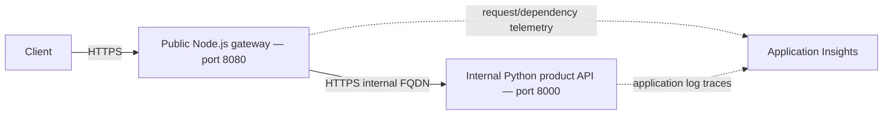

# दो-सेवा माइक्रोसर्विसेज — Azure कंटेनर एप्स

**स्तर:** मध्यवर्ती · **समय:** सेटअप सहित 45–60 मिनट

यह लर्निंग सैम्पल एक **Node.js API गेटवे** और एक **रीड-ओनली Python उत्पाद सेवा** को लागू करता है। स्रोत, Dockerfiles, Bicep, और azd कॉन्फ़िगरेशन शामिल हैं।

यह एक प्रोडक्शन-हार्डन सिस्टम नहीं है।

## आप क्या सीखेंगे

- दो सेवाओं को स्वतंत्र रूप से तैनात करना।
- HTTPS पर एक आंतरिक बैकेंड FQDN का उपयोग करना।
- सफल, न-प्राप्त और अनुपलब्ध-सेवा प्रतिक्रियाओं को सत्यापित करना।
- टेलीमेट्री और स्वतंत्र स्केलिंग सीमाओं को समझना।



उत्पाद कैटलॉग में मेमोरी में पांच निर्धारित उत्पाद हैं। **कोई POST, PUT, या DELETE हैंडलर**, डेटाबेस, सर्विस बस, ऑर्डर/यूजर/सूचना सेवा, C#, या Go कोड नहीं हैं।
ये भविष्य के विकास के विचार हैं, शामिल विशेषताएं नहीं।
गेटवे उपयोगकर्ताओं को प्रमाणीकरण नहीं करता; आंतरिक इनग्रैस एप्लिकेशन प्राधिकरण के लिए प्रतिस्थापन नहीं है।

एप्लीकेशन प्राधिकरण के लिए। 

## पूर्वापेक्षाएँ

पहले [single Flask API](../../../../../examples/container-app/simple-flask-api) को पूरा करें।
वर्तमान स्थिर azd (समीक्षा के समय प्रकाशित संस्करण: 1.37.2), Azure CLI,
और Docker को इंस्टॉल करें जिसमें डेमन चल रहा हो। आपको एक Azure सदस्यता, संसाधन
निर्माण अनुमतियाँ, और Container Apps क्षेत्रीय कोटा की आवश्यकता है।

```bash
azd version
az version
docker info
azd auth login
az login
```

दोनों CLI उपकरणों में एक ही सदस्यता का उपयोग करें। नीचे दिए गए कमांड Bash का उपयोग करते हैं।

## परिनियोजित करें और सत्यापित करें

रिपोजिटरी रूट से:

```bash
cd examples/container-app/microservices
azd env new microservices-demo
azd up
GATEWAY_URL=$(azd env get-value API_GATEWAY_URL)
RG_NAME=$(azd env get-value AZURE_RESOURCE_GROUP)
GATEWAY_NAME=$(azd env get-value API_GATEWAY_NAME)
PRODUCT_NAME=$(azd env get-value PRODUCT_SERVICE_NAME)

curl --fail-with-body "${GATEWAY_URL}/health"
curl --fail-with-body "${GATEWAY_URL}/api/products"
curl --fail-with-body "${GATEWAY_URL}/api/products/1"
curl -i "${GATEWAY_URL}/api/products/999"
```

**सफलता:** health 200; list 200 के साथ **पाँच** उत्पाद; उत्पाद 1 एक लैपटॉप है
जिसका मूल्य 999.99 है और स्टॉक 50 है; अज्ञात उत्पाद 404 लौटाता है।
विवरण प्रतिक्रियाओं में शामिल हैं; समय टिकट अलग-अलग हो सकते हैं।

प्रारंभिक प्रावधान सार्वजनिक hello-world इमेजेज़ को पोर्ट 80 पर उपयोग करता है ताकि यह
खाली रजिस्ट्री से मौजूद नहीं इमेजेज़ को खींचने की कोशिश न करे। सेवा-विशिष्ट Bicep मॉड्यूल
और पैरामीटर फाइलें उन्हें निर्मित इमेजेज़ और ऐप पोर्ट/प्रोब के साथ
`azd deploy` के दौरान बदलती हैं। मुख्य पैरामीटर बाद के प्रावधान के लिए प्रकाशित इमेज नामों को संरक्षित करते हैं।

## सेवाएँ और नेटवर्किंग

| सेवा | प्रदर्शित एंडपॉइंट | डिफ़ॉल्ट संसाधन |
|---|---|---|
| गेटवे | GET `/`, `/health`, `/api/products`, `/api/products/:id` | 1 vCPU, 2 GiB, 2–20 प्रतिकृति |
| उत्पाद | GET `/`, `/health`, `/products`, `/products/<id>` | 0.5 vCPU, 1 GiB, 1–10 प्रतिकृति |

उत्पाद इन्ग्रेस में `external: false` और `allowInsecure: false` शामिल हैं। Bicep
गेटवे में `PRODUCT_SERVICE_URL=https://<actual-internal-fqdn>` इंजेक्ट करता है। HTTP रीडायरेक्ट करेगा;
HTTPS निर्दिष्ट इन्ग्रेस से मेल खाता है। एक छोटा DNS नाम
**वास्तविक Container App नाम** से मेल खाना चाहिए, लॉजिकल सेवा कुंजी `product-service` से नहीं।
अपने लैपटॉप से आंतरिक URL को सीधे कॉल करने की कोशिश न करें।

गेटवे में उत्पाद कॉल के लिए पाँच सेकंड का टाइमआउट होता है। गायब उत्पाद ID 404 के रूप में प्रसारित होती हैं;
परिवहन विफलताएँ/अन्य बैकएंड विफलताएँ 503 लौटाती हैं। गेटवे
`/health` केवल गेटवे को जांचता है, बैकएंड उपलब्धता को नहीं।

## फाइलें और कॉन्फ़िगरेशन

```text
azure.yaml
infra/main.bicep
infra/main.parameters.json
infra/abbreviations.json
infra/core/container-apps-environment.bicep
infra/core/monitor.bicep
infra/app/api-gateway.bicep
infra/app/api-gateway.parameters.json
infra/app/product-service.bicep
infra/app/product-service.parameters.json
src/api-gateway/{app.js,package.json,Dockerfile}
src/product-service/{main.py,requirements.txt,Dockerfile}
```

स्केलिंग, CPU/मेमोरी, पोर्ट, और प्रोब्स `infra/app/*.bicep` में सेट होते हैं। उन
फाइलों को बदलें और अवसंरचना लागू करने और पुनःपरिनियोजित करने के लिए `azd up` चलाएं। इस नमूने में कोई
`GATEWAY_MAX_REPLICAS` पर्यावरण-चर पैरामीटर नहीं है।

केवल कोड परिवर्तन के लिए:

```bash
azd deploy product-service
azd deploy api-gateway
```

Node इमेज Node 22 का उपयोग करता है; Python इमेज Python 3.11 का उपयोग करता है। दोनों 
`0.0.0.0` से बाइंड करते हैं। इन्ग्रेस/प्रोब्स क्रमशः पोर्ट 8080 (गेटवे) और 8000 (उत्पाद) का उपयोग करते हैं।

## Docker के साथ स्थानीय विकास

इस उदाहरण निर्देशिका से चलाएँ। एक उपयोगकर्ता-परिभाषित नेटवर्क का उपयोग करें, **न कि `localhost`
एक कंटेनर से दूसरे तक पहुँचने के लिए**:

```bash
docker network create azd-microservices-demo
docker build -t local-product ./src/product-service
docker build -t local-gateway ./src/api-gateway
docker run -d --name azd-product --network azd-microservices-demo local-product
docker run -d --name azd-gateway --network azd-microservices-demo \
  -p 8080:8080 -e PRODUCT_SERVICE_URL=http://azd-product:8000 local-gateway
curl --fail-with-body http://localhost:8080/api/products
```

अपेक्षित: पाँच उत्पाद। HTTP केवल इस स्थानीय Docker नेटवर्क के लिए उपयोग किया जाता है।

```bash
docker stop azd-product azd-gateway
docker rm azd-product azd-gateway
docker network rm azd-microservices-demo
```

## निगरानी

```bash
az containerapp logs show --name "$GATEWAY_NAME" --resource-group "$RG_NAME" --follow
# In a separate terminal:
az containerapp logs show --name "$PRODUCT_NAME" --resource-group "$RG_NAME" --tail 100
```

`azd monitor --logs` एक पोर्टल दृश्य खोलता है; यह टर्मिनल लॉग स्ट्रीम नहीं करता।
Node SDK गेटवे अनुरोधों/निर्भरता को एकत्र करता है। Python का `AzureLogHandler`
**लॉग ट्रेस** निर्यात करता है, स्वत: Flask अनुरोध, SQL निर्भरताएँ, या पूर्ण
वितरित ट्रेस नहीं। OpenCensus एक पुराना SDK है; इस नमूने का विस्तार करते समय Azure Monitor OpenTelemetry
को प्राथमिकता दें।

Application Insights Logs में, अनुरोध उत्पन्न करें और निरीक्षण करें:

```kusto
requests
| where timestamp > ago(1h)
| where name contains "products"
| summarize RequestCount=count(), AvgDuration=avg(duration) by bin(timestamp, 5m)
```

पायथन एप्लिकेशन संदेशों के लिए:

```kusto
traces
| where timestamp > ago(1h)
| where message contains "products"
| project timestamp, message, severityLevel
```

इनजेशन विलंब और सैंपलिंग की अनुमति दें; एक सटीक अनुरोध संख्या या सुनिश्चित विलंब की अपेक्षा न करें।
कोई कस्टम अलर्ट या डैशबोर्ड कॉन्फ़िगर नहीं किए गए हैं।

## व्यावहारिक अभ्यास

### अभ्यास 1: कैटलॉग संशोधित करें

**प्रारंभिक बिंदु:** `src/product-service/main.py`।
**लक्ष्य:** स्वतंत्र सेवा परिनियोजन को सत्यापित करें।
लैपटॉप का स्टॉक फिक्स्ड `products` सूची में 50 से 49 में बदलें,
`azd deploy product-service` चलाएं, फिर `${GATEWAY_URL}/api/products/1` का अनुरोध करें।

**सफलता मानदंड / समाधान:** HTTP 200 के साथ `"stock":49`। 50 को पुनर्स्थापित करें और पुनः तैनात करें।
**सामान्य समस्या:** कैटलॉग के मालिक सेवा के बजाय गेटवे को संपादित करना।
यह स्रोत डेटा बदलता है, एक स्थायी सूची डेटाबेस नहीं।

### व्यायाम 2: प्रतिकृति कॉन्फ़िगरेशन सत्यापित करें

**शुरुआती बिंदु:** `infra/app/product-service.bicep`।
**लक्ष्य:** ऑटोसकेलिंग का अनुमान लगाए बिना अवसंरचना परिवर्तन का अवलोकन करें।
`minReplicas: 1` को `minReplicas: 2` में बदलें, `azd up` चलाएं, फिर:

```bash
az containerapp show --name "$PRODUCT_NAME" --resource-group "$RG_NAME" \
  --query properties.template.scale -o json
```

**सफलता मानदंड:** कॉन्फ़िगर न्यूनतम 2 है और अधिकतम 10 बना रहता है।
न्यूनतम 1 पुनर्स्थापित करें और `azd up` चलाएं।
**सामान्य समस्या:** केवल `azd deploy` संबंधित साझा अवसंरचना में परिवर्तन लागू नहीं करता है।
फेल्योर सिमुलेशन के लिए `maxReplicas` को शून्य पर न सेट करें।
यह कॉन्फ़िगरेशन सत्यापित करता है, लोड-टेस्ट या गारंटीकृत तत्काल प्रतिकृति संख्या नहीं।

### व्यायाम 3: स्थानीय रूप से अनुपलब्ध-सेवा हैंडलिंग का परीक्षण करें

**शुरुआती बिंदु:** ऊपर दोनों स्थानीय Docker कंटेनर चल रहे हैं।
**लक्ष्य:** एक खोए हुए उत्पाद से बैकेंड विफलता को अलग करें।
केवल उत्पाद कंटेनर रोकें:

```bash
docker stop azd-product
curl -i http://localhost:8080/api/products
docker start azd-product
curl --fail-with-body http://localhost:8080/api/products
```

**सफलता मापदंड:** रुकने के दौरान, गेटवे 503 लौटाता है जिसमें
`"error":"Product service unavailable"` होता है; पुनः प्रारंभ के बाद, सूची 200 लौटाती है।
आवश्यक होने पर एक छोटी स्टार्टअप देरी के बाद पुनः प्रयास करें।
**सामान्य समस्या:** गेटवे को रोकना एक अलग विफलता का परीक्षण करता है (कोई HTTP प्रतिक्रिया नहीं)।

## लागतें और उत्पादन अंतर

डिफ़ॉल्ट न्यूनतम प्रतिकृतियाँ कंप्यूटिंग चलाए रखती हैं। रजिस्ट्री और निगरानी भी
शुल्क लगाते हैं। कोई सत्यापित निश्चित $50/माह कुल नहीं है: क्षेत्रीय CPU/मेमोरी,
प्रतिकृति घंटे, अनुरोध, रजिस्ट्री, और लॉग प्रतिधारण का अनुमान
[Azure मूल्य निर्धारण कैलकुलेटर](https://azure.microsoft.com/pricing/calculator/) में लगाएं।
शिक्षण संसाधनों को तुरंत हटा दें।

उत्पादन कार्य में प्रमाणीकरण/अधिकरण, सीमित प्रबंधित पहचान,
स्थायी डेटा, इनपुट/प्रतिक्रिया सत्यापन, समर्थित अवलोकनीयता उपकरण,
लोड/विफलता परीक्षण, CI/CD, अलर्ट, और पुनर्प्राप्ति प्रक्रियाएं शामिल हैं। एक आदेश जोड़ना
सेवा, कतार, या डेटाबेस एक अलग कार्यान्वयन कार्य है, यहां उपलब्ध एक पूरा व्यायाम या फीचर नहीं है।


## समस्या निवारण और सफाई

- **प्रथम प्रावधान के दौरान छवि नहीं मिली:** बूटस्ट्रैप को सार्वजनिक छवि का उपयोग करना चाहिए; 
  मुख्य छवि पैरामीटर डिफ़ॉल्ट और डिप्लॉयमेंट मॉड्यूल मैपिंग की जाँच करें।
- **503 उत्पाद:** उत्पाद लॉग, छवि पुनःसंस्करण, और इंजेक्ट किए गए आंतरिक HTTPS URL की जाँच करें।
- **404 अप्रत्याशित पथ:** उत्पाद API केवल-पढ़ने योग्य है; मार्ग सत्यापित करें, गैर-मौजूद CRUD हैंडलर नहीं।
- **कोई टेलीमेट्री नहीं:** रनटाइम कनेक्शन स्ट्रिंग्स का निरीक्षण करें बिना उन्हें प्रकट किए और
  इनजेशन में देरी की अनुमति दें। पायथन रिक्वेस्ट टेबल्स इसके लॉग हैंडलर द्वारा नहीं भरे जाते।

इस नमूना निर्देशिका से:

```bash
azd down
```

हटाने के संकेतों की समीक्षा करें और जांचें कि समर्पित रिसोर्स ग्रुप को हटा दिया गया है।

[पिछला: Flask API](../../../../../examples/container-app/simple-flask-api) · [अगला: डेटाबेस एप्लिकेशन](../../../../../examples/database-app) ·
[एआई विकास](../../../docs/chapter-02-ai-development/README.md) ·
[कोर्स होम](../../../README.md) · [समस्या रिपोर्ट करें](https://github.com/microsoft/AZD-for-beginners/issues)

---

<!-- CO-OP TRANSLATOR DISCLAIMER START -->
**अस्वीकरण**:
इस दस्तावेज़ का अनुवाद AI अनुवाद सेवा [Co-op Translator](https://github.com/Azure/co-op-translator) का उपयोग करके किया गया है। जबकि हम सटीकता के लिए प्रयास करते हैं, कृपया ध्यान दें कि स्वचालित अनुवादों में त्रुटियाँ या अशुद्धियाँ हो सकती हैं। मूल दस्तावेज़ अपनी मूल भाषा में ही प्रामाणिक स्रोत माना जाना चाहिए। महत्वपूर्ण जानकारी के लिए, पेशेवर मानव अनुवाद की सिफारिश की जाती है। इस अनुवाद के उपयोग से उत्पन्न किसी भी गलतफहमी या गलत व्याख्या के लिए हम उत्तरदायी नहीं हैं।
<!-- CO-OP TRANSLATOR DISCLAIMER END -->