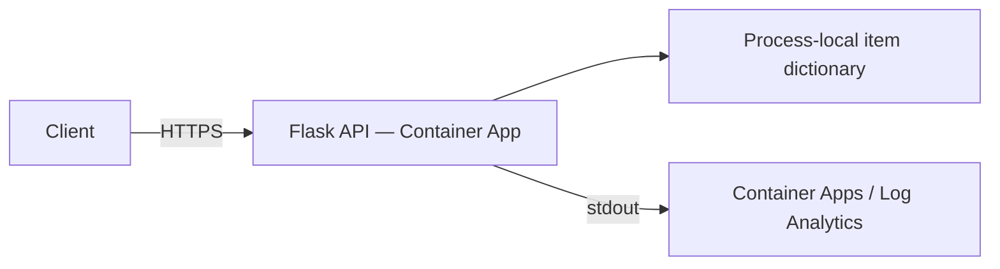

# सरल Flask API — Azure Container Apps

**स्तर:** शुरुआती · **समय:** सेटअप समेत 30–45 मिनट

Azure Developer CLI (azd) के साथ एक Python Flask CRUD API को तैनात करें। स्रोत, Dockerfile,
Bicep, और तैनाती पैरामीटर शामिल हैं। यह एक **सीखने के लिए नमूना** है, न कि
उत्पादन-तैयार API।

## आप क्या सीखेंगे

- azd के माध्यम से एक कंटेनर बनाएं और प्रकाशित करें।
- इनग्रेश और लिवनेस/रीडिनेस प्रोब को कॉन्फ़िगर करें।
- CRUD प्रतिक्रियाओं को सत्यापित करें और एप्लिकेशन लॉग्स की जांच करें।
- समझें कि क्यों इन-मेमोरी डेटा टिकाऊ एप्लिकेशन के लिए उपयुक्त नहीं है।



**महत्वपूर्ण:** आइटम एक प्रक्रिया में रखे जाते हैं। डिफ़ॉल्ट है **एक Gunicorn वर्कर,
0–1 प्रतिकृति**, जो जानबूझकर वर्करों/रिप्लिकाओं के बीच असंगत डेटा से बचता है।
आइटम पुनरारंभ, संशोधन परिवर्तन, या शून्य के लिए स्केल करने पर खो जाते हैं। प्रतिकृतियां बढ़ाने के लिए
साझा स्थायी स्टोरेज आवश्यक है। API में कोई प्रमाणीकरण या प्राधिकार नहीं है।

## पूर्वापेक्षाएँ

- [वर्तमान स्थिर azd](https://learn.microsoft.com/azure/developer/azure-developer-cli/install-azd)
  (समीक्षा के समय प्रकाशित संस्करण: 1.37.2)।
- सत्यापन के लिए [Azure CLI](https://learn.microsoft.com/cli/azure/install-azure-cli)।
- डॉकर और इसका डेमोन चल रहा होना चाहिए; यह डिफ़ॉल्ट स्थानीय इमेज निर्माण के लिए आवश्यक है।
- Azure सब्सक्रिप्शन, संसाधन-निर्माण अनुमतियाँ, और Container Apps क्षेत्रीय कोटा।
- नीचे दिए गए आदेशों के लिए Bash (या समान PowerShell)।
- वैकल्पिक स्थानीय विकास के लिए Python 3.11।

```bash
azd version
az version
docker info
azd auth login
az login
```

CLI उपकरणों के अलग-अलग लॉगिन सेशन होते हैं। दोनों में एक ही सब्सक्रिप्शन का उपयोग करें।

## त्वरित शुरुआत

रिपॉजिटरी रूट से:

```bash
cd examples/container-app/simple-flask-api
azd env new flask-demo
azd up
API_URL=$(azd env get-value API_ENDPOINT)
RG_NAME=$(azd env get-value AZURE_RESOURCE_GROUP)
API_NAME=$(azd env get-value API_NAME)
curl --fail-with-body "${API_URL}/health"
```

अपेक्षित: HTTP 200 और JSON जिसमें `"status":"healthy"`,
`"service":"simple-flask-api"`, और वर्तमान UTC टाइमस्टैम्प हो।
प्राविजनिंग और इमेज बिल्डिंग आमतौर पर कुछ मिनट लेता है; समय अलग-अलग हो सकता है।

प्रारंभिक प्राविजनिंग एक सार्वजनिक hello-world इमेज का उपयोग करता है, जो पोर्ट 80 पर सुन रहा है।
`azure.yaml`  `infra/app/api.bicep` और इसकी मिलती-जुलती पैरामीटर फ़ाइल का चयन करता है
सेवा तैनाती के लिए, जो इमेज, इनग्रेश, और प्रोब को पोर्ट 8000 पर स्विच करता है।
उन तैनाती पैरामीटरों को न हटाएँ।

## CRUD सत्यापित करें

निम्नलिखित को क्रमिक रूप से चलाएं जब तक कि वही रिप्लिका सक्रिय रहता है:

```bash
# Create: HTTP 201; note the returned id (1 for a fresh process).
curl -i -X POST "${API_URL}/api/items" \
  -H "Content-Type: application/json" \
  -d '{"name":"Test Item","description":"My first item"}'

# Read list: HTTP 200, total 1 in a fresh process.
curl --fail-with-body "${API_URL}/api/items"

# Replace 1 if your create response returned another id.
curl --fail-with-body "${API_URL}/api/items/1"
curl -i -X PUT "${API_URL}/api/items/1" \
  -H "Content-Type: application/json" -d '{"name":"Updated Item"}'
curl -i -X DELETE "${API_URL}/api/items/1"
curl -i "${API_URL}/api/items/1"
```

सफलता: POST 201, reads/PUT 200, DELETE 204 बिना बॉडी के, फिर गुमशुदा आइटम 404।
गलत/गैर-ऑब्जेक्ट JSON या खाली नाम 400 लौटाता है।
यदि आइटम अनुरोधों के बीच गायब हो जाता है, तो पुनरारंभ या शून्य पर स्केलिंग के लिए जांच करें;
यह जानबूझकर इन-मेमोरी सीमा है, स्थिरता नहीं।

| एंडपॉइंट | मेथड्स |
|---|---|
| `/` | GET — सेवा जानकारी |
| `/health` | GET — लिवनेस/रीडिनेस |
| `/api/items` | GET, POST |
| `/api/items/{id}` | GET, PUT, DELETE |

## लॉग्स और कॉन्फ़िगरेशन

```bash
az containerapp logs show --name "$API_NAME" --resource-group "$RG_NAME" --follow
```

अपेक्षित: Gunicorn स्टार्टअप, अनुरोध एक्सेस लॉग्स, और एप्लिकेशन संदेश।
`azd monitor --logs` एक पोर्टल दृश्य खोलता है; यह टर्मिनल में स्ट्रीम नहीं करता।
एप्लिकेशन इनसाइट्स प्राविज़न की गई है लेकिन **इस Flask कोड द्वारा उपकरण नहीं लगी है**;
stdout लॉग के लिए Container Apps/Log Analytics का उपयोग करें।

CPU/मेमोरी, रिप्लिका सीमाएँ, या स्केल नियमों के लिए `infra/app/api.bicep` संपादित करें, फिर
`azd up` चलाएं। डिफ़ॉल्ट हैं 0.5 vCPU, 1 GiB, न्यूनतम 0 / अधिकतम 1 रिप्लिका, और
HTTP थ्रेशोल्ड 50 समवर्ती अनुरोध। शून्य पर स्केलिंग ठंडा-प्रारंभ विलंब जोड़ सकती है।

मनमाने तरीके से `azd env set MAX_REPLICAS`, `API_KEY`, `LOG_LEVEL`, या
`SCALE_TO_ZERO_TIMEOUT` मान **इस टेम्पलेट या ऐप के साथ नहीं जुड़े हुए हैं**।
मान सेट करने से यह स्वतः ही रनटाइम परिवेश चर नहीं बनता।
इमेज पोर्ट 8000 को स्पष्ट रूप से बाइंड करता है; पोर्ट बदलने पर Dockerfile, Bicep ingress, और प्रोब
एक साथ अपडेट करें।

## फाइलें

```text
azure.yaml
infra/main.bicep
infra/main.parameters.json
infra/app/container-apps.bicep       # Environment, registry, monitoring
infra/app/api.bicep                  # App, ingress, probes, scale settings
infra/app/api.parameters.json        # Image and resource values for azd deploy
src/app.py
src/Dockerfile
src/requirements.txt
```

## स्थानीय विकास

इस उदाहरण डायरेक्टरी से:

```bash
python -m venv .venv
source .venv/bin/activate  # PowerShell: .\.venv\Scripts\Activate.ps1
python -m pip install -r src/requirements.txt
python src/app.py
```

एक अन्य टर्मिनल में `http://localhost:8000/health` और CRUD एंडपॉइंट्स का परीक्षण करें।
या वास्तविक इमेज बनाएं और चलाएं:

```bash
docker build -t flask-api:local ./src
docker run --rm -p 8000:8000 flask-api:local
```

पहली तैनाती के बाद केवल कोड परिवर्तन के लिए `azd deploy api` चलाएं।
Bicep परिवर्तनों के लिए, पुनः-प्राविजन और तैनाती हेतु `azd up` चलाएं।

## व्यावहारिक अभ्यास

### 1. इनपुट अस्वीकृति सत्यापित करें

**शुरुआती बिंदु:** तैनात API, ऊपर `API_URL` ।
**लक्ष्य:** सत्यापित करें कि API अमान्य JSON संरचनाओं और गायब नामों को अस्वीकार करता है।

```bash
curl -i -X POST "${API_URL}/api/items" \
  -H "Content-Type: application/json" -d '[]'
curl -i -X POST "${API_URL}/api/items" \
  -H "Content-Type: application/json" -d '{"name":""}'
```

**सफलता मानदंड / समाधान:** दोनों 400 JSON त्रुटि के साथ लौटाएं, 500 नहीं।
**सामान्य समस्या:** JSON कंटेंट-टाइप हेडर का छोड़ देना।

### 2. एक केवल-पढ़ने वाला संस्करण एंडपॉइंट जोड़ें

**शुरुआती बिंदु:** `src/app.py`। **लक्ष्य:** API का विस्तार करें और पुनः तैनात करें।
इसे `if __name__ == '__main__':` ब्लॉक से पहले जोड़ें:

```python
@app.route('/version', methods=['GET'])
def version():
    return jsonify({'version': '1.0.0'})
```

`azd deploy api` चलाएं, फिर `curl --fail-with-body "${API_URL}/version"`।
**सफलता मानदंड:** HTTP 200 और `{"version":"1.0.0"}`।
**सामान्य समस्या:** ब्लॉकिंग `app.run()` कॉल के बाद रूट रखना जब
`python src/app.py` के साथ परीक्षण कर रहे हों।

### ज्ञान जांच बिंदु

टिकाऊ डेटा के लिए एक वर्कर क्यों अपर्याप्त है? क्योंकि एक प्रक्रिया भी
पुनरारंभ पर अपनी शब्दकोश खो देती है। एक उत्पादन संस्करण को स्थायी साझा स्टोरेज,
प्रमाणीकरण, प्राधिकरण, माइग्रेशन, परीक्षण, और संचालन निगरानी की आवश्यकता होती है।

## लागत और समस्या निवारण

यह एक सुनिश्चित $0 तैनाती नहीं है: बेसिक रजिस्ट्री और लॉग स्टोरेज/इंजेशन
ऐप कंप्यूट शून्य होने पर भी शुल्क हो सकते हैं। अपने क्षेत्र के लिए
[मूल्य निर्धारण कैलकुलेटर](https://azure.microsoft.com/pricing/calculator/) का उपयोग करें।

- **डॉकर बिल्ड फेलियर:** पुष्टि करें `docker info`, नेटवर्क एक्सेस, और निर्भरताएँ।
- **अस्वस्थ ऐप:** कंसोल/सिस्टम लॉग्स की जांच करें और सुनिश्चित करें कि इमेज पोर्ट, इनग्रैस,
  और प्रोब सहमत हों। फ्लास्क पोर्ट पर प्लेसहोल्डर को प्रोब नहीं किया जाना चाहिए।
- **403/अनुमतियाँ:** सब्सक्रिप्शन और संसाधन-निर्माण अनुमतियों की पुष्टि करें।
- **आइटम गायब हो जाते हैं:** मेमोरी में रखी स्थिति पुनः शुरू/शून्य-तक स्केल पर रीसेट हो जाती है; टिकाऊ व्यवहार के लिए
  एक डेटाबेस जोड़ें।

## सफाई और आगे के कदम

```bash
azd down
```

हटाने के संकेत की समीक्षा करें और सुनिश्चित करें कि समर्पित संसाधन समूह हटा दिया गया है।
असंबंधित डेटा वाले संसाधन समूह के खिलाफ विध्वंसकारी सफाई न करें।

[अगला: डेटाबेस ऐप](../../../../../examples/database-app) · [माइक्रोसर्विस](../../../../../examples/container-app/microservices) ·
[कंटेनर अवलोकन](../README.md) · [कोर्स होम](../../../README.md) ·
[समस्या की रिपोर्ट करें](https://github.com/microsoft/AZD-for-beginners/issues)

---

<!-- CO-OP TRANSLATOR DISCLAIMER START -->
**अस्वीकरण**:
इस दस्तावेज़ का अनुवाद AI अनुवाद सेवा [Co-op Translator](https://github.com/Azure/co-op-translator) का उपयोग करके किया गया है। जबकि हम सटीकता के लिए प्रयास करते हैं, कृपया ध्यान दें कि स्वचालित अनुवादों में त्रुटियाँ या अशुद्धियाँ हो सकती हैं। मूल दस्तावेज़ अपनी मूल भाषा में ही प्रामाणिक स्रोत माना जाना चाहिए। महत्वपूर्ण जानकारी के लिए, पेशेवर मानव अनुवाद की सिफारिश की जाती है। इस अनुवाद के उपयोग से उत्पन्न किसी भी गलतफहमी या गलत व्याख्या के लिए हम उत्तरदायी नहीं हैं।
<!-- CO-OP TRANSLATOR DISCLAIMER END -->