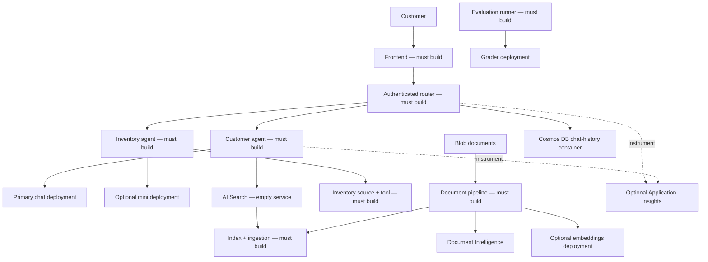

# मल्टी-एजेंट कस्टमर सपोर्ट — रिटेल आर्किटेक्चर ब्लूप्रिंट

**अध्याय 5: मल्टी-एजेंट AI सॉल्यूशंस**

- [कोर्स होम](../README.md)
- [अध्याय 5](../docs/chapter-05-multi-agent/README.md)
- [पूर्वापेक्षा: AI एकीकरण](../docs/chapter-02-ai-development/microsoft-foundry-integration.md)
- [अगला: क्षमता योजना](../docs/chapter-06-pre-deployment/capacity-planning.md)
- [ARM इन्फ्रास्ट्रक्चर स्कैफोल्ड](retail-multiagent-arm-template/README.md)

> **आर्किटेक्चर गाइड, कार्यशील एप्लीकेशन नहीं।** एकमात्र रिटेल इम्प्लीमेंटेशन
> फाइलें `azuredeploy.json`, `azuredeploy.parameters.json`, और `deploy.sh` हैं
> `retail-multiagent-arm-template/` में। राउटर/फ्रंटेंड कंटेनर हैलो-वर्ल्ड
> प्लेसहोल्डर हैं। कोई भी रिटेल एजेंट, UI, इनजेस्टन पाइपलाइन, इवैल्युएटर, स्कैनर,
> या एप्लीकेशन टेस्ट सूट स्थानीय रूप से मौजूद नहीं है।

## अवलोकन

**लक्ष्य:** एक ग्राहक-सपोर्ट सिस्टम डिज़ाइन करना जिसमें ग्राहक एजेंट और इन्वेंट्री
एजेंट हो, यह पहचानना कि इन्फ्रास्ट्रक्चर क्या प्रदान करता है, और अनुपलब्ध
एप्लीकेशन कॉन्ट्रैक्ट्स और सत्यापन की योजना बनाना।

**दर्शक:** डेवलपर्स जो स्थानीय
[चैट सैंपल](../../../examples/azure-openai-chat) और [दो-सेवा कंटेनर सैंपल](../../../examples/container-app/microservices) पूरा कर चुके हैं।
वास्तुकला अध्ययन के लिए 2–3 घंटे दें। एप्लीकेशन बनाना एक अलग
परियोजना है: अनुभवी डेवलपर्स के लिए 80–120 विकास घंटे मात्र एक अनुमानित योजना हैं,
**कोई डिलीवरी वादा नहीं**; उत्पादन कड़ाई, परीक्षण,
सुरक्षा समीक्षा, और संचालन के लिए अतिरिक्त कार्य आवश्यक है।

### सीखने के परिणाम

- रूटिंग, ग्राउंडिंग, टूल परमिशन्स, और वार्ता स्वामित्व समझाएं।
- मॉडल पहचानकर्ताओं, डिप्लॉयमेंट नामों, API संस्करणों, और ARM संस्करणों को अलग करें।
- दस्तावेज़ इनजेस्टन और पुनःप्राप्ति डिजाइन करें जो संगत वेक्टर आयामों के साथ हो।
- सत्यापनीय कार्यात्मक, मूल्यांकन, और विफलता-पूर्वापर्याप्त आवश्यकताओं को परिभाषित करें।
- वैकल्पिक आर्किटेक्चर लक्ष्यों को उन संसाधनों से अलग करें जो वास्तव में प्रदान किए गए हैं।

## समाधान आर्किटेक्चर



यह एक **लक्ष्य एप्लीकेशन आर्किटेक्चर** है, चल रहे एजेंट
सेवाओं का डायग्राम नहीं। ARM स्कैफोल्ड केवल अंतर्निहित सेवाएं और दो प्लेसहोल्डर
कंटेनर बनाता है। फ्रंट डोर, रजिस्ट्री, प्रबंधित पहचान, भूमिका असाइनमेंट,
निजी एंडपॉइंट, फेलओवर, एप्लीकेशन इंस्ट्रुमेंटेशन, और अलर्ट शामिल नहीं हैं।

### जिम्मेदारियां और कॉन्ट्रैक्ट्स

| घटक | आवश्यक व्यवहार | पूर्ण होने से पहले प्रमाण |
|---|---|---|
| फ्रंटेंड | उपयोगकर्ताओं को प्रमाणित करें, चैट रेंडर करें, दस्तावेज़ सुरक्षित रूप से अपलोड करें | UI और अपलोड परीक्षण, पहुँच योग्य त्रुटियां |
| राउटर | अनुरोधों को अधिकृत करें, एजेंट चुनें, प्रतिबंधित टूल कॉल/टाइमआउट चुनें | रूटिंग परीक्षण, अधिकरण जांचें, विफलता परीक्षण |
| ग्राहक एजेंट | नीति/उत्पाद उत्तरों को स्वीकृत स्रोतों में आधारित करें | सही उद्धरण, डेटा न होने पर परहेज |
| इन्वेंट्री टूल | स्कोप्ड अनुमतियों के साथ आधिकारिक स्टॉक पढ़ें | निर्धारित स्टॉक परीक्षण; कोई आविष्कृत उपलब्धता नहीं |
| दस्तावेज़ पाइपलाइन | निकालें, टुकड़े करें, संलग्न करें, अनुक्रमित करें, अपडेट/हटाएं | अनुक्रमित फ़िक्स्चर और पुनः प्रयास/डेड-लेटर व्यवहार |
| वार्ता संग्रहण | उपयोगकर्ताओं को अलग करें, प्रतिधारण लागू करें | क्रॉस-उपयोगकर्ता अधिकरण और TTL परीक्षण |
| मूल्यांकन रनर | आउटपुट की तुलना ग्राउंड ट्रुथ और रूब्रिक से करें | कवरेज, विफलता की संख्या, पुनरुत्पादनीय रिपोर्ट्स |

राउटर को रिसेप्शन डेस्क के रूप में सोचें और टूल को प्रतिबंधित आंतरिक प्रणालियों के रूप में:
विशेषज्ञ चुनना हर ग्राहक के रिकॉर्ड तक पहुँच की अनुमति नहीं है।
पहचान और अनुमतियों को एप्लीकेशन कोड और डेटा सेवाओं में लागू करें, प्रॉम्प्ट्स में नहीं।

## इन्फ्रास्ट्रक्चर बनाम एप्लीकेशन

प्रोविजनिंग से पहले [स्कैफ़ोल्ड README](retail-multiagent-arm-template/README.md) पढ़ें।
यह सटीक संसाधन, मोड, लागत, और सीमाएँ सूचीबद्ध करता है।

| तार्किक उपयोग | ARM डिप्लॉयमेंट नाम | मॉडल / संस्करण | डिफ़ॉल्ट क्षेत्र |
|---|---|---|---|
| ग्राहक चैट | `gpt-4.1-chat` | `gpt-4.1` / `2025-04-14` | `eastus2` |
| इन्वेंटरी | `gpt-4.1-mini-inventory` | `gpt-4.1-mini` / `2025-04-14` | `westus2`, वैकल्पिक |
| एम्बेडिंग्स | `text-embedding-ada-002` | `text-embedding-ada-002` / `2` | `francecentral`, वैकल्पिक |
| मूल्यांकन | `gpt-4.1-grader` | `gpt-4.1` / `2025-04-14` | डिफ़ॉल्ट रूप से प्राथमिक क्षेत्र |

**प्रत्येक क्षेत्र** में मॉडल/संस्करण/SKU की उपलब्धता और कोटा जांचें। चैट/मिनी/ग्रेडर 
`GlobalStandard` का उपयोग करते हैं; एम्बेडिंग्स `Standard` का उपयोग करते हैं। क्षमता-यूनिट-से-TPM मैपिंग
मॉडल-विशिष्ट होती है। सार्वभौमिक कोटा गारंटी के रूप में अलग-अलग क्षमता इकाइयाँ न जोड़ें।

एक Azure OpenAI अनुरोध का `model` तर्क **डिप्लॉयमेंट नाम** है, न कि
जरूरी रूप से कैटलॉग मॉडल पहचानकर्ता। डेटा-प्लेन API संस्करण `2024-10-21`
मॉडल संस्करण `2025-04-14` और ARM संसाधन `apiVersion` से अलग है।
केवल डेटा-प्लेन API संस्करण बदलकर अनुपलब्ध मॉडल को ठीक नहीं किया जा सकता।

`--no-multi-region` द्वितीयक और एम्बेडिंग खातों को छोड़ देता है। एक प्राथमिक चैट और
स्वतंत्र ग्रेडर खाता बना रहता है। अलग-अलग मॉडल खाते स्वचालित
फेलओवर प्रदान नहीं करते; इसके लिए एप्लिकेशन रूटिंग, संगत डिप्लॉयमेंट, स्वास्थ्य जांच,
पुनः प्रयास सीमा, और डेटा-निवास समीक्षा आवश्यक है।

## कार्यान्वयन रोडमैप

### 1. एक परीक्षणित इंटरैक्शन के साथ शुरुआत करें

बड़े स्कैफोल्ड को प्रोविजन करने से पहले, लोकल चैट नमूने का उपयोग करके
इंफरेंस कनेक्टिविटी स्थापित करें। एक प्रतिनिधि ग्राहक प्रश्न, अनुमोदित
उत्तर स्रोत, अपेक्षित संदर्भ, और उस स्रोत के अनुपस्थित होने पर असफलता व्यवहार को परिभाषित करें।

### 2. रूटिंग और टूल सीमाएँ परिभाषित करें

अपना खुद का राउटर स्रोत, निर्भरता मैनिफेस्ट, Dockerfile, और परीक्षण बनाएँ। एक
उदाहरण अनुबंध हो सकता है `POST /chat` के साथ `{"message":"...","conversation_id":"..."}`।
**वह एंडपॉइंट एक डिजाइन प्रस्ताव है; इसे ARM टेम्पलेट द्वारा लागू नहीं किया गया है।**

बॉडी प्रकार/सीमाओं को सत्यापित करें, प्रमाणीकरण से उपयोगकर्ता पहचान निकालें, बातचीत की मालकिनी लागू करें,
अनुरोध टाइमआउट लागू करें, और अर्थपूर्ण त्रुटि कोड लौटाएं।
HTTP विफलताओं या खाली प्रतिक्रियाओं को सफल एजेंट परिणाम के रूप में न मानें।

### 3. ग्राउंडिंग और इनजेशन लागू करें

ARM टेम्पलेट एक खोज सूचकांक नहीं बनाता है। यह एक **आपके अपने सूचकांक परिभाषा में अनुकूलित करने के लिए संदर्भ JSON
अंश है**, रिपॉजिटरी में पहले से मौजूद फ़ाइल नहीं:

```json
{
  "name": "retail-product-index",
  "fields": [
    {"name": "id", "type": "Edm.String", "key": true},
    {"name": "title", "type": "Edm.String", "searchable": true},
    {"name": "content", "type": "Edm.String", "searchable": true},
    {"name": "category", "type": "Edm.String", "filterable": true},
    {
      "name": "content_vector",
      "type": "Collection(Edm.Single)",
      "searchable": true,
      "dimensions": 1536,
      "vectorSearchProfile": "retail-profile"
    }
  ],
  "vectorSearch": {
    "algorithms": [{"name": "retail-hnsw", "kind": "hnsw"}],
    "profiles": [{"name": "retail-profile", "algorithm": "retail-hnsw"}]
  }
}
```

प्रोफाइल वेक्टर फ़ील्ड को उसके एल्गोरिद्म से जोड़ता है। आयाम वास्तविक
एम्बेडिंग आउटपुट से मेल खाने चाहिए (इस `ada-002` डिप्लॉयमेंट के लिए 1536)। Python पुनः प्राप्ति के लिए,
अधूरा डिक्शनरी उपयोग करने के बजाय `azure.search.documents.models.VectorizedQuery` का उपयोग करें,
जिसमें उसका वेक्टर क्वेरी प्रकार नहीं है:

```python
# Reference function only: supply an authenticated async SearchClient and an embedding.
from azure.search.documents.models import VectorizedQuery

async def retrieve(search_client, embedding):
    results = await search_client.search(
        search_text=None,
        vector_queries=[VectorizedQuery(
            vector=embedding,
            k_nearest_neighbors=5,
            fields="content_vector"
        )],
        select=["id", "title", "content"]
    )
    return [document async for document in results]
```

एक अलग इनजेशन इम्प्लीमेंटेशन बनाएं जो:

1. अपलोड एक्सेस को अधिकृत करता है और कंटेंट टाइप और साइज़ को मान्य करता है।
2. प्रमाणीकृत SDK कॉल्स का उपयोग करके प्राइवेट ब्लॉब्स पढ़ता है। एक प्राइवेट ब्लॉब URL अपने आप में
   एक पठनीय Document Intelligence इनपुट **नहीं** है; डाउनलोड किए गए बाइट्स को
   `AnalyzeDocumentRequest(bytes_source=...)` के साथ भेजें या आवश्यक पहुँच आवश्यकताओं की समीक्षा के बाद
   उपयुक्त रूप से स्कोप्ड, अल्पकालिक SAS का उपयोग करें।
3. टेक्स्ट निकालता है, इसे एम्बेडिंग सीमाओं में फिट होने वाले टुकड़ों में विभाजित करता है, और एम्बेडिंग जनरेट करता है।
4. स्थिर वैध दस्तावेज़ कुंजी बनाता है और मिलते-जुलते वेक्टरों के साथ टुकड़ों को अपलोड करता है।
5. प्रति-दस्तावेज़ इंडेक्सिंग परिणामों की जांच करता है, पुनःप्रयास को संभालता है, और अवांछित डेटा को अपडेट/डिलीट करता है।

OData फ़िल्टर में मनमाने उपयोगकर्ता कुंजी/मान घुसाने से बचें। फील्ड्स को अनुमति सूचीबद्ध करें,
मान प्रकारों को मान्य करें, और स्ट्रिंग उद्धरणों को एस्केप करें। Boolean और न्यूमेरिक फ़िल्टर में
टैप्ड लिटरेल्स की आवश्यकता होती है, न कि उद्धृत स्ट्रिंग।

### 4. वेब ग्राउंडिंग

**Bing Search v7 को 11 अगस्त, 2025 को सेवानिवृत्त किया गया।** पुराना `Microsoft.Bing/accounts`
संसाधन और `api.bing.microsoft.com/v7.0/search` उदाहरण एक समर्थित
इम्प्लीमेंटेशन रास्ता नहीं हैं। Microsoft Foundry में वर्तमान समर्थित ग्राउंडिंग इंटीग्रेशन,
उसके SDK, अनुमतियाँ, बिलिंग, और संदर्भ आवश्यकताओं का मूल्यांकन करें;
यहां कोई भी लागू नहीं किया गया है। यह सेवानिवृत्त एंडपॉइंट के लिए अप्रत्यक्ष प्रतिस्थापन नहीं है।

### 5. टेलीमेट्री और मूल्यांकन जोड़ें

Application Insights बनाना कोड को इंस्ट्रूमेंट नहीं करता। एक नया एप्लिकेशन बनाते समय समर्थित Azure Monitor
OpenTelemetry इंस्ट्रूमेंटेशन का उपयोग करें, सेवाओं के बीच ट्रेस संदर्भ प्रसारित करें, और ग्राहक प्रोम्प्ट्स, दस्तावेज़, या गुप्त जानकारियों को लॉग न करें।
एक क्वेरी को ट्रंकेट करना उसे **गुमनाम** नहीं बनाता।


मूल्यांकन मामलों के साथ संग्रहीत करें: एक ग्रेडर केवल प्रश्न और उत्तर से तथ्यात्मक सटीकता विश्वसनीय रूप से निर्धारित नहीं कर सकता।

एक ग्रेडर डिप्लॉयमेंट मूल्यांकन रनर नहीं है। एक संस्करणित रूपरेखा,
संरचित आउटपुट/स्कीमा सत्यापन, स्कोर-रेंज जांच, ट्रांसपोर्ट विफलता गणना,


इसी तरह, कुछ कीवर्ड चेक्स सुरक्षा प्रमाणन नहीं हैं। एक विफल HTTP
अनुरोध, गायब परीक्षण रणनीति, या खाली प्रतिक्रिया एक परीक्षण को **असंम से या
विफल** बनाना चाहिए, “100% सुरक्षित” स्कोर न दें। उचित

इसी तरह, कुछ कीवर्ड जांच सुरक्षा प्रमाणपत्र नहीं हैं। एक असफल HTTP
अनुरोध, गायब परीक्षण रणनीति, या खाली प्रतिक्रिया को एक परीक्षण को **अस्पष्ट या
असफल** बनाना चाहिए, न कि “100% सुरक्षित” स्कोर देना चाहिए। उपयुक्त अधिकृत परीक्षण करें
उत्पादन-तैयारी के किसी भी दावे से पहले उपकरण और मानवीय समीक्षा।

### 6. अपनी एप्लिकेशन तैनात करें

अपने स्रोत निर्देशिका, मैनिफेस्ट, परीक्षण, रजिस्ट्री, और इमेज-पुल अनुमतियां बनाएं। प्लेसहोल्डर को निर्मित छवियों से बदलें और प्रत्येक ऐप के सुनने वाले पोर्ट से मेल खाने के लिए इन्ग्रेस/प्रोब को अपडेट करें।

Bicep में रनटाइम पर्यावरण चर या एक स्पष्ट समर्थित azd पर्यावरण मैपिंग को कॉन्फ़िगर करें।


azd सेवा के तहत कोई सामान्य `config` शब्दकोश नहीं है जो स्वचालित रूप से
रनटाइम वातावरण के चर बनाता है। `azd env set` केवल उन संसाधनों को बदलता है जो स्पष्ट रूप से उन मानों का उपयोग करते हैं।
इस स्कैफ़ॉल्ड में कोई कैनरी, क्षेत्रों की सूची, या ठीक-ठाक करने वाली हुक
लागू नहीं की गई है।

## व्यावहारिक डिजाइन अभ्यास

ये **आर्किटेक्चर अभ्यास** हैं, चलाने योग्य रिटेल स्टार्ट कोड के दावे नहीं।

### अभ्यास 1: सीमा सत्यापित करें

**प्रारंभिक बिंदु:** `retail-multiagent-arm-template/` में तीन फाइलें।
**लक्ष्य:** प्रोविजनिंग को एप्लिकेशन कार्यक्षमता से अलग करें।
`azuredeploy.json` खोलें, दोनों कंटेनर इमेज और `targetPort` मानों का स्थान ज्ञात करें,
फिर रिपॉजिटरी से अनुपस्थित एप्लिकेशन घटकों की सूची बनाएं।

**सफलता के मापदंड / उत्तर:** दोनों इमेज hello-world प्लेसहोल्डर हैं जो पोर्ट 80 पर सुनते हैं;
एजेंट, चैट UI, राउटर हैंडलर, इंडेक्स/इंजेशन, इवालुएटर, और स्कैनर अनुपस्थित हैं।
सफल प्लेसहोल्डर रूट अनुरोध `/chat` को सत्यापित नहीं करता।
**सामान्य समस्या:** `retail-router` जैसे संसाधन नामों को कार्यरत कोड के रूप में समझना।

### अभ्यास 2: वेक्टर कॉन्फ़िगरेशन का पता लगाएं

**प्रारंभिक बिंदु:** ऊपर दिया गया इंडेक्स JSON।
**लक्ष्य:** फील्ड → प्रोफ़ाइल → एल्गोरिदम संबंध को समझना।
पहचानें कि जब एक नए आउटपुट आयाम वाले एम्बेडिंग मॉडल में स्विच किया जाता है तो किन मानों को बदलना आवश्यक है,
फिर `retrieve` फ़ंक्शन का निरीक्षण करें।

**सफलता के मापदंड / उत्तर:** फील्ड `dimensions` को वास्तविक वेक्टर लंबाई में बदलें;
`vectorSearchProfile` को घोषित प्रोफ़ाइल और उसके एल्गोरिदम के साथ संरेखित रखें;
क्वेरी `fields` को वेक्टर फील्ड का नाम देना चाहिए। एम्बेडिंग मॉडल बदलने पर मौजूदा दस्तावेज़ वेक्टर पुनः उत्पन्न करें।
**सामान्य समस्या:** असंगत वेक्टरों के साथ केवल मॉडल नाम बदलना।


**लक्ष्य:** झूठी सफलता को रोकें।
अनुपलब्ध इन्वेंट्री API, बिना मेल खाने वाले दस्तावेज़ों वाले खोज इंडेक्स, और HTTP 503 लौटाने वाले मूल्यांकन अनुरोध के लिए अपेक्षित व्यवहार लिखें।

**सफलता के मापदंड / उत्तर:** कोई आविष्कृत इन्वेंट्री मान नहीं; संदर्भ न होने पर स्पष्ट अस्वीकार या प्रमोट; मूल्यांकन एक गुणवत्ता या सुरक्षा पास के बजाय एक परिवहन विफलता रिपोर्ट करता है। जब आप एप्लिकेशन बनाएं तो निष्पादन योग्य परीक्षण जोड़ें।


## लागत, समस्या निवारण, और सफाई

- खाली खोज इंडेक्स और प्लेसहोल्डर के साथ भी अवसंरचना के लिए जारी शुल्क होते हैं

## लागत, समस्या निवारण, और सफाई

- अवसंरचना में खाली सर्च इंडेक्स और प्लेसहोल्डर के साथ भी निरंतर शुल्क होते हैं
  ऐप्स। वर्तमान क्षेत्रीय कीमतों का उपयोग करें; न तो “न्यूनतम” और न ही मल्टी-क्षेत्र का मतलब मुफ्त है।
- टोकन लागत मॉडल, कैश्ड/अनकैश्ड इनपुट, आउटपुट, और डिप्लॉयमेंट SKU पर निर्भर करती है।
  रूटिंग केवल तभी पैसे बचा सकती है जब मापा गया कार्यभार और गुणवत्ता परिणाम इसे उचित ठहराएं;
  एक निश्चित 60–80% बचत की गारंटी नहीं है।
- प्रोविजनिंग से पहले मॉडल उपलब्धता और कोटा जांचें; अनुमति,
  डिप्लॉयमेंट-नाम, क्षेत्र, मॉडल-संस्करण, और API-संस्करण त्रुटियों में भेद करें।
- गायब `setup-data.sh`, मूल्यांकनकर्ता CLI, या `pytest tests/` कमांड न चलाएँ।
  उनके कार्यान्वयन आपके विकास बैकलॉग का हिस्सा हैं।
- स्कैफ़ोल्ड केवल ARM-के लिए है: इसके
  [सत्यापन और सफाई निर्देशों](retail-multiagent-arm-template/README.md) का पालन करें।
  `azd down` उन संसाधनों का प्रबंधन नहीं करता है।

## संबंधित संसाधन

- [कार्यशील स्थानीय चैट नमूना](../../../examples/azure-openai-chat)
- [कार्यशील दो-सेवा कंटेनर नमूना](../../../examples/container-app/microservices)
- [AI खोज वेक्टर सूचकांक](https://learn.microsoft.com/azure/search/vector-search-how-to-create-index)
- [कंटेनर ऐप्स दस्तावेज़](https://learn.microsoft.com/azure/container-apps/)
- [समस्या निवारण](../docs/chapter-07-troubleshooting/common-issues.md)
- [एक समस्या रिपोर्ट करें](https://github.com/microsoft/AZD-for-beginners/issues)

---

<!-- CO-OP TRANSLATOR DISCLAIMER START -->
**अस्वीकरण**:
इस दस्तावेज़ का अनुवाद AI अनुवाद सेवा [Co-op Translator](https://github.com/Azure/co-op-translator) का उपयोग करके किया गया है। जबकि हम सटीकता के लिए प्रयास करते हैं, कृपया ध्यान दें कि स्वचालित अनुवादों में त्रुटियाँ या अशुद्धियाँ हो सकती हैं। मूल दस्तावेज़ अपनी मूल भाषा में ही प्रामाणिक स्रोत माना जाना चाहिए। महत्वपूर्ण जानकारी के लिए, पेशेवर मानव अनुवाद की सिफारिश की जाती है। इस अनुवाद के उपयोग से उत्पन्न किसी भी गलतफहमी या गलत व्याख्या के लिए हम उत्तरदायी नहीं हैं।
<!-- CO-OP TRANSLATOR DISCLAIMER END -->