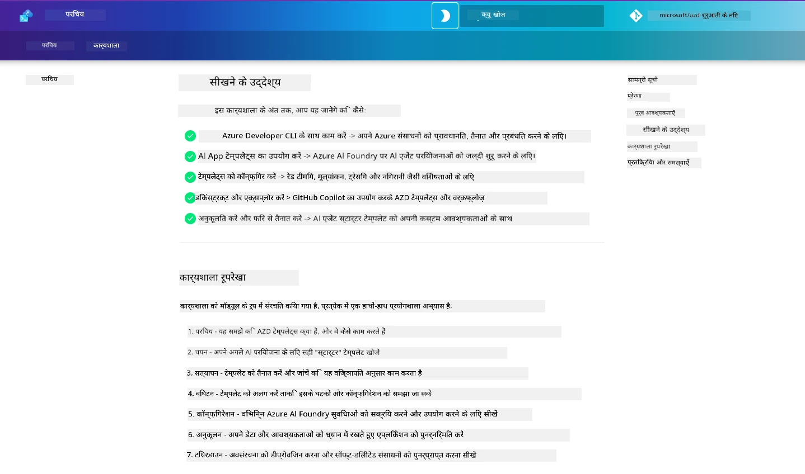

<div align="center">
  <div style="background: linear-gradient(135deg, #0078d4, #106ebe); border-radius: 10px; padding: 20px; margin: 20px 0; box-shadow: 0 4px 15px rgba(0, 120, 212, 0.3); border: 2px solid #005a9e;">
    <h2 style="color: white; margin: 0; font-size: 24px; text-shadow: 1px 1px 2px rgba(0,0,0,0.3);">
      🎯 AZD for AI Developers कार्यशाला
    </h2>
    <p style="color: white; margin: 10px 0 0 0; font-size: 16px; text-shadow: 1px 1px 2px rgba(0,0,0,0.3);">
      <strong>Azure Developer CLI के साथ AI अनुप्रयोग बनाने के लिए एक व्यावहारिक कार्यशाला।</strong><br>
      AZD टेम्प्लेट्स और AI डिप्लॉयमेंट वर्कफ़्लोज़ में महारत हासिल करने के लिए 7 मॉड्यूल पूरे करें।
    </p>
    <div style="margin-top: 15px;">
      <span style="background: rgba(255,255,255,0.2); padding: 5px 10px; border-radius: 15px; color: white; font-size: 14px;">
        📅 स्रोत मार्गदर्शन समीक्षा: नवंबर 2026
      </span>
    </div>
  </div>
</div>

# AZD for AI Developers कार्यशाला

Azure Developer CLI (AZD) सीखने के लिए एक व्यावहारिक कार्यशाला में आपका स्वागत है, जिसमें AI अनुप्रयोग डिप्लॉयमेंट पर ध्यान केंद्रित किया गया है। यह कार्यशाला आपको AZD टेम्प्लेट्स की व्यावहारिक समझ 3 चरणों में प्रदान करती है:

1. **खोज** - आपके लिए सही टेम्प्लेट खोजें।
1. **डिप्लॉयमेंट** - डिप्लॉय करें और पुष्टि करें कि यह काम करता है।
1. **अनुकूलन** - संशोधित करें और इसे अपना बनाएं!

इस कार्यशाला के दौरान, आपको प्रमुख डेवलपर टूल्स और वर्कफ़्लोज़ से भी परिचित कराया जाएगा, जो आपके एंड-टू-एंड विकास यात्रा को सुव्यवस्थित करने में मदद करेंगे।

<br/>

## ब्राउज़र-आधारित मार्गदर्शिका

कार्यशाला के पाठ Markdown में हैं। आप इन्हें सीधे GitHub में नेविगेट कर सकते हैं - या नीचे स्क्रीनशॉट में दिखाए गए अनुसार ब्राउज़र-आधारित पूर्वावलोकन लॉन्च कर सकते हैं।



इस विकल्प का उपयोग करने के लिए - रिपॉजिटरी को अपने प्रोफ़ाइल में फ़ोर्क करें, और GitHub Codespaces लॉन्च करें। एक बार VS कोड टर्मिनल सक्रिय हो जाने पर, यह कमांड टाइप करें:

यह ब्राउज़र पूर्वावलोकन GitHub Codespaces, डेव कंटेनर, या स्थानीय क्लोन में Python और MkDocs इंस्टॉल के साथ काम करता है।

```bash title="" linenums="0"
python -m pip install -r requirements-dev.txt
python -m mkdocs serve --config-file workshop/mkdocs.yml
```

ये कमांड **कोर्स रिपॉजिटरी रूट** से चलाएं, अलग से इनिशियलाइज़ किए गए AI सैंपल से नहीं। सुनिश्चित करें कि पूर्वावलोकन अग्रभूमि में हो ताकि त्रुटियाँ दिखती रहें; इसे Ctrl+C से बंद करें। सेवा दिए बिना साइट जांचने के लिए `python -m mkdocs build --strict --config-file workshop/mkdocs.yml` चलाएं।

कुछ सेकंड में, एक पॉप-अप डायलॉग दिखेगा। विकल्प चुनें `Open in browser`। वेब-आधारित गाइड अब नए ब्राउज़र टैब में खुलेगा। इस पूर्वावलोकन के कुछ लाभ:

1. **बिल्ट-इन खोज** - जल्दी से कीवर्ड या पाठ्यक्रम खोजें।
1. **कॉपी आइकन** - कोडब्लॉक्स पर होवर करें यह विकल्प देखने के लिए।
1. **थीम स्विच** - डार्क और लाइट थीम के बीच स्विच करें।
1. **मदद प्राप्त करें** - फुटर में Discord आइकन पर क्लिक करके जुड़ें!

<br/>

## कार्यशाला अवलोकन

**समयावधि:** 3-4 घंटे  
**स्तर:** शुरुआती से मध्यवर्ती  
**पूर्वापेक्षाएँ:** Azure, AI अवधारणाओं, VS कोड और कमांड-लाइन टूल्स की परिचितता।

यह एक व्यावहारिक कार्यशाला है जहाँ आप कार्य करता सीखते हैं। कार्य पूर्ण करने के बाद, हम आपको सिक्योरिटी और उत्पादकता सर्वोत्तम प्रथाओं की सीख जारी रखने के लिए AZD For Beginners पाठ्यक्रम समीक्षा करने की सलाह देते हैं।

| समय| मॉड्यूल  | उद्देश्य |
|:---|:---|:---|
| 15 मिनट | [परिचय](docs/instructions/0-Introduction.md) | सेटिंग करें, लक्ष्य समझें |
| 30 मिनट | [AI टेम्प्लेट चुनें](docs/instructions/1-Select-AI-Template.md) | विकल्पों का अन्वेषण करें और शुरुआती चुनें | 
| 30 मिनट | [AI टेम्प्लेट जांचें](docs/instructions/2-Validate-AI-Template.md) | डिफ़ॉल्ट समाधान Azure पर डिप्लॉय करें |
| 30 मिनट | [AI टेम्प्लेट का विश्लेषण](docs/instructions/3-Deconstruct-AI-Template.md) | संरचना और कॉन्फ़िगरेशन अन्वेषण करें |
| 30 मिनट | [AI टेम्प्लेट कॉन्फ़िगर करें](docs/instructions/4-Configure-AI-Template.md) | उपलब्ध फीचर्स सक्रिय करें और आज़माएँ |
| 30 मिनट | [AI टेम्प्लेट अनुकूलित करें](docs/instructions/5-Customize-AI-Template.md) | टेम्प्लेट अपनी ज़रूरतों के अनुसार बनाएँ |
| 30 मिनट | [इन्फ्रास्ट्रक्चर हटाएं](docs/instructions/6-Teardown-Infrastructure.md) | संसाधनों को साफ़ करें और जारी करें |
| 15 मिनट | [समापन और अगले कदम](docs/instructions/7-Wrap-up.md) | सीखने के संसाधन, कार्यशाला चुनौती |

<br/>

## आप क्या सीखेंगे

AZD टेम्प्लेट को Microsoft Foundry पर एंड-टू-एंड विकास के लिए विभिन्न क्षमताओं और उपकरणों का अन्वेषण करने वाला एक सीखने वाला सैंडबॉक्स समझें। इस कार्यशाला के अंत तक, आपको इस संदर्भ में विभिन्न उपकरणों और अवधारणाओं की सहज समझ होनी चाहिए।

| अवधारणा  | उद्देश्य |
|:---|:---|
| **Azure Developer CLI** | उपकरण कमांड्स और वर्कफ़्लोज़ समझें|
| **AZD टेम्प्लेट्स**| परियोजना संरचना और कॉन्फ़िग समझें|
| **Azure AI एजेंट**| Microsoft Foundry परियोजना का प्रावधान और डिप्लॉयमेंट |
| **Azure AI Search**| एजेंट्स के साथ कंटेक्स्ट इंजीनियरिंग सक्षम करें |
| **Observability**| ट्रेसिंग, मॉनिटरिंग और मूल्यांकन अन्वेषण करें |
| **Red Teaming**| प्रतिद्वंदी परीक्षण और बचाव उपाय अन्वेषण करें |

<br/>

## कार्यशाला संरचना

कार्यशाला इस प्रकार संरचित है कि यह आपको टेम्प्लेट खोज, डिप्लॉयमेंट, विश्लेषण और अनुकूलन की यात्रा पर ले जाती है - आधिकारिक [Getting Started with AI Agents](https://github.com/Azure-Samples/get-started-with-ai-agents) स्टार्ट टेम्प्लेट को आधार के रूप में प्रयोग करते हुए।

### [मॉड्यूल 1: AI टेम्प्लेट चुनें](docs/instructions/1-Select-AI-Template.md) (30 मिनट)

- AI टेम्प्लेट क्या हैं?
- AI टेम्प्लेट कहाँ मिल सकते हैं?
- AI एजेंट बनाना कैसे शुरू करें?
- **लैब**: Codespaces या dev container में क्विकस्टार्ट

### [मॉड्यूल 2: AI टेम्प्लेट जांचें](docs/instructions/2-Validate-AI-Template.md) (30 मिनट)

- AI टेम्प्लेट वास्तुकला क्या है?
- AZD विकास वर्कफ़्लो क्या है?
- AZD विकास में सहायता कैसे प्राप्त करें?
- **लैब**: AI एजेंट टेम्प्लेट डिप्लॉय & वैलिडेट करें

### [मॉड्यूल 3: AI टेम्प्लेट विश्लेषण करें](docs/instructions/3-Deconstruct-AI-Template.md) (30 मिनट)

- अपने पर्यावरण को `.azure/` में अन्वेषण करें
- अपने संसाधन सेटअप को `infra/` में अन्वेषण करें
- अपने AZD कॉन्फ़िगरेशन को `azure.yaml` में अन्वेषण करें
- **लैब**: पर्यावरण चर संशोधित करें और पुनःडिप्लॉय करें

### [मॉड्यूल 4: AI टेम्प्लेट कॉन्फ़िगर करें](docs/instructions/4-Configure-AI-Template.md) (30 मिनट)
- अन्वेषण करें: रिट्रीवल ऑगमेंटेड जनरेशन
- अन्वेषण करें: एजेंट मूल्यांकन और रेड टीमिंग
- अन्वेषण करें: ट्रेसिंग और मॉनिटरिंग
- **लैब**: AI एजेंट + ऑब्जर्वेबिलिटी अन्वेषण करें

### [मॉड्यूल 5: AI टेम्प्लेट अनुकूलित करें](docs/instructions/5-Customize-AI-Template.md) (30 मिनट)
- परिभाषित करें: परिदृश्य आवश्यकताओं के साथ PRD
- कॉन्फ़िगर करें: AZD के लिए पर्यावरण चर
- लागू करें: अतिरिक्त कार्यों के लिए लाइफसायकल हुक्स
- **लैब**: मेरे परिदृश्य के लिए टेम्प्लेट अनुकूलित करें

### [मॉड्यूल 6: इन्फ्रास्ट्रक्चर समाप्त करें](docs/instructions/6-Teardown-Infrastructure.md) (30 मिनट)
- पुनरावलोकन: AZD टेम्प्लेट क्या हैं?
- पुनरावलोकन: Azure Developer CLI क्यों उपयोग करें?
- अगले कदम: कोई दूसरा टेम्प्लेट आज़माएँ!
- **लैब**: इन्फ्रास्ट्रक्चर हटाएं और साफ़ करें

<br/>

## कार्यशाला चुनौती

क्या आप अपने आप को और अधिक चुनौती देना चाहते हैं? यहाँ कुछ परियोजना सुझाव हैं - या हमें अपने विचार साझा करें!!

| परियोजना | विवरण |
|:---|:---|
|1. **एक जटिल AI टेम्प्लेट का विश्लेषण करें** | हमने जो वर्कफ़्लो और उपकरण बताए हैं उनका उपयोग करें और देखें कि क्या आप एक अलग AI समाधान टेम्प्लेट डिप्लॉय, वैलिडेट और अनुकूलित कर सकते हैं। _आपने क्या सीखा?_|
|2. **अपने परिदृश्य के साथ अनुकूलित करें**  | किसी अलग परिदृश्य के लिए PRD (प्रोडक्ट रिक्वायरमेंट्स डॉक्यूमेंट) लिखने का प्रयास करें। फिर Agent Model में अपने टेम्प्लेट रिपो में GitHub Copilot का उपयोग करें - और इसे आपके लिए अनुकूलन वर्कफ़्लो जनरेट करने के लिए कहें। _आपने क्या सीखा? इन सुझावों में आप कैसे सुधार कर सकते हैं?_|
| | |

## प्रतिक्रिया है?

1. इस रिपो में एक इश्यू पोस्ट करें - इसे सुविधा के लिए टैग करें `Workshop`.
1. Microsoft Foundry Discord में जुड़ें - अपने सहपाठियों से कनेक्ट करें!


| | | 
|:---|:---|
| **📚 कोर्स होम**| [AZD For Beginners](../README.md)|
| **📖 प्रलेखन** | [AI टेम्प्लेट के साथ शुरुआत करें](https://learn.microsoft.com/en-us/azure/ai-foundry/how-to/develop/ai-template-get-started)|
| **🛠️AI टेम्प्लेट** | [Microsoft Foundry Templates](https://ai.azure.com/templates) |
|**🚀 अगले कदम** | [कार्यशाला शुरू करें](#workshop-overview) |
| | |

<br/>

---

**नेविगेशन:** [मुख्य कोर्स](../README.md) | [परिचय](docs/instructions/0-Introduction.md) | [मॉड्यूल 1: टेम्प्लेट चुनें](docs/instructions/1-Select-AI-Template.md)

**क्या आप AZD के साथ AI एप्लिकेशन बनाना शुरू करने के लिए तैयार हैं?**

[कार्यशाला शुरू करें: परिचय →](docs/instructions/0-Introduction.md)

---

<!-- CO-OP TRANSLATOR DISCLAIMER START -->
**अस्वीकरण**:
इस दस्तावेज़ का अनुवाद AI अनुवाद सेवा [Co-op Translator](https://github.com/Azure/co-op-translator) का उपयोग करके किया गया है। जबकि हम सटीकता के लिए प्रयास करते हैं, कृपया ध्यान दें कि स्वचालित अनुवादों में त्रुटियाँ या अशुद्धियाँ हो सकती हैं। मूल दस्तावेज़ अपनी मूल भाषा में ही प्रामाणिक स्रोत माना जाना चाहिए। महत्वपूर्ण जानकारी के लिए, पेशेवर मानव अनुवाद की सिफारिश की जाती है। इस अनुवाद के उपयोग से उत्पन्न किसी भी गलतफहमी या गलत व्याख्या के लिए हम उत्तरदायी नहीं हैं।
<!-- CO-OP TRANSLATOR DISCLAIMER END -->