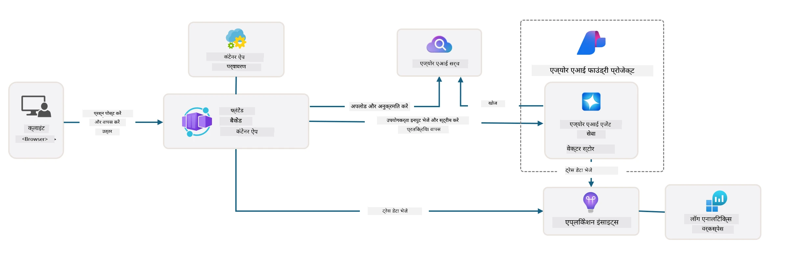

# 3. एक टेम्पलेट को विघटित करना

!!! tip "इस मॉड्यूल के अंत तक आप सक्षम होंगे"

    - [ ] Use GitHub Copilot and optional MCP tools for Azure documentation and read-only exploration
    - [ ] Identify the template's application, infrastructure, configuration, and test entry points
    - [ ] Verify generated explanations against actual repository files
    - [ ] **Lab 3:** Trace one request and one configuration input through the project

---

## 1. GitHub Copilot सक्रिय करें

VS कोड में इनिशियलाइज़ किए गए AI नमूने को खोलें और [GitHub Copilot](https://code.visualstudio.com/docs/copilot/chat/chat-agent-mode) को सक्षम करें। किसी ऐसे खाते से साइन इन करें जिसमे पात्र योजना हो; उपयोग सीमाएं अलग-अलग होती हैं। Copilot से रिपॉजिटरी समझाने के लिए कहें इससे पहले कि आप बदलावों को अधिकृत करें।

### वैकल्पिक MCP सर्वर

ये सेवाएं अतिरिक्त उपकरण प्रदान कर सकती हैं:

- [Azure MCP Server](https://learn.microsoft.com/azure/developer/azure-mcp-server/overview)
- [Microsoft Learn MCP Server](https://learn.microsoft.com/training/support/mcp)

VS कोड में, [MCP कॉन्फ़िगरेशन मार्गदर्शन](https://code.visualstudio.com/docs/copilot/chat/mcp-servers) की समीक्षा करें और आवश्यकता हो तो `.vscode/mcp.json` बनाएँ:

```json
{
  "servers": {
    "Azure MCP Server": {
      "type": "stdio",
      "command": "npx",
      "args": ["-y", "@azure/mcp@latest", "server", "start"]
    },
    "microsoft.docs.mcp": {
      "type": "http",
      "url": "https://learn.microsoft.com/api/mcp"
    }
  }
}
```

`npx` कमांड को समर्थित Node.js/npm इंस्टॉलेशन की आवश्यकता होती है और यह निष्पादन योग्य कोड डाउनलोड करता है। पैकेज की समीक्षा करें और पुनरुत्पादन योग्य टीम सेटअप के लिए अनुमोदित संस्करण को पिन करें। VS कोड के MCP नियंत्रणों का उपयोग करके सर्वरों को शुरू करें और उनके उपलब्ध उपकरणों का निरीक्षण करें; संस्करणों के बीच नाम बदल सकते हैं।

**प्रमाणीकरण अलग है।** AZD के लिए `azd auth login` का उपयोग करें। उसके उपकरणों के लिए Azure MCP के प्रलेखित प्रमाणीकरण प्रवाह का पालन करें; केवल AZD लॉगिन से MCP सत्र स्थापित नहीं होता। जब किसी अभ्यास या हुक द्वारा Azure CLI को बुलाया जाए तब `az login` का अलग से उपयोग करें।

केवल पढ़ने वाले प्रॉम्प्ट आज़माएं:

1. "Microsoft Learn MCP का उपयोग करके Azure Developer CLI कॉन्फ़िगरेशन दस्तावेज़ खोजें।"
2. "इस रिपॉजिटरी के `azure.yaml` की व्याख्या करें; उन फ़ाइलों का संदर्भ दें जो प्रत्येक हुक को लागू करती हैं।"
3. "उपलब्ध Azure MCP टूल्स का उपयोग करके, बिना किसी संशोधन के मेरे डिप्लॉय किए गए संसाधनों की सूची बनाएं।"

चुना गया टेनेंट/सब्सक्रिप्शन और हर प्रस्तावित उपकरण कॉल की जाँच करें। केवल वास्तुकला का पता लगाने के लिए संसाधन निर्माण, हटाने या पहुँच परिवर्तन को मंजूरी न दें।

## 2. वास्तुकला को समझें

नमूना में एक Python FastAPI बैकेंड और एक React/TypeScript फ्रंटेंड Azure Container Apps में होस्ट किया गया है। बैकेंड एक Microsoft Foundry प्रोजेक्ट में एजेंट के साथ संवाद करता है। पुनर्प्राप्ति और पर्यवेक्षण सक्षम टेम्प्लेट फीचर्स और सफल सेटअप पर निर्भर करते हैं; केवल एप्लिकेशन के डिप्लॉय होने का मतलब यह गारंटी नहीं है।



इस आरेख की तुलना [वर्तमान ऊपरवाले डिप्लॉयमेंट गाइड](https://github.com/Azure-Samples/get-started-with-ai-agents/blob/main/docs/deployment.md) और आपकी वास्तविक संसाधनों से करें। कॉन्फ़िगर किए गए मॉडल डिप्लॉयमेंट, एजेंट उपकरण, प्रबंधित पहचान, भूमिका असाइनमेंट और वैकल्पिक AI Search/Application Insights संसाधनों की जाँच करें।

**अभ्यास:** Copilot से कहें कि फ्रंटेंड से API के ज़रिए Foundry तक एक चैट अनुरोध को ट्रेस करे, फ़ाइल और फ़ंक्शन संदर्भ दिखाएं। उन संदर्भों को खोलें और व्याख्या सत्यापित करें। केवल आरेख से निष्पादित प्रमाणीकरण, रूटिंग या प्राधिकरण की कल्पना न करें।

## 3. रिपॉजिटरी संरचना

निम्नलिखित चयनित पथ 4 नवंबर, 2026 को नमूने के विरुद्ध जांचे गए थे। आपकी इनिशियलाइज्ड रिवीजन सत्य का स्रोत बनी रहती है:

```text
get-started-with-ai-agents/
  azure.yaml
  docker-compose.yaml
  requirements-dev.txt
  .devcontainer/
  infra/
    main.bicep
    main.parameters.json
    api.bicep
    core/
  src/
    Dockerfile
    pyproject.toml
    requirements.txt
    api/
      main.py
      routes.py
      search_index_manager.py
    frontend/
      package.json
      src/
    files/
  scripts/
    validate_env_vars.sh
    validate_env_vars.ps1
    postdeploy.sh
    postdeploy.ps1
  tests/
    test_evaluation.py
    test_red_teaming.py
  docs/
    deployment.md
    deploy_customization.md
    ai_search.md
    observability.md
    local_development.md
    troubleshooting.md
```

### इंफ्रास्ट्रक्चर और कॉन्फ़िगरेशन

`infra/main.bicep` संसाधनों का संचालन करता है; `main.parameters.json` टेम्पलेट इनपुट को AZD पर्यावरण मूल्यों से जोड़ता है। `azure.yaml` आवेदन सेवा और जीवनचक्र हुक को चुनता है। `USE_AZURE_AI_SEARCH_SERVICE` जैसे इनपुट का इन फ़ाइलों में पता लगाएं ताकि जान सकें वास्तव में क्या बदलता है।

### एप्लिकेशन और पहचान

`src/api/` और `src/frontend/` को साथ-साथ पढ़ें। पहचानें कि एजेंट कहाँ बनाया या पुनः प्राप्त किया जाता है, निर्देश/उपकरण कहाँ कॉन्फ़िगर किए गए हैं, और कौन सी पहचान हर Azure कॉल का उपयोग करती है। `src/files/` के नीचे नमूना फ़ाइलें प्रदर्शन डेटा हैं, उत्पादन सूची या प्राधिकरण मॉडल नहीं।

### परीक्षण और पर्यवेक्षण

वर्तमान मूल्यांकन और रेड-टीमिंग प्रवेश बिंदु `tests/` के अंतर्गत हैं; पुराने `evals/` और `airedteaming/` निर्देशिका संदर्भ इस नमूने के लिए अप्रचलित हैं। क्लाउड परीक्षण करने से पहले `docs/observability.md` पढ़ें, जिसमें आवश्यकताएँ और लागतें हैं। ये Python परीक्षण वैकल्पिक `azure.ai.evaluations` AZD एक्सटेंशन से अलग हैं।

## 4. अपनी खोजों को सत्यापित करें

- एक नमूना प्रश्न के लिए API रूट, एजेंट इंटरैक्शन, और पुनर्प्राप्ति कोड की पहचान करें।
- समझाएं कि Foundry का उपयोग कौन सी पहचान करता है और कौन सा कॉन्फ़िगरेशन उसका एंडपॉइंट चुनता है।
- असली प्री-अप और पोस्ट-डिप्लॉय स्क्रिप्ट्स और उनकी त्रुटि-संभाल व्यवहार खोजें।
- अपनी तैनाती से अनुपस्थित किसी भी निर्भरता या वैकल्पिक फीचर्स की सूची बनाएं।

आगे बढ़ें [एक टेम्पलेट कॉन्फ़िगर करें](4-Configure-AI-Template.md)।

---

<!-- CO-OP TRANSLATOR DISCLAIMER START -->
**अस्वीकरण**:
इस दस्तावेज़ का अनुवाद AI अनुवाद सेवा [Co-op Translator](https://github.com/Azure/co-op-translator) का उपयोग करके किया गया है। जबकि हम सटीकता के लिए प्रयास करते हैं, कृपया ध्यान दें कि स्वचालित अनुवादों में त्रुटियाँ या अशुद्धियाँ हो सकती हैं। मूल दस्तावेज़ अपनी मूल भाषा में ही प्रामाणिक स्रोत माना जाना चाहिए। महत्वपूर्ण जानकारी के लिए, पेशेवर मानव अनुवाद की सिफारिश की जाती है। इस अनुवाद के उपयोग से उत्पन्न किसी भी गलतफहमी या गलत व्याख्या के लिए हम उत्तरदायी नहीं हैं।
<!-- CO-OP TRANSLATOR DISCLAIMER END -->