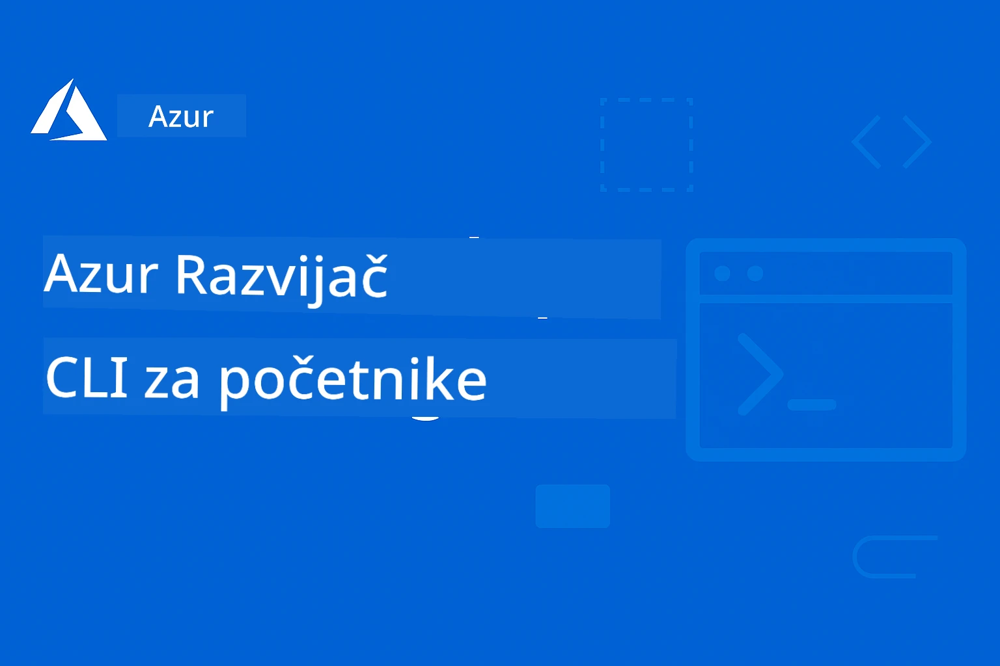

# AZD za početnike: Strukturirano putovanje učenjem

 

[](https://GitHub.com/microsoft/azd-for-beginners/watchers/)
[](https://GitHub.com/microsoft/azd-for-beginners/network/)
[](https://GitHub.com/microsoft/azd-for-beginners/stargazers/)

[](https://discord.com/invite/nkVh3dp)
[](https://discord.gg/nTYy5BXMWG)

---

### Automatski prijevodi (Uvijek ažurno)

<!-- CO-OP TRANSLATOR LANGUAGES TABLE START -->
[Arapski](../ar/README.md) | [Bengalski](../bn/README.md) | [Bugarski](../bg/README.md) | [Burmanski (Myanmar)](../my/README.md) | [Kineski (pojednostavljeni)](../zh-CN/README.md) | [Kineski (tradicionalni, Hong Kong)](../zh-HK/README.md) | [Kineski (tradicionalni, Makao)](../zh-MO/README.md) | [Kineski (tradicionalni, Tajvan)](../zh-TW/README.md) | [Hrvatski](./README.md) | [Češki](../cs/README.md) | [Danski](../da/README.md) | [Nizozemski](../nl/README.md) | [Estonski](../et/README.md) | [Finski](../fi/README.md) | [Francuski](../fr/README.md) | [Njemački](../de/README.md) | [Grčki](../el/README.md) | [Hebrejski](../he/README.md) | [Hindi](../hi/README.md) | [Mađarski](../hu/README.md) | [Indonezijski](../id/README.md) | [Talijanski](../it/README.md) | [Japanski](../ja/README.md) | [Kannada](../kn/README.md) | [Khmer](../km/README.md) | [Korejski](../ko/README.md) | [Litvanski](../lt/README.md) | [Malezijski](../ms/README.md) | [Malajalamski](../ml/README.md) | [Manipuri (Meitei Mayek)](../mni/README.md) | [Marathi](../mr/README.md) | [Nepalski](../ne/README.md) | [Nigerijski pidžin](../pcm/README.md) | [Norveški](../no/README.md) | [Perzijski (Farsi)](../fa/README.md) | [Poljski](../pl/README.md) | [Portugalski (Brazil)](../pt-BR/README.md) | [Portugalski (Portugal)](../pt-PT/README.md) | [Punjabi (Gurmukhi)](../pa/README.md) | [Rumunjski](../ro/README.md) | [Ruski](../ru/README.md) | [Srpski (ćirilica)](../sr/README.md) | [Slovački](../sk/README.md) | [Slovenski](../sl/README.md) | [Španjolski](../es/README.md) | [Svahili](../sw/README.md) | [Švedski](../sv/README.md) | [Tagalog (Filipinski)](../tl/README.md) | [Tamil](../ta/README.md) | [Telugu](../te/README.md) | [Tajlandski](../th/README.md) | [Turski](../tr/README.md) | [Ukrajinski](../uk/README.md) | [Urdu](../ur/README.md) | [Vijetnamski](../vi/README.md)

> **Radije želite klonirati lokalno?**
>
> Ovo spremište uključuje prijevode na više od 50 jezika što značajno povećava veličinu preuzimanja. Za kloniranje bez prijevoda, koristite sparse checkout:
>
> **Bash / macOS / Linux:**
> ```bash
> git clone --filter=blob:none --sparse https://github.com/microsoft/AZD-for-beginners.git
> cd AZD-for-beginners
> git sparse-checkout set --no-cone '/*' '!translations' '!translated_images'
> ```
>
> **CMD (Windows):**
> ```cmd
> git clone --filter=blob:none --sparse https://github.com/microsoft/AZD-for-beginners.git
> cd AZD-for-beginners
> git sparse-checkout set --no-cone "/*" "!translations" "!translated_images"
> ```
>
> Ovo vam daje sve što trebate za dovršetak tečaja s mnogo bržim preuzimanjem.
<!-- CO-OP TRANSLATOR LANGUAGES TABLE END -->

## 🆕 Što je novo u azd danas

> 📌 Ovaj je tečaj potvrđen za **`azd 1.27.1`** (srpanj 2026). Pokrenite `azd version` za provjeru vaše gradnje, i `azd upgrade` da dobite najnoviju verziju.

Azure Developer CLI nadmašio je tradicionalne web aplikacije i API-je. Danas je azd jedini alat za postavljanje **bilo koje** aplikacije na Azure — uključujući aplikacije pokretane AI-jem i inteligentne agente.

Evo što to znači za vas:

- **AI agenti su sada primarni azd radni zadaci.** Možete inicijalizirati, postaviti i upravljati AI agent projektima koristeći isti `azd init` → `azd up` tijek koji već poznajete.
- **Potpuni životni ciklus agenta iz CLI-ja.** Proširenje `azure.ai.agents` sada pokriva cijelo putovanje — `azd ai agent init` za izradu kostura, `azd ai agent invoke` za testiranje (s izvještajem o vremenu odziva), `azd ai agent eval generate` i `azd ai agent optimize` za mjerenje i poboljšanje kvalitete, te `azd ai agent delete` za čišćenje.
- **Više AI građevnih blokova.** Nova preview proširenja — `azure.ai.skills` i `azure.ai.connections` — omogućuju vam upravljanje ponovljivo upotrebljivim vještinama agenata i Foundry vezama direktno kroz azd.
- **Integracija s Microsoft Foundry** donosi implementaciju modela, hosting agenata i konfiguraciju AI usluga direktno u azd predložak ekosustav.
- **Glavne svakodnevne stvari su jednostavnije.** Nedavne verzije učinile su `azd init` idempotentnim (sigurni za ponovni poziv), automatski su očistile zastarjele tokene u `azd auth login` i dodale prijateljski `azd tool` prompt za prvu postavku.
- **Temeljni tijek rada se nije mijenjao.** Bez obzira postavljate li todo aplikaciju, mikroservis ili višestruko agentsko AI rješenje, naredbe su jednake.

> **Napomena za Aspire korisnike:** Microsoft sada proizvode jednostavno naziva **Aspire** (ranije ".NET Aspire"). Podrška za Aspire u azd ostaje nepromijenjena — samo je ime ažurirano.

Ako ste ranije koristili azd, podrška za AI je prirodni nastavak — nije zaseban alat ili napredni put. Ako počinjete od nule, naučit ćete jedan tijek rada koji funkcionira za sve.

---

## 🚀 Što je Azure Developer CLI (azd)?

**Azure Developer CLI (azd)** je korisnički prihvatljiv alat naredbenog retka koji pojednostavljuje postavljanje aplikacija na Azure. Umjesto ručnog stvaranja i povezivanja desetaka Azure resursa, možete postaviti cijele aplikacije jednim naredbom.

### Čarolija `azd up`

```bash
# This single command does everything:
# ✅ Creates all Azure resources  
# ✅ Configures networking and security
# ✅ Builds your application code
# ✅ Deploys to Azure
# ✅ Gives you a working URL
azd up
```

**To je to!** Nema klikanja po Azure portalu, nema učenja složenih ARM predložaka, nema ručne konfiguracije - samo aplikacije koje rade na Azureu.

---

## ❓ Azure Developer CLI vs Azure CLI: Koja je razlika?

Ovo je najčešće pitanje koje početnici postavljaju. Evo jednostavnog odgovora:

| Značajka | **Azure CLI (`az`)** | **Azure Developer CLI (`azd`)** |
|---------|---------------------|--------------------------------|
| **Svrha** | Upravljanje pojedinačnim Azure resursima | Postavljanje kompletnih aplikacija |
| **Razmišljanje** | Fokus na infrastrukturu | Fokus na aplikaciju |
| **Primjer** | `az webapp create --name myapp...` | `azd up` |
| **Krivulja učenja** | Mora poznavati Azure servise | Samo poznaj svoju aplikaciju |
| **Najbolje za** | DevOps, infrastruktura | Programere, prototipiziranje |

### Jednostavna analogija

- **Azure CLI** je kao imati sve alate za gradnju kuće - čekiće, pile, čavle. Možeš izgraditi bilo što, ali moraš znati graditi.
- **Azure Developer CLI** je kao unajmiti izvođača radova - opišeš što želiš, a oni se pobrinu za gradnju.

### Kada koristiti koji

| Scenarij | Koristi ovo |
|----------|----------|
| "Želim brzo postaviti svoju web aplikaciju" | `azd up` |
| "Trebam samo kreirati račun za pohranu" | `az storage account create` |
| "Gradim kompletnu AI aplikaciju" | `azd init --template azure-search-openai-demo` |
| "Trebam debugirati određeni Azure resurs" | `az resource show` |
| "Želim produkcijsko spremno postavljanje u nekoliko minuta" | `azd up --environment production` |

### Oni rade zajedno!

AZD koristi Azure CLI u pozadini. Možete koristiti oba:
```bash
# Deploy your app with AZD
azd up

# Then fine-tune specific resources with Azure CLI
az webapp config set --name myapp --always-on true
```

---

## 🌟 Pronađite predloške u Awesome AZD

Nemojte započinjati od nule! **Awesome AZD** je zajednički skup spremnih za postavljanje predložaka:

| Resurs | Opis |
|----------|-------------|
| 🔗 [**Awesome AZD galerija**](https://azure.github.io/awesome-azd/) | Pregledajte 200+ predložaka s postavljanjem jednim klikom |
| 🔗 [**Pošalji predložak**](https://github.com/Azure/awesome-azd/issues) | Doprinesi vlastiti predložak zajednici |
| 🔗 [**GitHub spremište**](https://github.com/Azure/awesome-azd) | Zvijezda i istraživanje izvora |

### Popularni AI predlošci iz Awesome AZD

```bash
# RAG Chat with Microsoft Foundry Models + AI Search
azd init --template azure-search-openai-demo

# Quick AI Chat Application
azd init --template openai-chat-app-quickstart

# AI Agents with Foundry Agents
azd init --template get-started-with-ai-agents
```

---

## 🎯 Početak u 3 koraka

Prije početka, provjerite je li vaš uređaj spreman za predložak koji želite postaviti:

**Windows:**
```powershell
.\validate-setup.ps1
```

**macOS / Linux:**
```bash
bash ./validate-setup.sh
```

Ako bilo koja potrebna provjera ne uspije, prvo to popravite, a zatim nastavite s brzom instalacijom.

### Korak 1: Instalirajte AZD (2 minute)

**Windows:**
```powershell
winget install microsoft.azd
```

**macOS:**
```bash
brew tap azure/azd && brew install azd
```

**Linux:**
```bash
curl -fsSL https://aka.ms/install-azd.sh | bash
```

### Korak 2: Autentificirajte se za AZD

```bash
# Optional if you plan to use Azure CLI commands directly in this course
az login

# Required for AZD workflows
azd auth login
```

Ako niste sigurni koji vam treba, slijedite cijeli tijek postavljanja u [Installation & Setup](docs/chapter-01-foundation/installation.md#authentication-setup).

### Korak 3: Postavite svoju prvu aplikaciju

```bash
# Initialize from a template
azd init --template todo-nodejs-mongo

# Deploy to Azure (creates everything!)
azd up
```

**🎉 To je to!** Vaša aplikacija je sada aktivna na Azureu.

### Očistite (ne zaboravite!)

```bash
# Remove all resources when done experimenting
azd down --force --purge
```

---

## 📚 Kako koristiti ovaj tečaj

Ovaj tečaj je dizajniran za **progresivno učenje** - započnite tamo gdje vam je ugodno i napredujte:

| Vaše iskustvo | Početak ovdje |
|-----------------|------------|
| **Potpuno nov u Azuru** | [Poglavlje 1: Osnove](#-chapter-1-foundation--quick-start) |
| **Poznajete Azure, novi u AZD-u** | [Poglavlje 1: Osnove](#-chapter-1-foundation--quick-start) |
| **Želite postaviti AI aplikacije** | [Poglavlje 2: AI-prvo razvijanje](#-chapter-2-ai-first-development-recommended-for-ai-developers) |
| **Želite praktičnu vježbu** | [🎓 Interaktivna radionica](workshop/README.md) - 3-4 sata vođenog laboratorija |
| **Trebate produkcijske obrasce** | [Poglavlje 8: Produkcija i poduzeće](#-chapter-8-production--enterprise-patterns) |

### Brzo postavljanje

1. **Forkajte ovo spremište**: [](https://GitHub.com/microsoft/azd-for-beginners/fork)
2. **Klonirajte ga**: `git clone https://github.com/YOUR-USERNAME/azd-for-beginners.git`
3. **Tražite pomoć**: [Azure Discord zajednica](https://discord.com/invite/ByRwuEEgH4)

> **Radije želite klonirati lokalno?**

> Ovo spremište uključuje prijevode na više od 50 jezika što značajno povećava veličinu preuzimanja. Za kloniranje bez prijevoda, koristite sparse checkout:
> ```bash
> git clone --filter=blob:none --sparse https://github.com/microsoft/AZD-for-beginners.git
> cd AZD-for-beginners
> git sparse-checkout set --no-cone '/*' '!translations' '!translated_images'
> ```
> Ovo vam daje sve što trebate za dovršetak tečaja s mnogo bržim preuzimanjem.


## Pregled tečaja

Ovladat ćete Azure Developer CLI-jem (azd) kroz strukturirana poglavlja dizajnirana za progresivno učenje. **Poseban naglasak na postavljanje AI aplikacija s Microsoft Foundry integracijom.**

### Zašto je ovaj tečaj ključan za moderne programere

Na temelju uvida iz Microsoft Foundry Discord zajednice, **45% programera želi koristiti AZD za AI radne zadatke** ali nailaze na izazove s:
- Složenim višeserijskim AI arhitekturama
- Najboljim praksama produkcijskog AI postavljanja  
- Integracijom i konfiguracijom Azure AI usluga
- Optimizacijom troškova za AI radne zadatke
- Rješavanjem problema specifičnih za AI postavljanje

### Ciljevi učenja

Završavanjem ovog strukturiranog tečaja:
- **Ovladat ćete temeljnim AZD pojmovima**: Osnovni koncepti, instalacija i konfiguracija
- **Postavljati AI aplikacije**: Korištenjem AZD-a s Microsoft Foundry uslugama
- **Implementirajte Infrastrukturu kao Kod**: Upravljajte Azure resursima s Bicep predlošcima
- **Rješavanje Problema s Implementacijama**: Otklonite uobičajene probleme i debugirajte poteškoće
- **Optimizirajte za Produkciju**: Sigurnost, skaliranje, nadzor i upravljanje troškovima
- **Izgradite Višeagentska Rješenja**: Implementirajte složene AI arhitekture

## Prije nego počnete: Računi, pristup i pretpostavke

Prije nego započnete s Poglavljem 1, provjerite imate li sljedeće pripremljeno. Koraci instalacije kasnije u ovom vodiču pretpostavljaju da su ove osnove već riješene.

- **Pretplata na Azure**: Možete koristiti postojeću pretplatu s posla ili vlastiti račun, ili kreirati [besplatno probno razdoblje](https://aka.ms/azurefreetrial) za početak.
- **Dozvole za stvaranje Azure resursa**: Za većinu vježbi trebali biste imati najmanje pristup **Contributor** na ciljanoj pretplati ili grupi resursa. Neka poglavlja mogu pretpostaviti da možete kreirati grupe resursa, upravljane identitete i RBAC dodjele.
- [**GitHub račun**](https://github.com): Koristan za forkanje repozitorija, praćenje vlastitih promjena i korištenje GitHub Codespaces za radionicu.
- **Zahtjevi za rad predložaka**: Neki predlošci zahtijevaju lokalne alate poput Node.js, Python, Java ili Docker. Pokrenite validator postavki prije početka kako biste rano uočili nedostatke alata.
- **Osnovno poznavanje terminala**: Ne morate biti stručnjak, ali trebali biste se osjećati ugodno pokretati naredbe poput `git clone`, `azd auth login`, i `azd up`.

> **Radite u enterprise pretplati?**
> Ako vaš Azure okruženje upravlja administrator, unaprijed potvrdite možete li implementirati resurse u pretplati ili grupi resursa koju planirate koristiti. Ako ne, zatražite sandbox pretplatu ili pristup Contributor prije početka.

> **Novi ste u Azure?**
> Počnite sa svojom vlastitom Azure probnom ili pretplatom po potrošnji na https://aka.ms/azurefreetrial kako biste mogli završiti vježbe od početka do kraja bez čekanja odobrenja na razini najmodavca.

## 🗺️ Karta tečaja: Brza navigacija po poglavljima

Svako poglavlje ima svoj README s ciljevima učenja, brzim početcima i vježbama:

| Poglavlje | Tema | Lekcije | Trajanje | Kompleksnost |
|---------|-------|---------|----------|------------|
| **[Pog 1: Osnove](docs/chapter-01-foundation/README.md)** | Početak | [Osnove AZD](docs/chapter-01-foundation/azd-basics.md) &#124; [Instalacija](docs/chapter-01-foundation/installation.md) &#124; [Prvi projekt](docs/chapter-01-foundation/first-project.md) | 30-45 min | ⭐ |
| **[Pog 2: AI razvoj](docs/chapter-02-ai-development/README.md)** | AI-first aplikacije | [Microsoft Foundry integracija](docs/chapter-02-ai-development/microsoft-foundry-integration.md) &#124; [AI agenti](docs/chapter-02-ai-development/agents.md) &#124; [Model implementacije](docs/chapter-02-ai-development/ai-model-deployment.md) &#124; [Radionica](docs/chapter-02-ai-development/ai-workshop-lab.md) | 1-2 h | ⭐⭐ |
| **[Pog 3: Konfiguracija](docs/chapter-03-configuration/README.md)** | Autentikacija i sigurnost | [Konfiguracija](docs/chapter-03-configuration/configuration.md) &#124; [Autentikacija & sigurnost](docs/chapter-03-configuration/authsecurity.md) | 45-60 min | ⭐⭐ |
| **[Pog 4: Infrastruktura](docs/chapter-04-infrastructure/README.md)** | IaC & implementacija | [Vodič za implementaciju](docs/chapter-04-infrastructure/deployment-guide.md) &#124; [Provisioning](docs/chapter-04-infrastructure/provisioning.md) | 1-1.5 h | ⭐⭐⭐ |
| **[Pog 5: Višeagentski](docs/chapter-05-multi-agent/README.md)** | AI agentska rješenja | [Scenarij prodaje](examples/retail-scenario.md) &#124; [Uzori koordinacije](docs/chapter-06-pre-deployment/coordination-patterns.md) | 2-3 h | ⭐⭐⭐⭐ |
| **[Pog 6: Prije implementacije](docs/chapter-06-pre-deployment/README.md)** | Planiranje i validacija | [Pre-flight provjere](docs/chapter-06-pre-deployment/preflight-checks.md) &#124; [Planiranje kapaciteta](docs/chapter-06-pre-deployment/capacity-planning.md) &#124; [Odabir SKU](docs/chapter-06-pre-deployment/sku-selection.md) &#124; [App Insights](docs/chapter-06-pre-deployment/application-insights.md) | 1 h | ⭐⭐ |
| **[Pog 7: Rješavanje problema](docs/chapter-07-troubleshooting/README.md)** | Debug i popravak | [Uobičajeni problemi](docs/chapter-07-troubleshooting/common-issues.md) &#124; [Debugging](docs/chapter-07-troubleshooting/debugging.md) &#124; [AI problemi](docs/chapter-07-troubleshooting/ai-troubleshooting.md) | 1-1.5 h | ⭐⭐ |
| **[Pog 8: Produkcija](docs/chapter-08-production/README.md)** | Enterprise obrasci | [Prakse u produkciji](docs/chapter-08-production/production-ai-practices.md) | 2-3 h | ⭐⭐⭐⭐ |
| **[🎓 Radionica](workshop/README.md)** | Praktični laboratorij | [Uvod](workshop/docs/instructions/0-Introduction.md) &#124; [Odabir](workshop/docs/instructions/1-Select-AI-Template.md) &#124; [Validacija](workshop/docs/instructions/2-Validate-AI-Template.md) &#124; [Razlaganje](workshop/docs/instructions/3-Deconstruct-AI-Template.md) &#124; [Konfiguracija](workshop/docs/instructions/4-Configure-AI-Template.md) &#124; [Prilagodba](workshop/docs/instructions/5-Customize-AI-Template.md) &#124; [Raspad](workshop/docs/instructions/6-Teardown-Infrastructure.md) &#124; [Završetak](workshop/docs/instructions/7-Wrap-up.md) | 3-4 h | ⭐⭐ |

**Ukupno trajanje tečaja:** ~10-14 sati | **Razina vještine:** Početnik → Spreman za produkciju

---

## 📚 Poglavlja za učenje

*Odaberite svoj put učenja prema razini iskustva i ciljevima*

### 🚀 Poglavlje 1: Osnove i Brzi početak
**Preduvjeti**: Azure pretplata, osnovno poznavanje komandne linije  
**Trajanje**: 30-45 minuta  
**Kompleksnost**: ⭐

#### Što ćete naučiti
- Razumijevanje osnovnih pojmova Azure Developer CLI
- Instalacija AZD na vašoj platformi
- Vaša prva uspješna implementacija

#### Resursi za učenje
- **🎯 Počnite ovdje**: [Što je Azure Developer CLI?](#what-is-azure-developer-cli)
- **📖 Teorija**: [Osnove AZD](docs/chapter-01-foundation/azd-basics.md) - Ključni koncepti i terminologija
- **⚙️ Postavljanje**: [Instalacija i podešavanje](docs/chapter-01-foundation/installation.md) - Vodiči specifični za platformu
- **🛠️ Praktično**: [Vaš prvi projekt](docs/chapter-01-foundation/first-project.md) - Vodič korak po korak
- **📋 Brza referenca**: [Upute za naredbe](resources/cheat-sheet.md)

#### Praktične vježbe
```bash
# Quick installation check
azd version

# Deploy your first application
azd init --template todo-nodejs-mongo
azd up
```

**💡 Ishod poglavlja**: Uspješno implementirajte jednostavnu web aplikaciju na Azure koristeći AZD

**✅ Potvrda uspjeha:**
```bash
# After completing Chapter 1, you should be able to:
azd version              # Shows installed version
azd init --template todo-nodejs-mongo  # Initializes project
azd up                  # Deploys to Azure
azd show                # Displays running app URL
# Application opens in browser and works
azd down --force --purge  # Cleans up resources
```

**📊 Uloženo vrijeme:** 30-45 minuta  
**📈 Razina vještine nakon:** Može samostalno implementirati osnovne aplikacije
**📈 Razina vještine nakon:** Može samostalno implementirati osnovne aplikacije

---

### 🤖 Poglavlje 2: AI-First razvoj (Preporučeno za AI programere)
**Preduvjeti**: Završeno Poglavlje 1  
**Trajanje**: 1-2 sata  
**Kompleksnost**: ⭐⭐

#### Što ćete naučiti
- Microsoft Foundry integracija s AZD
- Implementacija AI-pokretanih aplikacija
- Razumijevanje konfiguracije AI usluga

#### Resursi za učenje
- **🎯 Počnite ovdje**: [Microsoft Foundry integracija](docs/chapter-02-ai-development/microsoft-foundry-integration.md)
- **🤖 AI Agentii**: [Vodič za AI agente](docs/chapter-02-ai-development/agents.md) - Implementirajte inteligentne agente koristeći AZD
- **📖 Uzorci**: [AI Model implementacija](docs/chapter-02-ai-development/ai-model-deployment.md) - Implementirajte i upravljajte AI modelima
- **🛠️ Radionica**: [AI Radionica](docs/chapter-02-ai-development/ai-workshop-lab.md) - Pripremite AI rješenja za AZD
- **🎥 Interaktivni vodič**: [Materijali radionice](workshop/README.md) - Preko preglednika s MkDocs * DevContainer okruženje
- **📋 Predlošci**: [Microsoft Foundry predlošci](#featured-microsoft-foundry-templates)
- **📝 Primjeri**: [Primjeri implementacije AZD](examples/README.md)

#### Praktične vježbe
```bash
# Deploy your first AI application
azd init --template azure-search-openai-demo
azd up

# Try additional AI templates
azd init --template openai-chat-app-quickstart
azd init --template agent-openai-python-prompty
```

**💡 Ishod poglavlja**: Implementirajte i konfigurirajte AI-pokretanu chat aplikaciju s RAG mogućnostima

**✅ Potvrda uspjeha:**
```bash
# After Chapter 2, you should be able to:
azd init --template azure-search-openai-demo
azd up
# Test the AI chat interface
# Ask questions and get AI-powered responses with sources
# Verify search integration works
azd monitor  # Check Application Insights shows telemetry
azd down --force --purge
```

**📊 Uloženo vrijeme:** 1-2 sata  
**📈 Razina vještine nakon:** Može implementirati i konfigurirati AI aplikacije spremne za produkciju  
**💰 Svijest o troškovima:** Razumije troškove razvoja $80-150/mj, produkcije $300-3500/mj

#### 💰 Razmatranja troškova za AI implementacije

**Okruženje za razvoj (Procijenjeno $80-150/mj):**
- Microsoft Foundry modeli (Pay-as-you-go): $0-50/mj (na temelju korištenja tokena)
- AI Search (osnovni nivo): $75/mj
- Container Apps (potrošnja): $0-20/mj
- Pohrana (standarna): $1-5/mj

**Okruženje za produkciju (Procijenjeno $300-3,500+/mj):**
- Microsoft Foundry modeli (PTU za dosljedne performanse): $3,000+/mj ILI pay-as-you-go s velikim volumenom
- AI Search (standardni nivo): $250/mj
- Container Apps (dedicated): $50-100/mj
- Application Insights: $5-50/mj
- Pohrana (premium): $10-50/mj

**💡 Savjeti za optimizaciju troškova:**
- Koristite **Besplatni nivo** Microsoft Foundry modela za učenje (Azure OpenAI uključen 50,000 tokena/mj)
- Pokrenite `azd down` za dealokaciju resursa kad ne razvijate aktivno
- Počnite s naplatom prema potrošnji, nadogradite na PTU samo za produkciju
- Koristite `azd provision --preview` za procjenu troškova prije implementacije
- Omogućite automatsko skaliranje: platite samo prema stvarnoj upotrebi

**Praćenje troškova:**
```bash
# Check estimated monthly costs
azd provision --preview

# Monitor actual costs in Azure Portal
az consumption budget list --resource-group <your-rg>
```

---

### ⚙️ Poglavlje 3: Konfiguracija i autentikacija
**Preduvjeti**: Završeno Poglavlje 1  
**Trajanje**: 45-60 minuta  
**Kompleksnost**: ⭐⭐

#### Što ćete naučiti
- Konfiguracija i upravljanje okruženjem
- Najbolje prakse za autentikaciju i sigurnost
- Imenovanje i organizacija resursa

#### Resursi za učenje
- **📖 Konfiguracija**: [Vodič za konfiguraciju](docs/chapter-03-configuration/configuration.md) - Postavljanje okruženja
- **🔐 Sigurnost**: [Obrasci autentikacije i upravljane identitete](docs/chapter-03-configuration/authsecurity.md) - Obrasci autentikacije
- **📝 Primjeri**: [Primjer aplikacije baze podataka](examples/database-app/README.md) - AZD primjeri baze podataka

#### Praktične vježbe
- Konfigurirajte više okruženja (dev, staging, prod)
- Postavite autentikaciju s upravljanim identitetom
- Implementirajte konfiguracije specifične za okruženje

**💡 Ishod poglavlja**: Upravljajte višestrukim okruženjima s ispravnom autentikacijom i sigurnošću

---

### 🏗️ Poglavlje 4: Infrastruktura kao kod i implementacija
**Preduvjeti**: Završena Poglavlja 1-3  
**Trajanje**: 1-1.5 sat  
**Kompleksnost**: ⭐⭐⭐

#### Što ćete naučiti
- Napredni obrasci implementacije
- Infrastruktura kao kod s Bicep-om
- Strategije provisioning resursa

#### Resursi za učenje
- **📖 Implementacija**: [Vodič za implementaciju](docs/chapter-04-infrastructure/deployment-guide.md) - Cjeloviti radni tokovi
- **🏗️ Provisioning**: [Provisioning resursa](docs/chapter-04-infrastructure/provisioning.md) - Upravljanje Azure resursima
- **📝 Primjeri**: [Primjer Container App](../../examples/container-app) - Implementacije u kontejnere

#### Praktične vježbe
- Kreirajte vlastite Bicep predloške
- Implementirajte aplikacije s više servisa
- Implementirajte strategije plavo-zelene implementacije

**💡 Ishod poglavlja**: Implementirajte složene višeservisne aplikacije koristeći prilagođene infrastrukturne predloške

---

### 🎯 Poglavlje 5: Višeagentska AI rješenja (Napredno)
**Preduvjeti**: Završena Poglavlja 1-2  
**Trajanje**: 2-3 sata  
**Kompleksnost**: ⭐⭐⭐⭐

#### Što ćete naučiti
- Obrasci višeagentske arhitekture
- Orkestracija i koordinacija agenata
- Produkcijski spremne AI implementacije

#### Resursi za učenje
- **🤖 Istaknuti projekt**: [Višeagentsko rješenje za maloprodaju](examples/retail-scenario.md) - Kompletna implementacija
- **🛠️ ARM predlošci**: [Paket ARM predložaka](../../examples/retail-multiagent-arm-template) - Implementacija klikom
- **📖 Arhitektura**: [Obrasci koordinacije više agenata](docs/chapter-06-pre-deployment/coordination-patterns.md) - Obrasci

#### Praktične vježbe
```bash
# Deploy the complete retail multi-agent solution
cd examples/retail-multiagent-arm-template
./deploy.sh

# Explore agent configurations
az deployment group show --resource-group <rg-name> --name <deployment-name>
```

**💡 Ishod poglavlja**: Implementirajte i upravljajte produkcijskim spremnim višeagentskim AI rješenjem s agentima za korisnike i inventar

---

### 🔍 Poglavlje 6: Validacija i planiranje prije implementacije
**Preduvjeti**: Završeno Poglavlje 4  
**Trajanje**: 1 sat  
**Kompleksnost**: ⭐⭐

#### Što ćete naučiti
- Planiranje kapaciteta i validacija resursa
- Strategije odabira SKU-a
- Provjere prije leta i automatizacija

#### Resursi za učenje
- **📊 Planiranje**: [Planiranje kapaciteta](docs/chapter-06-pre-deployment/capacity-planning.md) - Provjera resursa
- **💰 Odabir**: [Odabir SKU](docs/chapter-06-pre-deployment/sku-selection.md) - Ekonomični izbori
- **✅ Validacija**: [Provjere prije leta](docs/chapter-06-pre-deployment/preflight-checks.md) - Automatizirani skripti

#### Praktične vježbe
- Pokrenite skripte za validaciju kapaciteta
- Optimizirajte odabire SKU-a za troškove
- Implementirajte automatizirane provjere prije implementacije

**💡 Ishod poglavlja**: Validirajte i optimizirajte implementacije prije izvršenja

---

### 🚨 Poglavlje 7: Rješavanje problema i ispravljanje pogrešaka
**Preduvjeti**: Završeno bilo koje poglavlje o implementaciji  
**Trajanje**: 1-1,5 sati  
**Složenost**: ⭐⭐

#### Što ćete naučiti
- Sistematski pristupi ispravljanju pogrešaka
- Česti problemi i rješenja
- Specifično rješavanje problema vezano za AI

#### Resursi za učenje
- **🔧 Česti problemi**: [Česti problemi](docs/chapter-07-troubleshooting/common-issues.md) - Česta pitanja i rješenja
- **🕵️ Ispravljanje pogrešaka**: [Vodič za ispravljanje pogrešaka](docs/chapter-07-troubleshooting/debugging.md) - Strategije korak po korak
- **🤖 AI problemi**: [Specifično rješavanje problema za AI](docs/chapter-07-troubleshooting/ai-troubleshooting.md) - Problemi s AI servisima

#### Praktične vježbe
- Dijagnosticirajte neuspjele implementacije
- Riješite probleme s autentifikacijom
- Ispravljajte povezivost AI servisa

**💡 Ishod poglavlja**: Samostalno dijagnosticirajte i riješite česte probleme implementacije

---

### 🏢 Poglavlje 8: Obrasci za proizvodnju i poduzeća
**Preduvjeti**: Završena poglavlja 1-4  
**Trajanje**: 2-3 sata  
**Složenost**: ⭐⭐⭐⭐

#### Što ćete naučiti
- Strategije za proizvodnu implementaciju
- Obrasci sigurnosti u poduzećima
- Praćenje i optimizacija troškova

#### Resursi za učenje
- **🏭 Proizvodnja**: [Najbolje prakse za AI u proizvodnji](docs/chapter-08-production/production-ai-practices.md) - Obrasci za poduzeća
- **📝 Primjeri**: [Primjer mikroservisa](../../examples/microservices) - Kompleksne arhitekture
- **📊 Praćenje**: [Integracija Application Insights](docs/chapter-06-pre-deployment/application-insights.md) - Praćenje

#### Praktične vježbe
- Implementirajte obrasce sigurnosti za poduzeća
- Postavite sveobuhvatno praćenje
- Implementirajte u proizvodnju s pravilnim upravljanjem

**💡 Ishod poglavlja**: Implementirajte aplikacije spremne za poduzeća s punim proizvodnim mogućnostima

---

## 🎓 Pregled radionice: Iskustvo učenja kroz praksu

> **⚠️ STATUS RADIONICE: Aktivni razvoj**  
> Materijali radionice trenutno se razvijaju i usavršavaju. Osnovni moduli su funkcionalni, ali neki napredni dijelovi su nedovršeni. Aktivno radimo na dovršetku cijelog sadržaja. [Pratite napredak →](workshop/README.md)

### Interaktivni materijali radionice
**Sveobuhvatno praktično učenje s alatima u pregledniku i vođenim vježbama**

Naši materijali radionice pružaju strukturirano, interaktivno iskustvo učenja koje nadopunjuje gore navedeni program po poglavljima. Radionica je zamišljena za samostalno učenje i vođene sesije instruktora.

#### 🛠️ Značajke radionice
- **Sučelje u pregledniku**: Potpuna radionica temeljena na MkDocs-u s pretraživanjem, kopiranjem i tematskim značajkama
- **Integracija GitHub Codespaces**: Jednim klikom postavljanje razvojne okoline
- **Strukturirani put učenja**: 8 modula vođenih vježbi (ukupno 3-4 sata)
- **Postupna metodologija**: Uvod → Odabir → Validacija → Rastavljanje → Konfiguracija → Prilagodba → Rastavljanje → Zaključak
- **Interaktivno okruženje DevContainer**: Prekonfigurirani alati i ovisnosti

#### 📚 Struktura modula radionice
Radionica slijedi **8-modulnu progresivnu metodologiju** koja vas vodi od otkrivanja do majstorstva implementacije:

| Modul | Tema | Što ćete raditi | Trajanje |
|--------|-------|----------------|----------|
| **0. Uvod** | Pregled radionice | Razumjeti ciljeve učenja, preduvjete i strukturu radionice | 15 min |
| **1. Odabir** | Otkrivanje predložaka | Istražiti AZD predloške i izabrati pravi AI predložak za vaš scenarij | 20 min |
| **2. Validacija** | Implementacija i provjera | Implementirati predložak uz `azd up` i validirati infrastrukturu | 30 min |
| **3. Rastavljanje** | Razumjeti strukturu | Koristiti GitHub Copilot za istraživanje arhitekture predloška, Bicep datoteka i organizaciju koda | 30 min |
| **4. Konfiguracija** | Detaljno o azure.yaml | Ovladati konfiguracijom `azure.yaml`, životnim ciklusom i varijablama okoline | 30 min |
| **5. Prilagodba** | Učinite ga svojim | Omogućiti AI pretraživanje, praćenje, evaluaciju i prilagoditi za svoj scenarij | 45 min |
| **6. Rastavljanje** | Čišćenje | Sigurno deprovisionirati resurse s `azd down --purge` | 15 min |
| **7. Zaključak** | Sljedeći koraci | Pregled postignuća, ključnih pojmova i nastavak putovanja učenja | 15 min |

**Tok radionice:**
```
Introduction → Selection → Validation → Deconstruction → Configuration → Customization → Teardown → Wrap-up
     ↓            ↓           ↓              ↓               ↓              ↓            ↓           ↓
  Overview    Find the     Deploy &      Explore        Master         Customize     Clean up    Review &
             right        verify        code &        azure.yaml      for your      resources   next steps
             template                   structure                     scenario
```

#### 🚀 Početak radionice
```bash
# Option 1: GitHub Codespaces (Recommended)
# Click "Code" → "Create codespace on main" in the repository

# Option 2: Local Development
git clone https://github.com/microsoft/azd-for-beginners.git
cd azd-for-beginners/workshop
# Follow the setup instructions in workshop/README.md
```

#### 🎯 Ishodi učenja radionice
Završetkom radionice, sudionici će:
- **Implementirati proizvodne AI aplikacije**: Koristiti AZD s Microsoft Foundry uslugama
- **Ovladati višestrukim agentnim arhitekturama**: Implementirati koordinirana AI agentna rješenja
- **Implementirati najbolje sigurnosne prakse**: Konfigurirati autentifikaciju i kontrolu pristupa
- **Optimizirati za skaliranje**: Dizajnirati isplative i učinkovite implementacije
- **Rješavati probleme implementacije**: Samostalno rješavati česte probleme

#### 📖 Resursi radionice
- **🎥 Interaktivni vodič**: [Materijali radionice](workshop/README.md) - Učenje putem preglednika
- **📋 Upute za svaki modul**:
  - [0. Uvod](workshop/docs/instructions/0-Introduction.md) - Pregled i ciljevi radionice
  - [1. Odabir](workshop/docs/instructions/1-Select-AI-Template.md) - Pronaći i odabrati AI predloške
  - [2. Validacija](workshop/docs/instructions/2-Validate-AI-Template.md) - Implementirati i potvrditi predloške
  - [3. Rastavljanje](workshop/docs/instructions/3-Deconstruct-AI-Template.md) - Istražiti arhitekturu predložaka
  - [4. Konfiguracija](workshop/docs/instructions/4-Configure-AI-Template.md) - Ovladati azure.yaml
  - [5. Prilagodba](workshop/docs/instructions/5-Customize-AI-Template.md) - Prilagoditi za svoj scenarij
  - [6. Rastavljanje](workshop/docs/instructions/6-Teardown-Infrastructure.md) - Očistiti resurse
  - [7. Zaključak](workshop/docs/instructions/7-Wrap-up.md) - Pregled i sljedeći koraci
- **🛠️ AI laboratorij radionice**: [AI laboratorij radionice](docs/chapter-02-ai-development/ai-workshop-lab.md) - Vježbe fokusirane na AI
- **💡 Brzi početak**: [Vodič za postavljanje radionice](workshop/README.md#quick-start) - Konfiguracija okoline

**Savršeno za**: Korporativnu edukaciju, sveučilišne tečajeve, samostalno učenje i bootcampove za developere.

---

## 📖 Detaljno: Mogućnosti AZD-a

Osim osnovnog, AZD pruža moćne značajke za proizvodne implementacije:

- **Implementacije temeljene na predlošcima** - Koristite unaprijed izgrađene predloške za uobičajene obrasce aplikacija
- **Infrastruktura kao kod** - Upravljajte Azure resursima koristeći Bicep ili Terraform  
- **Integrirani radni procesi** - Bez problema osigurajte, implementirajte i nadzirite aplikacije
- **Prikladno za developere** - Optimizirano za produktivnost i iskustvo developera

### **AZD + Microsoft Foundry: Savršeno za AI implementacije**

**Zašto AZD za AI rješenja?** AZD rješava glavne izazove s kojima se developeri AI-a suočavaju:

- **AI spremni predlošci** - Pre-konfigurirani predlošci za Microsoft Foundry modele, Azure AI usluge i ML zadatke
- **Sigurne AI implementacije** - Ugrađeni obrasci sigurnosti za AI usluge, API ključeve i točke završetka modela  
- **Proizvodni AI obrasci** - Najbolje prakse za skalabilne i isplative implementacije AI aplikacija
- **End-to-end AI radni procesi** - Od razvoja modela do proizvodne implementacije uz pravilno praćenje
- **Optimizacija troškova** - Pametne strategije dodjele resursa i skaliranja za AI zadatke
- **Integracija s Microsoft Foundry** - Bezproblemna veza s Microsoft Foundry katalogom modela i krajnjim točkama

---

## 🎯 Knjižnica predložaka i primjera

### Istaknuto: Microsoft Foundry predlošci
**Započnite ovdje ako implementirate AI aplikacije!**

> **Napomena:** Ovi predlošci pokazuju različite AI obrasce. Neki su vanjski Azure uzorci, drugi su lokalne implementacije.

| Predložak | Poglavlje | Složenost | Usluge | Tip |
|----------|---------|------------|----------|------|
| [**Početak s AI chatom**](https://github.com/Azure-Samples/get-started-with-ai-chat) | Poglavlje 2 | ⭐⭐ | AzureOpenAI + Azure AI Model Inference API + Azure AI Search + Azure Container Apps + Application Insights | Vanjski |
| [**Početak s AI agentima**](https://github.com/Azure-Samples/get-started-with-ai-agents) | Poglavlje 2 | ⭐⭐ | Foundry Agents + AzureOpenAI + Azure AI Search + Azure Container Apps + Application Insights| Vanjski |
| [**Azure Search + OpenAI Demo**](https://github.com/Azure-Samples/azure-search-openai-demo) | Poglavlje 2 | ⭐⭐ | AzureOpenAI + Azure AI Search + App Service + Storage | Vanjski |
| [**OpenAI Chat aplikacija Brzi početak**](https://github.com/Azure-Samples/openai-chat-app-quickstart) | Poglavlje 2 | ⭐ | AzureOpenAI + Container Apps + Application Insights | Vanjski |
| [**Agent OpenAI Python Prompty**](https://github.com/Azure-Samples/agent-openai-python-prompty) | Poglavlje 5 | ⭐⭐⭐ | AzureOpenAI + Azure Functions + Prompty | Vanjski |
| [**Contoso Chat RAG**](https://github.com/Azure-Samples/contoso-chat) | Poglavlje 8 | ⭐⭐⭐⭐ | AzureOpenAI + AI Search + Cosmos DB + Container Apps | Vanjski |
| [**Retail Multi-Agent Solution**](examples/retail-scenario.md) | Poglavlje 5 | ⭐⭐⭐⭐ | AzureOpenAI + AI Search + Storage + Container Apps + Cosmos DB | **Lokalno** |

### Istaknuto: Potpuni scenariji za učenje
**Predlošci aplikacija spremnih za proizvodnju povezani s poglavljima za učenje**

| Predložak | Poglavlje za učenje | Složenost | Ključna nauka |
|----------|------------------|------------|--------------|
| [**openai-chat-app-quickstart**](https://github.com/Azure-Samples/openai-chat-app-quickstart) | Poglavlje 2 | ⭐ | Osnovni AI obrasci implementacije |
| [**azure-search-openai-demo**](https://github.com/Azure-Samples/azure-search-openai-demo) | Poglavlje 2 | ⭐⭐ | RAG implementacija s Azure AI Search |
| [**ai-document-processing**](https://github.com/Azure-Samples/ai-document-processing) | Poglavlje 4 | ⭐⭐ | Integracija inteligencije dokumenata |
| [**agent-openai-python-prompty**](https://github.com/Azure-Samples/agent-openai-python-prompty) | Poglavlje 5 | ⭐⭐⭐ | Okviri za agente i pozivanje funkcija |
| [**contoso-chat**](https://github.com/Azure-Samples/contoso-chat) | Poglavlje 8 | ⭐⭐⭐ | Enterprise AI orkestracija |
| [**retail-multi-agent-solution**](examples/retail-scenario.md) | Poglavlje 5 | ⭐⭐⭐⭐ | Višestruka agentna arhitektura s agentima za kupce i inventar |

### Učenje po vrsti primjera

> **📌 Lokalni nasuprot vanjskim primjerima:**  
> **Lokalni primjeri** (u ovom repozitoriju) = Odmah spremni za korištenje  
> **Vanjski primjeri** (Azure uzorci) = Klonirajte iz povezanih repozitorija

#### Lokalni primjeri (spremni za korištenje)
- [**Retail Multi-Agent Solution**](examples/retail-scenario.md) - Potpuna proizvodno spremna implementacija s ARM predlošcima
  - Višestruka agentna arhitektura (Customer + Inventory agenti)
  - Sveobuhvatno praćenje i evaluacija
  - Jednim klikom implementacija putem ARM predloška

#### Lokalni primjeri - Container aplikacije (Poglavlja 2-5)
**Sveobuhvatni primjeri implementacije kontejnera u ovom repozitoriju:**
- [**Primjeri Container App**](examples/container-app/README.md) - Potpuni vodič za implementaciju kontejnera
  - [Jednostavan Flask API](../../examples/container-app/simple-flask-api) - Osnovni REST API s automatskim skaliranjem na nulu
  - [Mikroservisna arhitektura](../../examples/container-app/microservices) - Proizvodno spremna višeservisna implementacija
  - Obrasci za Brzi početak, Proizvodnju i Naprednu implementaciju
  - Smjernice za praćenje, sigurnost i optimizaciju troškova

#### Vanjski primjeri - Jednostavne aplikacije (Poglavlja 1-2)
**Klonirajte ove Azure uzorke da biste počeli:**
- [Jednostavna web aplikacija - Node.js + MongoDB](https://github.com/Azure-Samples/todo-nodejs-mongo) - Osnovni obrasci implementacije
- [Statistička web stranica - React SPA](https://github.com/Azure-Samples/todo-csharp-sql-swa-func) - Implementacija statičkog sadržaja
- [Container App - Python Flask](https://github.com/Azure-Samples/container-apps-store-api-microservice) - Implementacija REST API-ja

#### Vanjski primjeri - Integracija baza podataka (Poglavlja 3-4)  
- [Aplikacija s bazom podataka - C# + SQL](https://github.com/Azure-Samples/todo-csharp-sql) - Obrasci povezivanja baza podataka
- [Funkcije + Cosmos DB](https://github.com/Azure-Samples/todo-python-mongo-swa-func) - Serverless radni tijek podataka

#### Vanjski primjeri - Napredni obrasci (Poglavlja 4-8)
- [Java mikroservisi](https://github.com/Azure-Samples/java-microservices-aca-lab) - Arhitekture s više servisa
- [Container Apps poslovi](https://github.com/Azure-Samples/container-apps-jobs) - Obrada u pozadini  
- [Enterprise ML Pipeline](https://github.com/Azure-Samples/mlops-v2) - Proizvodno spremni ML obrasci

### Vanjske kolekcije predložaka
- [**Službena galerija AZD predložaka**](https://azure.github.io/awesome-azd/) - Kurirana kolekcija službenih i zajedničkih predložaka
- [**Predlošci Azure Developer CLI**](https://learn.microsoft.com/en-us/azure/developer/azure-developer-cli/azd-templates) - Dokumentacija predložaka Microsoft Learn
- [**Direktorij primjera**](examples/README.md) - Lokalni primjeri za učenje s detaljnim objašnjenjima

---

## 📚 Resursi za učenje i reference

### Brze reference
- [**Prečac za naredbe**](resources/cheat-sheet.md) - Osnovne azd naredbe organizirane po poglavljima
- [**Rječnik**](resources/glossary.md) - Azure i azd terminologija  
- [**FAQ**](resources/faq.md) - Česta pitanja organizirana prema poglavljima za učenje
- [**Vodič za učenje**](resources/study-guide.md) - Sveobuhvatne vježbe za praksu

### Praktikum radionice
- [**AI Workshop Lab**](docs/chapter-02-ai-development/ai-workshop-lab.md) - Napravite AI rješenja koja se mogu implementirati pomoću AZD-a (2-3 sata)
- [**Interaktivna radionica**](workshop/README.md) - 8-modulne vođene vježbe s MkDocs i GitHub Codespaces
  - Slijedi: Uvod → Izbor → Validacija → Dekonstrukcija → Konfiguracija → Prilagodba → Rastavljanje → Zaključak

### Vanjski resursi za učenje
- [Azure Developer CLI dokumentacija](https://learn.microsoft.com/en-us/azure/developer/azure-developer-cli/)
- [Azure Architecture Center](https://learn.microsoft.com/en-us/azure/architecture/)
- [Azure kalkulator cijena](https://azure.microsoft.com/pricing/calculator/)
- [Azure status](https://status.azure.com/)

### Vještine AI agenta za vaš uređivač
- [**Microsoft Azure vještine na skills.sh**](https://skills.sh/microsoft/github-copilot-for-azure) - 37 otvorenih vještina agenata za Azure AI, Foundry, implementaciju, dijagnostiku, optimizaciju troškova i više. Instalirajte ih u GitHub Copilot, Cursor, Claude Code, ili bilo kojeg podržanog agenta:
  ```bash
  npx skills add microsoft/github-copilot-for-azure
  ```

---

## 🔧 Brzi Vodič za Rješavanje Problema

**Uobičajeni problemi s kojima se početnici susreću i trenutna rješenja:**

<details>
<summary><strong>❌ "azd: naredba nije pronađena"</strong></summary>

```bash
# Install AZD first
# Windows (PowerShell):
winget install microsoft.azd

# macOS:
brew tap azure/azd && brew install azd

# Linux:
curl -fsSL https://aka.ms/install-azd.sh | bash

# Verify installation
azd version
```
</details>

<details>
<summary><strong>❌ "Nije pronađena pretplata" ili "Pretplata nije postavljena"</strong></summary>

```bash
# List available subscriptions
az account list --output table

# Set default subscription
az account set --subscription "<subscription-id-or-name>"

# Set for AZD environment
azd env set AZURE_SUBSCRIPTION_ID "<subscription-id>"

# Verify
az account show
```
</details>

<details>
<summary><strong>❌ "InsufficientQuota" ili "Kvota prekoračena"</strong></summary>

```bash
# Try different Azure region
azd env set AZURE_LOCATION "westus2"
azd up

# Or use smaller SKUs in development
# Edit infra/main.parameters.json:
{
  "sku": "B1"  // Instead of "P1V2"
}
```
</details>

<details>
<summary><strong>❌ "azd up" ne uspijeva na pola puta</strong></summary>

```bash
# Option 1: Clean and retry
azd down --force --purge
azd up

# Option 2: Just fix infrastructure
azd provision

# Option 3: Check detailed status
azd show

# Option 4: Check logs in Azure Monitor
azd monitor --logs
```
</details>

<details>
<summary><strong>❌ "Autentifikacija neuspjela" ili "Token istekao"</strong></summary>

```bash
# Re-authenticate for AZD
azd auth logout
azd auth login

# Optional: refresh Azure CLI too if you are running az commands
az logout
az login

# Verify authentication
az account show
```
</details>

<details>
<summary><strong>❌ "Resurs već postoji" ili sukobi u imenima</strong></summary>

```bash
# AZD generates unique names, but if conflict:
azd down --force --purge

# Then retry with fresh environment
azd env new dev-v2
azd up
```
</details>

<details>
<summary><strong>❌ Implementacija predloška traje predugo</strong></summary>

**Normalno vrijeme čekanja:**
- Jednostavna web aplikacija: 5-10 minuta
- Aplikacija s bazom podataka: 10-15 minuta
- AI aplikacije: 15-25 minuta (Provisioniranje OpenAI je sporo)

```bash
# Check progress
azd show

# If stuck >30 minutes, check Azure Portal:
azd monitor --overview
# Look for failed deployments
```
</details>

<details>
<summary><strong>❌ "Dozvola odbijena" ili "Zabranjeno"</strong></summary>

```bash
# Check your Azure role
az role assignment list --assignee $(az account show --query user.name -o tsv)

# You need at least "Contributor" role
# Ask your Azure admin to grant:
# - Contributor (for resources)
# - User Access Administrator (for role assignments)
```
</details>

<details>
<summary><strong>❌ Ne mogu pronaći URL implementirane aplikacije</strong></summary>

```bash
# Show all service endpoints
azd show

# Or open Azure Portal
azd monitor

# Check specific service
azd env get-values
# Look for *_URL variables
```
</details>

### 📚 Potpuni resursi za rješavanje problema

- **Vodič za uobičajene probleme:** [Detaljna rješenja](docs/chapter-07-troubleshooting/common-issues.md)
- **AI-specifični problemi:** [Rješavanje problema AI](docs/chapter-07-troubleshooting/ai-troubleshooting.md)
- **Vodič za otklanjanje pogrešaka:** [Korak po korak otklanjanje pogrešaka](docs/chapter-07-troubleshooting/debugging.md)
- **Dobijte pomoć:** [Azure Discord](https://discord.gg/microsoft-azure) #azure-developer-cli

---

## 🎓 Završetak tečaja i certifikacija

### Praćenje napretka
Pratite svoj napredak u učenju kroz svako poglavlje:

- [ ] **Poglavlje 1**: Osnovno i Brzi početak ✅
- [ ] **Poglavlje 2**: Razvoj AI-prvo ✅  
- [ ] **Poglavlje 3**: Konfiguracija i autentifikacija ✅
- [ ] **Poglavlje 4**: Infrastruktura kao kod i implementacija ✅
- [ ] **Poglavlje 5**: Višeagentska AI rješenja ✅
- [ ] **Poglavlje 6**: Validacija i planiranje prije implementacije ✅
- [ ] **Poglavlje 7**: Rješavanje problema i otklanjanje pogrešaka ✅
- [ ] **Poglavlje 8**: Produkcija i obrasci za poduzeća ✅

### Verifikacija učenja
Nakon završetka svakog poglavlja, provjerite svoje znanje:
1. **Praktična vježba**: Završite praktičnu implementaciju za poglavlje
2. **Provjera znanja**: Pregledajte FAQ odjeljak za svoje poglavlje
3. **Zajednički razgovor**: Podijelite svoje iskustvo u Azure Discord-u
4. **Sljedeće poglavlje**: Krenite na sljedeću razinu složenosti

### Prednosti završetka tečaja
Nakon završetka svih poglavlja, imat ćete:
- **Iskustvo u produkciji**: Implementirane stvarne AI aplikacije na Azure
- **Profesionalne vještine**: Sposobnost implementacije spremne za poduzeća  
- **Prepoznavanje u zajednici**: Aktivni član Azure developer zajednice
- **Napredak u karijeri**: Traženo AZD i AI znanje za implementaciju

---

## 🤝 Zajednica i podrška

### Dobijte pomoć i podršku
- **Tehnički problemi**: [Prijavite bugove i zatražite značajke](https://github.com/microsoft/azd-for-beginners/issues)
- **Pitanja o učenju**: [Microsoft Azure Discord zajednica](https://discord.gg/microsoft-azure) i [](https://discord.gg/nTYy5BXMWG)
- **Pomoć specifična za AI**: Pridružite se [](https://discord.gg/nTYy5BXMWG)
- **Dokumentacija**: [Službena dokumentacija Azure Developer CLI-ja](https://learn.microsoft.com/en-us/azure/developer/azure-developer-cli/)

### Uvidi zajednice iz Microsoft Foundry Discorda

**Nedavni rezultati ankete iz #Azure kanala:**
- **45%** developera želi koristiti AZD za AI radne zadatke
- **Glavni izazovi**: Višeservisne implementacije, upravljanje vjerodajnicama, spremnost za produkciju  
- **Najviše traženo**: AI-specifični predlošci, vodiči za rješavanje problema, najbolje prakse

**Pridružite se našoj zajednici da:**
- Podijelite svoja AZD + AI iskustva i dobijete pomoć
- Pristupite ranijim pregledima novih AI predložaka
- Doprinosete najboljim praksama implementacije AI
- Utječete na budući razvoj AI + AZD značajki

### Doprinoseći tečaju
Dobrodošli su doprinosi! Molimo pročitajte naš [Vodič za doprinos](CONTRIBUTING.md) za detalje o:
- **Poboljšanja sadržaja**: Unaprijedite postojeća poglavlja i primjere
- **Novi primjeri**: Dodajte stvarne scenarije i predloške  
- **Prijevod**: Pomozite održavati podršku za više jezika
- **Prijave grešaka**: Poboljšajte točnost i jasnoću
- **Standardi zajednice**: Slijedite naše inkluzivne smjernice zajednice

---

## 📄 Informacije o tečaju

### Licenca
Ovaj projekt je licenciran pod MIT licencom - pogledajte datoteku [LICENSE](../../LICENSE) za detalje.

### Povezani Microsoft resursi za učenje

Naš tim proizvodi i druge sveobuhvatne tečajeve:

<!-- CO-OP TRANSLATOR OTHER COURSES START -->
### LangChain
[](https://aka.ms/langchain4j-for-beginners)
[](https://aka.ms/langchainjs-for-beginners?WT.mc_id=m365-94501-dwahlin)
[](https://github.com/microsoft/langchain-for-beginners?WT.mc_id=m365-94501-dwahlin)
---

### Azure / Edge / MCP / Agenti
[](https://github.com/microsoft/AZD-for-beginners?WT.mc_id=academic-105485-koreyst)
[](https://github.com/microsoft/edgeai-for-beginners?WT.mc_id=academic-105485-koreyst)
[](https://github.com/microsoft/mcp-for-beginners?WT.mc_id=academic-105485-koreyst)
[](https://github.com/microsoft/ai-agents-for-beginners?WT.mc_id=academic-105485-koreyst)

---
 
### Serija Generativni AI
[](https://github.com/microsoft/generative-ai-for-beginners?WT.mc_id=academic-105485-koreyst)
[-9333EA?style=for-the-badge&labelColor=E5E7EB&color=9333EA)](https://github.com/microsoft/Generative-AI-for-beginners-dotnet?WT.mc_id=academic-105485-koreyst)
[-C084FC?style=for-the-badge&labelColor=E5E7EB&color=C084FC)](https://github.com/microsoft/generative-ai-for-beginners-java?WT.mc_id=academic-105485-koreyst)
[-E879F9?style=for-the-badge&labelColor=E5E7EB&color=E879F9)](https://github.com/microsoft/generative-ai-with-javascript?WT.mc_id=academic-105485-koreyst)

---
 
### Osnovno učenje
[](https://aka.ms/ml-beginners?WT.mc_id=academic-105485-koreyst)
[](https://aka.ms/datascience-beginners?WT.mc_id=academic-105485-koreyst)
[](https://aka.ms/ai-beginners?WT.mc_id=academic-105485-koreyst)
[](https://github.com/microsoft/Security-101?WT.mc_id=academic-96948-sayoung)
[](https://aka.ms/webdev-beginners?WT.mc_id=academic-105485-koreyst)
[](https://aka.ms/iot-beginners?WT.mc_id=academic-105485-koreyst)
[](https://github.com/microsoft/xr-development-for-beginners?WT.mc_id=academic-105485-koreyst)

---
 
### Copilot serija
[](https://aka.ms/GitHubCopilotAI?WT.mc_id=academic-105485-koreyst)
[](https://github.com/microsoft/mastering-github-copilot-for-dotnet-csharp-developers?WT.mc_id=academic-105485-koreyst)
[](https://github.com/microsoft/CopilotAdventures?WT.mc_id=academic-105485-koreyst)
<!-- CO-OP TRANSLATOR OTHER COURSES END -->

---

## 🗺️ Navigacija tečajem

**🚀 Spremni za početak učenja?**

**Početnici**: Počnite s [Poglavlje 1: Osnovno i Brzi početak](#-chapter-1-foundation--quick-start)  
**AI developeri**: Krenite na [Poglavlje 2: Razvoj AI-prvo](#-chapter-2-ai-first-development-recommended-for-ai-developers)  
**Iskusni developeri**: Započnite s [Poglavlje 3: Konfiguracija i autentifikacija](#️-chapter-3-configuration--authentication)

**Sljedeći koraci**: [Započnite Poglavlje 1 - Osnove AZD-a](docs/chapter-01-foundation/azd-basics.md) →

---

<!-- CO-OP TRANSLATOR DISCLAIMER START -->
**Napomena**:
Ovaj dokument je preveden korištenjem AI prevoditeljskog servisa [Co-op Translator](https://github.com/Azure/co-op-translator). Iako težimo točnosti, imajte na umu da automatski prijevodi mogu sadržavati greške ili netočnosti. Izvorni dokument na izvornom jeziku treba smatrati autoritativnim izvorom. Za važne informacije preporuča se profesionalni ljudski prijevod. Nismo odgovorni za bilo kakva nesporazumevanja ili pogrešne interpretacije koje proizlaze iz korištenja ovog prijevoda.
<!-- CO-OP TRANSLATOR DISCLAIMER END -->