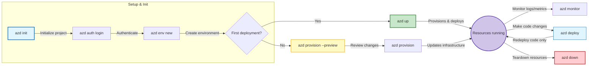
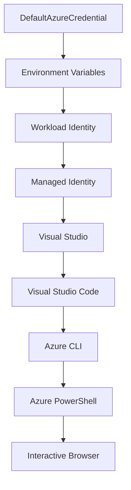

# Osnove AZD-a - Temeljni koncepti i osnove

**Navigacija poglavljem:**
- **📚 Početna stranica tečaja**: [AZD za početnike](../../README.md)
- **📖 Trenutno poglavlje**: Poglavlje 1 - Temelj i brz početak
- **⬅️ Prethodno**: [Pregled tečaja](../../README.md#-chapter-1-foundation--quick-start)
- **➡️ Sljedeće**: [Instalacija i postavljanje](installation.md)
- **🚀 Sljedeće poglavlje**: [Poglavlje 2: AI-prvo razvoj](../chapter-02-ai-development/microsoft-foundry-integration.md)

## Uvod

> Pregledano u odnosu na `azd 1.37.2` (studeni 2026.). Bash naredbe koriste citirane rezervirane riječi koje morate zamijeniti. Predlošci radnih tijekova koriste `.` za inicijalizaciju trenutnog direktorija; bez argumenta direktorija, inicijalizacija predloška stvara poddirektorij i ne mijenja radni direktorij vašeg ljuska. Napredni isječci su ilustrativni, ne potpuni projekti.

Ova lekcija uvodi vas u Azure Developer CLI (azd), moćan alat naredbenog retka koji ubrzava vaše putovanje od lokalnog razvoja do implementacije u Azureu. Naučit ćete osnovne koncepte, glavne značajke i shvatiti kako azd pojednostavljuje implementaciju aplikacija prilagođenih oblaku.

## Ciljevi učenja

Do kraja ove lekcije ćete:
- Razumjeti što je Azure Developer CLI i njegovu glavnu svrhu
- Naučiti osnovne koncepte predložaka, okruženja i usluga
- Istražiti ključne značajke uključujući razvoj vođen predlošcima i infrastrukturu kao kod
- Razumjeti strukturu projekta azd i radni tijek
- Biti spremni instalirati i konfigurirati azd za vaše razvojno okruženje

## Ishodi učenja

Nakon završetka ove lekcije moći ćete:
- Objasniti ulogu azd-a u modernim razvojnim radnim tijekovima oblaka
- Identificirati komponente strukture azd projekta
- Opisati kako predlošci, okruženja i usluge djeluju zajedno
- Razumjeti prednosti infrastrukture kao koda s azd-om
- Prepoznati različite azd naredbe i njihove svrhe

## Što je Azure Developer CLI (azd)?

Azure Developer CLI (azd) je alat naredbenog retka dizajniran da ubrza vaše putovanje od lokalnog razvoja do implementacije u Azureu. Pojednostavljuje proces izrade, implementacije i upravljanja aplikacijama prilagođenima oblaku na Azureu.

### Što možete implementirati s azd-om?

azd podržava širok raspon radnih opterećenja — i popis se neprestano povećava. Danas možete koristiti azd za implementaciju:

| Vrsta radnog opterećenja | Primjeri | Isti radni tijek? |
|-------------------------|----------|-----------------|
| **Tradicionalne aplikacije** | Web aplikacije, REST API-ji, statične stranice | ✅ `azd up` |
| **Usluge i mikroservisi** | Container Apps, Function Apps, višeservisni backendi | ✅ `azd up` |
| **AI-pokretane aplikacije** | Chat aplikacije s Microsoft Foundry modelima, RAG rješenja s AI pretraživanjem | ✅ `azd up` |
| **Inteligentni agenti** | Agentirni hostani na Foundry-u, koordinacije više agenata | ✅ `azd up` |

Ključni uvid je da **životni ciklus azd-a ostaje isti bez obzira na to što implementirate**. Inicijalizirate projekt, provisite infrastrukturu, implementirate kod, nadgledate aplikaciju i čistite — bilo da je riječ o jednostavnoj web stranici ili sofisticiranom AI agentu.

Ta kontinuitet je namjerno osmišljen. azd tretira AI mogućnosti kao još jednu vrstu usluge koju vaša aplikacija može koristiti, a ne kao nešto temeljno drugačije. Chat endpoint podržan Microsoft Foundry modelima je, s aspekta azd-a, samo još jedna usluga za konfiguraciju i implementaciju.

### 🎯 Zašto koristiti AZD? Usporedba iz stvarnog svijeta

Usporedimo implementaciju jednostavne web aplikacije s bazom podataka:

#### ❌ BEZ AZD-a: Ručna Azure implementacija (30+ minuta)

**Ilustrativna Bash usporedba, nije pokretač aplikacije.** Pretpostavlja postojeći kod aplikacije, jedinstvene nazive resursa, Azure CLI autentikaciju i potrebne CLI ekstenzije. Upotrijebite donji predložak za potpunu podržanu end-to-end stazu.

```bash
# Step 1: Create resource group
az group create --name myapp-rg --location eastus

# Step 2: Create App Service Plan
az appservice plan create --name myapp-plan \
  --resource-group myapp-rg \
  --sku B1 --is-linux

# Step 3: Create Web App
az webapp create --name myapp-web-unique123 \
  --resource-group myapp-rg \
  --plan myapp-plan \
  --runtime "NODE:22-lts"

# Step 4: Create Cosmos DB account (10-15 minutes)
az cosmosdb create --name myapp-cosmos-unique123 \
  --resource-group myapp-rg \
  --kind MongoDB

# Step 5: Create database
az cosmosdb mongodb database create \
  --account-name myapp-cosmos-unique123 \
  --resource-group myapp-rg \
  --name tododb

# Step 6: Create collection
az cosmosdb mongodb collection create \
  --account-name myapp-cosmos-unique123 \
  --resource-group myapp-rg \
  --database-name tododb \
  --name todos

# Step 7: Get connection string
CONN_STR=$(az cosmosdb keys list \
  --name myapp-cosmos-unique123 \
  --resource-group myapp-rg \
  --type connection-strings \
  --query "connectionStrings[0].connectionString" -o tsv)

# Step 8: Configure app settings
az webapp config appsettings set \
  --name myapp-web-unique123 \
  --resource-group myapp-rg \
  --settings MONGODB_URI="$CONN_STR"

# Step 9: Enable logging
az webapp log config --name myapp-web-unique123 \
  --resource-group myapp-rg \
  --application-logging filesystem \
  --detailed-error-messages true

# Step 10: Set up Application Insights
az monitor app-insights component create \
  --app myapp-insights \
  --location eastus \
  --resource-group myapp-rg

# Step 11: Link App Insights to Web App
INSTRUMENTATION_KEY=$(az monitor app-insights component show \
  --app myapp-insights \
  --resource-group myapp-rg \
  --query "instrumentationKey" -o tsv)

az webapp config appsettings set \
  --name myapp-web-unique123 \
  --resource-group myapp-rg \
  --settings APPINSIGHTS_INSTRUMENTATIONKEY="$INSTRUMENTATION_KEY"

# Step 12: Build application locally
npm install
npm run build

# Step 13: Create deployment package
zip -r app.zip . -x "*.git*" "node_modules/*"

# Step 14: Deploy application
az webapp deployment source config-zip \
  --resource-group myapp-rg \
  --name myapp-web-unique123 \
  --src app.zip

# Step 15: Wait and pray it works 🙏
# (No automated validation, manual testing required)
```

**Problemi:**
- ❌ Više od 15 naredbi za zapamtiti i izvršiti redoslijedom
- ❌ 30-45 minuta ručnog rada
- ❌ Lako do pogrešaka (tipfelera, pogrešni parametri)
- ❌ Potrebno eksplicitno rukovanje vjerodajnicama; debug zapisi i praćenje ljuske mogu ih izložiti
- ❌ Nema automatskog vraćanja ako nešto zakaže
- ❌ Teško za replicirati za članove tima
- ❌ Svaki put drugačije (nerazumljivo)

#### ✅ S AZD-om: Automatizirana implementacija (5 naredbi, 10-15 minuta)

```bash
# Step 1: Initialize from template
azd init --template todo-nodejs-mongo .

# Step 2: Authenticate
azd auth login

# Step 3: Select the environment created during init
azd env select dev

# Step 4: Preview changes (optional but recommended)
azd provision --preview

# Step 5: Deploy everything
azd up

# ✨ Done! Everything is deployed, configured, and monitored
```

**Prednosti:**
- ✅ **5 naredbi** u usporedbi s 15+ ručnih koraka
- ✅ Ukupno vrijeme **10-15 minuta** (uglavnom čekanje na Azure)
- ✅ **Manje ručnih grešaka** - dosljedan radni tijek vođen predlošcima
- ✅ **Sigurno rukovanje tajnama** - mnogi predlošci koriste Azure upravljano skladište tajni
- ✅ **Ponavljajuće implementacije** - isti radni tijek svaki put
- ✅ **Ponavljajuće definicije infrastrukture** - podložno kvotama, dostupnosti regije i verzijama predložaka
- ✅ **Pripremljeno za timove** - svatko može implementirati s istim naredbama
- ✅ **Infrastruktura kao kod** - Bicep predlošci pod verzijskom kontrolom
- ✅ **Praćenje definirano predlošcima** - Application Insights kada je uključeno u predložak

### Vrijeme i pouzdanost

Gore navedena vremena su procjene, ne standardi. azd smanjuje broj naredbi koje morate koordinirati, ali ne jamči trajanje implementacije, ne uklanja greške niti pruža automatsko vraćanje aplikacije/baze podataka. Čuvajte radne verzije u nadzoru izvora i testirajte procedure oporavka.

## Temeljni koncepti

### Predlošci
Predlošci su temelj azd-a. Sadrže:
- **Kod aplikacije** - vaš izvorni kod i ovisnosti
- **Definicije infrastrukture** - Azure resursi definirani u Bicepu ili Terraformu
- **Konfiguracijske datoteke** - postavke i varijable okruženja
- **Skripte za implementaciju** - automatizirani radni tokovi implementacije

### Okruženja
Okruženja predstavljaju različite ciljeve implementacije:
- **Razvojno** - za testiranje i razvoj
- **Predprodukcijsko** - predprodukcijsko okruženje
- **Produkcijsko** - produkcijsko živo okruženje

Svako okruženje održava svoje:
- Ime i vrijednosti okruženja; izolacija resursa ovisi o predlošku infrastrukture
- Konfiguracijske postavke
- Stanje implementacije

### Usluge
Usluge u `azure.yaml` opisuju implementabilne komponente aplikacije:
- **Frontend** - web aplikacije, jedinstvene stranice (SPA)
- **Backend** - API-ji, mikroservisi

Baze podataka i pohrane obično se provisuju kao infrastrukturni resursi, a ne izmišljeni hosting usluga poput `host: postgres`.

## Ključne značajke

### 1. Razvoj vođen predlošcima
```bash
# Browse available templates
azd template list

# Initialize from a template
azd init --template "<template-name>" .
```

### 2. Infrastruktura kao kod
- **Bicep** - Azure domenski jezik
- **Terraform** - alat za infrastrukturno upravljanje u više oblaka
- Bicep se prevodi u ARM predloške; sirovi ARM JSON nije zaseban ugrađeni `infra.provider`.

### 3. Integrirani radni tokovi
```bash
# Complete deployment workflow
azd up            # Provision + Deploy this is hands off for first time setup

# 🧪 NEW: Preview infrastructure changes before deployment (SAFE)
azd provision --preview    # Simulate infrastructure deployment without making changes

azd provision     # Create Azure resources if you update the infrastructure use this
azd deploy        # Deploy application code or redeploy application code once update
azd down          # Clean up resources
```

#### 🛡️ Sigurno planiranje infrastrukture uz pregled
Naredba `azd provision --preview` je revolucionarna za sigurne implementacije:
- **Suhi pregled** - prikazuje što će se stvoriti, mijenjati ili izbrisati
- **Bez primjene infrastrukture** - pregledava promjene pružatelja; prvo pregledajte projektne kuke jer kuke mogu pokrenuti naredbe sa sporednim efektima
- **Timska suradnja** - dijelite rezultate pregleda prije implementacije
- **Ulaz za planiranje troškova** - pregledajte predložene SKU-ove, zatim ih cijenite s Azure kalkulatorom; pregled ne izračunava cijene

```bash
# Example preview workflow
azd provision --preview           # See what will change
# Review the output, discuss with team
azd provision                     # Apply changes with confidence
```

### 📊 Vizualno: AZD radni tijek razvoja



**Objašnjenje radnog tijeka:**
1. **Init** - započnite s predloškom ili novim projektom
2. **Auth** - autentikacija s Azureom
3. **Environment** - kreirajte izolirano okruženje za implementaciju
4. **Preview** - 🆕 uvijek prvo pregledajte infrastrukturne promjene (sigurna praksa)
5. **Provision** - stvaranje/azuriranje Azure resursa
6. **Deploy** - gurnite vaš kod aplikacije
7. **Monitor** - promatrajte performanse aplikacije
8. **Iterate** - napravite promjene i ponovno implementirajte kod
9. **Cleanup** - uklonite resurse kad završite

### 4. Upravljanje okruženjima
```bash
# Create and manage environments
azd env new "<environment-name>"
azd env select "<environment-name>"
azd env list
```

### 5. Ekstenzije i AI naredbe

azd koristi sustav proširenja za dodavanje mogućnosti izvan osnovnog CLI-ja. Ovo je posebno korisno za AI radna opterećenja:

```bash
# List available extensions
azd extension list

# Install the Foundry agents extension
azd extension install azure.ai.agents

# Initialize an AI agent project interactively
azd ai agent init

# Test a deployed agent (shows latency and time-to-first-byte)
azd ai agent invoke

# Start the MCP server for AI-assisted development (Alpha)
azd mcp start
```

**Životni ciklus agenta, od početka do kraja.** Koristite `azure.ai.agents` za operacije životnog ciklusa agenta i zasebno instalirajte `azure.ai.evaluations` za evaluacije. Za kombinirani radni tijek koristite `azd >= 1.37.0`. Nije potrebno imati sve ovo od prvog dana:

| Faza | Naredba | Što radi |
|-------|---------|--------------|
| **Scaffold** | `azd ai agent init --template <path-to-azure.yaml>` | Usvojite trenutačni predložak agenta |
| **Test** | `azd ai agent invoke` | Pozovite agenta i pogledajte vrijeme odziva |
| **Measure** | `azd ai eval init`, `generate`, `run start` | Konfigurirajte, implementirajte i pokrenite evaluacije koristeći zasebno proširenje |
| **Improve** | `azd ai agent optimize --eval <evaluation-name> --optimize-model <optimizer-deployment>` | Ponovno upotrijebite kompatibilnu evaluaciju za optimizaciju agenta |
| **Inspect** | `azd ai agent endpoint show` | Pregledajte konfiguraciju uživo endpointa |
| **Clean up** | `azd ai agent delete` | Izbrišite hostanog agenta i sve njegove verzije |

> Ekstenzije su detaljno obrađene u [Poglavlju 2: AI-prvo razvoj](../chapter-02-ai-development/agents.md) i referenci [AZD AI CLI naredbi](../chapter-08-production/production-ai-practices.md#azd-ai-cli-commands-and-extensions).

## 📁 Struktura projekta

Tipična struktura azd projekta:
```
my-app/
├── .azure/                  # Local environments and selected-environment config
│   ├── config.json
│   └── dev/.env
├── .devcontainer/          # Development container config
├── .github/workflows/      # GitHub Actions
├── .vscode/               # VS Code settings
├── infra/                 # Infrastructure code
│   ├── main.bicep        # Main infrastructure template
│   ├── main.parameters.json
│   └── modules/          # Reusable modules
├── src/                  # Application source code
│   ├── api/             # Backend services
│   └── web/             # Frontend application
├── azure.yaml           # azd project configuration
└── README.md
```

## 🔧 Konfiguracijske datoteke

### azure.yaml
Glavna konfiguracijska datoteka projekta:
```yaml
name: my-awesome-app
metadata:
  template: my-template@1.0.0

services:
  web:
    project: ./src/web
    language: js
    host: appservice
  api:
    project: ./src/api
    language: js
    host: appservice

hooks:
  preprovision:
    shell: pwsh
    run: echo "Preparing to provision..."
```

### .azure/config.json
Lokalni izbor zadanog okruženja projekta (ilustrativno; upravlja azd):
```json
{
  "defaultEnvironment": "dev"
}
```

## 🎪 Uobičajeni radni tokovi s praktičnim vježbama

> **💡 Savjet za učenje:** Slijedite ove vježbe redom kako biste postupno gradili svoje AZD vještine.

### 🎯 Vježba 1: Inicijalizirajte svoj prvi projekt

**Cilj:** Kreirajte AZD projekt i istražite njegovu strukturu

**Koraci:**
```bash
# Use a proven template
mkdir azd-basics-practice
cd azd-basics-practice
# Choose "dev" for the environment name when prompted
azd init --template todo-nodejs-mongo .

# Explore the generated files
ls -la  # View all files including hidden ones

# Key files created:
# - azure.yaml (main config)
# - infra/ (infrastructure code)
# - src/ (application code)
```

**✅ Uspjeh:** Imate direktorije azure.yaml, infra/ i src/

---

### 🎯 Vježba 2: Implementirajte u Azure

**Cilj:** Završite potpunu implementaciju

**Koraci:**
```bash
# 1. Authenticate
azd auth login

# 2. Select the dev environment created in Exercise 1
azd env select dev
azd env set AZURE_LOCATION eastus

# 3. Preview changes (RECOMMENDED)
azd provision --preview

# 4. Deploy everything
azd up

# 5. Verify deployment
azd show    # View your app URL
```

**Očekivano vrijeme:** 10-15 minuta  
**✅ Uspjeh:** URL aplikacije se otvara u pregledniku

---

### 🎯 Vježba 3: Višestruka okruženja

**Cilj:** Implementirajte u dev i staging

**Koraci:**
```bash
# Already have dev, create staging
azd env new staging
azd env set AZURE_LOCATION westus2
azd up

# Switch between them
azd env list
azd env select dev
```

**✅ Uspjeh:** Dvije odvojene grupe resursa u Azure portalu

**Čišćenje:** Vježba 3 stvara drugi naplativi deployment. Obrišite oba nakon završetka:

```bash
azd down --environment dev
azd down --environment staging
```

---

### 🛡️ Destruktivno čišćenje: `azd down --force --purge`

Kada namjerno želite izbrisati Azure resurse odabranog okruženja:

```bash
azd down --force --purge
```

**Što radi:**
- `--force`: Nema potvrda prije izvršenja
- `--purge`: Također trajno briše podržane soft-delete resurse (npr. Key Vaultove), gdje je dozvoljena zaštita od brisanja. Ne briše lokalni `.azure/` direktorij.

**Koristite kada:** završili ste s privremenim okruženjem. Ne koristite destruktivno čišćenje kao prvu reakciju na grešku autentikacije, kvote ili konfiguracije.

---

## 🎪 Izvorni radni tijek

### Započinjanje novog projekta
```bash
# Method 1: Use existing template
azd init --template todo-nodejs-mongo .

# Method 2: Start from scratch
azd init

# Method 3: Use current directory
azd init .
```

### Razvojni ciklus
```bash
# Set up development environment
azd auth login
azd env new dev
azd env select dev

# Deploy everything
azd up

# Make changes and redeploy
azd deploy

# Clean up when done
azd down --force --purge # Deletes this environment's discovered Azure resources; review before forcing deletion.
```

## Razumijevanje `azd down --force --purge`
Naredba `azd down --force --purge` je moćan način da potpuno uklonite svoje azd okruženje i sve pridružene resurse. Evo pregleda što svaki pokazatelj radi:
```
--force
```
- Preskače potvrde za izvršenje.
- Korisno za automatizaciju ili skriptiranje gdje ručni unos nije izvediv.
- Ne zaobilazi dozvole, zaštitu od brisanja ili neuspjehe brisanja.

```
--purge
```
Trajno briše podržane soft-delete Azure resurse bez dodatne potvrde. Zaštita od brisanja i dozvole se i dalje primjenjuju. **Ne** uklanja lokalna okruženja ili `.azure/` mapu.


### Zašto koristiti oba?
Koristite oba samo ako namjeravate izbrisati Azure resurse odabranog okruženja i očistiti resurse koji se mogu oporaviti. To je destruktivno čišćenje, ne općenito popravljanje ili resetiranje lokalnog stanja.

Posebno je korisno nakon ručnih brisanja resursa u Azure portalu ili pri promjeni predložaka, okruženja ili naziva grupa resursa.


### Upravljanje višestrukim okruženjima
```bash
# Create staging environment
azd env new staging
azd env select staging
azd up

# Switch back to dev
azd env select dev

# Compare environments
azd env list
```

## 🔐 Autentikacija i vjerodajnice

Razlikujte autentikaciju implementacije (`azd auth login`) od autentikacije SDK aplikacije (`DefaultAzureCredential`). To su odvojene stvari. azd po zadanoj postavci ne koristi vjerodajnice Azure CLI-ja.

### Autentikacija Azure CLI-ja (`az login`)

Pokrenite `azd auth login` za azd. Sljedeće Azure CLI naredbe su opcionalne i samostalno autentificiraju `az` naredbe:

```bash
# Interactive login (opens browser)
az login

# Login with specific tenant
az login --tenant "<tenant-id>"

# Login with service principal
az login --service-principal -u "<app-id>" -p "<password>" --tenant "<tenant-id>"

# Check current login status
az account show

# List available subscriptions
az account list --output table

# Set default subscription
az account set --subscription "<subscription-id>"
```

### Tijek autentikacije
1. **Interaktivni login**: Otvara zadani preglednik za prijavu
2. **Device Code Flow**: Za okruženja bez pristupa pregledniku
3. **Service Principal**: Za automatizacijske i CI/CD scenarije
4. **Managed Identity**: Za aplikacije hostane na Azureu

### Lanca DefaultAzureCredential

`DefaultAzureCredential` je vrsta vjerodajnica koja pruža pojednostavljeni autentikacijski doživljaj automatskim isprobavanjem više izvora vjerodajnica u određenom redoslijedu:

#### Lanac vjerodajnica aplikacijskog SDK-a

Točan lanac ovisi o jeziku Azure Identity SDK-a, verziji, instaliranim dodacima i opcijama. Ovaj dijagram je konceptualan, nije fiksni redoslijed za azd autentifikaciju; noviji SDK-ovi također mogu uključivati vjerodajnice Azure Developer CLI-ja.


#### 1. Varijable Okoline
```bash
# Set environment variables for service principal
export AZURE_CLIENT_ID="<app-id>"
export AZURE_CLIENT_SECRET="<password>"
export AZURE_TENANT_ID="<tenant-id>"
```

#### 2. Workload Identity (Kubernetes/GitHub Actions)
Automatski se koristi u:
- Azure Kubernetes Service (AKS) s Workload Identity
- GitHub Actions s OIDC federacijom
- Ostalim scenarijima federirane identitete

#### 3. Managed Identity
Za Azure resurse poput:
- Virtualnih Strojova
- App Service
- Azure Functions
- Container Instances

```bash
# Inspect a deployed Container App's configured identity (requires az login)
az containerapp show --name "<app-name>" --resource-group "<rg-name>" --query identity
```

#### 4. Integracija Alata za Razvoj
- **Visual Studio**: Automatski koristi prijavljeni račun
- **VS Code**: Podrška ovisi o SDK-u i konfiguraciji posrednika/dodatka
- **Azure CLI**: Koristi `az login` vjerodajnice (najčešće za lokalni razvoj)

### Postavljanje AZD Autentifikacije

```bash
# Method 1: Direct azd authentication (recommended)
azd auth login

# Method 2: Direct azd authentication
azd auth login --use-device-code  # For headless environments

# Method 3: Check authentication status
azd auth login --check-status

# Method 4: Logout and re-authenticate
azd auth logout
azd auth login
```

### Najbolje Prakse za Autentifikaciju

#### Za Lokalni Razvoj
```bash
# 1. Log in to azd
azd auth login

# 2. Select the subscription for this initialized environment
azd env set AZURE_SUBSCRIPTION_ID "<subscription-id>"

# 3. Check azd sign-in details (read the status message)
azd auth login --check-status
```

#### Za CI/CD Pipelines
```yaml
# Partial GitHub Actions steps: assumes checkout, azd installation,
# required AZURE_* environment values, and pipeline secret configuration.
- name: Deploy with azd
  run: |
    azd auth login --client-id ${{ secrets.AZURE_CLIENT_ID }} \
                    --client-secret ${{ secrets.AZURE_CLIENT_SECRET }} \
                    --tenant-id ${{ secrets.AZURE_TENANT_ID }}
    azd up --no-prompt
```

#### Za Produkcijska Okruženja
- Koristite **Managed Identity** kada pokrećete na Azure resursima
- Koristite **Service Principal** za scenarije automatizacije
- Izbjegavajte pohranu vjerodajnica u kod ili konfiguracijske datoteke
- Koristite **Azure Key Vault** za osjetljive konfiguracije

### Uobičajeni Problemi s Autentifikacijom i Rješenja

#### Problem: "Nema pronađene pretplate"
```bash
# Solution: Set default subscription
az account list --output table
az account set --subscription "<subscription-id>"
azd env set AZURE_SUBSCRIPTION_ID "<subscription-id>"
```

#### Problem: "Nedostatak dopuštenja"
```bash
# Solution: Check and assign required roles
az role assignment list --assignee $(az account show --query user.name --output tsv)

# Common required roles:
# - Contributor (for resource management)
# - User Access Administrator (for role assignments)
```

#### Problem: "Token je istekao"
```bash
# Solution: Re-authenticate
az logout
az login
azd auth logout
azd auth login
```

### Autentifikacija u Različitim Scenarijima

#### Lokalni Razvoj
```bash
# Personal development account
az login
azd auth login
```

#### Timski Rad na Razvoju
```bash
# Use specific tenant for organization
az login --tenant contoso.onmicrosoft.com
azd auth login --tenant-id "<tenant-id>"
```

#### Višenamjenski Scenariji
```bash
# Switch between tenants
az login --tenant tenant1.onmicrosoft.com
azd auth login --tenant-id "<tenant-1-id>"
# Select an environment configured with tenant 1's subscription
azd env select tenant1-dev
# Deploy to tenant 1
azd up

az login --tenant tenant2.onmicrosoft.com  
azd auth login --tenant-id "<tenant-2-id>"
azd env select tenant2-dev
# Deploy to tenant 2
azd up
```

### Sigurnosne Napomene

1. **Pohrana Vjerodajnica**: Nikad ne pohranjujte vjerodajnice u izvorni kod
2. **Ograničenje Opsega**: Koristite najnižu razinu dopuštenja za service principle
3. **Rotacija Tokena**: Redovito rotirajte tajne service principala
4. **Revizijski Trag**: Nadgledajte aktivnosti autentifikacije i implementacije
5. **Sigurnost Mreže**: Koristite privatne krajnje točke kad god je moguće

### Otklanjanje Problema s Autentifikacijom

```bash
# Debug authentication issues
azd auth login --check-status
az account show
az account get-access-token

# Common diagnostic commands
whoami                          # Current user context
az ad signed-in-user show      # Microsoft Entra ID user details
az group list                  # Test resource access
```

## Otkrivanje naredbi

### Otkrivanje
```bash
azd template list              # Browse templates
azd template list --help       # Template discovery options
azd init --help               # Initialization options
```

### Upravljanje Projektom
```bash
azd show                     # Project overview
azd env list                # Available environments and selected default
azd config show            # Configuration settings
```

### Praćenje
```bash
azd monitor                  # Open Azure portal monitoring
azd monitor --logs           # View application logs
azd monitor --live           # View live metrics
azd pipeline config          # Set up CI/CD
```

## Najbolje Prakse

### 1. Koristite Značajna Imena
```bash
# Good
azd env new production-east
azd init --template todo-nodejs-mongo .

# Avoid
azd env new env1
azd init --template template1 .
```

### 2. Iskoristite Predloške
- Počnite s postojećim predlošcima
- Prilagodite prema svojim potrebama
- Kreirajte predloške za višekratnu uporabu u svojoj organizaciji

### 3. Izolacija Okruženja
- Koristite odvojena okruženja za razvoj/testiranje/produkciju
- Nikada ne implementirajte izravno u produkciju s lokalnog računala
- Za produkcijske implementacije koristite CI/CD pipelineove

### 4. Upravljanje Konfiguracijom
- Koristite managed identity i Key Vault za tajne; obične `azd env set` vrijednosti su lokalni običan tekst
- Držite konfiguracije pod kontrolom verzija
- Dokumentirajte postavke specifične za okruženje

## Napredak u učenju

### Početnik (Tjedan 1-2)
1. Instalirajte azd i autentificirajte se
2. Implementirajte jednostavan predložak
3. Razumite strukturu projekta
4. Naučite osnovne naredbe (up, down, deploy)

### Srednji nivo (Tjedan 3-4)
1. Prilagodite predloške
2. Upravljajte višestrukim okruženjima
3. Razumite infrastrukturni kod
4. Postavite CI/CD pipelineove

### Napredni (Tjedan 5+)
1. Kreirajte prilagođene predloške
2. Napredni infrastrukturni obrasci
3. Implementacije u više regija
4. Konfiguracije razine poduzeća

## Sljedeći Koraci

**📖 Nastavite s učenjem poglavlja 1:**
- [Instalacija i postavljanje](installation.md) - Instalirajte i konfigurirajte azd
- [Vaš prvi projekt](first-project.md) - Završite praktični vodič
- [Vodič za konfiguraciju](../chapter-03-configuration/configuration.md) - Napredne opcije konfiguracije

**🎯 Spremni za sljedeće poglavlje?**
- [Poglavlje 2: AI-First Development](../chapter-02-ai-development/microsoft-foundry-integration.md) - Počnite graditi AI aplikacije

## Dodatni Resursi

- [Pregled Azure Developer CLI-ja](https://learn.microsoft.com/en-us/azure/developer/azure-developer-cli/)
- [Galerija predložaka](https://azure.github.io/awesome-azd/)
- [Primjeri zajednice](https://github.com/Azure-Samples)

---

## 🙋 Često postavljana pitanja

### Opća pitanja

**P: Koja je razlika između AZD i Azure CLI?**

O: Azure CLI (`az`) je za upravljanje pojedinačnim Azure resursima. AZD (`azd`) je za upravljanje cjelokupnim aplikacijama:

```bash
# Azure CLI - Low-level resource management
az webapp create --name myapp --resource-group rg
az sql server create --name myserver --resource-group rg
# ...many more commands needed

# AZD - Application-level management
azd up  # Deploys entire app with all resources
```

**Razmotrite ovako:**
- `az` = Rad s pojedinačnim Lego kockama
- `azd` = Rad sa cijelim Lego setovima

---

**P: Trebam li znati Bicep ili Terraform za korištenje AZD-a?**

O: Ne! Počnite s predlošcima:
```bash
# Use existing template - no IaC knowledge needed
azd init --template todo-nodejs-mongo .
azd up
```

Kasnije možete naučiti Bicep za prilagodbu infrastrukture. Predlošci pružaju funkcionalne primjere za učenje.

---

**P: Koliko košta pokretanje AZD predložaka?**

O: Troškovi variraju po regiji, SKU-u, radnom vremenu, načinu baze podataka i korištenju modela. Razvojno okruženje može uzrokovati značajne mjesečne troškove čak i kad je neaktivno; nemojte pretpostavljati univerzalni raspon od 50-150 $:

```bash
# Preview resource changes (not prices)
azd provision --preview

# Always cleanup when not using
azd down --force --purge  # Removes all resources
```

**Stručni savjet:** Koristite besplatne slojeve gdje su dostupni:
- App Service: F1 (Besplatni) sloj
- Azure OpenAI: nema općeg zajamčenog mjesečnog besplatnog tokena; provjerite trenutne cijene modela i ponude
- Cosmos DB: korisnički nalozi s definiranom propusnošću mogu birati besplatni sloj; serverless predlošci se ne kvalificiraju automatski

---

**P: Mogu li koristiti AZD s postojećim Azure resursima?**

O: Da, ali je lakše početi ispočetka. AZD najbolje funkcionira kada upravlja cijelim životnim ciklusom. Za postojeće resurse:

```bash
# Option 1: Import existing resources (advanced)
azd init
# Then modify infra/ to reference existing resources

# Option 2: Start fresh (recommended)
azd init --template "<verified-template-name>" .
azd up  # Creates new environment
```

---

**P: Kako dijelim moj projekt s kolegama?**

O: Pohranite AZD projekt u Git (ali NE .azure mapu):

```bash
# Already in .gitignore by default
.azure/        # Contains secrets and environment data
*.env          # Environment variables

# Team members then:
git clone "<your-repo>"
# Change into the cloned repository before running the remaining commands.
azd auth login
azd env new "<their-name>-dev"
azd up
```

Svima se pruža identična infrastruktura iz istih predložaka.

---

### Pitanja o otklanjanju problema

**P: "azd up" nije uspio na pola puta. Što da radim?**

O: Provjerite pogrešku, ispravite je i pokušajte ponovno:

```bash
# Capture detailed diagnostics (redact sensitive values before sharing)
azd up --debug

# Common fixes:

# 1. If quota exceeded:
azd env set AZURE_LOCATION "westus2"  # Try different region

# 2. If resource name conflict:
azd down --force --purge  # Clean slate
azd up  # Retry

# 3. If auth expired:
az login
azd auth login
azd up
```

**Najčešći problem:** Izabrana je pogrešna Azure pretplata
```bash
az account list --output table
az account set --subscription "<correct-subscription>"
azd env set AZURE_SUBSCRIPTION_ID "<correct-subscription-id>"
```

---

**P: Kako implementirati samo promjene u kodu bez reprovizioniranja?**

O: Koristite `azd deploy` umjesto `azd up`:

```bash
azd up          # First time: provision + deploy (slow)

# Make code changes...

azd deploy      # Subsequent times: deploy only (fast)
```

Usporedba brzine:
- `azd up`: 10-15 minuta (provisionira infrastrukturu)
- `azd deploy`: 2-5 minuta (samo kod)

---

**P: Mogu li prilagoditi infrastrukturne predloške?**

O: Da! Uredite Bicep datoteke u `infra/`:

```bash
# After azd init
cd infra/
code main.bicep  # Edit in VS Code

# Preview changes
azd provision --preview

# Apply changes
azd provision
```

**Savjet:** Počnite s malim - prvo promijenite SKU-ove:
```bicep
// infra/main.bicep
sku: {
  name: 'B1'  // Change to 'P1V2' for production
}
```

---

**P: Kako obrisati sve što je AZD kreirao?**

O: Jedna naredba uklanja sve resurse:

```bash
azd down --force --purge

# This deletes:
# - Azure resources/resource groups discovered for the selected environment
# - Supported soft-deleted resources, if purge protection allows
# Local .azure files remain; shared/external resources may remain too.
```

**Uvijek pokrenite ovo kada:**
- Završili ste testiranje predloška
- Prelazite na drugi projekt
- Želite početi iznova

**Provjera troškova:** Potvrdite brisanje u Azure i provjerite postojeće/zajedničke resurse. Prijašnji nastali troškovi još uvijek vrijede.

---

**P: Što ako sam slučajno obrisao resurse u Azure Portalu?**

O: Stanje AZD-a može biti nesinkronizirano. Pristup čiste ploče:

```bash
# 1. Delete remaining resources only if that is your intent
azd down --force --purge

# 2. Start fresh
azd up

# Alternative: Let AZD detect and fix
azd provision  # Will create missing resources
```

---

### Napredna pitanja

**P: Mogu li koristiti AZD u CI/CD pipelineovima?**

O: Da! Primjer s GitHub Actions:

```yaml
# .github/workflows/deploy.yml
name: Deploy with AZD

on:
  push:
    branches: [main]

jobs:
  deploy:
    runs-on: ubuntu-latest
    steps:
      - uses: actions/checkout@v4
      
      - name: Install azd
        run: curl -fsSL https://aka.ms/install-azd.sh | bash
      
      - name: Azure Login
        run: |
          azd auth login \
            --client-id ${{ secrets.AZURE_CLIENT_ID }} \
            --client-secret ${{ secrets.AZURE_CLIENT_SECRET }} \
            --tenant-id ${{ secrets.AZURE_TENANT_ID }}
      
      - name: Deploy
        env:
          AZURE_ENV_NAME: dev
          AZURE_LOCATION: ${{ vars.AZURE_LOCATION }}
          AZURE_SUBSCRIPTION_ID: ${{ vars.AZURE_SUBSCRIPTION_ID }}
        run: azd up --no-prompt
```

---

**P: Kako upravljati tajnama i osjetljivim podacima?**

O: Koristite Key Vault eksplicitno. `azd env set` zapisuje obične vrijednosti u lokalnu datoteku okoline; on ne kreira automatski vault, ne dodjeljuje uloge niti ne ubacuje tajne u vašu aplikaciju.

```bash
# Interactive: create/select a Key Vault secret and save its reference
azd env set-secret DATABASE_PASSWORD
```

Potrebna su odgovarajuća prava za vault. Vaša infrastruktura/aplikacija i dalje mora povezati tajnu sa svojim korisnikom i dati pristup identitetu runtime-a. Ne ispisujte riješene tajne vrijednosti u zapisnike.

**Nikad nemojte pohraniti:**
- `.azure/` mapu (sadrži podatke okoline)
- `.env` datoteke (lokalne tajne)
- Poveznice za povezivanje (connection strings)

---

**P: Mogu li implementirati u više regija?**

O: Da, kreirajte okruženje po regiji:

```bash
# East US environment
azd env new prod-eastus
azd env set AZURE_LOCATION eastus
azd up

# West Europe environment
azd env new prod-westeurope
azd env set AZURE_LOCATION westeurope
azd up

# Each environment is independent
azd env list
```

Za prave multi-regionalne aplikacije, prilagodite Bicep predloške za simultanu implementaciju u više regija.

---

**P: Gdje mogu dobiti pomoć ako zapnem?**

1. **AZD Dokumentacija:** https://learn.microsoft.com/azure/developer/azure-developer-cli/
2. **GitHub Issues:** https://github.com/Azure/azure-dev/issues
3. **Discord:** [Azure Discord](https://discord.gg/microsoft-azure) - kanal #azure-developer-cli
4. **Stack Overflow:** Oznaka `azure-developer-cli`
5. **Ovaj tečaj:** [Vodič za otklanjanje problema](../chapter-07-troubleshooting/common-issues.md)

**Stručni savjet:** Prije nego pitate, pokrenite:
```bash
azd show       # Shows current state
azd version    # Shows your version
```
 Uključite ove informacije u svoj upit za bržu pomoć.

---

## 🎓 Što slijedi?

Sada razumijete osnove AZD-a. Izaberite svoj put:

### 🎯 Za početnike:
1. **Sljedeće:** [Instalacija i postavljanje](installation.md) - Instalirajte AZD na svoje računalo
2. **Zatim:** [Vaš prvi projekt](first-project.md) - Implementirajte svoju prvu aplikaciju
3. **Vježbajte:** Završite sva 3 zadatka u ovoj lekciji

### 🚀 Za AI programere:
1. **Preskočite na:** [Poglavlje 2: AI-First Development](../chapter-02-ai-development/microsoft-foundry-integration.md)
2. **Implementirajte:** U praznom direktoriju projekta, započnite s `azd init --template get-started-with-ai-chat .`
3. **Naučite:** Gradite istovremeno s implementacijom

### 🏗️ Za iskusne programere:
1. **Pregledajte:** [Vodič za konfiguraciju](../chapter-03-configuration/configuration.md) - Napredne postavke
2. **Istražite:** [Infrastruktura kao kod](../chapter-04-infrastructure/provisioning.md) - Detaljan pregled Bicep-a
3. **Izgradite:** Kreirajte prilagođene predloške za svoj tehnološki sloj

---

**Navigacija poglavljima:**
- **📚 Početak tečaja**: [AZD Za početnike](../../README.md)
- **📖 Trenutno poglavlje**: Poglavlje 1 - Osnove & Brzi početak  
- **⬅️ Prethodno**: [Pregled tečaja](../../README.md#-chapter-1-foundation--quick-start)
- **➡️ Sljedeće**: [Instalacija i postavljanje](installation.md)
- **🚀 Sljedeće poglavlje**: [Poglavlje 2: AI-First Development](../chapter-02-ai-development/microsoft-foundry-integration.md)

---

<!-- CO-OP TRANSLATOR DISCLAIMER START -->
**Napomena**:
Ovaj dokument je preveden korištenjem AI prevoditeljskog servisa [Co-op Translator](https://github.com/Azure/co-op-translator). Iako težimo točnosti, imajte na umu da automatski prijevodi mogu sadržavati greške ili netočnosti. Izvorni dokument na izvornom jeziku treba smatrati autoritativnim izvorom. Za važne informacije preporuča se profesionalni ljudski prijevod. Nismo odgovorni za bilo kakva nesporazumevanja ili pogrešne interpretacije koje proizlaze iz korištenja ovog prijevoda.
<!-- CO-OP TRANSLATOR DISCLAIMER END -->