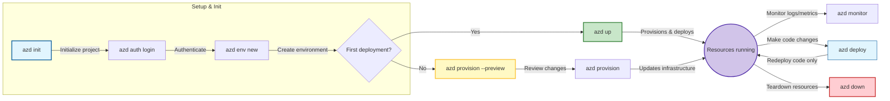
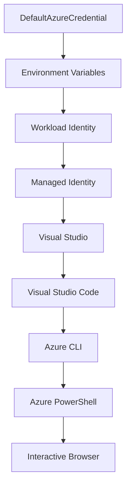

# Osnove AZD-a - Temeljni koncepti i osnove

**Navigacija poglavljima:**
- **📚 Početna stranica tečaja**: [AZD za početnike](../../README.md)
- **📖 Trenutno poglavlje**: Poglavlje 1 - Osnove i brzi početak
- **⬅️ Prethodno**: [Pregled tečaja](../../README.md#-chapter-1-foundation--quick-start)
- **➡️ Sljedeće**: [Instalacija i postavljanje](installation.md)
- **🚀 Sljedeće poglavlje**: [Poglavlje 2: AI-prvo razvoj](../chapter-02-ai-development/microsoft-foundry-integration.md)

## Uvod

> Pregledano u skladu s `azd 1.37.2` (studeni 2026.). Bash naredbe koriste citirane rezervirane znakove koje morate zamijeniti. Predlošci tijekova rada koriste `.` za inicijalizaciju trenutnog direktorija; bez argumenta direktorija, inicijalizacija predloška stvara poddirektorij i ne mijenja radni direktorij ljuske. Napredni isječci su ilustrativni, ne potpuni projekti.

Ova lekcija uvodi Azure Developer CLI (azd), moćan alat naredbenog retka koji ubrzava vaše putovanje od lokalnog razvoja do implementacije na Azure. Naučit ćete osnovne pojmove, ključne značajke i razumjeti kako azd pojednostavljuje implementaciju aplikacija izvornih za cloud.

## Ciljevi učenja

Do kraja lekcije, znat ćete:
- Razumjeti što je Azure Developer CLI i njegovu osnovnu namjenu
- Naučiti temeljne koncepte predložaka, okruženja i usluga
- Istražiti ključne značajke uključujući razvoj vođen predlošcima i Infrastructure as Code
- Razumjeti strukturu projekta azd i tijek rada
- Biti spremni za instalaciju i konfiguraciju azd-a za vaše razvojno okruženje

## Ishodi učenja

Nakon završetka lekcije, moći ćete:
- Objasniti ulogu azd-a u modernim tijekovima rada za razvoj u cloudu
- Prepoznati komponente strukture azd projekta
- Opisati kako predlošci, okruženja i usluge međusobno djeluju
- Razumjeti prednosti Infrastructure as Code s azd-om
- Prepoznati različite azd naredbe i njihove namjene

## Što je Azure Developer CLI (azd)?

Azure Developer CLI (azd) je alat naredbenog retka dizajniran da ubrza vaše putovanje od lokalnog razvoja do implementacije na Azure. Pojednostavljuje proces izgradnje, implementacije i upravljanja cloud-native aplikacijama na Azure.

### Što možete implementirati s azd-om?

azd podržava širok raspon radnih opterećenja – i popis se nastavlja širiti. Danas možete koristiti azd za implementaciju:

| Vrsta radnog opterećenja | Primjeri | Isti tijek rada? |
|---------------|----------|----------------|
| **Tradicionalne aplikacije** | Web aplikacije, REST API-ji, statične stranice | ✅ `azd up` |
| **Usluge i mikroservisi** | Container Apps, Function Apps, višeservice backendi | ✅ `azd up` |
| **Aplikacije s AI podrškom** | Chat aplikacije s Microsoft Foundry modelima, RAG rješenja s AI pretraživanjem | ✅ `azd up` |
| **Inteligentni agenti** | Agentu smješteni u Foundry-u, orkestracije s više agenata | ✅ `azd up` |

Ključna spoznaja je da **životni ciklus azd-a ostaje isti bez obzira što implementirate**. Inicijalizirate projekt, odobravate infrastrukturu, implementirate kod, nadgledate aplikaciju i čistite resurse – bilo da je riječ o jednostavnoj web stranici ili sofisticiranom AI agentu.

Ta kontinuitet je dizajnirana svrha. azd tretira AI mogućnosti kao drugu vrstu usluge koju vaša aplikacija može koristiti, a ne kao nešto temeljito drugačije. Chat endpoint podržan Microsoft Foundry modelima je, iz perspektive azd-a, samo još jedna usluga za konfiguraciju i implementaciju.

### 🎯 Zašto koristiti AZD? Usporedba iz stvarnog svijeta

Usporedimo implementaciju jednostavne web aplikacije s bazom podataka:

#### ❌ BEZ AZD-A: Ručna Azure implementacija (više od 30 minuta)

**Ilustrativna usporedba u Bashu, nije pokretački program za aplikaciju.** Pretpostavlja postojeći kod aplikacije, jedinstvena imena resursa, autentikaciju Azure CLI-jem i potrebne CLI ekstenzije. Koristite predložene vježbe ispod za podržani end-to-end postupak.

```bash
# Step 1: Create resource group
az group create --name myapp-rg --location eastus

# Step 2: Create App Service Plan
az appservice plan create --name myapp-plan \
  --resource-group myapp-rg \
  --sku B1 --is-linux

# Step 3: Create Web App
az webapp create --name myapp-web-unique123 \
  --resource-group myapp-rg \
  --plan myapp-plan \
  --runtime "NODE:22-lts"

# Step 4: Create Cosmos DB account (10-15 minutes)
az cosmosdb create --name myapp-cosmos-unique123 \
  --resource-group myapp-rg \
  --kind MongoDB

# Step 5: Create database
az cosmosdb mongodb database create \
  --account-name myapp-cosmos-unique123 \
  --resource-group myapp-rg \
  --name tododb

# Step 6: Create collection
az cosmosdb mongodb collection create \
  --account-name myapp-cosmos-unique123 \
  --resource-group myapp-rg \
  --database-name tododb \
  --name todos

# Step 7: Get connection string
CONN_STR=$(az cosmosdb keys list \
  --name myapp-cosmos-unique123 \
  --resource-group myapp-rg \
  --type connection-strings \
  --query "connectionStrings[0].connectionString" -o tsv)

# Step 8: Configure app settings
az webapp config appsettings set \
  --name myapp-web-unique123 \
  --resource-group myapp-rg \
  --settings MONGODB_URI="$CONN_STR"

# Step 9: Enable logging
az webapp log config --name myapp-web-unique123 \
  --resource-group myapp-rg \
  --application-logging filesystem \
  --detailed-error-messages true

# Step 10: Set up Application Insights
az monitor app-insights component create \
  --app myapp-insights \
  --location eastus \
  --resource-group myapp-rg

# Step 11: Link App Insights to Web App
INSTRUMENTATION_KEY=$(az monitor app-insights component show \
  --app myapp-insights \
  --resource-group myapp-rg \
  --query "instrumentationKey" -o tsv)

az webapp config appsettings set \
  --name myapp-web-unique123 \
  --resource-group myapp-rg \
  --settings APPINSIGHTS_INSTRUMENTATIONKEY="$INSTRUMENTATION_KEY"

# Step 12: Build application locally
npm install
npm run build

# Step 13: Create deployment package
zip -r app.zip . -x "*.git*" "node_modules/*"

# Step 14: Deploy application
az webapp deployment source config-zip \
  --resource-group myapp-rg \
  --name myapp-web-unique123 \
  --src app.zip

# Step 15: Wait and pray it works 🙏
# (No automated validation, manual testing required)
```

**Problemi:**
- ❌ Više od 15 naredbi za pamćenje i izvođenje po redu
- ❌ 30-45 minuta ručnog rada
- ❌ Lako je napraviti pogreške (tipkarske pogreške, pogrešni parametri)
- ❌ Potvrde zahtijevaju eksplicitno upravljanje; debug zapisi i praćenje ljuske mogu ih otkriti
- ❌ Nema automatskog vraćanja ako nešto zakaže
- ❌ Teško za repliciranje članovima tima
- ❌ Svaki put drugačije (nije reproduktivno)

#### ✅ S AZD-om: Automatizirana implementacija (5 naredbi, 10-15 minuta)

```bash
# Step 1: Initialize from template
azd init --template todo-nodejs-mongo .

# Step 2: Authenticate
azd auth login

# Step 3: Select the environment created during init
azd env select dev

# Step 4: Preview changes (optional but recommended)
azd provision --preview

# Step 5: Deploy everything
azd up

# ✨ Done! Everything is deployed, configured, and monitored
```

**Prednosti:**
- ✅ **5 naredbi** nasuprot 15+ ručnih koraka
- ✅ Ukupno **10-15 minuta** (uglavnom čekanje na Azure)
- ✅ **Manje ručnih pogrešaka** - dosljedan, vođen predložcima tijek rada
- ✅ **Sigurno upravljanje tajnama** - mnogi predlošci koriste Azure-managed pohranu tajni
- ✅ **Ponovljive implementacije** - isti tijek rada svaki put
- ✅ **Ponovljive definicije infrastrukture** - podložno kvotama, dostupnosti regija i verzijama predložaka
- ✅ **Pripremljeno za tim** - bilo tko može implementirati istim naredbama
- ✅ **Infrastructure as Code** - verzionirano Bicep predloške
- ✅ **Monitoring definiran predloškom** - Application Insights kad je uključen u predložak

### Vrijeme i pouzdanost

Gore navedena vremena su procjene, ne mjerila. azd smanjuje naredbe koje morate koordinirati, ali ne jamči trajanje implementacije, ne uklanja pogreške niti pruža automatsko vraćanje aplikacije/baze podataka. Čuvajte radne verzije u kontrolnom sustavu i testirajte postupke oporavka.

## Temeljni koncepti

### Predlošci
Predlošci su temelj azd-a. Sadrže:
- **Kod aplikacije** - vaš izvorni kod i ovisnosti
- **Definicije infrastrukture** - Azure resursi definirani u Bicep-u ili Terraform-u
- **Konfiguracijske datoteke** - Postavke i varijable okruženja
- **Skripte za implementaciju** - automatizirani tijekovi rada implementacije

### Okruženja
Okruženja predstavljaju različite ciljeve implementacije:
- **Razvoj** - za testiranje i razvoj
- **Predprodukcija** - pre-produkcijsko okruženje
- **Produkcija** - živo produkcijsko okruženje

Svako okruženje održava svoje:
- Ime okruženja i vrijednosti; izolacija resursa ovisi o predlošku infrastrukture
- Konfiguracijske postavke
- Stanje implementacije

### Usluge
Usluge u `azure.yaml` opisuju komponente aplikacije koje se mogu implementirati:
- **Frontend** - web aplikacije, SPA
- **Backend** - API-jevi, mikroservisi

Baze podataka i pohrana obično se osiguravaju kao resursi infrastrukture, a ne kao osmišljeni domaćini usluga poput `host: postgres`.

## Ključne značajke

### 1. Razvoj vođen predlošcima
```bash
# Browse available templates
azd template list

# Initialize from a template
azd init --template "<template-name>" .
```

### 2. Infrastructure as Code
- **Bicep** - domensko specifični jezik za Azure
- **Terraform** - alat za infrastrukturu više cloudova
- Bicep se prevodi u ARM predloške; sirovi ARM JSON nije zaseban ugrađeni `infra.provider`.

### 3. Integrirani tijekovi rada
```bash
# Complete deployment workflow
azd up            # Provision + Deploy this is hands off for first time setup

# 🧪 NEW: Preview infrastructure changes before deployment (SAFE)
azd provision --preview    # Simulate infrastructure deployment without making changes

azd provision     # Create Azure resources if you update the infrastructure use this
azd deploy        # Deploy application code or redeploy application code once update
azd down          # Clean up resources
```

#### 🛡️ Sigurno planiranje infrastrukture s pregledom
Naredba `azd provision --preview` je prekretnica za sigurne implementacije:
- **Dry-run analiza** - prikazuje što će se stvoriti, promijeniti ili izbrisati
- **Bez primjene infrastrukture** - pregledava promjene pružatelja; prvo pregledajte kuke projekta, jer kuke mogu pokretati naredbe sa sporednim učincima
- **Timsku suradnju** - podijelite rezultate pregleda prije implementacije
- **Unos za planiranje troškova** - pregledajte predložene SKU-ove, zatim ih cijenujte uz Azure Pricing Calculator; pregled ne izračunava cijene

```bash
# Example preview workflow
azd provision --preview           # See what will change
# Review the output, discuss with team
azd provision                     # Apply changes with confidence
```

### 📊 Vizualno: tijek rada razvoja s AZD-om



**Objašnjenje tijeka rada:**
1. **Init** - započnite s predloškom ili novim projektom
2. **Auth** - autentifikacija s Azureom
3. **Okruženje** - stvorite izolirano razvojno okruženje
4. **Pregled** - 🆕 Uvijek prvo pregledajte promjene infrastrukture (sigurna praksa)
5. **Provision** - stvorite/ ažurirajte Azure resurse
6. **Deploy** - pošaljite kod vaše aplikacije
7. **Monitor** - promatrajte izvedbu aplikacije
8. **Iterate** - napravite promjene i ponovno implementirajte kod
9. **Cleanup** - uklonite resurse kada završite

### 4. Upravljanje okruženjima
```bash
# Create and manage environments
azd env new "<environment-name>"
azd env select "<environment-name>"
azd env list
```

### 5. Ekstenzije i AI naredbe

azd koristi sustav ekstenzija za dodavanje funkcionalnosti izvan osnovnog CLI-ja. Ovo je posebno korisno za AI radna opterećenja:

```bash
# List available extensions
azd extension list

# Install the GA Foundry bundle (requires azd >= 1.37.0)
azd ext install microsoft.foundry

# Initialize an AI agent project interactively
azd ai agent init

# Test a deployed agent (shows latency and time-to-first-byte)
azd ai agent invoke

# Start the MCP server for AI-assisted development (Alpha)
azd mcp start
```

**Životni ciklus agenta, od početka do kraja.** GA paket `microsoft.foundry` uključuje `azure.ai.agents` i šest drugih osnovnih ekstenzija. Instalirajte `azure.ai.evaluations` zasebno za evaluaciju. Koristite `azd >= 1.37.0` za ovaj tijek rada. Ne trebate sve ovo od prvog dana:

| Faza | Naredba | Što radi |
|-------|---------|--------------|
| **Scaffold** | `azd ai agent init --template <path-to-azure.yaml>` | Prilagodite predložak trenutnog agentnog projekta |
| **Lokalno pokretanje** | `azd ai agent run`, zatim `azd ai agent invoke --local "Test prompt"` u drugom terminalu | Pregledajte lokalnu aktivnost u Agent Inspectoru; pozivi modela i dalje koriste Azure |
| **Implementacija** | `azd deploy` | Za agente hostane u kodu, pošaljite izvor za udaljenu Foundry izgradnju |
| **Testiranje** | `azd ai agent invoke` | Pozovite agenta i pogledajte vrijeme odziva |
| **Mjerenje** | `azd ai eval init`, `generate`, `run start` | Konfigurirajte, implementirajte i pokrenite evaluacije koristeći zasebnu ekstenziju |
| **Poboljšanje** | `azd ai agent optimize --eval <evaluation-name> --optimize-model <optimizer-deployment>` | Ponovno koristite kompatibilnu evaluaciju za optimizaciju agenta |
| **Inspekcija** | `azd ai agent endpoint show` | Pogledajte konfiguraciju live endpointa |
| **Čišćenje** | `azd ai agent delete` | Izbrišite hostanog agenta i sve njegove verzije |

> Započnite s [GA walkthrough za hostanog agenta](../chapter-02-ai-development/microsoft-foundry-integration.md#hosted-agent-walkthrough-ga), koji pokriva preduvjete, odobravanje i sigurno čišćenje. Ekstenzije su dalje opisane u referenci [AZD AI CLI Commands](../chapter-08-production/production-ai-practices.md#azd-ai-cli-commands-and-extensions).

## 📁 Struktura projekta

Tipična struktura azd projekta:
```
my-app/
├── .azure/                  # Local environments and selected-environment config
│   ├── config.json
│   └── dev/.env
├── .devcontainer/          # Development container config
├── .github/workflows/      # GitHub Actions
├── .vscode/               # VS Code settings
├── infra/                 # Infrastructure code
│   ├── main.bicep        # Main infrastructure template
│   ├── main.parameters.json
│   └── modules/          # Reusable modules
├── src/                  # Application source code
│   ├── api/             # Backend services
│   └── web/             # Frontend application
├── azure.yaml           # azd project configuration
└── README.md
```

## 🔧 Konfiguracijske datoteke

### azure.yaml
Glavna konfiguracijska datoteka projekta:
```yaml
name: my-awesome-app
metadata:
  template: my-template@1.0.0

services:
  web:
    project: ./src/web
    language: js
    host: appservice
  api:
    project: ./src/api
    language: js
    host: appservice

hooks:
  preprovision:
    shell: pwsh
    run: echo "Preparing to provision..."
```

### .azure/config.json
Lokalni izbor zadanog okruženja projekta (ilustrativno; upravlja azd):
```json
{
  "defaultEnvironment": "dev"
}
```

## 🎪 Uobičajeni tijekovi rada s praktičnim vježbama

> **💡 Savjet za učenje:** Slijedite ove vježbe redom za postupno izgrađivanje vaših AZD vještina.

### 🎯 Vježba 1: Inicijalizirajte svoj prvi projekt

**Cilj:** Kreirati AZD projekt i istražiti njegovu strukturu

**Koraci:**
```bash
# Use a proven template
mkdir azd-basics-practice
cd azd-basics-practice
# Choose "dev" for the environment name when prompted
azd init --template todo-nodejs-mongo .

# Explore the generated files
ls -la  # View all files including hidden ones

# Key files created:
# - azure.yaml (main config)
# - infra/ (infrastructure code)
# - src/ (application code)
```

**✅ Uspjeh:** Imate direktorije azure.yaml, infra/ i src/

---

### 🎯 Vježba 2: Implementacija na Azure

**Cilj:** Završiti end-to-end implementaciju

**Koraci:**
```bash
# 1. Authenticate
azd auth login

# 2. Select the dev environment created in Exercise 1
azd env select dev
azd env set AZURE_LOCATION eastus

# 3. Preview changes (RECOMMENDED)
azd provision --preview

# 4. Deploy everything
azd up

# 5. Verify deployment
azd show    # View your app URL
```

**Očekivano vrijeme:** 10-15 minuta  
**✅ Uspjeh:** URL aplikacije se otvara u pregledniku

---

### 🎯 Vježba 3: Višestruka okruženja

**Cilj:** Implementirati u razvojno i predprodukcijsko okruženje

**Koraci:**
```bash
# Already have dev, create staging
azd env new staging
azd env set AZURE_LOCATION westus2
azd up

# Switch between them
azd env list
azd env select dev
```

**✅ Uspjeh:** Dvije odvojene grupe resursa u Azure Portalu

**Čišćenje:** Vježba 3 stvara drugu naplativu implementaciju. Obrišite obje kad završite:

```bash
azd down --environment dev
azd down --environment staging
```

---

### 🛡️ Destruktivno čišćenje: `azd down --force --purge`

Kad namjerno želite izbrisati Azure resurse odabranog okruženja:

```bash
azd down --force --purge
```

**Što radi:**
- `--force`: Bez potvrda
- `--purge`: Također trajno briše podržane soft-obrisane resurse (na primjer Key Vault-ove), gdje zaštita od brisanja to dopušta. Ne briše lokalni direktorij `.azure/`.

**Koristite kada:** završite s privremenim okruženjem. Ne tretirajte destruktivno čišćenje kao prvi odgovor na autentifikacijske, kvota ili konfiguratcijske pogreške.

---

## 🎪 Izvorna referenca tijeka rada

### Pokretanje novog projekta
```bash
# Method 1: Use existing template
azd init --template todo-nodejs-mongo .

# Method 2: Start from scratch
azd init

# Method 3: Use current directory
azd init .
```

### Razvojni ciklus
```bash
# Set up development environment
azd auth login
azd env new dev
azd env select dev

# Deploy everything
azd up

# Make changes and redeploy
azd deploy

# Clean up when done
azd down --force --purge # Deletes this environment's discovered Azure resources; review before forcing deletion.
```

## Razumijevanje `azd down --force --purge`
Naredba `azd down --force --purge` je moćan način za potpuno uklanjanje vašeg azd okruženja i svih povezanih resursa. Evo pregleda što svaki parametar radi:
```
--force
```
- Preskače potvrde.
- Korisno za automatizaciju ili skriptiranje gdje manualni unos nije moguć.
- Ne zaobilazi dopuštenja, zaštitu od brisanja ili neuspjele brisanja.

```
--purge
```
Trajno briše podržane soft-obrisane Azure resurse bez dodatne potvrde. Zaštita od brisanja i dozvole i dalje vrijede. Ne uklanja **ne** lokalna okruženja ni mapu `.azure/`.


### Zašto koristiti oba?
Koristite oba samo ako namjeravate izbrisati Azure resurse odabranog okruženja i očistiti resurse koji se mogu vratiti. Ovo je destruktivno čišćenje, a ne općenita popravka ili resetiranje lokalnog stanja.

Posebno je korisno nakon ručnih brisanja resursa u Azure portalu ili prilikom promjene predložaka, okruženja ili konvencija imenovanja skupina resursa.


### Upravljanje višestrukim okruženjima
```bash
# Create staging environment
azd env new staging
azd env select staging
azd up

# Switch back to dev
azd env select dev

# Compare environments
azd env list
```

## 🔐 Autentikacija i vjerodajnice

Razlikujte autentikaciju za raspoređivanje (`azd auth login`) od autentikacije aplikacijskog SDK-a (`DefaultAzureCredential`). To su odvojene stvari. azd prema zadanim postavkama ne koristi vjerodajnice Azure CLI-ja.

### Azure CLI autentikacija (`az login`)

Pokrenite `azd auth login` za azd. Sljedeće Azure CLI naredbe su opcionalne i odvojeno autenticiraju `az` naredbe:

```bash
# Interactive login (opens browser)
az login

# Login with specific tenant
az login --tenant "<tenant-id>"

# Login with service principal
az login --service-principal -u "<app-id>" -p "<password>" --tenant "<tenant-id>"

# Check current login status
az account show

# List available subscriptions
az account list --output table

# Set default subscription
az account set --subscription "<subscription-id>"
```

### Tijek autentikacije
1. **Interaktivna prijava**: Otvara vaš zadani preglednik za autentikaciju
2. **Potok uređajskog koda**: Za okruženja bez pristupa pregledniku
3. **Glavni servisni račun (Service Principal)**: Za scenarije automatizacije i CI/CD
4. **Upravljani identitet**: Za aplikacije hostane u Azureu

### Lanac vjerodajnica DefaultAzureCredential

`DefaultAzureCredential` je tip vjerodajnica koji pruža pojednostavljeno iskustvo provjere autentičnosti automatskim isprobavanjem više izvora vjerodajnica u određenom redoslijedu:

#### Lanac vjerodajnica SDK aplikacije

Točan lanac ovisi o jeziku Azure Identity SDK, verziji, instaliranim dodacima i opcijama. Ovaj dijagram je konceptualan, nije fiksirana sekvenca azd autentifikacije; noviji SDK-ovi također mogu uključivati vjerodajnice Azure Developer CLI.


#### 1. Varijable okruženja
```bash
# Set environment variables for service principal
export AZURE_CLIENT_ID="<app-id>"
export AZURE_CLIENT_SECRET="<password>"
export AZURE_TENANT_ID="<tenant-id>"
```

#### 2. Workload Identity (Kubernetes/GitHub Actions)
Automatski se koristi u:
- Azure Kubernetes Service (AKS) s Workload Identity
- GitHub Actions s OIDC federacijom
- Ostali scenariji federiranih identiteta

#### 3. Upravljani identitet
Za Azure resurse poput:
- Virtualnih računala
- App Service
- Azure Functions
- Container Instances

```bash
# Inspect a deployed Container App's configured identity (requires az login)
az containerapp show --name "<app-name>" --resource-group "<rg-name>" --query identity
```

#### 4. Integracija alata za razvoj
- **Visual Studio**: Automatski koristi prijavljeni račun
- **VS Code**: Podrška ovisi o SDK-u i njegovoj podršci za broker/dodatke
- **Azure CLI**: Koristi `az login` vjerodajnice (najčešće za lokalni razvoj)

### Postavljanje autentifikacije u AZD-u

```bash
# Method 1: Direct azd authentication (recommended)
azd auth login

# Method 2: Direct azd authentication
azd auth login --use-device-code  # For headless environments

# Method 3: Check authentication status
azd auth login --check-status

# Method 4: Logout and re-authenticate
azd auth logout
azd auth login
```

### Najbolje prakse autentifikacije

#### Za lokalni razvoj
```bash
# 1. Log in to azd
azd auth login

# 2. Select the subscription for this initialized environment
azd env set AZURE_SUBSCRIPTION_ID "<subscription-id>"

# 3. Check azd sign-in details (read the status message)
azd auth login --check-status
```

#### Za CI/CD pipelineove
```yaml
# Partial GitHub Actions steps: assumes checkout, azd installation,
# required AZURE_* environment values, and pipeline secret configuration.
- name: Deploy with azd
  run: |
    azd auth login --client-id ${{ secrets.AZURE_CLIENT_ID }} \
                    --client-secret ${{ secrets.AZURE_CLIENT_SECRET }} \
                    --tenant-id ${{ secrets.AZURE_TENANT_ID }}
    azd up --no-prompt
```

#### Za produkcijska okruženja
- Koristite **Upravljani identitet** kad radite na Azure resursima
- Koristite **Service Principal** za scenarije automatizacije
- Izbjegavajte spremanje vjerodajnica u kod ili konfiguracijske datoteke
- Koristite **Azure Key Vault** za osjetljive konfiguracije

### Uobičajeni problemi s autentifikacijom i rješenja

#### Problem: "No subscription found" (Nema pronađene pretplate)
```bash
# Solution: Set default subscription
az account list --output table
az account set --subscription "<subscription-id>"
azd env set AZURE_SUBSCRIPTION_ID "<subscription-id>"
```

#### Problem: "Insufficient permissions" (Nedostatak dozvola)
```bash
# Solution: Check and assign required roles
az role assignment list --assignee $(az account show --query user.name --output tsv)

# Common required roles:
# - Contributor (for resource management)
# - User Access Administrator (for role assignments)
```

#### Problem: "Token expired" (Istekao token)
```bash
# Solution: Re-authenticate
az logout
az login
azd auth logout
azd auth login
```

### Autentifikacija u različitim scenarijima

#### Lokalni razvoj
```bash
# Personal development account
az login
azd auth login
```

#### Timski razvoj
```bash
# Use specific tenant for organization
az login --tenant contoso.onmicrosoft.com
azd auth login --tenant-id "<tenant-id>"
```

#### Multi-tenant scenariji
```bash
# Switch between tenants
az login --tenant tenant1.onmicrosoft.com
azd auth login --tenant-id "<tenant-1-id>"
# Select an environment configured with tenant 1's subscription
azd env select tenant1-dev
# Deploy to tenant 1
azd up

az login --tenant tenant2.onmicrosoft.com  
azd auth login --tenant-id "<tenant-2-id>"
azd env select tenant2-dev
# Deploy to tenant 2
azd up
```

### Sigurnosni aspekti

1. **Spremanje vjerodajnica**: Nikada ne spremati vjerodajnice u izvorni kod
2. **Ograničenje opsega**: Koristite načelo najmanjeg privilegija za service principle
3. **Rotacija tokena**: Redovito mijenjajte tajne service principala
4. **Audit trail**: Nadzirite aktivnosti autentifikacije i implementacije
5. **Sigurnost mreže**: Koristite privatne krajnje točke kad je moguće

### Rješavanje problema s autentifikacijom

```bash
# Debug authentication issues
azd auth login --check-status
az account show
az account get-access-token

# Common diagnostic commands
whoami                          # Current user context
az ad signed-in-user show      # Microsoft Entra ID user details
az group list                  # Test resource access
```

## Otkriće naredbi

### Otkriće
```bash
azd template list              # Browse templates
azd template list --help       # Template discovery options
azd init --help               # Initialization options
```

### Upravljanje projektom
```bash
azd show                     # Project overview
azd env list                # Available environments and selected default
azd config show            # Configuration settings
```

### Praćenje
```bash
azd monitor                  # Open Azure portal monitoring
azd monitor --logs           # View application logs
azd monitor --live           # View live metrics
azd pipeline config          # Set up CI/CD
```

## Najbolje prakse

### 1. Koristite smislene nazive
```bash
# Good
azd env new production-east
azd init --template todo-nodejs-mongo .

# Avoid
azd env new env1
azd init --template template1 .
```

### 2. Iskoristite predloške
- Počnite s postojećim predlošcima
- Prilagodite ih svojim potrebama
- Kreirajte ponovno upotrebljive predloške za svoju organizaciju

### 3. Izolacija okruženja
- Koristite odvojena okruženja za razvoj/test/produkciju
- Nikada ne vršite izravne implementacije u produkciju s lokalnog računala
- Koristite CI/CD pipelineove za produkcijske implementacije

### 4. Upravljanje konfiguracijom
- Koristite upravljani identitet i Key Vault za tajne; uobičajene `azd env set` vrijednosti su lokalni obični tekst
- Držite konfiguraciju pod verzijskom kontrolom
- Dokumentirajte postavke specifične za okruženje

## Progres u učenju

### Početnik (tjedan 1-2)
1. Instalirajte azd i autentificirajte se
2. Implementirajte jednostavan predložak
3. Razumijte strukturu projekta
4. Naučite osnovne naredbe (up, down, deploy)

### Srednja razina (tjedan 3-4)
1. Prilagodite predloške
2. Upravljajte više okruženja
3. Razumite infrastrukturni kod
4. Postavite CI/CD pipelineove

### Napredno (tjedan 5+)
1. Kreirajte prilagođene predloške
2. Napredni infrastrukturni obrasci
3. Implementacije u više regija
4. Konfiguracije razine poduzeća

## Sljedeći koraci

**📖 Nastavite s učenjem poglavlja 1:**
- [Instalacija i postavljanje](installation.md) - Instalirajte i konfigurirajte azd
- [Vaš prvi projekt](first-project.md) - Završite praktični vodič
- [Vodič za konfiguraciju](../chapter-03-configuration/configuration.md) - Napredne opcije konfiguracije

**🎯 Spremni za sljedeće poglavlje?**
- [Poglavlje 2: AI-prioritetni razvoj](../chapter-02-ai-development/microsoft-foundry-integration.md) - Počnite graditi AI aplikacije

## Dodatni resursi

- [Pregled Azure Developer CLI](https://learn.microsoft.com/en-us/azure/developer/azure-developer-cli/)
- [Galerija predložaka](https://azure.github.io/awesome-azd/)
- [Primjeri iz zajednice](https://github.com/Azure-Samples)

---

## 🙋 Često postavljana pitanja

### Opća pitanja

**P: Koja je razlika između AZD i Azure CLI?**

O: Azure CLI (`az`) služi za upravljanje pojedinačnim Azure resursima. AZD (`azd`) služi za upravljanje cijelim aplikacijama:

```bash
# Azure CLI - Low-level resource management
az webapp create --name myapp --resource-group rg
az sql server create --name myserver --resource-group rg
# ...many more commands needed

# AZD - Application-level management
azd up  # Deploys entire app with all resources
```

**Razmislite ovako:**
- `az` = Rad s pojedinačnim Lego kockama
- `azd` = Rad s gotovim Lego setovima

---

**P: Trebam li znati Bicep ili Terraform za korištenje AZD-a?**

O: Ne! Počnite s predlošcima:
```bash
# Use existing template - no IaC knowledge needed
azd init --template todo-nodejs-mongo .
azd up
```

Kasnije možete naučiti Bicep za prilagodbu infrastrukture. Predlošci pružaju radne primjere za učenje.

---

**P: Koliko košta korištenje AZD predložaka?**

O: Troškovi variraju ovisno o regiji, SKU-u, trajanju rada, modu baze podataka i upotrebi modela. Razvojno okruženje može generirati značajne mjesečne troškove čak i kada nije aktivno; nemojte pretpostavljati univerzalni raspon od 50-150 dolara:

```bash
# Preview resource changes (not prices)
azd provision --preview

# Always cleanup when not using
azd down --force --purge  # Removes all resources
```

**Profesionalni savjet:** Koristite besplatne razine kad su dostupne:
- App Service: F1 (Besplatna) razina
- Azure OpenAI: bez opće jamčene mjesečne besplatne kvote tokena; provjerite trenutni model i cijene
- Cosmos DB: kvalificirani računi s provisioned-throughput mogu odabrati besplatnu razinu; serverless predlošci ne daju automatsku kvalifikaciju

---

**P: Mogu li koristiti AZD s postojećim Azure resursima?**

O: Da, ali je lakše početi iznova. AZD najbolje funkcionira kada upravlja cijelim životnim ciklusom. Za postojeće resurse:

```bash
# Option 1: Import existing resources (advanced)
azd init
# Then modify infra/ to reference existing resources

# Option 2: Start fresh (recommended)
azd init --template "<verified-template-name>" .
azd up  # Creates new environment
```

---

**P: Kako mogu podijeliti svoj projekt s timom?**

O: Pohranite AZD projekt u Git (ali NE mapu .azure):

```bash
# Already in .gitignore by default
.azure/        # Contains secrets and environment data
*.env          # Environment variables

# Team members then:
git clone "<your-repo>"
# Change into the cloned repository before running the remaining commands.
azd auth login
azd env new "<their-name>-dev"
azd up
```

Svi dobiju identičnu infrastrukturu iz istih predložaka.

---

### Pitanja vezana uz rješavanje problema

**P: "azd up" je propao na pola puta. Što da radim?**

O: Provjerite grešku, ispravite je, zatim pokušajte ponovno:

```bash
# Capture detailed diagnostics (redact sensitive values before sharing)
azd up --debug

# Common fixes:

# 1. If quota exceeded:
azd env set AZURE_LOCATION "westus2"  # Try different region

# 2. If resource name conflict:
azd down --force --purge  # Clean slate
azd up  # Retry

# 3. If auth expired:
az login
azd auth login
azd up
```

**Najčešći problem:** Odabrana je pogrešna Azure pretplata
```bash
az account list --output table
az account set --subscription "<correct-subscription>"
azd env set AZURE_SUBSCRIPTION_ID "<correct-subscription-id>"
```

---

**P: Kako implementirati samo promjene koda bez ponovnog provisioning-a?**

O: Koristite `azd deploy` umjesto `azd up`:

```bash
azd up          # First time: provision + deploy (slow)

# Make code changes...

azd deploy      # Subsequent times: deploy only (fast)
```

Usporedba brzine:
- `azd up`: 10-15 minuta (postavlja infrastrukturu)
- `azd deploy`: 2-5 minuta (samo kod)

---

**P: Mogu li prilagoditi infrastrukturne predloške?**

O: Da! Uredite Bicep datoteke u `infra/`:

```bash
# After azd init
cd infra/
code main.bicep  # Edit in VS Code

# Preview changes
azd provision --preview

# Apply changes
azd provision
```

**Savjet:** Počnite s malim promjenama - prvo promijenite SKU-ove:
```bicep
// infra/main.bicep
sku: {
  name: 'B1'  // Change to 'P1V2' for production
}
```

---

**P: Kako obrisati sve što je AZD kreirao?**

O: Jedna naredba uklanja sve resurse:

```bash
azd down --force --purge

# This deletes:
# - Azure resources/resource groups discovered for the selected environment
# - Supported soft-deleted resources, if purge protection allows
# Local .azure files remain; shared/external resources may remain too.
```

**Uvijek pokrenite ovu naredbu kad:**
- Završite testiranje predloška
- Prelazite na drugi projekt
- Želite započeti ispočetka

**Provjera troškova:** Potvrdite brisanje u Azureu i provjerite postoje li zadržani/dijeljeni resursi. Troškovi nastali ranije još vrijede.

---

**P: Što ako slučajno obrišem resurse u Azure Portalu?**

O: Stanje AZD-a može biti nesinkronizirano. Pristupom čistog početka:

```bash
# 1. Delete remaining resources only if that is your intent
azd down --force --purge

# 2. Start fresh
azd up

# Alternative: Let AZD detect and fix
azd provision  # Will create missing resources
```

---

### Napredna pitanja

**P: Mogu li koristiti AZD u CI/CD pipelineovima?**

O: Da! Primjer za GitHub Actions:

```yaml
# .github/workflows/deploy.yml
name: Deploy with AZD

on:
  push:
    branches: [main]

jobs:
  deploy:
    runs-on: ubuntu-latest
    steps:
      - uses: actions/checkout@v4
      
      - name: Install azd
        run: curl -fsSL https://aka.ms/install-azd.sh | bash
      
      - name: Azure Login
        run: |
          azd auth login \
            --client-id ${{ secrets.AZURE_CLIENT_ID }} \
            --client-secret ${{ secrets.AZURE_CLIENT_SECRET }} \
            --tenant-id ${{ secrets.AZURE_TENANT_ID }}
      
      - name: Deploy
        env:
          AZURE_ENV_NAME: dev
          AZURE_LOCATION: ${{ vars.AZURE_LOCATION }}
          AZURE_SUBSCRIPTION_ID: ${{ vars.AZURE_SUBSCRIPTION_ID }}
        run: azd up --no-prompt
```

---

**P: Kako rukovati tajnama i osjetljivim podacima?**

O: Koristite Key Vault eksplicitno. `azd env set` zapisuje obične vrijednosti u lokalnu datoteku okruženja; ne kreira automatski vault, ne dodjeljuje uloge niti ne ubacuje tajne u vašu aplikaciju.

```bash
# Interactive: create/select a Key Vault secret and save its reference
azd env set-secret DATABASE_PASSWORD
```

Potrebne su vam odgovarajuće dozvole za vault. Infrastruktura/aplikacija mora povezati tajnu sa svojim korisnikom i omogućiti pristup identitetu u runtime-u. Nemojte ispisivati razriješene vrijednosti tajni u zapisnicima.

**Nikada ne pohranjujte:**
- `.azure/` mapu (sadrži podatke okruženja)
- `.env` datoteke (lokalne tajne)
- Stringove za povezivanje

---

**P: Mogu li implementirati u više regija?**

O: Da, kreirajte okruženje po regiji:

```bash
# East US environment
azd env new prod-eastus
azd env set AZURE_LOCATION eastus
azd up

# West Europe environment
azd env new prod-westeurope
azd env set AZURE_LOCATION westeurope
azd up

# Each environment is independent
azd env list
```

Za stvarne višeregionalne aplikacije, prilagodite Bicep predloške za istovremenu implementaciju u više regija.

---

**P: Gdje mogu dobiti pomoć ako zapnem?**

1. **AZD dokumentacija:** https://learn.microsoft.com/azure/developer/azure-developer-cli/
2. **GitHub Issues:** https://github.com/Azure/azure-dev/issues
3. **Discord:** [Azure Discord](https://discord.gg/microsoft-azure) - kanal #azure-developer-cli
4. **Stack Overflow:** Oznaka `azure-developer-cli`
5. **Ovaj tečaj:** [Vodič za rješavanje problema](../chapter-07-troubleshooting/common-issues.md)

**Profesionalni savjet:** Prije nego pitate, pokrenite:
```bash
azd show       # Shows current state
azd version    # Shows your version
```
Uključite ove informacije u svoje pitanje za bržu pomoć.

---

## 🎓 Što sad?

Sada razumijete osnove AZD-a. Odaberite svoj put:

### 🎯 Za početnike:
1. **Sljedeće:** [Instalacija i postavljanje](installation.md) - Instalirajte AZD na svoje računalo
2. **Zatim:** [Vaš prvi projekt](first-project.md) - Implementirajte svoju prvu aplikaciju
3. **Vježbajte:** Završite sve 3 vježbe u ovoj lekciji

### 🚀 Za AI developere:
1. **Preskočite na:** [Poglavlje 2: AI-prioritetni razvoj](../chapter-02-ai-development/microsoft-foundry-integration.md)
2. **Implementirajte:** U praznom direktoriju projekta, započnite s `azd init --template get-started-with-ai-chat .`
3. **Naučite:** Gradite dok implementirate

### 🏗️ Za iskusne developere:
1. **Pregledajte:** [Vodič za konfiguraciju](../chapter-03-configuration/configuration.md) - Napredne postavke
2. **Istražite:** [Infrastruktura kao kod](../chapter-04-infrastructure/provisioning.md) - Dubinski uvid u Bicep
3. **Izgradite:** Kreirajte prilagođene predloške za svoj stack

---

**Navigacija poglavljem:**
- **📚 Početna stranica tečaja**: [AZD za početnike](../../README.md)
- **📖 Trenutno poglavlje**: Poglavlje 1 - Temelji i brz početak  
- **⬅️ Prethodno**: [Pregled tečaja](../../README.md#-chapter-1-foundation--quick-start)
- **➡️ Sljedeće**: [Instalacija i postavljanje](installation.md)
- **🚀 Sljedeće poglavlje**: [Poglavlje 2: AI-prioritetni razvoj](../chapter-02-ai-development/microsoft-foundry-integration.md)

---

<!-- CO-OP TRANSLATOR DISCLAIMER START -->
**Napomena**:
Ovaj dokument je preveden korištenjem AI prevoditeljskog servisa [Co-op Translator](https://github.com/Azure/co-op-translator). Iako težimo točnosti, imajte na umu da automatski prijevodi mogu sadržavati greške ili netočnosti. Izvorni dokument na izvornom jeziku treba smatrati autoritativnim izvorom. Za važne informacije preporuča se profesionalni ljudski prijevod. Nismo odgovorni za bilo kakva nesporazumevanja ili pogrešne interpretacije koje proizlaze iz korištenja ovog prijevoda.
<!-- CO-OP TRANSLATOR DISCLAIMER END -->