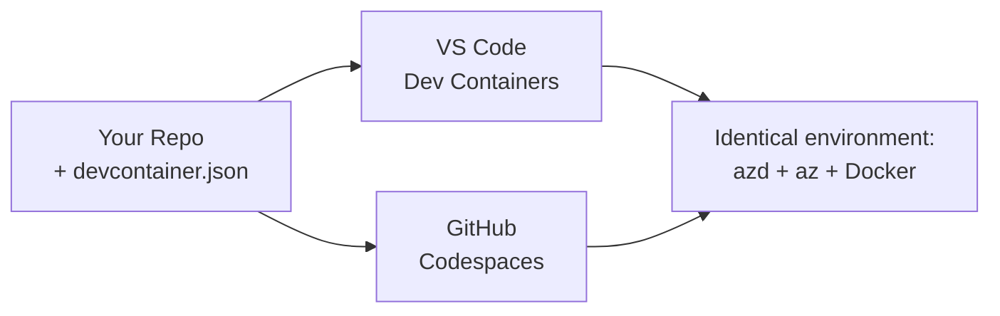

# Dev kontejneri i GitHub Codespaces za azd

**Navigacija po poglavljima:**
- **📚 Početna stranica tečaja**: [AZD za početnike](../../README.md)
- **📖 Trenutno poglavlje**: Poglavlje 1 - Osnove i brzi početak
- **⬅️ Prethodno**: [Donesite vlastitu aplikaciju](bring-your-own-app.md)
- **🚀 Sljedeće poglavlje**: [Poglavlje 2: AI-prvi razvoj](../chapter-02-ai-development/README.md)

> Cilj pregleda naredbi i konfiguracije: `azd 1.37.2` (studeni 2026.). Izgradnje kontejnera i Azure implementacije nisu izvršene kao dio ovog pregleda.

## Uvod

Instaliranje azd, odgovarajućeg runtime okruženja za jezik, Dockera i Azure CLI-ja na svakom računalu mukotrpan je posao — i glavni razlog zašto vodič koji "radi na mom računalu" ne uspijeva na nekom drugom. **Dev kontejner** rješava ovaj problem opisivanjem cijelog lanca alata u datoteci. Bilo tko tko otvori projekt u VS Codeu ili GitHub Codespacesu dobiva potpuno isto okruženje, s već instaliranim azd-om. Ova lekcija pokazuje kako dodati jedan.

## Ciljevi učenja

Do kraja ove lekcije, naučit ćete:
- Razumjeti što je dev kontejner i zašto pomaže s azd-om
- Dodati minimalni `.devcontainer/devcontainer.json` u projekt
- Uključiti azd, Azure CLI i Docker putem značajki Dev Container-a
- Otvoriti projekt u GitHub Codespacesu ili VS Codeu

## Ishodi učenja

Nakon završetka ove lekcije, moći ćete:
- Napisati `devcontainer.json` za azd projekt
- Dodati azd i Azure alate bez ručnih instalacija
- Pokrenuti `azd up` iz unutar kontejnera ili Codespace-a

---

## Što je dev kontejner?

Dev kontejner je razvojno okruženje temeljeno na Dockeru definirano `.devcontainer/devcontainer.json` datotekom u vašem repozitoriju. Kad otvorite projekt:

- **VS Code** (s Dev Containers ekstenzijom) gradi kontejner i povezuje se s njim.
- **GitHub Codespaces** gradi isti kontejner u oblaku i daje vam uređivač baziran na pregledniku.

U svakom slučaju, svaki suradnik dobiva identične alate — nema više problema tipa "jeste li instalirali azd?".



---

## Korak 1: Kreirajte devcontainer datoteku

Kreirajte `.devcontainer/devcontainer.json` u korijenu vašeg projekta:

```json
{
  "name": "azd-project",
  "image": "mcr.microsoft.com/devcontainers/base:bookworm",
  "features": {
    "ghcr.io/devcontainers/features/azure-cli:1": {},
    "ghcr.io/azure/azure-dev/azd:0": { "version": "1.37.2" },
    "ghcr.io/devcontainers/features/docker-in-docker:2": {},
    "ghcr.io/devcontainers/features/node:1": {}
  },
  "customizations": {
    "vscode": {
      "extensions": [
        "ms-azuretools.azure-dev",
        "ms-azuretools.vscode-bicep"
      ]
    }
  },
  "forwardPorts": [3000],
  "postCreateCommand": "azd version"
}
```

Što svaki dio radi:

| Ključ | Namjena |
|-----|---------|
| `image` | Osnovni operativni sustav kontejnera |
| `features` | Predinstalirani instalateri — ovdje: Azure CLI, **azd**, Docker i Node.js |
| `customizations.vscode.extensions` | Automatski instalira azd i Bicep VS Code ekstenzije |
| `forwardPorts` | Izlaže port vaše aplikacije prema pregledniku |
| `postCreateCommand` | Pokreće se jednom nakon što je kontejner izgrađen (ovdje, provjera ispravnosti) |

> Verzija značajke (`azd:0`) i instalirana verzija CLI-ja su različite. Postavite opciju `version` značajke na `"1.37.2"` da biste fiksirali CLI; nemojte koristiti verziju CLI-ja kao oznaku značajke.

---

## Korak 2: Uskladite značajku s jezikom vaše aplikacije

Zamijenite značajku `node` s onom koju vaša aplikacija koristi:

```jsonc
// Python project
"ghcr.io/devcontainers/features/python:1": {},

// .NET project
"ghcr.io/devcontainers/features/dotnet:2": {},

// Java project
"ghcr.io/devcontainers/features/java:1": {},

// Go project
"ghcr.io/devcontainers/features/go:1": {}
```

Zadržite `docker-in-docker` pri lokalnom građenju slika. Konfigurirana udaljena ACR izgradnja (`docker.remoteBuild: true`) je alternativa; sam tip domaćina ne zahtijeva uvijek lokalni Docker.

---

## Korak 3: Otvorite ga

**U VS Codeu:**
1. Instalirajte **Dev Containers** ekstenziju.
2. Otvorite mapu projekta.
3. Kliknite **Reopen in Container** kad se pojavi upitnik (ili pokrenite *Dev Containers: Reopen in Container*).

**U GitHub Codespacesu:**
1. Gurnite repozitorij na GitHub.
2. Kliknite **Code → Codespaces → Create codespace on main**.
3. Pričekajte da se kontejner izgradi — azd je spreman u terminalu.

---

## Korak 4: Implementirajte iz unutar kontejnera

Kontejner ima preinstalirani azd, tako da normalni tijek rada jednostavno funkcionira:

```bash
azd auth login --use-device-code   # device code is handy inside Codespaces
azd up
```

> **Zašto `--use-device-code`?** U udaljenom kontejneru ili Codespace-u nema lokalnog preglednika za preusmjeravanje, pa je prijava putem uređaja s kodom pouzdan put. Zalijepit ćete kod u karticu preglednika da dovršite prijavu.

---

## Uobičajene poteškoće

| Poteškoća | Rješenje |
|---------|-----|
| `azd up` ne može izgraditi sliku | Dodajte značajku `docker-in-docker` |
| Prijava u preglednik zapinje u Codespaces | Koristite `azd auth login --use-device-code` |
| Alati se razlikuju među članovima tima | Fiksirajte CLI kroz opciju `version` značajke azd i fiksirajte runtime jezika |
| Aplikacija nije dostupna u pregledniku | Dodajte port u `forwardPorts` |

---

## Sažetak

- Dev kontejner čini vaš azd alatni lanac reproducibilnim za sve.
- Dodajte azd, Azure CLI i Docker kroz Dev Container *značajke*.
- Uskladite značajku jezika s vašom aplikacijom i zadržite `docker-in-docker` za domaćine kontejnera.
- Koristite prijavu putem uređaja s kodom kad radite unutar Codespaces-a.

---

## 🔗 Navigacija

| Smjer | Resurs |
|-----------|----------|
| **Prethodno** | [Donesite vlastitu aplikaciju](bring-your-own-app.md) |
| **Početak poglavlja** | [Poglavlje 1: Osnove i brzi početak](README.md) |
| **Sljedeće poglavlje** | [Poglavlje 2: AI-prvi razvoj](../chapter-02-ai-development/README.md) |

## 📖 Povezani resursi

- [Instalacija i postavljanje](installation.md)
- [Kratka referenca naredbi](../../resources/cheat-sheet.md)
- [Službena specifikacija Dev Containers](https://containers.dev/)
- [azd Dev Container značajka](https://github.com/Azure/azure-dev/tree/main/ext/devcontainer)

---

<!-- CO-OP TRANSLATOR DISCLAIMER START -->
**Napomena**:
Ovaj dokument je preveden korištenjem AI prevoditeljskog servisa [Co-op Translator](https://github.com/Azure/co-op-translator). Iako težimo točnosti, imajte na umu da automatski prijevodi mogu sadržavati greške ili netočnosti. Izvorni dokument na izvornom jeziku treba smatrati autoritativnim izvorom. Za važne informacije preporuča se profesionalni ljudski prijevod. Nismo odgovorni za bilo kakva nesporazumevanja ili pogrešne interpretacije koje proizlaze iz korištenja ovog prijevoda.
<!-- CO-OP TRANSLATOR DISCLAIMER END -->