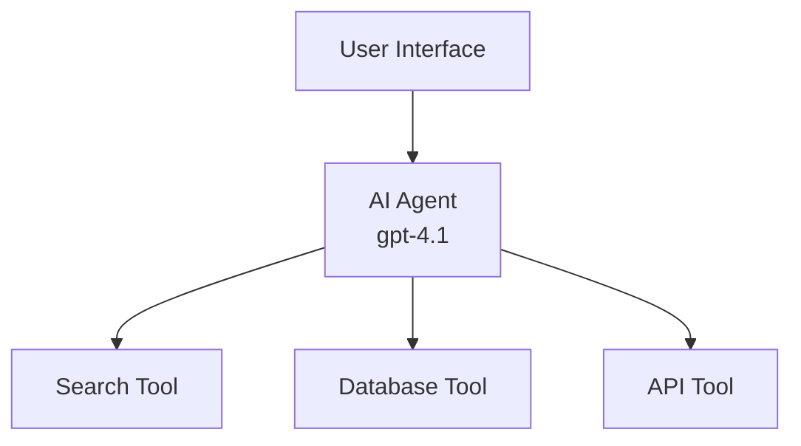
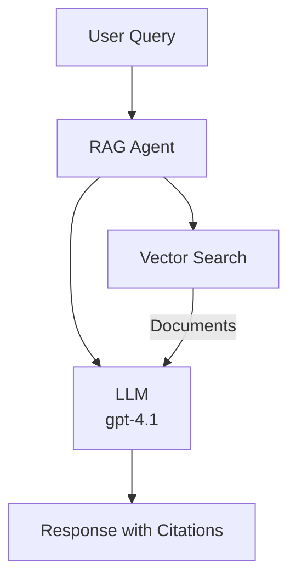
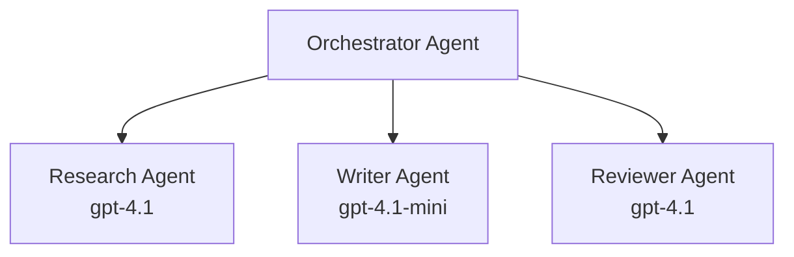

# AI agenti s Azure Developer CLI

**Navigacija poglavljem:**
- **📚 Početna stranica tečaja**: [AZD za početnike](../../README.md)
- **📖 Trenutno poglavlje**: Poglavlje 2 - AI-prvo razvijanje
- **⬅️ Prethodno**: [Microsoft Foundry integracija](microsoft-foundry-integration.md)
- **➡️ Sljedeće**: [Implementacija AI modela](ai-model-deployment.md)
- **🚀 Napredno**: [Rješenja s više agenata](../../examples/retail-scenario.md)

---

## Uvod

AI agenti su autonomni programi koji mogu percipirati svoje okruženje, donositi odluke i poduzimati radnje radi ostvarivanja određenih ciljeva. Za razliku od jednostavnih chatbotova koji odgovaraju na upite, agenti mogu:

- **Koristiti alate** - Pozivati API-je, pretraživati baze podataka, izvoditi kod
- **Planirati i razmišljati** - Razložiti složene zadatke na korake
- **Učiti iz konteksta** - Održavati memoriju i prilagođavati ponašanje
- **Surađivati** - Raditi s drugim agentima (sistemi s više agenata)

Ovaj vodič pokazuje kako implementirati AI agente u Azure koristeći Azure Developer CLI (azd).

Korištenje konteksta razgovora nije treniranje modela: trajnu memoriju, kontrolu pristupa i zadržavanje mora implementirati/konfigurirati aplikacija.

> **Pregled izdanja (2026-11-04):** CLI primjeri su provjereni u odnosu na dokumentaciju/izvor `azd` `1.37.2`, `azure.ai.agents` `1.0.0-beta.23` i `azure.ai.evaluations` `1.0.0-beta.2`, a ne na živoj Azure implementaciji. Za kombinirani tijek rada koristite `azd >= 1.37.0`. Pogledajte [nedavne promjene i ispravke](../chapter-08-production/production-ai-practices.md#recent-release-changes-and-fixes) prije nadogradnje starijih projekata.

## Ciljevi učenja

Završetkom ovog vodiča:
- Razumjet ćete što su AI agenti i kako se razlikuju od chatbotova
- Implementirati unaprijed izrađene AI agent predloške koristeći AZD
- Konfigurirati Foundry agente za prilagođene agente
- Implementirati osnovne obrasce agenata (upotreba alata, RAG, više-agentski sustavi)
- Nadzirati i otklanjati pogreške kod implementiranih agenata

## Ishodi učenja

Nakon završetka moći ćete:
- Implementirati AI agent aplikacije u Azure jednom naredbom
- Konfigurirati alate i mogućnosti agenata
- Implementirati generiranje s nadopunjavanjem pretraživanjem (RAG) s agentima
- Dizajnirati arhitekture s više agenata za složene tijekove rada
- Otkloniti uobičajene probleme implementacije agenata

---

## 🤖 Čime se agent razlikuje od chatbota?

| Značajka | Chatbot | AI Agent |
|---------|---------|----------|
| **Ponašanje** | Odgovara na upite | Poduzima autonomne radnje |
| **Alati** | Može koristiti pretraživanje ili alate | Tipično koristi alate u petlji usmjerenoj na cilj |
| **Memorija** | Ovisi o aplikaciji | Trajna memorija samo ako je eksplicitno implementirana |
| **Planiranje** | Jedan odgovor | Višekoračno razmišljanje |
| **Suradnja** | Jedinstvena jedinica | Može raditi s drugim agentima |

### Jednostavna analogija

- **Chatbot** = Pomoćna osoba koja odgovara na pitanja na informativnom pultu
- **AI Agent** = Osobni asistent koji može obavljati pozive, zakazivati termine i izvršavati zadatke za vas

---

## 🚀 Brzi početak: Implementirajte svog prvog agenta

Odaberite jednu opciju u **novom praznom radnom direktoriju**. Završni `.` se inicijalizira tamo; bez eksplicitne destinacije, trenutni AZD može stvoriti poddirektorij s imenom predloška i neće promijeniti direktorij vaše ljuske. Držite odvojene predloške/okruženja u zasebnim direktorijima.

Vrijeme/troškovi su ilustrativni, nisu potvrđene ponude. Provjerite trenutačne preduvjete, cijene, kvote modela i dodatne usluge svakog primjera prije implementacije.

### Opcija 1: Foundry Agents predložak (Preporučeno)

```bash
# Initialize the AI agents template
azd init --template get-started-with-ai-agents .

# Deploy to Azure
azd up
```

**Što se implementira:** Trenutna infrastruktura primjera i odabrane opcije određuju model, alate, hosting i resurse za nadzor. Pregledajte README i `infra/` prije provisioniranja; ne pretpostavljajte da svaki predložak agenta uključuje Search ili web sučelje.

**Vrijeme:** ~15-20 minuta
**Trošak:** ~$100-150/mjesečno (razvoj)

### Opcija 2: Kreativni pisani agenti s Promptyjem

```bash
# Initialize the Prompty-based agent template
azd init --template https://github.com/Azure-Samples/contoso-creative-writer .

# Deploy to Azure
azd up
```

**Što se implementira:** Primjer više agenata za pisanje s FastAPI/Prompty koristeći Azure OpenAI, Bing Grounding i Azure AI Search. Stari `agent-openai-python-prompty` repozitorij preusmjerava ovdje; nije minimalni predložak vremenskog agenta za Azure Functions. Slijedite njegov trenutni README za hosting, kvotu modela i preduvjete za Bing Grounding.

**Vrijeme:** ~10-15 minuta
**Trošak:** ~$50-100/mjesečno (razvoj)

### Opcija 3: RAG chat agent

```bash
# Initialize RAG chat template
azd init --template azure-search-openai-demo .

# Deploy to Azure
azd up
```

**Što se implementira:**
- ✅ Microsoft Foundry modeli
- ✅ Azure AI Search s primjerom podataka
- ✅ Procesni tijek za dokumente
- ✅ Chat sučelje s citatima

**Vrijeme:** ~15-25 minuta
**Trošak:** ~$80-150/mjesečno (razvoj)

### Opcija 4: AZD AI Agent Init (Pregled predloška projekta)

Koristite `azd ai agent init` interaktivno, ili usvojite trenutni `azure.yaml` agent projekt s `--template`/`-t`. Stara opcija `--manifest`/`-m` je zastarjeli alias, nije konverter za naslijeđene manifeste.

```bash
# Install the AI agents extension
azd extension install azure.ai.agents

# Optional: verify the installed preview version
azd extension show azure.ai.agents

# Initialize from a current agent project template (supply your template path)
azd ai agent init --template ./templates/support-agent/azure.yaml

# Deploy to Azure
azd up

# Test the deployed agent (shows latency + time-to-first-byte)
azd ai agent invoke
```

**Kad koristiti `azd ai agent init` naspram `azd init --template`:**

| Pristup | Najbolje za | Kako radi |
|----------|----------|------|
| `azd init --template` | Početak s radnim uzorkom aplikacije | Klonira cijeli predložak repozitorija s kodom + infrastrukturom |
| `azd ai agent init --template` | Usvajanje trenutnog Foundry agent projekta | Koristi `azure.yaml` projektni dokument i njegove definicije |

> **Savjet:** Koristite `azd init --template` za učenje (Opcije 1-3 gore). Koristite `azd ai agent init` za Foundry agentski tijek rada. Za dodavanje izravne definicije agenta postojećem projektu pogledajte [upute za inicijalizaciju i migraciju](../chapter-08-production/production-ai-practices.md#initializing-agent-projects-with-azd-ai-agent-init).

Nakon `azd up` koristite `azd ai agent invoke` za testiranje, zasebni `azure.ai.evaluations` dodatak (`azd ai eval init`, `generate` i `run start`) za mjerenje kvalitete i `azd ai agent optimize` za poboljšanja koristeći novu konfiguraciju evaluacije. Agents beta.22 zamijenio je stari evaluacijski tijek rada i promijenio je format optimizacije `--config`. Pogledajte [migraciju evaluacije](../chapter-08-production/production-ai-practices.md#evaluation-migration-and-quality-checks) i [migraciju optimizacije](../chapter-08-production/production-ai-practices.md#optimization-configuration-migration) prije ponovne uporabe starijih primjera.

---

## 🏗️ Obrasci arhitekture agenata

### Obrazac 1: Jedan agent s alatima

Najjednostavniji obrazac agenta - jedan agent koji može koristiti više alata.



**Najbolje za:**
- Botove za korisničku podršku
- Istraživačke asistente
- Agente za analizu podataka

**Povezani aplikacijski primjer:** `azure-search-openai-demo` prikazuje RAG, ne generički agent s proizvoljnim alatima.

### Obrazac 2: RAG agent (generiranje s nadopunjavanjem pretraživanjem)

Agent koji dohvaća relevantne dokumente prije generiranja odgovora.



**Najbolje za:**
- Poslovne baze znanja
- Sustave pitanja i odgovora na dokumente
- Usklađenost i pravna istraživanja

**AZD predložak:** `azure-search-openai-demo`

### Obrazac 3: Sustav s više agenata

Više specijaliziranih agenata koji zajednički rade na složenim zadacima.



**Najbolje za:**
- Složenu generaciju sadržaja
- Višekoračne tijekove rada
- Zadatke koji zahtijevaju različita stručna znanja

**Saznajte više:** [Obrasci koordinacije više agenata](../chapter-06-pre-deployment/coordination-patterns.md)

---

## ⚙️ Konfiguriranje alata za agente

Agenti postaju moćni kada mogu koristiti alate. Evo kako konfigurirati uobičajene alate:

### Konfiguracija alata u Foundry agentima

Ovaj **klasični isječak Agent Service SDK-a** cilja `azure-ai-projects==1.0.0` i `azure-ai-agents==1.1.0` s `azure-identity`. Nije to noviji versionirani agent/Responses API koji koriste neki trenutačni Foundry predlošci, niti `azure.ai.agents` AZD ekstenzija (drugi paket). Nemojte miješati ove generacije API-ja. Postavite `PROJECT_ENDPOINT` na klasični Foundry projektni endpoint i `MODEL_DEPLOYMENT_NAME` na postojeću podržanu implementaciju modela; autentificirajte se s `az login` lokalno i dajte potrebne dozvole za projekt.

```python
# agent_config.py
import os
from azure.ai.projects import AIProjectClient
from azure.ai.agents.models import FunctionTool
from azure.identity import DefaultAzureCredential

def search_knowledge_base(query: str) -> str:
    """Search the demonstration knowledge base.

    :param query: Search text.
    :return: Matching demonstration information.
    """
    # Local fixture only, not a production search implementation.
    return "Demo policy: returns are accepted within 30 days."

project_client = AIProjectClient(
    endpoint=os.environ["PROJECT_ENDPOINT"],
    credential=DefaultAzureCredential(),
)
search_tool = FunctionTool(functions={search_knowledge_base})
project_client.agents.enable_auto_function_calls(search_tool)
agent = project_client.agents.create_agent(
    model=os.environ["MODEL_DEPLOYMENT_NAME"],
    name="Support Agent",
    instructions="Use search_knowledge_base for policy questions. Label results as demo data.",
    tools=search_tool.definitions,
)
```

Registracija sheme funkcije ne izvršava Python na servisu. U ovom SDK-u, `enable_auto_function_calls` plus `agents.runs.create_and_process(...)` pokreću registrirane povratne pozive u procesu klijenta. Pogledajte [primjer objavljen u SDK-u](https://github.com/Azure/azure-sdk-for-python/blob/azure-ai-agents_1.1.0/sdk/ai/azure-ai-agents/samples/agents_tools/sample_agents_auto_function_call.py). Zatvorite klijenta i izbrišite demonstracijske agente/niti kad završite.

### Konfiguracija okruženja

Sljedeća imena su **ilustrativni ulazi prilagođenih predložaka**, nisu ugrađeni AZD prekidači. Najprije svaki unos prenesite kroz `infra/main.parameters.json`, infrastrukturu i kod aplikacije. `azd env set` sam ne mijenja alate ili upute agenta.

```bash
# Set up agent-specific environment variables
azd env set AZURE_OPENAI_MODEL "gpt-4.1"
azd env set AGENT_INSTRUCTIONS "You are a helpful assistant..."
azd env set ENABLE_CODE_INTERPRETER "true"
azd env set ENABLE_FILE_SEARCH "true"

# Apply wired infrastructure and application changes
azd up
```

---

## 📊 Nadgledanje agenata

### Integracija s Application Insights

Ako vaš odabrani predložak provisionira Application Insights i konfigurira instrumentaciju:

```bash
# Open monitoring dashboard
azd monitor --overview

# Open the Application Insights logs view (not a streaming log tail)
azd monitor --logs

# View live metrics
azd monitor --live
```

### Ključne metrike za praćenje

| Metrika | Opis | Cilj |
|--------|-------------|--------|
| Kašnjenje odgovora | Vrijeme za generiranje odgovora | < 5 sekundi |
| Upotreba tokena | Tokeni po upitu | Pratiti zbog troškova |
| Uspješnost poziva alata | % uspješnih izvršenja alata | > 95% |
| Stopa pogrešaka | Neuspjeli agent zahtjevi | < 1% |
| Zadovoljstvo korisnika | Rezultati povratnih informacija | > 4.0/5.0 |

### Prilagođeni zapis za agente

```python
import os
from azure.monitor.opentelemetry import configure_azure_monitor
from opentelemetry import trace

# Configure Azure Monitor with OpenTelemetry
configure_azure_monitor(
    connection_string=os.environ["APPLICATIONINSIGHTS_CONNECTION_STRING"]
)

tracer = trace.get_tracer(__name__)

def log_agent_interaction(user_query, agent_response, tools_used, latency_ms):
    with tracer.start_as_current_span("agent_interaction") as span:
        span.set_attributes({
            "query_length": len(user_query),  # Do not log raw prompts or personal data
            "response_length": len(agent_response),
            "tools_used": tools_used,
            "latency_ms": latency_ms
        })
```

> **Napomena:** Instalirajte potrebni paket: `pip install azure-monitor-opentelemetry`. On donosi OpenTelemetry ovisnosti; import namespace nije zahtjev za instalaciju paketa naziva `opentelemetry`.

---

## 💰 Troškovni čimbenici

### Procijenjeni mjesečni troškovi po obrascu

Ovo su ilustrativni rasponi za planiranje, nisu ponude ni ograničenja potrošnje. Regija, tokeni modela, Search/compute SKU-ovi, sesije alata, pohrana i promet mogu ih nadmašiti. Prije `azd up` provjerite upute o troškovima uzorka i cijene u Azureu.

| Obrazac | Razvojno okruženje | Proizvodnja |
|---------|-----------------|------------|
| Jedan agent | $50-100 | $200-500 |
| RAG agent | $80-150 | $300-800 |
| Više agenata (2-3 agenta) | $150-300 | $500-1,500 |
| Enterprise više agenata | $300-500 | $1,500-5,000+ |

### Savjeti za optimizaciju troškova

1. **Koristite gpt-4.1-mini za jednostavne zadatke** (samo ako vaš predložak koristi ovaj ulaz)
   ```bash
   azd env set AZURE_OPENAI_MODEL "gpt-4.1-mini"
   ```

2. **Implementirajte scoped keširanje za sigurne, ponovljene upite.** Uključite autorizaciju zakupnika/korisnika, implementaciju modela, upute i verziju dohvaćanja u ključ keša; postavite istek. Ne dijelite privatne odgovore razgovora kroz keš samo za čitanje širom procesa. SDK objekti agenata nemaju generičku `agent.run()` metodu.

3. **Postavite ograničenja tokena po izvršenju**
   ```python
   # Set max_completion_tokens when running the agent, not during creation
   run = project_client.agents.runs.create_and_process(
       thread_id=thread.id,
       agent_id=agent.id,
       max_completion_tokens=1000  # Budget across the run; may finish as incomplete
   )
   ```

4. **Skladirane kontejnerske aplikacije skalirajte na nulu kad se ne koriste**
   ```bash
   # Custom-template input: must map to template.scale.minReplicas
   azd env set MIN_REPLICAS "0"
   ```
   Promjenu infrastrukture provedite s `azd provision` ili `azd up`. Skaliranje na nulu treba prikladan okidač i ne zaustavlja Search, pohranu ni troškove modela/alata.

---

## 🔧 Rješavanje problema s agentima

### Uobičajeni problemi i rješenja

<details>
<summary><strong>❌ Agent ne odgovara na pozive alata</strong></summary>

```bash
# Inspect the application deployment (not the agent's registered tools)
azd show

# Verify OpenAI deployment
az cognitiveservices account deployment list \
  --name $AZURE_OPENAI_NAME \
  --resource-group $RG_NAME

# Check agent logs
azd monitor --logs
```

**Uobičajeni uzroci:**
- Nepodudaranje potpisa funkcije alata
- Nedostaju potrebne dozvole
- API endpoint nije dostupan
</details>

<details>
<summary><strong>❌ Visoko kašnjenje u odgovorima agenta</strong></summary>

```bash
# Check Application Insights for bottlenecks
azd monitor --live

# Consider using a faster model
azd env set AZURE_OPENAI_MODEL "gpt-4.1-mini"
azd up
```

**Savjeti za optimizaciju:**
- Koristite streaming odgovore
- Implementirajte keširanje odgovora
- Smanjite veličinu kontekstnog prozora
</details>

<details>
<summary><strong>❌ Agent vraća netočne ili halucinirane informacije</strong></summary>

```python
# Improve with better system prompts
instructions = """
You are a helpful assistant. IMPORTANT:
- Only answer based on provided context
- If you don't know, say "I don't know"
- Always cite your sources
- Never make up information
"""

# Use these instructions in the agent definition.
# For classic file search, first upload/index documents in a vector store,
# then use FileSearchTool(vector_store_ids=[...]) and pass both its
# .definitions and .resources when creating the agent.
```
Upute i dohvaćanje smanjuju rizik; nijedno ne jamči činjenične odgovore. Procijenite osnovana i izvan dosega pitanja prema poznatim odgovorima.
</details>

<details>
<summary><strong>❌ Pogreške prekoračenja ograničenja tokena</strong></summary>

```python
# Implement context window management
def truncate_context(messages, max_tokens=8000, model="gpt-4.1"):
    """Approximate content-only budget for objects with .content strings."""
    import tiktoken
    encoding = tiktoken.encoding_for_model(model)
    total_tokens = 0
    truncated = []
    
    for msg in reversed(messages):
        msg_tokens = len(encoding.encode(msg.content))
        if total_tokens + msg_tokens > max_tokens:
            break
        truncated.insert(0, msg)
        total_tokens += msg_tokens
    
    return truncated
```
Ovaj pomoćnik isključuje sheme uloga/alata, sistemske upute, tokene slika i protokolarni overhead. Rezervirajte prostor za njih i dovršetak; nemojte dijeliti parove poziva alata/rezultata niti odbacivati potrebne sistemske upute. Instalirajte `tiktoken` zasebno. Nije opći validator kontekstnog prozora.
</details>

---

## 🎓 Praktične vježbe

### Vježba 1: Implementirajte osnovnog agenta (20 minuta)

**Cilj:** Implementirati svog prvog AI agenta koristeći AZD

```bash
# Step 1: Initialize template
azd init --template get-started-with-ai-agents .

# Step 2: Login to Azure
azd auth login
# If you work across tenants, add --tenant-id <tenant-id>

# Step 3: Deploy
azd up

# Step 4: Test the agent
# Expected output after deployment:
#   Deployment Complete!
#   Endpoint: https://<app-name>.<region>.azurecontainerapps.io
# Open the URL shown in the output and try asking a question

# Step 5: View monitoring
azd monitor --overview

# Step 6: Clean up
azd down --force --purge
```

**Kriteriji uspjeha:**
- [ ] Agent odgovara na pitanja
- [ ] Može pristupiti nadzornoj ploči putem `azd monitor`
- [ ] Resursi uspješno očišćeni

### Vježba 2: Dodajte prilagođeni alat (30 minuta)

**Cilj:** Proširiti agenta prilagođenim alatom

**Polazna točka:** Koristite klasični SDK klijent iz [Konfiguracije alata](#tool-configuration-in-foundry-agents), ne proizvoljni predložak s drugom generacijom SDK-a.

1. Dodajte ovu determinističku privjesku u `agent_config.py`:
   ```python
   def get_weather(location: str) -> str:
       """Return demonstration weather, not live conditions.

       :param location: City name.
       :return: A clearly labelled fixture.
       """
       print(f"TOOL_CALLED: {location}")
       return f"Demo weather in {location}: Sunny, 72°F (fixture, not live)"
   ```
2. Zamijenite blok registracije i kreiranja alata za pretraživanje s:
   ```python
   weather_tool = FunctionTool(functions={get_weather})
   project_client.agents.enable_auto_function_calls(weather_tool)
   agent = project_client.agents.create_agent(
       model=os.environ["MODEL_DEPLOYMENT_NAME"],
       name="Weather Agent",
       instructions="Call get_weather for weather questions; explain that it returns demo data.",
       tools=weather_tool.definitions,
   )
   thread = project_client.agents.threads.create()
   try:
       project_client.agents.messages.create(
           thread_id=thread.id, role="user", content="Use get_weather for Seattle."
       )
       run = project_client.agents.runs.create_and_process(
           thread_id=thread.id, agent_id=agent.id
       )
       if run.status != "completed":
           raise RuntimeError(f"Run status: {run.status}; error: {run.last_error}")
       for message in project_client.agents.messages.list(thread_id=thread.id):
           for text in message.text_messages:
               print(text.text.value)
   finally:
       project_client.agents.threads.delete(thread.id)
       project_client.agents.delete_agent(agent.id)
       project_client.close()
   ```
3. Pokrenite lokalno (ovo poziva postojeći Azure projekt i uzrokuje troškove modela):
   ```bash
   python agent_config.py
   # Expected: TOOL_CALLED: Seattle, then a completed answer labelled demo data.
   ```

**Kriteriji uspjeha:**
- [ ] Agent prepoznaje upite povezane s vremenom
- [ ] Alat se poziva ispravno
- [ ] Odgovor uključuje informacije o vremenu

### Vježba 3: Izradite RAG agenta (45 minuta)

**Cilj:** Izraditi agenta koji odgovara na pitanja iz vaših dokumenata

```bash
# Step 1: Deploy RAG template
azd init --template azure-search-openai-demo .
azd up

# Step 2: Upload your documents
# For the sample's local ingestion path, place supported files in data/.
# Run from the sample root after following its Python environment setup:
./scripts/prepdocs.sh
# Windows PowerShell equivalent: .\\scripts\\prepdocs.ps1

# Step 3: Test with domain-specific questions
# Open the web app URL from the azd up output
# Ask questions about your uploaded documents
# Responses should include citation references like [doc.pdf]
```

**Kriteriji uspjeha:**
- [ ] Agent odgovara na temelju učitanih dokumenata
- [ ] Odgovori uključuju citate
- [ ] Test pitanja izvan opsega se obrađuju bez nepodržanih tvrdnji (nije jamstvo za svako buduće pitanje)

Ako je `USE_CLOUD_INGESTION=true`, umjesto toga upotrijebite uzorak rada za unos/učitavanje u oblaku; lokalna omotnica namjerno preskače unos. Nakon testiranja, pokrenite `azd down` u RAG okruženju i pregledajte resurse koji će biti izbrisani.

---

## 📚 Sljedeći koraci

Sad kad razumijete AI agente, istražite ove napredne teme:

| Tema | Opis | Poveznica |
|-------|-------------|------|
| **Višeagentni sustavi** | Izgradite sustave s više surađujućih agenata | [Primjer višeagentnog maloprodajnog sustava](../../examples/retail-scenario.md) |
| **Koordinacijski obrasci** | Učite obrasce orkestracije i komunikacije | [Koordinacijski obrasci](../chapter-06-pre-deployment/coordination-patterns.md) |
| **Produkcijsko postavljanje** | Postavljanje agenta spremnog za proizvodnju | [Produkcijske AI prakse](../chapter-08-production/production-ai-practices.md) |
| **Evaluacija agenata** | Testirajte i procijenite performanse agenta | [Rješavanje problema AI](../chapter-07-troubleshooting/ai-troubleshooting.md) |
| **AI radionica** | Praktično: Pripremite svoje AI rješenje za AZD | [AI radionica](ai-workshop-lab.md) |

---

## 📖 Dodatni resursi

### Službena dokumentacija
- [Microsoft Foundry Agent Service](https://learn.microsoft.com/azure/ai-services/agents/)
- [Microsoft Foundry Agent Service Quickstart](https://learn.microsoft.com/azure/ai-services/agents/quickstart)
- [Semantic Kernel Agent Framework](https://learn.microsoft.com/semantic-kernel/)

### AZD predlošci za agente
- [Počnite s AI agentima](https://github.com/Azure-Samples/get-started-with-ai-agents)
- [Agent za kreativno pisanje s Promptyjem](https://github.com/Azure-Samples/contoso-creative-writer)
- [Azure Search OpenAI Demo](https://github.com/Azure-Samples/azure-search-openai-demo)

### Zajednički resursi
- [Awesome AZD - predlošci agenata](https://azure.github.io/awesome-azd/?tags=ai-agents)
- [Azure AI Discord](https://discord.gg/microsoft-azure)
- [Microsoft Foundry Discord](https://discord.gg/nTYy5BXMWG)

### Vještine agenata za vaš uređivač
- [**Vještine Microsoft Azure agenata**](https://skills.sh/microsoft/github-copilot-for-azure) - Instalirajte višekratno upotrebljive AI vještine za razvoj Azure agenata u GitHub Copilot, Cursor ili bilo kojem podržanom agentu. Uključuje vještine za [Azure AI](https://skills.sh/microsoft/github-copilot-for-azure/azure-ai), [Microsoft Foundry](https://skills.sh/microsoft/github-copilot-for-azure/microsoft-foundry), [postavljanje](https://skills.sh/microsoft/github-copilot-for-azure/azure-deploy) i [dijagnostiku](https://skills.sh/microsoft/github-copilot-for-azure/azure-diagnostics):
  ```bash
  npx skills add microsoft/github-copilot-for-azure
  ```

---

**Navigacija**
- **Prethodna lekcija**: [Microsoft Foundry integracija](microsoft-foundry-integration.md)
- **Sljedeća lekcija**: [Postavljanje AI modela](ai-model-deployment.md)

---

<!-- CO-OP TRANSLATOR DISCLAIMER START -->
**Napomena**:
Ovaj dokument je preveden korištenjem AI prevoditeljskog servisa [Co-op Translator](https://github.com/Azure/co-op-translator). Iako težimo točnosti, imajte na umu da automatski prijevodi mogu sadržavati greške ili netočnosti. Izvorni dokument na izvornom jeziku treba smatrati autoritativnim izvorom. Za važne informacije preporuča se profesionalni ljudski prijevod. Nismo odgovorni za bilo kakva nesporazumevanja ili pogrešne interpretacije koje proizlaze iz korištenja ovog prijevoda.
<!-- CO-OP TRANSLATOR DISCLAIMER END -->