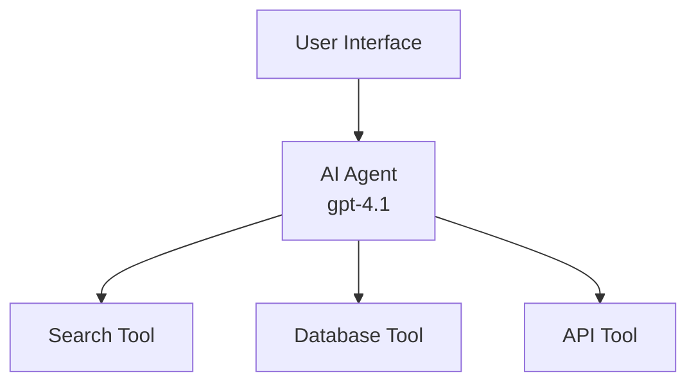
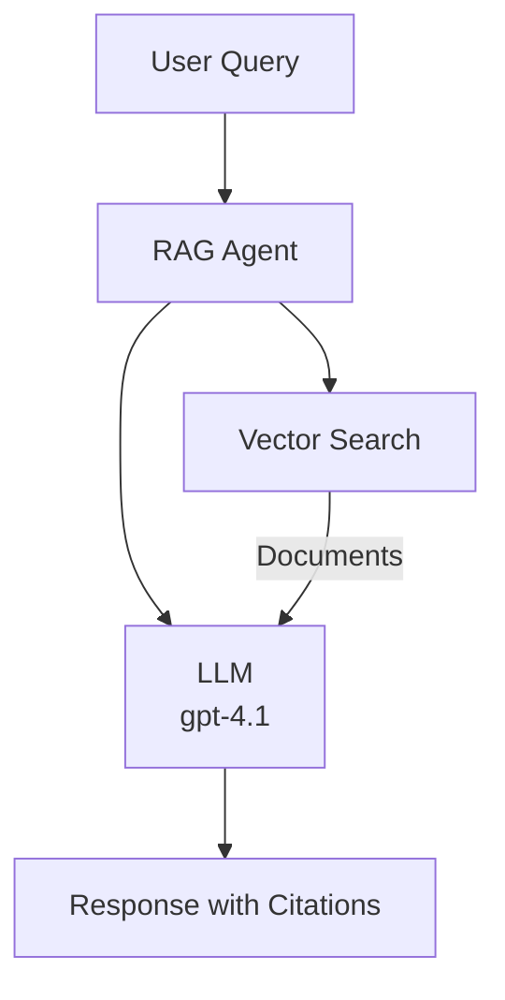
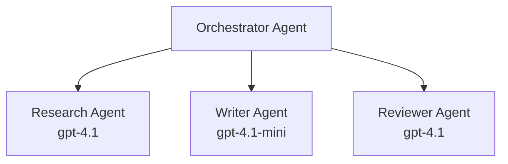

# AI Agenti s Azure Developer CLI

**Navigacija poglavljem:**
- **📚 Početna stranica tečaja**: [AZD za početnike](../../README.md)
- **📖 Trenutno poglavlje**: Poglavlje 2 - AI-Usmjereni razvoj
- **⬅️ Prethodno**: [Microsoft Foundry integracija](microsoft-foundry-integration.md)
- **➡️ Sljedeće**: [Implementacija AI modela](ai-model-deployment.md)
- **🚀 Napredno**: [Rješenja s više agenata](../../examples/retail-scenario.md)

---

## Uvod

AI agenti su autonomni programi koji mogu percipirati svoju okolinu, donositi odluke i poduzimati akcije za postizanje specifičnih ciljeva. Za razliku od jednostavnih chatbotova koji odgovaraju na upite, agenti mogu:

- **Koristiti alate** - Pozivati API-jeve, pretraživati baze podataka, izvršavati kod
- **Planirati i zaključivati** - Razbiti složene zadatke na korake
- **Učiti iz konteksta** - Održavati memoriju i prilagođavati ponašanje
- **Surađivati** - Raditi s drugim agentima (sustavi s više agenata)

Ovaj vodič pokazuje kako implementirati AI agente u Azure koristeći Azure Developer CLI (azd).

Korištenje konteksta razgovora nije trening modela: trajna memorija, kontrola pristupa i zadržavanje moraju biti implementirani/konfigurirani od strane aplikacije.

> **Foundry GA ažuriranje (2026-11-09):** Instalirajte općenito dostupni `microsoft.foundry` 1.0 paket s `azd >= 1.37.0`. Evaluacije se instaliraju zasebno; opcionalne pregledne značajke i klasični SDK fragment ispod nisu promovirani u GA objavom paketa. Ovo uputstvo temelji se na [GA najavi](https://devblogs.microsoft.com/azure-sdk/microsoft-foundry-azure-developer-cli-ga/) i dokumentaciji, ne na aktivnoj Azure implementaciji.

## Ciljevi učenja

Završetkom ovog vodiča ćete:
- Razumjeti što su AI agenti i kako se razlikuju od chatbotova
- Implementirati unaprijed izrađene predloške AI agenata koristeći AZD
- Konfigurirati Foundry agente za prilagođene agente
- Implementirati osnovne obrasce agenata (korištenje alata, RAG, multi-agent)
- Nadzirati i otklanjati pogreške u implementiranim agentima

## Ishodi učenja

Po završetku ćete moći:
- Implementirati AI aplikacije agenata u Azure jednim naredbom
- Konfigurirati alate i sposobnosti agenta
- Implementirati generiranje s podrškom preuzimanja podataka (RAG) s agentima
- Dizajnirati višestruke arhitekture agenata za složene radne tokove
- Rješavati uobičajene probleme prilikom implementacije agenata

---

## 🤖 Što čini agenta drugačijim od chatbota?

| Značajka | Chatbot | AI Agent |
|---------|---------|----------|
| **Ponašanje** | Odgovara na upite | Poduzima autonomne akcije |
| **Alati** | Može koristiti pretraživanje ili alate | Obično koristi alate u ciljno usmjerenom ciklusu |
| **Memorija** | Ovisi o aplikaciji | Trajna memorija samo ako je eksplicitno implementirana |
| **Planiranje** | Jedan odgovor | Zaključivanje u više koraka |
| **Suradnja** | Jedinica | Može surađivati s drugim agentima |

### Jednostavna analogija

- **Chatbot** = Pomoćna osoba koja odgovara na pitanja na informacijskom pultu
- **AI Agent** = Osobni asistent koji može obavljati pozive, rezervirati termine i izvršavati zadatke za vas

---

## 🚀 Brzi početak: Implementirajte svog prvog agenta

Odaberite jednu opciju u **novom praznom radnom direktoriju**. Završni `.` inicijalizira baš tamo; bez eksplicitne destinacije, trenutni AZD može kreirati poddirektorij naziva predloška i ne mijenja direktorij vašeg terminala. Držite zasebne predloške/okoline u zasebnim direktorijima.

Vremenski i troškovni rasponi u nastavku su ilustrativni, nisu provjereni ponude. Provjerite sve trenutno potrebne uvjete, cijene, kvote modela i opcionalne usluge prije implementacije.

### Opcija 1: Foundry Agents predložak (preporučeno)

```bash
# Initialize the AI agents template
azd init --template get-started-with-ai-agents .

# Deploy to Azure
azd up
```

**Što se implementira:** Infrastruktura uzorka i odabrane opcije određuju model, alate, hosting i nadzorne resurse. Pregledajte README i `infra/` prije provisioning-a; ne pretpostavljajte da svaki predložak agenta uključuje Search ili web sučelje.

**Vrijeme:** ~15-20 minuta
**Trošak:** ~$100-150/mjesečno (razvoj)

### Opcija 2: Agenti za kreativno pisanje s Prompty-jem

```bash
# Initialize the Prompty-based agent template
azd init --template https://github.com/Azure-Samples/contoso-creative-writer .

# Deploy to Azure
azd up
```

**Što se implementira:** FastAPI/Prompty više-agentni uzorak za pisanje koristeći Azure OpenAI, Bing Grounding i Azure AI Search. Prethodni `agent-openai-python-prompty` repozitorij preusmjerava ovdje; to nije minimalni Azure Functions predložak vremenskog agenta. Slijedite trenutni README za hosting, kvote modela i Bing Grounding uvjete.

**Vrijeme:** ~10-15 minuta
**Trošak:** ~$50-100/mjesečno (razvoj)

### Opcija 3: RAG Chat agent

```bash
# Initialize RAG chat template
azd init --template azure-search-openai-demo .

# Deploy to Azure
azd up
```

**Što se implementira:**
- ✅ Microsoft Foundry modeli
- ✅ Azure AI Search s uzorkom podataka
- ✅ Cjevovod za obradu dokumenata
- ✅ Chat sučelje s citatima

**Vrijeme:** ~15-25 minuta
**Trošak:** ~$80-150/mjesečno (razvoj)

### Opcija 4: Hostani agent s GA Foundry paketom

Koristite [kompletan vodič za hostanog agenta](microsoft-foundry-integration.md#hosted-agent-walkthrough-ga) za osnovni Python Agent Framework Responses API uzorak. Ovaj put implementacije zahtijeva Python 3.13+, aktualni uv, Foundry dozvole i regionalnu kvotu modela. Autentificirajte lokalne pozive SDK-a zasebno prilikom korištenja Azure CLI vjerodajnica.

```bash
azd auth login
azd ext install microsoft.foundry
```

U praznom direktoriju inicijalizirajte uzorak:

```text
azd ai agent init --template https://github.com/microsoft-foundry/foundry-samples/blob/main/samples/python/hosted-agents/agent-framework/responses/01-basic/azure.yaml --deploy-mode code --src .
```

Odaberite novi ili postojeći projekt, pregledajte `azure.yaml` i pokrenite `azd provision`. Koristite `azd ai agent run` za otvaranje Agent Inspector-a i iz drugog terminala u istom direktoriju pokrenite `azd ai agent invoke --local "Explain how this agent is hosted."`. Nakon lokalne provjere, koristite `azd deploy` i `azd ai agent invoke "Explain how this agent is hosted."` za usporedbu implementiranog odgovora. Foundry gradi učitani izvor daljinski; lokalna izgradnja kontejnera nije potrebna.

**Kada koristiti `azd ai agent init` vs `azd init --template`:**

| Pristup | Najbolje za | Kako funkcionira |
|----------|----------|------|
| `azd init --template` | Početak s radnom uzorkom aplikacije | Klonira cijeli predložak repozitorija s kodom i infrastrukturom |
| `azd ai agent init --template` | Usvajanje postojećeg Foundry projekta agenta | Koristi projektni dokument `azure.yaml` i njegove definicije |

> **Savjet:** Opcije 1-3 započinju s potpunim aplikacijskim predlošcima; Opcija 4 uči radni tok hostanog agenta u GA. Nijedna naredba za inicijalizaciju automatski ne migrira naslijeđene agente. Za dodavanje direktne definicije agenta u postojeći projekt, pogledajte [upute za inicijalizaciju i migraciju](../chapter-08-production/production-ai-practices.md#initializing-agent-projects-with-azd-ai-agent-init).

Instalirajte `azure.ai.evaluations` zasebno za generiranje i pregled testnih podataka/rubrika, konfiguriranje evaluacije i pokretanje s `azd ai eval`. Optimizacija može ponovno koristiti kompatibilnu evaluaciju; pregledajte kandidate prije eksplicitnog implementiranja. Slijedite [radni tok evaluacije](../chapter-08-production/production-ai-practices.md#evaluation-migration-and-quality-checks) i [migraciju optimizacije](../chapter-08-production/production-ai-practices.md#optimization-configuration-migration) prije ponovne upotrebe starih primjera. Za čišćenje, resursi ponovno korištenog Foundry projekta ostaju nakon `azd down`; novi projekti brišu grupu resursa. Pogledajte [upute za čišćenje](microsoft-foundry-integration.md#7-clean-up-deliberately).

---

## 🏗️ Obrasci arhitekture agenata

### Obrazac 1: Jedan agent s alatima

Najjednostavniji obrazac agenta - jedan agent koji može koristiti više alata.



**Najbolje za:**
- Botove za korisničku podršku
- Istraživačke asistente
- Agente za analizu podataka

**Povezan uzorak aplikacije:** `azure-search-openai-demo` demonstrira RAG, ne generički arbitrarni agent loop za alate.

### Obrazac 2: RAG agent (retrieval-augmented generation)

Agent koji preuzima relevantne dokumente prije generiranja odgovora.



**Najbolje za:**
- Poslovne baze znanja
- Sustave pitanja i odgovora na dokumentima
- Istraživanje usklađenosti i prava

**AZD predložak:** `azure-search-openai-demo`

### Obrazac 3: Sustav s više agenata

Više specijaliziranih agenata koji rade zajedno na složenim zadacima.



**Najbolje za:**
- Složenu generaciju sadržaja
- Višekorakne radne tokove
- Zadatke koji zahtijevaju razne stručnosti

**Saznajte više:** [Obrasci koordinacije više agenata](../chapter-06-pre-deployment/coordination-patterns.md)

---

## ⚙️ Konfiguriranje alata agenata

Agenti postaju moćni kada mogu koristiti alate. Evo kako konfigurirati uobičajene alate:

### Konfiguracija alata u Foundry agentima

Ovaj **klasični Agent Service SDK fragment** cilja na `azure-ai-projects==1.0.0` i `azure-ai-agents==1.1.0` s `azure-identity`. Nije novija verzija agent/Responses API-a koju koriste neki trenutni Foundry predlošci, niti `azure.ai.agents` AZD proširenje (drugi paket). Nemojte miješati ove generacije API-ja. Postavite `PROJECT_ENDPOINT` na klasičnu Foundry krajnju točku projekta i `MODEL_DEPLOYMENT_NAME` na postojeću podržanu implementaciju modela; autentificirajte se lokalno s `az login` i dajte potrebne dozvole za projekt.

```python
# agent_config.py
import os
from azure.ai.projects import AIProjectClient
from azure.ai.agents.models import FunctionTool
from azure.identity import DefaultAzureCredential

def search_knowledge_base(query: str) -> str:
    """Search the demonstration knowledge base.

    :param query: Search text.
    :return: Matching demonstration information.
    """
    # Local fixture only, not a production search implementation.
    return "Demo policy: returns are accepted within 30 days."

project_client = AIProjectClient(
    endpoint=os.environ["PROJECT_ENDPOINT"],
    credential=DefaultAzureCredential(),
)
search_tool = FunctionTool(functions={search_knowledge_base})
project_client.agents.enable_auto_function_calls(search_tool)
agent = project_client.agents.create_agent(
    model=os.environ["MODEL_DEPLOYMENT_NAME"],
    name="Support Agent",
    instructions="Use search_knowledge_base for policy questions. Label results as demo data.",
    tools=search_tool.definitions,
)
```

Registracija sheme funkcije ne izvršava Python na usluzi. U ovom SDK-u, `enable_auto_function_calls` plus `agents.runs.create_and_process(...)` pokreće registrirane callback funkcije u vašem klijentskom procesu. Pogledajte [primjer objavljenog SDK-a](https://github.com/Azure/azure-sdk-for-python/blob/azure-ai-agents_1.1.0/sdk/ai/azure-ai-agents/samples/agents_tools/sample_agents_auto_function_call.py). Zatvorite klijent i izbrišite demonstracijske agente/threads kada završite.

### Konfiguracija okoliša

Sljedeća imena su **ilustrativni prilagođeni unosi predloška**, nisu ugrađeni AZD preklopnici. Prvo prenesite svaku vrijednost kroz `infra/main.parameters.json`, infrastrukturu i aplikacijski kod. Samo `azd env set` ne mijenja alate ili upute agenta.

```bash
# Set up agent-specific environment variables
azd env set AZURE_OPENAI_MODEL "gpt-4.1"
azd env set AGENT_INSTRUCTIONS "You are a helpful assistant..."
azd env set ENABLE_CODE_INTERPRETER "true"
azd env set ENABLE_FILE_SEARCH "true"

# Apply wired infrastructure and application changes
azd up
```

---

## 📊 Nadgledanje agenata

### Integracija s Application Insights

Ako vaš odabrani predložak obuhvaća Application Insights i konfigurira instrumentaciju:

```bash
# Open monitoring dashboard
azd monitor --overview

# Open the Application Insights logs view (not a streaming log tail)
azd monitor --logs

# View live metrics
azd monitor --live
```

### Ključne metrike za praćenje

| Metrika | Opis | Cilj |
|--------|-------------|--------|
| Latencija odgovora | Vrijeme generiranja odgovora | < 5 sekundi |
| Potrošnja tokena | Tokeni po zahtjevu | Pratiti radi troškova |
| Uspješnost poziva alata | % uspješnih izvršenja alata | > 95% |
| Stopa pogrešaka | Neuspjeli zahtjevi agenta | < 1% |
| Zadovoljstvo korisnika | Ocjene povratnih informacija | > 4.0/5.0 |

### Prilagođeno zapisivanje podataka za agente

```python
import os
from azure.monitor.opentelemetry import configure_azure_monitor
from opentelemetry import trace

# Configure Azure Monitor with OpenTelemetry
configure_azure_monitor(
    connection_string=os.environ["APPLICATIONINSIGHTS_CONNECTION_STRING"]
)

tracer = trace.get_tracer(__name__)

def log_agent_interaction(user_query, agent_response, tools_used, latency_ms):
    with tracer.start_as_current_span("agent_interaction") as span:
        span.set_attributes({
            "query_length": len(user_query),  # Do not log raw prompts or personal data
            "response_length": len(agent_response),
            "tools_used": tools_used,
            "latency_ms": latency_ms
        })
```

> **Napomena:** Instalirajte potrebni paket: `pip install azure-monitor-opentelemetry`. Donosi OpenTelemetry zavisnosti; uvoz imenskog prostora nije uvjet za instalaciju paketa naziva `opentelemetry`.

---

## 💰 Troškovi

### Procijenjeni mjesečni troškovi po obrascu

Ovo su ilustrativni planirani rasponi, nisu ponude niti gornje granice potrošnje. Regija, modeli tokena, Search/compute SKU-ovi, sesije alata, skladištenje i promet mogu ih premašiti. Provjerite upute o troškovima i Azure cijene prije `azd up`.

| Obrazac | Razvojno okruženje | Proizvodnja |
|---------|-----------------|------------|
| Jedan agent | $50-100 | $200-500 |
| RAG agent | $80-150 | $300-800 |
| Više agenata (2-3 agenata) | $150-300 | $500-1.500 |
| Enterprise više agenata | $300-500 | $1.500-5.000+ |

### Savjeti za optimizaciju troškova

1. **Koristite gpt-4.1-mini za jednostavne zadatke** (samo ako vaš predložak koristi ovaj unos)
   ```bash
   azd env set AZURE_OPENAI_MODEL "gpt-4.1-mini"
   ```

2. **Provedite scoped caching za sigurne, ponovljene upite.** Uključite autorizaciju zakupca/korisnika, implementaciju modela, upute i verziju preuzimanja u ključ predmemorije; postavite rok trajanja. Ne dijelite privatne odgovore razgovora kroz procesnu memoriju samo za upite. SDK agent objekt nema generičku `agent.run()` metodu.

3. **Postavite ograničenja tokena po izvođenju**
   ```python
   # Set max_completion_tokens when running the agent, not during creation
   run = project_client.agents.runs.create_and_process(
       thread_id=thread.id,
       agent_id=agent.id,
       max_completion_tokens=1000  # Budget across the run; may finish as incomplete
   )
   ```

4. **Smanjite skaliranje prihvatljivih Container Appsa na nulu kada se ne koriste**
   ```bash
   # Custom-template input: must map to template.scale.minReplicas
   azd env set MIN_REPLICAS "0"
   ```
   Primijenite promjenu infrastrukture s `azd provision` ili `azd up`. Skaliranje na nulu zahtijeva odgovarajući okidač i ne zaustavlja Search, pohranu ili naplate modela/alata.

---

## 🔧 Otklanjanje poteškoća s agentima

### Uobičajeni problemi i rješenja

<details>
<summary><strong>❌ Agent ne odgovara na pozive alata</strong></summary>

```bash
# Inspect the application deployment (not the agent's registered tools)
azd show

# Verify OpenAI deployment
az cognitiveservices account deployment list \
  --name $AZURE_OPENAI_NAME \
  --resource-group $RG_NAME

# Check agent logs
azd monitor --logs
```

**Česti uzroci:**
- Nepodudaranje potpisa funkcije alata
- Nedostaju potrebne dozvole
- Nedostupna API krajnja točka
</details>

<details>
<summary><strong>❌ Visoka latencija u odgovorima agenta</strong></summary>

```bash
# Check Application Insights for bottlenecks
azd monitor --live

# Consider using a faster model
azd env set AZURE_OPENAI_MODEL "gpt-4.1-mini"
azd up
```

**Savjeti za optimizaciju:**
- Koristite streaming odgovore
- Implementirajte keširanje odgovora
- Smanjite veličinu kontekstnog prozora
</details>

<details>
<summary><strong>❌ Agent vraća netočne ili halucinirane informacije</strong></summary>

```python
# Improve with better system prompts
instructions = """
You are a helpful assistant. IMPORTANT:
- Only answer based on provided context
- If you don't know, say "I don't know"
- Always cite your sources
- Never make up information
"""

# Use these instructions in the agent definition.
# For classic file search, first upload/index documents in a vector store,
# then use FileSearchTool(vector_store_ids=[...]) and pass both its
# .definitions and .resources when creating the agent.
```
Upute i dohvat smanjuju rizik; nijedno ne jamči činjenice. Procijenite utemeljena i izvan dosega pitanja prema poznatim odgovorima.
</details>

<details>
<summary><strong>❌ Pogreške zbog prekoračenja token limita</strong></summary>

```python
# Implement context window management
def truncate_context(messages, max_tokens=8000, model="gpt-4.1"):
    """Approximate content-only budget for objects with .content strings."""
    import tiktoken
    encoding = tiktoken.encoding_for_model(model)
    total_tokens = 0
    truncated = []
    
    for msg in reversed(messages):
        msg_tokens = len(encoding.encode(msg.content))
        if total_tokens + msg_tokens > max_tokens:
            break
        truncated.insert(0, msg)
        total_tokens += msg_tokens
    
    return truncated
```
Ovaj pomoćnik izuzima sheme uloga/alata, sistemske upute, tokene slika i protokolni overhead. Rezervirajte prostor za njih i za dovršenje; nemojte dijeliti parove poziva alata/rezultata niti odbacivati potrebne sistemske upute. Instalirajte `tiktoken` zasebno. Nije opći validator kontekstnog prozora.
</details>

---

## 🎓 Praktične vježbe

### Vježba 1: Implementirajte osnovnog agenta (20 minuta)

**Cilj:** Implementirajte svog prvog AI agenta koristeći AZD

```bash
# Step 1: Initialize template
azd init --template get-started-with-ai-agents .

# Step 2: Login to Azure
azd auth login
# If you work across tenants, add --tenant-id <tenant-id>

# Step 3: Deploy
azd up

# Step 4: Test the agent
# Expected output after deployment:
#   Deployment Complete!
#   Endpoint: https://<app-name>.<region>.azurecontainerapps.io
# Open the URL shown in the output and try asking a question

# Step 5: View monitoring
azd monitor --overview

# Step 6: Review the listed resources and confirm cleanup
azd down
```

**Kriteriji uspjeha:**
- [ ] Agent odgovara na pitanja
- [ ] Moguće je pristupiti nadzornoj ploči putem `azd monitor`
- [ ] Resursi su uspješno očišćeni

### Vježba 2: Dodajte prilagođeni alat (30 minuta)

**Cilj:** Proširiti agenta s prilagođenim alatom

**Početna točka:** Koristite klasičnog SDK klijenta iz [Tool Configuration](#tool-configuration-in-foundry-agents), a ne proizvoljni predložak s drugačijom generacijom SDK-a.

1. Dodajte ovaj deterministički pribor u `agent_config.py`:
   ```python
   def get_weather(location: str) -> str:
       """Return demonstration weather, not live conditions.

       :param location: City name.
       :return: A clearly labelled fixture.
       """
       print(f"TOOL_CALLED: {location}")
       return f"Demo weather in {location}: Sunny, 72°F (fixture, not live)"
   ```
2. Zamijenite blok registracije i kreiranja search-tool s:
   ```python
   weather_tool = FunctionTool(functions={get_weather})
   project_client.agents.enable_auto_function_calls(weather_tool)
   agent = project_client.agents.create_agent(
       model=os.environ["MODEL_DEPLOYMENT_NAME"],
       name="Weather Agent",
       instructions="Call get_weather for weather questions; explain that it returns demo data.",
       tools=weather_tool.definitions,
   )
   thread = project_client.agents.threads.create()
   try:
       project_client.agents.messages.create(
           thread_id=thread.id, role="user", content="Use get_weather for Seattle."
       )
       run = project_client.agents.runs.create_and_process(
           thread_id=thread.id, agent_id=agent.id
       )
       if run.status != "completed":
           raise RuntimeError(f"Run status: {run.status}; error: {run.last_error}")
       for message in project_client.agents.messages.list(thread_id=thread.id):
           for text in message.text_messages:
               print(text.text.value)
   finally:
       project_client.agents.threads.delete(thread.id)
       project_client.agents.delete_agent(agent.id)
       project_client.close()
   ```
3. Pokrenite lokalno (ovo poziva postojeći Azure projekt i generira troškove modela):
   ```bash
   python agent_config.py
   # Expected: TOOL_CALLED: Seattle, then a completed answer labelled demo data.
   ```

**Kriteriji uspjeha:**
- [ ] Agent prepoznaje upite vezane uz vremenske prilike
- [ ] Alat se ispravno poziva
- [ ] Odgovor uključuje informacije o vremenskim prilikama

### Vježba 3: Izradite RAG agenta (45 minuta)

**Cilj:** Stvoriti agenta koji odgovara na pitanja iz vaših dokumenata

```bash
# Step 1: Deploy RAG template
azd init --template azure-search-openai-demo .
azd up

# Step 2: Upload your documents
# For the sample's local ingestion path, place supported files in data/.
# Run from the sample root after following its Python environment setup:
./scripts/prepdocs.sh
# Windows PowerShell equivalent: .\\scripts\\prepdocs.ps1

# Step 3: Test with domain-specific questions
# Open the web app URL from the azd up output
# Ask questions about your uploaded documents
# Responses should include citation references like [doc.pdf]
```

**Kriteriji uspjeha:**
- [ ] Agent odgovara na temelju učitanih dokumenata
- [ ] Odgovori uključuju citate
- [ ] Testna pitanja izvan okvira obrađuju se bez nepotvrđenih tvrdnji (nije jamstvo za svako buduće pitanje)

Ako `USE_CLOUD_INGESTION=true`, koristite uzorkovinski cloud ingestion/upload tijek rada; lokalni omotač namjerno preskače ingestiju. Nakon testiranja, pokrenite `azd down` u RAG okruženju i pregledajte resurse koji će se izbrisati.

---

## 📚 Sljedeći koraci

Sada kada razumijete AI agente, istražite ove napredne teme:

| Tema | Opis | Veza |
|-------|-------------|------|
| **Višeagentski sustavi** | Gradite sustave s više suradničkih agenata | [Retail Multi-Agent Example](../../examples/retail-scenario.md) |
| **Koordinacijski obrasci** | Naučite obrasce orkestracije i komunikacije | [Coordination Patterns](../chapter-06-pre-deployment/coordination-patterns.md) |
| **Produkcijsko implementiranje** | Implementacija agenata spremna za poduzeće | [Production AI Practices](../chapter-08-production/production-ai-practices.md) |
| **Evaluacija agenata** | Testirajte i procijenite izvedbu agenata | [AI Troubleshooting](../chapter-07-troubleshooting/ai-troubleshooting.md) |
| **AI laboratorij radionica** | Praktično: Pripremite svoje AI rješenje za AZD | [AI Workshop Lab](ai-workshop-lab.md) |

---

## 📖 Dodatni resursi

### Službena dokumentacija
- [Microsoft Foundry Agent Service](https://learn.microsoft.com/azure/ai-services/agents/)
- [Microsoft Foundry Agent Service Quickstart](https://learn.microsoft.com/azure/ai-services/agents/quickstart)
- [Semantic Kernel Agent Framework](https://learn.microsoft.com/semantic-kernel/)

### AZD predlošci za agente
- [Početak rada s AI agentima](https://github.com/Azure-Samples/get-started-with-ai-agents)
- [Agenti za kreativno pisanje s Promptyjem](https://github.com/Azure-Samples/contoso-creative-writer)
- [Azure Search OpenAI demo](https://github.com/Azure-Samples/azure-search-openai-demo)

### Resursi zajednice
- [Awesome AZD - predlošci za agente](https://azure.github.io/awesome-azd/?tags=ai-agents)
- [Azure AI Discord](https://discord.gg/microsoft-azure)
- [Microsoft Foundry Discord](https://discord.gg/nTYy5BXMWG)

### Vještine agenata za vaš uređivač
- [**Microsoft Azure Agent Skills**](https://skills.sh/microsoft/github-copilot-for-azure) - Instalirajte ponovno upotrebljive AI vještine agenata za razvoj u Azureu u GitHub Copilotu, Cursoru ili bilo kojem podržanom agentu. Uključuje vještine za [Azure AI](https://skills.sh/microsoft/github-copilot-for-azure/azure-ai), [Microsoft Foundry](https://skills.sh/microsoft/github-copilot-for-azure/microsoft-foundry), [implementaciju](https://skills.sh/microsoft/github-copilot-for-azure/azure-deploy) i [dijagnostiku](https://skills.sh/microsoft/github-copilot-for-azure/azure-diagnostics):
  ```bash
  npx skills add microsoft/github-copilot-for-azure
  ```

---

**Navigacija**
- **Prethodna lekcija**: [Microsoft Foundry Integration](microsoft-foundry-integration.md)
- **Sljedeća lekcija**: [AI Model Deployment](ai-model-deployment.md)

---

<!-- CO-OP TRANSLATOR DISCLAIMER START -->
**Napomena**:
Ovaj dokument je preveden korištenjem AI prevoditeljskog servisa [Co-op Translator](https://github.com/Azure/co-op-translator). Iako težimo točnosti, imajte na umu da automatski prijevodi mogu sadržavati greške ili netočnosti. Izvorni dokument na izvornom jeziku treba smatrati autoritativnim izvorom. Za važne informacije preporuča se profesionalni ljudski prijevod. Nismo odgovorni za bilo kakva nesporazumevanja ili pogrešne interpretacije koje proizlaze iz korištenja ovog prijevoda.
<!-- CO-OP TRANSLATOR DISCLAIMER END -->