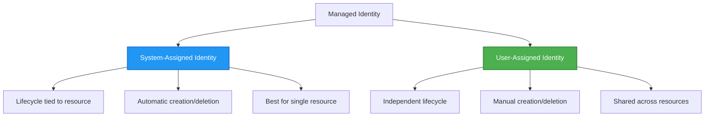

# Obrasci provjere autentičnosti i upravljani identitet

⏱️ **Procijenjeno vrijeme**: 45-60 minuta čitanja; predvidite dodatno vrijeme za integraciju vježbi | 💰 **Utjecaj na cijenu**: Identity/RBAC su besplatni; naplativa su izračunska snaga, pohrana i Key Vault | ⭐ **Složenost**: Srednja

> Pregledano u skladu s `azd 1.37.2` (studeni 2026.). Ova lekcija sadrži **primjere ilustrativne integracije, a ne potpunu preuzetu `secure-app` predložak**. Izradite referencirane datoteke, osigurajte odgovarajuću infrastrukturu i zamijenite rezervirana mjesta prije implementacije. Tijekom pregleda nisu kreirani Azure resursi.

**📚 Put učenja:**
- ← Prethodno: [Upravljanje konfiguracijom](configuration.md) - Upravljanje varijablama okoline i tajnama
- 🎯 **Nalazite se ovdje**: Autentifikacija i sigurnost (Managed Identity, Key Vault, sigurnosni obrasci)
- → Sljedeće: [Infrastruktura kao kod](../chapter-04-infrastructure/README.md) - Provisioniranje i implementacija resursa
- 🏠 [Početna stranica tečaja](../../README.md)

---

## Što ćete naučiti

Završetkom ove lekcije ćete:
- Razumjeti obrasce Azure autentifikacije (ključevi, connection stringovi, upravljani identitet)
- Implementirati **Managed Identity** za autentifikaciju bez lozinke
- Osigurati tajne pomoću integracije s **Azure Key Vault**
- Konfigurirati **upravljanje pristupom temeljeno na ulogama (RBAC)** za AZD implementacije
- Primijeniti najbolje sigurnosne prakse u Container Apps i Azure servisima
- Migrirati s autentifikacije na temelju ključeva na autentifikaciju na temelju identiteta

## Zašto je Managed Identity važan

### Problem: Tradicionalna autentifikacija

**Prije Managed Identity:**
```javascript
// ❌ SECURITY RISK: Hardcoded secrets in code
const connectionString = "Server=mydb.database.windows.net;User=admin;Password=P@ssw0rd123";
const storageKey = "xK7mN9pQ2wR5tY8uI0oP3aS6dF1gH4jK...";
const cosmosKey = "C2x7B9n4M1p8Q5w3E6r0T2y5U8i1O4p7...";
```

**Problemi:**
- 🔴 **Izložene tajne** u kodu, konfiguracijskim datotekama, varijablama okoline
- 🔴 **Rotacija vjerodajnica** zahtijeva izmjene koda i ponovnu implementaciju
- 🔴 **Noćne more s revizijom** - tko je pristupio što i kada?
- 🔴 **Razbacanost** - tajne raštrkane po više sustava
- 🔴 **Rizici usklađenosti** - ne prolazi sigurnosne revizije

### Rješenje: Managed Identity

**Nakon Managed Identity:**
```javascript
// ✅ SECURE: No secrets in code
const credential = new DefaultAzureCredential();
const client = new BlobServiceClient(
  "https://mystorageaccount.blob.core.windows.net",
  credential  // Azure automatically handles authentication
);
```

**Prednosti:**
- ✅ **Nema tajni** u kodu ili konfiguraciji
- ✅ **Automatska rotacija** - Azure to upravlja
- ✅ **Potpuni trag revizije** u Microsoft Entra ID zapisima
- ✅ **Centralizirana sigurnost** - upravlja se putem Azure portala
- ✅ **Spreman za usklađenost** - zadovoljava sigurnosne standarde

**Analogija**: Tradicionalna autentifikacija je poput nošenja više fizičkih ključeva za različita vrata. Managed Identity je poput sigurnosne iskaznice koja automatski dodjeljuje pristup s obzirom na to tko ste—bez ključeva za izgubiti, kopirati ili rotirati.

---

## Pregled arhitekture

### Tijek autentifikacije s Managed Identity

```mermaid
sequenceDiagram
    participant App as Your Application<br/>(Container App)
    participant MI as Managed Identity<br/>(Microsoft Entra ID)
    participant KV as Key Vault
    participant Storage as Azure Storage
    participant DB as Azure SQL
    
    App->>MI: Request access token<br/>(automatic)
    MI->>MI: Verify identity<br/>(no password needed)
    MI-->>App: Return token for requested audience<br/>(lifetime varies)
    
    App->>KV: Get secret<br/>(using token)
    KV->>KV: Check RBAC permissions
    KV-->>App: Return secret value
    
    App->>Storage: Upload blob<br/>(using token)
    Storage->>Storage: Check RBAC permissions
    Storage-->>App: Success
    
    App->>DB: Query data<br/>(using token)
    DB->>DB: Check SQL permissions
    DB-->>App: Return results
    
    Note over App,DB: Request a separate token for each service audience;<br/>SDK credentials handle caching and renewal
```

### Vrste Managed Identities



| Značajka | Sustavno dodijeljena | Korisnički dodijeljena |
|---------|----------------|---------------|
| **Životni ciklus** | Povezana s resursom | Neovisna |
| **Kreiranje** | Automatski s resursom | Ručno kreiranje |
| **Brisanje** | Briše se s resursom | Ostaje nakon brisanja resursa |
| **Dijeljenje** | Samo za jedan resurs | Više resursa |
| **Slučaj korištenja** | Jednostavni slučajevi | Složeni slučajevi s više resursa |
| **Odabir predloška** | Definirano u infrastrukturi | Definirano u infrastrukturi |

---

## Preduvjeti

### Potrebni alati

Trebali biste već imati instalirano iz prethodnih lekcija:

```bash
# Verify Azure Developer CLI
azd version
# ✅ Expected: azd version 1.0.0 or higher

# Verify Azure CLI
az --version
# ✅ Expected: azure-cli 2.50.0 or higher
```

### Zahtjevi za Azure

- Aktivna Azure pretplata
- Dozvole za:
  - Kreiranje upravljanih identiteta
  - Dodjeljivanje RBAC uloga
  - Kreiranje Key Vault resursa
  - Implementaciju Container Apps

### Predznanje

Trebali biste završiti:
- [Vodič za instalaciju](../chapter-01-foundation/installation.md) - postavljanje AZD
- [Osnove AZD-a](../chapter-01-foundation/azd-basics.md) - osnovni pojmovi
- [Upravljanje konfiguracijom](configuration.md) - varijable okoline

---

## Lekcija 1: Razumijevanje obrazaca provjere autentičnosti

### Obrazac 1: Connection Strings (Zastarjeli - Izbjegavati)

**Kako radi:**
```bash
# Connection string contains credentials
STORAGE_CONNECTION_STRING="DefaultEndpointsProtocol=https;AccountName=myaccount;AccountKey=xK7mN9pQ2wR5..."
COSMOS_CONNECTION_STRING="AccountEndpoint=https://myaccount.documents.azure.com:443/;AccountKey=C2x7..."
SQL_CONNECTION_STRING="Server=myserver.database.windows.net;User=admin;Password=P@ssw0rd..."
```

**Problemi:**
- ❌ Tajne vidljive u varijablama okoline
- ❌ Zapisane u sustavima za implementaciju
- ❌ Teško za rotaciju
- ❌ Nema traga revizije pristupa

**Kada koristiti:** Kad ciljna usluga zahtijeva autentifikaciju temeljenu na ključu. Preferirajte identitet gdje je podržano; inače pohranite ključeve sigurno i rotirajte ih, uključujući u produkciji.

---

### Obrazac 2: Key Vault Reference (Bolje)

**Kako radi:**
**Djelomični Bicep fragmenti:** potrebna su polja za vault, identitet Container App-a i njegov `configuration.secrets` unos su izostavljeni. `secretRef` označava tajnu Container App-a; ona **nisu URI Key Vault-a**. Za korištenje Key Vault-a definirajte tu nazvanu tajnu s `keyVaultUrl` i ovlaštenim `identity`.

```bicep
// Store secret in Key Vault
resource keyVault 'Microsoft.KeyVault/vaults@2023-02-01' = {
  name: 'mykv'
  properties: {
    enableRbacAuthorization: true
  }
}

// Reference in Container App
env: [
  {
    name: 'STORAGE_KEY'
    secretRef: 'storage-key'  // References Key Vault
  }
]
```

**Prednosti:**
- ✅ Tajne sigurno pohranjene u Key Vault
- ✅ Centralizirano upravljanje tajnama
- ✅ Rotacija bez promjena koda

**Ograničenja:**
- ⚠️ Još koristi ključeve/lozinke
- ⚠️ Potrebno upravljanje pristupom Key Vaultu

**Kada koristiti:** Prijelazni korak s connection stringova na managed identity.

---

### Obrazac 3: Managed Identity (Najbolja praksa)

**Kako radi:**
**Djelomični Bicep:** spajajte blok identiteta u potpun Container App i osigurajte `storageAccount` i definiciju uloge. Dodjela uloge također zahtijeva deterministički `name`.

```bicep
// Enable managed identity
resource containerApp 'Microsoft.App/containerApps@2023-05-01' = {
  name: 'myapp'
  identity: {
    type: 'SystemAssigned'  // Automatically creates identity
  }
}

// Grant permissions
resource roleAssignment 'Microsoft.Authorization/roleAssignments@2022-04-01' = {
  name: guid(storageAccount.id, containerApp.id, storageBlobDataContributorRole)
  scope: storageAccount
  properties: {
    roleDefinitionId: storageBlobDataContributorRole
    principalId: containerApp.identity.principalId
    principalType: 'ServicePrincipal'
  }
}
```

**Kod aplikacije:**
```javascript
// No secrets needed!
const { DefaultAzureCredential } = require('@azure/identity');
const { BlobServiceClient } = require('@azure/storage-blob');

const credential = new DefaultAzureCredential();
const blobServiceClient = new BlobServiceClient(
  'https://mystorageaccount.blob.core.windows.net',
  credential
);
```

**Prednosti:**
- ✅ Nema tajni u kodu/konfiguraciji
- ✅ Automatska rotacija vjerodajnica
- ✅ Potpuni trag revizije
- ✅ Dozvole temeljene na RBAC-u
- ✅ Pripremljeno za usklađenost

**Kada koristiti:** Preferirajte za Azure-hostane aplikacije koje pristupaju uslugama koje podržavaju Microsoft Entra autentifikaciju.

---

### Obrazac 4: Service Principals (CI/CD i automatizacija)

Managed identity je zlatni standard *za resurse unutar Azure-a*. Ali što s onim što se izvodi **izvan** Azure—kao CI/CD pipeline na build agentu ili skripta na vašem laptopu koja ne može koristiti interaktivnu prijavu? Tu dolazi **service principal**: ne-ljudski identitet sa svojim vjerodajnicama kojim se automatizirani proces može prijaviti.

**Kako radi:**

Kreirajte service principal ograničen na grupu resursa (najmanje privilegija):

```bash
az ad sp create-for-rbac \
  --name "myapp-cicd" \
  --role contributor \
  --scopes "/subscriptions/<sub-id>/resourceGroups/<rg-name>"
```

Ovo ispisuje client ID, client secret i tenant ID. azd se može prijaviti njima neinteraktivno:

```bash
azd auth login \
  --client-id "<appId>" \
  --client-secret "<password>" \
  --tenant-id "<tenant>"
```

**Preferirajte federirane vjerodajnice (OIDC) nad tajnama.** Umjesto dugotrajnog client secreta, konfigurirajte federiranu vjerodajnicu tako da pipeline razmjenjuje kratkotrajni token—nema tajne koja može procuriti ili zahtijeva rotaciju:

```bash
azd auth login \
  --client-id "<appId>" \
  --federated-credential-provider "github" \
  --tenant-id "<tenant>"
```

> `azd pipeline config` to automatski postavlja za vas. Pogledajte CI/CD vodiče u [Poglavlju 8](../chapter-08-production/production-ai-practices.md).

**Prednosti:**
- ✅ Radi izvan Azure (build agenti, on-premises, drugi cloudovi)
- ✅ Može biti ograničen na jednu grupu resursa s jednom ulogom
- ✅ Federirani (OIDC) variant ne koristi pohranjenu tajnu

**Nedostaci:**
- ⚠️ Varijanta s tajnom zahtijeva pažljivo skladištenje i rotaciju
- ⚠️ Procurena tajna daje sva prava SP-u—držite ovlasti uskim

**Kada koristiti:** CI/CD pipeline i automatizaciju koja ne može koristiti managed identity. Uvijek preferirajte **federiranu/OIDC** varijantu nad client secretom, i preferirajte managed identity kad god radno opterećenje radi unutar Azure.

**Sigurno pohranjivanje vjerodajnica:**
- Nikad ne pohranjujte tajne u repozitorije—koristite spremište tajni pipelinea (GitHub Actions secrets, Azure DevOps varijabilne skupine/Key Vault).
- Ograničite SP na najmanju moguću ulogu i grupu resursa
- Postavite datum isteka i rotirajte, ili potpuno eliminirajte tajnu korištenjem OIDC.

---

## Lekcija 2: Implementacija Managed Identity s AZD-om

### Implementacija korak-po-korak

Sljedeći fragmenti pokazuju kako integrirati managed identity u projekt Container App-a. Oni nisu **primjer odmah za korištenje**: Storage modul, potpuna infrastruktura managed environment/registry, Dockerfile i parametarski fajl nisu ovdje svi pruženi. Počnite od funkcionalnog Container Apps predloška i uklopite ove obrasce, zadržavajući njegovu konfiguraciju registracije i uslužne oznake.

### Struktura projekta

```
secure-app/
├── azure.yaml                 # AZD configuration
├── infra/
│   ├── main.bicep            # Main infrastructure
│   ├── core/
│   │   ├── identity.bicep    # Managed identity setup
│   │   ├── keyvault.bicep    # Key Vault configuration
│   │   └── storage.bicep     # Storage with RBAC
│   └── app/
│       └── container-app.bicep
└── src/
    ├── app.js                # Application code
    ├── package.json
    └── Dockerfile
```

### 1. Konfigurirajte AZD (azure.yaml)

```yaml
name: secure-app
metadata:
  template: secure-app@1.0.0

services:
  api:
    project: ./src
    language: js
    host: containerapp

# Managed identity must be enabled in the infrastructure, not by this YAML.
```

### 2. Infrastruktura: Omogućite Managed Identity

**Datoteka: `infra/main.bicep`**

```bicep
targetScope = 'subscription'

param environmentName string
param location string = 'eastus'
param containerAppsEnvironmentId string
param containerImage string

var tags = { 'azd-env-name': environmentName }

// Resource group
resource rg 'Microsoft.Resources/resourceGroups@2021-04-01' = {
  name: 'rg-${environmentName}'
  location: location
  tags: tags
}

// Storage Account
module storage './core/storage.bicep' = {
  name: 'storage'
  scope: rg
  params: {
    name: 'st${uniqueString(rg.id)}'
    location: location
    tags: tags
  }
}

// Key Vault
module keyVault './core/keyvault.bicep' = {
  name: 'keyvault'
  scope: rg
  params: {
    name: 'kv-${uniqueString(rg.id)}'
    location: location
    tags: tags
  }
}

// Container App with Managed Identity
module containerApp './app/container-app.bicep' = {
  name: 'container-app'
  scope: rg
  params: {
    name: 'ca-${environmentName}'
    location: location
    tags: tags
    storageAccountName: storage.outputs.name
    keyVaultName: keyVault.outputs.name
    containerAppsEnvironmentId: containerAppsEnvironmentId
    containerImage: containerImage
  }
}

// Grant Container App access to Storage
module storageRoleAssignment './core/role-assignment.bicep' = {
  name: 'storage-role'
  scope: rg
  params: {
    principalId: containerApp.outputs.identityPrincipalId
    roleDefinitionId: 'ba92f5b4-2d11-453d-a403-e96b0029c9fe'  // Storage Blob Data Contributor
    targetResourceType: 'storage'
    targetResourceName: storage.outputs.name
  }
}

// Grant Container App access to Key Vault
module kvRoleAssignment './core/role-assignment.bicep' = {
  name: 'kv-role'
  scope: rg
  params: {
    principalId: containerApp.outputs.identityPrincipalId
    roleDefinitionId: '4633458b-17de-408a-b874-0445c86b69e6'  // Key Vault Secrets User
    targetResourceType: 'keyvault'
    targetResourceName: keyVault.outputs.name
  }
}

// Outputs
output AZURE_STORAGE_ACCOUNT_NAME string = storage.outputs.name
output AZURE_KEY_VAULT_NAME string = keyVault.outputs.name
output APP_URL string = containerApp.outputs.url
```

### 3. Container App sa sustavno dodijeljenim identitetom

**Datoteka: `infra/app/container-app.bicep`**

```bicep
param name string
param location string
param tags object = {}
param storageAccountName string
param keyVaultName string
param containerAppsEnvironmentId string
param containerImage string

resource containerApp 'Microsoft.App/containerApps@2023-05-01' = {
  name: name
  location: location
  tags: union(tags, { 'azd-service-name': 'api' })
  identity: {
    type: 'SystemAssigned'  // 🔑 Enable managed identity
  }
  properties: {
    managedEnvironmentId: containerAppsEnvironmentId
    configuration: {
      ingress: {
        external: true
        targetPort: 3000
      }
    }
    template: {
      containers: [
        {
          name: 'api'
          image: containerImage // Must exist; configure registry credentials for private images
          resources: {
            cpu: json('0.5')
            memory: '1Gi'
          }
          env: [
            {
              name: 'AZURE_STORAGE_ACCOUNT_NAME'
              value: storageAccountName
            }
            {
              name: 'AZURE_KEY_VAULT_NAME'
              value: keyVaultName
            }
            // 🔑 No secrets - managed identity handles authentication!
          ]
        }
      ]
    }
  }
}

// Output the identity for RBAC assignments
output identityPrincipalId string = containerApp.identity.principalId
output id string = containerApp.id
output url string = 'https://${containerApp.properties.configuration.ingress.fqdn}'
```

### 4. Modul za dodjelu RBAC uloge

**Datoteka: `infra/core/role-assignment.bicep`**

```bicep
param principalId string
param roleDefinitionId string  // Azure built-in role ID
@allowed(['storage', 'keyvault'])
param targetResourceType string
param targetResourceName string

// Typed existing resources give Bicep a valid resource scope, not a string ID.
resource storageTarget 'Microsoft.Storage/storageAccounts@2023-01-01' existing = {
  name: targetResourceName
}
resource vaultTarget 'Microsoft.KeyVault/vaults@2023-02-01' existing = {
  name: targetResourceName
}

resource storageAssignment 'Microsoft.Authorization/roleAssignments@2022-04-01' = if (targetResourceType == 'storage') {
  name: guid(storageTarget.id, principalId, roleDefinitionId)
  scope: storageTarget
  properties: {
    roleDefinitionId: subscriptionResourceId('Microsoft.Authorization/roleDefinitions', roleDefinitionId)
    principalId: principalId
    principalType: 'ServicePrincipal'
  }
}

resource vaultAssignment 'Microsoft.Authorization/roleAssignments@2022-04-01' = if (targetResourceType == 'keyvault') {
  name: guid(vaultTarget.id, principalId, roleDefinitionId)
  scope: vaultTarget
  properties: {
    roleDefinitionId: subscriptionResourceId('Microsoft.Authorization/roleDefinitions', roleDefinitionId)
    principalId: principalId
    principalType: 'ServicePrincipal'
  }
}

// This module assigns at the target resource scope, not the whole resource group.
```

### 5. Kod aplikacije s Managed Identity

**Datoteka: `src/app.js`**

```javascript
const express = require('express');
const { DefaultAzureCredential } = require('@azure/identity');
const { BlobServiceClient } = require('@azure/storage-blob');
const { SecretClient } = require('@azure/keyvault-secrets');

const app = express();
const PORT = process.env.PORT || 3000;

// 🔑 Initialize credential (works automatically with managed identity)
const credential = new DefaultAzureCredential();

// Azure Storage setup
const storageAccountName = process.env.AZURE_STORAGE_ACCOUNT_NAME;
const blobServiceClient = new BlobServiceClient(
  `https://${storageAccountName}.blob.core.windows.net`,
  credential  // No keys needed!
);

// Key Vault setup
const keyVaultName = process.env.AZURE_KEY_VAULT_NAME;
const secretClient = new SecretClient(
  `https://${keyVaultName}.vault.azure.net`,
  credential  // No keys needed!
);

// Health check
app.get('/health', (req, res) => {
  res.json({ status: 'healthy', authentication: 'managed-identity' });
});

// Upload file to blob storage
app.post('/upload', async (req, res) => {
  try {
    const containerClient = blobServiceClient.getContainerClient('uploads');
    await containerClient.createIfNotExists();
    
    const blobName = `file-${Date.now()}.txt`;
    const blockBlobClient = containerClient.getBlockBlobClient(blobName);
    
    const content = 'Hello from managed identity!';
    await blockBlobClient.upload(content, Buffer.byteLength(content));
    
    res.json({
      success: true,
      blobName: blobName,
      message: 'File uploaded using managed identity!'
    });
  } catch (error) {
    console.error('Upload error:', error);
    res.status(500).json({ error: error.message });
  }
});

// Get secret from Key Vault
app.get('/secret/:name', async (req, res) => {
  try {
    const secretName = req.params.name;
    const secret = await secretClient.getSecret(secretName);
    
    res.json({
      name: secretName,
      retrieved: secret.value !== undefined, // Never return the secret value to callers
      message: 'Secret retrieved using managed identity!'
    });
  } catch (error) {
    console.error('Secret error:', error);
    res.status(500).json({ error: error.message });
  }
});

// List blob containers (demonstrates read access)
app.get('/containers', async (req, res) => {
  try {
    const containers = [];
    for await (const container of blobServiceClient.listContainers()) {
      containers.push(container.name);
    }
    
    res.json({
      containers: containers,
      count: containers.length,
      message: 'Containers listed using managed identity!'
    });
  } catch (error) {
    console.error('List error:', error);
    res.status(500).json({ error: error.message });
  }
});

app.listen(PORT, () => {
  console.log(`Secure API listening on port ${PORT}`);
  console.log('Authentication: Managed Identity (passwordless)');
});
```

**Datoteka: `src/package.json`**

```json
{
  "name": "secure-app",
  "version": "1.0.0",
  "dependencies": {
    "express": "^4.18.2",
    "@azure/identity": "^4.0.0",
    "@azure/storage-blob": "^12.17.0",
    "@azure/keyvault-secrets": "^4.7.0"
  },
  "scripts": {
    "start": "node app.js"
  }
}
```

### 6. Implementirajte i testirajte

Pokrenite ove naredbe **tek nakon** što ste dovršili nedostajuću infrastrukturu, Dockerfile, i odgovarajući `main.parameters.json` u vlastitom projektu. Autentificirajte azd s `azd auth login`; prijavite se zasebno s `az login` za kasnije provjere Azure CLI. Prikazani krajnji točke su demonstracije i zahtijevaju odgovarajuće kontrole pristupa prije javne upotrebe.

```bash
# Initialize AZD environment
azd init

# Deploy infrastructure and application
azd up

# Get the app URL
APP_URL=$(azd env get-value APP_URL)

# Test health check
curl $APP_URL/health
```

**✅ Očekivani ishod:**
```json
{
  "status": "healthy",
  "authentication": "managed-identity"
}
```

**Test prijenos datoteke (blob upload):**
```bash
curl -X POST $APP_URL/upload
```

**✅ Očekivani ishod:**
```json
{
  "success": true,
  "blobName": "file-1700404800000.txt",
  "message": "File uploaded using managed identity!"
}
```

**Test popisa kontejnera:**
```bash
curl $APP_URL/containers
```

**✅ Očekivani ishod:**
```json
{
  "containers": ["uploads"],
  "count": 1,
  "message": "Containers listed using managed identity!"
}
```

---

## Uobičajene Azure RBAC uloge

### Ugrađeni ID-ovi uloga za Managed Identity

| Usluga | Naziv uloge | ID uloge | Dozvole |
|---------|-----------|---------|-------------|
| **Storage** | Storage Blob Data Reader | `2a2b9908-6ea1-4ae2-8e65-a410df84e7d1` | Čitanje blobova i kontejnera |
| **Storage** | Storage Blob Data Contributor | `ba92f5b4-2d11-453d-a403-e96b0029c9fe` | Čitanje, pisanje, brisanje blobova |
| **Storage** | Storage Queue Data Contributor | `974c5e8b-45b9-4653-ba55-5f855dd0fb88` | Čitanje, pisanje, brisanje redova/poruka |
| **Key Vault** | Key Vault Secrets User | `4633458b-17de-408a-b874-0445c86b69e6` | Čitanje tajni |
| **Key Vault** | Key Vault Secrets Officer | `b86a8fe4-44ce-4948-aee5-eccb2c155cd7` | Čitanje, pisanje, brisanje tajni |
| **Cosmos DB** | Cosmos DB Built-in Data Reader | `00000000-0000-0000-0000-000000000001` | Čitanje podataka Cosmos DB-a |
| **Cosmos DB** | Cosmos DB Built-in Data Contributor | `00000000-0000-0000-0000-000000000002` | Čitanje, pisanje podataka Cosmos DB-a |
| **SQL Database** | SQL DB Contributor | `9b7fa17d-e63e-47b0-bb0a-15c516ac86ec` | Upravljanje resursima baze podataka; ne daje pristup SQL podacima |
| **Service Bus** | Azure Service Bus Data Owner | `090c5cfd-751d-490a-894a-3ce6f1109419` | Slanje, primanje, upravljanje porukama |

### Kako pronaći ID-ove uloga

Cosmos DB for NoSQL-ova dva gore navedena ID-a su **izvorne definicije uloga podatkovne ravnine Cosmos-a**, a ne Azure RBAC ID-ovi pretplate. Dodjeljujte ih s `az cosmosdb sql role assignment create` (ili `Microsoft.DocumentDB/databaseAccounts/sqlRoleAssignments`), a ne s `az role assignment create`. Pristup podacima u SQL-u zahtijeva korisnika baze u Entra i SQL dozvole.

```bash
# List all built-in roles
az role definition list --query "[].{Name:roleName, ID:name}" --output table

# Search for specific role
az role definition list --query "[?contains(roleName, 'Storage Blob')].{Name:roleName, ID:name}" --output table

# Get role details
az role definition list --name "Storage Blob Data Contributor"
```

---

## Praktične vježbe

**Preduvjeti za integraciju za sve tri vježbe:** funkcionalni Container App predložak u vašem vlastitom projektu, odgovarajući Bicep resursi, prijava u Azure CLI/azd i ovlasti za dodjelu potrebnih uloga. Ovo su vođene prilagodbe, a ne samostalni lokalni predlošci; zamijenite primjere imena resursa stvarnim imenima vaših implementiranih resursa.

### Vježba 1: Omogućavanje Managed Identity za postojeću aplikaciju ⭐⭐ (Srednja)

**Cilj**: Dodati managed identity postojećoj implementaciji Container App-a

**Scenarij**: Imate Container App koji koristi connection strings. Pretvorite ga u managed identity.

**Početna točka**: Container App s ovom konfiguracijom:

```bicep
// ❌ Current: Using connection string
env: [
  {
    name: 'STORAGE_CONNECTION_STRING'
    secretRef: 'storage-connection'
  }
]
```

**Koraci**:

1. **Omogućite managed identity u Bicep-u:**

```bicep
resource containerApp 'Microsoft.App/containerApps@2023-05-01' = {
  name: 'myapp'
  identity: {
    type: 'SystemAssigned'  // Add this
  }
  // ... rest of configuration
}
```

2. **Dodijelite pristup Storage-u:**

```bicep
// Get storage account reference
resource storageAccount 'Microsoft.Storage/storageAccounts@2023-01-01' existing = {
  name: storageAccountName
}

// Assign role
resource roleAssignment 'Microsoft.Authorization/roleAssignments@2022-04-01' = {
  name: guid(containerApp.id, 'ba92f5b4-2d11-453d-a403-e96b0029c9fe', storageAccount.id)
  scope: storageAccount
  properties: {
    roleDefinitionId: subscriptionResourceId('Microsoft.Authorization/roleDefinitions', 'ba92f5b4-2d11-453d-a403-e96b0029c9fe')
    principalId: containerApp.identity.principalId
    principalType: 'ServicePrincipal'
  }
}
```

3. **Ažurirajte kod aplikacije:**

**Prije (connection string):**
```javascript
const { BlobServiceClient } = require('@azure/storage-blob');

const blobServiceClient = BlobServiceClient.fromConnectionString(
  process.env.STORAGE_CONNECTION_STRING
);
```

**Nakon (managed identity):**
```javascript
const { DefaultAzureCredential } = require('@azure/identity');
const { BlobServiceClient } = require('@azure/storage-blob');

const credential = new DefaultAzureCredential();
const blobServiceClient = new BlobServiceClient(
  `https://${process.env.STORAGE_ACCOUNT_NAME}.blob.core.windows.net`,
  credential
);
```

4. **Ažurirajte varijable okoline:**

```bicep
env: [
  {
    name: 'STORAGE_ACCOUNT_NAME'
    value: storageAccountName  // Just the name, no secrets!
  }
  // Remove STORAGE_CONNECTION_STRING
]
```

5. **Deploy i testirajte:**

```bash
# Redeploy
azd up

# Test that it still works
APP_URL=$(azd show --output json | jq -er '.services.api.ingressUrl')
curl --fail -X POST "$APP_URL/upload"
```

**✅ Kriteriji uspjeha:**
- ✅ Aplikacija se implementira bez pogrešaka
- ✅ Operacije sa Storage rade (upload, lista, download)
- ✅ Nema connection stringova u varijablama okoline
- ✅ Identitet je vidljiv u Azure Portal-u pod "Identity" pločom

**Provjera:**

```bash
# Check managed identity is enabled
az containerapp show \
  --name myapp \
  --resource-group rg-myapp \
  --query "identity.type"
# ✅ Expected: "SystemAssigned"

# Check role assignment
az role assignment list \
  --assignee $(az containerapp show --name myapp --resource-group rg-myapp --query "identity.principalId" -o tsv) \
  --scope /subscriptions/{sub-id}/resourceGroups/rg-myapp/providers/Microsoft.Storage/storageAccounts/mystorageaccount
# ✅ Expected: Shows "Storage Blob Data Contributor" role
```

**Vrijeme:** 20-30 minuta

---

### Vježba 2: Pristup više usluga s korisnički dodijeljenim identitetom ⭐⭐⭐ (Napredno)

**Cilj**: Kreirati korisnički dodijeljeni identitet koji dijele više Container App-ova

**Scenarij**: Imate 3 mikroservisa kojima je potreban pristup istom Storage računu i Key Vault-u.

**Koraci:**

1. **Kreirajte korisnički dodijeljeni identitet:**

**Datoteka: `infra/core/identity.bicep`**

```bicep
param name string
param location string
param tags object = {}

resource userAssignedIdentity 'Microsoft.ManagedIdentity/userAssignedIdentities@2023-01-31' = {
  name: name
  location: location
  tags: tags
}

output id string = userAssignedIdentity.id
output principalId string = userAssignedIdentity.properties.principalId
output clientId string = userAssignedIdentity.properties.clientId
```

2. **Dodijelite uloge korisnički dodijeljenom identitetu:**

```bicep
// In main.bicep
module userIdentity './core/identity.bicep' = {
  name: 'user-identity'
  scope: rg
  params: {
    name: 'id-${environmentName}'
    location: location
    tags: tags
  }
}

// Grant Storage access
resource storageRoleAssignment 'Microsoft.Authorization/roleAssignments@2022-04-01' = {
  name: guid(storageAccount.id, environmentName, 'storage-contributor')
  scope: storageAccount
  properties: {
    roleDefinitionId: subscriptionResourceId('Microsoft.Authorization/roleDefinitions', 'ba92f5b4-2d11-453d-a403-e96b0029c9fe')
    principalId: userIdentity.outputs.principalId
    principalType: 'ServicePrincipal'
  }
}

// Grant Key Vault access
resource kvRoleAssignment 'Microsoft.Authorization/roleAssignments@2022-04-01' = {
  name: guid(keyVault.id, environmentName, 'kv-secrets-user')
  scope: keyVault
  properties: {
    roleDefinitionId: subscriptionResourceId('Microsoft.Authorization/roleDefinitions', '4633458b-17de-408a-b874-0445c86b69e6')
    principalId: userIdentity.outputs.principalId
    principalType: 'ServicePrincipal'
  }
}
```

3. **Dodijelite identitet više Container App-ova:**

```bicep
resource apiGateway 'Microsoft.App/containerApps@2023-05-01' = {
  name: 'api-gateway'
  identity: {
    type: 'UserAssigned'
    userAssignedIdentities: {
      '${userIdentity.outputs.id}': {}
    }
  }
  // ... rest of config
}

resource productService 'Microsoft.App/containerApps@2023-05-01' = {
  name: 'product-service'
  identity: {
    type: 'UserAssigned'
    userAssignedIdentities: {
      '${userIdentity.outputs.id}': {}
    }
  }
  // ... rest of config
}

resource orderService 'Microsoft.App/containerApps@2023-05-01' = {
  name: 'order-service'
  identity: {
    type: 'UserAssigned'
    userAssignedIdentities: {
      '${userIdentity.outputs.id}': {}
    }
  }
  // ... rest of config
}
```

4. **Aplikacijski kod (svi servisi koriste isti obrazac):**

```javascript
const { ManagedIdentityCredential } = require('@azure/identity');
const { BlobServiceClient } = require('@azure/storage-blob');

// For user-assigned identity, specify the client ID
const credential = new ManagedIdentityCredential(
  process.env.AZURE_CLIENT_ID  // User-assigned identity client ID
);

// Alternative (choose ONE credential declaration):
// const { DefaultAzureCredential } = require('@azure/identity');
// const credential = new DefaultAzureCredential({
//   managedIdentityClientId: process.env.AZURE_CLIENT_ID
// });

const blobServiceClient = new BlobServiceClient(
  `https://${process.env.STORAGE_ACCOUNT_NAME}.blob.core.windows.net`,
  credential
);
```

Postavite runtime `AZURE_CLIENT_ID` svakog Container App-a na `userIdentity.outputs.clientId` i `STORAGE_ACCOUNT_NAME` na ime vašeg spremišta u Bicep-u. Samo dodjeljivanje identiteta ili pokretanje `azd env set` ne postavlja ove runtime vrijednosti.

5. **Implementirajte i provjerite:**

```bash
azd up

# Test all services can access storage
# Replace with the actual ingress URLs reported for your three services
curl --fail -X POST "$API_GATEWAY_URL/upload"
curl --fail -X POST "$PRODUCT_SERVICE_URL/upload"
curl --fail -X POST "$ORDER_SERVICE_URL/upload"
```

**✅ Kriteriji uspjeha:**
- ✅ Jedan identitet dijeljen između 3 servisa
- ✅ Svi servisi mogu pristupiti Storageu i Key Vaultu
- ✅ Identitet ostaje ako obrišete jedan servis
- ✅ Centralizirano upravljanje dozvolama

**Prednosti korisnički dodijeljenog identiteta:**
- Jedinstveni identitet za upravljanje
- Dosljedne dozvole među servisima
- Ostat će ako se servis izbriše
- Bolje za složenije arhitekture

**Vrijeme**: 30-40 minuta

---

### Vježba 3: Implementacija rotacije Key Vault tajni ⭐⭐⭐ (Napredno)

**Cilj**: Spremiti API ključeve trećih strana u Key Vault i pristupati im koristeći upravljani identitet

**Scenarij**: Vaša aplikacija treba pozvati vanjski API (OpenAI, Stripe, SendGrid) koji zahtijeva API ključeve.

**Koraci**:

1. **Kreirajte Key Vault s RBAC:**

**Datoteka: `infra/core/keyvault.bicep`**

```bicep
param name string
param location string
param tags object = {}

resource keyVault 'Microsoft.KeyVault/vaults@2023-02-01' = {
  name: name
  location: location
  tags: tags
  properties: {
    enableRbacAuthorization: true  // Use RBAC instead of access policies
    sku: {
      family: 'A'
      name: 'standard'
    }
    tenantId: subscription().tenantId
    enableSoftDelete: true
    softDeleteRetentionInDays: 90
  }
}

// Allow Container App to read secrets
output id string = keyVault.id
output name string = keyVault.name
output uri string = keyVault.properties.vaultUri
```

2. **Spremite tajne u Key Vault:**

```bash
# Get Key Vault name
KV_NAME=$(azd env get-value AZURE_KEY_VAULT_NAME)

# Store third-party API keys
az keyvault secret set \
  --vault-name $KV_NAME \
  --name "OpenAI-ApiKey" \
  --value "sk-proj-xxxxxxxxxxxxx"

az keyvault secret set \
  --vault-name $KV_NAME \
  --name "Stripe-ApiKey" \
  --value "sk_live_xxxxxxxxxxxxx"

az keyvault secret set \
  --vault-name $KV_NAME \
  --name "SendGrid-ApiKey" \
  --value "SG.xxxxxxxxxxxxx"
```

3. **Aplikacijski kod za dohvat tajni:**

**Datoteka: `src/config.js`**

```javascript
const { DefaultAzureCredential } = require('@azure/identity');
const { SecretClient } = require('@azure/keyvault-secrets');

class Config {
  constructor() {
    this.credential = new DefaultAzureCredential();
    this.secretClient = new SecretClient(
      `https://${process.env.AZURE_KEY_VAULT_NAME}.vault.azure.net`,
      this.credential
    );
    this.cache = {};
  }

  async getSecret(secretName) {
    // Check cache first
    if (this.cache[secretName]) {
      return this.cache[secretName];
    }

    try {
      const secret = await this.secretClient.getSecret(secretName);
      this.cache[secretName] = secret.value;
      console.log(`✅ Retrieved secret: ${secretName}`);
      return secret.value;
    } catch (error) {
      console.error(`❌ Failed to get secret ${secretName}:`, error.message);
      throw error;
    }
  }

  async getOpenAIKey() {
    return this.getSecret('OpenAI-ApiKey');
  }

  async getStripeKey() {
    return this.getSecret('Stripe-ApiKey');
  }

  async getSendGridKey() {
    return this.getSecret('SendGrid-ApiKey');
  }
}

module.exports = new Config();
```

4. **Koristite tajne u aplikaciji:**

**Datoteka: `src/app.js`**

Ovaj **fragment zamjenske aplikacije** zahtijeva `npm install openai`, stvarni ključ treće strane, pristupačan model i infrastrukturu iz vašeg radnog projekta. Poziva OpenAI izravno, ne Azure OpenAI implementaciju. Donji privremeni ključevi ne ovlašćuju zahtjev.

```javascript
const express = require('express');
const config = require('./config');
const { OpenAI } = require('openai');

const app = express();

// Initialize OpenAI with key from Key Vault
let openaiClient;

async function initializeServices() {
  const openaiKey = await config.getOpenAIKey();
  openaiClient = new OpenAI({ apiKey: openaiKey });
  console.log('✅ Services initialized with secrets from Key Vault');
}

app.post('/chat', async (req, res) => {
  try {
    const completion = await openaiClient.chat.completions.create({
      model: 'gpt-4.1',
      messages: [{ role: 'user', content: 'Hello!' }]
    });
    
    res.json({
      response: completion.choices[0].message.content,
      authentication: 'Key from Key Vault via Managed Identity'
    });
  } catch (error) {
    res.status(500).json({ error: error.message });
  }
});

// Start listening only after initialization succeeds.
initializeServices().then(() => {
  app.listen(3000, () => console.log('Key Vault demo running'));
}).catch(error => {
  console.error('Initialization failed:', error.message);
  process.exitCode = 1;
});
```

5. **Implementirajte i testirajte:**

```bash
azd up

# Test that API keys work
curl -X POST https://myapp.azurecontainerapps.io/chat \
  -H "Content-Type: application/json" \
  -d '{"message":"Hello AI"}'
```

**✅ Kriteriji uspjeha:**
- ✅ Nema API ključeva u kodu ili varijablama okoline
- ✅ Aplikacija dohvaća ključeve iz Key Vaulta
- ✅ API-ji trećih strana ispravno rade
- ✅ Mogućnost rotacije ključeva bez izmjena koda

**Rotirajte tajnu:**

```bash
# Update secret in Key Vault
az keyvault secret set \
  --vault-name $KV_NAME \
  --name "OpenAI-ApiKey" \
  --value "sk-proj-NEW_KEY_HERE"

# Find the active revision name, then restart it to clear the in-process cache
az containerapp revision list --name myapp --resource-group rg-myapp --output table
az containerapp revision restart \
  --name myapp \
  --resource-group rg-myapp \
  --revision "<active-revision-name>"
```

**Vrijeme**: 25-35 minuta

---

## Provjera znanja

### 1. Obrasci autentifikacije ✓

Provjerite svoje razumijevanje:

- [ ] **P1**: Koja su tri glavna obrasca autentifikacije? 
  - **O**: Connection strings (naslijeđeno), Key Vault reference (prijelaz), Managed Identity (najbolje)

- [ ] **P2**: Zašto je upravljani identitet bolji od connection stringova?
  - **O**: Nema tajni u kodu, automatska rotacija, potpuni audit, RBAC dozvole

- [ ] **P3**: Kada biste koristili korisnički dodijeljeni identitet umjesto sistemski dodijeljenog?
  - **O**: Kada dijelite identitet među više resursa ili kad je životni ciklus identiteta neovisan o životnom ciklusu resursa

**Provjera praktičnim radom:**
```bash
# Check what type of identity your app uses
az containerapp show \
  --name myapp \
  --resource-group rg-myapp \
  --query "identity.type"

# List all role assignments for the identity
az role assignment list \
  --assignee $(az containerapp show --name myapp --resource-group rg-myapp --query "identity.principalId" -o tsv)
```

---

### 2. RBAC i dozvole ✓

Provjerite svoje razumijevanje:

- [ ] **P1**: Koji je ID uloge za "Storage Blob Data Contributor"?
  - **O**: `ba92f5b4-2d11-453d-a403-e96b0029c9fe`

- [ ] **P2**: Koje dozvole daje "Key Vault Secrets User"?
  - **O**: Samo pristup za čitanje tajni (ne može stvarati, ažurirati ili brisati)

- [ ] **P3**: Kako dodijeliti Container App-u pristup Azure SQL-u?
  - **O**: Konfigurirati Microsoft Entra autentifikaciju, kreirati identitet kao korisnika baze podataka i dodijeliti potrebne SQL dozvole. "SQL DB Contributor" upravlja samo Azure resursima; ne ovlašćuje upite.

**Provjera praktičnim radom:**
```bash
# Find specific role
az role definition list --name "Storage Blob Data Contributor"

# Check what roles are assigned to your identity
PRINCIPAL_ID=$(az containerapp show --name myapp --resource-group rg-myapp --query "identity.principalId" -o tsv)
az role assignment list --assignee $PRINCIPAL_ID --output table
```

---

### 3. Integracija Key Vaulta ✓

Provjerite svoje razumijevanje:

- [ ] **P1**: Kako omogućiti RBAC za Key Vault umjesto pristupnih politika?
  - **O**: Postavite `enableRbacAuthorization: true` u Bicepu

- [ ] **P2**: Koja Azure SDK biblioteka upravlja autentifikacijom upravljanim identitetom?
  - **O**: `@azure/identity` s klasom `DefaultAzureCredential`

- [ ] **P3**: Koliko dugo Key Vault tajne ostaju u cacheu?
  - **O**: Ovisi o aplikaciji; implementirajte vlastitu strategiju cacheiranja

**Provjera praktičnim radom:**
```bash
# Test Key Vault access
az keyvault secret show \
  --vault-name $KV_NAME \
  --name "OpenAI-ApiKey" \
  --query "{name:name,enabled:attributes.enabled}"

# Check RBAC is enabled
az keyvault show \
  --name $KV_NAME \
  --query "properties.enableRbacAuthorization"
# ✅ Expected: true
```

---

## Najbolje sigurnosne prakse

### ✅ ČINITE:

1. **Uvijek koristite upravljani identitet u produkciji**
   ```bicep
   identity: {
     type: 'SystemAssigned'
   }
   ```

2. **Koristite RBAC uloge s najmanje potrebnim privilegijama**
   - Koristite "Reader" uloge kad god je moguće
   - Izbjegavajte "Owner" ili "Contributor" osim ako nije nužno

3. **Spremajte ključeve trećih strana u Key Vault**
   ```javascript
   const apiKey = await secretClient.getSecret('ThirdPartyApiKey');
   ```

4. **Omogućite audit logging** (djelomični fragment resursa; spojite s vašim vault i workspace deklaracijama)
   ```bicep
   resource vaultDiagnostics 'Microsoft.Insights/diagnosticSettings@2021-05-01-preview' = {
     name: 'vault-audit'
     scope: keyVault
     properties: {
       workspaceId: logAnalytics.id
       logs: [{ category: 'AuditEvent', enabled: true }]
     }
   }
   ```

5. **Koristite različite identitete za razvoj/staging/produkciju**
   ```bash
   azd env new dev
   azd env new staging
   azd env new prod
   ```

6. **Redovito rotirajte tajne**
   - Postavite datume isteka na Key Vault tajnama
   - Automatizirajte rotaciju s Azure Functions

### ❌ NEMOJTE:

1. **Nikad ne hardkodirajte tajne**
   ```javascript
   // ❌ BAD
   const apiKey = "sk-proj-xxxxxxxxxxxxx";
   ```

2. **Nemojte koristiti connection stringove u produkciji**
   ```javascript
   // ❌ BAD
   BlobServiceClient.fromConnectionString(process.env.STORAGE_CONNECTION_STRING)
   ```

3. **Nemojte davati pretjerane dozvole**
   ```bicep
   // ❌ BAD - too much access
   roleDefinitionId: subscriptionResourceId('Microsoft.Authorization/roleDefinitions', '8e3af657-a8ff-443c-a75c-2fe8c4bcb635')
   
   // ✅ GOOD - least privilege
   roleDefinitionId: subscriptionResourceId('Microsoft.Authorization/roleDefinitions', '2a2b9908-6ea1-4ae2-8e65-a410df84e7d1')
   ```

4. **Nemojte logirati tajne**
   ```javascript
   // ❌ BAD
   console.log('API Key:', apiKey);
   
   // ✅ GOOD
   console.log('API Key retrieved successfully');
   ```

5. **Nemojte dijeliti produkcijske identitete među okruženjima**
   ```bicep
   // ❌ BAD - same identity for dev and prod
   // ✅ GOOD - separate identities per environment
   ```

---

## Vodič za rješavanje problema

### Problem: "Unauthorized" pri pristupu Azure Storageu

**Simptomi:**
```
Error: Unauthorized (403)
AuthorizationPermissionMismatch: This request is not authorized to perform this operation
```

**Dijagnoza:**

```bash
# Check if managed identity is enabled
az containerapp show \
  --name myapp \
  --resource-group rg-myapp \
  --query "identity.type"
# ✅ Expected: "SystemAssigned" or "UserAssigned"

# Check role assignments
PRINCIPAL_ID=$(az containerapp show --name myapp --resource-group rg-myapp --query "identity.principalId" -o tsv)
az role assignment list --assignee $PRINCIPAL_ID

# Expected: Should see "Storage Blob Data Contributor" or similar role
```

**Rješenja:**

1. **Dodijelite ispravnu RBAC ulogu:**
```bash
STORAGE_ID=$(az storage account show --name mystorageaccount --resource-group rg-myapp --query "id" -o tsv)
az role assignment create \
  --assignee $PRINCIPAL_ID \
  --role "Storage Blob Data Contributor" \
  --scope $STORAGE_ID
```

2. **Pričekajte propagaciju (može potrajati 5-10 minuta):**
```bash
# Check role assignment status
az role assignment list --assignee $PRINCIPAL_ID --scope $STORAGE_ID
```

3. **Provjerite koristi li aplikacijski kod ispravne vjerodajnice:**
```javascript
// Make sure you're using DefaultAzureCredential
const credential = new DefaultAzureCredential();
```

---

### Problem: Odbijen pristup Key Vaultu

**Simptomi:**
```
Error: Forbidden (403)
The user, group or application does not have secrets get permission
```

**Dijagnoza:**

```bash
# Check Key Vault RBAC is enabled
az keyvault show \
  --name $KV_NAME \
  --query "properties.enableRbacAuthorization"
# ✅ Expected: true

# Check role assignments
az role assignment list \
  --assignee $PRINCIPAL_ID \
  --scope /subscriptions/{sub-id}/resourceGroups/rg-myapp/providers/Microsoft.KeyVault/vaults/$KV_NAME
```

**Rješenja:**

1. **Omogućite RBAC na Key Vaultu:**
```bash
az keyvault update \
  --name $KV_NAME \
  --enable-rbac-authorization true
```

2. **Dodijelite ulogu Key Vault Secrets User:**
```bash
KV_ID=$(az keyvault show --name $KV_NAME --query "id" -o tsv)
az role assignment create \
  --assignee $PRINCIPAL_ID \
  --role "Key Vault Secrets User" \
  --scope $KV_ID
```

---

### Problem: DefaultAzureCredential ne radi lokalno

**Simptomi:**
```
Error: DefaultAzureCredential failed to retrieve a token
CredentialUnavailableError: No credential available
```

**Dijagnoza:**

```bash
# Check if you're logged in
az account show

# Check Azure CLI authentication
az ad signed-in-user show
```

**Rješenja:**

1. **Prijavite se u Azure CLI:**
```bash
az login
```

2. **Postavite Azure pretplatu:**
```bash
az account set --subscription "Your Subscription Name"
```

3. **Za lokalni razvoj koristite varijable okoline:**
```bash
export AZURE_TENANT_ID="your-tenant-id"
export AZURE_CLIENT_ID="your-client-id"
export AZURE_CLIENT_SECRET="your-client-secret"
```

4. **Ili koristite druge vjerodajnice lokalno:**
```javascript
const { DefaultAzureCredential, AzureCliCredential } = require('@azure/identity');

// Use AzureCliCredential for local dev
const credential = process.env.NODE_ENV === 'production' 
  ? new DefaultAzureCredential()
  : new AzureCliCredential();
```

---

### Problem: Dodjela uloge sporo se propagira

**Simptomi:**
- Uloga je uspješno dodijeljena
- I dalje dobivate 403 greške
- Pristup je povremen (ponekad radi, ponekad ne)

**Objašnjenje:**
Promjene u Azure RBAC-u mogu potrajati 5-10 minuta za globalnu propagaciju.

**Rješenje:**

```bash
# Wait and retry
echo "Waiting for RBAC propagation..."
sleep 300  # Wait 5 minutes

# Test access
curl --fail -X POST "$APP_URL/upload"

# If still failing, restart the app
az containerapp revision restart \
  --name myapp \
  --resource-group rg-myapp \
  --revision "<active-revision-name>"
```

---

## Troškovna razmatranja

### Troškovi upravljanog identiteta

| Resurs | Trošak |
|----------|------|
| **Upravljani identitet** | 🆓 **BESPLATNO** - Nema naplate |
| **Dodjele RBAC uloga** | 🆓 **BESPLATNO** - Nema naplate |
| **Zahtjevi Microsoft Entra ID tokena** | 🆓 **BESPLATNO** - Uključeno |
| **Operacije Key Vaulta** | 0,03 USD na 10.000 operacija |
| **Skladištenje Key Vault tajni** | Provjerite trenutačne cijene; nemojte pretpostavljati mjesečnu naknadu po tajni |

**Upravljani identitet štedi novac jer:**
- ✅ Eliminira operacije Key Vaulta za autentifikaciju servis-servis
- ✅ Smanjuje sigurnosne incidente (nema procurjelih vjerodajnica)
- ✅ Smanjuje operativne troškove (nema ručne rotacije)

Broj zahtjeva aplikacije ne odgovara broju operacija Key Vaulta: obrasci cacheiranja i rotacije određuju troškove čitanja tajni. Identitet ne uklanja troškove računalnih resursa/spremišta. Provjerite [Key Vault cijene](https://azure.microsoft.com/pricing/details/key-vault/) i Azure kalkulator cijena za vašu regiju umjesto da pretpostavljate mjesečne uštede samo prema broju zahtjeva.

---

## Saznajte više

### Službena dokumentacija
- [Azure Managed Identity](https://learn.microsoft.com/entra/identity/managed-identities-azure-resources/overview)
- [Azure RBAC](https://learn.microsoft.com/azure/role-based-access-control/overview)
- [Azure Key Vault](https://learn.microsoft.com/azure/key-vault/general/overview)
- [DefaultAzureCredential](https://learn.microsoft.com/dotnet/api/azure.identity.defaultazurecredential)

### SDK dokumentacija
- [@azure/identity (Node.js)](https://www.npmjs.com/package/@azure/identity)
- [Azure.Identity (C#)](https://www.nuget.org/packages/Azure.Identity/)
- [azure-identity (Python)](https://pypi.org/project/azure-identity/)

### Sljedeći koraci u ovom tečaju
- ← Prethodno: [Upravljanje konfiguracijom](configuration.md)
- → Sljedeće: [Infrastruktura kao kod](../chapter-04-infrastructure/README.md)
- 🏠 [Početna stranica tečaja](../../README.md)

### Povezani primjeri
- [Microsoft Foundry Models Chat Primjer](../../../../examples/azure-openai-chat) - Koristi upravljani identitet za Microsoft Foundry Models
- [Primjer mikroservisa](../../../../examples/microservices) - Obrasci autentifikacije više servisa

---

## Sažetak

**Naučili ste:**
- ✅ Tri obrasca autentifikacije (connection strings, Key Vault, upravljani identitet)
- ✅ Kako omogućiti i konfigurirati upravljani identitet u AZD-u
- ✅ Dodjele RBAC uloga za Azure servise
- ✅ Integraciju Key Vaulta za tajne trećih strana
- ✅ Korisnički vs sistemski dodijeljeni identiteti
- ✅ Sigurnosne najbolje prakse i rješavanje problema

**Ključni zaključci:**
1. **Uvijek koristite upravljani identitet u produkciji** - Nema tajni, automatska rotacija
2. **Koristite RBAC uloge s najmanje potrebnim privilegijama** - Dodijelite samo potrebne dozvole
3. **Spremite ključeve trećih strana u Key Vault** - Centralizirano upravljanje tajnama
4. **Razdvojite identitete po okruženjima** - Izolacija za razvoj, staging, produkciju
5. **Omogućite audit logging** - Pratite tko je što pristupio

**Sljedeći koraci:**
1. Dovršite praktične vježbe gore
2. Migrirajte postojeću aplikaciju s connection stringova na upravljani identitet
3. Ponovno pregledajte početni tijek implementacije: [Prvi Projekt](../chapter-01-foundation/first-project.md)

---

<!-- CO-OP TRANSLATOR DISCLAIMER START -->
**Napomena**:
Ovaj dokument je preveden korištenjem AI prevoditeljskog servisa [Co-op Translator](https://github.com/Azure/co-op-translator). Iako težimo točnosti, imajte na umu da automatski prijevodi mogu sadržavati greške ili netočnosti. Izvorni dokument na izvornom jeziku treba smatrati autoritativnim izvorom. Za važne informacije preporuča se profesionalni ljudski prijevod. Nismo odgovorni za bilo kakva nesporazumevanja ili pogrešne interpretacije koje proizlaze iz korištenja ovog prijevoda.
<!-- CO-OP TRANSLATOR DISCLAIMER END -->