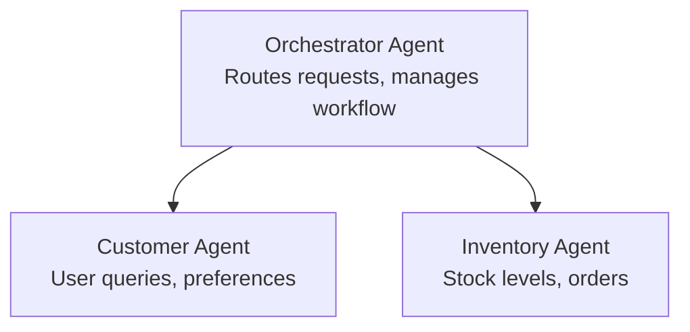

# Poglavlje 5: Rješenja umjetne inteligencije s više agenata

**📚 Tečaj**: [AZD za početnike](../../README.md) | **⏱️ Trajanje**: 2-3 sata | **⭐ Kompleksnost**: Napredno

---

## Pregled

Ovo poglavlje pokriva napredne obrasce arhitekture s više agenata, orkestraciju agenata i implementacije AI spremne za produkciju za složene scenarije.

> Upute za naredbe pregledane su u odnosu na objavljenu referencu `azd 1.37.2`. Implementacije u oblaku nisu izvršene.

## Ciljevi učenja

Završetkom ovog poglavlja naučit ćete:
- Razumjeti obrasce arhitekture s više agenata
- Implementirati koordinirane sustave AI agenata
- Provoditi komunikaciju između agenata
- Izgraditi rješenja s više agenata spremna za produkciju

---

## 📚 Lekcije

| # | Lekcija | Opis | Vrijeme |
|---|--------|-------------|------|
| 1 | [Osnove više agenata](multi-agent-basics.md) | Praktično: implementirajte funkcionalnu aplikaciju s više agenata koristeći `azd up` | 45 min |
| 2 | [Obrasci koordinacije](../chapter-06-pre-deployment/coordination-patterns.md) | Strategije orkestracije agenata (nastavlja se u Poglavlju 6) | 30 min |
| 3 | [Implementacija ARM predloška](../../examples/retail-multiagent-arm-template/README.md) | Primjer implementacije jednim klikom | 30 min |

> **Započnite s Lekcijom 1.** To je jedina potpuno praktična i implementabilna lekcija u ovom poglavlju. Lekcija 2 je u Poglavlju 6 (dio je planiranja prije implementacije), a [Rješenje za maloprodaju s više agenata](../../examples/retail-scenario.md) je arhitektonski nacrt — referenca za dizajn, a ne predložak s jednom naredbom.

---

## 🚀 Brzi početak

```bash
# Option 1: Deploy the multi-agent template used in Lesson 1
azd init --template Azure-Samples/contoso-creative-writer .
azd up

# Option 2: Initialize a Foundry agent interactively (requires azure.ai.agents)
azd extension install azure.ai.agents
azd ai agent init
azd up
```

> **Koji pristup odabrati?** Koristite `azd init --template` za početak s radnim uzorkom. Koristite `azd ai agent init` interaktivno ili `azd ai agent init --template <path-to-azure.yaml>` za usvajanje postojećeg projekta agenta. Pogledajte [AZD AI CLI referencu](../chapter-08-production/production-ai-practices.md#azd-ai-cli-commands-and-extensions) za zahtjeve verzije i migraciju evaluacije.

Pokrenite ove alternative u odvojenim praznim mapama. Proširenje agenata `1.0.0-beta.23` zahtijeva `azd >= 1.37.0`; njegov interaktivni tijek ne generira prilagođeni Service Bus pipeline u lekciji koordinacije.

---

## 🤖 Arhitektura s više agenata



---

## 🎯 Istaknuto rješenje: Maloprodaja s više agenata

Rješenje [Retail Multi-Agent](../../examples/retail-scenario.md) demonstrira:

- **Agent kupca**: Rukuje korisničkim interakcijama i preferencijama
- **Agent zaliha**: Upravljanje zalihama i obradom narudžbi
- **Orkestrator**: Koordinira između agenata
- **Zajednička memorija**: Upravljanje kontekstom između agenata

### Korištene usluge

| Usluga | Svrha |
|---------|---------|
| Microsoft Foundry Models | Razumijevanje jezika |
| Azure AI Search | Katalog proizvoda |
| Cosmos DB | Stanje i memorija agenta |
| Container Apps | Hostanje agenta |
| Application Insights | Nadgledanje |

---

## 🔗 Navigacija

| Smjer | Poglavlje |
|-----------|---------|
| **Prethodno** | [Poglavlje 4: Infrastruktura](../chapter-04-infrastructure/README.md) |
| **Sljedeće** | [Poglavlje 6: Prije raspoređivanja](../chapter-06-pre-deployment/README.md) |

---

## 📖 Povezani resursi

- [Vodič za AI agente](../chapter-02-ai-development/agents.md)
- [Prakse AI u produkciji](../chapter-08-production/production-ai-practices.md)
- [Otklanjanje poteškoća s AI](../chapter-07-troubleshooting/ai-troubleshooting.md)

---

<!-- CO-OP TRANSLATOR DISCLAIMER START -->
**Napomena**:
Ovaj dokument je preveden korištenjem AI prevoditeljskog servisa [Co-op Translator](https://github.com/Azure/co-op-translator). Iako težimo točnosti, imajte na umu da automatski prijevodi mogu sadržavati greške ili netočnosti. Izvorni dokument na izvornom jeziku treba smatrati autoritativnim izvorom. Za važne informacije preporuča se profesionalni ljudski prijevod. Nismo odgovorni za bilo kakva nesporazumevanja ili pogrešne interpretacije koje proizlaze iz korištenja ovog prijevoda.
<!-- CO-OP TRANSLATOR DISCLAIMER END -->