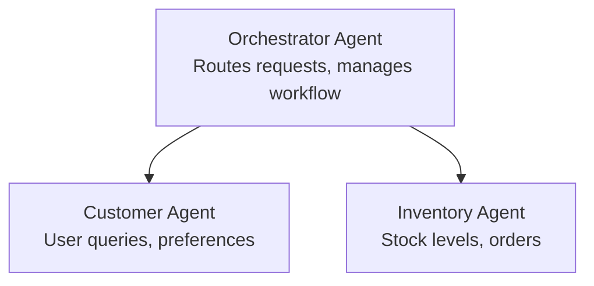

# Poglavlje 5: Višestruka AI rješenja s agentima

**📚 Tečaj**: [AZD za početnike](../../README.md) | **⏱️ Trajanje**: 2-3 sata | **⭐ Kompleksnost**: Napredno

---

## Pregled

Ovo poglavlje pokriva napredne obrasce višestruke arhitekture agenata, koordinaciju agenata i AI implementacije spremne za proizvodnju u složenim scenarijima.

> Smjernice za naredbe pregledane su u odnosu na objavljenu referencu `azd 1.37.2`. Implementacije u oblaku nisu izvršene.

## Ciljevi učenja

Završetkom ovog poglavlja ćete:
- Razumjeti obrasce arhitekture višestrukih agenata
- Implementirati koordinirane AI sustave agenata
- Provoditi komunikaciju među agentima
- Izgraditi rješenja višestrukih agenata spremna za proizvodnju

---

## 📚 Lekcije

| # | Lekcija | Opis | Vrijeme |
|---|--------|-------------|------|
| 1 | [Osnove višestrukih agenata](multi-agent-basics.md) | Praktično: implementirajte radnu aplikaciju s višestrukim agentima koristeći `azd up` | 45 min |
| 2 | [Obrasci koordinacije](../chapter-06-pre-deployment/coordination-patterns.md) | Strategije orkestracije agenata (nastavlja se u Poglavlju 6) | 30 min |
| 3 | [Implementacija ARM predloška](../../examples/retail-multiagent-arm-template/README.md) | Primjer implementacije jednim klikom | 30 min |

> **Započnite s Lekcijom 1.** To je jedina u potpunosti praktična i implementabilna lekcija u ovom poglavlju. Lekcija 2 nalazi se u Poglavlju 6 (dijeli se s planiranjem prije implementacije), a [Retail Multi-Agent Solution](../../examples/retail-scenario.md) je arhitektonski nacrt—referenca za dizajn, a ne predložak jednim naredbom.

---

## 🚀 Brzi početak

```bash
# Option 1: Deploy the multi-agent template used in Lesson 1
azd init --template Azure-Samples/contoso-creative-writer .
azd up

# Option 2: Initialize a Foundry agent interactively with the GA bundle
azd ext install microsoft.foundry
azd ai agent init
azd up
```

> **Koji pristup?** Koristite `azd init --template` za početak s radnim uzorkom. Koristite `azd ai agent init` interaktivno ili `azd ai agent init --template <path-to-azure.yaml>` za usvajanje postojećeg projekta agenata. Pogledajte [AZD AI CLI referencu](../chapter-08-production/production-ai-practices.md#azd-ai-cli-commands-and-extensions) za zahtjeve verzije i migraciju evaluacije.

Pokrenite ove alternative u zasebnim praznim mapama. GA Foundry tijek zahtijeva `azd >= 1.37.0`; njegov interaktivni tijek ne generira prilagođeni Service Bus proces u lekciji koordinacije. Za lokalno testiranje, implementaciju koda i čišćenje novih u odnosu na ponovno korištene projekte, slijedite [vodstvo za hostirane agente](../chapter-02-ai-development/microsoft-foundry-integration.md#hosted-agent-walkthrough-ga).

---

## 🤖 Arhitektura višestrukih agenata



---

## 🎯 Izdvojeno rješenje: Maloprodajni višestruki agent

Rješenje [Maloprodajni Višestruki Agent](../../examples/retail-scenario.md) prikazuje:

- **Agent Kupca**: Rukuje korisničkim interakcijama i preferencijama
- **Agent Zaliha**: Upravljanje zalihama i obrada narudžbi
- **Orkestrator**: Koordinira između agenata
- **Zajednička memorija**: Upravljanje kontekstom između agenata

### Korištene usluge

| Usluga | Svrha |
|---------|---------|
| Microsoft Foundry Models | Razumijevanje jezika |
| Azure AI Search | Katalog proizvoda |
| Cosmos DB | Stanje i memorija agenata |
| Container Apps | Hosting agenata |
| Application Insights | Praćenje |

---

## 🔗 Navigacija

| Smjer | Poglavlje |
|-----------|---------|
| **Prethodno** | [Poglavlje 4: Infrastruktura](../chapter-04-infrastructure/README.md) |
| **Sljedeće** | [Poglavlje 6: Pred Implementaciju](../chapter-06-pre-deployment/README.md) |

---

## 📖 Povezani resursi

- [Vodič za AI Agente](../chapter-02-ai-development/agents.md)
- [Prakse proizvodnje AI](../chapter-08-production/production-ai-practices.md)
- [Rješavanje problema AI](../chapter-07-troubleshooting/ai-troubleshooting.md)

---

<!-- CO-OP TRANSLATOR DISCLAIMER START -->
**Napomena**:
Ovaj dokument je preveden korištenjem AI prevoditeljskog servisa [Co-op Translator](https://github.com/Azure/co-op-translator). Iako težimo točnosti, imajte na umu da automatski prijevodi mogu sadržavati greške ili netočnosti. Izvorni dokument na izvornom jeziku treba smatrati autoritativnim izvorom. Za važne informacije preporuča se profesionalni ljudski prijevod. Nismo odgovorni za bilo kakva nesporazumevanja ili pogrešne interpretacije koje proizlaze iz korištenja ovog prijevoda.
<!-- CO-OP TRANSLATOR DISCLAIMER END -->