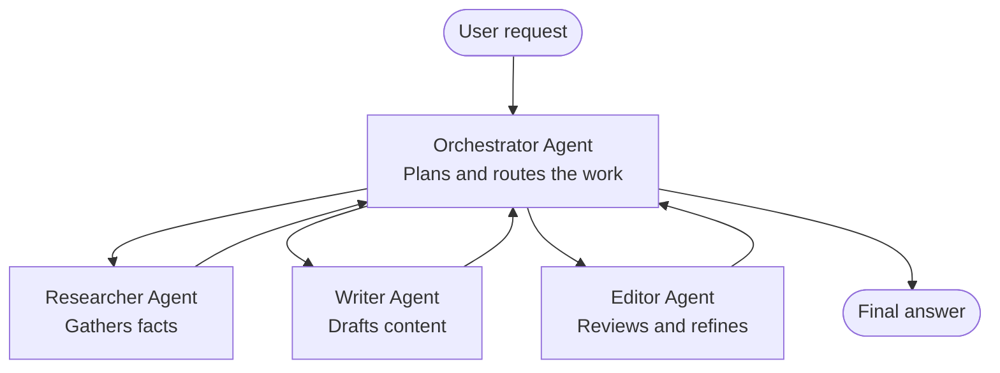

# Osnove Višeagencijskih Sustava - Postavite Svoj Prvi Koordinirani AI Sustav

**Navigacija Poglavljem:**
- **📚 Naslovnica Tečaja**: [AZD za Početnike](../../README.md)
- **📖 Trenutno Poglavlje**: Poglavlje 5 - Višeagencijska AI Rješenja
- **⬅️ Prethodno**: [Poglavlje 4: Infrastruktura](../chapter-04-infrastructure/README.md)
- **➡️ Sljedeće**: [Koordinacijski Obrasci](../chapter-06-pre-deployment/coordination-patterns.md)

> Upute naredbi su pregledane u odnosu na objavljenu referencu `azd 1.37.2`. Izvršenje u oblaku nije provedeno.

## Uvod

U ranijim poglavljima postavili ste jednu aplikaciju—i u Poglavlju 2 postavili ste jednog AI agenta. Ova lekcija čini sljedeći korak: postavljanje **višeagencijskog sustava** gdje nekoliko specijaliziranih agenata surađuje kako bi riješili problem koji pojedinačni agent ne bi mogao dobro sam riješiti.

Dobra vijest za početnike: **ne trebate nove naredbe.** Višeagencijsko rješenje je i dalje azd projekt. Vi ćete `azd init`, `azd up`, testirati i `azd down`—točno onako kako već znate raditi. Ono što se mijenja je *oblik* aplikacije iznutra.

## Ciljevi učenja

Do kraja ove lekcije ćete:
- Razumjeti što znači "višeagencijski" i kada se isplati dodatna složenost
- Prepoznati uobičajene uloge u višeagencijskom sustavu (koordinator + specijalisti)
- Postaviti stvarni, funkcionalni višeagencijski predložak s `azd up`
- Razumjeti Azure resurse koji podupiru višeagencijsku aplikaciju
- Znati kako provjeriti, prilagoditi i sigurno ukloniti rješenje

## Ishodi učenja

Nakon dovršetka ove lekcije moći ćete:
- Objasniti razliku između jednog agenta i višeagencijskog sustava
- Odabrati između jednog agenta s alatima i pravog višeagencijskog dizajna
- Postaviti i testirati višeagencijski predložak od početka do kraja s azd
- Prepoznati gdje se svaki agent izvodi i kako komuniciraju
- Očistiti sve resurse da izbjegnete stalne troškove

---

## Što je Višeagencijski Sustav?

Jedan AI agent je jedan model s nizom uputa i (po potrebi) nekim alatima. To dobro funkcionira za fokusirane zadatke. Ali kako zadatak raste—istraživanje, pa pisanje, pa uređivanje, pa provjera činjenica—stavljanje svega u jedan prompt usporava agenta, čini ga manje pouzdanim i teže ga je debugirati.

**Višeagencijski sustav** dijeli posao na specijaliste koji svaki obavljaju jedan zadatak dobro, koordinirani od koordinatora:



### Dvije uloge koje ćete uvijek vidjeti

| Uloga | Posao | Primjer |
|------|-------|---------|
| **Koordinator** | Odlučuje *što slijedi* i usmjerava posao između agenata | "Prvo istražuj, onda piši, zatim uređuj" |
| **Specijalist** | Obavlja jedan fokusirani zadatak i vraća rezultat | "istraživač" koji samo prikuplja činjenice |

### Trebate li zapravo više agenata?

Počnite jednostavno. Koristite više agenata **samo** ako je jedno od ovih istinito:

- ✅ Zadatak ima **jasne faze** koje koriste različite upute (istraživanje vs. pisanje vs. pregled)
- ✅ Želite da specijalisti rade **paralelno** radi uštede vremena
- ✅ Različiti koraci trebaju **različite alate ili izvore podataka**
- ✅ Svaki korak treba biti **neovisno testabilan i debugabilan**

Ako je vaš zadatak jedno pitanje i odgovor ili jednostavan poziv alata, **jedan agent s alatima** (Poglavlje 2) je jednostavniji, jeftiniji i lakši za rad.

> **Savjet za početnike:** "Više agenata" nije "bolje." Svaki agent dodaje kašnjenje, trošak i novu stvar za praćenje. Dodajte agente samo kad se problem jasno dijeli na dijelove.

---

## Dva Načina za Izgradnju Višeagencijskog Sustava na Azureu

| Pristup | Što je to | Najbolje za |
|---------|-----------|------------|
| **Jedan agent + alati** | Jedan Foundry agent koji poziva funkcije/alatke | Jednostavni tijekovi rada, početak rada |
| **Više koordiniranih agenata** | Više agenata s koordinatorom | Različite faze, paralelni rad, specijalizacija |

Ova lekcija se fokusira na drugi pristup koristeći **gotov predložak**, da možete vidjeti stvarni višeagencijski sustav u radu prije nego što napravite svoj.

---

## Praktično: Postavite Funkcionalnu Višeagencijsku Aplikaciju

Postavit ćemo **Contoso Creative Writer**, službeni Azure primjer koji koordinira istraživačke, proizvodne, pisane i uređivačke agente za proizvodnju članka. Prije nego krenete, provjerite [preduvjete i troškove uzorka](https://github.com/Azure-Samples/contoso-creative-writer#azure-account-requirements): potreban je modelni kvot, Azure AI Search, pristup Bing Groundingu, Python, Docker i Bash-kompatibilni hookovi. Dostupnost modela i regije ovisi o vašoj pretplati; postavljanje nije zajamčeno izborom određene regije.

### Korak 1: Inicijalizirajte predložak

```bash
# Create a working folder
mkdir creative-writer && cd creative-writer

# Initialize from the official multi-agent template
azd init --template Azure-Samples/contoso-creative-writer .
```

> Pregledajte više višeagencijskih predložaka bilo kada u [Awesome AZD AI galeriji](https://azure.github.io/awesome-azd/?tags=ai). Drugi početnički prijateljski primjeri uključuju `get-started-with-ai-agents` i `azure-ai-travel-agents`.

### Korak 2: Autentifikacija

```bash
# Required for azd workflows
azd auth login

# Also required by this sample's Azure CLI hooks
az login
```

### Korak 3: Provjerite okruženje

```bash
# init normally creates/selects an environment; confirm it before proceeding
azd env list
# Only if you need an additional environment:
# azd env new dev
```

### Korak 4: Pregledajte, zatim postavite

```bash
# See what will be created before spending anything (recommended)
azd provision --preview

# Provision infrastructure and deploy all agents in one step
azd up
```

`azd up` će zatražiti nedostajuće postavke pretplate i regije, zatim provisionirati resurse i postaviti aplikaciju. Pregled ne rezervira kvotu niti jamči uspjeh; hookovi predloška još se mogu pokrenuti tijekom pregleda provisioniranja, pa ih prvo pregledajte. Da biste produžili koliko dugo azd čeka svaki **postavljanje servisa** (ne provisioniranje modela):

```bash
azd deploy --timeout 1800
```

Timeout zaustavlja čekanje azd-a; ne otkazuje postavljanje u Azureu. Pregledajte stanje resursa prije ponovnog pokušaja.

> **Upozorenje o troškovima i kapacitetu:** Višeagencijske aplikacije postavljaju AI modele koji troše kvotu i stvaraju trošak. Ako `azd up` ne uspije zbog kvote modela, pogledajte [Otklanjanje poteškoća s AI](../chapter-07-troubleshooting/ai-troubleshooting.md) za ispravke regije i kvote, te Poglavlje 6 [Planiranje kapaciteta](../chapter-06-pre-deployment/capacity-planning.md).

---

## Razumijevanje Što Ste Postavili

Tipična višeagencijska aplikacija poput ove postavlja skup Azure resursa koji odgovaraju odgovornostima na dijagramu iznad:

| Resurs | Zašto je tu |
|--------|-------------|
| **Microsoft Foundry / modeli** | Domaćin je jezičnih modela koje svaki agent koristi |
| **Azure AI Search** | Daje istraživačkom agentu utemeljene podatke za pretraživanje |
| **Container Apps** (ili App Service) | Domaćin koordinatorskog i agentskog koda |
| **Cosmos DB** (u nekim uzorcima) | Čuva zajedničko stanje/pamćenje koje se prenosi između agenata |
| **Application Insights** | Prati zahtjeve *između* agenata da bi mogloš debugirati tok |

### Kako agenti komuniciraju međusobno

U većini azd višeagencijskih uzoraka, **koordinator radi u kodu vaše aplikacije** (na primjer, koristeći okvir poput Semantic Kernel ili Microsoft Agent Framework). Koordinator redom poziva svakog specijalistu, prenosi rezultate i sastavlja konačni odgovor. Agenti dijele kontekst preko:

- **Poziva funkcija/alata** — koordinator poziva specijalistu i dobiva rezultat natrag
- **Zajedničke memorije** — baza podataka (često Cosmos DB) koja čuva stanje koje oba agenta mogu čitati
- **Poruka/događaja** — za labavije povezivanje, agenti komuniciraju putem reda ili Service Busa

> **Zašto je ovo bitno za debugiranje:** budući da je svaki korak odvojen, Application Insights vam pokazuje *koji* agent je bio spor ili nije uspio. To je glavni razlog za podjelu posla preko agenata.

---

## Provjerite Postavljanje

Potvrdite da sustav zapravo radi prije nego nastavite:

```bash
# Show the deployed endpoints
azd show

# Open the app's monitoring dashboard
azd monitor

# Open Application Insights Logs (not a terminal log stream)
azd monitor --logs
```

Zatim otvorite URL aplikacije iz `azd show` i zatražite kratak članak. Koristite prikaz za debugiranje uzorka da pregledate tijek rada agenata. Pretraga transakcija u Application Insights može pokazati pojedinačne korake samo ako uzorak instrumentira i povezuje te korake; azd automatski ne dodaje spans agenata.

**Kriteriji uspjeha:**
- ✅ `azd show` navodi dostupnu krajnju točku
- ✅ Zahtjev proizvede rezultat koji je očito prošao kroz više faza
- ✅ Prikaz za debugiranje pokazuje više koraka agenata; ako je praćenje omogućeno, provjerite odgovarajuću telemetriju nakon prijema

---

## Prilagodba: Dodajte ili Prilagodite Agenta

Budući da je svaki agent samo upute plus alati, prilagodba je pristupačna:

1. **Pronađite definicije agenata** u predlošku (često skup datoteka kao što su `prompts/`, `agents/` ili `*.prompty`).
2. **Podesite upute za agenta** — na primjer, recite agentu za uređivanje da primjenjuje određeni ton ili broj riječi.
3. **Ponovno postavite samo kod** (infrastruktura ostaje nepromijenjena):

   ```bash
   azd deploy
   ```

Za daljnji rad sa *svojim* Foundry agent projektom, koristite GA paket s AZD 1.37.0+ u zasebnom praznom direktoriju:

```bash
azd ext install microsoft.foundry
azd ai agent init
azd up
azd ai agent invoke      # test, with response timing
```

Pogledajte [GA hosted-agent walkthrough](../chapter-02-ai-development/microsoft-foundry-integration.md#hosted-agent-walkthrough-ga) za lokalno testiranje Agent Inspectora, udaljeno postavljanje koda i vlasništvo nad čišćenjem. Referenca [AZD AI CLI](../chapter-08-production/production-ai-practices.md#azd-ai-cli-commands-and-extensions) također pokriva zasebno evaluacije, optimizaciju i brisanje agenta.

---

## Čišćenje

Višeagencijske aplikacije pokreću više naplatnih servisa. Sve poništite kad završite:

```bash
# Review the resources and confirm deletion interactively
azd down
```

Brisanje je destruktivno. Za jednokratni laboratorij, `azd down --force --purge` preskače brisanje i podržane potvrde mekog brisanja; brisanje je nepovratno gdje je podržano i može ga blokirati zaštita od brisanja. Mekano brisanje je briga oporavka/ponovne uporabe imena, ne dokaz stalnih troškova. Provjerite za zadržane resurse i naplate nakon čišćenja.

Ako ste također inicijalizirali hostiranog agenta za postojeći Foundry projekt, `azd down` ostavlja tog agenta i druge resurse projekta na mjestu. Uklonite samo neželjene resurse koje posjedujete zasebno. Za novi Foundry projekt kreiran njegovim AZD okruženjem, `azd down` briše grupu resursa i sve u njoj.

---

## Napomena o Višeagencijskim Sustavima u Produkciji

Rješenje [Retail Multi-Agent](../../examples/retail-scenario.md) u ovom spremištu nije **predložak za pokretanje jednom naredbom**, već je to nacrt arhitekture—dokumentira kako bi proizvodni maloprodajni sustav *zaista* bio izgrađen (i jasno je da je cijela izgradnja zahtjevan posao). Koristite ga kao referencu za dizajn *nakon* što ste ovdje postavili radni primjer. Za proizvodne aspekte (otpornost, trošak, nadzor, upravljanje), nastavite na [Poglavlje 8: Prakse AI u proizvodnji](../chapter-08-production/production-ai-practices.md).

---

## Sažetak

- Sustav s više agenata dijeli rad na stručnjake koje koordinira orkestrator.
- Koristite ga samo kada zadatak ima jasne faze, paralelizam ili različite alate po koracima—inače je bolje koristiti jednog agenta.
- Azd tok rada nije promijenjen: `azd init` → `azd up` → test → `azd down`.
- Pravi predložak poput `contoso-creative-writer` danas vam omogućuje da vidite i prilagodite radnu multi-agent aplikaciju.
- Praćenje Application Insights među agentima jedna je od najvećih praktičnih prednosti dizajna s više agenata.

---

## 🔗 Navigacija

| Smjer | Lekcija |
|-----------|--------|
| **Prethodno** | [Poglavlje 4: Infrastruktura](../chapter-04-infrastructure/README.md) |
| **Sljedeće** | [Obrasci koordinacije](../chapter-06-pre-deployment/coordination-patterns.md) |

## 📖 Povezani Resursi

- [Vodič za AI agente](../chapter-02-ai-development/agents.md)
- [Obrasci koordinacije](../chapter-06-pre-deployment/coordination-patterns.md)
- [Prakse AI u proizvodnji](../chapter-08-production/production-ai-practices.md)
- [Otklanjanje poteškoća s AI](../chapter-07-troubleshooting/ai-troubleshooting.md)

---

<!-- CO-OP TRANSLATOR DISCLAIMER START -->
**Napomena**:
Ovaj dokument je preveden korištenjem AI prevoditeljskog servisa [Co-op Translator](https://github.com/Azure/co-op-translator). Iako težimo točnosti, imajte na umu da automatski prijevodi mogu sadržavati greške ili netočnosti. Izvorni dokument na izvornom jeziku treba smatrati autoritativnim izvorom. Za važne informacije preporuča se profesionalni ljudski prijevod. Nismo odgovorni za bilo kakva nesporazumevanja ili pogrešne interpretacije koje proizlaze iz korištenja ovog prijevoda.
<!-- CO-OP TRANSLATOR DISCLAIMER END -->