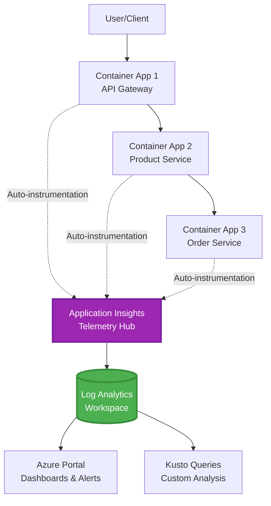
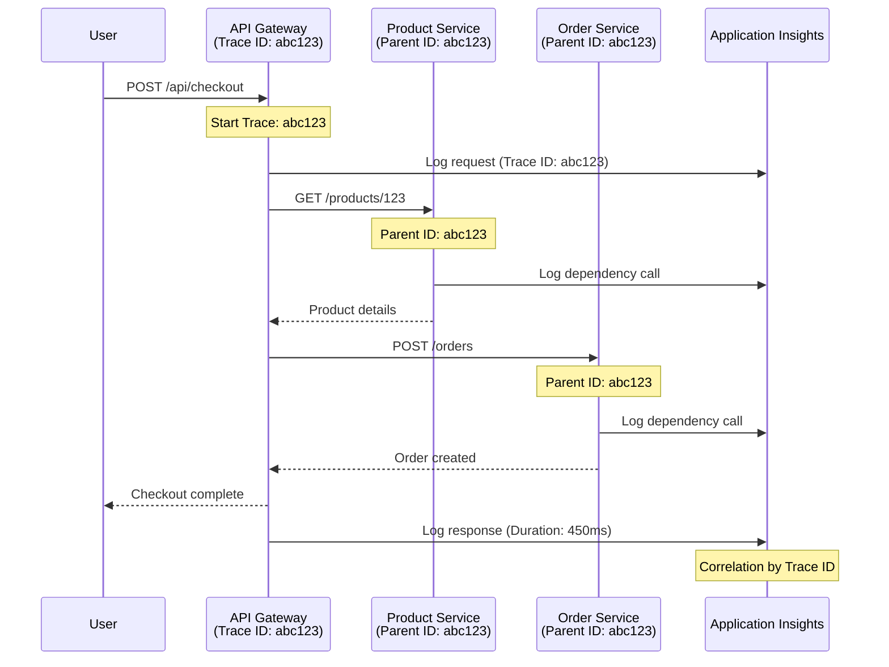

# Integracija Application Insights s AZD-om

⏱️ **Procijenjeno vrijeme**: 40-50 minuta | 💰 **Utjecaj na troškove**: ~$5-15/mjesečno | ⭐ **Kompleksnost**: Srednja

**📚 Put učenja:**
- ← Prethodno: [Provjere prije lansiranja](preflight-checks.md) - Validacija prije implementacije
- 🎯 **Trenutno ste ovdje**: Integracija Application Insights (Nadzor, telemetrija, otklanjanje pogrešaka)
- → Sljedeće: [Vodič za implementaciju](../chapter-04-infrastructure/deployment-guide.md) - Implementacija u Azure
- 🏠 [Početna stranica tečaja](../../README.md)

---

## Što ćete naučiti

Završetkom ovog lekcija, moći ćete:
- Deklarirati **Application Insights** u AZD infrastrukturi i konfigurirati SDK instrumentaciju
- Konfigurirati **distribuirano praćenje** za mikroservise
- Implementirati **prilagođenu telemetriju** (metrike, događaje, ovisnosti)
- Postaviti **live metrike** za nadzor u stvarnom vremenu
- Kreirati **alarme i nadzorne ploče** iz AZD implementacija
- Otklanjati proizvodne probleme pomoću **upita telemetrije**
- Optimizirati **troškove i strategije uzorkovanja**
- Nadzirati **AI/LLM aplikacije** (tokene, kašnjenja, troškove)

## Zašto je Application Insights važan s AZD-om

### Izazov: Promatranje proizvodnje

**Bez Application Insights-a:**
```
❌ No visibility into production behavior
❌ Manual log aggregation across services
❌ Reactive debugging (wait for customer complaints)
❌ No performance metrics
❌ Cannot trace requests across services
❌ Unknown failure rates and bottlenecks
```

**S Application Insights + AZD-om:**
```
✅ Automatic telemetry collection
✅ Centralized logs from all services
✅ Proactive issue detection
✅ End-to-end request tracing
✅ Performance metrics and insights
✅ Real-time dashboards
✅ AZD provisions the monitoring declared in your templates
```

**Analogija**: Application Insights je kao da imate "crnu kutiju" za snimanje leta + instrument ploču u kokpitu za vašu aplikaciju. Vidite sve što se događa u stvarnom vremenu i možete reproducirati svaki incident.

---

## Pregled arhitekture

### Application Insights u AZD arhitekturi



### Što se automatski nadzire

Podržana auto-instrumentacija hvata zahtjeve/ovisnosti za instrumentirane knjižnice. Prilagođeni događaji i metrike zahtijevaju aplikacijski kod; testovi dostupnosti moraju biti zasebno konfigurirani. Ne prikuplja sve ispod jednostavno zato što resurs postoji.

| Tip telemetrije | Što hvata | Primjena |
|----------------|------------------|----------|
| **Zahtjevi** | HTTP zahtjevi, status kodovi, trajanje | Nadzor performansi API-ja |
| **Ovisnosti** | Vanjski pozivi (baza podataka, API-ji, skladištenje) | Identifikacija uskih grla |
| **Iznimke** | Neuhvaćene pogreške sa stogom poziva | Otklanjanje pogrešaka |
| **Prilagođeni događaji** | Poslovni događaji (registracija, kupnja) | Analitika i tokovi procesa |
| **Metrike** | Brojači performansi, prilagođene metrike | Planiranje kapaciteta |
| **Tragovi** | Poruke zapisnika s težinom | Otklanjanje pogrešaka i revizija |
| **Dostupnost** | Testovi dostupnosti i vremena odziva | Nadzor SLA-e |

---

## Preduvjeti

### Potrebni alati

```bash
# Verify Azure Developer CLI
azd version
# Command reference baseline: azd 1.37.2

# Verify Azure CLI
az --version
# ✅ Expected: azure-cli 2.50.0 or higher
```

### Azure zahtjevi

- Aktivna pretplata na Azure
- Dozvole za kreiranje:
  - Application Insights resursa
  - Log Analytics radnih prostora
  - Container Apps
  - Skupina resursa

### Prethodno znanje

Trebali biste završiti:
- [Osnove AZD-a](../chapter-01-foundation/azd-basics.md) - Temeljni AZD koncepti
- [Konfiguracija](../chapter-03-configuration/configuration.md) - Postavljanje okruženja
- [Prvi projekt](../chapter-01-foundation/first-project.md) - Osnovna implementacija

---

## Lekcija 1: Automatski Application Insights s AZD-om

### Kako AZD postavlja Application Insights

AZD postavlja Application Insights **samo kad infrastruktura projekta to deklarira**. `azure.yaml` sam po sebi ne stvara nadzor niti instrumentira aplikacijski kod.

> **Primjer obuhvata:** Ova lekcija sadrži fragmente integracije, ne cijeli `monitored-app` projekt u ovom repozitoriju. Potrebno je osigurati glavni predložak i preslikavanje parametara, okruženje Container Apps, registraciju/sliku i konfiguraciju identiteta, Dockerfile i oznake usluge prije implementacije. Kasnije lekcije pokazuju alternativne/ekstenzijske fragmente, ne datoteke koje se mogu sve zalijepiti kao nepromijenjene. Počnite s radnim [primjerom mikroservisa](../../../../examples/microservices) ako trebate osnovu koja se može pokrenuti.

### Struktura projekta

```
monitored-app/
├── azure.yaml                     # AZD configuration
├── infra/
│   ├── main.bicep                # Main infrastructure
│   ├── core/
│   │   └── monitoring.bicep      # Application Insights + Log Analytics
│   └── app/
│       └── api.bicep             # Container App with monitoring
└── src/
    ├── app.py                    # Application with telemetry
    ├── requirements.txt
    └── Dockerfile
```

---

### Korak 1: Konfigurirajte AZD (azure.yaml)

**Datoteka: `azure.yaml`**

```yaml
name: monitored-app
metadata:
  template: monitored-app@1.0.0

services:
  api:
    project: ./src
    language: python
    host: containerapp

# Monitoring must be declared in infra/ and enabled in application code.
```

Ovo deklarira uslugu za implementaciju. Sljedeće Bicep i SDK konfiguracije osiguravaju nadzor; azd ih ne dodaje implicitno.

---

### Korak 2: Infrastruktura nadzora (Bicep)

**Datoteka: `infra/core/monitoring.bicep`**

```bicep
param logAnalyticsName string
param applicationInsightsName string
param location string = resourceGroup().location
param tags object = {}

// Log Analytics Workspace (required for Application Insights)
resource logAnalytics 'Microsoft.OperationalInsights/workspaces@2022-10-01' = {
  name: logAnalyticsName
  location: location
  tags: tags
  properties: {
    sku: {
      name: 'PerGB2018'  // Pay-as-you-go pricing
    }
    retentionInDays: 30  // Keep logs for 30 days
    features: {
      enableLogAccessUsingOnlyResourcePermissions: true
    }
  }
}

// Application Insights
resource applicationInsights 'Microsoft.Insights/components@2020-02-02' = {
  name: applicationInsightsName
  location: location
  tags: tags
  kind: 'web'
  properties: {
    Application_Type: 'web'
    WorkspaceResourceId: logAnalytics.id
    IngestionMode: 'LogAnalytics'
    publicNetworkAccessForIngestion: 'Enabled'
    publicNetworkAccessForQuery: 'Enabled'
  }
}

// Outputs for Container Apps
output logAnalyticsWorkspaceId string = logAnalytics.id
output logAnalyticsWorkspaceName string = logAnalytics.name
output applicationInsightsConnectionString string = applicationInsights.properties.ConnectionString
output applicationInsightsInstrumentationKey string = applicationInsights.properties.InstrumentationKey
output applicationInsightsName string = applicationInsights.name
output applicationInsightsId string = applicationInsights.id
```

---

### Korak 3: Povežite Container App s Application Insights

**Datoteka: `infra/app/api.bicep`**

```bicep
param name string
param location string
param tags object = {}
param containerAppsEnvironmentId string
param containerImage string
param applicationInsightsConnectionString string

resource containerApp 'Microsoft.App/containerApps@2023-05-01' = {
  name: name
  location: location
  tags: tags
  properties: {
    managedEnvironmentId: containerAppsEnvironmentId
    configuration: {
      ingress: {
        external: true
        targetPort: 8000
      }
      secrets: [
        {
          name: 'appinsights-connection-string'
          value: applicationInsightsConnectionString
        }
      ]
    }
    template: {
      containers: [
        {
          name: 'api'
          image: containerImage // Supply an accessible image and registry authentication
          resources: {
            cpu: json('0.5')
            memory: '1Gi'
          }
          env: [
            {
              name: 'APPLICATIONINSIGHTS_CONNECTION_STRING'
              secretRef: 'appinsights-connection-string'
            }
            {
              name: 'APPLICATIONINSIGHTS_ENABLED'
              value: 'true'
            }
          ]
        }
      ]
    }
  }
}

output uri string = 'https://${containerApp.properties.configuration.ingress.fqdn}'
```

---

### Korak 4: Aplikacijski kod s telemetrijom

**Datoteka: `src/app.py`**

```python
from flask import Flask, request, jsonify
from azure.monitor.opentelemetry import configure_azure_monitor
import logging
import os

app = Flask(__name__)

# Get Application Insights connection string
connection_string = os.environ.get('APPLICATIONINSIGHTS_CONNECTION_STRING')

if connection_string:
    # Azure Monitor OpenTelemetry instruments supported libraries, including Flask.
    configure_azure_monitor(
        connection_string=connection_string,
        logger_name=__name__,
        enable_live_metrics=True
    )
    logger = logging.getLogger(__name__)
    logger.setLevel(logging.INFO)
    
    print("✅ Application Insights enabled")
else:
    logger = logging.getLogger(__name__)
    logger.setLevel(logging.INFO)
    print("⚠️ Application Insights not configured")

@app.route('/health')
def health():
    logger.info('Health check endpoint called')
    return jsonify({'status': 'healthy', 'monitoring': 'enabled' if connection_string else 'disabled'})

@app.route('/api/products')
def get_products():
    logger.info('Fetching products')
    
    # In-memory fixture: this is not a database dependency call.
    products = [
        {'id': 1, 'name': 'Laptop', 'price': 999.99},
        {'id': 2, 'name': 'Mouse', 'price': 29.99},
        {'id': 3, 'name': 'Keyboard', 'price': 79.99}
    ]
    
    logger.info(f'Returned {len(products)} products')
    return jsonify(products)

@app.route('/api/error-test')
def error_test():
    """Test error tracking"""
    logger.error('Testing error tracking')
    try:
        raise ValueError('This is a test exception')
    except Exception as e:
        logger.exception('Exception occurred in error-test endpoint')
        return jsonify({'error': str(e)}), 500

@app.route('/api/slow')
def slow_endpoint():
    """Test performance tracking"""
    import time
    logger.info('Slow endpoint called')
    time.sleep(3)  # Simulate slow operation
    logger.warning('Endpoint took 3 seconds to respond')
    return jsonify({'message': 'Slow operation completed'})

if __name__ == '__main__':
    app.run(host='0.0.0.0', port=8000)
```

**Datoteka: `src/requirements.txt`**

```txt
Flask
azure-monitor-opentelemetry
gunicorn
requests
openai
```

Riješite ove ovisnosti u svom projektu, testirajte ih zajedno i zaključajte rezultatne verzije. Novi projekti trebaju koristiti Azure Monitor OpenTelemetry, a ne umirovljene OpenCensus Python izvoznike.

---

### Korak 5: Implementirajte i provjerite

```bash
# Deploy only after completing and wiring the infrastructure fragments above
azd up

# Get app URL
APP_URL=$(azd env get-value API_URL) # Requires this output in main.bicep

# Generate telemetry
curl $APP_URL/health
curl $APP_URL/api/products
curl $APP_URL/api/error-test
curl $APP_URL/api/slow
```

**✅ Očekivani rezultat:**
```json
{
  "status": "healthy",
  "monitoring": "enabled"
}
```

---

### Korak 6: Pogledajte telemetriju u Azure portalu

```bash
# Get Application Insights details
azd env get-values | grep APPLICATIONINSIGHTS

# Open in Azure Portal
az monitor app-insights component show \
  --app $(azd env get-values | grep APPLICATIONINSIGHTS_NAME | cut -d '=' -f2 | tr -d '"') \
  --resource-group $(azd env get-values | grep AZURE_RESOURCE_GROUP | cut -d '=' -f2 | tr -d '"') \
  --query "appId" -o tsv
```

**Idite u Azure Portal → Application Insights → Pretraživanje transakcija**

Trebali biste vidjeti:
- ✅ HTTP zahtjeve s status kodovima
- ✅ Trajanje zahtjeva (3+ sekunde za `/api/slow`)
- ✅ Detalje iznimki iz `/api/error-test`
- ✅ Prilagođene poruke zapisnika

---

## Lekcija 2: Prilagođena telemetrija i događaji

### Pratite poslovne događaje

Dodajmo prilagođenu telemetriju za poslovno kritične događaje.

**Datoteka: `src/telemetry.py`**

```python
from contextlib import contextmanager
from azure.monitor.opentelemetry import configure_azure_monitor
from opentelemetry import metrics, trace
from opentelemetry.trace import SpanKind
import logging
import os

class TelemetryClient:
    """Custom telemetry client for Application Insights"""
    
    def __init__(self, connection_string=None):
        self.connection_string = connection_string or os.environ.get('APPLICATIONINSIGHTS_CONNECTION_STRING')
        
        # Configure once per process. If app.py already calls this, keep only
        # one configure_azure_monitor call and use logger_name='telemetry'.
        if self.connection_string:
            configure_azure_monitor(
                connection_string=self.connection_string,
                logger_name=__name__,
                enable_live_metrics=True
            )
        self.logger = logging.getLogger(__name__)
        self.logger.setLevel(logging.INFO)
        self.tracer = trace.get_tracer(__name__)
        self.meter = metrics.get_meter(__name__)
        self.instruments = {}
    
    def track_event(self, event_name: str, properties: dict = None):
        """Track custom business event"""
        properties = properties or {}
        self.logger.info(
            f"CustomEvent: {event_name}",
            extra={
                # OTel log attributes become customDimensions in App Insights.
                    'event_name': event_name,
                    **properties
            }
        )
    
    def track_metric(self, metric_name: str, value: float, properties: dict = None):
        """Track custom metric"""
        properties = properties or {}
        if metric_name not in self.instruments:
            self.instruments[metric_name] = self.meter.create_histogram(metric_name)
        self.instruments[metric_name].record(value, attributes=properties)
    
    @contextmanager
    def track_dependency(self, name: str):
        """Time the real operation inside a client span; exceptions mark failure."""
        with self.tracer.start_as_current_span(name, kind=SpanKind.CLIENT) as span:
            yield span

# Global telemetry client
telemetry = TelemetryClient()
```

### Ažurirajte aplikaciju s prilagođenim događajima

**Datoteka: `src/app.py` (poboljšano)**

Dodajte ove rute postojećoj Flask aplikaciji; zadržite ranije rute za provjeru zdravlja/test. Skrćeni blok prikazuje zasebnu aplikaciju radi jasnoće. Inicijalizacija telemetrije sada živi u `telemetry.py`—ne inicijalizirajte izvoznike dvaput.

```python
from flask import Flask, request, jsonify
from telemetry import telemetry
import time
import random
import os

app = Flask(__name__)

@app.route('/api/purchase', methods=['POST'])
def purchase():
    """Track purchase event with custom telemetry"""
    data = request.get_json(silent=True) or {}
    product_id = data.get('product_id')
    quantity = data.get('quantity', 1)
    price = data.get('price', 0)
    if not isinstance(quantity, int) or quantity < 1 or \
       not isinstance(price, (int, float)) or price < 0:
        return jsonify({'error': 'quantity and price must be non-negative numbers; quantity >= 1'}), 400
    
    # Track business event
    telemetry.track_event('Purchase', {
        'product_id': product_id,
        'quantity': quantity,
        'total_amount': price * quantity,
        'user_id': request.headers.get('X-User-Id', 'anonymous')
    })
    
    # Track revenue metric
    telemetry.track_metric('Revenue', price * quantity, {
        'product_id': product_id,
        'currency': 'USD'
    })
    
    return jsonify({
        'order_id': f'ORD-{random.randint(1000, 9999)}',
        'status': 'confirmed',
        'total': price * quantity
    })

@app.route('/api/search')
def search():
    """Track search queries"""
    query = request.args.get('q', '')
    
    start_time = time.time()
    
    # Simulate search (would be real database query)
    results = [{'id': 1, 'name': f'Result for {query}'}]
    
    duration = (time.time() - start_time) * 1000  # Convert to ms
    
    # Track search event
    telemetry.track_event('Search', {
        'query': query,
        'results_count': len(results),
        'duration_ms': duration
    })
    
    # Track search performance metric
    telemetry.track_metric('SearchDuration', duration, {
        'query_length': len(query)
    })
    
    return jsonify({'results': results, 'count': len(results)})

@app.route('/api/external-call')
def external_call():
    """Track external API dependency"""
    import requests
    
    try:
        # Set an actual test endpoint; api.example.com is not a working API.
        with telemetry.track_dependency('ExternalAPI'):
            response = requests.get(os.environ['EXTERNAL_API_URL'], timeout=5)
            response.raise_for_status()
            result = response.json()
    except Exception as e:
        return jsonify({'error': 'External dependency failed'}), 502
    
    return jsonify(result)

if __name__ == '__main__':
    app.run(host='0.0.0.0', port=8000)
```

### Testiranje prilagođene telemetrije

```bash
# Track purchase event
curl -X POST $APP_URL/api/purchase \
  -H "Content-Type: application/json" \
  -H "X-User-Id: user123" \
  -d '{"product_id": 1, "quantity": 2, "price": 29.99}'

# Track search event
curl "$APP_URL/api/search?q=laptop"

# Track external dependency
curl $APP_URL/api/external-call
```

**Pogledajte u Azure portalu:**

Idite u Application Insights → Zapisnike, zatim pokrenite:

```kusto
// View purchase events
traces
| where customDimensions.event_name == "Purchase"
| project 
    timestamp,
    product_id = tostring(customDimensions.product_id),
    total_amount = todouble(customDimensions.total_amount),
    user_id = tostring(customDimensions.user_id)
| order by timestamp desc

// Revenue recorded in Purchase events (not a billing ledger)
traces
| where customDimensions.event_name == "Purchase"
| summarize TotalRevenue = sum(todouble(customDimensions.total_amount)) by bin(timestamp, 1h)
| render timechart

// View search performance
traces
| where customDimensions.event_name == "Search"
| summarize 
    AvgDuration = avg(todouble(customDimensions.duration_ms)),
    SearchCount = count()
  by bin(timestamp, 5m)
| render timechart
```

---

## Lekcija 3: Distribuirano praćenje za mikroservise

### Omogućite praćenje između servisa

Uz kompatibilnu instrumentaciju i W3C trace-context propagaciju, Application Insights povezuje zahtjeve između servisa. Dijeljenje veze za povezivanje samo po sebi ne uspostavlja roditeljske i dječje poveznice (spanove). Sljedeći arhitektonski fragment referencira module koje morate implementirati.

**Datoteka: `infra/main.bicep`**

```bicep
targetScope = 'subscription'

param environmentName string
param location string = 'eastus'

var tags = { 'azd-env-name': environmentName }

resource rg 'Microsoft.Resources/resourceGroups@2021-04-01' = {
  name: 'rg-${environmentName}'
  location: location
  tags: tags
}

// Monitoring (shared by all services)
module monitoring './core/monitoring.bicep' = {
  name: 'monitoring'
  scope: rg
  params: {
    logAnalyticsName: 'log-${environmentName}'
    applicationInsightsName: 'appi-${environmentName}'
    location: location
    tags: tags
  }
}

// API Gateway
module apiGateway './app/api-gateway.bicep' = {
  name: 'api-gateway'
  scope: rg
  params: {
    name: 'ca-gateway-${environmentName}'
    location: location
    tags: union(tags, { 'azd-service-name': 'gateway' })
    applicationInsightsConnectionString: monitoring.outputs.applicationInsightsConnectionString
  }
}

// Product Service
module productService './app/product-service.bicep' = {
  name: 'product-service'
  scope: rg
  params: {
    name: 'ca-products-${environmentName}'
    location: location
    tags: union(tags, { 'azd-service-name': 'products' })
    applicationInsightsConnectionString: monitoring.outputs.applicationInsightsConnectionString
  }
}

// Order Service
module orderService './app/order-service.bicep' = {
  name: 'order-service'
  scope: rg
  params: {
    name: 'ca-orders-${environmentName}'
    location: location
    tags: union(tags, { 'azd-service-name': 'orders' })
    applicationInsightsConnectionString: monitoring.outputs.applicationInsightsConnectionString
  }
}

output APPLICATIONINSIGHTS_CONNECTION_STRING string = monitoring.outputs.applicationInsightsConnectionString
output GATEWAY_URL string = apiGateway.outputs.uri
```

### Pogledajte krajnji transakcijski trag



**Upit za krajnji trag:**

```kusto
// Find complete request flow
let traceId = "abc123...";  // Copy operation_Id from a request in Application Insights
dependencies
| union requests
| where operation_Id == traceId
| project 
    timestamp,
    type = itemType,
    name,
    duration,
    success,
    cloud_RoleName
| order by timestamp asc
```

---

## Lekcija 4: Live metrike i nadzor u stvarnom vremenu

### Omogućite prijenos live metrika

Live Metrics pruža telemetriju gotovo u stvarnom vremenu kad je podržana i omogućena putem SDK-a. To nije SLA za latenciju. Gornja Python OpenTelemetry postavka uključuje opciju s `enable_live_metrics=True`.

**Pristupite Live Metrics:**

```bash
# Get Application Insights resource
APPI_NAME=$(azd env get-values | grep APPLICATIONINSIGHTS_NAME | cut -d '=' -f2 | tr -d '"')

# Get resource group
RG_NAME=$(azd env get-values | grep AZURE_RESOURCE_GROUP | cut -d '=' -f2 | tr -d '"')

echo "Navigate to: Azure Portal → Resource Groups → $RG_NAME → $APPI_NAME → Live Metrics"
```

**Što vidite u stvarnom vremenu:**
- ✅ Stopa dolaznih zahtjeva (zahtjevi/sek)
- ✅ Izlazni pozivi ovisnosti
- ✅ Broj iznimki
- ✅ Korištenje CPU-a i memorije
- ✅ Broj aktivnih poslužitelja
- ✅ Primjeri telemetrije

### Generirajte opterećenje za testiranje

```bash
# Generate load to see live metrics
for i in {1..100}; do
  curl --silent --max-time 10 "$APP_URL/api/products"
  curl --silent --max-time 10 "$APP_URL/api/search?q=test$i"
done

# Watch live metrics in Azure Portal
# You should see request rate spike
```

---

## Praktične vježbe

### Vježba 1: Postavljanje alarma ⭐⭐ (Srednje)

**Cilj**: Kreirajte alarme za visoke stope pogrešaka i spore odgovore.

**Koraci:**

1. **Kreirajte alarm za stopu pogrešaka:**

```bash
# Get Application Insights resource ID
APPI_ID=$(az monitor app-insights component show \
  --app $APPI_NAME \
  --resource-group $RG_NAME \
  --query "id" -o tsv)

# Create metric alert for failed requests
az monitor metrics alert create \
  --name "High-Error-Rate" \
  --resource-group $RG_NAME \
  --scopes $APPI_ID \
  --condition "count requests/failed > 10" \
  --window-size 5m \
  --evaluation-frequency 1m \
  --description "Alert when failed request count exceeds 10 per 5 minutes"
```

2. **Kreirajte alarm za spore odgovore:**

```bash
az monitor metrics alert create \
  --name "Slow-Responses" \
  --resource-group $RG_NAME \
  --scopes $APPI_ID \
  --condition "avg requests/duration > 3000" \
  --window-size 5m \
  --evaluation-frequency 1m \
  --description "Alert when average response time exceeds 3 seconds"
```

3. **Kreirajte alarm preko Bicep-a (preporučeno za AZD):**

**Datoteka: `infra/core/alerts.bicep`**

```bicep
param applicationInsightsId string
param actionGroupId string = ''
param location string = resourceGroup().location

// High error rate alert
resource errorRateAlert 'Microsoft.Insights/metricAlerts@2018-03-01' = {
  name: 'high-error-rate'
  location: 'global'
  properties: {
    description: 'Alert when error rate exceeds threshold'
    severity: 2
    enabled: true
    scopes: [
      applicationInsightsId
    ]
    evaluationFrequency: 'PT1M'
    windowSize: 'PT5M'
    criteria: {
      'odata.type': 'Microsoft.Azure.Monitor.SingleResourceMultipleMetricCriteria'
      allOf: [
        {
          name: 'Error rate'
          metricName: 'requests/failed'
          operator: 'GreaterThan'
          threshold: 10
          timeAggregation: 'Count'
        }
      ]
    }
    actions: actionGroupId != '' ? [
      {
        actionGroupId: actionGroupId
      }
    ] : []
  }
}

// Slow response alert
resource slowResponseAlert 'Microsoft.Insights/metricAlerts@2018-03-01' = {
  name: 'slow-responses'
  location: 'global'
  properties: {
    description: 'Alert when response time is too high'
    severity: 3
    enabled: true
    scopes: [
      applicationInsightsId
    ]
    evaluationFrequency: 'PT1M'
    windowSize: 'PT5M'
    criteria: {
      'odata.type': 'Microsoft.Azure.Monitor.SingleResourceMultipleMetricCriteria'
      allOf: [
        {
          name: 'Response duration'
          metricName: 'requests/duration'
          operator: 'GreaterThan'
          threshold: 3000
          timeAggregation: 'Average'
        }
      ]
    }
  }
}

output errorAlertId string = errorRateAlert.id
output slowResponseAlertId string = slowResponseAlert.id
```

4. **Testirajte alarme:**

```bash
# Generate errors
for i in {1..20}; do
  curl $APP_URL/api/error-test
done

# Generate slow responses
for i in {1..10}; do
  curl $APP_URL/api/slow
done

# Check rule configuration (not fired/resolved alert-instance history)
az monitor metrics alert list \
  --resource-group $RG_NAME \
  --query "[].{Name:name, Enabled:enabled}" \
  --output table
```

**✅ Kriteriji uspjeha:**
- ✅ Alarmi uspješno kreirani
- ✅ Alarmi se aktiviraju kad se premaše pragovi
- ✅ Mogućnost pregleda povijesti alarma u Azure portalu
- ✅ Integrirani s AZD implementacijom

**Vrijeme**: 20-25 minuta

---

### Vježba 2: Kreirajte prilagođenu nadzornu ploču ⭐⭐ (Srednje)

**Cilj**: Izradite nadzornu ploču koja prikazuje ključne metrike aplikacije.

**Koraci:**

1. **Kreirajte nadzornu ploču putem Azure portala:**

Idite na: Azure Portal → Nadzorne ploče → Nova nadzorna ploča

2. **Dodajte pločice za ključne metrike:**

- Broj zahtjeva (zadnjih 24 sata)
- Prosječno vrijeme odgovora
- Stopa pogrešaka
- Top 5 najsporijih operacija
- Geografska raspodjela korisnika

3. **Kreirajte nadzornu ploču putem Bicep-a:**

**Datoteka: `infra/core/dashboard.bicep`**

```bicep
param dashboardName string
param applicationInsightsId string
param location string = resourceGroup().location

resource dashboard 'Microsoft.Portal/dashboards@2020-09-01-preview' = {
  name: dashboardName
  location: location
  properties: {
    lenses: [
      {
        order: 0
        parts: [
          // Request count
          {
            position: {
              x: 0
              y: 0
              rowSpan: 4
              colSpan: 6
            }
            metadata: {
              type: 'Extension/Microsoft_OperationsManagementSuite_Workspace/PartType/LogsDashboardPart'
              inputs: [
                {
                  name: 'resourceId'
                  value: applicationInsightsId
                }
                {
                  name: 'query'
                  value: '''
                    requests
                    | summarize RequestCount = count() by bin(timestamp, 1h)
                    | render timechart
                  '''
                }
              ]
            }
          }
          // Error rate
          {
            position: {
              x: 6
              y: 0
              rowSpan: 4
              colSpan: 6
            }
            metadata: {
              type: 'Extension/Microsoft_OperationsManagementSuite_Workspace/PartType/LogsDashboardPart'
              inputs: [
                {
                  name: 'resourceId'
                  value: applicationInsightsId
                }
                {
                  name: 'query'
                  value: '''
                    requests
                    | summarize 
                        Total = count(),
                        Failed = countif(success == false)
                    | extend ErrorRate = (Failed * 100.0) / Total
                    | project ErrorRate
                  '''
                }
              ]
            }
          }
        ]
      }
    ]
  }
}

output dashboardId string = dashboard.id
```

4. **Implementirajte nadzornu ploču:**

```bicep
// Add to a subscription-scoped main.bicep with rg and monitoring declared
module dashboard './core/dashboard.bicep' = {
  name: 'dashboard'
  scope: rg
  params: {
    dashboardName: 'dashboard-${environmentName}'
    applicationInsightsId: monitoring.outputs.applicationInsightsId
    location: location
  }
}
```

```bash
# Deploy
azd up
```

**✅ Kriteriji uspjeha:**
- ✅ Nadzorna ploča prikazuje ključne metrike
- ✅ Mogućnost pričvršćivanja na početnu stranicu Azure portala
- ✅ Ažurira se u stvarnom vremenu
- ✅ Moguće implementirati preko AZD-a

**Vrijeme**: 25-30 minuta

---

### Vježba 3: Nadzor AI/LLM aplikacije ⭐⭐⭐ (Napredno)

**Cilj**: Pratite korištenje Microsoft Foundry modela (tokene, troškove, kašnjenja).

**Koraci:**

1. **Kreirajte omotač za AI nadzor:**

**Datoteka: `src/ai_telemetry.py`**

```python
from telemetry import telemetry
from openai import AzureOpenAI
import time

class MonitoredAzureOpenAI:
    """Microsoft Foundry Models client with automatic telemetry"""
    
    def __init__(self, api_key, endpoint, input_usd_per_million,
                 output_usd_per_million, api_version="2024-10-21"):
        self.client = AzureOpenAI(
            api_key=api_key,
            api_version=api_version,
            azure_endpoint=endpoint
        )
        self.input_rate = input_usd_per_million
        self.output_rate = output_usd_per_million
    
    def chat_completion(self, model: str, messages: list, **kwargs):
        """Track chat completion with telemetry"""
        start_time = time.time()
        
        try:
            # Call Microsoft Foundry Models
            response = self.client.chat.completions.create(
                model=model,
                messages=messages,
                **kwargs
            )
            
            duration = (time.time() - start_time) * 1000  # ms
            
            # Extract usage
            usage = response.usage
            prompt_tokens = usage.prompt_tokens
            completion_tokens = usage.completion_tokens
            total_tokens = usage.total_tokens
            
            # Approximation: supply actual deployment/region/contract rates.
            # Cached input, batch, provisioned and other charges need separate accounting.
            prompt_cost = (prompt_tokens / 1_000_000) * self.input_rate
            completion_cost = (completion_tokens / 1_000_000) * self.output_rate
            total_cost = prompt_cost + completion_cost
            
            # Track custom event
            telemetry.track_event('OpenAI_Request', {
                'model': model,
                'prompt_tokens': prompt_tokens,
                'completion_tokens': completion_tokens,
                'total_tokens': total_tokens,
                'duration_ms': duration,
                'cost_usd': total_cost,
                'success': True
            })
            
            # Track metrics
            telemetry.track_metric('OpenAI_Tokens', total_tokens, {
                'model': model,
                'type': 'total'
            })
            
            telemetry.track_metric('OpenAI_Cost', total_cost, {
                'model': model,
                'currency': 'USD'
            })
            
            telemetry.track_metric('OpenAI_Duration', duration, {
                'model': model
            })
            
            return response
            
        except Exception as e:
            duration = (time.time() - start_time) * 1000
            
            telemetry.track_event('OpenAI_Request', {
                'model': model,
                'duration_ms': duration,
                'success': False,
                'error': str(e)
            })
            
            raise
```

2. **Koristite nadzirani klijent:**

```python
from flask import Flask, request, jsonify
from ai_telemetry import MonitoredAzureOpenAI
import os

app = Flask(__name__)

# Initialize monitored OpenAI client
openai_client = MonitoredAzureOpenAI(
    api_key=os.environ['AZURE_OPENAI_API_KEY'],
    endpoint=os.environ['AZURE_OPENAI_ENDPOINT'],
    input_usd_per_million=float(os.environ['INPUT_USD_PER_MILLION']),
    output_usd_per_million=float(os.environ['OUTPUT_USD_PER_MILLION'])
)

@app.route('/api/chat', methods=['POST'])
def chat():
    data = request.json
    user_message = data.get('message')
    
    # Call with automatic monitoring
    response = openai_client.chat_completion(
        model=os.environ['AZURE_OPENAI_DEPLOYMENT'], # Deployment name, not catalog ID
        messages=[
            {'role': 'user', 'content': user_message}
        ]
    )
    
    return jsonify({
        'response': response.choices[0].message.content,
        'tokens': response.usage.total_tokens
    })
```

3. **Upit AI metrika:**

```kusto
// Total AI spend over time
traces
| where customDimensions.event_name == "OpenAI_Request"
| where tobool(customDimensions.success) == true
| summarize TotalCost = sum(todouble(customDimensions.cost_usd)) by bin(timestamp, 1h)
| render timechart

// Token usage by model
traces
| where customDimensions.event_name == "OpenAI_Request"
| summarize 
    TotalTokens = sum(toint(customDimensions.total_tokens)),
    RequestCount = count()
  by Model = tostring(customDimensions.model)

// Average latency
traces
| where customDimensions.event_name == "OpenAI_Request"
| summarize AvgDuration = avg(todouble(customDimensions.duration_ms))
| project AvgDurationSeconds = AvgDuration / 1000

// Cost per request
traces
| where customDimensions.event_name == "OpenAI_Request"
| extend Cost = todouble(customDimensions.cost_usd)
| summarize 
    TotalCost = sum(Cost),
    RequestCount = count(),
    AvgCostPerRequest = avg(Cost)
```

**✅ Kriteriji uspjeha:**
- ✅ Svaki OpenAI poziv se automatski prati
- ✅ Vidljivo korištenje tokena i troškovi
- ✅ Nadzirano kašnjenje
- ✅ Mogućnost postavljanja budžetnih alarma

**Vrijeme**: 35-45 minuta

---

## Optimizacija troškova

### Strategije uzorkovanja

Kontrolirajte troškove uzorkovanjem telemetrije:

```python
import os

# Configure before the one configure_azure_monitor() call in your process.
os.environ["OTEL_TRACES_SAMPLER"] = "microsoft.fixed_percentage"
os.environ["OTEL_TRACES_SAMPLER_ARG"] = "0.1" # 10% trace sampling
```

Uzorkovanje traga ne smanjuje svaki telemetrijski tip za 90%. Metrike i samostalno emitirani zapisnici trebaju vlastite kontrole volumena. Izbor stope napravite prema potrebama opažanja, a ne općom zabranom u proizvodnji.

Izričito postavite uzorkovanje u SDK-u; svojstvo `SamplingPercentage` komponente nije zamjena za konfiguriranje Python OpenTelemetry sampler-a.

### Čuvanje podataka

```bicep
resource logAnalytics 'Microsoft.OperationalInsights/workspaces@2022-10-01' = {
  name: logAnalyticsName
  properties: {
    retentionInDays: 30  // Minimum (cheapest)
    // Options: 30, 31, 60, 90, 120, 180, 270, 365, 550, 730
  }
}
```

### Mjesečne procjene troškova

| Volumen podataka | Zadržavanje | Mjesečni trošak |
|-------------|-----------|--------------|
| 1 GB/mjesečno | 30 dana | ~$2-5 |
| 5 GB/mjesečno | 30 dana | ~$10-15 |
| 10 GB/mjesečno | 90 dana | ~$25-40 |
| 50 GB/mjesečno | 90 dana | ~$100-150 |

Ovi brojevi su ilustrativni, ne ponude. Provjerite cijene unosa, čuvanja, alarma i testiranja za vašu regiju i ugovor; besplatni paketi se dijele/prema obuhvatu prema cijenama Azure Monitor-a, ne kao zajamčena besplatna SKU po Application Insights resursu.

---

## Provjera znanja

### 1. Osnovna integracija ✓

Provjerite svoje razumijevanje:

- [ ] **P1**: Kako AZD postavlja Application Insights?
  - **O**: Implementira nadzorne resurse izričito deklarirane u Bicep/Terraform predlošcima projekta.

- [ ] **P2**: Koja okolinska varijabla omogućuje Application Insights?
  - **O**: `APPLICATIONINSIGHTS_CONNECTION_STRING`

- [ ] **P3**: Koja su tri glavna tipa telemetrije?
  - **O**: Zahtjevi (HTTP pozivi), ovisnosti (vanjski pozivi), iznimke (pogreške)

**Praktična provjera:**
```bash
# Check if Application Insights is configured
azd env get-values | grep APPLICATIONINSIGHTS

# Verify telemetry is flowing
az monitor app-insights metrics show \
  --app $APPI_NAME \
  --resource-group $RG_NAME \
  --metric "requests/count"
```

---

### 2. Prilagođena telemetrija ✓

Provjerite svoje razumijevanje:

- [ ] **P1**: Kako pratiti prilagođene poslovne događaje?
  - **O**: Omotač ove lekcije zapisuje strukturirane OTel zapisnike s `event_name` atributima, upitnim u `traces`; oni nisu automatski `customEvents`.

- [ ] **P2**: Koja je razlika između događaja i metrika?
  - **O**: Događaji su diskretni događaji, metrike su numeričke mjere

- [ ] **P3**: Kako povezati telemetriju između servisa?
  - **O**: Application Insights automatski koristi `operation_Id` za korelaciju

**Praktična provjera:**
```kusto
// Verify custom events
traces
| where customDimensions.event_name != ""
| summarize count() by tostring(customDimensions.event_name)
```

---

### 3. Proizvodni nadzor ✓

Provjerite svoje razumijevanje:

- [ ] **P1**: Što je uzorkovanje i zašto ga koristiti?
  - **O**: Uzorkovanje smanjuje volumen podataka (i troškove) tako da hvata samo postotak telemetrije

- [ ] **P2**: Kako postaviti alarme?
  - **O**: Koristite metrika alarme u Bicep-u ili Azure portalu temeljem metrika Application Insights-a

- [ ] **P3**: Koja je razlika između Log Analytics-a i Application Insights-a?
  - **O**: Application Insights pohranjuje podatke u Log Analytics radni prostor; App Insights pruža aplikacijski specifične poglede

**Praktična provjera:**
```bash
# Check the sampler configured for the running application, not only the ARM component.
az containerapp show --name "$APP_NAME" --resource-group "$RG_NAME" \
  --query "properties.template.containers[].env[?starts_with(name, 'OTEL_TRACES_SAMPLER')]"
```

---

## Najbolje prakse

### ✅ Činite:

1. **Koristite korelacijske ID-e**
   ```python
   logger.info('Processing order', extra={
           'order_id': order_id,
           'user_id': user_id
   })
   ```

2. **Postavite alarme za kritične metrike**
   ```bicep
   // Error rate, slow responses, availability
   ```

3. **Koristite strukturirano zapisivanje**
   ```python
   # ✅ GOOD: Structured
   logger.info('User signup', extra={'user_id': 'pseudonymous-id'})
   
   # ❌ BAD: Unstructured
   logger.info(f'User 123 signed up')
   ```

4. **Nadzirite ovisnosti**
   ```python
   # Automatically track database calls, HTTP requests, etc.
   ```

5. **Koristite Live Metrics tijekom implementacija**

### ❌ Ne činite:

1. **Ne bilježite osjetljive podatke**
   ```python
   # ❌ BAD
   logger.info(f'Login: {username}:{password}')
   
   # ✅ GOOD
   logger.info('Login attempt', extra={'result': 'failed'})
   ```

2. **Ne birajte uzorkovanje bez mjerenja volumena i dijagnostičkih potreba**
   ```python
   # ❌ Expensive
   # 100% traces may be appropriate for a small workload or investigation.
   
   # ✅ Cost-effective
   # A lower trace rate reduces visibility; validate coverage before enabling.
   ```

3. **Nemojte ignorirati redove s mrtvim pismima (dead letter queues)**

4. **Ne zaboravite postaviti granice zadržavanja podataka**

---

## Rješavanje problema

### Problem: Nema prikaza telemetrije

**Dijagnoza:**
```bash
# Check connection string is set
azd env get-values | grep APPLICATIONINSIGHTS

# Check application logs via Azure Monitor
azd monitor --logs

# Or use Azure CLI for Container Apps:
az containerapp logs show --name $APP_NAME --resource-group $RG_NAME --tail 50
```

**Rješenje:**
```bash
# Verify connection string in Container App
az containerapp show \
  --name $APP_NAME \
  --resource-group $RG_NAME \
  --query "properties.template.containers[0].env" \
  | grep -i applicationinsights
```

---

### Problem: Visoki troškovi

**Dijagnoza:**
```bash
# Query ingestion volume in the linked Log Analytics workspace.
# WORKSPACE_ID is the workspace customer ID (GUID), not its ARM resource ID.
az monitor log-analytics query --workspace "$WORKSPACE_ID" \
  --analytics-query "Usage | where TimeGenerated > ago(30d) | where IsBillable == true | summarize IngestedMB=sum(Quantity) by DataType"
```

**Rješenje:**
- Smanjite stopu uzorkovanja
- Skratite razdoblje zadržavanja
- Uklonite opsežno logiranje

---

## Saznajte Više

### Službena dokumentacija
- [Pregled Application Insights](https://learn.microsoft.com/azure/azure-monitor/app/app-insights-overview)
- [Postavljanje Azure Monitor OpenTelemetry](https://learn.microsoft.com/azure/azure-monitor/app/opentelemetry-enable?tabs=python)
- [Kusto Query Language](https://learn.microsoft.com/azure/data-explorer/kusto/query/)
- [AZD Monitoring](https://learn.microsoft.com/azure/developer/azure-developer-cli/monitor-your-app)

### Sljedeći koraci u ovom tečaju
- ← Prethodno: [Preflight Checks](preflight-checks.md)
- → Sljedeće: [Vodič za implementaciju](../chapter-04-infrastructure/deployment-guide.md)
- 🏠 [Početna stranica tečaja](../../README.md)

### Povezani primjeri
- [Microsoft Foundry Models Example](../../../../examples/azure-openai-chat) - AI telemetrija
- [Microservices Example](../../../../examples/microservices) - Distribuirano praćenje

---

## Sažetak

**Naučili ste:**
- ✅ Automatsko provisioniranje Application Insights s AZD
- ✅ Prilagođena telemetrija (događaji, metričke vrijednosti, ovisnosti)
- ✅ Distribuirano praćenje kroz mikroservise
- ✅ Mjerne vrijednosti uživo i nadzor u stvarnom vremenu
- ✅ Upozorenja i nadzorne ploče
- ✅ Praćenje AI/LLM aplikacija
- ✅ Strategije optimizacije troškova

**Glavne poruke:**
1. **Jasno deklarirajte nadzor** - AZD implementira vaše predloške; SDK instrumentacija šalje telemetriju
2. **Koristite strukturirano logiranje** - Olakšava upite
3. **Pratite poslovne događaje** - Ne samo tehničke metrike
4. **Nadzirite AI troškove** - Pratite tokene i potrošnju
5. **Postavite obavijesti** - Budite proaktivni, ne reaktivni
6. **Optimizirajte troškove** - Koristite uzorkovanje i ograničenja zadržavanja

**Sljedeći koraci:**
1. Završite praktične vježbe
2. Dodajte Application Insights u svoje AZD projekte
3. Izradite prilagođene nadzorne ploče za svoj tim
4. Naučite [Vodič za implementaciju](../chapter-04-infrastructure/deployment-guide.md)

---

<!-- CO-OP TRANSLATOR DISCLAIMER START -->
**Napomena**:
Ovaj dokument je preveden korištenjem AI prevoditeljskog servisa [Co-op Translator](https://github.com/Azure/co-op-translator). Iako težimo točnosti, imajte na umu da automatski prijevodi mogu sadržavati greške ili netočnosti. Izvorni dokument na izvornom jeziku treba smatrati autoritativnim izvorom. Za važne informacije preporuča se profesionalni ljudski prijevod. Nismo odgovorni za bilo kakva nesporazumevanja ili pogrešne interpretacije koje proizlaze iz korištenja ovog prijevoda.
<!-- CO-OP TRANSLATOR DISCLAIMER END -->