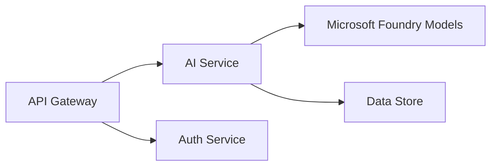
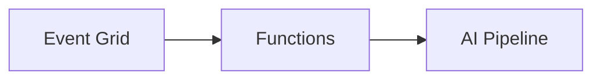

# Poglavlje 8: Produkcijski i Enterprise Obrasci

**📚 Tečaj**: [AZD za Početnike](../../README.md) | **⏱️ Trajanje**: 2-3 sata | **⭐ Složenost**: Napredno

---

## Pregled

Ovo poglavlje obuhvaća obrasce za implementaciju spremnu za enterprise, učvršćivanje sigurnosti, nadzor i optimizaciju troškova za proizvodne AI radne opterećenja.

Ovo je arhitektonska referenca, a ne kompletan spreman proizvodni predložak za implementaciju. Primjeri izostavljaju detalje integracije koje morate osigurati i testirati u vlastitoj aplikaciji; čitanje kontrolnog popisa ne jamči spremnost za proizvodnju.

> **Pregled izdanja (2026-11-04):** Upute za AI CLI provjerene su prema dokumentaciji/izvorima `azd 1.37.2`, agenata `1.0.0-beta.23` i evaluacija `1.0.0-beta.2`. Pogledajte [promjene i popravke izdanja](production-ai-practices.md#recent-release-changes-and-fixes) za zahtjeve kompatibilnosti i detalje migracije; ovo nije provjera stvarne proizvodne implementacije.

## Ciljevi učenja

Nakon završetka ovog poglavlja, moći ćete:
- Implementirati višeregionalne otporne aplikacije
- Primijeniti enterprise sigurnosne obrasce
- Konfigurirati opsežan nadzor
- Optimizirati troškove u velikom opsegu
- Postaviti CI/CD kanale pomoću AZD-a

---

## 📚 Lekcije

| # | Lekcija | Opis | Vrijeme |
|---|--------|-------------|------|
| 1 | [Produkcijske AI prakse](production-ai-practices.md) | Enterprise obrasci implementacije | 90 min |

---

## 🚀 Produkcijski Kontrolni Popis

- [ ] Višeregionalna implementacija za otpornost
- [ ] Upravljani identitet za autentikaciju (bez ključeva)
- [ ] Application Insights za nadzor
- [ ] Konfigurirani budžeti troškova i upozorenja
- [ ] Omogućeno skeniranje sigurnosti
- [ ] Integracija CI/CD kanala
- [ ] Plan za oporavak od katastrofa

---

## 🏗️ Arhitektonski Obrasci

### Obrazac 1: AI Microservices



### Obrazac 2: Događajem Pogonjeni AI



---

## 🔐 Najbolje Sigurnosne Prakse

```bicep
// Illustrative properties from different resources, NOT a standalone Bicep file.
// Attach identity to the application host:
identity: {
  type: 'SystemAssigned'
}

// AI account properties (also require private endpoints, DNS and app connectivity):
properties: {
  publicNetworkAccess: 'Disabled'
  networkAcls: {
    defaultAction: 'Deny'
  }
}
```

---

## 💰 Optimizacija Troškova

| Strategija | Glavno Ograničenje |
|----------|---------|
| Skaliranje na nulu (Container Apps) | Potreban je prikladan okidač; ostale usluge i dalje stvaraju troškove |
| Korištenje potrošačkih slojeva za razvoj | Usporedba cijena odabrane usluge i opterećenja |
| Raspoređeno skaliranje | Skaliranje kroz podržanu infrastrukturu/automatizaciju |
| Rezervacije/provizionirani kapacitet | Samo kad je podržano; obveze mogu povećati troškove neaktivnosti |

Koristite [kompletan obrazac resursa budžeta](production-ai-practices.md#2-cost-monitoring-and-budgets) s valjanim datumom početka, opsegom naplate, primateljima i dopuštenjima. Budžet šalje upozorenja; ne ograničava troškove. Uštede ovise o izmjerenoj iskorištenosti i nisu zajamčeni postoci.

---

## 📊 Postavljanje Nadzora

```bash
# Open the Application Insights logs view (requires configured monitoring)
azd monitor --logs

# Check Application Insights
azd monitor --overview

# View metrics
az monitor metrics list --resource <resource-id>
```

---

## 🔗 Navigacija

| Smjer | Poglavlje |
|-----------|---------|
| **Prethodno** | [Poglavlje 7: Rješavanje problema](../chapter-07-troubleshooting/README.md) |
| **Tečaj Završio** | [Početna stranica tečaja](../../README.md) |

---

## 📖 Povezani Resursi

- [Vodič za AI Agente](../chapter-02-ai-development/agents.md)
- [Application Insights](../chapter-06-pre-deployment/application-insights.md)
- [Rješenja s Višestrukim Agentima](../chapter-05-multi-agent/README.md)
- [Primjer Microservices](../../examples/microservices/README.md)

---

<!-- CO-OP TRANSLATOR DISCLAIMER START -->
**Napomena**:
Ovaj dokument je preveden korištenjem AI prevoditeljskog servisa [Co-op Translator](https://github.com/Azure/co-op-translator). Iako težimo točnosti, imajte na umu da automatski prijevodi mogu sadržavati greške ili netočnosti. Izvorni dokument na izvornom jeziku treba smatrati autoritativnim izvorom. Za važne informacije preporuča se profesionalni ljudski prijevod. Nismo odgovorni za bilo kakva nesporazumevanja ili pogrešne interpretacije koje proizlaze iz korištenja ovog prijevoda.
<!-- CO-OP TRANSLATOR DISCLAIMER END -->