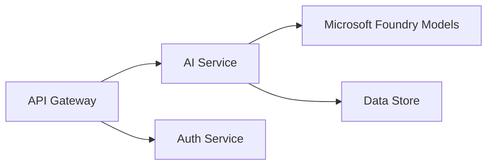
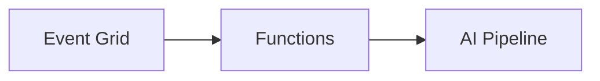

# Poglavlje 8: Obrasci za proizvodnju i poduzetništvo

**📚 Tečaj**: [AZD za početnike](../../README.md) | **⏱️ Trajanje**: 2-3 sata | **⭐ Kompleksnost**: Napredno

---

## Pregled

Ovo poglavlje pokriva obrasce za implementaciju spremnu za poduzeće, ojačavanje sigurnosti, nadzor i optimizaciju troškova za proizvodne AI radne zadatke.

Ovo je arhitektonski referentni materijal, a ne potpuni model za implementaciju u proizvodnju. Primjeri izostavljaju detalje integracije koje morate sami osigurati i testirati u svojoj aplikaciji; čitanje kontrolne liste ne jamči spremnost za proizvodnju.

> **Foundry GA ažuriranje (2026-11-09):** Koristite `azd >= 1.37.0` i općenito dostupni `microsoft.foundry` 1.0 paket za Foundry tijek rada; evaluacije se instaliraju zasebno. Pogledajte [opseg izdanja i migraciju](production-ai-practices.md#recent-release-changes-and-fixes) i [primjer autentificiranog tijeka](production-ai-practices.md#cicd-pipeline-configuration). Ovo je pregled dokumentacije, a ne validacija stvarne implementacije ili opća GA status za opcionalne značajke u pregledu.

## Ciljevi učenja

Završetkom ovog poglavlja, moći ćete:
- Implementirati višeregionalne otpornosti aplikacija
- Primijeniti sigurnosne obrasce za poduzeće
- Konfigurirati sveobuhvatan nadzor
- Optimizirati troškove u velikoj skali
- Postaviti CI/CD pipelineove s AZD-om

---

## 📚 Lekcije

| # | Lekcija | Opis | Vrijeme |
|---|--------|-------------|------|
| 1 | [Prakse za proizvodni AI](production-ai-practices.md) | Obrasci implementacije za poduzeće | 90 min |

---

## 🚀 Kontrolna lista za proizvodnju

- [ ] Višeregionalna implementacija za otpornost
- [ ] Upravljani identitet za autentifikaciju (bez ključeva)
- [ ] Application Insights za nadzor
- [ ] Konfigurirani budžeti i upozorenja za troškove
- [ ] Omogućeno skeniranje sigurnosti
- [ ] Integracija CI/CD pipeline-a
- [ ] Plan oporavka od katastrofe

---

## 🏗️ Arhitektonski obrasci

### Obrasci 1: Mikroservisi i AI



### Obrasci 2: AI okidač na događaje



---

## 🔐 Najbolje sigurnosne prakse

```bicep
// Illustrative properties from different resources, NOT a standalone Bicep file.
// Attach identity to the application host:
identity: {
  type: 'SystemAssigned'
}

// AI account properties (also require private endpoints, DNS and app connectivity):
properties: {
  publicNetworkAccess: 'Disabled'
  networkAcls: {
    defaultAction: 'Deny'
  }
}
```

---

## 💰 Optimizacija troškova

| Strategija | Glavno ograničenje |
|----------|---------|
| Skaliranje na nulu (Container Apps) | Zahtijeva prikladni okidač; ostale usluge i dalje imaju troškove |
| Korištenje potrošačkih razina za razvoj | Usporedba cijena odabrane usluge i radnog opterećenja |
| Planirano skaliranje | Skaliranje kroz podržanu infrastrukturu/automatizaciju |
| Rezervacije/pružena kapacitet | Samo kad je podržano; ugovori mogu povećati troškove kad je neiskorišteno |

Koristite [potpuni obrazac budžeta resursa](production-ai-practices.md#2-cost-monitoring-and-budgets) s valjanim datumom početka, opsegom naplate, primateljima i dozvolama. Budžet šalje upozorenja; ne ograničava potrošnju. Uštede ovise o izmjerenoj iskorištenosti i nisu zajamčeni postotci.

---

## 📊 Postavljanje nadzora

```bash
# Open the Application Insights logs view (requires configured monitoring)
azd monitor --logs

# Check Application Insights
azd monitor --overview

# View metrics
az monitor metrics list --resource <resource-id>
```

---

## 🔗 Navigacija

| Smjer | Poglavlje |
|-----------|---------|
| **Prethodno** | [Poglavlje 7: Rješavanje problema](../chapter-07-troubleshooting/README.md) |
| **Završetak tečaja** | [Početna stranica tečaja](../../README.md) |

---

## 📖 Povezani resursi

- [Vodič za AI agente](../chapter-02-ai-development/agents.md)
- [Application Insights](../chapter-06-pre-deployment/application-insights.md)
- [Višestruka agentska rješenja](../chapter-05-multi-agent/README.md)
- [Primjer mikroservisa](../../examples/microservices/README.md)

---

<!-- CO-OP TRANSLATOR DISCLAIMER START -->
**Napomena**:
Ovaj dokument je preveden korištenjem AI prevoditeljskog servisa [Co-op Translator](https://github.com/Azure/co-op-translator). Iako težimo točnosti, imajte na umu da automatski prijevodi mogu sadržavati greške ili netočnosti. Izvorni dokument na izvornom jeziku treba smatrati autoritativnim izvorom. Za važne informacije preporuča se profesionalni ljudski prijevod. Nismo odgovorni za bilo kakva nesporazumevanja ili pogrešne interpretacije koje proizlaze iz korištenja ovog prijevoda.
<!-- CO-OP TRANSLATOR DISCLAIMER END -->