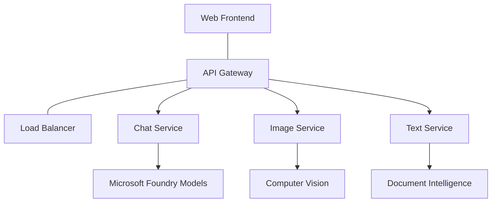

# Najbolje prakse radnog opterećenja proizvodnje AI pomoću AZD-a

**Navigacija poglavljem:**
- **📚 Početna stranica tečaja**: [AZD za početnike](../../README.md)
- **📖 Trenutno poglavlje**: Poglavlje 8 - Uzorci za proizvodnju i poduzeća
- **⬅️ Prethodno poglavlje**: [Poglavlje 7: Otklanjanje poteškoća](../chapter-07-troubleshooting/debugging.md)
- **⬅️ Također povezano**: [AI radionica laboratorij](../chapter-02-ai-development/ai-workshop-lab.md)
- **🎯 Završen tečaj**: [AZD za početnike](../../README.md)

## Pregled

Ovaj vodič objašnjava uzorke dizajna umjetne inteligencije za proizvodnju koristeći Azure Developer CLI (AZD). To je referenca za dizajn, a ne primjenjiva aplikacija ili certifikat za proizvodnju.

**Primjeri granica:** Ako nije izričito opisano kao kompletno, fragmente Bicepa pretpostavljaju parametre i referencirane resurse iz sadržavajućeg predloška. Izostavljaju slike/planske planove hostova, identitete, uloge, DNS, izlaze i ostalu potrebnu integraciju. YAML putanje servisa i skripte za hook/test samo su ilustrativne datoteke koje trebate izraditi u **vlastitoj aplikaciji**; one nisu isporučene s ovim tečajem. Koristite radni uzorak AZD-a kao bazu, sastavite kompletnu infrastrukturu i testirajte je u izoliranom okruženju prije proizvodnje.

## Ključni izazovi koji se rješavaju

Uobičajene brige proizvodnje uključuju višestruke implementacije usluga, upravljanje identitetom i tajnama, skaliranje, kontrolu troškova i nadzor. Ovdje se ne tvrdi mjerenje učestalosti.

## Arhitektonski uzorci za proizvodnu AI

### Uzorak 1: Arhitektura mikroservisa za AI

**Kada koristiti**: Kompleksne AI aplikacije s višestrukim funkcionalnostima



**AZD implementacija**:

```yaml
# azure.yaml
name: enterprise-ai-platform
services:
  web:
    project: ./web
    host: staticwebapp
  api-gateway:
    project: ./api-gateway
    host: containerapp
  chat-service:
    project: ./services/chat
    host: containerapp
  vision-service:
    project: ./services/vision
    host: containerapp
  text-service:
    project: ./services/text
    host: containerapp
```

### Uzorak 2: Obrada AI temeljena na događajima

**Kada koristiti**: Obrada u serijama, analiza dokumenata, asinkroni radni tokovi

```bicep
// Event Hub for AI processing pipeline
resource eventHub 'Microsoft.EventHub/namespaces@2024-01-01' = {
  name: eventHubNamespaceName
  location: location
  sku: {
    name: 'Standard'
    tier: 'Standard'
    capacity: 1
  }
}

// Service Bus for reliable message processing
resource serviceBus 'Microsoft.ServiceBus/namespaces@2024-01-01' = {
  name: serviceBusNamespaceName
  location: location
  sku: {
    name: 'Premium'
    tier: 'Premium'
    capacity: 1
  }
}

// Function App for processing
resource functionApp 'Microsoft.Web/sites@2023-01-01' = {
  name: functionAppName
  location: location
  kind: 'functionapp,linux'
  properties: {
    siteConfig: {
      appSettings: [
        {
          name: 'FUNCTIONS_EXTENSION_VERSION'
          value: '~4'
        }
        {
          name: 'AZURE_OPENAI_ENDPOINT'
          value: '@Microsoft.KeyVault(VaultName=${keyVault.name};SecretName=openai-endpoint)'
        }
      ]
    }
  }
}
```

Ovo stvara fragmente namespace-a, ne hubove, queue-e, pretplate ili okidače funkcija. Izvršna funkcija također treba plan hostinga, konfiguraciju runtime/a i pohrane, pridruženi identitet, RBAC i mrežni pristup. Referenca na Key Vault treba dozvolu za čitanje tajne; URL krajnje točke nije vjerodajnica.

## Razmišljanje o zdravlju AI agenta

Kad se tradicionalna web aplikacija pokvari, simptomi su poznati: stranica se ne učitava, API vraća pogrešku ili implementacija ne uspije. AI aplikacije mogu se pokvariti na sve te načine—ali također se mogu ponašati suptilnije načine koji ne proizvode očite poruke o pogrešci.

Ovaj odjeljak pomaže vam izgraditi mentalni model za nadziranje AI radnih opterećenja tako da znate gdje gledati kad stvari ne izgledaju ispravno.

### Kako se zdravlje agenta razlikuje od zdravlja tradicionalne aplikacije

Tradicionalne aplikacije također mogu imati suptilne pogreške ispravnosti. AI agent dodaje nedeterminističku kvalitetu odgovora uz uobičajene brige o dostupnosti i ispravnosti. Razmislite o zdravlju agenta u dva sloja:

| Sloj | Što pratiti | Gdje gledati |
|-------|--------------|---------------|
| **Zdravlje infrastrukture** | Radi li servis? Jesu li resursi osigurani? Jesu li krajnje točke dostupne? | `azd monitor`, Azure Portal zdravlje resursa, zapisi kontejnera/aplikacije |
| **Zdravlje ponašanja** | Odgovara li agent točno? Jesu li odgovori pravovremeni? Je li model ispravno pozvan? | Application Insights tragovi, metričke kašnjenja poziva modela, zapisi kvalitete odgovora |

Zdravlje infrastrukture je poznato—isto je kao za bilo koju azd aplikaciju. Zdravlje ponašanja je novi sloj koji AI radna opterećenja uvode.

### Gdje gledati kad AI aplikacije ne rade kako se očekuje

Ako vaša AI aplikacija ne daje očekivane rezultate, evo konceptualnog kontrolnog popisa:

1. **Počnite od osnova.** Radi li aplikacija? Može li pristupiti svojim ovisnostima? Provjerite `azd monitor` i zdravlje resursa kao za bilo koju aplikaciju.
2. **Provjerite konekciju modela.** Zove li aplikacija uspješno AI model? Neuspjeli ili timeout pozivi modelu najčešći su uzrok problema s AI aplikacijama i pojavit će se u zapisnicima aplikacije.
3. **Sigurno pregledajte ulaz i osnove.** Pogrešni odgovori mogu biti rezultat dohvaćanja, uputa, ograničenja modela ili izvršenja alata. Koristite dijagnostičke podatke s kontroliranim pristupom i maskiranjem; nemojte uključivati neograničeno logiranje promptova/odgovora u produkciji.
4. **Pregledajte kašnjenje odgovora.** Pozivi modelu AI traju duže od uobičajenih API poziva. Ako se aplikacija čini usporenom, provjerite je li vrijeme odgovora modela poraslo—to može ukazivati na ograničenje, kapacitete ili zagušenje na razini regije.
5. **Pazite na signale troškova.** Neočekivani skokovi u korištenju tokena ili API poziva mogu ukazivati na petlju, krivo konfigurirani prompt ili pretjerane ponovne pokušaje.

Ne morate odmah savladati alate za promatranje. Ključna poruka je da AI aplikacije imaju dodatni sloj ponašanja kojeg treba nadzirati, a ugrađeni nadzor azd-a (`azd monitor`) pruža početnu točku za istraživanje oba sloja.

---

## Najbolje sigurnosne prakse

### 1. Zero-Trust sigurnosni model

**Strategija implementacije**:
- Nema komunikacije servis-servis bez autentifikacije
- Svi API pozivi koriste upravljane identitete
- Mrežna izolacija s privatnim krajnjim točkama
- Kontrola pristupa s najmanjim privilegijama

```bicep
// Managed Identity for each service
resource chatServiceIdentity 'Microsoft.ManagedIdentity/userAssignedIdentities@2023-01-31' = {
  name: 'chat-service-identity'
  location: location
}

// Role assignments with minimal permissions
resource openAIUserRole 'Microsoft.Authorization/roleAssignments@2022-04-01' = {
  scope: openAIAccount
  name: guid(openAIAccount.id, chatServiceIdentity.id, '5e0bd9bd-7b93-4f28-af87-19fc36ad61bd')
  properties: {
    roleDefinitionId: subscriptionResourceId('Microsoft.Authorization/roleDefinitions', '5e0bd9bd-7b93-4f28-af87-19fc36ad61bd')
    principalId: chatServiceIdentity.properties.principalId
    principalType: 'ServicePrincipal'
  }
}
```

### 2. Sigurno upravljanje tajnama

**Uzorak integracije Key Vault-a**:

```bicep
// Key Vault with proper access policies
resource keyVault 'Microsoft.KeyVault/vaults@2023-02-01' = {
  name: keyVaultName
  location: location
  properties: {
    tenantId: tenant().tenantId
    sku: {
      family: 'A'
      name: 'standard' // Premium is needed for HSM-backed keys, not ordinary secrets
    }
    enableRbacAuthorization: true  // Use RBAC instead of access policies
    enablePurgeProtection: true    // Prevent accidental deletion
    enableSoftDelete: true
    softDeleteRetentionInDays: 90
  }
}

// Optional legacy key-auth alternative; omit when using Entra ID.
resource openAIKeySecret 'Microsoft.KeyVault/vaults/secrets@2023-02-01' = {
  parent: keyVault
  name: 'openai-api-key'
  properties: {
    value: openAIAccount.listKeys().key1
    attributes: {
      enabled: true
    }
  }
}
```

Dodijelite runtime identitet `Key Vault Secrets User` na odgovarajućem opsegu i pridružite ga hostu; samo `enableRbacAuthorization` ne daje pristup. Preferirajte autentifikaciju upravljanom identitetom OpenAI pomoću `disableLocalAuth: true`. Opcionalni ključ tajne smislen je samo za račun s namjenski omogućenim ključem, a ovlasti provisioning glavnog računa također trebaju dozvolu za zapisivanje tajni.

### 3. Mrežna sigurnost

**Konfiguracija privatnih krajnjih točaka**:

```bicep
// Virtual Network for AI services
resource virtualNetwork 'Microsoft.Network/virtualNetworks@2023-04-01' = {
  name: vnetName
  location: location
  properties: {
    addressSpace: {
      addressPrefixes: ['10.0.0.0/16']
    }
    subnets: [
      {
        name: 'ai-services-subnet'
        properties: {
          addressPrefix: '10.0.1.0/24'
          privateEndpointNetworkPolicies: 'Disabled'
        }
      }
      {
        name: 'app-services-subnet'
        properties: {
          addressPrefix: '10.0.2.0/24'
          delegations: [
            {
              name: 'Microsoft.Web/serverFarms'
              properties: {
                serviceName: 'Microsoft.Web/serverFarms'
              }
            }
          ]
        }
      }
    ]
  }
}

// Private endpoints for all AI services
resource openAIPrivateEndpoint 'Microsoft.Network/privateEndpoints@2023-04-01' = {
  name: '${openAIAccountName}-pe'
  location: location
  properties: {
    subnet: {
      id: virtualNetwork.properties.subnets[0].id
    }
    privateLinkServiceConnections: [
      {
        name: 'openai-connection'
        properties: {
          privateLinkServiceId: openAIAccount.id
          groupIds: ['account']
        }
      }
    ]
  }
}
```

Privatne krajnje točke također zahtijevaju privatne DNS zonu skupine/VNet linkove i integraciju aplikacije s VNetom. One ne blokiraju automatski javni pristup: eksplicitno onemogućite javni mrežni pristup AI računu nakon potvrde privatne povezanosti i pristupa implementaciji.

## Performanse i skaliranje

### 1. Strategije automatskog skaliranja

**Automatsko skaliranje Container aplikacija**:

```bicep
resource containerApp 'Microsoft.App/containerApps@2023-05-01' = {
  name: containerAppName
  location: location
  properties: {
    configuration: {
      ingress: {
        external: true
        targetPort: 8000
        transport: 'http'
      }
    }
    template: {
      scale: {
        minReplicas: 2  // Always have 2 instances minimum
        maxReplicas: 50 // Scale up to 50 for high load
        rules: [
          {
            name: 'http-scaling'
            http: {
              metadata: {
                concurrentRequests: '20'  // Scale when >20 concurrent requests
              }
            }
          }
          {
            name: 'cpu-scaling'
            custom: {
              type: 'cpu'
              metadata: {
                type: 'Utilization'
                value: '70'  // Scale when CPU >70%
              }
            }
          }
        ]
      }
    }
  }
}
```

### 2. Strategije keširanja

**Redis keš za AI odgovore**:

```bicep
// Legacy Azure Cache for Redis example (not recommended for new deployments)
resource redisCache 'Microsoft.Cache/redis@2023-04-01' = {
  name: redisCacheName
  location: location
  properties: {
    sku: {
      name: 'Premium'
      family: 'P'
      capacity: 1
    }
    enableNonSslPort: false
    minimumTlsVersion: '1.2'
    redisConfiguration: {
      'maxmemory-policy': 'allkeys-lru'
    }
    // Sharding distributes data; replication/failover provides availability.
    shardCount: 2
  }
}

// Cache configuration in application
var cacheConnectionString = '${redisCache.properties.hostName}:6380,password=${redisCache.listKeys().primaryKey},ssl=True,abortConnect=False'
```

Azure Cache za Redis Basic/Standard/Premium je na [putu povlačenja](https://learn.microsoft.com/azure/azure-cache-for-redis/retirement-faq). Koristite Azure Managed Redis za nove dizajne te njegov dokumentirani SKU, identitet i TLS konfiguraciju, umjesto da kopirate ovaj zastarjeli resurs u novi proizvodni sustav. Linija s connection-stringom je nefunkcionalni rezervni znak, nije vjerodajnica. Ključeve keša particionirajte prema autorizaciji, modelu/uputama i verziji dohvaćanja, s istekom; zajednički keš samo za upite može izložiti podatke drugog korisnika.

### 3. Balansiranje opterećenja i upravljanje prometom

**Application Gateway s WAF-om**:

```bicep
// Application Gateway with Web Application Firewall
resource applicationGateway 'Microsoft.Network/applicationGateways@2023-04-01' = {
  name: appGatewayName
  location: location
  properties: {
    sku: {
      name: 'WAF_v2'
      tier: 'WAF_v2'
      capacity: 2
    }
    webApplicationFirewallConfiguration: {
      enabled: true
      firewallMode: 'Prevention'
      ruleSetType: 'OWASP'
      ruleSetVersion: '3.2'
    }
    // Backend pools for AI services
    backendAddressPools: [
      {
        name: 'ai-services-pool'
        properties: {
          backendAddresses: [
            {
              fqdn: '${containerApp.properties.configuration.ingress.fqdn}'
            }
          ]
        }
      }
    ]
  }
}
```

Ovo je djelomični gateway resurs: stvarna implementacija također zahtijeva gateway subnet/IP konfiguraciju, frontend IP-ove i porte, TLS slušatelje/sertifikate, backend HTTP postavke/probe, pravila usmjeravanja i prioritete te revidiranu WAF politiku. TLS hostname/SNI i autentifikacija moraju se podudarati sa backendom Container aplikacija.

## 💰 Optimizacija troškova

### 1. Pravilno dimenzioniranje resursa

**Konfiguracije specifične za okruženje**:

Ova imena su **ilustrativni unosi za prilagođeni predložak**, ne automatske AZD postavke. Svaki mapirajte u `infra/main.parameters.json`/Bicep i konfiguraciju hosta prvo. Na primjer, RAG primjer koristi `AZURE_SEARCH_SERVICE_SKU` i `AZURE_OPENAI_CHATGPT_DEPLOYMENT_CAPACITY`, ne generička imena ispod. Dodijelite memoriju Container aplikacijama u podržane jedinice poput `1Gi` u stvarnom resursu. Primijenite infrastrukturne promjene koristeći `azd up` ili `azd provision`; samo `azd deploy` ne primjenjuje Bicep promjene.

```bash
# Development environment
azd env new development
azd env set AZURE_OPENAI_SKU "S0"
azd env set AZURE_OPENAI_CAPACITY 10
azd env set AZURE_SEARCH_SKU "basic"
azd env set CONTAINER_CPU 0.5
azd env set CONTAINER_MEMORY 1.0

# Production environment  
azd env new production
azd env set AZURE_OPENAI_SKU "S0"
azd env set AZURE_OPENAI_CAPACITY 100
azd env set AZURE_SEARCH_SKU "standard"
azd env set CONTAINER_CPU 2.0
azd env set CONTAINER_MEMORY 4.0
```

### 2. Praćenje troškova i budžeti

```bicep
// Supply the first day of the current UTC month, e.g. 2026-11-01T00:00:00Z.
param budgetStartDate string

// Cost management and budgets
resource budget 'Microsoft.Consumption/budgets@2024-08-01' = {
  name: 'ai-workload-budget'
  properties: {
    timePeriod: {
      startDate: budgetStartDate
    }
    timeGrain: 'Monthly'
    amount: 2000  // In the billing currency, not necessarily USD
    category: 'Cost'
    notifications: {
      warning: {
        enabled: true
        operator: 'GreaterThan'
        threshold: 80
        contactEmails: [
          'finance@company.com'
          'engineering@company.com'
        ]
        contactRoles: [
          'Owner'
          'Contributor'
        ]
      }
      critical: {
        enabled: true
        operator: 'GreaterThan'
        threshold: 95
        contactEmails: [
          'cto@company.com'
        ]
      }
    }
  }
}
```

Zamijenite primjere primatelja i provjerite opseg/dozvole. Upozorenja o budžetu koriste odgođene račune i ne nameću ograničenje potrošnje.

### 3. Optimizacija korištenja tokena

**Upravljanje troškovima OpenAI-ja**:

Ovo je samo heuristika temeljena na znakovima za UI pregled, **nije** validator ograničenja tokena modela. Proizvodni kod mora koristiti tokenizator prikladan za implementirani model i uzeti u obzir sistemske upute, sheme alata, povijest i proračun izlaza. Odbacite preveliku korisničku poruku umjesto tihog skraćivanja.

```typescript
// Application-level token optimization
class TokenOptimizer {
  private readonly maxTokens = 4000;
  private readonly reserveTokens = 500;
  
  optimizePrompt(userInput: string, context: string): string {
    const availableTokens = this.maxTokens - this.reserveTokens;
    if (this.estimateTokens(userInput) + 8 >= availableTokens) {
      throw new Error("User input exceeds the illustrative prompt budget");
    }
    const estimatedTokens = this.estimateTokens(userInput + context) + 8;
    
    if (estimatedTokens > availableTokens) {
      // Truncate context, not user input
      context = this.truncateContext(context, Math.max(0, availableTokens - this.estimateTokens(userInput) - 8));
    }
    
    return `${context}\n\nUser: ${userInput}`;
  }
  
  private estimateTokens(text: string): number {
    // Rough estimation: 1 token ≈ 4 characters
    return Math.ceil(text.length / 4);
  }

  private truncateContext(text: string, estimatedBudget: number): string {
    return text.slice(0, Math.max(0, estimatedBudget) * 4);
  }
}
```

## Praćenje i vidljivost

### 1. Sveobuhvatni Application Insights

```bicep
// Application Insights with advanced features
resource applicationInsights 'Microsoft.Insights/components@2020-02-02' = {
  name: applicationInsightsName
  location: location
  kind: 'web'
  properties: {
    Application_Type: 'web'
    WorkspaceResourceId: logAnalyticsWorkspace.id
    SamplingPercentage: 100  // Ingestion setting; review cost and SDK sampling separately
    DisableIpMasking: false  // Retain IP masking
  }
}

// Custom metrics for AI operations
resource aiMetricAlerts 'Microsoft.Insights/metricAlerts@2018-03-01' = {
  name: 'ai-high-error-rate'
  location: 'global'
  properties: {
    description: 'Alert when failed request count exceeds 10 in five minutes'
    severity: 2
    enabled: true
    scopes: [
      applicationInsights.id
    ]
    evaluationFrequency: 'PT1M'
    windowSize: 'PT5M'
    criteria: {
      'odata.type': 'Microsoft.Azure.Monitor.SingleResourceMultipleMetricCriteria'
      allOf: [
        {
          name: 'high-error-rate'
          metricName: 'requests/failed'
          operator: 'GreaterThan'
          threshold: 10
          timeAggregation: 'Count'
        }
      ]
    }
  }
}
```

### 2. AI-specifično praćenje

**Prilagođene nadzorne ploče za AI metrike**:

```json
{
  "dashboard": {
    "name": "AI Application Monitoring",
    "tiles": [
      {
        "name": "OpenAI Request Volume",
        "query": "dependencies | where target contains 'openai' | summarize count() by bin(timestamp, 5m)"
      },
      {
        "name": "AI Response Latency",
        "query": "dependencies | where target contains 'openai' | summarize avg(duration) by bin(timestamp, 5m)"
      },
      {
        "name": "Token Usage",
        "query": "customMetrics | where name == 'openai_tokens_used' | summarize sum(value) by bin(timestamp, 1h)"
      },
      {
        "name": "Cost per Hour",
        "query": "customMetrics | where name == 'openai_cost' | summarize sum(value) by bin(timestamp, 1h)"
      }
    ]
  }
}
```

Ovaj JSON je aplikacijski definirani nacrt, ne uvoziva šema nadzorne ploče u Azure portalu. Upiti za tokene/troškove zahtijevaju da vaša aplikacija emitira te točno prilagođene metrike; nisu kreirani od strane AZD-a. Prilagodite filtere ovisnosti stvarnim imenima krajnjih točaka/modela i raspona.

### 3. Provjere zdravlja i nadzor dostupnosti

```bicep
// Application Insights availability tests
resource availabilityTest 'Microsoft.Insights/webtests@2022-06-15' = {
  name: 'ai-app-availability-test'
  location: location
  tags: {
    'hidden-link:${applicationInsights.id}': 'Resource'
  }
  properties: {
    SyntheticMonitorId: 'ai-app-availability-test'
    Name: 'AI Application Availability Test'
    Description: 'Tests AI application endpoints'
    Enabled: true
    Frequency: 300  // 5 minutes
    Timeout: 120    // 2 minutes
    Kind: 'standard'
    Locations: [
      {
        Id: 'us-east-2-azr'
      }
      {
        Id: 'us-west-2-azr'
      }
    ]
    Request: {
      RequestUrl: 'https://${webApp.properties.defaultHostName}/health'
      HttpVerb: 'GET'
      FollowRedirects: true
      ParseDependentRequests: false
    }
    ValidationRules: {
      ExpectedHttpStatusCode: 200
      SSLCheck: true
      SSLCertRemainingLifetimeCheck: 7
    }
  }
}
```

## Oporavak od katastrofe i visoka dostupnost

Prethodni test pretpostavlja postojeći App Service `webApp` i resurs Application Insights-a. Standardni testovi dostupnosti su naplativi i zahtijevaju dostupnu krajnju točku; aplikacije samo za privatnu mrežu trebaju odgovarajući dizajn privatnog nadzora. URL ping testovi su zastarjeli; koristite [standardne testove dostupnosti](https://learn.microsoft.com/azure/azure-monitor/app/availability).

### 1. Implementacija u višestruke regije

```yaml
# azure.yaml - Multi-region configuration
name: ai-app-multiregion
services:
  api-primary:
    project: ./api
    host: containerapp
    env:
      AZURE_REGION: eastus
  api-secondary:
    project: ./api
    host: containerapp
    env:
      AZURE_REGION: westus2
```

```bicep
// Separate App Service topology, not the Container Apps declarations above
resource trafficManager 'Microsoft.Network/trafficManagerProfiles@2022-04-01' = {
  name: trafficManagerProfileName
  location: 'global'
  properties: {
    profileStatus: 'Enabled'
    trafficRoutingMethod: 'Priority'
    dnsConfig: {
      relativeName: trafficManagerProfileName
      ttl: 30
    }
    monitorConfig: {
      protocol: 'HTTPS'
      port: 443
      path: '/health'
      intervalInSeconds: 30
      toleratedNumberOfFailures: 3
      timeoutInSeconds: 10
    }
    endpoints: [
      {
        name: 'primary-endpoint'
        type: 'Microsoft.Network/trafficManagerProfiles/azureEndpoints'
        properties: {
          targetResourceId: primaryAppService.id
          endpointStatus: 'Enabled'
          priority: 1
        }
      }
      {
        name: 'secondary-endpoint'
        type: 'Microsoft.Network/trafficManagerProfiles/azureEndpoints'
        properties: {
          targetResourceId: secondaryAppService.id
          endpointStatus: 'Enabled'
          priority: 2
        }
      }
    ]
  }
}
```

Varijable okruženja ne biraju lokacije resursa. IaC mora osigurati različite regionalne hostove i vezati svaki servis s `resourceName` ili `azd-service-name` oznakama. Primjer Traffic Managera je **odvojena App Service topologija** (`primaryAppService`/`secondaryAppService`), ne usmjeravanje za deklaracije Container aplikacija. Container aplikacije zahtijevaju pravilno konfiguriranu eksternu krajnju točku/front door, TLS/prilagođeno usmjeravanje domene i probe zdravlja.

### 2. Sigurnosna kopija podataka i oporavak

```bicep
// Backup configuration for critical data
resource backupVault 'Microsoft.DataProtection/backupVaults@2023-05-01' = {
  name: backupVaultName
  location: location
  identity: {
    type: 'SystemAssigned'
  }
  properties: {
    storageSettings: [
      {
        datastoreType: 'VaultStore'
        type: 'LocallyRedundant'
      }
    ]
  }
}

```

Sam vault ne radi sigurnosne kopije. Konfigurirajte **specifičnu za radno opterećenje podržanu politiku i instancu sigurnosne kopije**, izvorne dozvole, zadržavanje i testove oporavka koristeći [Azure Backup matrice podrške](https://learn.microsoft.com/azure/backup/backup-support-matrix). Nema generičke Azure Backup politike za implementacije modela Azure OpenAI koji se hostaju. Čuvajte definicije infrastrukture/modela u kontroli izvora; zaštitite učitane dokumente, podatke aplikacije i artefakte fino podešavanja koristeći podržane funkcije sigurnosnih kopija/izvoza za svaki servis. Izričito definirajte i testirajte RPO/RTO.

## DevOps i CI/CD integracija

### 1. GitHub Actions radni tijek

```yaml
# .github/workflows/deploy-ai-app.yml
name: Deploy AI Application

on:
  push:
    branches: [main]
  pull_request:
    branches: [main]

jobs:
  test:
    runs-on: ubuntu-latest
    steps:
      - uses: actions/checkout@v4
      
      - name: Setup Python
        uses: actions/setup-python@v4
        with:
          python-version: '3.11'
          
      - name: Install dependencies
        run: |
          pip install -r requirements.txt
          pip install pytest
          
      - name: Run tests
        run: pytest tests/
        
      - name: AI Safety Tests
        run: |
          python scripts/test_ai_safety.py
          python scripts/validate_prompts.py

```

Ovo je **samo testni dio** radnog tijeka i pretpostavlja da ste izradili `requirements.txt`, `tests/` i dvije sigurnosne skripte. Dodajte autentificirane OIDC provisioning/deployment poslove iz [CI/CD konfiguracije](#cicd-pipeline-configuration), s `needs: test`, pouzdanim push/manualnim okidačem i zaštićenim GitHub okruženjima. Nemojte implementirati nepovjerljiv kod pull-request-a s cloud vjerodajnicama. Svježi runner nema odabrano lokalno AZD okruženje; dostavite ulaze okruženja/pretplate/lokacije i koristite `azd auth login`, ne samo `azure/login`.

### 2. Validacija infrastrukture

```bash
# scripts/validate_infrastructure.sh
#!/bin/bash
set -euo pipefail

echo "Validating AI infrastructure deployment..."

# Requires Azure CLI login and the resource group selected explicitly.
: "${AZURE_RESOURCE_GROUP:?Set AZURE_RESOURCE_GROUP}"
: "${AZURE_OPENAI_NAME:?Set AZURE_OPENAI_NAME}"
: "${AZURE_OPENAI_CHAT_DEPLOYMENT:?Set the actual deployment name}"

# A successful empty list is not proof that resources exist.
types=("Microsoft.CognitiveServices/accounts" "Microsoft.Search/searchServices"
       "Microsoft.Storage/storageAccounts" "Microsoft.KeyVault/vaults")
for resource_type in "${types[@]}"; do
    count=$(az resource list --resource-group "$AZURE_RESOURCE_GROUP" \
        --resource-type "$resource_type" --query "length(@)" -o tsv)
    if [[ "$count" -lt 1 ]]; then
        echo "ERROR: No $resource_type found in $AZURE_RESOURCE_GROUP"
        exit 1
    fi
done

# Validate OpenAI model deployments
echo "Validating OpenAI model deployments..."
state=$(az cognitiveservices account deployment show \
  --name "$AZURE_OPENAI_NAME" --resource-group "$AZURE_RESOURCE_GROUP" \
  --deployment-name "$AZURE_OPENAI_CHAT_DEPLOYMENT" \
  --query "properties.provisioningState" -o tsv)
if [[ "$state" != "Succeeded" ]]; then
    echo "ERROR: Required model deployment is not provisioned successfully"
    exit 1
fi

echo "Infrastructure validation completed successfully!"
```

Očekivano: nulta izlazna vrijednost i poruka završetka samo kad svi očekivani tipovi postoje i imenovana implementacija modela je osigurana. Ovo provjerava stanje inventara/provisioninga, **ne** zdravlje resursa, točnu topologiju, RBAC, mrežnu dostupnost ili ponašanje modela. Prilagodite očekivane tipove svojoj arhitekturi, zatim izvedite odvojeni autentificirani test spremnosti aplikacije.

## Kontrolni popis spremnosti za proizvodnju

### Sigurnost ✅
- [ ] Sve usluge koriste upravljane identitete
- [ ] Tajne pohranjene u Key Vault
- [ ] Konfigurirane privatne krajnje točke
- [ ] Implementirane mrežne sigurnosne grupe
- [ ] RBAC s najmanjim privilegijama
- [ ] WAF omogućen na javnim krajnjim točkama

### Performanse ✅
- [ ] Konfigurirano automatsko skaliranje
- [ ] Implementiran keš
- [ ] Postavljeno balansiranje opterećenja
- [ ] CDN za statički sadržaj
- [ ] Pooliranje veza baze podataka
- [ ] Optimizacija korištenja tokena

### Praćenje ✅
- [ ] Konfiguriran Application Insights
- [ ] Definirane prilagođene metrike
- [ ] Postavljeni pravila upozorenja
- [ ] Kreirana nadzorna ploča
- [ ] Implementirane provjere zdravlja
- [ ] Politike zadržavanja zapisa

### Pouzdanost ✅
- [ ] Implementacija u višeregionalnu infrastrukturu
- [ ] Plan sigurnosne kopije i oporavka
- [ ] Implementirani circuit breaker-i
- [ ] Konfigurirane politike ponovnih pokušaja
- [ ] Graceful degradacija
- [ ] Krajnje točke provjere zdravlja

### Upravljanje troškovima ✅
- [ ] Konfigurirana upozorenja budžeta
- [ ] Pravilno dimenzionirani resursi
- [ ] Primijenjeni popusti za razvoj/testiranje
- [ ] Kupljene rezervirane instance
- [ ] Nadzorna ploča za praćenje troškova
- [ ] Redovita analiza troškova

### Usklađenost ✅
- [ ] Zadovoljavanje zahtjeva o lokaciji podataka
- [ ] Omogućeno auditiranje zapisa
- [ ] Primijenjene politike usklađenosti
- [ ] Implementirane sigurnosne osnovne linije
- [ ] Redovite sigurnosne procjene
- [ ] Plan za odgovor na incidente

## Performansni benchmarkovi

### Ilustrativni ciljevi proizvodnje

Ovo su primjeri SLO-a za pregovore i testiranje opterećenja, ne mjerene varijable ili jamstva. Kašnjenje odgovora ovisi o modelu/duljini izlaza; mjesečna potrošnja tokena ovisi o prometu i cijenama, ne samo o broju tokena.

| Mjera | Cilj | Praćenje |
|--------|--------|------------|
| **Vrijeme odgovora** | < 2 sekunde | Application Insights |
| **Dostupnost** | 99,9% | Praćenje dostupnosti |
| **Stopa pogrešaka** | < 0,1% | Zapisi aplikacije |
| **Trošak modela** | < 500 $/mjesečno (primjer budžeta) | Upravljanje troškovima |
| **Istovremeni korisnici** | 1000+ | Testiranje opterećenja |
| **Vrijeme oporavka** | < 1 sat | Testovi oporavka od katastrofe |

### Testiranje opterećenja

Slijedi skica sučelja za skriptu za testiranje opterećenja koju **morate implementirati**; ovaj repozitorij ne isporučuje `scripts/load_test.py`. Definirajte zahtjeve za payload, autentifikaciju, reprezentativne radne opterećenja, provjere latencije/gresaka u postotcima i ograničenje troškova u odabranom alatu za testiranje opterećenja prije pokretanja:

```bash
# Load testing script for AI applications
python scripts/load_test.py \
  --endpoint https://your-ai-app.azurewebsites.net \
  --concurrent-users 100 \
  --duration 300 \
  --ramp-up 60
```

## 🤝 Najbolje prakse zajednice

Na temelju povratnih informacija zajednice Microsoft Foundry Discord:

### Najvažnije preporuke zajednice:

1. **Počnite malo, postepeno skalirajte**: Počnite s osnovnim SKU-ovima i skalirajte prema stvarnoj upotrebi
2. **Nadzor svega**: Postavite sveobuhvatan nadzor od prvog dana
3. **Automatizirajte sigurnost**: Koristite infrastrukturu kao kod za dosljednu sigurnost
4. **Temeljito testirajte**: Uključite AI-specifično testiranje u svoj pipeline
5. **Planirajte troškove**: Pratite potrošnju tokena i postavite upozorenja o budžetu rano

### Česte zamke koje treba izbjegavati:

- ❌ Hardkodiranje API ključeva u kod
- ❌ Nepostavljanje pravilnog nadzora
- ❌ Zanemarivanje optimizacije troškova
- ❌ Ne testiranje scenarija neuspjeha
- ❌ Implementacija bez provjera zdravlja

## AZD AI CLI naredbe i ekstenzije

AZD uključuje rastući skup AI-specifičnih naredbi i proširenja koja pojednostavljuju produkcijske AI radne tokove. Ovi alati premošćuju jaz između lokalnog razvoja i produkcijskog deploya za AI radna opterećenja.

> **Foundry GA ažuriranje (2026-11-09):** Paket `microsoft.foundry` dosegao je **1.0 / opću dostupnost** dana [5. studenog 2026.](https://devblogs.microsoft.com/azure-sdk/microsoft-foundry-azure-developer-cli-ga/). Za ovaj tijek rada koristite **`azd >= 1.37.0`**. Ranija recenzija `azd 1.37.2`, agenata beta.23 i evaluacija beta.2 zadržana je u nastavku kao povijest migracije, a ne trenutna verzija paketa. Ovo je dokumentacijska/izvorna recenzija, ne potvrda žive implementacije niti tvrdnja da su svaka opcionalna proširenja, API ili značajka u pretpregledu GA.

### AZD proširenja za AI

AZD koristi sustav proširenja za dodavanje značajki specifičnih za AI. Instalirajte i upravljajte proširenjima pomoću:

```bash
# List all available extensions (including AI)
azd extension list

# Inspect installed versions
azd version
azd ext list --installed

# Install the GA Foundry bundle
azd ext install microsoft.foundry

# Install the separate Foundry evaluations extension
azd extension install azure.ai.evaluations

# Install the fine-tuning extension
azd extension install azure.ai.finetune

# Install the custom models extension
azd extension install azure.ai.models

# Upgrade the Foundry bundle
azd ext upgrade microsoft.foundry
```

**Dostupna AI proširenja:**

| Proširenje | Namjena | Status |
|-----------|---------|--------|
| `microsoft.foundry` | Meta-paket koji instalira sedam osnovnih proširenja u nastavku; nema vlastitu grupu naredbi | GA paket 1.0 |
| `azure.ai.agents` | `azd ai agent`: postavljanje agenata, lokalno izvođenje i operacije | Uključeno; neovisno verzionirano |
| `azure.ai.connections` | `azd ai connection`: veze s projektom | Uključeno; neovisno verzionirano |
| `azure.ai.inspector` | `azd ai inspector`: lokalno UI Inspektora agenata | Uključeno; neovisno verzionirano |
| `azure.ai.projects` | `azd ai project`: resursi projekta i implementacije modela | Uključeno; neovisno verzionirano |
| `azure.ai.routines` | `azd ai routine`: rasporedi i okidači | Uključeno; neovisno verzionirano |
| `azure.ai.skills` | `azd ai skill`: višekratno upotrebljive smjernice ponašanja | Uključeno; neovisno verzionirano |
| `azure.ai.toolboxes` | `azd ai toolbox`: verzionirane kolekcije alata | Uključeno; neovisno verzionirano |
| `azure.ai.evaluations` | Skupovi podataka za evaluaciju, evaluatori, grupe evaluacija i izvođenja | Odvojena instalacija/izdanje |
| `azure.ai.dataset` | Registracija skupa podataka i verzioniranje | Odvojena instalacija/izdanje |
| `azure.ai.finetune` | Fino podešavanje Foundry modela | Odvojena instalacija/izdanje |
| `azure.ai.models` | Prilagođeni Foundry modeli | Odvojena instalacija/izdanje |

Pojedinačna instalacija `azure.ai.agents` i dalje je podržana i instalira svoje ovisnosti; paket je zadana opcija tečaja za GA tijek rada. GA paketa nije opća garancija statusa izdavanja za opcionalne značajke njegovih komponenti. Pogledajte [paketiranje i verifikaciju proširenja](https://learn.microsoft.com/azure/foundry/agents/how-to/install-cli-foundry-extensions) i pregledajte pomoć za naredbe prije njihove upotrebe.

> Prvo nadogradite osnovni CLI s `azd update` ili odgovarajućom [metodom instalacije/azuriranja](https://learn.microsoft.com/azure/developer/azure-developer-cli/install-azd), zatim pokrenite `azd ext upgrade microsoft.foundry`. Ažurirajte zasebno instalirane evaluacije prema potrebi s `azd ext upgrade azure.ai.evaluations`. Ne postoji osnovna naredba `azd upgrade`. Snimajte i pregledavajte neovisno verzionirana proširenja u proizvodnoj automatizaciji; nadogradnja ne migrira automatski staru konfiguraciju.

### Nedavne promjene i ispravci u izdanju

| Izdanje | Što se mijenja za ovaj tečaj |
|---------|------------------------------|
| `microsoft.foundry` 1.0 GA (2026-11-05) | Zadani paket sedam proširenja, zadržati postavke agenata/implementacije u `azure.yaml`, testirati lokalno s Inspektorom agenata, te učitati kod za daljinsku Foundry gradnju. Evaluacije instalirati zasebno i ponovno instalirati potrebna proširenja na CI pokretačima. |
| `azd 1.37.0` | Dodaje stabilne API-je za pregled implementacije i popravlja uređivanje proširenja koje prepisuje nepovezane postavke `azure.yaml`. |
| `azd 1.37.1` | Popravlja propagaciju Ctrl+C kroz proširenja i razlikuje prekidanje/vremenska ograničenja od općih neuspjeha. |
| `azd 1.37.2` | Poboljšava validaciju postavljanja: kritična upozorenja po zadanim postavkama na **Ne**, ne uspijeva bez potvrde u nepraćenim izvođenjima, a prekid izostavlja hookove nakon postavljanja. Također popravlja neriješene vrijednosti okoline u popisima zabrana Deployment Stackova kad je ta alfa značajka omogućena. |
| Agenti `beta.22` | Migrira evaluaciju na `azd ai eval`, mijenja optimizaciju na GA v1 API, zahtijeva množinu `toolboxes` i odvaja managed-harness, glasovne i dugotrajne pretpregledne potpisnike. Popravlja odabir modela specifičan za okolinu i autentifikaciju alatnih okvira. |
| Agenti `beta.23` | Otkriva `init --harness`; popravlja izlaz odgovora A2A 0.3, neispravne putove/module za prompt-agente kroz slojeve infrastrukture, dijagnostiku vremenskog ograničenja aktivacije i zadržana RBAC upozorenja za programere. |
| Evaluacije `beta.2` | Zahtijeva evalucijsku konfiguraciju u camelCase-u, dodaje statičko/simulirano autorstvo konverzacije i eksplicitne izvore lokalne datoteke, te popravlja upravljanje identitetom/verzijom skupa podataka, brojeve kvalitativnih pragova i dijagnostiku neuspjelih izvođenja. |

Vremensko ograničenje aktivacije agenta **ne dokazuje** neuspjeh implementacije: pregledajte pokušanu verziju i njezino stanje prije ponovnog pokušaja. RBAC upozorenja programera mogu ostati i kad postavljanje uspije; riješite nedostajući pristup prije poziva kao taj programer.

Redovi beta iznad opisuju ranije ispravke i granice migracije, a ne zahtjev da novi projekti budu fiksirani na te verzije.

Izvori: [Foundry GA najava](https://devblogs.microsoft.com/azure-sdk/microsoft-foundry-azure-developer-cli-ga/), [AZD izdanja](https://github.com/Azure/azure-dev/releases), [izdanje agenata beta.23](https://github.com/Azure/azure-dev/releases/tag/azd-ext-azure-ai-agents_1.0.0-beta.23), [migracija agenata beta.22](https://github.com/Azure/azure-dev/releases/tag/azd-ext-azure-ai-agents_1.0.0-beta.22) i [izdanje evaluacija beta.2](https://github.com/Azure/azure-dev/releases/tag/azd-ext-azure-ai-evaluations_1.0.0-beta.2).

**Što su paketirana `skills` i `connections` proširenja?**

Instalirana su s osnovnim paketom, ali služe različitim svrhama:

- **`azure.ai.skills`** — **vještina** pakira višekratno upotrebljive smjernice ponašanja za agente. Dijelite pregledane upute između agenata umjesto kopiranja. Vještina sama ne implementira alat niti daje pristup podacima; za izvršenje alata koristite alatne okvire i aplikacijski kod.
- **`azure.ai.connections`** — **veza** je upravljana veza iz vašeg Foundry projekta prema vanjskom resursu koji vaši agenti trebaju—izvoru podataka (kao što je Azure AI Search), krajnjoj točki alata ili drugoj usluzi. Veze centraliziraju *gdje* i *kako* agenti pristupaju podacima, pa vjerodajnice i krajnje točke postoje na jednom upravljanom mjestu umjesto da su raštrkane po kodu.

Ne morate konfigurirati svaku paketiranu mogućnost za implementaciju svog prvog agenta. Koristite vještine kad agenti dijele smjernice ponašanja i veze kad dijele vanjske resurse.

### Inicijalizacija projekata agenata s `azd ai agent init`

Naredba `azd ai agent init` postavlja osnovni Microsoft Foundry agent projekt. Za primjerni kod za pokretanje s Python 3.13+ i trenutnim uv, pratite [GA vodič za hostiranog agenta](../chapter-02-ai-development/microsoft-foundry-integration.md#hosted-agent-walkthrough-ga). Naredbe u nastavku ilustriraju usvajanje **vašeg vlastitog** trenutnog `azure.yaml` predloška projekta; imenovani lokalni predložak nije isporučen ovim tečajem:

```bash
# Initialize a new agent project from a local project template
azd ai agent init --template ./templates/support-agent/azure.yaml

# Initialize and target a specific Foundry project
azd ai agent init --template ./templates/support-agent/azure.yaml --project-id <foundry-project-id>

# Adopt the template into a different directory
azd ai agent init --template ./templates/support-agent/azure.yaml --src ./agents/my-agent
```

**Ključne zastavice:**

| Zastavica | Opis |
|------|-------------|
| `-t, --template` | Put ili podržani GitHub URI za `azure.yaml` dokument projekta |
| `-p, --project-id` | Postojeći Microsoft Foundry Project ID za vaše azd okruženje |
| `-s, --src` | Izvorna mapa za generirane agente ili ciljna mapa pri usvajanju projekta |
| `--deploy-mode code` | Učitaj izvor za daljinsku Foundry gradnju umjesto lokalne gradnje kontejnera |
| `--model-deployment` | Ponovno upotrijebi imenovanu postojeću implementaciju modela tijekom inicijalizacije |
| `--kind` | Inicijaliziraj `hosted`, `prompt` ili pretpreglednog `prompt-voice` agenta |
| `--harness` | Opcionalni izvršni okvir za `--kind prompt`; zahtijeva njegovu pretpreglednu potvrdu |
| `-e, --environment` | azd okruženje za uporabu |

`--manifest`/`-m` je zastarjeli alias za `--template`/`-t`; promjena imena zastavice ne pretvara stari manifest u trenutni dokument projekta. `--host containerapp` nije trenutna zastavica agent-init. Za običnu aplikaciju Container Apps koristite `azd init --template` s predloškom koji deklarira `host: containerapp`.

Za postojeći projekt s točno jednom `azure.ai.project` uslugom, `azd ai agent add support-agent --file ./agents/support-agent.yaml` dodaje ili ažurira izravnu definiciju agenta bez postavljanja ili implementacije. Izvršne naredbe odbacuju zastarjele implicitne `agent.yaml`/AgentManifest i ugneždene definiranja usluge `config:`; migrirajte ih u trenutnu `azure.ai.agent` uslugu. Kad init ispiše `cd` sljedeći korak, pokrenite ga prije `azd up`: init ne mijenja vašu radnu mapu ljuske.

**Savjet za produkciju**: Koristite `--project-id` za izravno povezivanje s postojećim Foundry projektom, držeći svoj agent kod i cloud resurse povezanim od početka.

#### Opcionalne pretpregledne značajke

Managed harness, glasovne i dugotrajne pozive su prema zadanim postavkama neovisno onemogućeni. Postavite samo preklopnik za značajku koja vam treba u **okruženju procesa ljuske/CI**, ne s `azd env set`:

| Značajka | Varijabla okruženja procesa |
|---------|------------------------------|
| Managed harness (`init --kind prompt --harness ...`) | `AZD_ALPHA_ENABLE_AGENTS_MANAGED_HARNESS=true` |
| Glasovne (`init --kind prompt-voice`) | `AZD_ALPHA_ENABLE_AGENTS_VOICE=true` |
| Dugotrajni poziv | `AZD_ALPHA_ENABLE_AGENTS_LONG_RUNNING=true` |

Na primjer, koristite `export AZD_ALPHA_ENABLE_AGENTS_MANAGED_HARNESS=true` u Bash-u ili `$env:AZD_ALPHA_ENABLE_AGENTS_MANAGED_HARNESS = "true"` u PowerShell-u prije pokretanja relevantne naredbe. Jedan preklopnik ne uključuje ostale. Pogledajte [README objavljenih agenata](https://github.com/Azure/azure-dev/blob/azd-ext-azure-ai-agents_1.0.0-beta.23/cli/azd/extensions/azure.ai.agents/README.md) za sve pretpregledne preklopnike i ograničenja.

### Upravljanje životnim ciklusom agenta

Paketovo `azure.ai.agents` proširenje podržava lokalno testiranje i rad s implementiranim agentima. Instalirajte `azure.ai.evaluations` zasebno za mjerenje kvalitete:

```bash
# Start the local agent and Agent Inspector (leave running)
azd ai agent run

# From a second terminal in the project directory
azd ai agent invoke --local "Explain how this agent is deployed."

# Invoke a deployed agent and view server response timing
# (total latency and time to first byte)
azd ai agent invoke

# Show the live endpoint configuration before changing it
azd ai agent endpoint show

# Download the deployed source of a code-based hosted agent
# (with SHA-256 verification)
azd ai agent code download

# Delete a hosted agent and all of its versions
# (--force terminates active sessions)
azd ai agent delete --force
```

**Životni ciklus na pogled:**

| Faza | Naredba | Upotreba u produkciji |
|-------|---------|----------------|
| Lokalni test | `azd ai agent run`, zatim `azd ai agent invoke --local "Test prompt"` | Pregled zahtjeva i odgovora prije implementacije; pozivi Azure modelima i dalje naplaćuju |
| Implementacija | `azd deploy` | U načinu rada koda, gradi učitani izvor na daljinu u Foundry |
| Testiranje | `azd ai agent invoke` | Validirajte odgovore i mjerite kašnjenje prije izdanja |
| Dijagnostika | `azd ai agent doctor`, `azd ai agent monitor --follow` | Provjerite postavke/dozvole i pratite dnevnike agenta |
| Inspekcija | `azd ai agent endpoint show` | Pregledajte autentifikaciju/konfiguraciju krajnje točke; rano uočite prekidajuće promjene |
| Mjerenje | `azd ai eval init`, `generate`, `run start` | Definirajte, implementirajte i izvršite ponovljive evaluacije |
| Poboljšanje | `azd ai agent optimize --eval <evaluation-name> --optimize-model <optimizer-deployment>` | Ponovno upotrijebite kompatibilnu evaluaciju za optimizaciju agenta |
| Oporavak | `azd ai agent code download` | Dohvatite točni implementirani izvor za reviziju/vratite na stariju verziju |
| Povlačenje | `azd ai agent delete --force` | Uklonite agenta i njegove verzije uredno |

> Pokrenite `azd ai agent --help` za pregled naredbi u instaliranoj verziji. Paket je GA; neovisno zaključane pretpregledne značajke još su u opciji. Prije čišćenja razlikujte brisanje agenta od brisanja projekta: `azd down` briše resursnu grupu tek novostvorenog projekta, ali ostavlja resurse ponovno korištenog projekta na mjestu. Slijedite [upute za čišćenje](../chapter-02-ai-development/microsoft-foundry-integration.md#7-clean-up-deliberately).

`endpoint show` podržava hostirane, prompt i glasovne agente, ali ažuriranja krajnjih točaka su samo za hostirane; agenti tijeka rada nisu podržani. Preuzimanje koda i primjer povlačenja hostiranog agenta iznad nisu generičke operacije za svaki tip agenta.

#### Migracija evaluacije i provjere kvalitete

Počevši s agentima **1.0.0-beta.22 (2026-10-23)**, zastarjele `azd ai agent eval` naredbe pružaju smjernice za migraciju umjesto prijašnjeg tijeka rada evaluacije. Nemojte kopirati stare `eval generate --dataset ...` primjere: evaluacija sada živi pod **`azd ai eval`**.

U inicijaliziranom agent projektu, autentificirajte se s `azd auth login`, potvrdite odabrano okruženje/Foundry projekt i instalirajte `azure.ai.evaluations`. Potrebno je implementirati model sudaca za ocjenjivanje temeljem modela; generiranje i simulacija razgovora mogu zahtijevati vlastite izbore modela i uzrokovati dodatne troškove.

```bash
# Generate a draft rubric and dataset from the deployed agent
azd ai eval generate

# After reviewing the assets, configure a named evaluation
azd ai eval init --name quality

# Review generated files, then register datasets, evaluators, and eval groups
azd up

# Start an evaluation and wait for its results
azd ai eval run start --eval quality --wait

# Inspect runs and available test-case output
azd ai eval run list
azd ai eval run show <run-id>
azd ai eval run output list <run-id>
```

Za primjer iz GA najave, prilikom generiranja odaberite **Dataset and evaluator** i **Turn**, zatim tijekom inicijalizacije odaberite te pregledane resurse i model sudca. Slijedite ispisane sljedeće korake umjesto da pretpostavljate da su generirani resursi već registrirani. Također možete inicijalizirati prema postojećem pregledanom datasetu/ocjenjivaču bez generiranja novih podataka. Konfiguracija evaluacije se obično nalazi u `evals/azure.eval.yaml`, na koju referencira usluga `azure.ai.eval` u `azure.yaml`. Ključevi su u **camelCase** (`evaluationLevel`, `maxSamples`, `initializationParameters`, `dataMapping`); stari konfiguracijski ključevi snake_case se odbijaju. Putanje unutar referencirane konfiguracije rješavaju se relativno prema toj datoteci, a ne prema korijenu repozitorija.

Za evaluacije razgovora, odaberite **static** za ocjenjivanje dovršenih transkripata bez pokretanja agenta, ili **simulation** za generiranje razgovora iz početnih podataka scenarija. Simulacija zahtijeva cilj agenta, model simulatora i zaseban izbor modela sudca. Za neupadljive naredbe, navedite ulaze koje traže `azd ai eval init --help` i `azd ai eval generate --help`; nemojte pretpostavljati da je model generiranja također sudac ili simulator.

Za CI, konfigurirajte eksplicitnu politiku kvalitete koristeći `azd ai eval run start --help` (`--fail-on`) i tretirajte izlaz domaćina različit od nule kao neuspjeh. Završni pokret nije automatski prolaz kvalitete. Pregledajte neuspjele/pogrešne retke i dijagnostiku; nedostajući ili nekonzistentni brojevi rezultata nisu dokaz o uspjehu. Registrirani dataseti zadržavaju svoj identitet/uslugu verzije; `--max-samples` ne može izdvojiti podskup registriranog dataseta. Namjerno objavite manji dataset ili koristite podržani lokalni izvor datoteka.

```bash
# Example CI policy: at least 90% of all test cases must pass
azd ai eval run start --eval quality --wait --no-prompt --fail-on "pass-rate=0.9"
```

Prag prolaznosti koristi omjer uspješnih test slučajeva prema ukupnom broju slučajeva; neuspjeli, pogrešni, preskočeni i inače neuspješni redovi se računanju protiv njega. Nemojte kombinirati prag s `--no-wait`, koji vraća prije nego što je presuda dostupna.

#### Migracija konfiguracije optimizacije

Optimizacija sada koristi GA v1 API. Za ponovno korištenje kompatibilne **evaluacije na razini poteza, podržane datasetom** iz novog tijeka rada:

```bash
# Replace placeholders with the evaluation name and optimizer model deployment
azd ai agent optimize --eval-config ./evals/azure.eval.yaml --eval <evaluation-name> --optimize-model <optimizer-deployment>
```

`--eval` odabire evaluaciju; `--eval-config` odabire njenu konfiguracijsku datoteku (uključujući definicije na datoteci). `--config` prima umjesto toga **samostalni API zahtjev za optimizaciju** u YAML ili JSON formatu. Nemojte prosljeđivati stari agent `eval.yaml` ili novi `azure.eval.yaml` za `--config`, i nemojte kombinirati `--config` s `--eval`/`--eval-config`. Evaluacije razgovora, praćene tragom ili simulacije nisu zamjenjive s optimizacijskim prečacem podržanim datasetom; koristite podržani format zahtjeva za optimizaciju za te scenarije. Pregledajte kandidate prije primjene ili implementacije.

Pogledajte [referencu evaluacija za pregledano izdanje](https://github.com/Azure/azure-dev/blob/azd-ext-azure-ai-evaluations_1.0.0-beta.2/cli/azd/extensions/azure.ai.evaluations/README.md) i [izvor naredbi optimizacije za pregledano izdanje](https://github.com/Azure/azure-dev/blob/azd-ext-azure-ai-agents_1.0.0-beta.23/cli/azd/extensions/azure.ai.agents/internal/cmd/optimize.go) za točne opcije.

#### Pregled implementacije hostiranog agenta samo za čitanje

Za postojeće Foundry-okruženo okruženje s jedinstvenom `azure.ai.agent` uslugom `kind: hosted`, usporedite podržanu konfiguraciju prije implementacije:

```bash
azd deploy <service-name> --preview --no-prompt
```

Ovaj pregled ne implementira agenta. Nije potpuna razlika infrastrukture/sigurnosti: prompt/glasovni/agentni radni tokovi, nasljedne konfiguracijske strukture i neke hostirane postavke nisu obuhvaćene. Rezultat `unknown` nije odobrenje za implementaciju. Ne postoji samostalna naredba `azd ai agent deploy` ili `--dry-run` agenta; koristite osnovni tijek implementacije.

### Protokol konteksta modela (MCP) s `azd mcp`

AZD uključuje ugrađenu podršku MCP poslužitelja (Alpha), omogućujući AI agentima i alatima interakciju s vašim Azure resursima putem standardiziranog protokola:

```bash
# Start the MCP server for your project
azd mcp start

# Review current Copilot consent rules for tool execution
azd copilot consent list
```

MCP poslužitelj izlaže kontekst vašeg azd projekta—okruženja, usluge i Azure resurse—AI-pokretanim razvojnim alatima. Ovo omogućava:

- **AI-podržane implementacije**: Dopustite agentima za kodiranje da ispitaju stanje vašeg projekta i pokrenu implementacije
- **Otkrivanje resursa**: AI alati mogu otkriti koje Azure resurse vaš projekt koristi
- **Upravljanje okruženjem**: Agenti mogu mijenjati između razvojnih/testnih/produkcijskih okruženja

### Generiranje infrastrukture s `azd infra generate`

Za AI radne zadatke u produkciji, možete generirati i prilagoditi Infrastrukturu kao kod umjesto oslanjanja na automatski provisioning:

```bash
# Generate supported infrastructure for this project type
azd infra generate
```

Podrška ovisi o projektu/domaćinu i instaliranim pružateljima usluga; ovo nije opća naredba za reverzno inženjerstvo proizvoljnih Azure resursa niti obećanje za generiranje i Bicepa i Terraforma. Pokrenite `azd infra generate --help` i pregledajte generirani format. Gdje je podržano, zapisivanje IaC na disk omogućava vam:
- Pregled i reviziju infrastrukture prije implementacije
- Dodavanje prilagođenih sigurnosnih politika (mrežna pravila, privatne točke pristupa)
- Integraciju s postojećim procesima revizije IaC
- Verzijsko upravljanje infrastrukturnim promjenama odvojeno od koda aplikacije

### Hook-ovi životnog ciklusa proizvodnje

AZD hook-ovi omogućuju vam ubacivanje prilagođene logike u svaku fazu životnog ciklusa implementacije—kritično za AI radne zadatke u produkciji:

```yaml
# azure.yaml - Production hooks example
name: ai-production-app
hooks:
  preprovision:
    shell: sh
    run: scripts/validate-quotas.sh    # Check AI model quota before provisioning
  postprovision:
    shell: sh
    run: scripts/verify-networking.sh  # Verify IaC-provisioned private connectivity
  predeploy:
    shell: sh
    run: scripts/run-ai-safety-tests.sh  # Run prompt safety checks
  postdeploy:
    shell: sh
    run: scripts/smoke-test.sh           # Verify agent responses post-deploy
services:
  agent-api:
    project: ./src/agent
    host: containerapp
    hooks:
      predeploy:
        shell: sh
        run: scripts/validate-model-access.sh  # Per-service hook
```

```bash
# Run a specific hook manually during development
azd hooks run predeploy
```

**Preporučeni hook-ovi za produkciju za AI radne zadatke:**

| Hook | Primjena |
|------|----------|
| `preprovision` | Provjera kvota pretplate za kapacitet AI modela |
| `postprovision` | Verifikacija privatne povezanosti i potrebnih izlaza resursa |
| `predeploy` | Pokretanje AI sigurnosnih testova, validacija predložaka prompta |
| `postdeploy` | Smoke testiranje odgovora agenta, provjera povezivosti modela |

### Konfiguracija CI/CD pipeline-a

Prvo lokalno validirajte projekt i uspješno dovršite `azd up`. Zatim upotrijebite `azd pipeline config` za povezivanje s GitHub Actions ili Azure Pipelines s sigurnom Azure autentifikacijom:

```bash
# Configure CI/CD pipeline (interactive)
azd pipeline config

# Configure with a specific provider
azd pipeline config --provider github
```

Ova naredba:
- Stvara ili konfigurira identitet pipeline-a; pregledajte njegov generirani opseg uloga/dozvola umjesto da pretpostavljate najmanje privilegije
- Konfigurira federirane vjerodajnice (bez pohranjenih tajni)
- Generira ili ažurira vašu pipeline definiciju datoteke
- Postavlja potrebne varijable okruženja u vašem CI/CD sustavu

#### Korak-po-korak: vaš prvi GitHub Actions pipeline

Evo cijelog vodiča od radećeg azd projekta do automatiziranih implementacija pri svakom push-u.

**1. Provjerite da je vaš projekt na GitHub-u**

```bash
git init
git add .
git commit -m "Initial azd project"
gh repo create my-ai-app --private --source=. --push
```

**2. Pokrenite konfiguraciju pipeline-a**

```bash
azd pipeline config --provider github
```

azd će interaktivno:
- Pitati koju Azure pretplatu i okruženje želite ciljati
- Stvoriti Entra **app registraciju + servisni principal** za pipeline
- Postaviti **federirane vjerodajnice (OIDC)** — tako da se GitHub autentificira u Azure pomoću kratkotrajnih tokena i **niti jedna tajna nije pohranjena**
- Postaviti potrebne **varijable** u vaš GitHub repozitorij (`AZURE_CLIENT_ID`, `AZURE_TENANT_ID`, `AZURE_SUBSCRIPTION_ID`, `AZURE_ENV_NAME`, `AZURE_LOCATION`)

**3. Razumite generirani workflow**

Za podržani predložak, konfigurirajte/pregledajte `.github/workflows/azure-dev.yml`. Sljedeći Foundry primjer zadržava checkout, OIDC prijavu i postavke ciljnih okruženja te instalira GA paket plus evaluacije na runner. Dodajte zahtjeve alata i infrastrukture vaše aplikacije; za Terraform zadržite njegovu generiranu postavku, udaljeno stanje i korake autentifikacije. Odaberite i pin-ajte pregledanu verziju AZD na ili iznad 1.37.0; ovaj isječak koristi minimalnu verziju iz najave.

```yaml
# .github/workflows/azure-dev.yml
on:
  push:
    branches: [ main ]
  workflow_dispatch:        # lets you run it manually too

permissions:
  id-token: write           # required for OIDC federated login
  contents: read

concurrency:
  group: foundry-production-deployment
  cancel-in-progress: false

jobs:
  build:
    runs-on: ubuntu-latest
    env:
      AZURE_CLIENT_ID: ${{ vars.AZURE_CLIENT_ID }}
      AZURE_TENANT_ID: ${{ vars.AZURE_TENANT_ID }}
      AZURE_SUBSCRIPTION_ID: ${{ vars.AZURE_SUBSCRIPTION_ID }}
      AZURE_ENV_NAME: ${{ vars.AZURE_ENV_NAME }}
      AZURE_LOCATION: ${{ vars.AZURE_LOCATION }}
    steps:
      - uses: actions/checkout@v4
      - name: Install azd
        uses: Azure/setup-azd@v2
        with:
          version: 1.37.0
      - name: Install Foundry extensions
        run: azd ext install microsoft.foundry azure.ai.evaluations
      - name: Log in with OIDC
        run: azd auth login --client-id "$AZURE_CLIENT_ID" --federated-credential-provider "github" --tenant-id "$AZURE_TENANT_ID"
      - name: Provision infrastructure
        run: azd provision --no-prompt
      - name: Deploy application
        run: azd deploy --no-prompt
      - name: Evaluate deployed agent
        run: azd ai eval run start --eval quality --wait --no-prompt --fail-on "pass-rate=0.9"
```

Korak evaluacije zahtijeva predani `evals/azure.eval.yaml`, njegovu referencu usluge u `azure.yaml`, pregledane nesekretne testne resurse i pristup pipeline-a referenciranim datasetima, evaluacijama i implementacijama modela. Konfigurirajte evaluaciju `quality` prije omogućavanja ovog koraka; izostavite i korak i instalaciju evaluacija ako vaš projekt to ne koristi. Sam dovršeni pokret nije prag kvalitete: ovaj primjer zahtijeva da barem 90% svih slučajeva prođe.

Koristite zasebno AZD okruženje i odgovarajuće odobrenja za svaku fazu. Grupa konkurentnosti serijalizira samo ovaj workflow, a ne druge alate ili repozitorije koji ažuriraju istog agenta. Dodijelite potrebne resursne i Foundry dozvole identitetu pipeline-a i pohranite potrebne runtime vjerodajnice u tajne, ne u predanu konfiguraciju. Pogledajte [cjeloviti Foundry CI/CD vodič](https://learn.microsoft.com/azure/foundry/agents/how-to/set-up-ci-cd-cli) za pružateljsko-specifične zahtjeve.

**4. Provjerite radi li**

```bash
# Push a change to trigger the pipeline
git commit -am "Trigger pipeline" --allow-empty
git push
```

Otvorite karticu **Actions** u vašem GitHub repozitoriju i pratite automatizirani tok rada `azd provision` i `azd deploy`.

> **Zašto su federirane vjerodajnice važne:** stariji pipeline-ovi pohranjivali su klijentsku tajnu u GitHub-u. OIDC federirane vjerodajnice potpuno uklanjaju tu tajnu—GitHub za vrijeme izvođenja traži kratkotrajni token, što je sigurnije i nema potrebe za rotacijom ili curenjem. Ovo je zadani način na koji `azd pipeline config` postavlja.

> **Tajni podaci vs. varijable:** neosjetljivi identifikatori (`AZURE_CLIENT_ID`, itd.) idu u repozitorijske **varijable**. Ako vaša aplikacija stvarno treba tajni podatak za vrijeme izrade, dodajte ga kao GitHub **tajnu** i referencirajte ga s `${{ secrets.NAME }}`—ali preferirajte Key Vault + upravljani identitet u vrijeme izvođenja (vidi [Poglavlje 3](../chapter-03-configuration/authsecurity.md)).

**Proizvodni tijek rada s konfiguracijom pipelinea:**

```bash
# 1. Set up production environment
azd env new production
azd env set AZURE_OPENAI_CAPACITY 100

# 2. Configure the pipeline
azd pipeline config --provider github

# 3. Review the generated trigger, provisioning/deployment steps, and approvals
```

#### Korak po korak: Azure DevOps Pipelines

Preferirate Azure DevOps umjesto GitHub Actions? azd ga podržava nativno s `azdo` providera. Tijek je gotovo identičan—azd generira pipeline datoteku, stvara servisnu vezu i povezuje autentikaciju.

**1. Pobrinite se da imate Azure DevOps projekt**

Trebate organizaciju i projekt na `https://dev.azure.com/<your-org>`. Generirajte Personal Access Token (PAT) s dozvolama **Build (Čitanje i izvođenje)**, **Code (Čitanje i pisanje)**, i **Service Connections (Čitanje, upit i upravljanje)**—azd će vas na to tražiti.

**2. Konfigurirajte pipeline**

```bash
azd pipeline config --provider azdo
```

azd će:
- Tražiti vašu Azure DevOps organizaciju i projekt
- Kreirati (ili ponovno upotrijebiti) **servisnu vezu** prema Azureu koristeći servisni principal
- Konfigurirati **federaciju identiteta radnog opterećenja (OIDC)** tako da se ne sprema klijentska tajna
- Konfigurirati definiciju pipelinea (obično `.azdo/pipelines/azure-dev.yml`) iz predloška pipelinea projekta

**3. Pregledajte generirani pipeline**

Koristite generirani pipeline projekta, uključujući njegovu **servisnu vezu za Azure i korake autentikacije AZD-a**. Službeni [Azure Pipelines vodič za postavljanje](https://learn.microsoft.com/azure/developer/azure-developer-cli/pipeline-azure-pipelines) prikazuje instalacijski fragment dolje; ovo je **samo instalacija**, ne pokretni autentificirani tijek rada za implementaciju:

```yaml
# .azdo/pipelines/azure-dev.yml (installer fragment only)
trigger:
  - main

pool:
  vmImage: ubuntu-latest

steps:
  - task: setup-azd@0
    displayName: Install azd
```

Instalirajte AZD Azure DevOps ekstenziju ako taj zadatak nije dostupan u vašoj organizaciji. Za Foundry zadatke, provjerite AZD verziju 1.37.0+ i instalirajte `microsoft.foundry` na runner, plus `azure.ai.evaluations` kad su evaluacije potrebne. Nemojte kopirati sirove `azd provision`/`azd deploy` shell korake bez autentikacije: imati konfiguriranu servisnu vezu ne znači automatski da se svaki proces prijavljuje u AZD. Slijedite OIDC prijavu i autorizirani kontekst zadatka iz generiranog predloška te navedite odabrano okruženje/pretplatu/lokaciju.

**4. Otkud varijable dolaze**

azd pohranjuje vrijednosti okruženja (`AZURE_ENV_NAME`, `AZURE_LOCATION`, `AZURE_SUBSCRIPTION_ID`) kao **grupu varijabli** u Azure DevOps tako da pipeline može čitati te vrijednosti. Možete ih pregledavati i mijenjati pod **Pipelines → Library**.

> **Ista OIDC prednost kao kod GitHub:** `azdo` provider također po defaultu konfigurira federaciju identiteta radnog opterećenja, tako da se u servisnoj vezi ne sprema klijentska tajna—Azure DevOps razmjenjuje kratkotrajni token u vrijeme izvođenja. Proslijedite `--auth-type client-credentials` samo ako vaša organizacija još ne može koristiti OIDC.

**5. Pokrenite ga**

```bash
git commit -am "Add Azure DevOps pipeline" --allow-empty
git push
```

Otvorite **Pipelines** u Azure DevOps da pratite izvođenje `azd provision` i `azd deploy`.

### Dodavanje komponenti s `azd add`

Postupno dodajte Azure servise u postojeći projekt:

```bash
# Add a new service component interactively
azd add
```

Ovo je posebno korisno za proširivanje proizvodnih AI aplikacija—na primjer, dodavanje vektorskog pretraživačkog servisa, nove krajnje točke agenta ili monitornog modula u postojeću implementaciju.

## Dodatni resursi

- **Azure Well-Architected Framework**: [Smjernice za AI radna opterećenja](https://learn.microsoft.com/azure/well-architected/ai/)
- **Microsoft Foundry dokumentacija**: [Službena dokumentacija](https://learn.microsoft.com/azure/ai-studio/)
- **Zajednički predlošci**: [Azure Primjeri](https://github.com/Azure-Samples)
- **Discord zajednica**: [#Azure kanal](https://discord.gg/microsoft-azure)
- **Agent Skills za Azure**: [microsoft/github-copilot-for-azure na skills.sh](https://skills.sh/microsoft/github-copilot-for-azure) - Ponovno iskoristive sposobnosti agenta za Azure AI, Foundry, implementaciju, optimizaciju troškova i dijagnostiku. Instalirajte u svoj uređivač:
  ```bash
  npx skills add microsoft/github-copilot-for-azure
  ```

---

**Navigacija kroz poglavlja:**
- **📚 Početna stranica tečaja**: [AZD za početnike](../../README.md)
- **📖 Trenutno poglavlje**: Poglavlje 8 - Proizvodni i enterprise obrasci
- **⬅️ Prethodno poglavlje**: [Poglavlje 7: Rješavanje problema](../chapter-07-troubleshooting/debugging.md)
- **⬅️ Također povezano**: [AI radionica](../chapter-02-ai-development/ai-workshop-lab.md)
- **🎯 Tečaj završen**: [AZD za početnike](../../README.md)

**Zapamtite**: Produkcijski AI radni opterećenja zahtijevaju pažljivo planiranje, nadzor i kontinuiranu optimizaciju. Započnite s ovim obrascima i prilagodite ih svojim specifičnim zahtjevima.

---

<!-- CO-OP TRANSLATOR DISCLAIMER START -->
**Napomena**:
Ovaj dokument je preveden korištenjem AI prevoditeljskog servisa [Co-op Translator](https://github.com/Azure/co-op-translator). Iako težimo točnosti, imajte na umu da automatski prijevodi mogu sadržavati greške ili netočnosti. Izvorni dokument na izvornom jeziku treba smatrati autoritativnim izvorom. Za važne informacije preporuča se profesionalni ljudski prijevod. Nismo odgovorni za bilo kakva nesporazumevanja ili pogrešne interpretacije koje proizlaze iz korištenja ovog prijevoda.
<!-- CO-OP TRANSLATOR DISCLAIMER END -->