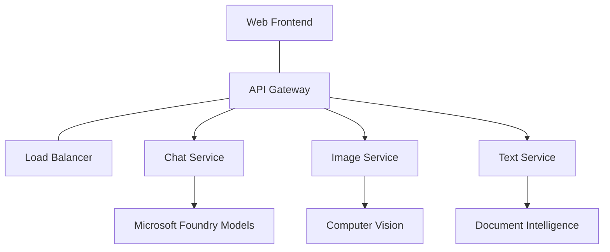

# Najbolje prakse za proizvodno opterećenje AI uz AZD

**Navigacija poglavljem:**
- **📚 Početna stranica tečaja**: [AZD za početnike](../../README.md)
- **📖 Trenutno poglavlje**: Poglavlje 8 - Produkcijski i poslovni obrasci
- **⬅️ Prethodno poglavlje**: [Poglavlje 7: Rješavanje problema](../chapter-07-troubleshooting/debugging.md)
- **⬅️ Također povezano**: [AI radionica laboratorij](../chapter-02-ai-development/ai-workshop-lab.md)
- **🎯 Završetak tečaja**: [AZD za početnike](../../README.md)

## Pregled

Ovaj vodič objašnjava obrasce dizajna produkcijske AI pomoću Azure Developer CLI (AZD). To je referenca za dizajn, ne aplikacija za implementaciju ili certifikacija za produkciju.

**Granice primjera:** Osim ako nije eksplicitno opisano kao kompletno, Bicep fragmenti pretpostavljaju parametre i referentne resurse iz okružujućeg predloška. Izostavljaju slike/planske hostove, identitete, dodjele uloga, DNS, izlaze i drugu potrebnu integraciju. YAML uslužni putovi i hook/test skripte su ilustrativne datoteke koje trebate kreirati u **svojoj aplikaciji**; nisu uključene u ovaj tečaj. Koristite funkcionalni AZD uzorak kao osnovu, kompajlirajte kompletnu infrastrukturu i testirajte je u izoliranom okruženju prije produkcije.

## Ključni izazovi koje rješavamo

Uobičajene produkcijske brige uključuju višeservice implementacije, upravljanje identitetima i tajnama, skaliranje, kontrolu troškova i nadzor. Ovdje se ne tvrdi mjereni stupanj učestalosti.

## Arhitektonski obrasci za produkcijsku AI

### Obrazac 1: Mikroservisna AI arhitektura

**Kada koristiti**: složene AI aplikacije sa više značajki



**AZD implementacija**:

```yaml
# azure.yaml
name: enterprise-ai-platform
services:
  web:
    project: ./web
    host: staticwebapp
  api-gateway:
    project: ./api-gateway
    host: containerapp
  chat-service:
    project: ./services/chat
    host: containerapp
  vision-service:
    project: ./services/vision
    host: containerapp
  text-service:
    project: ./services/text
    host: containerapp
```

### Obrazac 2: AI procesuiranje vođeno događajima

**Kada koristiti**: serijsko procesuiranje, analiza dokumenata, asinhroni tokovi rada

```bicep
// Event Hub for AI processing pipeline
resource eventHub 'Microsoft.EventHub/namespaces@2024-01-01' = {
  name: eventHubNamespaceName
  location: location
  sku: {
    name: 'Standard'
    tier: 'Standard'
    capacity: 1
  }
}

// Service Bus for reliable message processing
resource serviceBus 'Microsoft.ServiceBus/namespaces@2024-01-01' = {
  name: serviceBusNamespaceName
  location: location
  sku: {
    name: 'Premium'
    tier: 'Premium'
    capacity: 1
  }
}

// Function App for processing
resource functionApp 'Microsoft.Web/sites@2023-01-01' = {
  name: functionAppName
  location: location
  kind: 'functionapp,linux'
  properties: {
    siteConfig: {
      appSettings: [
        {
          name: 'FUNCTIONS_EXTENSION_VERSION'
          value: '~4'
        }
        {
          name: 'AZURE_OPENAI_ENDPOINT'
          value: '@Microsoft.KeyVault(VaultName=${keyVault.name};SecretName=openai-endpoint)'
        }
      ]
    }
  }
}
```

Ovo kreira namespace fragmente, ne hubove, queueove, pretplate ili Function okidače. Izvršna Function također treba plan hostiranja, konfiguraciju runtime/spremišta, pridruženi identitet, RBAC i mrežni pristup. Referenca na Key Vault treba dozvolu čitanja tajne; URL krajnje točke sam po sebi nije vjerodajnica.

## Razmišljanje o zdravlju AI agenta

Kada tradicionalna web aplikacija zakaže, simptomi su poznati: stranica se ne učitava, API vraća grešku ili implementacija zakaže. AI aplikacije mogu se pokvariti na sve navedene načine — ali mogu se i neprimjetno ponašati nepravilno bez očitih poruka o grešci.

Ovaj odjeljak pomaže vam izgraditi mentalni model za nadzor AI opterećenja kako biste znali gdje tražiti kada stvari ne djeluju kako treba.

### Kako se zdravlje agenta razlikuje od zdravlja tradicionalne aplikacije

Tradicionalne aplikacije također mogu imati suptilne pogreške u ispravnosti. AI agent dodaje nedeterminističku kvalitetu odgovora na uobičajena pitanja dostupnosti i ispravnosti. Razmislite o zdravlju agenta u dva sloja:

| Sloj | Što pratiti | Gdje tražiti |
|-------|--------------|---------------|
| **Zdravlje infrastrukture** | Radi li usluga? Jesu li resursi osigurani? Jesu li krajnje točke dostupne? | `azd monitor`, zdravstveno stanje resursa u Azure portalu, spremnici/zapisnici aplikacija |
| **Zdravlje ponašanja** | Odgovara li agent točno? Jesu li odgovori pravovremeni? Je li model pozvan ispravno? | Application Insights tragovi, metrike latencije poziva modela, zapisnici kvalitete odgovora |

Zdravlje infrastrukture je poznato — isto je za bilo koju azd aplikaciju. Zdravlje ponašanja je novi sloj koji uvode AI opterećenja.

### Gdje tražiti kad AI aplikacije ne rade očekivano

Ako vaša AI aplikacija ne producira očekivane rezultate, evo konceptualnog popisa za provjeru:

1. **Počnite s osnovama.** Radi li aplikacija? Može li dosegnuti svoje ovisnosti? Provjerite `azd monitor` i zdravstveno stanje resursa kao i za svaku aplikaciju.
2. **Provjerite vezu s modelom.** Zove li vaša aplikacija uspješno AI model? Neuspjeli ili istekli pozivi modelu najčešći su uzrok problema AI aplikacija i pojavit će se u zapisnicima aplikacije.
3. **Sigurno pregledajte ulaz i utemeljenje.** Netocni odgovori mogu biti posljedica dohvaćanja, uputa, modelskih ograničenja ili izvršenja alata. Koristite dijagnostičke podatke pod kontrolom pristupa; nemojte uključivati bezrazložan zapisnik upita/odgovora u produkciji.
4. **Pregledajte latenciju odgovora.** Pozivi AI modela su sporiji od uobičajenih API poziva. Ako aplikacija djeluje tromo, provjerite jesu li se vremena reagiranja modela povećala — to može ukazivati na ograničenja, kapacitete ili zagušenja na razini regije.
5. **Promatrajte signale troškova.** Neočekivani skokovi u korištenju tokena ili API poziva mogu ukazivati na petlju, nepravilno konfigurirani upit ili pretjerane pokušaje.

Nije potrebno odmah savladati alati za promatranje. Ključna poruka je da AI aplikacije imaju dodatni sloj ponašanja za nadzor, a ugrađeni azd nadzor (`azd monitor`) pruža početnu točku za ispitivanje oba sloja.

---

## Najbolje prakse sigurnosti

### 1. Model sigurnosti bez povjerenja (Zero-Trust)

**Strategija implementacije**:
- Nijedna komunikacija između usluga bez autentikacije
- Svi API pozivi koriste upravljane identitete
- Mrežna izolacija s privatnim krajnjim točkama
- Kontrole pristupa na principu najmanjih privilegija

```bicep
// Managed Identity for each service
resource chatServiceIdentity 'Microsoft.ManagedIdentity/userAssignedIdentities@2023-01-31' = {
  name: 'chat-service-identity'
  location: location
}

// Role assignments with minimal permissions
resource openAIUserRole 'Microsoft.Authorization/roleAssignments@2022-04-01' = {
  scope: openAIAccount
  name: guid(openAIAccount.id, chatServiceIdentity.id, '5e0bd9bd-7b93-4f28-af87-19fc36ad61bd')
  properties: {
    roleDefinitionId: subscriptionResourceId('Microsoft.Authorization/roleDefinitions', '5e0bd9bd-7b93-4f28-af87-19fc36ad61bd')
    principalId: chatServiceIdentity.properties.principalId
    principalType: 'ServicePrincipal'
  }
}
```

### 2. Sigurno upravljanje tajnama

**Obrazac integracije s Key Vaultom**:

```bicep
// Key Vault with proper access policies
resource keyVault 'Microsoft.KeyVault/vaults@2023-02-01' = {
  name: keyVaultName
  location: location
  properties: {
    tenantId: tenant().tenantId
    sku: {
      family: 'A'
      name: 'standard' // Premium is needed for HSM-backed keys, not ordinary secrets
    }
    enableRbacAuthorization: true  // Use RBAC instead of access policies
    enablePurgeProtection: true    // Prevent accidental deletion
    enableSoftDelete: true
    softDeleteRetentionInDays: 90
  }
}

// Optional legacy key-auth alternative; omit when using Entra ID.
resource openAIKeySecret 'Microsoft.KeyVault/vaults/secrets@2023-02-01' = {
  parent: keyVault
  name: 'openai-api-key'
  properties: {
    value: openAIAccount.listKeys().key1
    attributes: {
      enabled: true
    }
  }
}
```

Dodijelite runtime identitet `Key Vault Secrets User` prikladnog opsega i pridružite ga hostu; `enableRbacAuthorization` sam ne daje pristup. Preferirajte autentikaciju upravljanim identitetom OpenAI s `disableLocalAuth: true`. Opcionalni ključ tajne ima smisla samo za namjerno omogućeni račun s ključem, a odgovorna osoba za pružanje usluge također treba dozvolu za pisanje tajni.

### 3. Mrežna sigurnost

**Konfiguracija privatnih krajnjih točaka**:

```bicep
// Virtual Network for AI services
resource virtualNetwork 'Microsoft.Network/virtualNetworks@2023-04-01' = {
  name: vnetName
  location: location
  properties: {
    addressSpace: {
      addressPrefixes: ['10.0.0.0/16']
    }
    subnets: [
      {
        name: 'ai-services-subnet'
        properties: {
          addressPrefix: '10.0.1.0/24'
          privateEndpointNetworkPolicies: 'Disabled'
        }
      }
      {
        name: 'app-services-subnet'
        properties: {
          addressPrefix: '10.0.2.0/24'
          delegations: [
            {
              name: 'Microsoft.Web/serverFarms'
              properties: {
                serviceName: 'Microsoft.Web/serverFarms'
              }
            }
          ]
        }
      }
    ]
  }
}

// Private endpoints for all AI services
resource openAIPrivateEndpoint 'Microsoft.Network/privateEndpoints@2023-04-01' = {
  name: '${openAIAccountName}-pe'
  location: location
  properties: {
    subnet: {
      id: virtualNetwork.properties.subnets[0].id
    }
    privateLinkServiceConnections: [
      {
        name: 'openai-connection'
        properties: {
          privateLinkServiceId: openAIAccount.id
          groupIds: ['account']
        }
      }
    ]
  }
}
```

Privatne krajnje točke također zahtijevaju privatne DNS zone grupe/VNet veze i integraciju aplikacije s VNet-om. Ne blokiraju automatski javni pristup: eksplicitno onemogućite javni mrežni pristup AI računa nakon potvrde privatne povezanosti i pristupa implementaciji.

## Performanse i skaliranje

### 1. Strategije automatskog skaliranja

**Automatsko skaliranje Container Apps**:

```bicep
resource containerApp 'Microsoft.App/containerApps@2023-05-01' = {
  name: containerAppName
  location: location
  properties: {
    configuration: {
      ingress: {
        external: true
        targetPort: 8000
        transport: 'http'
      }
    }
    template: {
      scale: {
        minReplicas: 2  // Always have 2 instances minimum
        maxReplicas: 50 // Scale up to 50 for high load
        rules: [
          {
            name: 'http-scaling'
            http: {
              metadata: {
                concurrentRequests: '20'  // Scale when >20 concurrent requests
              }
            }
          }
          {
            name: 'cpu-scaling'
            custom: {
              type: 'cpu'
              metadata: {
                type: 'Utilization'
                value: '70'  // Scale when CPU >70%
              }
            }
          }
        ]
      }
    }
  }
}
```

### 2. Strategije keširanja

**Redis keš za AI odgovore**:

```bicep
// Legacy Azure Cache for Redis example (not recommended for new deployments)
resource redisCache 'Microsoft.Cache/redis@2023-04-01' = {
  name: redisCacheName
  location: location
  properties: {
    sku: {
      name: 'Premium'
      family: 'P'
      capacity: 1
    }
    enableNonSslPort: false
    minimumTlsVersion: '1.2'
    redisConfiguration: {
      'maxmemory-policy': 'allkeys-lru'
    }
    // Sharding distributes data; replication/failover provides availability.
    shardCount: 2
  }
}

// Cache configuration in application
var cacheConnectionString = '${redisCache.properties.hostName}:6380,password=${redisCache.listKeys().primaryKey},ssl=True,abortConnect=False'
```

Azure Cache za Redis Basic/Standard/Premium je na [putu umirovljenja](https://learn.microsoft.com/azure/azure-cache-for-redis/retirement-faq). Koristite Azure Managed Redis za nove dizajne i njegov dokumentirani SKU, identitet i TLS konfiguraciju umjesto kopiranja ovog naslijeđenog resursa u novi produkcijski sustav. Redak za connection-string je nefunkcionalni rezervirani znak, ne vjerodajnica. Particionirajte keš ključeve po autorizaciji, modelu/uputama i verziji preuzimanja, s istekom; zajednički keš samo za upit može otkriti podatke drugog korisnika.

### 3. Uravnoteženje opterećenja i upravljanje prometom

**Application Gateway s WAF-om**:

```bicep
// Application Gateway with Web Application Firewall
resource applicationGateway 'Microsoft.Network/applicationGateways@2023-04-01' = {
  name: appGatewayName
  location: location
  properties: {
    sku: {
      name: 'WAF_v2'
      tier: 'WAF_v2'
      capacity: 2
    }
    webApplicationFirewallConfiguration: {
      enabled: true
      firewallMode: 'Prevention'
      ruleSetType: 'OWASP'
      ruleSetVersion: '3.2'
    }
    // Backend pools for AI services
    backendAddressPools: [
      {
        name: 'ai-services-pool'
        properties: {
          backendAddresses: [
            {
              fqdn: '${containerApp.properties.configuration.ingress.fqdn}'
            }
          ]
        }
      }
    ]
  }
}
```

Ovo je djelomični resurs gatewaya: stvarna implementacija treba i gateway subnet/IP konfiguraciju, frontend IP adrese i portove, TLS slušatelje/sertifikate, backend HTTP postavke/probe, pravila usmjeravanja i prioritete te pregledanu WAF politiku. TLS hostname/SNI i autentikacija moraju odgovarati Container App backendu.

## 💰 Optimizacija troškova

### 1. Pravilna veličina resursa

**Konfiguracije specifične za okruženje**:

Ova imena su **ilustrativni ulazi prilagođenog predloška**, a ne automatske AZD postavke. Mapirajte ih prvo u `infra/main.parameters.json`/Bicep i konfiguraciju hosta. Na primjer, RAG primjer koristi `AZURE_SEARCH_SERVICE_SKU` i `AZURE_OPENAI_CHATGPT_DEPLOYMENT_CAPACITY`, a ne generička imena niže. Dodijelite Container Apps memoriju u podržanoj jedinici poput `1Gi` u stvarnom resursu. Primijenite infrastrukturne promjene pomoću `azd up` ili `azd provision`; `azd deploy` sam ne primjenjuje Bicep promjene.

```bash
# Development environment
azd env new development
azd env set AZURE_OPENAI_SKU "S0"
azd env set AZURE_OPENAI_CAPACITY 10
azd env set AZURE_SEARCH_SKU "basic"
azd env set CONTAINER_CPU 0.5
azd env set CONTAINER_MEMORY 1.0

# Production environment  
azd env new production
azd env set AZURE_OPENAI_SKU "S0"
azd env set AZURE_OPENAI_CAPACITY 100
azd env set AZURE_SEARCH_SKU "standard"
azd env set CONTAINER_CPU 2.0
azd env set CONTAINER_MEMORY 4.0
```

### 2. Praćenje troškova i budžeti

```bicep
// Supply the first day of the current UTC month, e.g. 2026-11-01T00:00:00Z.
param budgetStartDate string

// Cost management and budgets
resource budget 'Microsoft.Consumption/budgets@2024-08-01' = {
  name: 'ai-workload-budget'
  properties: {
    timePeriod: {
      startDate: budgetStartDate
    }
    timeGrain: 'Monthly'
    amount: 2000  // In the billing currency, not necessarily USD
    category: 'Cost'
    notifications: {
      warning: {
        enabled: true
        operator: 'GreaterThan'
        threshold: 80
        contactEmails: [
          'finance@company.com'
          'engineering@company.com'
        ]
        contactRoles: [
          'Owner'
          'Contributor'
        ]
      }
      critical: {
        enabled: true
        operator: 'GreaterThan'
        threshold: 95
        contactEmails: [
          'cto@company.com'
        ]
      }
    }
  }
}
```

Zamijenite primatelje primjera i provjerite opseg/dozvole. Upozorenja za budžet koriste odgođene podatke o naplati i ne nameću ograničenje potrošnje.

### 3. Optimizacija upotrebe tokena

**Upravljanje troškovima OpenAI-a**:

Ovo je samo heuristika temeljena na znakovima za UI prikaz, **nije** validator ograničenja tokena modela. Produkcijski kod mora koristiti tokenizator prikladan za implementirani model i uzeti u obzir sistemske upute, sheme alata, povijest i proračun izlaza. Odbacite poruke korisnika koje su prevelike umjesto da ih tihi skraćujete.

```typescript
// Application-level token optimization
class TokenOptimizer {
  private readonly maxTokens = 4000;
  private readonly reserveTokens = 500;
  
  optimizePrompt(userInput: string, context: string): string {
    const availableTokens = this.maxTokens - this.reserveTokens;
    if (this.estimateTokens(userInput) + 8 >= availableTokens) {
      throw new Error("User input exceeds the illustrative prompt budget");
    }
    const estimatedTokens = this.estimateTokens(userInput + context) + 8;
    
    if (estimatedTokens > availableTokens) {
      // Truncate context, not user input
      context = this.truncateContext(context, Math.max(0, availableTokens - this.estimateTokens(userInput) - 8));
    }
    
    return `${context}\n\nUser: ${userInput}`;
  }
  
  private estimateTokens(text: string): number {
    // Rough estimation: 1 token ≈ 4 characters
    return Math.ceil(text.length / 4);
  }

  private truncateContext(text: string, estimatedBudget: number): string {
    return text.slice(0, Math.max(0, estimatedBudget) * 4);
  }
}
```

## Nadzor i uvidi

### 1. Sveobuhvatni Application Insights

```bicep
// Application Insights with advanced features
resource applicationInsights 'Microsoft.Insights/components@2020-02-02' = {
  name: applicationInsightsName
  location: location
  kind: 'web'
  properties: {
    Application_Type: 'web'
    WorkspaceResourceId: logAnalyticsWorkspace.id
    SamplingPercentage: 100  // Ingestion setting; review cost and SDK sampling separately
    DisableIpMasking: false  // Retain IP masking
  }
}

// Custom metrics for AI operations
resource aiMetricAlerts 'Microsoft.Insights/metricAlerts@2018-03-01' = {
  name: 'ai-high-error-rate'
  location: 'global'
  properties: {
    description: 'Alert when failed request count exceeds 10 in five minutes'
    severity: 2
    enabled: true
    scopes: [
      applicationInsights.id
    ]
    evaluationFrequency: 'PT1M'
    windowSize: 'PT5M'
    criteria: {
      'odata.type': 'Microsoft.Azure.Monitor.SingleResourceMultipleMetricCriteria'
      allOf: [
        {
          name: 'high-error-rate'
          metricName: 'requests/failed'
          operator: 'GreaterThan'
          threshold: 10
          timeAggregation: 'Count'
        }
      ]
    }
  }
}
```

### 2. Specifični nadzor AI-a

**Prilagođene nadzorne ploče za AI metrike**:

```json
{
  "dashboard": {
    "name": "AI Application Monitoring",
    "tiles": [
      {
        "name": "OpenAI Request Volume",
        "query": "dependencies | where target contains 'openai' | summarize count() by bin(timestamp, 5m)"
      },
      {
        "name": "AI Response Latency",
        "query": "dependencies | where target contains 'openai' | summarize avg(duration) by bin(timestamp, 5m)"
      },
      {
        "name": "Token Usage",
        "query": "customMetrics | where name == 'openai_tokens_used' | summarize sum(value) by bin(timestamp, 1h)"
      },
      {
        "name": "Cost per Hour",
        "query": "customMetrics | where name == 'openai_cost' | summarize sum(value) by bin(timestamp, 1h)"
      }
    ]
  }
}
```

Ovaj JSON je aplikacijski definirani skicarnik, nije uvozni Azure portal shema nadzorne ploče. Upiti za tokene/troškove zahtijevaju da vaša aplikacija emitira te točno definirane prilagođene metrike; azd ih ne kreira. Prilagodite filtre ovisnosti prema stvarnim imenima krajnjih točaka/modela/opsega.

### 3. Provjere zdravlja i praćenje dostupnosti

```bicep
// Application Insights availability tests
resource availabilityTest 'Microsoft.Insights/webtests@2022-06-15' = {
  name: 'ai-app-availability-test'
  location: location
  tags: {
    'hidden-link:${applicationInsights.id}': 'Resource'
  }
  properties: {
    SyntheticMonitorId: 'ai-app-availability-test'
    Name: 'AI Application Availability Test'
    Description: 'Tests AI application endpoints'
    Enabled: true
    Frequency: 300  // 5 minutes
    Timeout: 120    // 2 minutes
    Kind: 'standard'
    Locations: [
      {
        Id: 'us-east-2-azr'
      }
      {
        Id: 'us-west-2-azr'
      }
    ]
    Request: {
      RequestUrl: 'https://${webApp.properties.defaultHostName}/health'
      HttpVerb: 'GET'
      FollowRedirects: true
      ParseDependentRequests: false
    }
    ValidationRules: {
      ExpectedHttpStatusCode: 200
      SSLCheck: true
      SSLCertRemainingLifetimeCheck: 7
    }
  }
}
```

## Oporavak od katastrofa i visoka dostupnost

Prethodni test podrazumijeva postojeći App Service `webApp` i Application Insights resurs. Standardni testovi dostupnosti naplaćuju se i zahtijevaju dostupnu krajnju točku; aplikacije samo s privatnim pristupom trebaju odgovarajući privatni dizajn za nadzor. URL ping testovi su zastarjeli; koristite [standardne testove dostupnosti](https://learn.microsoft.com/azure/azure-monitor/app/availability).

### 1. Implementacija u više regija

```yaml
# azure.yaml - Multi-region configuration
name: ai-app-multiregion
services:
  api-primary:
    project: ./api
    host: containerapp
    env:
      AZURE_REGION: eastus
  api-secondary:
    project: ./api
    host: containerapp
    env:
      AZURE_REGION: westus2
```

```bicep
// Separate App Service topology, not the Container Apps declarations above
resource trafficManager 'Microsoft.Network/trafficManagerProfiles@2022-04-01' = {
  name: trafficManagerProfileName
  location: 'global'
  properties: {
    profileStatus: 'Enabled'
    trafficRoutingMethod: 'Priority'
    dnsConfig: {
      relativeName: trafficManagerProfileName
      ttl: 30
    }
    monitorConfig: {
      protocol: 'HTTPS'
      port: 443
      path: '/health'
      intervalInSeconds: 30
      toleratedNumberOfFailures: 3
      timeoutInSeconds: 10
    }
    endpoints: [
      {
        name: 'primary-endpoint'
        type: 'Microsoft.Network/trafficManagerProfiles/azureEndpoints'
        properties: {
          targetResourceId: primaryAppService.id
          endpointStatus: 'Enabled'
          priority: 1
        }
      }
      {
        name: 'secondary-endpoint'
        type: 'Microsoft.Network/trafficManagerProfiles/azureEndpoints'
        properties: {
          targetResourceId: secondaryAppService.id
          endpointStatus: 'Enabled'
          priority: 2
        }
      }
    ]
  }
}
```

Varijable okruženja ne biraju lokacije resursa. Infrastructure as Code mora osigurati odvojene regionalne hostove i povezati svaku uslugu oznakama `resourceName` ili `azd-service-name`. Primjer Traffic Managera je **odvojena App Service topologija** (`primaryAppService`/`secondaryAppService`), ne usmjeravanje za Container Apps deklaracije. Container Apps zahtijeva prikladno konfiguriranu vanjsku krajnju točku/front door, TLS/prilagođeno usmjeravanje domena i health probe.

### 2. Sigurnosne kopije podataka i oporavak

```bicep
// Backup configuration for critical data
resource backupVault 'Microsoft.DataProtection/backupVaults@2023-05-01' = {
  name: backupVaultName
  location: location
  identity: {
    type: 'SystemAssigned'
  }
  properties: {
    storageSettings: [
      {
        datastoreType: 'VaultStore'
        type: 'LocallyRedundant'
      }
    ]
  }
}

```

Sam vault ne izrađuje sigurnosne kopije. Konfigurirajte **politiku i instancu sigurnosne kopije specifičnu za opterećenje**, dozvole izvora, zadržavanje i testiranje oporavka koristeći [Azure Backup podršku matrica](https://learn.microsoft.com/azure/backup/backup-support-matrix). Nema generičke Azure Backup politike za hostane Azure OpenAI implementacije modela. Čuvajte definicije implementacije infrastrukture/modela u izvornom kodu; zaštitite prenesene dokumente, podatke aplikacije i artefakte fino podešavanja koristeći podržane značajke sigurnosne kopije/izvoza pojedinog servisa. Definirajte i testirajte RPO/RTO eksplicitno.

## Integracija DevOps-a i CI/CD-a

### 1. GitHub Actions radni tok

```yaml
# .github/workflows/deploy-ai-app.yml
name: Deploy AI Application

on:
  push:
    branches: [main]
  pull_request:
    branches: [main]

jobs:
  test:
    runs-on: ubuntu-latest
    steps:
      - uses: actions/checkout@v4
      
      - name: Setup Python
        uses: actions/setup-python@v4
        with:
          python-version: '3.11'
          
      - name: Install dependencies
        run: |
          pip install -r requirements.txt
          pip install pytest
          
      - name: Run tests
        run: pytest tests/
        
      - name: AI Safety Tests
        run: |
          python scripts/test_ai_safety.py
          python scripts/validate_prompts.py

```

Ovo je **samo testni dio** radnog toka i pretpostavlja da ste kreirali `requirements.txt`, `tests/` i dvije sigurnosne skripte. Dodajte autentificirane OIDC provisioning/deployment poslove iz [CI/CD konfiguracije pipelinea](#cicd-pipeline-configuration), s `needs: test`, pouzdanim push/manual okidačem i zaštićenim GitHub okruženjima. Ne implementirajte nepouzdani kod iz pull-zahtjeva s cloud vjerodajnicama. Svježi runner nema odabrano lokalno AZD okruženje; unesite ulaze za okruženje/pretplatu/locaciju i koristite `azd auth login`, ne samo `azure/login`.

### 2. Validacija infrastrukture

```bash
# scripts/validate_infrastructure.sh
#!/bin/bash
set -euo pipefail

echo "Validating AI infrastructure deployment..."

# Requires Azure CLI login and the resource group selected explicitly.
: "${AZURE_RESOURCE_GROUP:?Set AZURE_RESOURCE_GROUP}"
: "${AZURE_OPENAI_NAME:?Set AZURE_OPENAI_NAME}"
: "${AZURE_OPENAI_CHAT_DEPLOYMENT:?Set the actual deployment name}"

# A successful empty list is not proof that resources exist.
types=("Microsoft.CognitiveServices/accounts" "Microsoft.Search/searchServices"
       "Microsoft.Storage/storageAccounts" "Microsoft.KeyVault/vaults")
for resource_type in "${types[@]}"; do
    count=$(az resource list --resource-group "$AZURE_RESOURCE_GROUP" \
        --resource-type "$resource_type" --query "length(@)" -o tsv)
    if [[ "$count" -lt 1 ]]; then
        echo "ERROR: No $resource_type found in $AZURE_RESOURCE_GROUP"
        exit 1
    fi
done

# Validate OpenAI model deployments
echo "Validating OpenAI model deployments..."
state=$(az cognitiveservices account deployment show \
  --name "$AZURE_OPENAI_NAME" --resource-group "$AZURE_RESOURCE_GROUP" \
  --deployment-name "$AZURE_OPENAI_CHAT_DEPLOYMENT" \
  --query "properties.provisioningState" -o tsv)
if [[ "$state" != "Succeeded" ]]; then
    echo "ERROR: Required model deployment is not provisioned successfully"
    exit 1
fi

echo "Infrastructure validation completed successfully!"
```

Očekivano: nula izlaza i poruka o dovršetku samo kada svi očekivani tipovi postoje i imenovana implementacija modela je osigurana. Ovo provjerava stanje inventara/provizije, **nije** zdravlje resursa, točnu topologiju, RBAC, mrežnu dostupnost ili ponašanje modela. Prilagodite očekivane tipove svojoj arhitekturi, zatim izvedite zaseban autentificirani test spremnosti aplikacije.

## Popis za pripremu proizvodnje

### Sigurnost ✅
- [ ] Sve usluge koriste upravljane identitete
- [ ] Tajne pohranjene u Key Vault
- [ ] Konfigurirane privatne krajnje točke
- [ ] Implementirane mrežne sigurnosne grupe
- [ ] RBAC s najmanjim privilegijama
- [ ] Omogućen WAF na javnim krajnjim točkama

### Performanse ✅
- [ ] Konfigurirano automatsko skaliranje
- [ ] Implementiran keš
- [ ] Postavljeno uravnoteženje opterećenja
- [ ] CDN za statički sadržaj
- [ ] Povezivanje pool bazu podataka
- [ ] Optimizacija korištenja tokena

### Nadzor ✅
- [ ] Konfiguriran Application Insights
- [ ] Definirane prilagođene metrike
- [ ] Postavljena pravila za upozorenja
- [ ] Kreirana nadzorna ploča
- [ ] Implementirane provjere zdravlja
- [ ] Politike zadržavanja zapisnika

### Pouzdanost ✅
- [ ] Implementacija u više regija
- [ ] Plan sigurnosnih kopija i oporavka
- [ ] Implementirani prekidači struje
- [ ] Konfigurirane politike ponovnog pokušaja
- [ ] Pristojno degradiranje
- [ ] Krajnje točke za provjeru zdravlja

### Upravljanje troškovima ✅
- [ ] Konfigurirana upozorenja budžeta
- [ ] Pravilna veličina resursa
- [ ] Primijenjeni popusti za razvoj/test
- [ ] Kupljene rezervirane instance
- [ ] Nadzorna ploča za praćenje troškova
- [ ] Redovni pregledi troškova

### Usklađenost ✅
- [ ] Zadovoljeni zahtjevi za prebivalište podataka
- [ ] Omogućeno zapisivanje audita
- [ ] Primijenjene usklađenosti politike
- [ ] Implementirane sigurnosne osnove
- [ ] Redovne sigurnosne procjene
- [ ] Plan za reagiranje na incidente

## Benchmarkovi performansi

### Ilustrativni ciljevi za produkciju

Ovo su primjeri SLO-ova za pregovaranje i opterećenje-testiranje, nisu mjerene metrike ili garancije. Latencija odgovora ovisi o duljini modela/izlaza; mjesečna potrošnja tokena ovisi o prometu i cijenama, ne samo o broju tokena.

| Metrička vrijednost | Cilj | Nadzor |
|--------|--------|------------|
| **Vrijeme odgovora** | < 2 sekunde | Application Insights |
| **Dostupnost** | 99.9% | Praćenje dostupnosti |
| **Stopa pogrešaka** | < 0.1% | Zapisnici aplikacija |
| **Potrošnja modela** | < 500 $/mjesečno (primjer) | Upravljanje troškovima |
| **Istovremeni korisnici** | 1000+ | Testiranje opterećenja |
| **Vrijeme oporavka** | < 1 sat | Testovi oporavka od katastrofe |

### Testiranje opterećenja

Sljedeće je skica sučelja za skriptu za testiranje opterećenja **koju morate implementirati**; ovaj repozitorij ne isporučuje `scripts/load_test.py`. Definirajte zahtjeve za tijelo poruke, autentikaciju, reprezentativna opterećenja, tvrdnje o latenciji/greskama po percentilima te ograničenje troškova u vašem odabranom alatu za testiranje opterećenja prije pokretanja:

```bash
# Load testing script for AI applications
python scripts/load_test.py \
  --endpoint https://your-ai-app.azurewebsites.net \
  --concurrent-users 100 \
  --duration 300 \
  --ramp-up 60
```

## 🤝 Najbolje prakse zajednice

Na temelju povratnih informacija Microsoft Foundry Discord zajednice:

### Glavne preporuke zajednice:

1. **Počnite s malim, skalirajte postupno**: Počnite s osnovnim SKU-ovima i skalirajte prema stvarnoj upotrebi
2. **Nadzor svega**: Postavite sveobuhvatni nadzor od prvog dana
3. **Automatizirajte sigurnost**: Koristite infrastrukturu kao kod za dosljednu sigurnost
4. **Temeljito testirajte**: Uključite specifična AI testiranja u vaš pipeline
5. **Planirajte troškove**: Pratite upotrebu tokena i rano postavite budžetske obavijesti

### Uobičajene zamke koje treba izbjegavati:

- ❌ Ugrađivanje API ključeva u kod
- ❌ Nepostavljanje odgovarajućeg nadzora
- ❌ Zanemarivanje optimizacije troškova
- ❌ Nepostavljanje testova scenarija neuspjeha
- ❌ Implementacija bez zdravstvenih provjera

## Komande i proširenja AZD AI CLI-ja

AZD uključuje rastući skup AI-specifičnih komandi i proširenja koja pojednostavljuju produkcijske AI radne tokove. Ti alati premošćuju jaz između lokalnog razvoja i produkcijskog postavljanja AI radnih opterećenja.

> **Pregled izdanja (2026-11-04):** Upute za CLI u nastavku su provjerene u odnosu na objavljena izdanja `azd` **1.37.2**, `azure.ai.agents` **1.0.0-beta.23** i `azure.ai.evaluations` **1.0.0-beta.2**. Agents beta.23 zahtijeva `azd >= 1.37.0`; evaluations beta.2 zahtijeva `azd >= 1.33.0`. Koristite najmanje 1.37.0 za kombinirani radni tok. Ovo je pregled dokumentacije/izvora, a ne validacija žive Azure implementacije.

### AZD proširenja za AI

AZD koristi sistem proširenja za dodavanje AI-specifičnih mogućnosti. Instalirajte i upravljajte proširenjima pomoću:

```bash
# List all available extensions (including AI)
azd extension list

# Inspect installed extension details
azd version
azd extension show azure.ai.agents

# Install the Foundry agents extension
azd extension install azure.ai.agents

# Install the separate Foundry evaluations extension
azd extension install azure.ai.evaluations

# Install the fine-tuning extension
azd extension install azure.ai.finetune

# Install the custom models extension
azd extension install azure.ai.models

# Upgrade all installed extensions
azd extension upgrade --all
```

**Dostupna AI proširenja:**

| Proširenje | Svrha | Status |
|-----------|---------|--------|
| `azure.ai.agents` | Upravljanje Foundry Agent uslugom | Pregled |
| `azure.ai.evaluations` | Evaluacijski skupovi podataka, evaluator, evaluacijske grupe i pokretanja | Pregled |
| `azure.ai.skills` | Višekratno upotrebljive agentove sposobnosti | Pregled |
| `azure.ai.connections` | Foundry veze (izvori podataka, alati) | Pregled |
| `azure.ai.finetune` | Fino podešavanje Foundry modela | Pregled |
| `azure.ai.models` | Foundry prilagođeni modeli | Pregled |
| `azure.coding-agent` | Konfiguracija kodirajućeg agenta | Dostupno |

> Pokrenite `azd extension list --installed` i `azd extension show azure.ai.evaluations` da pregledate instalirane verzije. Najprije nadogradite osnovni CLI koristeći [upute za instalaciju/nadogradnju](https://learn.microsoft.com/azure/developer/azure-developer-cli/install-azd) (za Windows winget instalaciju: `winget upgrade Microsoft.Azd`), zatim pokrenite `azd extension upgrade --all`. Ne postoji osnovna `azd upgrade` naredba. Pregledajte prekidajuće promjene prije nadogradnje produkcijske automatizacije; nemojte pretpostavljati da nadogradnja proširenja preservira stare formate naredbi ili konfiguracije.

### Nedavne promjene i ispravci u izdanju

| Izdanje | Što se mijenja za ovaj tečaj |
|---------|------------------------------|
| `azd 1.37.0` | Dodaje stabilne API-je za deployment-preview i ispravlja uređivanje proširenja koja su prepisivala nevezane postavke `azure.yaml`. |
| `azd 1.37.1` | Ispravlja propagaciju Ctrl+C kroz proširenja i razlikuje otkazivanja/tajne prekide od općih neuspjeha. |
| `azd 1.37.2` | Poboljšava validaciju provisoninga: kritična upozorenja su po defaultu **Ne**, neuspjeh bez potvrde u nenadziranom radu, a otkazivanje preskače koačke prostore nakon provisoninga. Također ispravlja neriješene vrijednosti okoline u listama odbijanja Deployment Stackova kada je ta alfa značajka omogućena. |
| Agents `beta.22` | Migrira evaluaciju na `azd ai eval`, mijenja optimizaciju na GA v1 API, zahtijeva množinu `toolboxes`, i razdvaja managed-harness, glasovne i dugotrajne preview pristupe. Popravlja izbor modela specifičnog za okruženje i autentikaciju alata. |
| Agents `beta.23` | Izlaže `init --harness`; ispravlja A2A 0.3 izlaz odgovora, neispravne putanje/module za prompt-agente kroz infrastrukturalne slojeve, dijagnostiku vremenskog ograničenja aktivacije i upozorenja RBAC zadržanih developera. |
| Evaluations `beta.2` | Zahtijeva camelCase konfiguraciju evaluacije, dodaje statičku/simuliranu izradu razgovora i eksplicitne izvore lokalnih datoteka, te ispravlja rukovanje identitetom/verzijom skupa podataka, brojanje kvalitativnih pragova i dijagnostiku neuspjelih pokretanja. |

Timeout aktivacije agenta ne dokazuje neuspjeh deploymenta: pregledajte pokušanu verziju i njezino stanje prije ponovnog pokušaja. Upozorenja RBAC developera mogu ostati čak i kada provisoning uspije; riješite nedostajući pristup prije pozivanja kao taj developer.

Izvori: [AZD izdanja](https://github.com/Azure/azure-dev/releases), [agents beta.23 izdanje](https://github.com/Azure/azure-dev/releases/tag/azd-ext-azure-ai-agents_1.0.0-beta.23), [agents beta.22 migracija](https://github.com/Azure/azure-dev/releases/tag/azd-ext-azure-ai-agents_1.0.0-beta.22), i [evaluations beta.2 izdanje](https://github.com/Azure/azure-dev/releases/tag/azd-ext-azure-ai-evaluations_1.0.0-beta.2).

**Što su novija `skills` i `connections` proširenja?**

Dva preview proširenja pojavila su se uz alate za agente i vrijedi ih razumjeti i kao početnik:

- **`azure.ai.skills`** — **sposobnost** je višekratno upotrebljiva funkcionalnost (pakirani alat ili ponašanje) koju možete pridružiti jednom ili više agenata umjesto ponovnog implementiranja svaki put. Zamislite to kao zajednički građevni blok: definirajte sposobnost "pretraži dokumentaciju" ili "provjeri narudžbu" jednom, zatim je višekratno upotrijebite preko agenata. Ovo održava konzistentnost sustava s više agenata (Poglavlje 5) i izbjegava kopiraj-zalijepi.
- **`azure.ai.connections`** — **veza** je upravljana veza vašeg Foundry projekta sa vanjskim resursom koji vaši agenti trebaju — izvor podataka (poput Azure AI Search), završnu točku alata, ili drugu uslugu. Veze centraliziraju *gdje* i *kako* agenti pristupaju podacima, tako da vjerodajnice i krajnje točke žive na jednom kontroliranom mjestu umjesto da budu raspršene po kodu.

Ne trebate ih za deploy svojih prvih agenata—držite se `azure.ai.agents` dok učite. Prepustite se `skills` kada uočite da duplicirate isti alat preko agenata, i `connections` kada nekoliko agenata dijeli isti izvor podataka.

### Inicijalizacija projekata agenata s `azd ai agent init`

`azd ai agent init` naredba postavlja Microsoft Foundry agent projekt. Koristite aktualni `azure.yaml` predložak projekta, a ne implicitni stari manifest agenta:

```bash
# Initialize a new agent project from a local project template
azd ai agent init --template ./templates/support-agent/azure.yaml

# Initialize and target a specific Foundry project
azd ai agent init --template ./templates/support-agent/azure.yaml --project-id <foundry-project-id>

# Adopt the template into a different directory
azd ai agent init --template ./templates/support-agent/azure.yaml --src ./agents/my-agent
```

**Ključne zastavice:**

| Zastavica | Opis |
|------|-------------|
| `-t, --template` | Putanja ili podržani GitHub URI do `azure.yaml` dokumenta projekta |
| `-p, --project-id` | Postojeći Microsoft Foundry Project ID za vaš azd okoliš |
| `-s, --src` | Izvorni direktorij za generirane agente, ili ciljni direktorij pri usvajanju projekta |
| `--kind` | Inicijalizirajte `hosted`, `prompt`, ili preview `prompt-voice` agenta |
| `--harness` | Opcionalni izvršni harness za `--kind prompt`; zahtijeva njegov preview pristup |
| `-e, --environment` | Azd okoliš koji će se koristiti |

`--manifest`/`-m` je zastarjela oznaka za `--template`/`-t`; preimenovanje zastavice ne pretvara stari manifest u aktualni dokument projekta. `--host containerapp` nije aktualna agent-init zastavica. Za običnu Container Apps aplikaciju koristite `azd init --template` s predloškom koji deklarira `host: containerapp`.

Za postojeći projekt s točno jednom `azure.ai.project` uslugom, `azd ai agent add support-agent --file ./agents/support-agent.yaml` dodaje ili ažurira direktnu definiciju agenta bez provisoninga ili deploya. Runtime naredbe odbacuju stare implicitne `agent.yaml`/AgentManifest i ugniježdene definicije usluga `config:`; migrirajte ih u aktualnu `azure.ai.agent` uslugu. Kada init ispiše `cd` sljedeći korak, pokrenite ga prije `azd up`: init ne mijenja vaš radni direktorij ljuske.

**Savjet za produkciju**: Koristite `--project-id` za direktno povezivanje s postojećim Foundry projektom, čime održavate vezu vašeg agenta i cloud resursa od početka.

#### Opcionalne Preview značajke

Managed harness, glasovne i dugotrajne invokacije su zadano samostalno onemogućene. Postavite samo prekidač za značajku koja vam treba u **okolini procesa skoja/CI**, ne s `azd env set`:

| Značajka | Varijabla okoline procesa |
|---------|------------------------------|
| Managed harness (`init --kind prompt --harness ...`) | `AZD_ALPHA_ENABLE_AGENTS_MANAGED_HARNESS=true` |
| Glas (`init --kind prompt-voice`) | `AZD_ALPHA_ENABLE_AGENTS_VOICE=true` |
| Dugotrajna invokacija | `AZD_ALPHA_ENABLE_AGENTS_LONG_RUNNING=true` |

Na primjer, upotrijebite `export AZD_ALPHA_ENABLE_AGENTS_MANAGED_HARNESS=true` u Bashu ili `$env:AZD_ALPHA_ENABLE_AGENTS_MANAGED_HARNESS = "true"` u PowerShellu prije pokretanja relevantne naredbe. Jedan prekidač ne uključuje druge. Pogledajte [README za objavljene agente](https://github.com/Azure/azure-dev/blob/azd-ext-azure-ai-agents_1.0.0-beta.23/cli/azd/extensions/azure.ai.agents/README.md) za sve preview prekidače i ograničenja.

### Upravljanje životnim ciklusom agenta

Koristite `azure.ai.agents` za testiranje, pregled, optimizaciju i umirovljenje agenata, a zasebno `azure.ai.evaluations` proširenje za mjerenje kvalitete:

```bash
# Invoke a deployed agent and view server response timing
# (total latency and time to first byte)
azd ai agent invoke

# Show the live endpoint configuration before changing it
azd ai agent endpoint show

# Download the deployed source of a code-based hosted agent
# (with SHA-256 verification)
azd ai agent code download

# Delete a hosted agent and all of its versions
# (--force terminates active sessions)
azd ai agent delete --force
```

**Pregled životnog ciklusa:**

| Faza | Naredba | Korištenje u produkciji |
|-------|---------|----------------|
| Test | `azd ai agent invoke` | Validirajte odgovore i mjerite latenciju prije izdavanja |
| Pregled | `azd ai agent endpoint show` | Pregledajte autentifikaciju/konfiguraciju endpointa; rano uočite prekidajuće promjene |
| Mjerenje | `azd ai eval init`, `generate`, `run start` | Definirajte, postavite i izvršite ponovljive evaluacije |
| Poboljšanje | `azd ai agent optimize --eval <evaluation-name> --optimize-model <optimizer-deployment>` | Ponovno iskoristite kompatibilnu evaluaciju za optimizaciju agenta |
| Oporavak | `azd ai agent code download` | Dohvatite točan nasazeni izvor za reviziju/povrat |
| Umirovljenje | `azd ai agent delete --force` | Produžite agenta i njegove verzije čistim uklanjanjem |

> Ovo su preview naredbe i mogu se mijenjati između izdanja proširenja. Pokrenite `azd ai agent --help` da vidite točne dostupne podnaredbe u vašoj instaliranoj verziji.

`endpoint show` podržava hostirane, prompt i glasovne agente, ali ažuriranja endpointa su samo za hostirane; agents za workflow nisu podržani. Preuzimanje koda i gornji primjer umirovljenja hostiranog agenta nisu generičke operacije za svaki tip agenta.

#### Migracija evaluacije i provjere kvalitete

Počevši od agenata **1.0.0-beta.22 (2026-10-23)**, stari `azd ai agent eval` naredbe daju smjernice za migraciju umjesto dosadašnjeg evaluacijskog radnog toka. Nemojte kopirati stare primjere `eval generate --dataset ...`: evaluacija je sada pod **`azd ai eval`**.

U inicijaliziranom agent projektu, autentificirajte se s `azd auth login`, potvrdite odabrano okruženje/Foundry projekt i instalirajte `azure.ai.evaluations`. Deploy modela suca je potreban za bodovanje modelom; generiranje i simulacija razgovora mogu zahtijevati vlastiti izbor modela i mogu uzrokovati dodatne troškove.

```bash
# Scaffold evals/ and wire an azure.ai.eval service into azure.yaml
azd ai eval init

# Optionally synthesize a rubric and dataset from the agent
azd ai eval generate

# Review generated files, then register datasets, evaluators, and eval groups
azd up

# Start an evaluation and wait for its results
azd ai eval run start --wait

# Inspect runs and available test-case output
azd ai eval run list
azd ai eval run show <run-id>
azd ai eval run output list <run-id>
```

Slijedite interaktivni odabir i ispisane sljedeće korake umjesto da pretpostavljate da su generirana sredstva već registrirana. Evaluacijska konfiguracija obično se nalazi u `evals/azure.eval.yaml`, na koju se poziva usluga `azure.ai.eval` u `azure.yaml`. Ključevi su **camelCase** (`evaluationLevel`, `maxSamples`, `initializationParameters`, `dataMapping`); stari snake_case ključevi konfiguracije se odbacuju. Putanje unutar referencirane konfiguracije rješavaju se u odnosu na tu datoteku, ne na korijen repozitorija.

Za evaluacije razgovora, odaberite **static** za bodovanje dovršenih transkripata bez pozivanja agenta, ili **simulation** za generiranje razgovora iz početnih scenarija. Simulacija zahtijeva cilj agenta, model simulatora i zaseban odabir modela suca. Za nenadzirane naredbe, dopremite ulaze navedene od `azd ai eval init --help` i `azd ai eval generate --help`; nemojte pretpostavljati da je model generacije također sudac ili simulator.

Za CI, konfigurirajte eksplicitnu kvalitetnu politiku koristeći `azd ai eval run start --help` (`--fail-on`) i tretirajte nenulti kod izlaza hosta kao neuspjeh. Dovršeno pokretanje nije automatski prolazak kvalitete. Pregledajte neuspjele/pogrešne retke i dijagnostiku; nedostajući ili neusklađeni brojevi rezultata nisu dokaz uspjeha. Registrirani skupovi podataka zadržavaju svoj identitet/verziju usluge; `--max-samples` ne može izdvojiti podskup registriranog skupa. Objavite manji skup namjerno, ili koristite podržani lokalni izvor datoteke.

```bash
# Example CI policy: at least 90% of all test cases must pass
azd ai eval run start --wait --fail-on "pass-rate=0.9"
```

Prag prolaznosti koristi broj prošlih test slučajeva podijeljen s ukupnim test slučajevima; neuspjeli, pogrešni, preskočeni i ostali neprošli retci se računaju protiv njega. Nemojte kombinirati prag s `--no-wait`, koji vraća rezultat prije nego što je presuda dostupna.

#### Migracija konfiguracije optimizacije

Optimizacija sada koristi GA v1 API. Za ponovno korištenje kompatibilne **evaluacije na razini poteza, s podacima poduprtih** iz novog radnog toka:

```bash
# Replace placeholders with the evaluation name and optimizer model deployment
azd ai agent optimize --eval-config ./evals/azure.eval.yaml --eval <evaluation-name> --optimize-model <optimizer-deployment>
```

`--eval` odabire evaluaciju; `--eval-config` odabire njezinu konfiguracijsku datoteku (uključujući definicije podržane datotekama). `--config` umjesto toga prima **samostalni zahtjev za optimizacijom putem API-ja** u YAML ili JSON formatu. Nemojte prosljeđivati stari agent `eval.yaml` ili novi `azure.eval.yaml` u `--config`, niti kombinirati `--config` s `--eval`/`--eval-config`. Razgovorna, na tragu bazirana ili simulacijska evaluacija nisu zamjenjive s prečacem za optimizaciju podržanom skupom podataka; za te scenarije koristite podržani format zahtjeva za optimizaciju. Pregledajte kandidate prije nego što ih primijenite ili implementirate.

Pogledajte [referencu evaluacija za pregledano izdanje](https://github.com/Azure/azure-dev/blob/azd-ext-azure-ai-evaluations_1.0.0-beta.2/cli/azd/extensions/azure.ai.evaluations/README.md) i [izvor naredbi za optimizaciju za pregledano izdanje](https://github.com/Azure/azure-dev/blob/azd-ext-azure-ai-agents_1.0.0-beta.23/cli/azd/extensions/azure.ai.agents/internal/cmd/optimize.go) za točne opcije.

#### Pregled implementacije agentnog sustava samo za čitanje

Za postojeće okruženje povezano s Foundryjem s objedinjenu uslugom `azure.ai.agent` od `kind: hosted`, usporedite podržanu konfiguraciju prije implementacije:

```bash
azd deploy <service-name> --preview --no-prompt
```

Ovaj pregled ne implementira agenta. Nije potpuna razlika infrastrukture/sigurnosti: agenti za prompt/glas/protokole, zastarjele konfiguracijske strukture i neka hostirana podešavanja su izvan njegova dosega. Rezultat `unknown` nije odobrenje za implementaciju. Ne postoji samostalna naredba `azd ai agent deploy` ili agentna naredba `--dry-run`; koristite osnovni tok implementacije.

### Protokol modela konteksta (MCP) s `azd mcp`

AZD uključuje ugrađenu podršku za MCP poslužitelj (Alfa), omogućujući AI agente i alate za interakciju s vašim Azure resursima putem standardiziranog protokola:

```bash
# Start the MCP server for your project
azd mcp start

# Review current Copilot consent rules for tool execution
azd copilot consent list
```

MCP poslužitelj izlaže kontekst vašeg azd projekta — okruženja, usluge i Azure resurse — AI-pokretanim razvojnim alatima. To omogućuje:

- **AI-podržana implementacija**: Dopustite agentima za kodiranje da upitaju stanje vašeg projekta i pokrenu implementacije
- **Otkrivanje resursa**: AI alati mogu otkriti koje Azure resurse koristi vaš projekt
- **Upravljanje okruženjima**: Agenti mogu prebacivati između razvojnih/testnih/produkcionih okruženja

### Generiranje infrastrukture s `azd infra generate`

Za produkcijske AI radne zadatke možete generirati i prilagoditi infrastrukturu kao kod umjesto da se oslanjate na automatsko postavljanje:

```bash
# Generate supported infrastructure for this project type
azd infra generate
```

Podrška ovisi o projektu/domaćinu i instaliranim pružateljima; ovo nije opća naredba za reverzno inženjerstvo proizvoljnih Azure resursa niti obećanje da će generirati i Bicep i Terraform. Pokrenite `azd infra generate --help` i pregledajte generirani format. Gdje je podržano, pisanje IaC na disk omogućuje vam:
- Pregled i reviziju infrastrukture prije implementacije
- Dodavanje prilagođenih sigurnosnih pravila (mrežna pravila, privatne točke pristupa)
- Integraciju s postojećim procesima pregleda IaC-a
- Verzijsko upravljanje promjenama infrastrukture odvojeno od koda aplikacije

### Hvati životnog ciklusa produkcije

AZD hvati vam omogućuju umetanje prilagođene logike u svaku fazu životnog ciklusa implementacije — kritično za produkcijske AI radne zadatke:

```yaml
# azure.yaml - Production hooks example
name: ai-production-app
hooks:
  preprovision:
    shell: sh
    run: scripts/validate-quotas.sh    # Check AI model quota before provisioning
  postprovision:
    shell: sh
    run: scripts/verify-networking.sh  # Verify IaC-provisioned private connectivity
  predeploy:
    shell: sh
    run: scripts/run-ai-safety-tests.sh  # Run prompt safety checks
  postdeploy:
    shell: sh
    run: scripts/smoke-test.sh           # Verify agent responses post-deploy
services:
  agent-api:
    project: ./src/agent
    host: containerapp
    hooks:
      predeploy:
        shell: sh
        run: scripts/validate-model-access.sh  # Per-service hook
```

```bash
# Run a specific hook manually during development
azd hooks run predeploy
```

**Preporučeni hvati za produkciju AI radnih zadataka:**

| Hvati | Primjer upotrebe |
|------|----------------|
| `preprovision` | Validacija kvota pretplate za kapacitet AI modela |
| `postprovision` | Provjera privatne povezanosti i potrebnih izlaza resursa |
| `predeploy` | Pokretanje AI testova sigurnosti, validacija predložaka promptova |
| `postdeploy` | Testiranje odgovora agenta, provjera povezanosti modela |

### Konfiguracija CI/CD pipelinea

Koristite `azd pipeline config` za povezivanje vašeg projekta s GitHub Actions ili Azure Pipelines s sigurnom Azure autentikacijom:

```bash
# Configure CI/CD pipeline (interactive)
azd pipeline config

# Configure with a specific provider
azd pipeline config --provider github
```

Ova naredba:
- Stvara ili konfigurira identitet pipelinea; pregledajte opseg/ovlasti generirane uloge umjesto da pretpostavite najmanje privilegije
- Konfigurira federirane vjerodajnice (nema pohranjenih tajni)
- Generira ili ažurira definiciju pipelinea u datoteci
- Postavlja potrebne varijable okruženja u vašem CI/CD sustavu

#### Korak po korak: vaš prvi GitHub Actions pipeline

Evo cjelokupnog vodiča od radnog azd projekta do automatiziranih implementacija pri svakom pushu.

**1. Provjerite je li vaš projekt na GitHubu**

```bash
git init
git add .
git commit -m "Initial azd project"
gh repo create my-ai-app --private --source=. --push
```

**2. Pokrenite konfiguraciju pipelinea**

```bash
azd pipeline config --provider github
```

azd će interaktivno:
- Pitati koju Azure pretplatu i okruženje ciljate
- Stvoriti Entra **registraciju aplikacije + servisni principal** za pipeline
- Postaviti **federirane vjerodajnice (OIDC)** — tako da se GitHub autentificira na Azure s kratkotrajnim tokenima i **nema pohranjenih tajni**
- Poslati potrebne **varijable** u vaš GitHub repozitorij (`AZURE_CLIENT_ID`, `AZURE_TENANT_ID`, `AZURE_SUBSCRIPTION_ID`, `AZURE_ENV_NAME`, `AZURE_LOCATION`)

**3. Razumjeti generirani workflow**

Za podržani predložak, konfigurirajte/pregledajte `.github/workflows/azure-dev.yml`. Ključni dijelovi izgledaju ovako (predložak mora pružiti alate aplikacije i parametre okruženja):

```yaml
# .github/workflows/azure-dev.yml
on:
  push:
    branches: [ main ]
  workflow_dispatch:        # lets you run it manually too

permissions:
  id-token: write           # required for OIDC federated login
  contents: read

jobs:
  build:
    runs-on: ubuntu-latest
    env:
      AZURE_CLIENT_ID: ${{ vars.AZURE_CLIENT_ID }}
      AZURE_TENANT_ID: ${{ vars.AZURE_TENANT_ID }}
      AZURE_SUBSCRIPTION_ID: ${{ vars.AZURE_SUBSCRIPTION_ID }}
      AZURE_ENV_NAME: ${{ vars.AZURE_ENV_NAME }}
      AZURE_LOCATION: ${{ vars.AZURE_LOCATION }}
    steps:
      - uses: actions/checkout@v4
      - name: Install azd
        uses: Azure/setup-azd@v2
      - name: Log in with OIDC
        run: azd auth login --client-id "$AZURE_CLIENT_ID" --federated-credential-provider "github" --tenant-id "$AZURE_TENANT_ID"
      - name: Provision infrastructure
        run: azd provision --no-prompt
      - name: Deploy application
        run: azd deploy --no-prompt
```

**4. Provjerite radi li**

```bash
# Push a change to trigger the pipeline
git commit -am "Trigger pipeline" --allow-empty
git push
```

Otvorite karticu **Actions** u vašem GitHub repozitoriju i promatrajte kako se workflow izvodi automatski `azd provision` i `azd deploy`.

> **Zašto su federirane vjerodajnice važne:** stariji pipelinei spremali su klijentsku tajnu u GitHubu. OIDC federirane vjerodajnice u potpunosti uklanjaju tu tajnu — GitHub traži kratkotrajan token prilikom izvršavanja, što je sigurnije i ne zahtijeva rotaciju ili curenje. Ovo je zadano što postavlja `azd pipeline config`.

> **Tajne vs. varijable:** neosjetljivi identifikatori (`AZURE_CLIENT_ID`, itd.) idu u repozitorijske **varijable**. Ako vaša aplikacija doista treba tajnu pri izgradnji, dodajte je kao GitHub **tajnu** i referencirajte je s `${{ secrets.NAME }}` — ali preferirajte Key Vault + upravljani identitet pri izvođenju (vidi [Poglavlje 3](../chapter-03-configuration/authsecurity.md)).

**Produkcijski workflow s konfiguracijom pipelinea:**

```bash
# 1. Set up production environment
azd env new production
azd env set AZURE_OPENAI_CAPACITY 100

# 2. Configure the pipeline
azd pipeline config --provider github

# 3. Review the generated trigger, provisioning/deployment steps, and approvals
```

#### Korak po korak: Azure DevOps Pipelines

Preferirate Azure DevOps umjesto GitHub Actions? azd ga izvornim putem podržava s pružateljem `azdo`. Tok je gotovo identičan — azd generira datoteku pipelinea, kreira servisnu vezu i povezuje autentikaciju.

**1. Provjerite imate li Azure DevOps projekt**

Trebate organizaciju i projekt na `https://dev.azure.com/<your-org>`. Generirajte osobni pristupni token (PAT) s opsegom **Build (čitanje i izvršavanje)**, **Code (čitanje i pisanje)** i **Service Connections (čitanje, upit i upravljanje)** — azd će vas tražiti unos.

**2. Konfigurirajte pipeline**

```bash
azd pipeline config --provider azdo
```

azd će:
- Pitati za vašu Azure DevOps organizaciju i projekt
- Stvoriti (ili ponovno koristiti) **servisnu vezu** s Azureom koristeći servisni principal
- Konfigurirati **federaciju identiteta radnog opterećenja (OIDC)** tako da se ne pohranjuje klijentska tajna
- Konfigurirati definiciju pipelinea (obično `.azdo/pipelines/azure-dev.yml`) iz predloška pipelinea projekta

**3. Pregledajte generirani pipeline**

Koristite generirani pipeline projekta, uključujući njegovu **Azure servisnu vezu i AZD korake autentikacije**. Službeni [priručnik za postavljanje Azure Pipelines](https://learn.microsoft.com/azure/developer/azure-developer-cli/pipeline-azure-pipelines) prikazuje donji fragment instalacije; ovo je **samo instalacija**, a ne izvršni autentificirani tok implementacije:

```yaml
# .azdo/pipelines/azure-dev.yml (installer fragment only)
trigger:
  - main

pool:
  vmImage: ubuntu-latest

steps:
  - task: setup-azd@0
    displayName: Install azd
```

Instalirajte AZD Azure DevOps ekstenziju ako taj zadatak nije dostupan u vašoj organizaciji. Nemojte kopirati sirove `azd provision`/`azd deploy` naredbe bez autentikacije: imati konfiguriranu servisnu vezu ne prijavljuje automatski svaki proces u AZD. Slijedite OIDC prijavu i autorizirani kontekst zadatka generiranog predloška te navedite odabrano okruženje/pretplatu/lokaciju.

**4. Odakle dolaze varijable**

azd pohranjuje vrijednosti okruženja (`AZURE_ENV_NAME`, `AZURE_LOCATION`, `AZURE_SUBSCRIPTION_ID`) kao **grupu varijabli** u Azure DevOpsu tako da to pipeline može čitati. Možete ih pregledavati i uređivati pod **Pipelines → Library**.

> **Ista OIDC prednost kao GitHub:** pružatelj `azdo` također prema zadanim postavkama konfigurira federaciju identiteta radnog opterećenja, tako da se klijentska tajna ne pohranjuje u servisnoj vezi — Azure DevOps razmjenjuje kratkotrajan token pri izvršavanju. Proslijedite `--auth-type client-credentials` samo ako vaša organizacija još ne može koristiti OIDC.

**5. Pokrenite pipeline**

```bash
git commit -am "Add Azure DevOps pipeline" --allow-empty
git push
```

Otvorite **Pipelines** u Azure DevOpsu da biste pratili izvršavanje `azd provision` i `azd deploy`.

### Dodavanje komponenti s `azd add`

Postupno dodajte Azure usluge postojećem projektu:

```bash
# Add a new service component interactively
azd add
```

Ovo je osobito korisno za proširenje produkcijskih AI aplikacija — na primjer, dodavanje vektorskog pretraživača, nove točke agenta ili komponentu za nadzor postojećoj implementaciji.

## Dodatni resursi

- **Azure Well-Architected Framework**: [Smjernice za AI radne zadatke](https://learn.microsoft.com/azure/well-architected/ai/)
- **Microsoft Foundry dokumentacija**: [Službena dokumentacija](https://learn.microsoft.com/azure/ai-studio/)
- **Zajednički predlošci**: [Azure Primjeri](https://github.com/Azure-Samples)
- **Discord zajednica**: [#Azure kanal](https://discord.gg/microsoft-azure)
- **Vještine agenata za Azure**: [microsoft/github-copilot-for-azure on skills.sh](https://skills.sh/microsoft/github-copilot-for-azure) - Ponovno upotrebljive vještine agenata za Azure AI, Foundry, implementaciju, optimizaciju troškova i dijagnostiku. Instalirajte u vašem uređivaču:
  ```bash
  npx skills add microsoft/github-copilot-for-azure
  ```

---

**Navigacija poglavljima:**
- **📚 Početna stranica tečaja**: [AZD za početnike](../../README.md)
- **📖 Trenutno poglavlje**: Poglavlje 8 - Produkcijski & Enterprise Obrasci
- **⬅️ Prethodno poglavlje**: [Poglavlje 7: Rješavanje problema](../chapter-07-troubleshooting/debugging.md)
- **⬅️ Također povezano**: [AI radionica laboratorij](../chapter-02-ai-development/ai-workshop-lab.md)
- **🎯 Završetak tečaja**: [AZD za početnike](../../README.md)

**Zapamtite**: Produkcijski AI radni zadaci zahtijevaju pažljivo planiranje, nadzor i kontinuiranu optimizaciju. Započnite s ovim obrascima i prilagodite ih svojim specifičnim zahtjevima.

---

<!-- CO-OP TRANSLATOR DISCLAIMER START -->
**Napomena**:
Ovaj dokument je preveden korištenjem AI prevoditeljskog servisa [Co-op Translator](https://github.com/Azure/co-op-translator). Iako težimo točnosti, imajte na umu da automatski prijevodi mogu sadržavati greške ili netočnosti. Izvorni dokument na izvornom jeziku treba smatrati autoritativnim izvorom. Za važne informacije preporuča se profesionalni ljudski prijevod. Nismo odgovorni za bilo kakva nesporazumevanja ili pogrešne interpretacije koje proizlaze iz korištenja ovog prijevoda.
<!-- CO-OP TRANSLATOR DISCLAIMER END -->