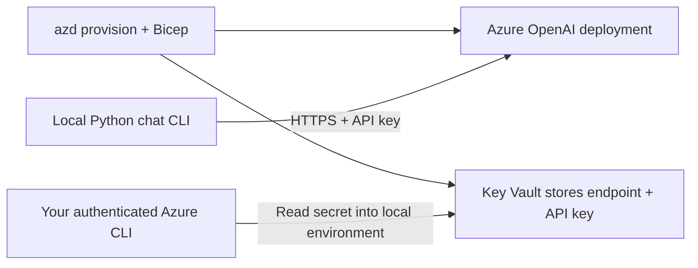

# Azure OpenAI Chat — Lokalni CLI i AZD infrastruktura

**Razina:** Srednja · **Vrijeme:** 35–60 minuta uključujući postavljanje

Ovaj primjer postavlja **Azure OpenAI resurs i Key Vault**, zatim pokreće
interaktivni Python chat CLI **na vašem računalu**. Ne hosta web aplikaciju
niti Container App. Zadani model je `gpt-4.1`, verzija `2025-04-14`, s
kapacitetom implementacije `GlobalStandard` 20. Provjerite trenutnu dostupnost i kvotu u
vašoj odabranoj regiji prije postavljanja; datumi životnog ciklusa modela mogu se promijeniti.

## Ciljevi učenja

- Postavljanje infrastrukture modela pomoću Bicep i azd.
- Dohvaćanje API ključa iz Key Vaulta bez stavljanja u izlaze implementacije.
- Slanje zahtjeva za chat dovršenjima i održavanje povijesti razgovora.
- Tumačenje broja tokena i ograničenja procjena troškova.



U ovom primjeru nema integracije pokretanja s upravljanim identitetom, višeregionalnog prebacivanja,
prilagođenog ograničivača brzine, načina rada strujanja ili hostanog računalstva.
OpenAI SDK izvodi do dva ponovna pokušaja za pogreške koje se mogu ponoviti; CLI prikazuje preostale pogreške.

## Preduvjeti

- Trenutna stabilna verzija [azd](https://learn.microsoft.com/azure/developer/azure-developer-cli/install-azd)
  (objavljena verzija u vrijeme pregleda: 1.37.2).
- [Azure CLI](https://learn.microsoft.com/cli/azure/install-azure-cli).
- Python **3.10+** (preporučeno 3.11) i virtualno okruženje.
- Azure pretplata s dopuštenjima za stvaranje Cognitive Services i Key Vault
  resursa, implementaciju modela i čitanje tajni iz vaulta.
- Regionalna dostupnost i `GlobalStandard` kvota za `gpt-4.1`. Zahtjevi za pristup
  ovise o pretplati i značajci; nema zajamčenog vremena odobrenja.

```bash
azd version
az version
python --version
azd auth login
az login
```

Ovo su zasešne sesije autentikacije. Odaberite istu pretplatu u oba
alata prije pokretanja naredbi u nastavku.

## Brzi početak (Bash)

Pokrenite iz korijena repozitorija:

```bash
cd examples/azure-openai-chat
azd env new myopenai
azd provision
```

Odaberite podržani regijom. Provisioniranje kreira grupu resursa, OpenAI račun,
implementaciju modela, Key Vault i `openai-endpoint`/`openai-api-key` tajne.
Nema **servisa za implementaciju** u `azure.yaml`.

Učitajte izlaze koji nisu tajne i dohvatite tajnu u trenutnu ljusku:

```bash
export AZURE_OPENAI_ENDPOINT="$(azd env get-value AZURE_OPENAI_ENDPOINT)"
export AZURE_OPENAI_MODEL="$(azd env get-value AZURE_OPENAI_MODEL)"
KV_NAME="$(azd env get-value AZURE_KEY_VAULT_NAME)"
export AZURE_OPENAI_API_KEY="$(az keyvault secret show \
  --vault-name "$KV_NAME" --name openai-api-key --query value --output tsv)"

python -m venv .venv
source .venv/bin/activate
python -m pip install -r src/requirements.txt
python src/chat.py
```

U PowerShell-u aktivirajte s `.\.venv\Scripts\Activate.ps1` i dodijelite varijable okoline
s `$env:AZURE_OPENAI_ENDPOINT = azd env get-value AZURE_OPENAI_ENDPOINT`
(na sličan način za model). Dohvatite API ključ koristeći
`$env:AZURE_OPENAI_API_KEY = az keyvault secret show --vault-name $KV_NAME --name openai-api-key --query value -o tsv`.
Prvo postavite `$KV_NAME = azd env get-value AZURE_KEY_VAULT_NAME`.

Nemojte ispisivati, spremati u repozitorij ili lijepiti API ključ u izvještaje o problemima. CLI čita varijable
okruženja procesa; **ne** dohvaća tajne iz Key Vault-a ni ne učitava `.env` datoteke.
`config.py` provjerava endpoint, ograničenje tokena i temperaturu pri pokretanju.

Očekivani izlaz (sadržaj i korištenje variraju):

```text
Azure OpenAI Chat Application
Model: gpt-4.1
...
You: Say hello in one sentence.
Assistant: Hello! How can I help you today?
[Tokens: ... | Cost: $...]
```

Naredbe: `stats` prikazuje ukupno, `clear` briše povijest razgovora, a
`quit`/`exit` završava sesiju. Nema naredbi `--stream`, `--show-tokens`, `tokens`,
niti `cost`.

## Provjera implementacije

Nakon učitavanja varijabli ljuske gore:

```bash
curl --fail-with-body \
  "${AZURE_OPENAI_ENDPOINT%/}/openai/deployments/${AZURE_OPENAI_MODEL}/chat/completions?api-version=2024-10-21" \
  -H "Content-Type: application/json" \
  -H "api-key: $AZURE_OPENAI_API_KEY" \
  -d '{"messages":[{"role":"user","content":"Say hello!"}],"max_tokens":50}'

az keyvault secret list --vault-name "$KV_NAME" --query "[].name" -o table
```

Uspjeh: API vraća HTTP 200 s `choices[0].message.content` i `usage`;
vault navodi `openai-api-key` i `openai-endpoint`. Sama ARM implementacija
ne potvrđuje inferenciju.

## Datoteke i konfiguracija

```text
azure.yaml                         # Infrastructure-only AZD project
infra/main.bicep                   # Subscription deployment
infra/main.parameters.json         # Environment, location, principal ID
infra/resources/openai.bicep       # Account + model
infra/resources/keyvault.bicep     # Vault + deploying user's secret access policy
infra/resources/secrets.bicep      # Writes secrets, no key output
src/chat.py                        # Interactive CLI
src/config.py                      # Environment validation
src/requirements.txt               # Python packages
```

Za promjenu provisioniranog modela/verzije/kapaciteta, uredite zadane vrijednosti u
`infra/main.bicep` i pokrenite `azd provision`. Postavljanje `AZURE_OPENAI_MODEL` u vašoj
ljusci samo odabire **postojeći naziv implementacije**; ne implementira drugi model.

| Varijabla izvođenja | Zadano / izvor |
|---|---|
| `AZURE_OPENAI_ENDPOINT` | Obavezno; azd izlaz koji nije tajna |
| `AZURE_OPENAI_API_KEY` | Obavezno; dohvaća se iz Key Vault-a |
| `AZURE_OPENAI_MODEL` | `gpt-4.1`; naziv Azure implementacije |
| `AZURE_OPENAI_MAX_TOKENS` | 800 (validacijski raspon 1–4096) |
| `AZURE_OPENAI_TEMPERATURE` | 0.7 (raspon 0–2) |
| `AZURE_OPENAI_INPUT_PRICE_PER_1K` | 0.002 USD; ilustrativna cijena nenadjaničenog ulaza |
| `AZURE_OPENAI_OUTPUT_PRICE_PER_1K` | 0.008 USD; ilustrativna cijena izlaza |

## Troškovi i sigurnosna ograničenja

Prikaz troškova je **procjena**, ne Azure fakturiranje. Množi korištenje API tokena
s konfiguriranim cijenama i ne uzima u obzir popuste za keširani ulaz,
regionalne/SKU razlike, poreze, promjene cijena ili neuspjele/ponovljene pozive.
Promijenite **obe cijene** pri korištenju drugog modela ili SKU-a i provjerite trenutne
[Azure OpenAI cijene](https://azure.microsoft.com/pricing/details/cognitive-services/openai-service/).

Za ilustraciju, 100 zahtjeva koristeći 500 nenadjaničenih ulaznih i 200 izlaznih tokena svaki
po zadanim cijenama koštaju `100 × (500/1000 × .002 + 200/1000 × .008) = $0.26`.
Operacije/spremanje u Key Vault proizvode dodatne troškove. Nema fiksne naplate od $50/mjesečno
za ovaj lokalni CLI niti hostirani izračun u predlošku.

Vault koristi pristupne politike za primarni subjekt implementacije; nije primjer RBAC-a ili
aplikacije sa upravljanim identitetom. Javni endpointi i autentikacija API ključem
koriste se u svrhu učenja. Ograničite dozvole i dodajte odgovarajuće kontrole identiteta/mreže
prije prilagodbe za proizvodnju.

## Praktične vježbe

### 1. Provjera konteksta i resetiranje

**Početak:** pokretanje CLI-a. **Cilj:** promatrati povijest.
Reci "Zapamti riječ cedar," zatim upitaj "Koju riječ sam te zamolio da zapamtiš?"
Pokreni `stats`; dvije uspješne izmjene treba računati kao dvije razmijenjene poruke.
Pokreni `clear` i `stats`; razmijenjene poruke trebaju biti nula (ukupni tokeni ostaju).
Točan izbor riječi modela nije determinističan.

### 2. Promjena ograničenja odgovora

**Početak:** izađi iz CLI-a, zadržavajući istu ljusku.
Pokreni `export AZURE_OPENAI_MAX_TOKENS=100`, ponovno pokreni `python src/chat.py` i zatraži
kratko objašnjenje azd. Provjeri da banner prikazuje 100.
Vrati s `unset AZURE_OPENAI_MAX_TOKENS`. Manje ograničenje odgovora ne
smanjuje tokeni povijesti već poslane.

### Česti problemi

- **Nedostaju varijable okoline:** provisioniranje ne izvozi vrijednosti u ljusku;
  ponovite korake izvoza. Novi terminal ih ponovno treba.
- **403 čitanje Key Vaulta:** provjerite pretplatu/prijavu Azure CLI-ja i glavnog korisnika
  u politici pristupa pohrani. Promjene politike mogu potrajati da se primijene.
- **404 zaključivanje:** provjerite ime rasporeda, krajnju točku i status rasporeda.
- **429 zaključivanje:** pričekajte resetiranje ograničenja stope; provjerite kvotu regionalnog modela.
  CLI uklanja neuspjele pokušaje iz povijesti pa ponovno pokušavanje ne duplira iste.
- **Duljina konteksta:** uzorak ne skraćuje duge razgovore; koristite `clear`.
- **Model nedostupan/povučena verzija:** provjerite dostupnost trenutnog modela i ažurirajte
  model/verziju/SKU zajedno; verzija API-ja i verzija modela su različite postavke.

## Čišćenje i sljedeći koraci

```bash
azd down
unset AZURE_OPENAI_API_KEY
```

Soft-delete zadržavanje u Key Vaultu traje sedam dana; trajno brisanje zahtijeva posebne dozvole.
Ne postoji objedinjeni testni komplet; nemojte pokretati nepostojeću naredbu `pytest tests/`.
Dodajte testove s lažnim API-jem prije proširenja koda.

[Primjeri spremnika](../../../../examples/container-app) · [Načrt arhitekture maloprodaje](../retail-scenario.md) ·
[Početak tečaja](../../README.md) · [Prijavi problem](https://github.com/microsoft/AZD-for-beginners/issues)

---

<!-- CO-OP TRANSLATOR DISCLAIMER START -->
**Napomena**:
Ovaj dokument je preveden korištenjem AI prevoditeljskog servisa [Co-op Translator](https://github.com/Azure/co-op-translator). Iako težimo točnosti, imajte na umu da automatski prijevodi mogu sadržavati greške ili netočnosti. Izvorni dokument na izvornom jeziku treba smatrati autoritativnim izvorom. Za važne informacije preporuča se profesionalni ljudski prijevod. Nismo odgovorni za bilo kakva nesporazumevanja ili pogrešne interpretacije koje proizlaze iz korištenja ovog prijevoda.
<!-- CO-OP TRANSLATOR DISCLAIMER END -->