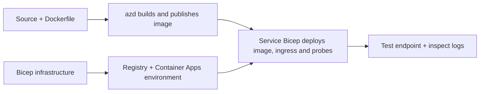

# Primjeri implementacije Container Appsa s AZD-om

Ovaj direktorij sadrži dva uzorka za učenje sa izvornim kodom, Dockerfileovima,
Bicep infrastrukturom i `azure.yaml`. Nijedan nije za produkciju.

## Odaberite primjer

| Uzorak | Što je implementirano | Preduvjeti |
|---|---|---|
| [Jednostavni Flask API](../../../../examples/container-app/simple-flask-api) | Jedan Python CRUD API, stavke u memoriji, health probeovi, HTTP skaliranje | Osnovno znanje CLI-a i HTTP-a |
| [Mikroservisi s dvije usluge](../../../../examples/container-app/microservices) | Node.js gateway, interno read-only Python service za proizvode, telemetrija i skaliranje | Prvo dovršite uzorak s jednom uslugom |

Planirajte 30–60 minuta uključujući postavljanje i provjeru. Vrijeme za Azure provisioning varira.

## Preduvjeti

- [Azure Developer CLI](https://learn.microsoft.com/azure/developer/azure-developer-cli/install-azd)
- [Azure CLI](https://learn.microsoft.com/cli/azure/install-azure-cli) za naredbe provjere
- Docker s pokrenutim daemon-om za izradu ovih container imageova
- Azure pretplata s dopuštenjima za kreiranje resursa i dovoljno regionalnog kvote
- Bash za shell primjere, ili odgovarajuće PowerShell naredbe

```bash
azd version
az version
docker info
azd auth login
az login
```

Ta dva alata imaju odvojene sesije prijave. Koristite trenutno stabilan azd; trenutna
objavljena verzija u vrijeme pregleda je 1.37.2. Starije minimalne verzije nisu
garancija kompatibilnosti.

## Brzi početak

Iz korijena repozitorija:

```bash
cd examples/container-app/simple-flask-api
azd env new flask-demo
azd up
API_URL=$(azd env get-value API_ENDPOINT)
curl --fail-with-body "${API_URL}/health"
```

Očekivano: HTTP 200 s `"status": "healthy"`. Slijedite README uzorka za kreiranje,
čitanje, ažuriranje i brisanje stavke te pregled zapisa.



Početno postavljanje koristi javni hello-world image na portu 80. Specifične
Bicep parametarske datoteke omogućuju `azd deploy` zamjenu s izgrađenim imageom aplikacije
i ispravnim portom/probe za aplikaciju (8000 za Flask/proizvod, 8080 za gateway).
Ove datoteke zadržite sa njihovim `azure.yaml` `module` postavkama.

## Konfiguracija: što mijenja što

`azure.yaml` bira izvorišne direktorije, jezike, hostove i module implementacije.
CPU/memorija kontejnera, ulazi, probeovi, brojevi replika i pravila skaliranja definiraju se
u **Bicep-u**, a ne proizvoljnim svojstvima usluga kao što su `resources`, `scale` ili `regions`.

`azd env set SOME_VALUE ...` pohranjuje vrijednost lokalno. Ona mijenja implementirani
resurs samo kada parametar, mapiranje okoline ili hook eksplicitno koristi tu
vrijednost. Ovi primjeri ne koriste `MAX_REPLICAS`, `SCALE_TO_ZERO_TIMEOUT`,
`CONTAINER_APP_REPLICA_TYPE` ili prilagođene canary postavke iz azd varijabli okoline.
Uredite odgovarajući Bicep i pokrenite `azd up` za ponovno postavljanje i implementaciju.

Nemojte stavljati izvor aplikacije pod `infra/`. `project` mora pokazivati na izvorni
direktorij koji sadrži Dockerfile i manifest ovisnosti.

## Praćenje i troškovi

- `azd monitor --logs` otvara prikaz portala; nije terminalski tok zapisa.
  Koristite `az containerapp logs show --follow` s stvarnim imenom resursa.
- Jednostavni API zapisuje stdout zapise prikupljene putem Container Apps/Log Analyticsa.
  Njegov provisionirani Application Insights resurs nije automatski instrumentiran.
- Gateway mikroservisa koristi Node.js Application Insights SDK; Python
  servis izvozi traceve zapisa aplikacije. Potpuno Python request/dependency praćenje
  nije konfigurirano.
- Skaliranje na nulu može smanjiti troškove računalnih resursa, ali registar i unos/spremanje zapisa
  još uvijek može koštati. Zadane postavke mikroservisa drže replike aktivnima.
  Procijenite svoj regiju i korištenje u
  [Azure kalkulatoru cijena](https://azure.microsoft.com/pricing/calculator/).

## Napredni obrasci — ne uključene implementacije

Ovo su smjernice dizajna, ne dodatni lokalni projekti ili isječci za kopiranje i pokretanje:

- **Postojani podaci i autentikacija:** zamijenite memorijske pohrane i dodajte
  Microsoft Entra ID autentikaciju/autorizaciju prije produkcije.
- **Blue-green/canary:** koristite višerevizijski način Container Appsa, oznake revizija,
  težine prometa, provjeru zdravlja i postupke vraćanja.
  Ne postoji `deploymentStrategy: canary` azd konfiguracija u ovim uzorcima.
  Pogledajte [upravljenje revizijama](https://learn.microsoft.com/azure/container-apps/revisions).
- **Višeregionalno:** kreirajte zasebne okoline i aplikacije u Bicepu i dizajnirajte
  globalno usmjeravanje i dosljednost podataka. Lista usluga `regions` nije azd
  mehanizam implementacije.
- **Radnici u redu:** dodajte izvor radnika, ovisnosti, resurse reda, upravljani
  identitet s ulogama na razini podataka i autentificirano pravilo skaliranja. Nemojte kopirati
  praznu `src/worker` putanju i očekivati pokretljiv projekt.
- **Dapr:** postavite komponente, konfigurirajte sidecar, instalirajte odgovarajući SDK
  i implementirajte rukovanje pogreškama stanja/pub-sub-a.
- **Tajne:** koristite upravljani identitet i dodjele uloga gdje je moguće. Samo
  kreiranje Key Vaulta ne daje aplikacijama pristup ili učitavanje tajni.

## Čišćenje

Iz direktorija uzorka:

```bash
azd down
```

Pregledajte upite za brisanje i potvrdite uklanjanje posvećene grupe resursa.
Nemojte koristiti ove uzorke kao osnovu za produkciju bez dodatnog dizajna i testova.

[Indeks primjera](../README.md) · [Početna stranica tečaja](../../README.md) ·
[Dokumentacija Container Appsa](https://learn.microsoft.com/azure/container-apps/) ·
[Prijavite problem](https://github.com/microsoft/AZD-for-beginners/issues)

---

<!-- CO-OP TRANSLATOR DISCLAIMER START -->
**Napomena**:
Ovaj dokument je preveden korištenjem AI prevoditeljskog servisa [Co-op Translator](https://github.com/Azure/co-op-translator). Iako težimo točnosti, imajte na umu da automatski prijevodi mogu sadržavati greške ili netočnosti. Izvorni dokument na izvornom jeziku treba smatrati autoritativnim izvorom. Za važne informacije preporuča se profesionalni ljudski prijevod. Nismo odgovorni za bilo kakva nesporazumevanja ili pogrešne interpretacije koje proizlaze iz korištenja ovog prijevoda.
<!-- CO-OP TRANSLATOR DISCLAIMER END -->