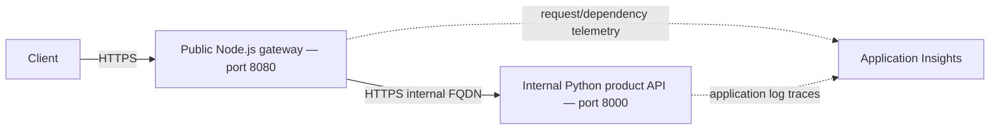

# Mikroservisi s dvije usluge — Azure Container Apps

**Razina:** Srednja · **Vrijeme:** 45–60 minuta uključujući postavljanje

Ovaj obrazovni primjer implementira **Node.js API Gateway** i **Python proizvodnu uslugu samo za čitanje**.
Izvorni kod, Dockerfileovi, Bicep i azd konfiguracija su uključeni.
Nije to proizvodni sustav otporan na greške.

## Što ćete naučiti

- Neovisno implementirati dvije usluge.
- Koristiti internu backend FQDN preko HTTPS-a.
- Provjeriti odgovore za uspjeh, ne pronađeno i nedostupnu uslugu.
- Razumjeti telemetriju i neovisne granice skaliranja.



Katalog proizvoda sadrži pet fiksnih proizvoda u memoriji. Nema **POST, PUT ili DELETE rukovatelja**, baze podataka,
Service Bus-a, usluge narudžbi/korisnika/obavijesti, C# ili Go koda.
To su ideje za budući razvoj, nisu uključene značajke.
Gateway ne autentificira korisnike; interni ulaz nije zamjena za autorizaciju aplikacije.


## Preduvjeti

Najprije dovršite [jedinstvenu Flask API](../../../../../examples/container-app/simple-flask-api).
Instalirajte aktualni stabilni azd (objavljeni release u vrijeme pregleda: 1.37.2), Azure CLI,
i Docker s pokrenutim daemon-om. Potrebna vam je Azure pretplata, ovlasti za stvaranje resursa
i regionalna kvota za Container Apps.

```bash
azd version
az version
docker info
azd auth login
az login
```

Koristite istu pretplatu u oba CLI alata. Sljedeće naredbe koriste Bash.

## Implementacija i provjera

Iz korijena repozitorija:

```bash
cd examples/container-app/microservices
azd env new microservices-demo
azd up
GATEWAY_URL=$(azd env get-value API_GATEWAY_URL)
RG_NAME=$(azd env get-value AZURE_RESOURCE_GROUP)
GATEWAY_NAME=$(azd env get-value API_GATEWAY_NAME)
PRODUCT_NAME=$(azd env get-value PRODUCT_SERVICE_NAME)

curl --fail-with-body "${GATEWAY_URL}/health"
curl --fail-with-body "${GATEWAY_URL}/api/products"
curl --fail-with-body "${GATEWAY_URL}/api/products/1"
curl -i "${GATEWAY_URL}/api/products/999"
```

**Uspjeh:** health 200; lista 200 sa **pet** proizvoda; proizvod 1 je Laptop
cijenjen na 999.99 i zaliha 50; nepoznati proizvod vraća 404.
Opisi su uključeni u odgovore; vremenske oznake variraju.

Početna implementacija koristi javne hello-world slike na portu 80 kako ne bi pokušala
povući nepostojeće slike iz praznog registra. Bicep moduli specifični za uslugu
i datoteke parametara zamjenjuju ih izgrađenim slikama i portovima/probama aplikacije tijekom
`azd deploy`. Glavni parametri čuvaju nazive objavljenih slika za kasniju implementaciju.

## Usluge i umrežavanje

| Usluga | Izloženi krajnji punktovi | Zadani resursi |
|---|---|---|
| Gateway | GET `/`, `/health`, `/api/products`, `/api/products/:id` | 1 vCPU, 2 GiB, 2–20 replika |
| Produkt | GET `/`, `/health`, `/products`, `/products/<id>` | 0.5 vCPU, 1 GiB, 1–10 replika |

Ulaz proizvoda ima `external: false` i `allowInsecure: false`. Bicep ubrizgava
`PRODUCT_SERVICE_URL=https://<actual-internal-fqdn>` u gateway. HTTP bi
preusmjerio; HTTPS odgovara konfiguriranom ulazu. Kratko DNS ime mora odgovarati
**stvarnom imenu Container App**, a ne logičkom ključu usluge `product-service`.
Nemojte pokušavati izravno pozvati internu URL adresu s vašeg prijenosnog računala.

Gateway ima timeout od pet sekundi za pozive proizvoda. Nedostajući ID-ovi proizvoda
propagiraju se kao 404; kvarovi transporta/drugi kvarovi backend-a vraćaju 503. Gateway
`/health` provjerava samo gateway, ne dostupnost backend-a.

## Datoteke i konfiguracija

```text
azure.yaml
infra/main.bicep
infra/main.parameters.json
infra/abbreviations.json
infra/core/container-apps-environment.bicep
infra/core/monitor.bicep
infra/app/api-gateway.bicep
infra/app/api-gateway.parameters.json
infra/app/product-service.bicep
infra/app/product-service.parameters.json
src/api-gateway/{app.js,package.json,Dockerfile}
src/product-service/{main.py,requirements.txt,Dockerfile}
```

Skaliranje, CPU/memorija, portovi i probe postavljeni su u `infra/app/*.bicep`. Promijenite te
datoteke i pokrenite `azd up` da primijenite infrastrukturu i ponovno implementirate. Nema
`GATEWAY_MAX_REPLICAS` parametra za varijablu okruženja u ovom primjeru.

Za promjene samo koda:

```bash
azd deploy product-service
azd deploy api-gateway
```

Node slika koristi Node 22; Python slika koristi Python 3.11. Obje se vežu na
`0.0.0.0`. Ingress/probe koriste port 8080 (gateway) odnosno 8000 (produkt).

## Lokalni razvoj s Dockerom

Pokrenite iz ovog direktorija primjera. Koristite mrežu definiranu od strane korisnika, **ne `localhost`
da jedan kontejner dosegne drugi**:

```bash
docker network create azd-microservices-demo
docker build -t local-product ./src/product-service
docker build -t local-gateway ./src/api-gateway
docker run -d --name azd-product --network azd-microservices-demo local-product
docker run -d --name azd-gateway --network azd-microservices-demo \
  -p 8080:8080 -e PRODUCT_SERVICE_URL=http://azd-product:8000 local-gateway
curl --fail-with-body http://localhost:8080/api/products
```

Očekivano: pet proizvoda. HTTP se koristi samo za ovu lokalnu Docker mrežu.

```bash
docker stop azd-product azd-gateway
docker rm azd-product azd-gateway
docker network rm azd-microservices-demo
```

## Praćenje

```bash
az containerapp logs show --name "$GATEWAY_NAME" --resource-group "$RG_NAME" --follow
# In a separate terminal:
az containerapp logs show --name "$PRODUCT_NAME" --resource-group "$RG_NAME" --tail 100
```

`azd monitor --logs` otvara prikaz portala; ne emitira terminalske logove.
Node SDK prikuplja zahtjeve/ovisnosti gatewaya. Pythonov `AzureLogHandler`
izvozi **log trake**, ne automatske Flask zahtjeve, SQL ovisnosti ili pune
distribuirane tragove. OpenCensus je zastarjeli SDK; preferirajte Azure Monitor OpenTelemetry
pri proširenju ovog primjera.

U Application Insights Logs generirajte zahtjeve i pregledajte:

```kusto
requests
| where timestamp > ago(1h)
| where name contains "products"
| summarize RequestCount=count(), AvgDuration=avg(duration) by bin(timestamp, 5m)
```

Za Python aplikacijske poruke:

```kusto
traces
| where timestamp > ago(1h)
| where message contains "products"
| project timestamp, message, severityLevel
```

Dozvolite kašnjenje unosa i uzorkovanje; ne očekujte točan broj zahtjeva ili
zajamčeno trajanje. Nema konfiguriranih prilagođenih upozorenja ili nadzornih ploča.

## Praktični zadaci

### Zadatak 1: Izmijenite katalog

**Početna točka:** `src/product-service/main.py`.
**Cilj:** potvrditi neovisnu implementaciju usluge.
Promijenite zalihu Laptopa s 50 na 49 u fiksnoj `products` listi, pokrenite
`azd deploy product-service`, zatim zatražite `${GATEWAY_URL}/api/products/1`.

**Kriteriji uspjeha / rješenje:** HTTP 200 s `"stock":49`. Vratite 50 i ponovno implementirajte.
**Čest problem:** uređivanje gatewaya umjesto usluge koja posjeduje katalog.
To mijenja izvorne podatke, ne trajnu bazu inventara.

### Zadatak 2: Provjerite konfiguraciju replika

**Početna točka:** `infra/app/product-service.bicep`.
**Cilj:** promatrati promjenu infrastrukture bez nagađanja o automatskom skaliranju.
Promijenite `minReplicas: 1` na `minReplicas: 2`, pokrenite `azd up`, zatim:

```bash
az containerapp show --name "$PRODUCT_NAME" --resource-group "$RG_NAME" \
  --query properties.template.scale -o json
```

**Kriteriji uspjeha:** minimalno konfigurirano je 2, a maksimalno ostaje 10.
Vratite minimalno 1 i pokrenite `azd up`.
**Čest problem:** `azd deploy` sam ne primjenjuje promjene na povezanu zajedničku
infrastrukturu. Nemojte postavljati `maxReplicas` na nulu kao simulaciju kvara.
Ovo potvrđuje konfiguraciju, ne opterećenje ili zajamčeni trenutačni broj replika.

### Zadatak 3: Testirajte rukovanje nedostupnom uslugom lokalno

**Početna točka:** oba lokalna Docker kontejnera gore rade.
**Cilj:** razlikovati kvar backend-a od nedostajućeg proizvoda.
Zaustavite samo kontejner proizvoda:

```bash
docker stop azd-product
curl -i http://localhost:8080/api/products
docker start azd-product
curl --fail-with-body http://localhost:8080/api/products
```

**Kriteriji uspjeha:** dok je zaustavljen, gateway vraća 503 s
`"error":"Product service unavailable"`; nakon restartanja, lista vraća 200.
Ponovite nakon kratkog kašnjenja pokretanja ako je potrebno.
**Čest problem:** zaustavljanje gatewaya testira drugačiji kvar (nema HTTP odgovora).

## Troškovi i praznine za produkciju

Zadane minimalne replike održavaju pokretanje računskih resursa. Registar i nadzor također
stvaraju troškove. Ne postoji potvrđeni fiksni ukupni iznos od 50 $ mjesečno:
procijenite regionalni CPU/memoriju, sate replika, zahtjeve, registar i držanje logova u
[Azure kalkulatoru cijena](https://azure.microsoft.com/pricing/calculator/).
Izbrišite resurse za učenje odmah nakon završetka.

Proizvodni rad uključuje autentifikaciju/autorizaciju, ograničene upravljane identitete,
trajne podatke, validaciju unosa/odgovora, podržano instrumentiranje za promatranje,
testiranje opterećenja/kvara, CI/CD, upozorenja i postupke oporavka.
Dodavanje usluge narudžbi, reda ili baze podataka je zaseban zadatak implementacije,
ne dovršeni zadatak ili funkcionalnost već dostupna ovdje.

## Otklanjanje poteškoća i čišćenje

- **Slika nije pronađena tijekom prve implementacije:** bootstrap bi trebao koristiti javnu sliku;
  provjerite zadane vrijednosti glavnog parametra slike i mapiranja modula za implementaciju.
- **503 proizvodi:** provjerite logove proizvoda, reviziju slike i ubrizganu internu HTTPS URL adresu.
- **404 neočekivani put:** proizvodni API je samo za čitanje; provjerite rutu, ne nepostojeći CRUD rukovatelj.
- **Nema telemetrije:** pregledajte runtime connection strings bez izlaganja i
  dozvolite kašnjenje unosa. Pythonove tablice zahtjeva nisu popunjene njegovim log handlerom.

Iz ovog direktorija primjera:

```bash
azd down
```

Pregledajte upite za brisanje i provjerite da je predana grupa resursa uklonjena.

[Prethodno: Flask API](../../../../../examples/container-app/simple-flask-api) · [Sljedeće: Database app](../../../../../examples/database-app) ·
[AI razvoj](../../../docs/chapter-02-ai-development/README.md) ·
[Početna stranica tečaja](../../../README.md) · [Prijavi problem](https://github.com/microsoft/AZD-for-beginners/issues)

---

<!-- CO-OP TRANSLATOR DISCLAIMER START -->
**Napomena**:
Ovaj dokument je preveden korištenjem AI prevoditeljskog servisa [Co-op Translator](https://github.com/Azure/co-op-translator). Iako težimo točnosti, imajte na umu da automatski prijevodi mogu sadržavati greške ili netočnosti. Izvorni dokument na izvornom jeziku treba smatrati autoritativnim izvorom. Za važne informacije preporuča se profesionalni ljudski prijevod. Nismo odgovorni za bilo kakva nesporazumevanja ili pogrešne interpretacije koje proizlaze iz korištenja ovog prijevoda.
<!-- CO-OP TRANSLATOR DISCLAIMER END -->