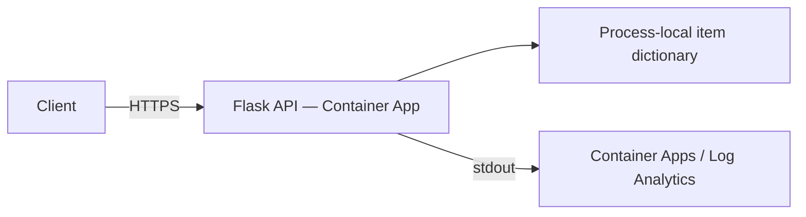

# Jednostavan Flask API — Azure Container Apps

**Razina:** Početnik · **Vrijeme:** 30–45 minuta uključujući postavljanje

Implementirajte Python Flask CRUD API pomoću Azure Developer CLI (azd). Izvorni kod, Dockerfile,
Bicep i parametri implementacije su uključeni. Ovo je **primjer za učenje**, nije
API spreman za produkciju.

## Što ćete naučiti

- Izgraditi i objaviti spremnik pomoću azd.
- Konfigurirati ulazni promet i probes za liveness/readiness.
- Provjeriti odgovore CRUD i pregledavati dnevnike aplikacije.
- Razumjeti zašto podatci u memoriji nisu prikladni za trajne aplikacije.



**Važno:** stavke se drže u jednom procesu. Zadano je **jedan Gunicorn radnik,
0–1 replika**, namjerno izbjegavajući nekonzistentne podatke između radnika/replika.
Stavke se gube nakon ponovnog pokretanja, promjene revizije ili skaliranja na nulu. Povećanje replika
zahtijeva zajedničku trajnu pohranu. API nema autentifikaciju ni autorizaciju.

## Preduvjeti

- [Trenutno stabilni azd](https://learn.microsoft.com/azure/developer/azure-developer-cli/install-azd)
  (objavljena verzija u vrijeme pregleda: 1.37.2).
- [Azure CLI](https://learn.microsoft.com/cli/azure/install-azure-cli) za provjeru.
- Docker s pokrenutim daemonom; potreban je za zadanu lokalnu izgradnju slike.
- Azure pretplata, dopuštenja za kreiranje resursa i regionalna kvota za Container Apps.
- Bash za dolje navedene naredbe (ili ekvivalentni PowerShell).
- Python 3.11 za opcionalni lokalni razvoj.

```bash
azd version
az version
docker info
azd auth login
az login
```

CLI alati imaju zasebne prijave. Koristite istu pretplatu u oba.

## Brzi početak

Iz korijena repozitorija:

```bash
cd examples/container-app/simple-flask-api
azd env new flask-demo
azd up
API_URL=$(azd env get-value API_ENDPOINT)
RG_NAME=$(azd env get-value AZURE_RESOURCE_GROUP)
API_NAME=$(azd env get-value API_NAME)
curl --fail-with-body "${API_URL}/health"
```

Očekivano: HTTP 200 i JSON s `"status":"healthy"`,
`"service":"simple-flask-api"` i trenutnim UTC vremenskim žigom.
Provisioning i izrada slike obično traju nekoliko minuta; trajanja variraju.

Početni provisioning koristi javnu hello-world sliku koja sluša na portu 80.
`azure.yaml` bira `infra/app/api.bicep` i odgovarajuću datoteku parametara za
implementaciju servisa, što prebacuje sliku, ingress i probes na port 8000.
Ne brišite te parametre implementacije.

## Provjera CRUD

Pokrenite sljedeće redom dok je ista replika aktivna:

```bash
# Create: HTTP 201; note the returned id (1 for a fresh process).
curl -i -X POST "${API_URL}/api/items" \
  -H "Content-Type: application/json" \
  -d '{"name":"Test Item","description":"My first item"}'

# Read list: HTTP 200, total 1 in a fresh process.
curl --fail-with-body "${API_URL}/api/items"

# Replace 1 if your create response returned another id.
curl --fail-with-body "${API_URL}/api/items/1"
curl -i -X PUT "${API_URL}/api/items/1" \
  -H "Content-Type: application/json" -d '{"name":"Updated Item"}'
curl -i -X DELETE "${API_URL}/api/items/1"
curl -i "${API_URL}/api/items/1"
```

Uspjeh: POST 201, čitanja/PUT 200, DELETE 204 bez tijela, zatim nedostajuća stavka 404.
Neispravan/neobjektni JSON ili prazno ime vraća 400.
Ako stavka nestane između zahtjeva, provjerite restart ili skaliranje na nulu;
ovo je namjerna ograničenje u memoriji, nije trajnost.

| Krajnja točka | Metode |
|---|---|
| `/` | GET — informacije o servisu |
| `/health` | GET — liveness/readiness |
| `/api/items` | GET, POST |
| `/api/items/{id}` | GET, PUT, DELETE |

## Dnevnici i konfiguracija

```bash
az containerapp logs show --name "$API_NAME" --resource-group "$RG_NAME" --follow
```

Očekivano: pokretanje Gunicorna, dnevnici pristupa zahtjevima i poruke aplikacije.
`azd monitor --logs` otvara prikaz portala; ne strimuje u terminal.
Application Insights je provisioniran, ali **nije instrumentiran ovim Flask kodom**;
koristite Container Apps/Log Analytics za stdout dnevnike.

Uredite `infra/app/api.bicep` za CPU/memoriju, ograničenja replika ili pravila skaliranja, zatim
pokrenite `azd up`. Zadano je 0.5 vCPU, 1 GiB, minimalno 0 / maksimalno 1 replika i
HTTP prag od 50 istovremenih zahtjeva. Skaliranje na nulu može uzrokovati kašnjenje hladnog starta.

Poljubno `azd env set MAX_REPLICAS`, `API_KEY`, `LOG_LEVEL` ili
`SCALE_TO_ZERO_TIMEOUT` vrijednosti **nisu povezane s ovom predloškom ili aplikacijom**.
Postavljanje vrijednosti ne znači automatski da je runtime varijabla okruženja.
Slika eksplicitno veže port 8000; ažurirajte Dockerfile, Bicep ingress i probes
zajedno ako mijenjate port.

## Datoteke

```text
azure.yaml
infra/main.bicep
infra/main.parameters.json
infra/app/container-apps.bicep       # Environment, registry, monitoring
infra/app/api.bicep                  # App, ingress, probes, scale settings
infra/app/api.parameters.json        # Image and resource values for azd deploy
src/app.py
src/Dockerfile
src/requirements.txt
```

## Lokalni razvoj

Iz ovog direktorija primjera:

```bash
python -m venv .venv
source .venv/bin/activate  # PowerShell: .\.venv\Scripts\Activate.ps1
python -m pip install -r src/requirements.txt
python src/app.py
```

U drugom terminalu testirajte `http://localhost:8000/health` i CRUD krajnje točke.
Ili izgradite i pokrenite stvarnu sliku:

```bash
docker build -t flask-api:local ./src
docker run --rm -p 8000:8000 flask-api:local
```

Za promjene samo u kodu nakon prve implementacije, pokrenite `azd deploy api`.
Za promjene u Bicepu, pokrenite `azd up` za ponovni provisioning i implementaciju.

## Praktične vježbe

### 1. Provjera odbijanja unosa

**Početna točka:** implementirani API, `API_URL` gore.
**Cilj:** potvrditi da API odbija nevaljane JSON oblike i nedostajuća imena.

```bash
curl -i -X POST "${API_URL}/api/items" \
  -H "Content-Type: application/json" -d '[]'
curl -i -X POST "${API_URL}/api/items" \
  -H "Content-Type: application/json" -d '{"name":""}'
```

**Kriteriji uspjeha / rješenje:** oba vraćaju 400 s JSON pogreškom, ne 500.
**Čest problem:** izostavljanje zaglavlja JSON content-type.

### 2. Dodajte krajnju točku samo za čitanje

**Početna točka:** `src/app.py`. **Cilj:** proširiti i ponovo implementirati API.
Dodajte ovo prije `if __name__ == '__main__':` bloka:

```python
@app.route('/version', methods=['GET'])
def version():
    return jsonify({'version': '1.0.0'})
```

Pokrenite `azd deploy api`, zatim `curl --fail-with-body "${API_URL}/version"`.
**Kriterij uspjeha:** HTTP 200 i `{"version":"1.0.0"}`.
**Čest problem:** stavljanje rute nakon blokirajućeg `app.run()` poziva pri
testiranju s `python src/app.py`.

### Provjera znanja

Zašto je jedan radnik nedovoljan za trajne podatke? Zato što i jedan proces gubi
svoj rječnik pri ponovnom pokretanju. Produkcijska verzija treba trajnu zajedničku pohranu,
autentifikaciju, autorizaciju, migracije, testove i operativni nadzor.

## Troškovi i rješavanje problema

Ovo nije zajamčena besplatna implementacija: osnovni registar i pohrana/ingest dnevnika
mogu uzrokovati troškove čak i kada je izračun aplikacije na nuli. Koristite
[kalkulator cijena](https://azure.microsoft.com/pricing/calculator/) za vašu regiju.

- **Neuspjeh izgradnje Dockera:** provjerite `docker info`, mrežni pristup i ovisnosti.
- **Nezdrava aplikacija:** pregledajte konzolne/sistemske dnevnike i provjerite port slike, ingress,
  i probes su usklađeni. Zadrživač ne smije biti probean na Flask portu.
- **403/dozvole:** provjerite pretplatu i dopuštenja za kreiranje resursa.
- **Stavke nestaju:** stanje u memoriji se resetira pri ponovnom pokretanju/skaliranju na nulu; dodajte bazu podataka
  za trajno ponašanje.

## Čišćenje i sljedeći koraci

```bash
azd down
```

Pregledajte upit za brisanje i potvrdite da je posvećena grupa resursa uklonjena.
Nemojte koristiti destruktivno čišćenje nad grupom resursa koja sadrži nepovezane podatke.

[Sljedeće: Aplikacija baze podataka](../../../../../examples/database-app) · [Mikroservisi](../../../../../examples/container-app/microservices) ·
[Pregled kontejnera](../README.md) · [Početna stranica tečaja](../../../README.md) ·
[Prijavite problem](https://github.com/microsoft/AZD-for-beginners/issues)

---

<!-- CO-OP TRANSLATOR DISCLAIMER START -->
**Napomena**:
Ovaj dokument je preveden korištenjem AI prevoditeljskog servisa [Co-op Translator](https://github.com/Azure/co-op-translator). Iako težimo točnosti, imajte na umu da automatski prijevodi mogu sadržavati greške ili netočnosti. Izvorni dokument na izvornom jeziku treba smatrati autoritativnim izvorom. Za važne informacije preporuča se profesionalni ljudski prijevod. Nismo odgovorni za bilo kakva nesporazumevanja ili pogrešne interpretacije koje proizlaze iz korištenja ovog prijevoda.
<!-- CO-OP TRANSLATOR DISCLAIMER END -->