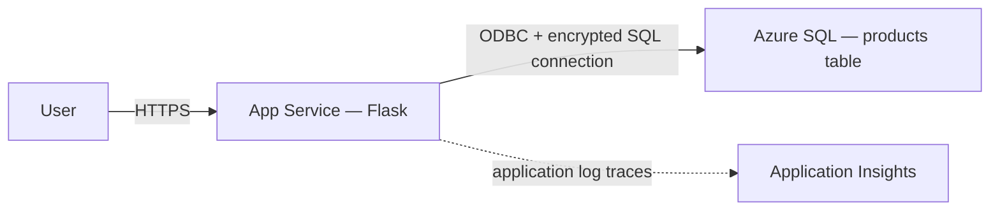

# Flask i Azure SQL na App Service

**Razina:** Srednja · **Vrijeme:** 30–60 minuta uključujući preduvjete

Ovaj primjer implementira Python Flask read API na **Linux App Service** i Basic
Azure SQL bazu podataka. Izvorni kod, Bicep i azd konfiguracija su uključeni. To je
aplikacija za učenje, a ne arhitektura baze podataka spremna za produkciju.

## Što ćete naučiti

- Osigurajte App Service, SQL i resurse za nadzor pomoću Bicep-a.
- Konfigurirajte šifriranu SQL povezanost bez pohrane vjerodajnica.
- Inicijalizirajte shemu prije pokretanja Gunicorn radnika.
- Provjerite unesene podatke, odgovore "nije pronađeno" i zdravlje baze podataka.



Resursi: posvećena grupa resursa, B1 Linux App Service plan, Python 3.11 Web
aplikacija, SQL poslužitelj i Basic 2-GB baza podataka, Application Insights i Log Analytics.
Web aplikacija koristi **izvorni/ZIP deployment i Oryx instalaciju ovisnosti**;
`azd deploy` ne gradi niti implementira opcijski Dockerfile.

## Preduvjeti

- Trenutni stabilni [azd](https://learn.microsoft.com/azure/developer/azure-developer-cli/install-azd)
  (objavljena verzija u vrijeme pregleda: 1.37.2).
- [Azure CLI](https://learn.microsoft.com/cli/azure/install-azure-cli) za provjeru.
- Azure pretplata, dopuštenja za kreiranje navedenih resursa i regionalni limit.
- Python **3.11** za lokalni razvoj; predani `pyodbc==5.0.1` može zahtijevati
  nativne alate za izgradnju na novijim verzijama Pythona.
- Microsoft ODBC Driver 18 (ili 17) za SQL Server na lokalnim računalima. `pip install
  pyodbc` ne instalira sustavni drajver. Pogledajte
  [ODBC instalaciju](https://learn.microsoft.com/sql/connect/odbc/download-odbc-driver-for-sql-server).
- Docker samo ako testirate opcijski kontejner lokalno.

```bash
azd version
az version
azd auth login
az login
```

Koristite istu pretplatu u oba alata. Naredbe u nastavku koriste Bash.

## Implementacija

Iz korijena repozitorija:

```bash
cd examples/database-app
azd env new sql-demo
azd provision
azd deploy
WEB_URL=$(azd env get-value WEB_APP_URI)
WEB_NAME=$(azd env get-value WEB_APP_NAME)
RG_NAME=$(azd env get-value AZURE_RESOURCE_GROUP)
```

Odaberite podržani regijnski podatak. `sqlAdminLogin` zadano postavlja na `sqladmin`; potrebno
`sqlAdminPassword` je siguran parametar. Unesite jaku lozinku kad se zatraži.
Držite vjerodajnice za deployment izvan Gita i izvještaja o greškama. Trenutna interpolacija
connection string-a očekuje lozinku bez razdjelnika connection-string-a kao što su
`;`; prilagodite escape prije upotrebe takvih vrijednosti.

Bicep postavlja startnu naredbu koja izvršava `init_database()` **prije** nego što radnici Gunicorn-a počnu.
Ovo je potrebno jer importiranje `app:app` ne izvršava
Python-ov `if __name__ == '__main__'` blok. Na svježoj bazi podataka, inicijalizacija
stvara `products` i umeće pet redaka. To je jednostavan nastavnički početak, a ne
sustav za migracije u konkurentnom okruženju; koristite odgovarajuće migracije prije skaliranja instanci.

Aplikacija bira instalirani Microsoft ODBC Driver 18, zatim 17, ako connection
string izričito ne navodi drajver. Ako ni jedan ne postoji, startanje ne uspijeva s
izvedivom porukom o instalaciji. Provjerite dostupnost drajvera u odabranom
runtime-u App Service-a umjesto da to pretpostavljate.

## Provjera

```bash
curl --fail-with-body "${WEB_URL}/"
curl --fail-with-body "${WEB_URL}/health"
curl --fail-with-body "${WEB_URL}/products"
curl --fail-with-body "${WEB_URL}/products/1"
curl -i "${WEB_URL}/products/999"
```

Očekivano:

- `/` vraća informacije o krajnjoj točki.
- `/health` vraća 200 sa `{"status":"healthy","database":"connected"}`.
- `/products` vraća pet unesena proizvoda na svježoj bazi.
- `/products/1` vraća Laptop s cijenom 1299.99.
- Nepostojeći proizvod vraća 404 s `{"error":"Product not found"}`.

API je samo za čitanje. Ne postoji PUT/POST/DELETE ruta ili korisničko sučelje u pregledniku.
Neuspjeh povezivanja s bazom vraća 503 iz `/health`; to nije uspjeh.

## Datoteke i konfiguracija

```text
azure.yaml                         # Python App Service source deployment
infra/main.bicep
infra/main.parameters.json
infra/abbreviations.json
infra/resources/sql-server.bicep
infra/resources/sql-database.bicep
infra/resources/app-service-plan.bicep
infra/resources/web-app.bicep       # Settings + initialization/startup command
infra/resources/app-insights.bicep
src/web/app.py
src/web/requirements.txt
src/web/Dockerfile                 # Optional local container, not the azd target
.env.sample
```

`SQL_CONNECTION_STRING` se prosljeđuje kao siguran Bicep parametar modulu Web App-a
i pohranjuje u postavke App Service-a, ne u izlazne podatke implementacije.
`APPLICATIONINSIGHTS_CONNECTION_STRING` konfigurira izvoz zapisa.
`SCM_DO_BUILD_DURING_DEPLOYMENT=true` omogućuje instalaciju ovisnosti na strani poslužitelja.
Postavljanje proizvoljnih `azd env` vrijednosti ne mijenja automatski postavke aplikacije.

SQL pravilo vatrozida `0.0.0.0` dopušta veze s **Azure servisa,
uključujući pretplate drugih korisnika**, uz uvjet SQL autentifikacije. Nije
ograničeno na ovu aplikaciju ili pretplatu. Javni mrežni pristup SQL-u je omogućen.
Koristite selektivno umrežavanje i identitet aplikacije bez administratorskih prava prije produkcije.

## Lokalni razvoj

Koristite Python 3.11 i instalirani Microsoft SQL ODBC drajver:

```bash
python -m venv .venv
source .venv/bin/activate  # PowerShell: .\.venv\Scripts\Activate.ps1
python -m pip install -r src/web/requirements.txt
export SQL_CONNECTION_STRING='Server=tcp:YOUR_SERVER.database.windows.net,1433;Database=YOUR_DATABASE;UID=YOUR_USER;PWD=YOUR_PASSWORD;Encrypt=yes;TrustServerCertificate=no;Connection Timeout=30;'
python src/web/app.py
```

Sigurno zamijenite rezervirana mjesta. Kopirana `.env` datoteka **nije automatski učitana**
ovom aplikacijom. Izvezite varijable u svojem trenutačnom shellu.
Za Azure SQL s laptopa privremeno dopustite samo vlastiti javni IP:

```bash
SQL_SERVER=$(azd env get-value SQL_SERVER_NAME)
MY_IP=YOUR_PUBLIC_IP
az sql server firewall-rule create -g "$RG_NAME" -s "$SQL_SERVER" \
  -n AllowMyLearningIP --start-ip-address "$MY_IP" --end-ip-address "$MY_IP"
```

Uklonite pravilo nakon testiranja:

```bash
az sql server firewall-rule delete -g "$RG_NAME" -s "$SQL_SERVER" -n AllowMyLearningIP
```

Opcijski test kontejnera iz ovog direktorija primjera:

```bash
docker build -t sql-flask:local src/web
docker run --rm -p 8000:8000 -e SQL_CONNECTION_STRING sql-flask:local
```

Ova slika instalira Driver 18 koristeći Debian 12 repozitorij paketa koji odgovara
njegovoj Bookworm osnovi, jednom inicijalizira bazu, zatim pokreće Gunicorn.

## Nadzor i otklanjanje problema

Omogućite i pratite datotečni sustav zapisivanja aplikacije App Service-a pri dijagnosticiranju pokretanja:

```bash
az webapp log config --name "$WEB_NAME" --resource-group "$RG_NAME" \
  --application-logging filesystem --level information
az webapp log tail --name "$WEB_NAME" --resource-group "$RG_NAME"
```

Ovaj kod izvozi aplikacijske **log traceove** putem zastarjelog OpenCensus handlera.
Ne konfigurira automatsko praćenje Flask zahtjeva/ovisnosti, Live Metrics,
SQL reviziju, dijagnostičke postavke ili alarme. Za te je potrebna zasebna konfiguracija.
Za novu instrumentaciju, radije koristite Azure Monitor OpenTelemetry.

U Application Insights Logs, nakon izvođenja API zahtjeva:

```kusto
traces
| where timestamp > ago(1h)
| where message contains "products" or message contains "Health check"
| project timestamp, message, severityLevel
```

Dozvolite kašnjenje pri unosu. Aktivnost u tablici zahtjeva ili Live Metrics nije kriterij završetka
ove samo-log instrukcije.

- **Nedostajući drajver:** provjerite `pyodbc.drivers()` u runtime-u i instalirajte
  podržani Microsoft ODBC drajver. Samo Python paket nije dovoljan.
- **Neuspjeh veze:** provjerite SQL postavke, vjerodajnice, vatrozid i odabranu
  pretplatu. Ne onemogućavajte enkripciju zaobići pogrešku.
- **Nedostaje tablica proizvoda:** potvrdite jesu li Bicep startne naredbe implementirane;
  start samo `gunicorn app:app` preskače inicijalizaciju.
- **Neuspjeh izgradnje paketa:** koristite Python 3.11 ili osigurajte nativne preduvjete.
- **Podaci s nulom kao cijenom:** nula je valjana decimalna cijena; mora se serijalizirati kao 0.0,
  ne kao `null`.

## Praktične vježbe

### Vježba 1: Provjerite ponašanje za nedostajući proizvod

**Početna točka:** implementirani API i `WEB_URL` gore.
**Cilj:** razlikovati nedostajući red od neispravne baze podataka.
Zahtjevajte `/health` i `/products/999` koristeći naredbe gore.
**Kriteriji uspjeha / odgovor:** zdravlje 200, nepostojeći proizvod 404 (ne 500 ili 503).
**Česti problem:** pretpostavljati da odgovor "nije pronađeno" dokazuje da je SQL veza neispravna.

### Vježba 2: Promijenite unesenu vrijednost

**Početna točka:** Azure SQL Query Editor, povezan na primjernu bazu podataka.
**Cilj:** pokazati da se podaci API-ja pohranjuju u SQL, a ne u memoriju procesa.

```sql
UPDATE products SET price = 0 WHERE id = 1;
SELECT id, name, price FROM products WHERE id = 1;
```

Zahtjevajte `${WEB_URL}/products/1`. **Kriterij uspjeha:** cijena je `0.0`, ne `null`.
Vratite vrijednost:

```sql
UPDATE products SET price = 1299.99 WHERE id = 1;
```

**Česti problem:** uređivanje Python liste za unos ne ažurira već unesene retke u SQL.
Ne pokrećite shemu/podatkovne vježbe protiv produkcijske baze.

### Vježba 3: Dodajte read-only count endpoint

**Početna točka:** `src/web/app.py`.
**Cilj:** proširite API korištenjem agregačkog upita bez parametara.
Dodajte ovo prije `if __name__ == '__main__':` bloka:

```python
@app.route('/product-count')
def product_count():
    from contextlib import closing
    with closing(get_db_connection()) as conn, closing(conn.cursor()) as cursor:
        cursor.execute("SELECT COUNT(*) FROM products")
        return jsonify({'count': cursor.fetchone()[0]})
```

Pokrenite `azd deploy web`, zatim zahtjevajte `${WEB_URL}/product-count`.
**Kriterij uspjeha:** 200 s `{"count":5}` na netaknutom unesenu bazi.
**Česti problem:** promjena rute a zaboravljanje ponovne implementacije.
Za produkciju dodajte rukovanje pogreškama/testove; ova kratka vježba se fokusira na upit.

## Troškovi, produkcijski nedostaci i čišćenje

B1 App Service i Basic baza se naplaćuju dok su osigurani. Zaustavljanje
Web App ne zaustavlja naplatu App Service plana. Zapisi i pohrana mogu dodati troškove.
Koristite [Azure kalkulator cijena](https://azure.microsoft.com/pricing/calculator/)
za trenutne regionalne cijene. Prebacivanje na F1 također zahtijeva onemogućavanje `alwaysOn`;
nije jednostavna zamjena s jednom naredbom. SQL serverless nije automatski besplatan.

Rad u produkciji uključuje identitet aplikacije s minimalnim privilegijama (ne SQL admin),
autentifikaciju/autorizaciju, privatnu mrežu, sigurne migracije, pregled poolinga/životnog ciklusa veze,
telemetriju, revizije, alarme, testove i procedure oporavka.
Redis caching i dodatne tablice su razvojne ideje, nisu implementirane vježbe.

Iz ovog direktorija primjera:

```bash
azd down
```

Pregledajte upit za brisanje i provjerite da je posvećena grupa resursa uklonjena.
Ne brišite grupe koje sadrže nepovezane podatke.

[Primjeri kontejnera](../../../../examples/container-app) ·
[Razvoj AI](../../docs/chapter-02-ai-development/README.md) ·
[Početna stranica tečaja](../../README.md) · [Prijavi problem](https://github.com/microsoft/AZD-for-beginners/issues)

---

<!-- CO-OP TRANSLATOR DISCLAIMER START -->
**Napomena**:
Ovaj dokument je preveden korištenjem AI prevoditeljskog servisa [Co-op Translator](https://github.com/Azure/co-op-translator). Iako težimo točnosti, imajte na umu da automatski prijevodi mogu sadržavati greške ili netočnosti. Izvorni dokument na izvornom jeziku treba smatrati autoritativnim izvorom. Za važne informacije preporuča se profesionalni ljudski prijevod. Nismo odgovorni za bilo kakva nesporazumevanja ili pogrešne interpretacije koje proizlaze iz korištenja ovog prijevoda.
<!-- CO-OP TRANSLATOR DISCLAIMER END -->