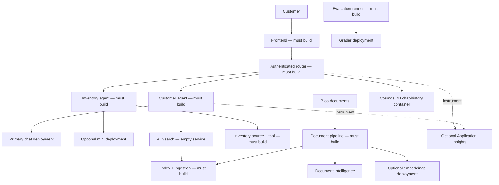

# Višekorisnička korisnička podrška — Skica arhitekture maloprodaje

**Poglavlje 5: AI rješenja za višekorisnike**

- [Početna stranica tečaja](../README.md)
- [Poglavlje 5](../docs/chapter-05-multi-agent/README.md)
- [Preduvjet: AI integracija](../docs/chapter-02-ai-development/microsoft-foundry-integration.md)
- [Sljedeće: Planiranje kapaciteta](../docs/chapter-06-pre-deployment/capacity-planning.md)
- [Okvir infrastrukture ARM](retail-multiagent-arm-template/README.md)

> **Vodič za arhitekturu, ne radna aplikacija.** Jedine implementacijske datoteke za maloprodaju
> su `azuredeploy.json`, `azuredeploy.parameters.json` i `deploy.sh` u
> `retail-multiagent-arm-template/`. Router/frontend kontejneri su zamjenski primjeri hello-world.
> Lokalne verzije maloprodajnog agenta, sučelja, pipelinea za unos, evaluatora, skenera ili
> paketa za testiranje aplikacije ne postoje.

## Pregled

**Cilj:** dizajnirati sustav podrške korisnicima s agentom za korisnike i agentom za inventar,
identificirati što infrastruktura pruža te planirati nedostajuće ugovore aplikacije
i verifikaciju.

**Publika:** programeri koji su završili lokalni
[chat primjer](../../../examples/azure-openai-chat) i [primjer kontejnera s dvije usluge](../../../examples/container-app/microservices).
Predvidite 2–3 sata za proučavanje arhitekture. Izrada aplikacije je zaseban
projekt: ilustrativna procjena planiranja za iskusne programere je 80–120 sati razvoja,
**ne obećanje isporuke**; proizvodna stabilizacija, testovi,
sigurnosna revizija i operacije zahtijevaju dodatni rad.

### Ishodi učenja

- Objasniti usmjeravanje, utemeljenje, dopuštenja alata i vlasništvo razgovora.
- Razlikovati identifikatore modela, nazive implementacija, verzije API-ja i verzije ARM-a.
- Dizajnirati unos i dohvat dokumenata s odgovarajućim dimenzijama vektora.
- Definirati provjerljive funkcionalne, evaluacijske i zahtjeve za oporavak od greške.
- Odvojiti opcionalne ciljeve arhitekture od stvarno osiguranih resursa.

## Arhitektura rješenja



Ovo je **ciljana arhitektura aplikacije**, a ne dijagram pokretnih servisnih agenata.
ARM skela kreira temeljne servise i dva zamjenska kontejnera.
Front Door, registar, upravljani identiteti, dodjele uloga,
privatne krajnje točke, failover, instrumentacija aplikacije i upozorenja nisu uključeni.

### Odgovornosti i ugovori

| Komponenta | Zahtjevano ponašanje | Dokaz prije označavanja gotovim |
|---|---|---|
| Frontend | Autentificirati korisnike, prikazati chat, sigurno uploadati dokumente | UI i testovi uploadanja, dostupne greške |
| Router | Autorizirati zahtjeve, odabrati agenta, ograničiti pozive alata/vremenska ograničenja | Testovi usmjeravanja, provjere autorizacije, testovi grešaka |
| Agent za korisnike | Utemeljiti odgovore politike/proizvoda u odobrene izvore | Ispravni citati, suzdržanost kad podataka nema |
| Inventarni alat | Čitati autoritativno stanje zaliha s ograničenim dopuštenjima | Deterministički testovi zaliha; bez izmišljene dostupnosti |
| Pipeline dokumenata | Ekstrahirati, segmentirati, ugnežditi, indeksirati, ažurirati/brisati | Indeksirani primjeri i ponašanje ponovnog pokušaja/pogrešaka |
| Pohrana razgovora | Izolirati korisnike, primjenjivati zadržavanje podataka | Testovi autorizacije između korisnika i TTL testovi |
| Izvršitelj evaluacije | Usporediti izlaze s točnim podacima i rubricom | Pokrivenost, brojevi neuspjeha, reproducibilni izvještaji |

Zamislite router kao recepciju, a alate kao ograničene interne sustave:
odabir stručnjaka nije autorizacija pristupa svim zapisima korisnika.
Provodite identitet i dopuštenja u kodu aplikacije i servisima podataka, ne u uputama.

## Infrastruktura vs. Aplikacija

Pročitajte [README o skeli](retail-multiagent-arm-template/README.md) prije
provisioniranja. Navodi točne resurse, načine, troškove i ograničenja.

| Logička namjena | Naziv implementacije ARM | Model / verzija | Zadani regija |
|---|---|---|---|
| Chat za korisnika | `gpt-4.1-chat` | `gpt-4.1` / `2025-04-14` | `eastus2` |
| Inventar | `gpt-4.1-mini-inventory` | `gpt-4.1-mini` / `2025-04-14` | `westus2`, opcionalno |
| Ugrađivanja | `text-embedding-ada-002` | `text-embedding-ada-002` / `2` | `francecentral`, opcionalno |
| Evaluacija | `gpt-4.1-grader` | `gpt-4.1` / `2025-04-14` | Primarna regija prema zadanim postavkama |

Provjerite dostupnost modela/verzije/SKU i kvotu u **svakoj regiji**. Chat/mini/ocjenjivač
koristi `GlobalStandard`; ugrađivanja koriste `Standard`. Preslikavanja kapaciteta u TPM
su specifična za model. Nemojte dodavati različite kapacitete kao univerzalnu garanciju kvote.

Argument `model` za Azure OpenAI zahtjev je **naziv implementacije**, ne
nužno identifikator modela u katalogu. Verzija API-ja za podatkovnu ravninu `2024-10-21`
razlikuje se od verzije modela `2025-04-14` i ARM resursa `apiVersion`.
Nije moguće popraviti nedostupni model samo promjenom verzije API-ja podatkovne ravnine.

`--no-multi-region` preskače sekundarne i račune za ugrađivanja. Ostaje primarni chat i
neovisni račun ocjenjivača. Odvojeni računi za modele ne pružaju automatski
prebacivanje; to zahtijeva usmjeravanje aplikacije, kompatibilne implementacije, zdravstvene provjere,
ograničenja pokušaja i pregled lokacije podataka.

## Plan implementacije

### 1. Počnite s jednim testiranim interakcijom

Prije postavljanja velikog okvira, upotrijebite lokalni chat uzorak za uspostavljanje
veze za izvođenje zaključivanja. Definirajte jedno reprezentativno korisničko pitanje, odobreni
izvor odgovora, očekivani citat i postupak u slučaju nedostatka tog izvora.

### 2. Definirajte granice usmjeravanja i alata

Izradite vlastiti izvor usmjerivača, manifest ovisnosti, Dockerfile i testove. Ilustrativni ugovor
može biti `POST /chat` s `{"message":"...","conversation_id":"..."}`.
**Ta točka pristupa je prijedlog dizajna; nije implementirana ARM predloškom.**

Provjerite tipove/ograničenja tijela, izvedite identitet korisnika iz autentikacije, provedite
vlasništvo razgovora, primijenite vremenska ograničenja zahtjeva i vratite smislen kod pogreške.
Ne tretirajte HTTP neuspjehe ili prazne odgovore kao uspješne rezultate agenta.

### 3. Implementirajte utemeljenje i unos podataka

ARM predložak ne stvara indeks za pretraživanje. Ovo je **referentni JSON
fragment za prilagodbu u vlastitoj definiciji indeksa**, nije datoteka već u repozitoriju:

```json
{
  "name": "retail-product-index",
  "fields": [
    {"name": "id", "type": "Edm.String", "key": true},
    {"name": "title", "type": "Edm.String", "searchable": true},
    {"name": "content", "type": "Edm.String", "searchable": true},
    {"name": "category", "type": "Edm.String", "filterable": true},
    {
      "name": "content_vector",
      "type": "Collection(Edm.Single)",
      "searchable": true,
      "dimensions": 1536,
      "vectorSearchProfile": "retail-profile"
    }
  ],
  "vectorSearch": {
    "algorithms": [{"name": "retail-hnsw", "kind": "hnsw"}],
    "profiles": [{"name": "retail-profile", "algorithm": "retail-hnsw"}]
  }
}
```

Profil povezuje vektorsko polje s njegovim algoritmom. Dimenzije moraju odgovarati
stvarnom izlazu ugrađivanja (1536 za ovu `ada-002` implementaciju). Za Python dohvat,
koristite `azure.search.documents.models.VectorizedQuery` umjesto nepotpunog
rječnika koji nema vrstu vektorskog upita:

```python
# Reference function only: supply an authenticated async SearchClient and an embedding.
from azure.search.documents.models import VectorizedQuery

async def retrieve(search_client, embedding):
    results = await search_client.search(
        search_text=None,
        vector_queries=[VectorizedQuery(
            vector=embedding,
            k_nearest_neighbors=5,
            fields="content_vector"
        )],
        select=["id", "title", "content"]
    )
    return [document async for document in results]
```

Izradite zasebnu implementaciju unosa koja:

1. Autorizira pristup za prijenos i provjerava tip i veličinu sadržaja.
2. Čita privatne blobove koristeći autentificirane SDK pozive. URL privatnog bloba sam po sebi
   **nije** čitljiv ulaz za Document Intelligence; pošaljite preuzete bajtove s
   `AnalyzeDocumentRequest(bytes_source=...)` ili koristite odgovarajuće ograničeni,
   kratkotrajni SAS nakon pregleda zahtjeva za pristupom.
3. Ekstrahira tekst, dijeli ga u cjeline da odgovara ograničenjima ugrađivanja i generira ugrađivanja.
4. Stvara stabilne valjane ključeve dokumenata i prenosi cjeline s podudarajućim vektorima.
5. Provjerava rezultate indeksiranja po dokumentu, obrađuje pokušaje i ažurira/izbriše zastarjele podatke.

Nemojte interpolirati proizvoljne korisničke ključeve/vrijednosti u OData filtre. Dozvoljavajte samo polja,
provjerite tipove vrijednosti i escape-ajte navodnike u stringovima. Boolean i numerički filteri trebaju
tipizirane literale, ne stringove u navodnicima.

### 4. Utemeljenje na webu

**Bing Search v7 je ukinut 11. kolovoza 2025.** Stari `Microsoft.Bing/accounts`
resurs i `api.bing.microsoft.com/v7.0/search` primjeri nisu podržan
implementacijski put. Procijenite trenutačno podržanu integraciju utemeljenja u
Microsoft Foundry i njegov SDK, dopuštenja, naplatu i zahtjeve za citiranjem;
nijedna nije ovdje implementirana. Nije zamjena "plug-and-play" za ukinutu završnu točku.

### 5. Dodajte telemetriju i evaluaciju

Kreiranje Application Insights ne instrumentira kod. Koristite podržanu Azure Monitor
OpenTelemetry instrumentaciju pri izradi nove aplikacije, prenosite kontekst traga
između servisa i izbjegavajte zapisivanje korisničkih upita, dokumenata ili tajni.
Skraćivanje upita **ne** anonmizira isti.

Mjerite trajanje zahtjeva, neuspjehe usmjeravanja/alata, relevantnost dohvaćanja, ispravnost citata,
korištenje tokena i apstinenciju. Spremite inventar/političke činjenice utemeljenja
zajedno sa slučajevima evaluacije: ocjenjivač ne može pouzdano odrediti činjeničnu točnost
samo na temelju pitanja i odgovora.

Implementacija ocjenjivača nije pokretač evaluacije. Implementirajte verzioniranu rubriku,
strukturiranu validaciju izlaza/sheme, provjere raspona rezultata, broj neuspjeha prijenosa
i slučajeve koje je pregledao čovjek. Izvještavajte nepotpune/pogrešne slučajeve zasebno;
nemojte ih pretvarati u uspješne ocjene niti ih tiho uključivati kao modele s nulom kvalitete.

Isto tako, nekoliko provjera ključnih riječi nije sigurnosna certifikacija. Neuspjeli HTTP
zahtjev, nedostatak testne strategije ili prazan odgovor moraju učiniti test **nerazlučivim ili
neuspjehom**, a ne davati rezultat "100% siguran". Izvršite ovlašteno testiranje uz odgovarajuću
opremu i pregled čovjeka prije bilo kakve tvrdnje o spremnosti za produkciju.

### 6. Implementirajte svoju aplikaciju

Kreirajte vlastite izvorišne direktorije, manifeste, testove, registar i dozvole za povlačenje slika.
Zamijenite zamjenske oznake izgrađenim slikama i ažurirajte ingress/probe da
odgovaraju portu slušanja svake aplikacije. Konfigurirajte varijable runtime okoline u Bicep
ili eksplicitnom podržanom azd mapiranju okoline.

Ne postoji generički `config` rječnik pod azd servisom koji automatski
stvara varijable runtime okoline. `azd env set` mijenja samo resurse koji
eksplicitno koriste te vrijednosti. Nijedan canary, popis regija ili kuka za fino podešavanje nije
implementirana u ovom okviru.

## Praktične dizajnerske vježbe

Ovo su **vježbe arhitekture**, a ne tvrdnje o izvršivom početnom maloprodajnom kodu.

### Vježba 1: Provjerite granicu

**Početna točka:** tri datoteke u `retail-multiagent-arm-template/`.
**Cilj:** razlikovati provisioning od funkcionalnosti aplikacije.
Otvorite `azuredeploy.json`, pronađite obje slike kontejnera i vrijednosti `targetPort`,
zatim navedite komponente aplikacije koje nedostaju u repozitoriju.

**Kriteriji uspjeha / odgovor:** obje slike su hello-world zamjene koje slušaju na portu 80;
agenti, chat UI, router handleri, indeks/unos, evaluator i skener nisu prisutni.
Uspješan root zahtjev za zamjenu ne validira `/chat`.
**Česti problem:** interpretirati nazive resursa poput `retail-router` kao funkcionalan kod.

### Vježba 2: Pratite konfiguraciju vektora

**Početna točka:** index JSON gore.
**Cilj:** razumjeti odnos polja → profila → algoritma.
Identificirajte koje se vrijednosti moraju promijeniti pri prelasku na embedding model s
drugačijom izlaznom dimenzijom, zatim pregledajte funkciju `retrieve`.

**Kriteriji uspjeha / odgovor:** promijenite polje `dimensions` na stvarnu duljinu vektora;
održavajte `vectorSearchProfile` usklađenim s deklariranim profilom i njegovim algoritmom;
upit `fields` mora imenovati vektorsko polje. Regenerirajte postojeće vektore dokumenata
kada se promijeni model ugradnje.
**Čest problem:** promjena samo imena modela uz zadržavanje nekompatibilnih vektora.

### Vježba 3: Definirajte test neuspjeha

**Početna točka:** tablica odgovornosti.
**Cilj:** spriječiti lažni uspjeh.
Napišite očekivano ponašanje za nedostupno API skladište, indeks pretraživanja bez
odgovarajućih dokumenata i zahtjev za evaluacijom koji vraća HTTP 503.

**Kriteriji uspjeha / odgovor:** nema izmišljenih vrijednosti skladišta; eksplicitni povlačenje ili
eskalacija kada nedostaje kontekst; evaluacija prijavljuje prijenosni kvar umjesto
prolaza kvalitete ili sigurnosti. Dodajte izvršne testove kad gradite aplikaciju.
**Čest problem:** hvatanje svake iznimke i nastavak s praznim odgovorom.

## Troškovi, rješavanje problema i čišćenje

- Infrastruktura ima tekuće troškove čak i s praznim indeksima pretraživanja i privremenim
  aplikacijama. Koristite trenutne regionalne cijene; niti „minimalno“ niti multi-regionalno ne znači besplatno.
- Troškovi tokena ovise o modelu, predmemoriranom/nepredmemoriranom unosu, izlazu i SKU-u distribucije.
  Usmjeravanje može uštedjeti novac samo ako mjerena opterećenja i rezultati kvalitete to opravdavaju;
  fiksna ušteda od 60–80% nije zajamčena.
- Provjerite dostupnost modela i kvotu prije osiguravanja; razlikujte pogreške vezane uz dopuštenja,
  naziv distribucije, regiju, verziju modela i verziju API-ja.
- Nemojte pokretati nedostajuće `setup-data.sh`, evaluator CLI-je ili `pytest tests/` naredbe.
  Njihove implementacije dio su vašeg razvojneg rasporeda.
- Okvir je samo za ARM: slijedite njegove
  [upute za verificiranje i čišćenje](retail-multiagent-arm-template/README.md).
  `azd down` ne upravlja tim resursima.

## Povezani resursi

- [Funkcionalni lokalni chat primjer](../../../examples/azure-openai-chat)
- [Funkcionalni primjer s dvama servisnim spremnicima](../../../examples/container-app/microservices)
- [AI Search vektorski indeksi](https://learn.microsoft.com/azure/search/vector-search-how-to-create-index)
- [Dokumentacija Container Apps](https://learn.microsoft.com/azure/container-apps/)
- [Rješavanje problema](../docs/chapter-07-troubleshooting/common-issues.md)
- [Prijavite problem](https://github.com/microsoft/AZD-for-beginners/issues)

---

<!-- CO-OP TRANSLATOR DISCLAIMER START -->
**Napomena**:
Ovaj dokument je preveden korištenjem AI prevoditeljskog servisa [Co-op Translator](https://github.com/Azure/co-op-translator). Iako težimo točnosti, imajte na umu da automatski prijevodi mogu sadržavati greške ili netočnosti. Izvorni dokument na izvornom jeziku treba smatrati autoritativnim izvorom. Za važne informacije preporuča se profesionalni ljudski prijevod. Nismo odgovorni za bilo kakva nesporazumevanja ili pogrešne interpretacije koje proizlaze iz korištenja ovog prijevoda.
<!-- CO-OP TRANSLATOR DISCLAIMER END -->