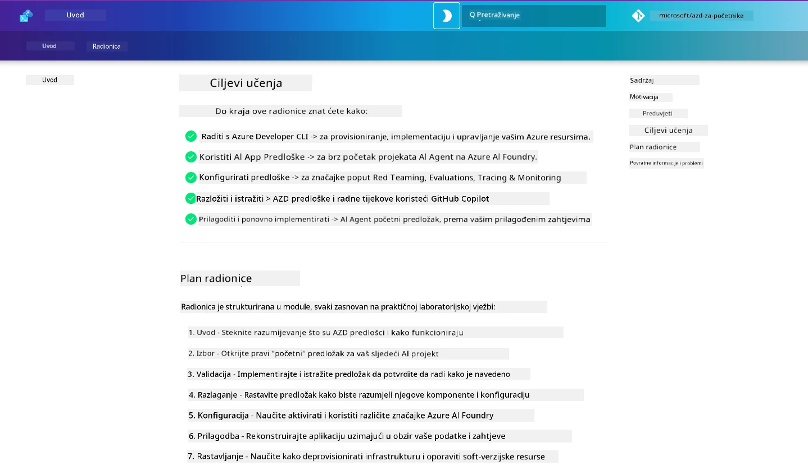

<div align="center">
  <div style="background: linear-gradient(135deg, #0078d4, #106ebe); border-radius: 10px; padding: 20px; margin: 20px 0; box-shadow: 0 4px 15px rgba(0, 120, 212, 0.3); border: 2px solid #005a9e;">
    <h2 style="color: white; margin: 0; font-size: 24px; text-shadow: 1px 1px 2px rgba(0,0,0,0.3);">
      🎯 Radionica AZD za AI developere
    </h2>
    <p style="color: white; margin: 10px 0 0 0; font-size: 16px; text-shadow: 1px 1px 2px rgba(0,0,0,0.3);">
      <strong>Praktična radionica za izradu AI aplikacija s Azure Developer CLI-jem.</strong><br>
      Završite 7 modula za savladavanje AZD predložaka i AI tijekova postavljanja.
    </p>
    <div style="margin-top: 15px;">
      <span style="background: rgba(255,255,255,0.2); padding: 5px 10px; border-radius: 15px; color: white; font-size: 14px;">
        📅 Izvorna uputa pregledana: studeni 2026.
      </span>
    </div>
  </div>
</div>

# Radionica AZD za AI developere

Dobrodošli na praktičnu radionicu za učenje Azure Developer CLI-ja (AZD) s fokusom na postavljanje AI aplikacija. Ova radionica pomaže vam usvojiti praktično razumijevanje AZD predložaka u 3 koraka:

1. **Otkrivanje** - pronađite predložak koji vam najviše odgovara.
1. **Postavljanje** - postavite i provjerite da radi.
1. **Prilagodba** - mijenjajte i iterirajte da bude vaš!

Tijekom ove radionice također ćete se upoznati s osnovnim razvojim alatima i tijekovima rada, koji će vam pomoći pojednostaviti cijeli razvojni proces.

<br/>

## Vodič baziran na pregledniku

Lekcije radionice su u Markdownu. Možete ih izravno pregledavati na GitHubu ili pokrenuti pregled u pregledniku kao što je prikazano na snimci zaslona ispod.



Za korištenje ove opcije - forkajte repozitorij na svoj profil i pokrenite GitHub Codespaces. Kad je VS Code terminal aktivan, upišite ovu naredbu:

Ovaj pregled u pregledniku radi u GitHub Codespaces, razvojnih kontejnerima ili lokalnoj kopiji s instaliranim Python i MkDocs.

```bash title="" linenums="0"
python -m pip install -r requirements-dev.txt
python -m mkdocs serve --config-file workshop/mkdocs.yml
```

Pokrenite ove naredbe iz **korijena repozitorija tečaja**, ne iz zasebno inicijaliziranog AI primjera. Ostavite pregled u prvom planu kako bi pogreške ostale vidljive; zaustavite ga s Ctrl+C. Za provjeru web-mjesta bez posluživanja, pokrenite `python -m mkdocs build --strict --config-file workshop/mkdocs.yml`.

Za nekoliko sekundi vidjet ćete skočni dijalog. Odaberite opciju `Open in browser`. Vodič baziran na webu sada će se otvoriti u novoj kartici preglednika. Neke prednosti ovog pregleda:

1. **Ugrađeno pretraživanje** - brzo pronađite ključne riječi ili lekcije.
1. **Ikona kopiranja** - prijeđite mišem preko blokova koda za ovu opciju
1. **Prebacivanje teme** - mijenjajte između tamne i svijetle teme
1. **Pomoć** - kliknite Discord ikonu u podnožju i pridružite se!

<br/>

## Pregled radionice

**Trajanje:** 3-4 sata  
**Razina:** Početnik do srednje napredni  
**Preduvjeti:** Poznavanje Azure, AI pojmova, VS Code-a i alata naredbenog retka.

Ovo je praktična radionica gdje učite radeći. Nakon završetka vježbi, preporučujemo pregled kurikuluma AZD za početnike za nastavak učenja o sigurnosnim i produktivnim praksama.

| Vrijeme | Modul  | Cilj |
|:---|:---|:---|
| 15 min | [Uvod](docs/instructions/0-Introduction.md) | Postavljanje okvira, razumijevanje ciljeva |
| 30 min | [Odabir AI predloška](docs/instructions/1-Select-AI-Template.md) | Istražite opcije i izaberite početni predložak | 
| 30 min | [Validacija AI predloška](docs/instructions/2-Validate-AI-Template.md) | Postavite zadano rješenje na Azure |
| 30 min | [Analiza AI predloška](docs/instructions/3-Deconstruct-AI-Template.md) | Istražite strukturu i konfiguraciju |
| 30 min | [Konfiguracija AI predloška](docs/instructions/4-Configure-AI-Template.md) | Aktivirajte i isprobajte dostupne značajke |
| 30 min | [Prilagodba AI predloška](docs/instructions/5-Customize-AI-Template.md) | Prilagodite predložak svojim potrebama |
| 30 min | [Raskid infrastrukture](docs/instructions/6-Teardown-Infrastructure.md) | Očistite i oslobodite resurse |
| 15 min | [Zaključak i sljedeći koraci](docs/instructions/7-Wrap-up.md) | Resursi za učenje, izazov radionice |

<br/>

## Što ćete naučiti

Razmislite o AZD predlošku kao o sandboxu za učenje kojim ćete istražiti razne mogućnosti i alate za cjelokupni razvoj na Microsoft Foundry platformi. Do kraja radionice trebali biste intuitivno razumjeti razne alate i koncepte u ovom kontekstu.

| Koncept  | Cilj |
|:---|:---|
| **Azure Developer CLI** | Razumijevanje naredbi alata i tijekova rada|
| **AZD predlošci**| Razumijevanje strukture projekta i konfiguracije|
| **Azure AI Agent**| Postavljanje i implementacija Microsoft Foundry projekta  |
| **Azure AI Search**| Omogućavanje kontekstnog inženjeringa s agentima |
| **Promatranje**| Istražite praćenje, nadzor i evaluacije |
| **Red Teaming**| Istražite napredna testiranja i mjere zaštite |

<br/>

## Struktura radionice

Radionica je strukturirana da vas vodi od otkrivanja predloška, do postavljanja, analize i prilagodbe - koristeći službeni [Uvod u AI agente](https://github.com/Azure-Samples/get-started-with-ai-agents) početni predložak kao osnovu.

### [Modul 1: Odabir AI predloška](docs/instructions/1-Select-AI-Template.md) (30 min)

- Što su AI predlošci?
- Gdje mogu pronaći AI predloške?
- Kako mogu započeti izradu AI agenata?
- **Radionica**: Brzi početak u Codespaces ili razvojnom kontejneru

### [Modul 2: Validacija AI predloška](docs/instructions/2-Validate-AI-Template.md) (30 min)

- Koja je arhitektura AI predloška?
- Koji je razvojni tijek rada AZD-a?
- Kako dobiti pomoć pri razvoju s AZD-om?
- **Radionica**: Postavljanje i validacija AI agenata predloška

### [Modul 3: Analiza AI predloška](docs/instructions/3-Deconstruct-AI-Template.md) (30 min)

- Istražite svoje okruženje u `.azure/` 
- Istražite postavke resursa u `infra/` 
- Istražite AZD konfiguraciju u `azure.yaml`-ovima
- **Radionica**: Mijenjajte varijable okruženja i ponovno postavite

### [Modul 4: Konfiguracija AI predloška](docs/instructions/4-Configure-AI-Template.md) (30 min)
- Istražite: Generiranje obogaćeno dohvaćanjem podataka
- Istražite: Evaluaciju agenta & Red Teaming
- Istražite: Praćenje & Nadzor
- **Radionica**: Istražite AI agenta + Promatranje

### [Modul 5: Prilagodba AI predloška](docs/instructions/5-Customize-AI-Template.md) (30 min)
- Definirajte: PRD sa zahtjevima scenarija
- Konfigurirajte: Varijable okruženja za AZD
- Implementirajte: Lifecycle Hooks za dodatne zadatke
- **Radionica**: Prilagodite predložak za svoj scenarij

### [Modul 6: Raskid infrastrukture](docs/instructions/6-Teardown-Infrastructure.md) (30 min)
- Ponovite: Što su AZD predlošci?
- Ponovite: Zašto koristiti Azure Developer CLI?
- Sljedeći koraci: Isprobajte drugi predložak!
- **Radionica**: Deprovision infrastrukture i čišćenje

<br/>

## Izazov radionice

Želite li se izazvati i napraviti više? Evo nekoliko prijedloga projekata - ili s nama podijelite svoje ideje!

| Projekt | Opis |
|:---|:---|
|1. **Analiza složenog AI predloška** | Koristite definirane tijekove rada i alate i pokušajte postaviti, validirati i prilagoditi drugačiji AI predložak rješenja. _Što ste naučili?_|
|2. **Prilagodba prema svom scenariju**  | Pokušajte napisati PRD (Dokument o zahtjevima proizvoda) za drugi scenarij. Zatim koristite GitHub Copilot u svom repozitoriju predložaka u Agent Model i zamolite ga da generira tijek prilagodbe za vas. _Što ste naučili? Kako biste mogli poboljšati te prijedloge?_|
| | |

## Imate povratnu informaciju?

1. Objavite issue na ovom repozitoriju - označite ga `Workshop` radi lakšeg pronalaska.
1. Pridružite se Microsoft Foundry Discordu - povežite se s kolegama!


| | | 
|:---|:---|
| **📚 Početna stranica tečaja**| [AZD za početnike](../README.md)|
| **📖 Dokumentacija** | [Započnite s AI predlošcima](https://learn.microsoft.com/en-us/azure/ai-foundry/how-to/develop/ai-template-get-started)|
| **🛠️AI predlošci** | [Microsoft Foundry predlošci](https://ai.azure.com/templates) |
|**🚀 Sljedeći koraci** | [Započni radionicu](#workshop-overview) |
| | |

<br/>

---

**Navigacija:** [Glavni tečaj](../README.md) | [Uvod](docs/instructions/0-Introduction.md) | [Modul 1: Odabir predloška](docs/instructions/1-Select-AI-Template.md)

**Spremni za početak izrade AI aplikacija s AZD-om?**

[Započni radionicu: Uvod →](docs/instructions/0-Introduction.md)

---

<!-- CO-OP TRANSLATOR DISCLAIMER START -->
**Napomena**:
Ovaj dokument je preveden korištenjem AI prevoditeljskog servisa [Co-op Translator](https://github.com/Azure/co-op-translator). Iako težimo točnosti, imajte na umu da automatski prijevodi mogu sadržavati greške ili netočnosti. Izvorni dokument na izvornom jeziku treba smatrati autoritativnim izvorom. Za važne informacije preporuča se profesionalni ljudski prijevod. Nismo odgovorni za bilo kakva nesporazumevanja ili pogrešne interpretacije koje proizlaze iz korištenja ovog prijevoda.
<!-- CO-OP TRANSLATOR DISCLAIMER END -->