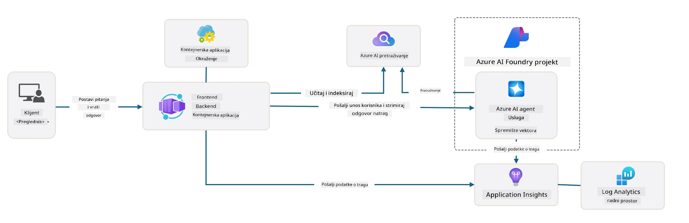

# 3. Dekonstruiraj predložak

!!! tip "NA KRAJU OVOG MODULA MOĆI ĆETE"

    - [ ] Use GitHub Copilot and optional MCP tools for Azure documentation and read-only exploration
    - [ ] Identify the template's application, infrastructure, configuration, and test entry points
    - [ ] Verify generated explanations against actual repository files
    - [ ] **Lab 3:** Trace one request and one configuration input through the project

---

## 1. Aktivirajte GitHub Copilot

Otvorite inicijalizirani AI uzorak u VS Code i omogućite [GitHub Copilot](https://code.visualstudio.com/docs/copilot/chat/chat-agent-mode). Prijavite se s računom koji ima podoban plan; ograničenja korištenja variraju. Zamolite Copilota da objasni spremište prije nego što ovlastite promjene.

### Neobavezni MCP poslužitelji

Ove usluge mogu pružiti dodatne alate:

- [Azure MCP poslužitelj](https://learn.microsoft.com/azure/developer/azure-mcp-server/overview)
- [Microsoft Learn MCP poslužitelj](https://learn.microsoft.com/training/support/mcp)

U VS Code-u pregledajte [smjernice za konfiguraciju MCP-a](https://code.visualstudio.com/docs/copilot/chat/mcp-servers) i po potrebi kreirajte `.vscode/mcp.json`:

```json
{
  "servers": {
    "Azure MCP Server": {
      "type": "stdio",
      "command": "npx",
      "args": ["-y", "@azure/mcp@latest", "server", "start"]
    },
    "microsoft.docs.mcp": {
      "type": "http",
      "url": "https://learn.microsoft.com/api/mcp"
    }
  }
}
```

Naredba `npx` zahtijeva podržanu instalaciju Node.js/npm i preuzima izvršni kod. Pregledajte paket i fiksirajte odobrenu verziju za reproducibilno timsko okruženje. Pokrenite poslužitelje koristeći MCP kontrole u VS Code-u i pregledajte dostupne alate; nazivi se mogu mijenjati između verzija.

**Autentifikacija je zasebna.** Koristite `azd auth login` za AZD. Slijedite dokumentirani tijek autentifikacije Azure MCP-a za njegove alate; prijava u AZD sama po sebi ne uspostavlja MCP sesiju. Koristite zasebno `az login` kad vježba ili hook poziva Azure CLI.

Isprobajte upite samo za čitanje:

1. „Upotrijebi Microsoft Learn MCP za pronalazak dokumentacije konfiguracije Azure Developer CLI-ja.”
2. „Objasni `azure.yaml` ovog spremišta; citiraj datoteke koje implementiraju svaki hook.”
3. „Koristeći dostupne Azure MCP alate, navedi moje implementirane resurse bez mijenjanja bilo čega.”

Provjerite odabrani tenant/pretplatu i svaki predloženi poziv alata. Ne odobravajte stvaranje, brisanje ili promjene pristupa resursima samo da biste istražili arhitekturu.

## 2. Razumjeti arhitekturu

Uzorak sadrži Python FastAPI backend i React/TypeScript frontend u Azure Container Apps. Backend komunicira s agentom u Microsoft Foundry projektu. Dohvat i mogućnost nadzora ovise o omogućenim značajkama predloška i uspješnoj postavci; nisu zajamčeni samo zato što je aplikacija implementirana.



Usporedite ovaj dijagram s [trenutačnim vodičem za implementaciju upstream](https://github.com/Azure-Samples/get-started-with-ai-agents/blob/main/docs/deployment.md) i svojim stvarnim resursima. Provjerite konfiguriranu implementaciju modela, agentove alate, upravljani identitet, dodjele uloga i neobavezne resurse AI Search/Application Insights.

**Vježba:** Zamolite Copilota da prati zahtjev za razgovor s frontenda preko API-ja do Foundryja, s referencama na datoteke i funkcije. Otvorite te reference i provjerite objašnjenje. Ne zaključujte implementiranu autentifikaciju, usmjeravanje ili ovlaštenje samo iz dijagrama.

## 3. Struktura spremišta

Sljedeći odabrani putovi provjereni su na uzorku 4. studenog 2026. Vaša inicijalizirana revizija ostaje izvor istine:

```text
get-started-with-ai-agents/
  azure.yaml
  docker-compose.yaml
  requirements-dev.txt
  .devcontainer/
  infra/
    main.bicep
    main.parameters.json
    api.bicep
    core/
  src/
    Dockerfile
    pyproject.toml
    requirements.txt
    api/
      main.py
      routes.py
      search_index_manager.py
    frontend/
      package.json
      src/
    files/
  scripts/
    validate_env_vars.sh
    validate_env_vars.ps1
    postdeploy.sh
    postdeploy.ps1
  tests/
    test_evaluation.py
    test_red_teaming.py
  docs/
    deployment.md
    deploy_customization.md
    ai_search.md
    observability.md
    local_development.md
    troubleshooting.md
```

### Infrastruktura i konfiguracija

`infra/main.bicep` orkestrira resurse; `main.parameters.json` povezuje ulaze iz predloška s vrijednostima okoline AZD-a. `azure.yaml` bira uslugu aplikacije i hooks za životni ciklus. Pratite ulaz poput `USE_AZURE_AI_SEARCH_SERVICE` kroz ove datoteke da biste pronašli što se zapravo mijenja.

### Aplikacija i identitet

Pročitajte `src/api/` i `src/frontend/` zajedno. Identificirajte gdje se agent stvara ili dohvaća, gdje se konfiguriraju upute/alati i koji identitet koristi svaki Azure poziv. Primjerni podaci u datotekama pod `src/files/` su demonstracijski, nisu proizvodni katalog ili model autorizacije.

### Testovi i nadzor

Trenutni ulazni čvorišta za evaluaciju i red-teaming su pod `tests/`; starije reference na direktorije `evals/` i `airedteaming/` su zastarjele za ovaj uzorak. Pročitajte `docs/observability.md` za preduvjete i troškove prije pokretanja testova u oblaku. Ovi Python testovi su odvojeni od neobavezne `azure.ai.evaluations` AZD ekstenzije.

## 4. Provjerite svoja zapažanja

- Identificirajte API rutu, interakciju agenta i kod dohvata za jedno uzorno pitanje.
- Objasnite koji identitet pristupa Foundryju i koja konfiguracija bira njegov endpoint.
- Pronađite stvarne skripte prije pokretanja i nakon implementacije te njihovo ponašanje kod rukovanja pogreškama.
- Nabrojite sve ovisnosti ili neobavezne značajke koje nedostaju u vašoj implementaciji.

Nastavite na [Konfiguriraj predložak](4-Configure-AI-Template.md).

---

<!-- CO-OP TRANSLATOR DISCLAIMER START -->
**Napomena**:
Ovaj dokument je preveden korištenjem AI prevoditeljskog servisa [Co-op Translator](https://github.com/Azure/co-op-translator). Iako težimo točnosti, imajte na umu da automatski prijevodi mogu sadržavati greške ili netočnosti. Izvorni dokument na izvornom jeziku treba smatrati autoritativnim izvorom. Za važne informacije preporuča se profesionalni ljudski prijevod. Nismo odgovorni za bilo kakva nesporazumevanja ili pogrešne interpretacije koje proizlaze iz korištenja ovog prijevoda.
<!-- CO-OP TRANSLATOR DISCLAIMER END -->