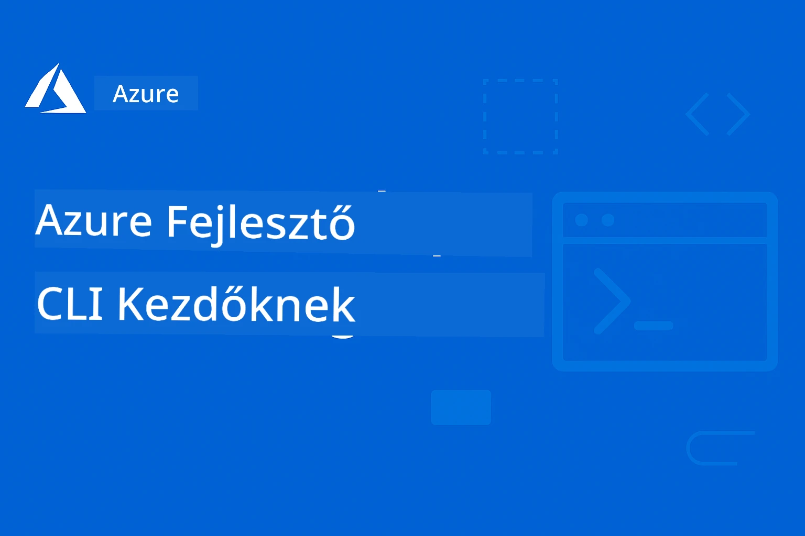

# AZD Kezdőknek: Egy Strukturált Tanulási Út

 

[](https://github.com/microsoft/AZD-for-beginners)
[](https://GitHub.com/microsoft/azd-for-beginners/network/)
[](https://github.com/microsoft/AZD-for-beginners)

[](https://discord.com/invite/nkVh3dp)
[](https://discord.gg/nTYy5BXMWG)

---

### Automatikus Fordítások (Mindig Naprakész)

<!-- CO-OP TRANSLATOR LANGUAGES TABLE START -->
[Arabic](../ar/README.md) | [Bengali](../bn/README.md) | [Bulgarian](../bg/README.md) | [Burmese (Myanmar)](../my/README.md) | [Chinese (Simplified)](../zh-CN/README.md) | [Chinese (Traditional, Hong Kong)](../zh-HK/README.md) | [Chinese (Traditional, Macau)](../zh-MO/README.md) | [Chinese (Traditional, Taiwan)](../zh-TW/README.md) | [Croatian](../hr/README.md) | [Czech](../cs/README.md) | [Danish](../da/README.md) | [Dutch](../nl/README.md) | [Estonian](../et/README.md) | [Finnish](../fi/README.md) | [French](../fr/README.md) | [German](../de/README.md) | [Greek](../el/README.md) | [Hebrew](../he/README.md) | [Hindi](../hi/README.md) | [Hungarian](./README.md) | [Indonesian](../id/README.md) | [Italian](../it/README.md) | [Japanese](../ja/README.md) | [Kannada](../kn/README.md) | [Khmer](../km/README.md) | [Korean](../ko/README.md) | [Lithuanian](../lt/README.md) | [Malay](../ms/README.md) | [Malayalam](../ml/README.md) | [Marathi](../mr/README.md) | [Nepali](../ne/README.md) | [Nigerian Pidgin](../pcm/README.md) | [Norwegian](../no/README.md) | [Persian (Farsi)](../fa/README.md) | [Polish](../pl/README.md) | [Portuguese (Brazil)](../pt-BR/README.md) | [Portuguese (Portugal)](../pt-PT/README.md) | [Punjabi (Gurmukhi)](../pa/README.md) | [Romanian](../ro/README.md) | [Russian](../ru/README.md) | [Serbian (Cyrillic)](../sr/README.md) | [Slovak](../sk/README.md) | [Slovenian](../sl/README.md) | [Spanish](../es/README.md) | [Swahili](../sw/README.md) | [Swedish](../sv/README.md) | [Tagalog (Filipino)](../tl/README.md) | [Tamil](../ta/README.md) | [Telugu](../te/README.md) | [Thai](../th/README.md) | [Turkish](../tr/README.md) | [Ukrainian](../uk/README.md) | [Urdu](../ur/README.md) | [Vietnamese](../vi/README.md)

> **Inkább helyben klónoznád?**
>
> Ez a tárhely több mint 50 nyelvi fordítást tartalmaz, ami jelentősen növeli a letöltési méretet. A fordítások nélküli klónozáshoz használj spars checkout-ot:
>
> **Bash / macOS / Linux:**
> ```bash
> git clone --filter=blob:none --sparse https://github.com/microsoft/AZD-for-beginners.git
> cd AZD-for-beginners
> git sparse-checkout set --no-cone '/*' '!translations' '!translated_images'
> ```
>
> **CMD (Windows):**
> ```cmd
> git clone --filter=blob:none --sparse https://github.com/microsoft/AZD-for-beginners.git
> cd AZD-for-beginners
> git sparse-checkout set --no-cone "/*" "!translations" "!translated_images"
> ```
>
> Ez mindent megad, amire a kurzus befejezéséhez szükséged van, jóval gyorsabb letöltéssel.
<!-- CO-OP TRANSLATOR LANGUAGES TABLE END -->

## 🆕 Mi újság az azd-ben ma

> 📌 **Foundry GA frissítés (2026-11-09):** A **`microsoft.foundry` 1.0 csomag általánosan elérhető**, bejelentve [2026. november 5-én](https://devblogs.microsoft.com/azure-sdk/microsoft-foundry-azure-developer-cli-ga/). Használd a **`azd >= 1.37.0`** parancsot és telepítsd `azd ext install microsoft.foundry` segítségével. Kövesd a [hostolt ügynök lépésről lépésre útmutatót](docs/chapter-02-ai-development/microsoft-foundry-integration.md#hosted-agent-walkthrough-ga) a beállításhoz, helyi teszteléshez és telepítéshez. Ez a frissítés közzétett iránymutatásokon alapul, nem egy élő Azure telepítés; a csomag GA nem tesz minden opcionális funkciót, bővítményt vagy SDK-t általánosan elérhetővé.

Az Azure Developer CLI sok alkalmazástípust támogat, beleértve webalkalmazásokat, API-kat és MI ügynököket, támogatott hosztokkal, sablonokkal és bővítményekkel.

Ez azt jelenti számodra:

- **GA csomag a Foundry fejlesztéshez.** `microsoft.foundry` telepíti a hét alapvető bővítményt, beleértve az ügynököket, projekteket és az Ügynök Ellenőrzőt. Az ügynök kódja és telepítési beállításai együtt maradnak az `azure.yaml`-ban.
- **Teszteld helyben, majd telepítsd a kódot.** Használd `azd ai agent init --deploy-mode code`, `azd provision`, és `azd ai agent run` a helyi kérelmek és válaszok vizsgálatára. Ezután használd a `azd deploy`-at távoli buildhez Foundry-ben, helyi konténer build nélkül.
- **Mérd külön a minőséget.** Telepítsd a **`azure.ai.evaluations`**-t az `azd ai eval generate`, `init` és `run start` használatához; ez nincs benne a csomagban. Tartsd a felülvizsgált adatokat és rubrikákat együtt a kóddal. Régebbi projektek kövessék az [értékelési és optimalizálási migrációs útmutatót](docs/chapter-08-production/production-ai-practices.md#evaluation-migration-and-quality-checks).
- **Konfiguráció újrahasználata CI/CD-ben.** Egy sikeres `azd up` után állíts be pipeline-t `azd pipeline config`-szal. Telepítsd a csomagot a futtatóra, és tárold a generált hitelesítési és környezeti beállításokat.
- **Zökkenőmentes alapok nap mint nap.** A legutóbbi kiadásokkal `azd init` idempotenssé vált (biztonságosan újrafuttatható), `azd auth login` automatikusan törli az elavult tokeneket, és hozzáadtak egy barátságos `azd tool` első futás beállítási parancsot.
- **Az alapvető munkafolyamat nem változott.** Akár egy todo alkalmazást, egy mikroservice-t vagy többügynökös MI megoldást telepítesz, a parancsok ugyanazok.

> **Megjegyzés Aspire felhasználóknak:** A Microsoft most egyszerűen **Aspire** néven említi a terméket (korábban ".NET Aspire"). azd Aspire támogatása nem változott — csak a név frissült.

Ha már használtad az azd-t korábban, az MI támogatás természetes kiterjesztés — nem külön eszköz vagy haladó szint. Ha most kezded, egy munkafolyamatot tanulsz meg, ami mindent lefed.

---

## 🚀 Mi az Azure Developer CLI (azd)?

**Azure Developer CLI (azd)** egy fejlesztőbarát parancssori eszköz, amely megkönnyíti az alkalmazások Azure-ba történő telepítését. Az összes Azure erőforrás kézi létrehozása és összekapcsolása helyett egyetlen paranccsal telepíthetsz teljes alkalmazásokat.

### A `azd up` varázsa

```bash
# This single command does everything:
# ✅ Creates all Azure resources  
# ✅ Configures networking and security
# ✅ Builds your application code
# ✅ Deploys to Azure
# ✅ Gives you a working URL
azd up
```

A sablon biztosítja az alkalmazás és infrastruktúra konfigurációt. A sikeres telepítéshez továbbra is szükség van támogatott szolgáltatásokra/modellekre, megfelelő kvótára és jogosultságokra, helyes bemenetekre, valamint a telepített alkalmazás ellenőrzésére. `azd up` nem tesz automatikusan sablont biztonságossá, megfelelősé tesz vagy éles környezetre alkalmassá.

---

## ❓ Azure Developer CLI vs Azure CLI: Mi a különbség?

Ez a leggyakoribb kérdés a kezdők részéről. Íme a egyszerű válasz:

| Tulajdonság | **Azure CLI (`az`)** | **Azure Developer CLI (`azd`)** |
|---------|---------------------|--------------------------------|
| **Cél** | Egyéni Azure erőforrások kezelése | Teljes alkalmazások telepítése |
| **Gondolkodásmód** | Infrastruktúra-központú | Alkalmazás-központú |
| **Példa** | `az webapp create --name myapp...` | `azd up` |
| **Tanulási görbe** | Ismerni kell az Azure szolgáltatásokat | Elég az alkalmazásod ismerete |
| **Legjobb használat** | DevOps, infrastruktúra | Fejlesztők, prototípus készítés |

### Egyszerű Analógia

- **Azure CLI** olyan, mintha minden házépítő szerszámmal rendelkeznél - kalapácsokkal, fűrészekkel, szögekkel. Bármit építhetsz, de értened kell az építészethez.
- **Azure Developer CLI** olyan, mint egy vállalkozó felkérése - elmondod, mit szeretnél, és ők intézik az építést.

### Mikor használd őket

| Forgatókönyv | Használd ezt |
|----------|----------|
| "Gyorsan szeretném telepíteni a webalkalmazásom" | `azd up` |
| "Csak egy tárolói fiókot kell létrehoznom" | `az storage account create` |
| "Teljes MI alkalmazást építek" | `azd init --template azure-search-openai-demo` |
| "Külön egy Azure erőforrást kell hibakeresnem" | `az resource show` |
| "A konfigurált éles környezetbe akarok telepíteni" | Vizsgáld át a konfigurációt, hozzáférést, költségeket és működési feltételeket előtte `azd up --environment production` |

### Együtt működnek!

AZD és Azure CLI külön hitelesítéssel és konfigurációval rendelkezik. Használd `azd auth login` az AZD-hez, és `az login`-t, amikor egy horgony vagy diagnosztikai parancs explicit Azure CLI-t igényel. Mindkettőt használhatod:
```bash
# Deploy your app with AZD
azd up

# Then fine-tune specific resources with Azure CLI
az webapp config set --name myapp --always-on true
```

---

## 🌟 Találd meg a Sablonokat az Awesome AZD-ben

Ne kezd az elejéről! Az **Awesome AZD** a közösség által készített kész telepíthető sablon gyűjtemény:

| Erőforrás | Leírás |
|----------|-------------|
| 🔗 [**Awesome AZD Galéria**](https://azure.github.io/awesome-azd/) | Több mint 200 sablon böngészése egy kattintásos telepítéssel |
| 🔗 [**Sablon Beküldése**](https://github.com/Azure/awesome-azd/issues) | Ajánld fel saját sablonod a közösségnek |
| 🔗 [**GitHub Tároló**](https://github.com/Azure/awesome-azd) | Csillagozd és fedezd fel a forrást |

### Népszerű MI sablonok az Awesome AZD-ből

Válassz egy sablont egy külön üres könyvtárban; az alábbi parancsok alternatívák. A végén lévő `.` inicializálja az adott könyvtárat.

```bash
# RAG Chat with Microsoft Foundry Models + AI Search
azd init --template azure-search-openai-demo .

# Quick AI Chat Application
azd init --template openai-chat-app-quickstart .

# AI Agents with Foundry Agents
azd init --template get-started-with-ai-agents .
```

---

## 🎯 Kezdés 3 lépésben

Mielőtt elkezdenéd, győződj meg arról, hogy a géped készen áll a kívánt sablon telepítésére:

**Windows:**
```powershell
.\validate-setup.ps1
```

**macOS / Linux:**
```bash
bash ./validate-setup.sh
```

Ha bármelyik kötelező ellenőrzés sikertelen, először azt javítsd, majd folytasd a gyors kezdéssel.

### 1. lépés: AZD telepítése (2 perc)

**Windows:**
```powershell
winget install microsoft.azd
```

**macOS:**
```bash
brew tap azure/azd && brew install azd
```

**Linux:**
```bash
curl -fsSL https://aka.ms/install-azd.sh | bash
```

### 2. lépés: Hitelesítés az AZD-hez

```bash
# Optional if you plan to use Azure CLI commands directly in this course
az login

# Required for AZD workflows
azd auth login
```

Ha nem vagy biztos, melyikre van szükséged, kövesd a teljes beállítási folyamatot az [Installation & Setup](docs/chapter-01-foundation/installation.md#authentication-setup) oldalon.

### 3. lépés: Az első alkalmazás telepítése

```bash
# Initialize from a template
azd init --template todo-nodejs-mongo .

# Deploy to Azure (creates everything!)
azd up
```

**🎉 Ennyi!** Az alkalmazásod most élő az Azure-on.

### Takarítás (Ne felejtsd el!)

```bash
# Remove all resources when done experimenting
azd down --force --purge
```

---

## 📚 Hogyan Használd Ezt a Kurzust

Ez a tanfolyam **progresszív tanulásra** készült - kezdj ott, ahol kényelmes, és haladj előre:

| Tapasztalatod | Itt Kezdd |
|-----------------|------------|
| **Teljesen új vagy az Azure-ban** | [1. fejezet: Alapok](#-chapter-1-foundation--quick-start) |
| **Ismered az Azure-t, de új vagy az AZD-ben** | [1. fejezet: Alapok](#-chapter-1-foundation--quick-start) |
| **AI alkalmazásokat akarsz telepíteni** | [2. fejezet: AI-első fejlesztés](#-chapter-2-ai-first-development-recommended-for-ai-developers) |
| **Gyakorlati gyakorlást szeretnél** | [🎓 Interaktív Műhely](workshop/README.md) - 3-4 órás vezetett labor |
| **Éles mintákra van szükséged** | [8. fejezet: Éles és vállalati](#-chapter-8-production--enterprise-patterns) |

### Gyors beállítás

1. **Fork-olj ezt a tárhelyet**: [](https://GitHub.com/microsoft/azd-for-beginners/fork)
2. **Klónozd le**: `git clone https://github.com/YOUR-USERNAME/azd-for-beginners.git`
3. **Kérj segítséget**: [Azure Discord közösség](https://discord.com/invite/ByRwuEEgH4)

> **Inkább helyben klónoznád?**

> Ez a tároló több mint 50 nyelvű fordítást tartalmaz, ami jelentősen megnöveli a letöltési méretet. A fordítások nélküli klónozáshoz használd a sparse checkout-ot:
> ```bash
> git clone --filter=blob:none --sparse https://github.com/microsoft/AZD-for-beginners.git
> cd AZD-for-beginners
> git sparse-checkout set --no-cone '/*' '!translations' '!translated_images'
> ```
> Ez mindent megad, amire szükséged van a kurzus befejezéséhez, sokkal gyorsabb letöltéssel.


## Kurzus áttekintése

Sajátítsd el az Azure Developer CLI (azd) használatát strukturált fejezeteken keresztül, amelyek a fokozatos tanulásra vannak kialakítva. **Külön figyelmet kap az AI alkalmazások telepítése Microsoft Foundry integrációval.**

### Miért alapvető ez a kurzus a modern fejlesztők számára

Az AI munkaterheléseket telepítő fejlesztőknek gyakran útmutatásra van szükségük a következő területeken:
- Összetett többszolgáltatásos AI architektúrák
- AI gyártási telepítés legjobb gyakorlatai  
- Azure AI szolgáltatások integrációja és konfigurálása
- AI munkaterhelések költségoptimalizálása
- AI-specifikus telepítési problémák hibakeresése

### Tanulási célok

A kurzus elvégzésével:
- **Az AZD alapjainak elsajátítása**: Alapfogalmak, telepítés és konfiguráció
- **AI alkalmazások telepítése**: AZD használata Microsoft Foundry szolgáltatásokkal
- **Infrastruktúra kód formájában történő megvalósítása**: Azure erőforrások kezelése Bicep sablonokkal
- **Telepítések hibakeresése**: Gyakori problémák megoldása és hibák elhárítása
- **Gyártásra optimalizálás**: Biztonság, skálázás, megfigyelés és költségkezelés
- **Többügynökös megoldások építése**: Összetett AI architektúrák telepítése

## Mielőtt elkezdenéd: Fiókok, hozzáférés és feltételezések

Az 1. fejezet megkezdése előtt ellenőrizd, hogy a következők rendelkezésre állnak. A telepítési lépések ebben az útmutatóban feltételezik, hogy ezek már rendezve vannak.

- **Egy Azure előfizetés**: Használhatsz meglévő előfizetést a munkahelyedről vagy a saját fiókodat, vagy létrehozhatsz egy [ingyenes próbaidőszakot](https://aka.ms/azurefreetrial) a kezdéshez.
- **Engedély az Azure erőforrások létrehozására**: A legtöbb gyakorlatnál legalább **Contributor** hozzáférés szükséges a cél előfizetésben vagy erőforráscsoportban. Egyes fejezetek feltételezhetik erőforráscsoportok, kezelt identitások és RBAC hozzárendelések létrehozását is.
- [**Egy GitHub fiók**](https://github.com): Hasznos a tároló fork-olásához, saját változtatások követéséhez és a GitHub Codespaces használatához a műhely során.
- **Sablon futtatási előfeltételek**: Néhány sablon igényel helyi eszközöket, például Node.js, Python, Java vagy Docker. Futtasd a beállítás ellenőrzőt kezdés előtt, hogy időben észleld a hiányzó eszközöket.
- **Alapvető terminálismeret**: Nem kell szakértőnek lenned, de kényelmesen kell tudnod parancsokat futtatni, mint például `git clone`, `azd auth login` és `azd up`.

> **Vállalati előfizetésben dolgozol?**
> Ha az Azure környezetedet egy rendszergazda kezeli, előre egyeztess, hogy telepíthetsz-e erőforrásokat a használni kívánt előfizetésben vagy erőforráscsoportban. Ha nem, kérj sandbox előfizetést vagy Contributor hozzáférést a kezdés előtt.

> **Új az Azure használatában?**
> Kezdj egy saját Azure próbafiókkal vagy fizess-amennyit-használsz előfizetéssel itt: https://aka.ms/azurefreetrial, így a gyakorlatokat végig tudod csinálni a bérlő szintű jóváhagyások várakozása nélkül.

## 🗺️ Kurzus térkép: Gyors navigáció fejezetenként

Minden fejezethez tartozik egy dedikált README tanulási célokkal, gyors kezdettel és gyakorlatokkal:

| Fejezet | Téma | Tananyagok | Időtartam | Nehézség |
|---------|-------|---------|----------|------------|
| **[1. fejezet: Alapok](docs/chapter-01-foundation/README.md)** | Kezdés | [AZD Alapok](docs/chapter-01-foundation/azd-basics.md) &#124; [Telepítés](docs/chapter-01-foundation/installation.md) &#124; [Első projekt](docs/chapter-01-foundation/first-project.md) | 30-45 perc | ⭐ |
| **[2. fejezet: AI Fejlesztés](docs/chapter-02-ai-development/README.md)** | AI-első alkalmazások | [Foundry integráció](docs/chapter-02-ai-development/microsoft-foundry-integration.md) &#124; [AI ügynökök](docs/chapter-02-ai-development/agents.md) &#124; [Modell telepítés](docs/chapter-02-ai-development/ai-model-deployment.md) &#124; [Műhely](docs/chapter-02-ai-development/ai-workshop-lab.md) | 1-2 óra | ⭐⭐ |
| **[3. fejezet: Konfiguráció](docs/chapter-03-configuration/README.md)** | Hitelesítés és biztonság | [Konfiguráció](docs/chapter-03-configuration/configuration.md) &#124; [Hitelesítés és biztonság](docs/chapter-03-configuration/authsecurity.md) | 45-60 perc | ⭐⭐ |
| **[4. fejezet: Infrastruktúra](docs/chapter-04-infrastructure/README.md)** | IaC és telepítés | [Telepítési útmutató](docs/chapter-04-infrastructure/deployment-guide.md) &#124; [Létrehozás](docs/chapter-04-infrastructure/provisioning.md) | 1-1,5 óra | ⭐⭐⭐ |
| **[5. fejezet: Többügynökös megoldások](docs/chapter-05-multi-agent/README.md)** | AI ügynökös megoldások | [Kiskereskedelmi esettanulmány](examples/retail-scenario.md) &#124; [Koordinációs minták](docs/chapter-06-pre-deployment/coordination-patterns.md) | 2-3 óra | ⭐⭐⭐⭐ |
| **[6. fejezet: Előzetes telepítés](docs/chapter-06-pre-deployment/README.md)** | Tervezés és ellenőrzés | [Előzetes ellenőrzések](docs/chapter-06-pre-deployment/preflight-checks.md) &#124; [Kapacitástervezés](docs/chapter-06-pre-deployment/capacity-planning.md) &#124; [SKU választás](docs/chapter-06-pre-deployment/sku-selection.md) &#124; [App Insights](docs/chapter-06-pre-deployment/application-insights.md) | 1 óra | ⭐⭐ |
| **[7. fejezet: Hibakeresés](docs/chapter-07-troubleshooting/README.md)** | Hibakeresés és javítás | [Gyakori problémák](docs/chapter-07-troubleshooting/common-issues.md) &#124; [Debug](docs/chapter-07-troubleshooting/debugging.md) &#124; [AI problémák](docs/chapter-07-troubleshooting/ai-troubleshooting.md) | 1-1,5 óra | ⭐⭐ |
| **[8. fejezet: Gyártás](docs/chapter-08-production/README.md)** | Vállalati minták | [Gyártási gyakorlatok](docs/chapter-08-production/production-ai-practices.md) | 2-3 óra | ⭐⭐⭐⭐ |
| **[🎓 Műhely](workshop/README.md)** | Gyakorlati labor | [Bevezető](workshop/docs/instructions/0-Introduction.md) &#124; [Kiválasztás](workshop/docs/instructions/1-Select-AI-Template.md) &#124; [Ellenőrzés](workshop/docs/instructions/2-Validate-AI-Template.md) &#124; [Szétbontás](workshop/docs/instructions/3-Deconstruct-AI-Template.md) &#124; [Konfiguráció](workshop/docs/instructions/4-Configure-AI-Template.md) &#124; [Testreszabás](workshop/docs/instructions/5-Customize-AI-Template.md) &#124; [Leállítás](workshop/docs/instructions/6-Teardown-Infrastructure.md) &#124; [Összefoglalás](workshop/docs/instructions/7-Wrap-up.md) | 3-4 óra | ⭐⭐ |

**Teljes kurzusidő:** ~10-14 óra | **Készségfejlődés:** Kezdő → Gyártásra kész

---

## 📚 Tanulási fejezetek

*Válaszd ki a tanulási útvonalat tapasztalati szint és célok alapján*

### 🚀 1. fejezet: Alapok és gyors kezdés
**Előfeltételek**: Azure előfizetés, alapvető parancssori ismeretek  
**Időtartam**: 30-45 perc  
**Nehézség**: ⭐

#### Amit megtanulsz
- Az Azure Developer CLI alapjainak megértése
- AZD telepítése a platformodon
- Az első sikeres telepítésed

#### Tanulási források
- **🎯 Kezdd itt**: [Mi az Azure Developer CLI?](#-what-is-azure-developer-cli-azd)
- **📖 Elmélet**: [AZD Alapok](docs/chapter-01-foundation/azd-basics.md) - Alapfogalmak és terminológia
- **⚙️ Beállítás**: [Telepítés és beállítás](docs/chapter-01-foundation/installation.md) - Platform specifikus útmutatók
- **🛠️ Gyakorlat**: [Az első projekted](docs/chapter-01-foundation/first-project.md) - Lépésről lépésre bemutató
- **📋 Gyors referencia**: [Parancs áttekintő](resources/cheat-sheet.md)

#### Gyakorlati feladatok
```bash
# Quick installation check
azd version

# Deploy your first application
azd init --template todo-nodejs-mongo .
azd up
```

**💡 A fejezet eredménye**: Egy egyszerű webalkalmazás sikeres telepítése az Azure-ra AZD-vel

**✅ Teljesítés igazolása:**
```bash
# After completing Chapter 1, you should be able to:
azd version              # Shows installed version
azd init --template todo-nodejs-mongo  # Initializes project
azd up                  # Deploys to Azure
azd show                # Displays running app URL
# Application opens in browser and works
azd down --force --purge  # Cleans up resources
```

**📊 Időráfordítás:** 30-45 perc  
**📈 Készség szint a végeztével:** Alap alkalmazásokat önállóan is tud telepíteni

---

### 🤖 2. fejezet: AI-első fejlesztés (Ajánlott AI fejlesztőknek)
**Előfeltételek**: 1. fejezet elvégzése  
**Időtartam**: 1-2 óra  
**Nehézség**: ⭐⭐

#### Amit megtanulsz
- Microsoft Foundry integráció az AZD-vel
- AI-vezérelt alkalmazások telepítése
- AI szolgáltatás konfigurációk megértése

#### Tanulási források
- **🎯 Kezdd itt**: [Microsoft Foundry Integráció](docs/chapter-02-ai-development/microsoft-foundry-integration.md)
- **🤖 AI ügynökök**: [AI ügynökök útmutató](docs/chapter-02-ai-development/agents.md) - Intelligens ügynökök telepítése AZD-vel
- **📖 Minták**: [AI modell telepítés](docs/chapter-02-ai-development/ai-model-deployment.md) - AI modellek telepítése és kezelése
- **🛠️ Műhely**: [AI műhely labor](docs/chapter-02-ai-development/ai-workshop-lab.md) - Tedd AI megoldásaidat AZD-kompatibilissé
- **🎥 Interaktív útmutató**: [Műhely anyagok](workshop/README.md) - Böngésző alapú tanulás MkDocs * DevContainer környezetben
- **📋 Sablonok**: [Microsoft Foundry sablonok](#featured-microsoft-foundry-templates)
- **📝 Példák**: [AZD telepítési példák](examples/README.md)

#### Gyakorlati feladatok
```bash
# Deploy your first AI application
azd init --template azure-search-openai-demo .
azd up

# Try additional AI templates
azd init --template openai-chat-app-quickstart .
azd init --template agent-openai-python-prompty .
```

**💡 A fejezet eredménye**: AI-vezérelt chat alkalmazás telepítése és konfigurálása RAG képességekkel

**✅ Teljesítés igazolása:**
```bash
# After Chapter 2, you should be able to:
azd init --template azure-search-openai-demo .
azd up
# Test the AI chat interface
# Ask questions and get AI-powered responses with sources
# Verify search integration works
azd monitor  # Check Application Insights shows telemetry
azd down --force --purge
```

**📊 Időráfordítás:** 1-2 óra  
**📈 Készség szint a végeztével:** AI tanulóalkalmazások telepítése és további gyártásra készségi követelmények azonosítása
**💰 Költségtudatosság:** Értsd meg a havi $80-150 fejlesztési költségeket, illetve a $300-3500 havi gyártási költségeket

#### 💰 AI telepítések költség szempontjai

**Fejlesztési környezet (Becsült $80-150/hó):**
- Microsoft Foundry modellek (Fizess használat alapján): $0-50/hó (a tokenhasználattól függ)
- AI Keresés (Alap szint): $75/hó
- Konténer alkalmazások (Fogyasztás alapú): $0-20/hó
- Tárolás (Standard): $1-5/hó

**Gyártási környezet (Becsült $300-3,500+/hó):**
- Microsoft Foundry modellek (PTU a konzisztens teljesítményért): $3,000+/hó VAGY magas volumenű használat esetén fizess használat alapján
- AI Keresés (Standard szint): $250/hó
- Konténer alkalmazások (Dedikált): $50-100/hó
- Application Insights: $5-50/hó
- Tárolás (Premium): $10-50/hó

**💡 Költségoptimalizálási tippek:**
- Ellenőrizd a modell inferencia árakat és a fiókspecifikus jóváírásokat; az Azure OpenAI nem tartalmaz univerzális havi 50,000 token ingyenes keretet
- Futtasd a `azd down` parancsot az erőforrások törlésére, ha már nincsenek rájuk szükségek, miután átvizsgáltad a kiválasztott környezetet
- Kezdd fogyasztás alapú számlázással, majd a PTU-ra csak gyártásnál válts
- Használd a `azd provision --preview` parancsot az infrastruktúra tervezett állapotának megtekintéséhez, majd árazz a Azure Árkalkulátorral
- Engedélyezd az automatikus skálázást: csak a tényleges használatért fizess

**Költségmonitorozás:**
```bash
# Inspect planned resources (this does not calculate prices)
azd provision --preview

# Monitor actual costs in Azure Portal
az consumption budget list --resource-group <your-rg>
```

---

### ⚙️ 3. fejezet: Konfiguráció és hitelesítés
**Előfeltételek**: 1. fejezet elvégzése  
**Időtartam**: 45-60 perc  
**Nehézség**: ⭐⭐

#### Amit megtanulsz
- Környezet konfigurálás és kezelés
- Hitelesítés és biztonsági legjobb gyakorlatok
- Erőforrás nevek és szervezés

#### Tanulási források
- **📖 Konfiguráció**: [Konfigurációs útmutató](docs/chapter-03-configuration/configuration.md) - Környezet beállítás
- **🔐 Biztonság**: [Hitelesítési minták és kezelt identitás](docs/chapter-03-configuration/authsecurity.md) - Hitelesítési minták
- **📝 Példák**: [Adatbázis alkalmazás példa](examples/database-app/README.md) - AZD adatbázis példák

#### Gyakorlati feladatok
- Több környezet konfigurálása (dev, staging, prod)
- Kezelt identitás hitelesítés beállítása
- Környezet specifikus konfigurációk megvalósítása

**💡 A fejezet eredménye**: Több környezet kezelése megfelelő hitelesítéssel és biztonsággal

---

### 🏗️ 4. fejezet: Infrastruktúra kód formájában és telepítés
**Előfeltételek**: 1-3 fejezet elvégzése  
**Időtartam**: 1-1,5 óra  
**Nehézség**: ⭐⭐⭐

#### Amit megtanulsz
- Fejlett telepítési minták
- Infrastrukturális kód Bicep segítségével
- Erőforrás létrehozási stratégiák

#### Tanulási források
- **📖 Telepítés**: [Telepítési útmutató](docs/chapter-04-infrastructure/deployment-guide.md) - Teljes munkafolyamatok
- **🏗️ Létrehozás**: [Erőforrás létrehozás](docs/chapter-04-infrastructure/provisioning.md) - Azure erőforrás menedzsment
- **📝 Példák**: [Konténer alkalmazás példa](../../examples/container-app) - Konténerizált telepítések

#### Gyakorlati feladatok
- Egyedi Bicep sablonok készítése
- Többszolgáltatásos alkalmazások telepítése
- Kék-zöld telepítési stratégiák megvalósítása

**💡 A fejezet eredménye**: Összetett több szolgáltatásból álló alkalmazások telepítése egyedi infrastruktúra sablonokkal

---

### 🎯 5. fejezet: Többügynökös AI megoldások (Haladó)
**Előfeltételek**: 1-2 fejezet elvégzése  
**Időtartam**: 2-3 óra  
**Nehézség**: ⭐⭐⭐⭐

#### Amit megtanulsz
- Többügynökös architektúra minták
- Ügynök koordináció és összehangolás
- Gyártásra kész AI telepítések

#### Tanulási források
- **🤖 Kiemelt Dizájn**: [Retail Multi-Agent Solution](examples/retail-scenario.md) - Architektúra tervrajz, nem teljes alkalmazás
- **🛠️ ARM Sablonok**: [ARM Template Package](../../examples/retail-multiagent-arm-template) - Infrastruktúra váz; ellenőrizze az előfeltételeket és hiányzó alkalmazáskomponenseket
- **📖 Architektúra**: [Többügynökös koordinációs minták](docs/chapter-06-pre-deployment/coordination-patterns.md) - Minták

#### Gyakorlati Feladatok
```bash
# Inspect the retail infrastructure scaffold before choosing to deploy it
cd examples/retail-multiagent-arm-template
cat README.md

# After an intentional deployment, inspect infrastructure state
az deployment group show --resource-group <rg-name> --name <deployment-name>
```

**💡 Fejezet Eredmény**: Értsd meg a többügynökös tervezést, és azonosítsd az infrastruktúra váznál túl szükséges megvalósítási, validációs és üzemeltetési munkát

---

### 🔍 6. fejezet: Előkészítés előtti validáció és tervezés
**Előfeltételek**: 4. fejezet befejezve  
**Időtartam**: 1 óra  
**Komplexitás**: ⭐⭐

#### Amit Megtanulsz
- Kapacitástervezés és erőforrás-ellenőrzés
- SKU kiválasztási stratégiák
- Pre-flight ellenőrzések és automatizálás

#### Tanulási Források
- **📊 Tervezés**: [Kapacitástervezés](docs/chapter-06-pre-deployment/capacity-planning.md) - Erőforrás ellenőrzés
- **💰 Kiválasztás**: [SKU kiválasztás](docs/chapter-06-pre-deployment/sku-selection.md) - Költséghatékony döntések
- **✅ Validálás**: [Előkészítő ellenőrzések](docs/chapter-06-pre-deployment/preflight-checks.md) - Automatizált szkriptek

#### Gyakorlati Feladatok
- Futtasd a kapacitásvalidációs szkripteket
- Optimalizáld az SKU kiválasztásokat költség szempontjából
- Valósíts meg automatizált előtelepítési ellenőrzéseket

**💡 Fejezet Eredmény**: Validáld és optimalizáld a telepítéseket a végrehajtás előtt

---

### 🚨 7. fejezet: Hibakeresés és hibavizsgálat
**Előfeltételek**: Bármely telepítési fejezet befejezve  
**Időtartam**: 1-1,5 óra  
**Komplexitás**: ⭐⭐

#### Amit Megtanulsz
- Rendszeres hibakeresési módszerek
- Gyakori problémák és megoldások
- AI-specifikus hibakeresés

#### Tanulási Források
- **🔧 Gyakori Problémák**: [Gyakori Problémák](docs/chapter-07-troubleshooting/common-issues.md) - GyIK és megoldások
- **🕵️ Hibakeresés**: [Hibakeresési Útmutató](docs/chapter-07-troubleshooting/debugging.md) - Lépésről lépésre stratégiák
- **🤖 AI Problémák**: [AI-Specifikus Hibakeresés](docs/chapter-07-troubleshooting/ai-troubleshooting.md) - AI szolgáltatás problémák

#### Gyakorlati Feladatok
- Diagnosztizáld a telepítési hibákat
- Oldd meg az autentikációs problémákat
- Hibakeresd AI szolgáltatás kapcsolódását

**💡 Fejezet Eredmény**: Önállóan diagnosztizáld és oldd meg a gyakori telepítési problémákat

---

### 🏢 8. fejezet: Termelési és vállalati minták
**Előfeltételek**: 1-4. fejezetek befejezve  
**Időtartam**: 2-3 óra  
**Komplexitás**: ⭐⭐⭐⭐

#### Amit Megtanulsz
- Termelési telepítési stratégiák
- Vállalati biztonsági minták
- Monitoring és költségoptimalizálás

#### Tanulási Források
- **🏭 Termelés**: [Termelési AI Legjobb Gyakorlatok](docs/chapter-08-production/production-ai-practices.md) - Vállalati minták
- **📝 Példák**: [Microservices Példa](../../examples/microservices) - Összetett architektúrák
- **📊 Monitoring**: [Application Insights integráció](docs/chapter-06-pre-deployment/application-insights.md) - Monitoring

#### Gyakorlati Feladatok
- Implementáld a vállalati biztonsági mintákat
- Állíts be átfogó monitorozást
- Telepíts termelésbe megfelelő irányítással

**💡 Fejezet Eredmény**: Telepíts vállalatra kész alkalmazásokat teljes termelési képességekkel

---

## 🎓 Műhely Áttekintés: Gyakorlati Tanulási Élmény

> **⚠️ MŰHELY ÁLLAPOT: Aktív Fejlesztés**  
> A műhely anyagai jelenleg fejlesztés alatt állnak és finomítják őket. Az alapmodulok működőképesek, de néhány haladó szakasz hiányos. Aktívan dolgozunk az összes tartalom befejezésén. [Nyomon követés →](workshop/README.md)

### Interaktív Műhely Anyagok
**Átfogó gyakorlati tanulás böngésző alapú eszközökkel és vezetett feladatokkal**

Műhely anyagaink strukturált, interaktív tanulási élményt nyújtanak, amelyek kiegészítik a fenti fejezetalapú tananyagot. A műhely önálló és oktató vezette tanulási módra is alkalmas.

#### 🛠️ Műhely Jellemzők
- **Böngésző Alapú Felület**: Teljes MkDocs-alapú műhely kereséssel, másolással és téma funkciókkal
- **GitHub Codespaces Integráció**: Egylépéses fejlesztői környezet beállítás
- **Strukturált Tanulási Út**: 8 modulból álló vezetett feladatok (összesen 3-4 óra)
- **Fokozatos Módszertan**: Bevezetés → Kiválasztás → Validálás → De-konstrukció → Konfiguráció → Testreszabás → Leszerelés → Összegzés
- **Interaktív DevContainer Környezet**: Előre konfigurált eszközök és függőségek

#### 📚 Műhely Modul Struktúra
A műhely egy **8 modulból álló progresszív módszertant** követ, amely felfedezéstől a telepítés mesteri szintű elsajátításáig vezet:

| Modul | Téma | Mit Fogsz Tenni | Időtartam |
|--------|-------|----------------|----------|
| **0. Bevezetés** | Műhely Áttekintés | Értsd meg a tanulási célokat, az előfeltételeket és a műhely felépítését | 15 perc |
| **1. Kiválasztás** | Sablon Felfedezés | Fedezd fel az AZD sablonokat és válaszd ki a megfelelő AI sablont a szcenáriódhoz | 20 perc |
| **2. Validálás** | Telepítés & Ellenőrzés | Telepítsd a sablont a `azd up` segítségével és validáld az infrastruktúra működését | 30 perc |
| **3. Dekonstrukció** | Strukturális Megértés | Használd a GitHub Copilotot a sablon architektúra, Bicep fájlok és kód szervezésének feltárására | 30 perc |
| **4. Konfiguráció** | azure.yaml Mélyreható | Mestereld a `azure.yaml` konfigurációt, életciklus hookokat és környezeti változókat | 30 perc |
| **5. Testreszabás** | Személyre Szabás | Kapcsold be az AI Keresést, nyomkövetést, értékelést, és testreszabás a szcenáriódhoz | 45 perc |
| **6. Leszerelés** | Takarítás | Biztonságosan távolítsd el az erőforrásokat a `azd down --purge` használatával | 15 perc |
| **7. Összegzés** | Következő Lépések | Tekintsd át az elért eredményeket, kulcsfontosságú fogalmakat, és folytasd a tanulási utadat | 15 perc |

**Műhely Folyamat:**
```
Introduction → Selection → Validation → Deconstruction → Configuration → Customization → Teardown → Wrap-up
     ↓            ↓           ↓              ↓               ↓              ↓            ↓           ↓
  Overview    Find the     Deploy &      Explore        Master         Customize     Clean up    Review &
             right        verify        code &        azure.yaml      for your      resources   next steps
             template                   structure                     scenario
```

#### 🚀 A Műhely Elindítása
```bash
# Option 1: GitHub Codespaces (Recommended)
# Click "Code" → "Create codespace on main" in the repository

# Option 2: Local Development
git clone https://github.com/microsoft/azd-for-beginners.git
cd azd-for-beginners/workshop
# Follow the setup instructions in workshop/README.md
```

#### 🎯 Műhely Tanulási Eredmények
A műhely befejezése után a résztvevők:
- **Termelési AI Alkalmazásokat Telepítenek**: Használják az AZD-t Microsoft Foundry szolgáltatásokkal
- **Mesteri Többügynökös Architektúrákban**: Végrehajtanak koordinált AI ügynök megoldásokat
- **Biztonsági Legjobb Gyakorlatokat Vezetnek Be**: Konfigurálják az autentikációt és a hozzáférés-szabályozást
- **Méretezésre Optimalizálnak**: Költséghatékony, nagy teljesítményű telepítéseket terveznek
- **Telepítési Problémákat Hibakeresnek**: Önállóan oldanak meg gyakori problémákat

#### 📖 Műhely Források
- **🎥 Interaktív Útmutató**: [Műhely Anyagai](workshop/README.md) - Böngésző alapú tanulási környezet
- **📋 Modulsorrend Utasítások**:
  - [0. Bevezetés](workshop/docs/instructions/0-Introduction.md) - Műhely áttekintés és célok
  - [1. Kiválasztás](workshop/docs/instructions/1-Select-AI-Template.md) - AI sablonok keresése és kiválasztása
  - [2. Validálás](workshop/docs/instructions/2-Validate-AI-Template.md) - Sablonok telepítése és ellenőrzése
  - [3. Dekonstrukció](workshop/docs/instructions/3-Deconstruct-AI-Template.md) - Sablon architektúra feltárása
  - [4. Konfiguráció](workshop/docs/instructions/4-Configure-AI-Template.md) - azure.yaml ismeretek
  - [5. Testreszabás](workshop/docs/instructions/5-Customize-AI-Template.md) - Testreszabás a te szcenáriódhoz
  - [6. Leszerelés](workshop/docs/instructions/6-Teardown-Infrastructure.md) - Erőforrások eltávolítása
  - [7. Összegzés](workshop/docs/instructions/7-Wrap-up.md) - Áttekintés és következő lépések
- **🛠️ AI Műhely Labor**: [AI Workshop Lab](docs/chapter-02-ai-development/ai-workshop-lab.md) - AI fókuszú gyakorlatok
- **💡 Gyors Kezdés**: [Műhely Beállítási Útmutató](workshop/README.md#browser-based-guide) - Környezet konfigurálás

**Tökéletes alkalmas**: Vállalati képzésekhez, egyetemi kurzusokhoz, önálló tanuláshoz és fejlesztői bootcamp-ekhez.

---

## 📖 Mélyebb Ismeretek: AZD Képességek

Az alapokon túl az AZD erőteljes funkciókat kínál termelési telepítésekhez:

- **Sablonalapú telepítések** - Előre elkészített sablonok használata általános alkalmazásmintákhoz
- **Infrastruktúra kód formájában** - Azure-erőforrások kezelése Bicep vagy Terraform használatával  
- **Integrált munkafolyamatok** - Alkalmazások zökkenőmentes provisionálása, telepítése és monitorozása
- **Fejlesztőbarát** - A fejlesztői termelékenység és élmény optimalizálása

### **AZD + Microsoft Foundry: Tökéletes AI Telepítésekhez**

**Miért AZD AI Megoldásokhoz?** Az AZD kezelni tudja az AI fejlesztők legnagyobb kihívásait:

- **AI-Kész Sablonok** - Előre konfigurált sablonok Microsoft Foundry modellekhez, Azure AI szolgáltatásokhoz és ML munkaterhelésekhez
- **Biztonságos AI Telepítések** - Beépített biztonsági minták AI szolgáltatásokhoz, API kulcsokhoz és modell végpontokhoz  
- **Termelési AI Minták** - Legjobb gyakorlatok skálázható, költséghatékony AI alkalmazás telepítésekhez
- **Teljes körű AI Munkafolyamatok** - A modell fejlesztéstől a termelési telepítésig megfelelő monitorozással
- **Költségoptimalizálás** - Okos erőforrás-kiosztás és skálázási stratégiák AI munkaterhelésekhez
- **Microsoft Foundry Integráció** - Zökkenőmentes kapcsolat a Microsoft Foundry modell katalógushoz és végpontokhoz

---

## 🎯 Sablonok és Példatár

### Kiemelt: Microsoft Foundry Sablonok
**Itt kezdj, ha AI alkalmazásokat telepítesz!**

> **Megjegyzés:** Ezek a sablonok különböző AI mintákat mutatnak be. Egyesek külső Azure minták, mások helyi megvalósítások.

| Sablon | Fejezet | Komplexitás | Szolgáltatások | Típus |
|----------|---------|------------|----------|------|
| [**AI chat kezdőknek**](https://github.com/Azure-Samples/get-started-with-ai-chat) | 2. fejezet | ⭐⭐ | AzureOpenAI + Azure AI Modell Inferencia API + Azure AI Search + Azure Container Apps + Application Insights | Külső |
| [**AI ügynökök kezdéshez**](https://github.com/Azure-Samples/get-started-with-ai-agents) | 2. fejezet | ⭐⭐ | Foundry Ügynökök + AzureOpenAI + Azure AI Search + Azure Container Apps + Application Insights| Külső |
| [**Azure Search + OpenAI Demo**](https://github.com/Azure-Samples/azure-search-openai-demo) | 2. fejezet | ⭐⭐ | Azure OpenAI + Azure AI Search + Container Apps (alapértelmezett) + Tároló | Külső |
| [**OpenAI Chat App Gyorsindítás**](https://github.com/Azure-Samples/openai-chat-app-quickstart) | 2. fejezet | ⭐ | AzureOpenAI + Container Apps + Application Insights | Külső |
| [**Agent OpenAI Python Prompty**](https://github.com/Azure-Samples/agent-openai-python-prompty) | 5. fejezet | ⭐⭐⭐ | AzureOpenAI + Azure Functions + Prompty | Külső |
| [**Contoso Chat RAG**](https://github.com/Azure-Samples/contoso-chat) | 8. fejezet | ⭐⭐⭐⭐ | AzureOpenAI + AI Search + Cosmos DB + Container Apps | Külső |
| [**Retail Többügynökös Megoldás**](examples/retail-scenario.md) | 5. fejezet | ⭐⭐⭐⭐ | Javasolt architektúra és infrastruktúra váz; szükséges az alkalmazás implementációja | **Helyi tervrajz** |

### Kiemelt: Teljes Tanulási Szcenáriók
**Termelésre kész alkalmazás sablonok tanulási fejezetekhez illesztve**

| Sablon | Tanulási Fejezet | Komplexitás | Fő Tanulási Tartalom |
|----------|------------------|------------|--------------|
| [**openai-chat-app-quickstart**](https://github.com/Azure-Samples/openai-chat-app-quickstart) | 2. fejezet | ⭐ | Alap AI telepítési minták |
| [**azure-search-openai-demo**](https://github.com/Azure-Samples/azure-search-openai-demo) | 2. fejezet | ⭐⭐ | RAG megvalósítás Azure AI Search-sal |
| [**get-started-with-ai-agents**](https://github.com/Azure-Samples/get-started-with-ai-agents) | 2. fejezet | ⭐⭐ | Ügynökös chat és példaspecifikus értékelő tesztek |
| [**agent-openai-python-prompty**](https://github.com/Azure-Samples/agent-openai-python-prompty) | 5. fejezet | ⭐⭐⭐ | Ügynöki keretrendszer és függvényhívás |
| [**contoso-chat**](https://github.com/Azure-Samples/contoso-chat) | 8. fejezet | ⭐⭐⭐ | Vállalati AI koordináció |
| [**retail-multi-agent-solution**](examples/retail-scenario.md) | 5. fejezet | ⭐⭐⭐⭐ | Többügynökös architektúra Ügyfél és Készlet ügynökökkel |

### Tanulás Példatípusok Szerint

> **📌 Helyi vs. Külső Példák:**  
> **Helyi Példák** (ebben a repo-ban) = Ellenőrizd a példa README-jét a megvalósítás állapotáért és előfeltételekért
> **Külső Példák** (Azure minták) = Klónozandó a linkelt tárolókból

#### Helyi Példák (Használatra Kész)
- [**Retail Többügynökös Megoldás**](examples/retail-scenario.md) - Architektúra tervrajz ARM infrastruktúra vázzal
  - Javasolt Ügyfél és Készlet ügynök szerepek
  - Monitoring, értékelés és alkalmazáskód implementáció szükséges és ellenőrzendő
  - Csak az erőforrások létrehozása nem eredményez működő kiskereskedelmi alkalmazást

#### Helyi Példák - Konténer Alkalmazások (2-5. fejezetek)
**Átfogó konténer telepítési példák ebben a tárolóban:**
- [**Konténer Alkalmazás Példák**](examples/container-app/README.md) - Teljes útmutató a konténerizált telepítésekhez
  - [Egyszerű Flask API](../../examples/container-app/simple-flask-api) - Alap REST API skálázódással nullára
  - [Mikroszolgáltatások Architektúra](../../examples/container-app/microservices) - Két szolgáltatásos tanuló példa; termelési erősítés további munka
  - Gyors indítás, termelési és haladó telepítési minták
  - Monitoring, biztonság és költségoptimalizálási útmutatók

#### Külső Példák - Egyszerű Alkalmazások (1-2. fejezetek)
**Klónozd ezeket az Azure minták tárolókat a kezdéshez:**
- [Egyszerű Web App - Node.js + MongoDB](https://github.com/Azure-Samples/todo-nodejs-mongo) - Alap telepítési minták
- [Statikus Weboldal - React SPA](https://github.com/Azure-Samples/todo-csharp-sql-swa-func) - Statikus tartalom telepítés
- [Konténer Alkalmazás - Python Flask](https://github.com/Azure-Samples/container-apps-store-api-microservice) - REST API telepítés

#### Külső példák - Adatbázis integráció (3-4. fejezet)  
- [Adatbázis Alkalmazás - C# + SQL](https://github.com/Azure-Samples/todo-csharp-sql) - Adatbázis kapcsolat minták
- [Funkciók + Cosmos DB](https://github.com/Azure-Samples/todo-python-mongo-swa-func) - Szerver nélküli adatfolyamat

#### Külső példák - Fejlett minták (4-8. fejezetek)
- [Java Microservices](https://github.com/Azure-Samples/java-microservices-aca-lab) - Többszolgáltatásos architektúrák
- [Konténer Alkalmazások Munkák](https://github.com/Azure-Samples/container-apps-jobs) - Háttérfeldolgozás  
- [Vállalati ML Pipeline](https://github.com/Azure/mlops-v2) - MLOps referenciaminták; nem egyből bevethető AZD sablon

### Külső sablon gyűjtemények
- [**Hivatalos AZD Sablon Galéria**](https://azure.github.io/awesome-azd/) - Kiválasztott hivatalos és közösségi sablonok gyűjteménye
- [**Azure Fejlesztői CLI Sablonok**](https://learn.microsoft.com/en-us/azure/developer/azure-developer-cli/azd-templates) - Microsoft Learn sablon dokumentáció
- [**Példakönyvtár**](examples/README.md) - Helyi tanulási példák részletes magyarázatokkal

---

## 📚 Tanulási források & Hivatkozások

### Gyors hivatkozások
- [**Parancs összefoglaló**](resources/cheat-sheet.md) - Alapvető azd parancsok fejezetek szerint rendszerezve
- [**Szószedet**](resources/glossary.md) - Azure és azd terminológia  
- [**GYIK**](resources/faq.md) - Gyakori kérdések fejezetek szerint rendszerezve
- [**Tanulmányi útmutató**](resources/study-guide.md) - Átfogó gyakorló feladatok

### Gyakorlati műhelyek
- [**AI Műhelylabor**](docs/chapter-02-ai-development/ai-workshop-lab.md) - Tegye AI megoldásait AZD-vel telepíthetővé (2-3 óra)
- [**Interaktív műhely**](workshop/README.md) - 8 modulból álló vezetett gyakorlat MkDocs és GitHub Codespaces használattal
  - Követi: Bevezetés → Kiválasztás → Érvényesítés → Bontás → Konfiguráció → Testreszabás → Lebontás → Összegzés

### Külső tanulási források
- [Azure Fejlesztői CLI Dokumentáció](https://learn.microsoft.com/en-us/azure/developer/azure-developer-cli/)
- [Azure Architektúra Központ](https://learn.microsoft.com/en-us/azure/architecture/)
- [Azure Árkalkulátor](https://azure.microsoft.com/pricing/calculator/)
- [Azure Állapot](https://status.azure.com/)

### AI Ágensek képességei a szerkesztődhöz
- [**Microsoft Azure Képességek a skills.sh oldalon**](https://skills.sh/microsoft/github-copilot-for-azure) - 37 nyílt ágentszakképesség Azure AI, Foundry, telepítés, diagnosztika, költségoptimalizálás és más témákban. Telepítheted őket GitHub Copilot, Cursor, Claude Code vagy bármely támogatott ügynökbe:
  ```bash
  npx skills add microsoft/github-copilot-for-azure
  ```

---

## 🔧 Gyors Hibaelhárítási Útmutató

**Gyakori kezdői hibák és azonnali megoldások:**

<details>
<summary><strong>❌ "azd: parancs nem található"</strong></summary>

```bash
# Install AZD first
# Windows (PowerShell):
winget install microsoft.azd

# macOS:
brew tap azure/azd && brew install azd

# Linux:
curl -fsSL https://aka.ms/install-azd.sh | bash

# Verify installation
azd version
```
</details>

<details>
<summary><strong>❌ "Nincs előfizetés" vagy "Előfizetés nincs beállítva"</strong></summary>

```bash
# List available subscriptions
az account list --output table

# Set default subscription
az account set --subscription "<subscription-id-or-name>"

# Set for AZD environment
azd env set AZURE_SUBSCRIPTION_ID "<subscription-id>"

# Verify
az account show
```
</details>

<details>
<summary><strong>❌ "Nem elegendő keret" vagy "Keret túllépve"</strong></summary>

```bash
# Try different Azure region
azd env set AZURE_LOCATION "westus2"
azd up

# Or use smaller SKUs in development
# Edit infra/main.parameters.json:
{
  "sku": "B1"  // Instead of "P1V2"
}
```
</details>

<details>
<summary><strong>❌ "azd up" félúton meghiúsul</strong></summary>

```bash
# Option 1: Inspect the error and retry after correcting its cause
azd show
azd up --debug

# Option 2: Just fix infrastructure
azd provision

# Option 3: Check detailed status
azd show

# Option 4: Check logs in Azure Monitor
azd monitor --logs
```
</details>

<details>
<summary><strong>❌ "Hitelesítés sikertelen" vagy "Token lejárt"</strong></summary>

```bash
# Re-authenticate for AZD
azd auth logout
azd auth login

# Optional: refresh Azure CLI too if you are running az commands
az logout
az login

# Verify authentication
az account show
```
</details>

<details>
<summary><strong>❌ "Erőforrás már létezik" vagy névütközések</strong></summary>

```bash
# Inspect the conflicting resource before changing or deleting anything.
# For an isolated new deployment, create a separate environment:
azd env new dev-v2
azd up
```
</details>

<details>
<summary><strong>❌ Sablon telepítés túl hosszú időt vesz igénybe</strong></summary>

**Normál várakozási idők:**
- Egyszerű webalkalmazás: 5-10 perc
- Alkalmazás adatbázissal: 10-15 perc
- AI alkalmazások: 15-25 perc (OpenAI ellátás lassú)

```bash
# Check progress
azd show

# If stuck >30 minutes, check Azure Portal:
azd monitor --overview
# Look for failed deployments
```
</details>

<details>
<summary><strong>❌ "Hozzáférés megtagadva" vagy "Tiltott"</strong></summary>

```bash
# Check your Azure role
az role assignment list --assignee $(az account show --query user.name -o tsv)

# You need at least "Contributor" role
# Ask your Azure admin to grant:
# - Contributor (for resources)
# - User Access Administrator (for role assignments)
```
</details>

<details>
<summary><strong>❌ Nem található a telepített alkalmazás URL-je</strong></summary>

```bash
# Show all service endpoints
azd show

# Or open Azure Portal
azd monitor

# Check specific service
azd env get-values
# Look for *_URL variables
```
</details>

### 📚 Teljes Hibaelhárítási Források

- **Gyakori Hibák Útmutatója:** [Részletes megoldások](docs/chapter-07-troubleshooting/common-issues.md)
- **AI-specifikus problémák:** [AI hibaelhárítás](docs/chapter-07-troubleshooting/ai-troubleshooting.md)
- **Hibakeresési útmutató:** [Lépésről lépésre hibakeresés](docs/chapter-07-troubleshooting/debugging.md)
- **Segítség kérése:** [Azure Discord](https://discord.gg/microsoft-azure) #azure-developer-cli

---

## 🎓 Tanfolyam Befejezés & Tanúsítvány

### Előrehaladás követése
Kövesd tanulási előrehaladásod minden fejezet során:

- [ ] **1. fejezet**: Alapok & Gyors kezdés ✅
- [ ] **2. fejezet**: AI-első fejlesztés ✅  
- [ ] **3. fejezet**: Konfiguráció & hitelesítés ✅
- [ ] **4. fejezet**: Infrastruktúra mint kód & telepítés ✅
- [ ] **5. fejezet**: Többügynökös AI megoldások ✅
- [ ] **6. fejezet**: Telepítés előtti érvényesítés & tervezés ✅
- [ ] **7. fejezet**: Hibaelhárítás & hibakeresés ✅
- [ ] **8. fejezet**: Termelési & vállalati minták ✅

### Tanulási ismeretek ellenőrzése
Minden fejezet teljesítése után ellenőrizd tudásod:
1. **Gyakorlati gyakorlat**: Fejezet telepítésének gyakorlata
2. **Ismeretek ellenőrzése**: Nézd át a fejezet GYIK szakaszát
3. **Közösségi megosztás**: Oszd meg tapasztalataidat az Azure Discordon
4. **Következő fejezet**: Lépj tovább a következő nehézségi szintre

### Tanfolyam befejezésének előnyei
Minden fejezet befejezése után:
- **Gyártási tapasztalat**: Valódi AI alkalmazások Azure-ra való telepítése
- **Szakmai készségek**: Vállalati szintű telepítési képességek  
- **Közösségi elismerés**: Aktív tagja az Azure fejlesztői közösségnek
- **Karrier előrelépés**: Keresett AZD és AI telepítési szakértelem

---

## 🤝 Közösség & Támogatás

### Segítség & támogatás
- **Technikai problémák**: [Hibabejelentések és funkciókérések](https://github.com/microsoft/azd-for-beginners/issues)
- **Tanulási kérdések**: [Microsoft Azure Discord Közösség](https://discord.gg/microsoft-azure) és [](https://discord.gg/nTYy5BXMWG)
- **AI-specifikus segítség**: Csatlakozz a [](https://discord.gg/nTYy5BXMWG)
- **Dokumentáció**: [Hivatalos Azure Fejlesztői CLI dokumentáció](https://learn.microsoft.com/en-us/azure/developer/azure-developer-cli/)

### Közösségi betekintések a Microsoft Foundry Discordból

**A közösség által tárgyalt témák:**
- Többszolgáltatásos telepítések, hitelesítő adatok kezelése, termelési készültség
- AI-specifikus sablonok, hibaelhárítási útmutatók, bevált gyakorlatok

**Csatlakozz a közösségünkhöz, hogy:**
- Oszd meg AZD + AI tapasztalataidat és kaphass segítséget
- Hozzáférj új AI sablonok korai verzióihoz
- Hozzájárulj AI telepítési bevált gyakorlatokhoz
- Befolyásold a jövőbeli AI + AZD funkciók fejlesztését

### A tanfolyamhoz való hozzájárulás
Örömmel fogadjuk a hozzájárulásokat! Olvasd el a [Hozzájárulási útmutatót](CONTRIBUTING.md) a részletekért:
- **Tartalomfejlesztés**: A meglévő fejezetek és példák fejlesztése
- **Új példák**: Valós életbeli helyzetek és sablonok hozzáadása  
- **Fordítás**: Segíts a többnyelvű támogatás fenntartásában
- **Hibajelentések**: Pontosság és érthetőség javítása
- **Közösségi normák**: Kövesd befogadó közösségi irányelveinket

---

## 📄 Tanfolyam információk

### Licenc
Ez a projekt az MIT Licenc alatt áll - az [LICENSE](../../LICENSE) fájlban találhatók a részletek.

### Kapcsolódó Microsoft tanulási források

Csapatunk más átfogó tanfolyamokat is készít:

<!-- CO-OP TRANSLATOR OTHER COURSES START -->
### LangChain
[](https://aka.ms/langchain4j-for-beginners)
[](https://aka.ms/langchainjs-for-beginners?WT.mc_id=m365-94501-dwahlin)
[](https://github.com/microsoft/langchain-for-beginners?WT.mc_id=m365-94501-dwahlin)
---

### Azure / Edge / MCP / Ügynökök
[](https://github.com/microsoft/AZD-for-beginners?WT.mc_id=academic-105485-koreyst)
[](https://github.com/microsoft/edgeai-for-beginners?WT.mc_id=academic-105485-koreyst)
[](https://github.com/microsoft/mcp-for-beginners?WT.mc_id=academic-105485-koreyst)
[](https://github.com/microsoft/ai-agents-for-beginners?WT.mc_id=academic-105485-koreyst)

---
 
### Generatív AI sorozat
[](https://github.com/microsoft/generative-ai-for-beginners?WT.mc_id=academic-105485-koreyst)
[-9333EA?style=for-the-badge&labelColor=E5E7EB&color=9333EA)](https://github.com/microsoft/Generative-AI-for-beginners-dotnet?WT.mc_id=academic-105485-koreyst)
[-C084FC?style=for-the-badge&labelColor=E5E7EB&color=C084FC)](https://github.com/microsoft/generative-ai-for-beginners-java?WT.mc_id=academic-105485-koreyst)
[-E879F9?style=for-the-badge&labelColor=E5E7EB&color=E879F9)](https://github.com/microsoft/generative-ai-with-javascript?WT.mc_id=academic-105485-koreyst)

---
 
### Alapvető tanulás
[](https://aka.ms/ml-beginners?WT.mc_id=academic-105485-koreyst)
[](https://aka.ms/datascience-beginners?WT.mc_id=academic-105485-koreyst)
[](https://aka.ms/ai-beginners?WT.mc_id=academic-105485-koreyst)
[](https://github.com/microsoft/Security-101?WT.mc_id=academic-96948-sayoung)
[](https://aka.ms/webdev-beginners?WT.mc_id=academic-105485-koreyst)
[](https://aka.ms/iot-beginners?WT.mc_id=academic-105485-koreyst)
[](https://github.com/microsoft/xr-development-for-beginners?WT.mc_id=academic-105485-koreyst)

---
 
### Copilot sorozat
[](https://aka.ms/GitHubCopilotAI?WT.mc_id=academic-105485-koreyst)
[](https://github.com/microsoft/mastering-github-copilot-for-dotnet-csharp-developers?WT.mc_id=academic-105485-koreyst)
[](https://github.com/microsoft/CopilotAdventures?WT.mc_id=academic-105485-koreyst)
<!-- CO-OP TRANSLATOR OTHER COURSES END -->

---

## 🗺️ Tanfolyam Navigáció

**🚀 Készen állsz a tanulásra?**

**Kezdőknek**: Kezdd a [1. fejezettel: Alapok & Gyors kezdés](#-chapter-1-foundation--quick-start)  
**AI fejlesztőknek**: Ugorj a [2. fejezethez: AI-első fejlesztés](#-chapter-2-ai-first-development-recommended-for-ai-developers)  
**Tapasztalt fejlesztőknek**: Kezdd a [3. fejezettel: Konfiguráció & hitelesítés](#️-chapter-3-configuration--authentication)

**Következő lépések**: [Kezdd az 1. fejezettel - AZD alapok](docs/chapter-01-foundation/azd-basics.md) →

---

<!-- CO-OP TRANSLATOR DISCLAIMER START -->
**Jogi nyilatkozat**:
Ez a dokumentum az AI fordítási szolgáltatás, a [Co-op Translator](https://github.com/Azure/co-op-translator) segítségével készült. Bár az pontosságra törekszünk, kérjük, vegye figyelembe, hogy az automatikus fordítások hibákat vagy pontatlanságokat tartalmazhatnak. Az eredeti dokumentum az anyanyelvén tekintendő hiteles forrásnak. Fontos információk esetén professzionális emberi fordítást javasolunk. Nem vállalunk felelősséget semmilyen félreértésért vagy téves értelmezésért, amely ebből a fordításból ered.
<!-- CO-OP TRANSLATOR DISCLAIMER END -->