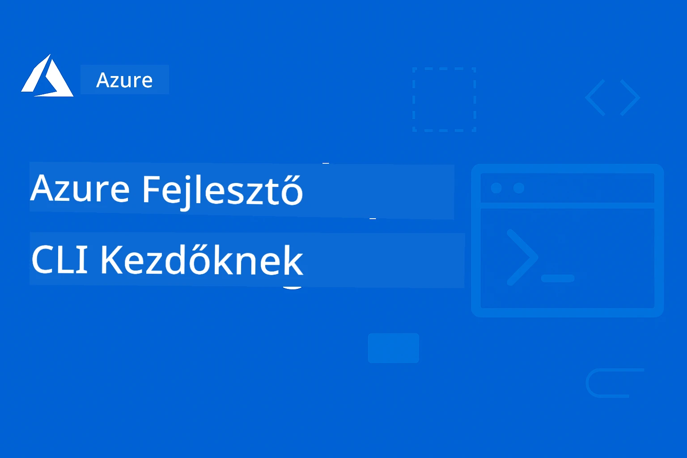

# AZD Kezdőknek: Egy Strukturált Tanulási Út

 

[](https://github.com/microsoft/AZD-for-beginners)
[](https://GitHub.com/microsoft/azd-for-beginners/network/)
[](https://github.com/microsoft/AZD-for-beginners)

[](https://discord.com/invite/nkVh3dp)
[](https://discord.gg/nTYy5BXMWG)

---

### Automatikus Fordítások (Mindig Naprakész)

<!-- CO-OP TRANSLATOR LANGUAGES TABLE START -->
[Arabic](../ar/README.md) | [Bengali](../bn/README.md) | [Bulgarian](../bg/README.md) | [Burmese (Myanmar)](../my/README.md) | [Chinese (Simplified)](../zh-CN/README.md) | [Chinese (Traditional, Hong Kong)](../zh-HK/README.md) | [Chinese (Traditional, Macau)](../zh-MO/README.md) | [Chinese (Traditional, Taiwan)](../zh-TW/README.md) | [Croatian](../hr/README.md) | [Czech](../cs/README.md) | [Danish](../da/README.md) | [Dutch](../nl/README.md) | [Estonian](../et/README.md) | [Finnish](../fi/README.md) | [French](../fr/README.md) | [German](../de/README.md) | [Greek](../el/README.md) | [Hebrew](../he/README.md) | [Hindi](../hi/README.md) | [Hungarian](./README.md) | [Indonesian](../id/README.md) | [Italian](../it/README.md) | [Japanese](../ja/README.md) | [Kannada](../kn/README.md) | [Khmer](../km/README.md) | [Korean](../ko/README.md) | [Lithuanian](../lt/README.md) | [Malay](../ms/README.md) | [Malayalam](../ml/README.md) | [Marathi](../mr/README.md) | [Nepali](../ne/README.md) | [Nigerian Pidgin](../pcm/README.md) | [Norwegian](../no/README.md) | [Persian (Farsi)](../fa/README.md) | [Polish](../pl/README.md) | [Portuguese (Brazil)](../pt-BR/README.md) | [Portuguese (Portugal)](../pt-PT/README.md) | [Punjabi (Gurmukhi)](../pa/README.md) | [Romanian](../ro/README.md) | [Russian](../ru/README.md) | [Serbian (Cyrillic)](../sr/README.md) | [Slovak](../sk/README.md) | [Slovenian](../sl/README.md) | [Spanish](../es/README.md) | [Swahili](../sw/README.md) | [Swedish](../sv/README.md) | [Tagalog (Filipino)](../tl/README.md) | [Tamil](../ta/README.md) | [Telugu](../te/README.md) | [Thai](../th/README.md) | [Turkish](../tr/README.md) | [Ukrainian](../uk/README.md) | [Urdu](../ur/README.md) | [Vietnamese](../vi/README.md)

> **Szeretnéd helyben klónozni?**
>
> Ez a tár nemcsak 50-nél is több nyelvi fordítást tartalmaz, ami jelentősen megnöveli a letöltési méretet. Ha fordítások nélkül szeretnéd klónozni, használd a ritkás ellenőrzést:
>
> **Bash / macOS / Linux:**
> ```bash
> git clone --filter=blob:none --sparse https://github.com/microsoft/AZD-for-beginners.git
> cd AZD-for-beginners
> git sparse-checkout set --no-cone '/*' '!translations' '!translated_images'
> ```
>
> **CMD (Windows):**
> ```cmd
> git clone --filter=blob:none --sparse https://github.com/microsoft/AZD-for-beginners.git
> cd AZD-for-beginners
> git sparse-checkout set --no-cone "/*" "!translations" "!translated_images"
> ```
>
> Ez mindent biztosít, amire szükséged van a tanfolyam befejezéséhez, jóval gyorsabb letöltéssel.
<!-- CO-OP TRANSLATOR LANGUAGES TABLE END -->

## 🆕 Mi Újság az azd-ben Ma

> 📌 **AI CLI kiadás áttekintése (2026-11-04):** Az irányelveket a közzétett **`azd 1.37.2`**, **agents `1.0.0-beta.23`**, és **evaluations `1.0.0-beta.2`** dokumentáció/forrás alapján ellenőrizték. Használd `azd >= 1.37.0` a kombinált munkafolyamathoz. Futtasd `azd version`, és [frissítsd az alap CLI-t](https://learn.microsoft.com/azure/developer/azure-developer-cli/install-azd) az extensionök előtt. Lásd a [kiadási változásokat és javításokat](docs/chapter-08-production/production-ai-practices.md#recent-release-changes-and-fixes). Ez nem egy élő telepítés ellenőrzése az egész tanfolyamra.

Az Azure Developer CLI támogatja sokféle alkalmazástípust, beleértve a webalkalmazásokat, API-kat és AI ügynököket is, támogatott gazdák, sablonok és bővítmények révén.

Ez azt jelenti számodra:

- **Az AI ügynökök mostantól elsőrendű azd munkaterhelések.** Inicializálhatod, telepítheted és kezelheted az AI ügynök projektjeidet ugyanazzal a `azd init` → `azd up` munkafolyamattal, amit már ismersz.
- **Az ügynök életciklusa két bővítmény között.** Használd `azure.ai.agents` az ügynökök inicializálására, meghívására, optimalizálására és visszavonására. Telepítsd külön a **`azure.ai.evaluations`**-t a `azd ai eval init`, `generate` és `run start`-hoz. Az Agents beta.22 lecserélte a régebbi evaluation munkafolyamatot és módosította az optimalizációs konfigurációt; kövesd a [migrációs útmutatót](docs/chapter-08-production/production-ai-practices.md#evaluation-migration-and-quality-checks).
- **További AI építőelemek.** Új előzetes verziós bővítmények — `azure.ai.skills` és `azure.ai.connections` — lehetővé teszik az újrahasznosítható ügynök készségek és Foundry kapcsolatok közvetlen kezelését az azd-vel.
- **Microsoft Foundry integráció** bevezeti a modell telepítést, az ügynökök hosztolását és AI szolgáltatás konfigurációt közvetlenül az azd sablon ökoszisztémába.
- **Zökkenőmentesebb mindennapi alapok.** A legutóbbi kiadásokkal az `azd init` idempotens lett (biztonságos újrafuttatni), az `azd auth login` automatikusan törli az elavult tokeneket, és egy barátságos `azd tool` első futtatási beállítási promptot adtak hozzá.
- **Az alap munkafolyamat nem változott.** Akár egy todo alkalmazást, mikro szolgáltatást vagy több ügynökös AI megoldást telepítesz, a parancsok ugyanazok.

> **Megjegyzés Aspire felhasználóknak:** A Microsoft mostantól egyszerűen **Aspire** néven említi a terméket (korábban ".NET Aspire"). Az azd Aspire támogatása változatlan — csak a nevet frissítették.

Ha már használtad korábban az azd-t, az AI támogatás természetes kiterjesztés — nem külön eszköz vagy fejlett tanfolyam. Ha most kezded, egyetlen munkafolyamatot tanulsz meg, ami mindenre működik.

---

## 🚀 Mi az Azure Developer CLI (azd)?

Az **Azure Developer CLI (azd)** egy fejlesztőbarát parancssori eszköz, amely megkönnyíti az alkalmazások Azure-ba történő telepítését. Ahelyett, hogy kézzel hoznál létre és kapcsolnál össze fél tucat Azure erőforrást, egyetlen paranccsal telepítheted az egész alkalmazást.

### A `azd up` varázsa

```bash
# This single command does everything:
# ✅ Creates all Azure resources  
# ✅ Configures networking and security
# ✅ Builds your application code
# ✅ Deploys to Azure
# ✅ Gives you a working URL
azd up
```

A sablon szolgáltatja az alkalmazás és infrastruktúra konfigurációját. A sikeres telepítéshez továbbra is szükségesek támogatott szolgáltatások/modellek, megfelelő kvóta és jogosultságok, helyes bemenetek, és a telepített alkalmazás ellenőrzése. Az `azd up` nem teszi automatikusan biztonságossá, megfelelőséggel ellátottá vagy élesre készsé a sablont.

---

## ❓ Azure Developer CLI vs Azure CLI: Mi a Különbség?

Ez a leggyakoribb kérdés, amit a kezdők feltesznek. Íme a egyszerű válasz:

| Tulajdonság | **Azure CLI (`az`)** | **Azure Developer CLI (`azd`)** |
|---------|---------------------|--------------------------------|
| **Cél** | Egyedi Azure erőforrások kezelése | Komplett alkalmazások telepítése |
| **Megközelítés** | Infrastruktúra-központú | Alkalmazás-központú |
| **Példa** | `az webapp create --name myapp...` | `azd up` |
| **Tanulási görbe** | Ismerni kell az Azure szolgáltatásokat | Csak az alkalmazásodat kell ismerni |
| **Legjobb** | DevOps, Infrastruktúra | Fejlesztők, Prototípus készítés |

### Egyszerű Analógia

- **Azure CLI** olyan, mint minden eszközt kézben tartani egy ház építéséhez — kalapácsok, fűrészek, szegek. Bármit felépíthetsz, de értened kell az építőiparhoz.
- **Azure Developer CLI** olyan, mintha egy vállalkozót bíznál meg — elmondod, mit szeretnél, és ők építik meg.

### Mikor használjuk melyiket

| Forgatókönyv | Használd ezt |
|----------|----------|
| "Gyorsan szeretném telepíteni a webalkalmazásom" | `azd up` |
| "Csak egy tárolófiókot kell létrehoznom" | `az storage account create` |
| "Teljes AI alkalmazást építek" | `azd init --template azure-search-openai-demo` |
| "Egy adott Azure erőforrást kell hibakeresnem" | `az resource show` |
| "A konfigurált éles környezetembe szeretnék telepíteni" | Vizsgáld át a konfigurációt, hozzáféréseket, költségeket és működési feltételeket az `azd up --environment production` előtt |

### Együtt működnek!

Az AZD és Azure CLI külön hitelesítéssel és konfigurációval rendelkezik. Használd az `azd auth login`-t az AZD-hez, és `az login`-t, amikor egy hook vagy diagnosztikai parancs kifejezetten az Azure CLI-t igényli. Mindkettőt használhatod:
```bash
# Deploy your app with AZD
azd up

# Then fine-tune specific resources with Azure CLI
az webapp config set --name myapp --always-on true
```

---

## 🌟 Találd meg a Sablonokat az Awesome AZD-ben

Ne kezdj nulláról! Az **Awesome AZD** a közösségi gyűjtemény azonnal telepíthető sablonokból:

| Erőforrás | Leírás |
|----------|-------------|
| 🔗 [**Awesome AZD Galéria**](https://azure.github.io/awesome-azd/) | Böngéssz 200+ sablon között egy kattintásos telepítéssel |
| 🔗 [**Sablon Beküldése**](https://github.com/Azure/awesome-azd/issues) | Adj hozzá saját sablont a közösséghez |
| 🔗 [**GitHub Tárhely**](https://github.com/Azure/awesome-azd) | Starolj és fedezd fel a forrást |

### Népszerű AI Sablonok az Awesome AZD-ből

Válassz egy sablont egy külön üres könyvtárban; az alábbi parancsok alternatívák. A végén az `.` inicializálja az adott könyvtárat.

```bash
# RAG Chat with Microsoft Foundry Models + AI Search
azd init --template azure-search-openai-demo .

# Quick AI Chat Application
azd init --template openai-chat-app-quickstart .

# AI Agents with Foundry Agents
azd init --template get-started-with-ai-agents .
```

---

## 🎯 Három lépés a kezdéshez

Mielőtt elkezdenéd, győződj meg róla, hogy a géped készen áll a telepíteni kívánt sablonhoz:

**Windows:**
```powershell
.\validate-setup.ps1
```

**macOS / Linux:**
```bash
bash ./validate-setup.sh
```

Ha bármely ellenőrzés sikertelen, javítsd azt először, majd folytasd a gyorskezdéssel.

### 1. lépés: Az AZD telepítése (2 perc)

**Windows:**
```powershell
winget install microsoft.azd
```

**macOS:**
```bash
brew tap azure/azd && brew install azd
```

**Linux:**
```bash
curl -fsSL https://aka.ms/install-azd.sh | bash
```

### 2. lépés: Hitelesítés az AZD-hez

```bash
# Optional if you plan to use Azure CLI commands directly in this course
az login

# Required for AZD workflows
azd auth login
```

Ha nem vagy biztos benne, melyikre van szükséged, kövesd a teljes beállítási folyamatot a [Installation & Setup](docs/chapter-01-foundation/installation.md#authentication-setup) oldalon.

### 3. lépés: Az első alkalmazásod telepítése

```bash
# Initialize from a template
azd init --template todo-nodejs-mongo .

# Deploy to Azure (creates everything!)
azd up
```

**🎉 Ennyi az egész!** Az alkalmazásod most már élő az Azure-on.

### Tisztítás (Ne felejtsd el!)

```bash
# Remove all resources when done experimenting
azd down --force --purge
```

---

## 📚 Hogyan Használd Ezt a Tanfolyamot

Ez a tanfolyam **fokozatos tanulásra** lett tervezve – kezd ott, ahol kényelmes vagy, és haladj felfelé:

| Tapasztalatod | Kezd itt |
|-----------------|------------|
| **Teljesen új az Azure-ban** | [1. fejezet: Alapozás](#-chapter-1-foundation--quick-start) |
| **Ismered az Azure-t, de új vagy az AZD-ben** | [1. fejezet: Alapozás](#-chapter-1-foundation--quick-start) |
| **AI alkalmazásokat szeretnél telepíteni** | [2. fejezet: AI-első fejlesztés](#-chapter-2-ai-first-development-recommended-for-ai-developers) |
| **Gyakorlati tuti gyakorlást szeretnél** | [🎓 Interaktív Műhely](workshop/README.md) – 3-4 órás vezetett labor |
| **Éles mintákra van szükséged** | [8. fejezet: Termelés & Vállalati használat](#-chapter-8-production--enterprise-patterns) |

### Gyors Beállítás

1. **Forkold ezt a tárat**: [](https://GitHub.com/microsoft/azd-for-beginners/fork)
2. **Klónozd le**: `git clone https://github.com/YOUR-USERNAME/azd-for-beginners.git`
3. **Kérj segítséget**: [Azure Discord Közösség](https://discord.com/invite/ByRwuEEgH4)

> **Szeretnéd helyben klónozni?**

> Ez a tár nemcsak 50-nél is több nyelvi fordítást tartalmaz, ami jelentősen megnöveli a letöltési méretet. Ha fordítások nélkül szeretnéd klónozni, használd a ritkás ellenőrzést:
> ```bash
> git clone --filter=blob:none --sparse https://github.com/microsoft/AZD-for-beginners.git
> cd AZD-for-beginners
> git sparse-checkout set --no-cone '/*' '!translations' '!translated_images'
> ```
> Ez mindent biztosít, amire szükséged van a tanfolyam befejezéséhez, jóval gyorsabb letöltéssel.


## Tanfolyam Áttekintése

Sajátítsd el az Azure Developer CLI (azd) kezelését strukturált fejezeteken keresztül, amelyek progresszív tanulásra lettek tervezve. **Különös figyelem az AI alkalmazások telepítésére a Microsoft Foundry integrációval.**

### Miért elengedhetetlen ez a kurzus a modern fejlesztők számára

Az AI munkaterhelések telepítésével foglalkozó fejlesztők gyakran útmutatásra szorulnak az alábbiakban:
- Összetett, több szolgáltatásból álló AI architektúrák
- AI éles üzembehelyezés legjobb gyakorlatai  
- Azure AI szolgáltatások integrálása és konfigurálása
- AI munkaterhelések költségoptimalizálása
- AI-specifikus telepítési problémák hibaelhárítása

### Tanulási célok

A kurzus elvégzése után képes leszel:
- **Elsajátítani az AZD alapjait**: Alapfogalmak, telepítés és konfiguráció
- **AI alkalmazások telepítése**: Az AZD használata Microsoft Foundry szolgáltatásokkal
- **Infrastructure as Code megvalósítása**: Azure erőforrások kezelése Bicep sablonokkal
- **Telepítések hibaelhárítása**: Gyakori problémák megoldása és hibakeresés
- **Éles üzemre optimalizálás**: Biztonság, skálázás, monitorozás és költségmenedzsment
- **Többügynökös megoldások építése**: Összetett AI architektúrák telepítése

## Mielőtt elkezdenéd: Fiókok, hozzáférések és feltételezések

Mielőtt elkezdenéd az 1. fejezetet, bizonyosodj meg arról, hogy a következők rendelkezésre állnak. Az útmutató későbbi telepítési lépései ezeket az alapokat feltételezik.

- **Egy Azure előfizetés**: Használhatsz meglévő munkáltatói vagy saját előfizetést, vagy létrehozhatsz egy [ingyenes próbaidőszakot](https://aka.ms/azurefreetrial) a kezdéshez.
- **Engedély Azure erőforrások létrehozására**: A legtöbb gyakorlatnál legalább **Contributorként** kell hozzáférned a cél előfizetéshez vagy erőforráscsoporthoz. Egyes fejezetek feltételezhetik továbbá, hogy létre tudsz hozni erőforráscsoportokat, kezelt identitásokat, valamint RBAC hozzárendeléseket.
- [**GitHub fiók**](https://github.com): Hasznos a tároló fork-olásához, a saját változtatások nyomon követéséhez és a GitHub Codespaces használatához a workshopon.
- **Sablon futtatási követelmények**: Egyes sablonokhoz helyi eszközök is szükségesek, mint Node.js, Python, Java vagy Docker. Futtasd a beállítás ellenőrzőt a kezdés előtt, hogy időben észrevedd az esetleges hiányosságokat.
- **Alapvető terminálismeret**: Nem kell szakértőnek lenned, de kényelmesen kell tudnod futtatni parancsokat, mint `git clone`, `azd auth login`, és `azd up`.

> **Vállalati előfizetésben dolgozol?**
> Ha az Azure környezetedet rendszergazda kezeli, előre egyeztesd, hogy telepíthetsz-e erőforrásokat abban az előfizetésben vagy erőforráscsoportban, amelyet használni tervezel. Ha nem, kérj sandbox előfizetést vagy Contributor jogosultságot a kezdés előtt.

> **Új vagy az Azure világában?**
> Kezdd a saját Azure próbaidőszakoddal vagy előfizetéseddel a https://aka.ms/azurefreetrial címen, hogy a gyakorlatokat végig tudd csinálni várakozás nélkül a tenant szintű jóváhagyásokra.

## 🗺️ Kurzustérkép: Gyors navigáció fejezetek szerint

Minden fejezethez tartozik egy dedikált README a tanulási célokkal, gyors indításokkal és gyakorlatokkal:

| Fejezet | Téma | Leckék | Időtartam | Bonyolultság |
|---------|-------|---------|----------|------------|
| **[1. fejezet: Alapok](docs/chapter-01-foundation/README.md)** | Kezdés | [AZD Alapok](docs/chapter-01-foundation/azd-basics.md) &#124; [Telepítés](docs/chapter-01-foundation/installation.md) &#124; [Első projekt](docs/chapter-01-foundation/first-project.md) | 30-45 perc | ⭐ |
| **[2. fejezet: AI fejlesztés](docs/chapter-02-ai-development/README.md)** | AI-először alkalmazások | [Foundry integráció](docs/chapter-02-ai-development/microsoft-foundry-integration.md) &#124; [AI ügynökök](docs/chapter-02-ai-development/agents.md) &#124; [Modell telepítés](docs/chapter-02-ai-development/ai-model-deployment.md) &#124; [Workshop](docs/chapter-02-ai-development/ai-workshop-lab.md) | 1-2 óra | ⭐⭐ |
| **[3. fejezet: Konfiguráció](docs/chapter-03-configuration/README.md)** | Hitelesítés és biztonság | [Konfiguráció](docs/chapter-03-configuration/configuration.md) &#124; [Hitelesítés és biztonság](docs/chapter-03-configuration/authsecurity.md) | 45-60 perc | ⭐⭐ |
| **[4. fejezet: Infrastruktúra](docs/chapter-04-infrastructure/README.md)** | IaC és telepítés | [Telepítési útmutató](docs/chapter-04-infrastructure/deployment-guide.md) &#124; [Provisioning](docs/chapter-04-infrastructure/provisioning.md) | 1-1,5 óra | ⭐⭐⭐ |
| **[5. fejezet: Több ügynök](docs/chapter-05-multi-agent/README.md)** | AI ügynök megoldások | [Kiskereskedelmi forgatókönyv](examples/retail-scenario.md) &#124; [Koordinációs minták](docs/chapter-06-pre-deployment/coordination-patterns.md) | 2-3 óra | ⭐⭐⭐⭐ |
| **[6. fejezet: Előzetes telepítés](docs/chapter-06-pre-deployment/README.md)** | Tervezés és ellenőrzés | [Preflight ellenőrzések](docs/chapter-06-pre-deployment/preflight-checks.md) &#124; [Kapacitástervezés](docs/chapter-06-pre-deployment/capacity-planning.md) &#124; [SKU választás](docs/chapter-06-pre-deployment/sku-selection.md) &#124; [App Insights](docs/chapter-06-pre-deployment/application-insights.md) | 1 óra | ⭐⭐ |
| **[7. fejezet: Hibaelhárítás](docs/chapter-07-troubleshooting/README.md)** | Hibakeresés és javítás | [Gyakori problémák](docs/chapter-07-troubleshooting/common-issues.md) &#124; [Hibakeresés](docs/chapter-07-troubleshooting/debugging.md) &#124; [AI problémák](docs/chapter-07-troubleshooting/ai-troubleshooting.md) | 1-1,5 óra | ⭐⭐ |
| **[8. fejezet: Éles üzem](docs/chapter-08-production/README.md)** | Vállalati minták | [Éles üzem gyakorlatok](docs/chapter-08-production/production-ai-practices.md) | 2-3 óra | ⭐⭐⭐⭐ |
| **[🎓 Workshop](workshop/README.md)** | Gyakorlati labor | [Bevezetés](workshop/docs/instructions/0-Introduction.md) &#124; [Kiválasztás](workshop/docs/instructions/1-Select-AI-Template.md) &#124; [Ellenőrzés](workshop/docs/instructions/2-Validate-AI-Template.md) &#124; [Lebontás](workshop/docs/instructions/3-Deconstruct-AI-Template.md) &#124; [Konfiguráció](workshop/docs/instructions/4-Configure-AI-Template.md) &#124; [Testreszabás](workshop/docs/instructions/5-Customize-AI-Template.md) &#124; [Bontás](workshop/docs/instructions/6-Teardown-Infrastructure.md) &#124; [Összegzés](workshop/docs/instructions/7-Wrap-up.md) | 3-4 óra | ⭐⭐ |

**Összesített időtartam:** ~10-14 óra | **Képességek fejlődése:** Kezdő → Éles üzemre kész

---

## 📚 Tanulási fejezetek

*Válaszd ki a tanulási utadat tapasztalati szint és célok alapján*

### 🚀 1. fejezet: Alapok & Gyors Kezdet
**Előfeltételek**: Azure előfizetés, alapvető parancssori ismeretek  
**Időtartam**: 30-45 perc  
**Bonyolultság**: ⭐

#### Amit tanulni fogsz
- Az Azure Developer CLI alapjainak megértése
- AZD telepítése a saját platformodra
- Az első sikeres telepítésed

#### Tanulási források
- **🎯 Kezd itt**: [Mi az Azure Developer CLI?](#-what-is-azure-developer-cli-azd)
- **📖 Elmélet**: [AZD Alapok](docs/chapter-01-foundation/azd-basics.md) - Alapfogalmak és terminológia
- **⚙️ Beállítás**: [Telepítés és beállítás](docs/chapter-01-foundation/installation.md) - Platform specifikus útmutatók
- **🛠️ Gyakorlat**: [Az első projekted](docs/chapter-01-foundation/first-project.md) - Lépésről lépésre útmutató
- **📋 Gyorsreferencia**: [Parancs összefoglaló](resources/cheat-sheet.md)

#### Gyakorlati gyakorlatok
```bash
# Quick installation check
azd version

# Deploy your first application
azd init --template todo-nodejs-mongo .
azd up
```

**💡 Fejezet eredménye**: Egy egyszerű webalkalmazás sikeres telepítése Azure-ra AZD használatával

**✅ Siker igazolása:**
```bash
# After completing Chapter 1, you should be able to:
azd version              # Shows installed version
azd init --template todo-nodejs-mongo  # Initializes project
azd up                  # Deploys to Azure
azd show                # Displays running app URL
# Application opens in browser and works
azd down --force --purge  # Cleans up resources
```

**📊 Időráfordítás:** 30-45 perc  
**📈 Készségszint a végén:** Alapvető alkalmazásokat önállóan tud telepíteni

---

### 🤖 2. fejezet: AI-először fejlesztés (Ajánlott AI fejlesztőknek)
**Előfeltétel**: Az 1. fejezet elvégzése  
**Időtartam**: 1-2 óra  
**Bonyolultság**: ⭐⭐

#### Amit tanulni fogsz
- Microsoft Foundry integráció AZD-vel
- AI-alapú alkalmazások telepítése
- AI szolgáltatás konfigurációk megértése

#### Tanulási források
- **🎯 Kezd itt**: [Microsoft Foundry Integráció](docs/chapter-02-ai-development/microsoft-foundry-integration.md)
- **🤖 AI ügynökök**: [AI ügynök útmutató](docs/chapter-02-ai-development/agents.md) - Intelligens ügynökök telepítése AZD-vel
- **📖 Minták**: [AI modell telepítése](docs/chapter-02-ai-development/ai-model-deployment.md) - AI modellek telepítése és kezelése
- **🛠️ Workshop**: [AI workshop labor](docs/chapter-02-ai-development/ai-workshop-lab.md) - Készülj fel AI megoldásaid AZD-hez
- **🎥 Interaktív útmutató**: [Workshop anyagok](workshop/README.md) - Böngésző alapú tanulás MkDocs * DevContainer környezetben
- **📋 Sablonok**: [Microsoft Foundry sablonok](#featured-microsoft-foundry-templates)
- **📝 Példák**: [AZD telepítési példák](examples/README.md)

#### Gyakorlati gyakorlatok
```bash
# Deploy your first AI application
azd init --template azure-search-openai-demo .
azd up

# Try additional AI templates
azd init --template openai-chat-app-quickstart .
azd init --template agent-openai-python-prompty .
```

**💡 Fejezet eredménye**: AI-alapú chat alkalmazás telepítése RAG képességekkel

**✅ Siker igazolása:**
```bash
# After Chapter 2, you should be able to:
azd init --template azure-search-openai-demo .
azd up
# Test the AI chat interface
# Ask questions and get AI-powered responses with sources
# Verify search integration works
azd monitor  # Check Application Insights shows telemetry
azd down --force --purge
```

**📊 Időráfordítás:** 1-2 óra  
**📈 Készségszint a végén:** AI tanuló alkalmazásokat képes telepíteni, és felismeri az éles üzemhez szükséges további követelményeket
**💰 Költségtudatosság:** Értse meg a fejlesztési költségeket ($80-150/hó), az éles üzem költségeit ($300-3500/hó)

#### 💰 Költségszempontok az AI telepítéseknél

**Fejlesztői környezet (becsült $80-150/hó):**
- Microsoft Foundry modellek (fizetés használat szerint): $0-50/hó (a token használat alapján)
- AI Search (alap szint): $75/hó
- Container Apps (fogyasztás alapú): $0-20/hó
- Tárolás (standard): $1-5/hó

**Éles üzem környezet (becsült $300-3,500+/hó):**
- Microsoft Foundry modellek (PTU a stabil teljesítményért): $3,000+/hó VAGY nagyforgalmú Pay-as-you-go
- AI Search (standard szint): $250/hó
- Container Apps (dedikált): $50-100/hó
- Application Insights: $5-50/hó
- Tárolás (premium): $10-50/hó

**💡 Költségoptimalizálási tippek:**
- Ellenőrizd a modell lekérdezési árakat és az előfizetésedhez tartozó jóváírásokat; az Azure OpenAI nem tartalmaz univerzális havi 50,000 token ingyenes keretet
- Futtasd a `azd down` parancsot az erőforrások törléséhez, ha már nincs rájuk szükség, miután átvizsgáltad az adott környezetet
- Kezdd fogyasztás alapú számlázással, csak éles üzem esetén válts PTU-ra
- Használd a `azd provision --preview` parancsot az infrastruktúra tervezett állapotának ellenőrzésére, majd kalkuláld az árat az Azure Árkalkulátorral
- Kapcsold be az automatikus skálázást: csak a tényleges használatért fizess

**Költségkövetés:**
```bash
# Inspect planned resources (this does not calculate prices)
azd provision --preview

# Monitor actual costs in Azure Portal
az consumption budget list --resource-group <your-rg>
```

---

### ⚙️ 3. fejezet: Konfiguráció és Hitelesítés
**Előfeltételek**: Az 1. fejezet elvégzése  
**Időtartam**: 45-60 perc  
**Bonyolultság**: ⭐⭐

#### Amit tanulni fogsz
- Környezet konfiguráció és kezelése
- Hitelesítés és biztonsági legjobb gyakorlatok
- Erőforrások elnevezése és rendszerezése

#### Tanulási források
- **📖 Konfiguráció**: [Konfigurációs útmutató](docs/chapter-03-configuration/configuration.md) - Környezet beállítása
- **🔐 Biztonság**: [Hitelesítési minták és kezelt identitás](docs/chapter-03-configuration/authsecurity.md) - Hitelesítési minták
- **📝 Példák**: [Adatbázis alkalmazás példa](examples/database-app/README.md) - AZD adatbázis példák

#### Gyakorlati gyakorlatok
- Több környezet konfigurálása (fejlesztői, teszt, éles)
- Kezelt identitás hitelesítésének beállítása
- Környezet specifikus konfigurációk megvalósítása

**💡 Fejezet eredménye**: Több környezet hatékony kezelése megfelelő hitelesítéssel és biztonsággal

---

### 🏗️ 4. fejezet: Infrastrukturakód & Telepítés
**Előfeltételek**: Az 1-3. fejezetek elvégzése  
**Időtartam**: 1-1,5 óra  
**Bonyolultság**: ⭐⭐⭐

#### Amit tanulni fogsz
- Haladó telepítési minták
- Infrastrukturakód Bicep használatával
- Erőforrás rendelkezésre állítás stratégiák

#### Tanulási források
- **📖 Telepítés**: [Telepítési útmutató](docs/chapter-04-infrastructure/deployment-guide.md) - Teljes munkafolyamatok
- **🏗️ Rendelkezésre állítás**: [Erőforrás provisioning](docs/chapter-04-infrastructure/provisioning.md) - Azure erőforrás menedzsment
- **📝 Példák**: [Container App példa](../../examples/container-app) - Konténeres telepítések

#### Gyakorlati gyakorlatok
- Egyedi Bicep sablonok létrehozása
- Több szolgáltatásos alkalmazások telepítése
- Blue-green telepítési stratégiák megvalósítása

**💡 Fejezet eredménye**: Összetett több szolgáltatásos alkalmazások telepítése egyedi infrastruktúra sablonokkal

---

### 🎯 5. fejezet: Több ügynökös AI megoldások (Haladó)
**Előfeltételek**: Az 1-2. fejezetek elvégzése  
**Időtartam**: 2-3 óra  
**Bonyolultság**: ⭐⭐⭐⭐

#### Amit tanulni fogsz
- Több ügynökös architektúra minták
- Ügynökök összehangolása és koordinációja
- Éles üzemre kész AI telepítések

#### Tanulási források
- **🤖 Kiemelt tervezés**: [Kiskereskedelmi több ügynökös megoldás](examples/retail-scenario.md) - Architektúra tervrajz, nem teljes alkalmazás
- **🛠️ ARM Templates**: [ARM Template Package](../../examples/retail-multiagent-arm-template) - Infrastruktúra váz; áttekinteni az előfeltételeket és hiányzó alkalmazás komponenseket
- **📖 Architecture**: [Multi-agent coordination patterns](docs/chapter-06-pre-deployment/coordination-patterns.md) - Minták

#### Gyakorlati gyakorlatok
```bash
# Inspect the retail infrastructure scaffold before choosing to deploy it
cd examples/retail-multiagent-arm-template
cat README.md

# After an intentional deployment, inspect infrastructure state
az deployment group show --resource-group <rg-name> --name <deployment-name>
```

**💡 Fejezet eredménye**: Értsd meg a több ügynökös tervezést, és azonosítsd a megvalósításhoz, érvényesítéshez és működtetéshez szükséges munkákat az infrastruktúra vázán túl

---

### 🔍 6. fejezet: Előtelepítési érvényesítés és tervezés
**Előfeltételek**: A 4. fejezet befejezve  
**Időtartam**: 1 óra  
**Bonyolultság**: ⭐⭐

#### Amit megtanulsz
- Kapacitástervezés és erőforrás-ellenőrzés
- SKU kiválasztási stratégiák
- Előrepülési ellenőrzések és automatizálás

#### Tanulási források
- **📊 Tervezés**: [Kapacitástervezés](docs/chapter-06-pre-deployment/capacity-planning.md) - Erőforrás-ellenőrzés
- **💰 Kiválasztás**: [SKU kiválasztás](docs/chapter-06-pre-deployment/sku-selection.md) - Költséghatékony döntések
- **✅ Érvényesítés**: [Előrepülési ellenőrzések](docs/chapter-06-pre-deployment/preflight-checks.md) - Automatizált szkriptek

#### Gyakorlati gyakorlatok
- Futtasd az erőforrás-ellenőrző szkripteket
- Optimalizáld az SKU-k költségszerinti kiválasztását
- Valósítsd meg az automatizált előtelepítési ellenőrzéseket

**💡 Fejezet eredménye**: Validáld és optimalizáld a telepítéseket végrehajtás előtt

---

### 🚨 7. fejezet: Hibakeresés és hibajavítás
**Előfeltételek**: Bármely telepítési fejezet befejezve  
**Időtartam**: 1-1,5 óra  
**Bonyolultság**: ⭐⭐

#### Amit megtanulsz
- Rendszeres hibakeresési megközelítések
- Gyakori problémák és megoldások
- AI-specifikus hibakeresés

#### Tanulási források
- **🔧 Gyakori problémák**: [Gyakori problémák](docs/chapter-07-troubleshooting/common-issues.md) - GYIK és megoldások
- **🕵️ Hibakeresés**: [Hibakeresési útmutató](docs/chapter-07-troubleshooting/debugging.md) - Lépésről-lépésre stratégiák
- **🤖 AI problémák**: [AI-specifikus hibakeresés](docs/chapter-07-troubleshooting/ai-troubleshooting.md) - AI szolgáltatási problémák

#### Gyakorlati gyakorlatok
- Diagnosztizáld a telepítési hibákat
- Oldd meg az azonosítási problémákat
- Hibakeresd az AI szolgáltatás kapcsolatát

**💡 Fejezet eredménye**: Önállóan diagnosztizálj és oldj meg gyakori telepítési hibákat

---

### 🏢 8. fejezet: Gyártási és vállalati minták
**Előfeltételek**: 1-4. fejezetek befejezve  
**Időtartam**: 2-3 óra  
**Bonyolultság**: ⭐⭐⭐⭐

#### Amit megtanulsz
- Gyártási telepítési stratégiák
- Vállalati biztonsági minták
- Monitorozás és költségoptimalizáció

#### Tanulási források
- **🏭 Gyártás**: [Gyártási AI legjobb gyakorlatok](docs/chapter-08-production/production-ai-practices.md) - Vállalati minták
- **📝 Példák**: [Microservices példa](../../examples/microservices) - Összetett architektúrák
- **📊 Monitorozás**: [Application Insights integráció](docs/chapter-06-pre-deployment/application-insights.md) - Monitorozás

#### Gyakorlati gyakorlatok
- Valósítsd meg a vállalati biztonsági mintákat
- Állíts be átfogó monitorozást
- Telepíts gyártási környezetbe megfelelő irányítással

**💡 Fejezet eredménye**: Telepíts vállalati szintű alkalmazásokat teljes gyártási képességekkel

---

## 🎓 Műhely áttekintés: Gyakorlati tanulási élmény

> **⚠️ MŰHELY ÁLLAPOTA: Aktív fejlesztés**  
> A műhely anyagai jelenleg fejlesztés és finomítás alatt állnak. Az alap modulok működnek, de néhány haladó rész még hiányos. Aktívan dolgozunk az összes tartalom befejezésén. [Nyomon követés →](workshop/README.md)

### Interaktív műhely anyagok
**Átfogó gyakorlati tanulás böngésző-alapú eszközökkel és vezetett gyakorlatokkal**

A műhely anyagai egy strukturált, interaktív tanulási élményt nyújtanak, amely kiegészíti a fentebb lévő fejezet-alapú tananyagot. A műhely önálló és oktató által vezetett órákra is alkalmas.

#### 🛠️ Műhely jellemzői
- **Böngésző-alapú felület**: Teljes MkDocs-alapú műhely kereséssel, másolással és témakezeléssel
- **GitHub Codespaces integráció**: Egykattintásos fejlesztői környezet beállítás
- **Strukturált tanulási útvonal**: 8 modulból álló vezetett gyakorlatok (összesen 3-4 óra)
- **Fokozatos módszertan**: Bevezetés → Kiválasztás → Érvényesítés → Szétszedés → Konfiguráció → Testreszabás → Leszerelés → Összegzés
- **Interaktív DevContainer környezet**: Előre beállított eszközök és függőségek

#### 📚 Műhely modul struktúra
A műhely egy **8 modulból álló fokozatos módszertant** követ, amely a felfedezéstől a telepítésig vezet el:

| Modul | Téma | Mit fogsz csinálni | Időtartam |
|--------|-------|----------------|----------|
| **0. Bevezetés** | Műhely áttekintés | Megérted a tanulási célokat, előfeltételeket és a műhely felépítését | 15 perc |
| **1. Kiválasztás** | Template felfedezés | Fedezd fel az AZD sablonokat és válaszd ki a helyzetedhez megfelelő AI sablont | 20 perc |
| **2. Érvényesítés** | Telepítés és ellenőrzés | Telepítsd a sablont `azd up` segítségével, ellenőrizd az infrastruktúra működését | 30 perc |
| **3. Szétszedés** | Architektúra megértése | Használd a GitHub Copilot-ot a sablon architektúrájának, Bicep fájloknak és kód szerkezetének felfedezéséhez | 30 perc |
| **4. Konfiguráció** | azure.yaml mélyreható | Sajátítsd el az `azure.yaml` konfigurációt, életciklus hookokat és környezeti változókat | 30 perc |
| **5. Testreszabás** | Tegyél bármi a tiéddé | Engedélyezd az AI keresést, követést, kiértékelést, és szabjad testre a helyzetedre | 45 perc |
| **6. Leszerelés** | Tisztítás | Biztonságosan töröld az erőforrásokat `azd down --purge` segítségével | 15 perc |
| **7. Összegzés** | Következő lépések | Tekintsd át az elért eredményeket, kulcsfogalmakat és folytasd a tanulási utat | 15 perc |

**Műhely menete:**
```
Introduction → Selection → Validation → Deconstruction → Configuration → Customization → Teardown → Wrap-up
     ↓            ↓           ↓              ↓               ↓              ↓            ↓           ↓
  Overview    Find the     Deploy &      Explore        Master         Customize     Clean up    Review &
             right        verify        code &        azure.yaml      for your      resources   next steps
             template                   structure                     scenario
```

#### 🚀 Indulás a műhellyel
```bash
# Option 1: GitHub Codespaces (Recommended)
# Click "Code" → "Create codespace on main" in the repository

# Option 2: Local Development
git clone https://github.com/microsoft/azd-for-beginners.git
cd azd-for-beginners/workshop
# Follow the setup instructions in workshop/README.md
```

#### 🎯 Műhely tanulási eredményei
A műhely befejezése után a résztvevők képesek lesznek:
- **Gyártási AI alkalmazások telepítése**: Használd az AZD-t a Microsoft Foundry szolgáltatásokkal
- **Több ügynökös architektúrák elsajátítása**: Koordinált AI ügynök megoldások implementálása
- **Biztonsági legjobb gyakorlatok alkalmazása**: Hitelesítés és hozzáférés-kezelés konfigurálása
- **Méretre optimalizálás**: Költséghatékony, teljesítményorientált telepítések tervezése
- **Telepítési hibák elhárítása**: Gyakori problémák önálló megoldása

#### 📖 Műhely források
- **🎥 Interaktív útmutató**: [Műhely anyagok](workshop/README.md) - Böngésző-alapú tanulási környezet
- **📋 Modulonkénti útmutatók**:
  - [0. Bevezetés](workshop/docs/instructions/0-Introduction.md) - Műhely áttekintés és célok
  - [1. Kiválasztás](workshop/docs/instructions/1-Select-AI-Template.md) - AI sablonok keresése és kiválasztása
  - [2. Érvényesítés](workshop/docs/instructions/2-Validate-AI-Template.md) - Sablon telepítés és ellenőrzés
  - [3. Szétszedés](workshop/docs/instructions/3-Deconstruct-AI-Template.md) - Sablon architektúra felfedezése
  - [4. Konfiguráció](workshop/docs/instructions/4-Configure-AI-Template.md) - azure.yaml mélyreható ismerete
  - [5. Testreszabás](workshop/docs/instructions/5-Customize-AI-Template.md) - Testreszabás a helyzetednek megfelelően
  - [6. Leszerelés](workshop/docs/instructions/6-Teardown-Infrastructure.md) - Erőforrások tisztítása
  - [7. Összegzés](workshop/docs/instructions/7-Wrap-up.md) - Áttekintés és további lépések
- **🛠️ AI műhely labor**: [AI Workshop Lab](docs/chapter-02-ai-development/ai-workshop-lab.md) - AI fókuszú gyakorlatok
- **💡 Gyors indulás**: [Műhely beállítási útmutató](workshop/README.md#browser-based-guide) - Környezet konfiguráció

**Ideális**: Vállalati képzésekhez, egyetemi kurzusokhoz, önálló tanuláshoz és fejlesztői bootcampekhez.

---

## 📖 Mélyebb betekintés: AZD képességek

Az alapokon túl az AZD erőteljes funkciókat kínál gyártási telepítésekhez:

- **Sablon alapú telepítések** - Használj előre elkészített sablonokat közös alkalmazásmintákhoz
- **Infrastruktúra mint kód** - Kezeld Azure erőforrásokat Bicep vagy Terraform segítségével  
- **Integrált munkafolyamatok** - Zökkenőmentesen provisioning, telepítés és monitorozás
- **Fejlesztőbarát** - Optimalizált a fejlesztői termelékenység és élmény érdekében

### **AZD + Microsoft Foundry: Tökéletes AI telepítésekhez**

**Miért az AZD AI megoldásokhoz?** AZD válasz a legfőbb kihívásokra, melyekkel az AI fejlesztők szembesülnek:

- **AI-kész sablonok** - Előre konfigurált sablonok Microsoft Foundry modellekhez, Azure AI szolgáltatásokhoz és ML munkaterhekhez
- **Biztonságos AI telepítések** - Beépített biztonsági minták AI szolgáltatások, API kulcsok és modell végpontok számára  
- **Gyártási AI minták** - Legjobb gyakorlatok skálázható, költséghatékony AI alkalmazás telepítésekhez
- **Végponttól végpontig AI munkafolyamatok** - Modell fejlesztéstől a gyártási telepítésig megfelelő monitorozással
- **Költségoptimalizáció** - Okos erőforrás allokáció és skálázás AI munkaterhelésekhez
- **Microsoft Foundry integráció** - Zökkenőmentes kapcsolat a Microsoft Foundry modell katalógushoz és végpontokhoz

---

## 🎯 Sablonok és példatár

### Kiemelt: Microsoft Foundry sablonok
**Kezdj itt, ha AI alkalmazásokat telepítesz!**

> **Megjegyzés:** Ezek a sablonok különböző AI mintákat demonstrálnak. Néhány külső Azure minta, mások helyi megvalósítások.

| Sablon | Fejezet | Bonyolultság | Szolgáltatások | Típus |
|----------|---------|------------|----------|------|
| [**Indulj el AI csevegéssel**](https://github.com/Azure-Samples/get-started-with-ai-chat) | 2. fejezet | ⭐⭐ | AzureOpenAI + Azure AI Model Inference API + Azure AI Search + Azure Container Apps + Application Insights | Külső |
| [**Indulj el AI ügynökökkel**](https://github.com/Azure-Samples/get-started-with-ai-agents) | 2. fejezet | ⭐⭐ | Foundry Agents + AzureOpenAI + Azure AI Search + Azure Container Apps + Application Insights| Külső |
| [**Azure Search + OpenAI Demo**](https://github.com/Azure-Samples/azure-search-openai-demo) | 2. fejezet | ⭐⭐ | Azure OpenAI + Azure AI Search + Container Apps (alapértelmezett) + Storage | Külső |
| [**OpenAI Chat App Gyorskezdő**](https://github.com/Azure-Samples/openai-chat-app-quickstart) | 2. fejezet | ⭐ | AzureOpenAI + Container Apps + Application Insights | Külső |
| [**Agent OpenAI Python Prompty**](https://github.com/Azure-Samples/agent-openai-python-prompty) | 5. fejezet | ⭐⭐⭐ | AzureOpenAI + Azure Functions + Prompty | Külső |
| [**Contoso Chat RAG**](https://github.com/Azure-Samples/contoso-chat) | 8. fejezet | ⭐⭐⭐⭐ | AzureOpenAI + AI Search + Cosmos DB + Container Apps | Külső |
| [**Kiskereskedelmi Több Ügynökös Megoldás**](examples/retail-scenario.md) | 5. fejezet | ⭐⭐⭐⭐ | Javasolt architektúra és infrastruktúra váz; alkalmazás megvalósítás szükséges | **Helyi tervrajz** |

### Kiemelt: Teljes tanulási szcenáriók
**Gyártásra kész alkalmazás sablonok tanulási fejezetekhez rendelve**

| Sablon | Tanulási fejezet | Bonyolultság | Fő tanulási pont |
|----------|------------------|------------|--------------|
| [**openai-chat-app-quickstart**](https://github.com/Azure-Samples/openai-chat-app-quickstart) | 2. fejezet | ⭐ | Alapvető AI telepítési minták |
| [**azure-search-openai-demo**](https://github.com/Azure-Samples/azure-search-openai-demo) | 2. fejezet | ⭐⭐ | RAG megvalósítás Azure AI Search segítségével |
| [**get-started-with-ai-agents**](https://github.com/Azure-Samples/get-started-with-ai-agents) | 2. fejezet | ⭐⭐ | Ügynök által támogatott chat és mintaspecifikus értékelő tesztek |
| [**agent-openai-python-prompty**](https://github.com/Azure-Samples/agent-openai-python-prompty) | 5. fejezet | ⭐⭐⭐ | Ügynök keretrendszer és függvényhívás |
| [**contoso-chat**](https://github.com/Azure-Samples/contoso-chat) | 8. fejezet | ⭐⭐⭐ | Vállalati AI koordináció |
| [**retail-multi-agent-solution**](examples/retail-scenario.md) | 5. fejezet | ⭐⭐⭐⭐ | Több ügynökös architektúra Ügyfél és Készlet ügynökökkel |

### Tanulás példatípus szerint

> **📌 Helyi vs Külső példák:**  
> **Helyi példák** (ebben a repóban) = Nézd meg a példa README-jét a megvalósítás állapotáért és előfeltételekért
> **Külső példák** (Azure minták) = Klónozd a linkelt repókat

#### Helyi példák (Készen áll használatra)
- [**Kiskereskedelmi Több Ügynökös Megoldás**](examples/retail-scenario.md) - Architektúra tervrajz ARM infrastruktúra vázzal
  - Javasolt Ügyfél és Készlet ügynök szerepek
  - Monitorozás, értékelés és alkalmazás kód megvalósítása és ellenőrzése szükséges
  - Csak az erőforrások kialakítása nem eredményez működő kiskereskedelmi alkalmazást

#### Helyi példák - Konténer alkalmazások (2-5. fejezetek)
**Átfogó konténer telepítési példák ebben a repóban:**
- [**Konténer Alkalmazás Példák**](examples/container-app/README.md) - Teljes útmutató konténerizált telepítésekhez
  - [Egyszerű Flask API](../../examples/container-app/simple-flask-api) - Alap REST API scale-to-zero funkcióval
  - [Microservices Architektúra](../../examples/container-app/microservices) - Két szolgáltatásos tanuló minta; gyártási keményítés további munka
  - Gyors kezdés, gyártás és haladó telepítési minták
  - Monitorozás, biztonság és költségoptimalizáció útmutató

#### Külső példák - Egyszerű alkalmazások (1-2. fejezetek)
**Klónozd ezeket az Azure Samples repókat a kezdéshez:**
- [Egyszerű Web App - Node.js + MongoDB](https://github.com/Azure-Samples/todo-nodejs-mongo) - Alap telepítési minták
- [Statikus weboldal - React SPA](https://github.com/Azure-Samples/todo-csharp-sql-swa-func) - Statikus tartalom telepítése
- [Konténer alkalmazás - Python Flask](https://github.com/Azure-Samples/container-apps-store-api-microservice) - REST API telepítés

#### Külső példák - Adatbázis integráció (3-4. fejezet)  
- [Adatbázis Alkalmazás - C# + SQL](https://github.com/Azure-Samples/todo-csharp-sql) - Adatbázis-kapcsolódási minták
- [Funkciók + Cosmos DB](https://github.com/Azure-Samples/todo-python-mongo-swa-func) - Serverless adatfolyam

#### Külső példák - Haladó minták (4-8. fejezet)
- [Java mikroszolgáltatások](https://github.com/Azure-Samples/java-microservices-aca-lab) - Többszolgáltatásos architektúrák
- [Konténeralkalmazás feladatok](https://github.com/Azure-Samples/container-apps-jobs) - Háttérfeldolgozás  
- [Vállalati gépi tanulási folyamat](https://github.com/Azure/mlops-v2) - MLOps referencia minták; nem egy azonnal alkalmazható AZD sablon

### Külső sablon gyűjtemények
- [**Hivatalos AZD sablongyűjtemény**](https://azure.github.io/awesome-azd/) - Válogatott hivatalos és közösségi sablonok
- [**Azure fejlesztői CLI sablonok**](https://learn.microsoft.com/en-us/azure/developer/azure-developer-cli/azd-templates) - Microsoft Learn sablon dokumentáció
- [**Példák könyvtára**](examples/README.md) - Helyi tanulási példák részletes magyarázatokkal

---

## 📚 Tanulási források és hivatkozások

### Gyors hivatkozások
- [**Parancs áttekintő**](resources/cheat-sheet.md) - Alapvető azd parancsok fejezetenként rendszerezve
- [**Fogalomtár**](resources/glossary.md) - Azure és azd terminológia  
- [**GYIK**](resources/faq.md) - Gyakori kérdések fejezetenként
- [**Tanulmányi útmutató**](resources/study-guide.md) - Átfogó gyakorlati feladatok

### Gyakorlati workshopok
- [**AI Workshop Labor**](docs/chapter-02-ai-development/ai-workshop-lab.md) - Tegye AI megoldásait AZD-telepíthetővé (2-3 óra)
- [**Interaktív workshop**](workshop/README.md) - 8 modulból álló vezetett gyakorlat MkDocs és GitHub Codespaces használatával
  - Menet: Bevezetés → Kiválasztás → Érvényesítés → Lebontás → Konfiguráció → Testreszabás → Bontás → Összegzés

### Külső tanulási források
- [Azure fejlesztői CLI dokumentáció](https://learn.microsoft.com/en-us/azure/developer/azure-developer-cli/)
- [Azure Architecture Center](https://learn.microsoft.com/en-us/azure/architecture/)
- [Azure árkalkulátor](https://azure.microsoft.com/pricing/calculator/)
- [Azure állapot](https://status.azure.com/)

### AI ügynök képességek a szerkesztődhöz
- [**Microsoft Azure képességek a skills.sh oldalon**](https://skills.sh/microsoft/github-copilot-for-azure) - 37 nyílt ügynöki képesség Azure AI, Foundry, telepítés, diagnosztika, költségoptimalizálás és más témákhoz. Telepíthető GitHub Copilot, Cursor, Claude Code vagy bármilyen támogatott ügynökbe:
  ```bash
  npx skills add microsoft/github-copilot-for-azure
  ```

---

## 🔧 Gyors hibakeresési útmutató

**Gyakori problémák kezdőknek és azonnali megoldások:**

<details>
<summary><strong>❌ "azd: parancs nem található"</strong></summary>

```bash
# Install AZD first
# Windows (PowerShell):
winget install microsoft.azd

# macOS:
brew tap azure/azd && brew install azd

# Linux:
curl -fsSL https://aka.ms/install-azd.sh | bash

# Verify installation
azd version
```
</details>

<details>
<summary><strong>❌ "Nincs előfizetés" vagy "Előfizetés nincs beállítva"</strong></summary>

```bash
# List available subscriptions
az account list --output table

# Set default subscription
az account set --subscription "<subscription-id-or-name>"

# Set for AZD environment
azd env set AZURE_SUBSCRIPTION_ID "<subscription-id>"

# Verify
az account show
```
</details>

<details>
<summary><strong>❌ "Elégséges keret nincs" vagy "Keret túllépve"</strong></summary>

```bash
# Try different Azure region
azd env set AZURE_LOCATION "westus2"
azd up

# Or use smaller SKUs in development
# Edit infra/main.parameters.json:
{
  "sku": "B1"  // Instead of "P1V2"
}
```
</details>

<details>
<summary><strong>❌ "azd up" félúton elakad</strong></summary>

```bash
# Option 1: Inspect the error and retry after correcting its cause
azd show
azd up --debug

# Option 2: Just fix infrastructure
azd provision

# Option 3: Check detailed status
azd show

# Option 4: Check logs in Azure Monitor
azd monitor --logs
```
</details>

<details>
<summary><strong>❌ "Hitelesítés sikertelen" vagy "Token lejárt"</strong></summary>

```bash
# Re-authenticate for AZD
azd auth logout
azd auth login

# Optional: refresh Azure CLI too if you are running az commands
az logout
az login

# Verify authentication
az account show
```
</details>

<details>
<summary><strong>❌ "Erőforrás már létezik" vagy névütközések</strong></summary>

```bash
# Inspect the conflicting resource before changing or deleting anything.
# For an isolated new deployment, create a separate environment:
azd env new dev-v2
azd up
```
</details>

<details>
<summary><strong>❌ A sablon telepítése túl sokáig tart</strong></summary>

**Megszokott várakozási idők:**
- Egyszerű webalkalmazás: 5-10 perc
- Adatbázis alklamazással: 10-15 perc
- AI alkalmazások: 15-25 perc (Az OpenAI előkészítés lassú)

```bash
# Check progress
azd show

# If stuck >30 minutes, check Azure Portal:
azd monitor --overview
# Look for failed deployments
```
</details>

<details>
<summary><strong>❌ "Hozzáférés megtagadva" vagy "Tiltott"</strong></summary>

```bash
# Check your Azure role
az role assignment list --assignee $(az account show --query user.name -o tsv)

# You need at least "Contributor" role
# Ask your Azure admin to grant:
# - Contributor (for resources)
# - User Access Administrator (for role assignments)
```
</details>

<details>
<summary><strong>❌ Nem találom a telepített alkalmazás URL-jét</strong></summary>

```bash
# Show all service endpoints
azd show

# Or open Azure Portal
azd monitor

# Check specific service
azd env get-values
# Look for *_URL variables
```
</details>

### 📚 Teljes hibakeresési források

- **Gyakori problémák útmutató:** [Részletes megoldások](docs/chapter-07-troubleshooting/common-issues.md)
- **AI-specifikus problémák:** [AI hibakeresés](docs/chapter-07-troubleshooting/ai-troubleshooting.md)
- **Hibakeresési útmutató:** [Lépésről lépésre hibakeresés](docs/chapter-07-troubleshooting/debugging.md)
- **Segítség:** [Azure Discord](https://discord.gg/microsoft-azure) #azure-developer-cli

---

## 🎓 Tanfolyam befejezése és tanúsítás

### Haladás nyomon követése
Kövesd nyomon tanulási előrehaladásodat fejezetenként:

- [ ] **1. fejezet**: Alapok és gyors kezdés ✅
- [ ] **2. fejezet**: AI-központú fejlesztés ✅  
- [ ] **3. fejezet**: Konfiguráció és hitelesítés ✅
- [ ] **4. fejezet**: Infrastruktúra kód formájában és telepítés ✅
- [ ] **5. fejezet**: Többügynökös AI megoldások ✅
- [ ] **6. fejezet**: Előtelepítés érvényesítés és tervezés ✅
- [ ] **7. fejezet**: Hibakeresés és debuggolás ✅
- [ ] **8. fejezet**: Termelési és vállalati minták ✅

### Tanulás igazolása
Minden fejezet befejezése után ellenőrizd tudásodat:
1. **Gyakorlati feladat**: A fejezet telepítését végezd el
2. **Ismeretellenőrzés**: Tekintsd át a fejezet GYIK szekcióját
3. **Közösségi vita**: Oszd meg tapasztalataid az Azure Discordon
4. **Következő fejezet**: Lépj a következő komplexitási szintre

### Tanfolyam befejezésének előnyei
Minden fejezetet befejezve a következők birtokába jutsz:
- **Termelési tapasztalat**: Valódi AI alkalmazások telepítése Azure-ra
- **Szakmai készségek**: Vállalati szintű telepítési képességek  
- **Közösségi elismerés**: Azure fejlesztői közösség aktív tagja
- **Karrier előrelépés**: Keresett AZD és AI telepítési szakértelem

---

## 🤝 Közösség és támogatás

### Segítség és támogatás
- **Technikai problémák**: [Hibabejelentés és funkciókérések](https://github.com/microsoft/azd-for-beginners/issues)
- **Tanulási kérdések**: [Microsoft Azure Discord közösség](https://discord.gg/microsoft-azure) és [](https://discord.gg/nTYy5BXMWG)
- **AI-specifikus segítség**: Csatlakozz a [](https://discord.gg/nTYy5BXMWG)
- **Dokumentáció**: [Hivatalos Azure fejlesztői CLI dokumentáció](https://learn.microsoft.com/en-us/azure/developer/azure-developer-cli/)

### Közösségi betekintések a Microsoft Foundry Discordból

**Témák, amelyeket a közösség megvitat:**
- Többszolgáltatásos telepítések, hitelesítő adatok kezelése, termelési készültség
- AI specifikus sablonok, hibakeresési útmutatók és legjobb gyakorlatok

**Csatlakozz közösségünkhöz, hogy:**
- Oszd meg AZD + AI tapasztalataidat és kérj segítséget
- Hozzáférj AI sablonok korai előzeteseihez
- Hozzájárulj az AI telepítési legjobb gyakorlatokhoz
- Befolyásold az AI + AZD jövőbeli fejlesztéseit

### Hozzájárulás a tanfolyamhoz
Szívesen fogadjuk a hozzájárulásokat! Kérjük, olvasd el a [Hozzájárulási útmutatót](CONTRIBUTING.md) a részletekért a következőkről:
- **Tartalom fejlesztések**: Javíts meglévő fejezeteket és példákat
- **Új példák**: Valós életből vett forgatókönyvek és sablonok hozzáadása  
- **Fordítás**: Segíts többnyelvű támogatás fenntartásában
- **Hibabejelentések**: Pontosság és érthetőség javítása
- **Közösségi szabályok**: Tartsa be befogadó közösségi irányelveinket

---

## 📄 Tanfolyami információk

### Licenc
Ez a projekt az MIT Licenc alatt áll - további részletek a [LICENSE](../../LICENSE) fájlban.

### Kapcsolódó Microsoft tanulási források

Csapatunk további átfogó tanfolyamokat készít:

<!-- CO-OP TRANSLATOR OTHER COURSES START -->
### LangChain
[](https://aka.ms/langchain4j-for-beginners)
[](https://aka.ms/langchainjs-for-beginners?WT.mc_id=m365-94501-dwahlin)
[](https://github.com/microsoft/langchain-for-beginners?WT.mc_id=m365-94501-dwahlin)
---

### Azure / Edge / MCP / Ügynökök
[](https://github.com/microsoft/AZD-for-beginners?WT.mc_id=academic-105485-koreyst)
[](https://github.com/microsoft/edgeai-for-beginners?WT.mc_id=academic-105485-koreyst)
[](https://github.com/microsoft/mcp-for-beginners?WT.mc_id=academic-105485-koreyst)
[](https://github.com/microsoft/ai-agents-for-beginners?WT.mc_id=academic-105485-koreyst)

---
 
### Generatív AI sorozat
[](https://github.com/microsoft/generative-ai-for-beginners?WT.mc_id=academic-105485-koreyst)
[-9333EA?style=for-the-badge&labelColor=E5E7EB&color=9333EA)](https://github.com/microsoft/Generative-AI-for-beginners-dotnet?WT.mc_id=academic-105485-koreyst)
[-C084FC?style=for-the-badge&labelColor=E5E7EB&color=C084FC)](https://github.com/microsoft/generative-ai-for-beginners-java?WT.mc_id=academic-105485-koreyst)
[-E879F9?style=for-the-badge&labelColor=E5E7EB&color=E879F9)](https://github.com/microsoft/generative-ai-with-javascript?WT.mc_id=academic-105485-koreyst)

---
 
### Alapvető tanulás
[](https://aka.ms/ml-beginners?WT.mc_id=academic-105485-koreyst)
[](https://aka.ms/datascience-beginners?WT.mc_id=academic-105485-koreyst)
[](https://aka.ms/ai-beginners?WT.mc_id=academic-105485-koreyst)
[](https://github.com/microsoft/Security-101?WT.mc_id=academic-96948-sayoung)
[](https://aka.ms/webdev-beginners?WT.mc_id=academic-105485-koreyst)
[](https://aka.ms/iot-beginners?WT.mc_id=academic-105485-koreyst)
[](https://github.com/microsoft/xr-development-for-beginners?WT.mc_id=academic-105485-koreyst)

---
 
### Copilot sorozat
[](https://aka.ms/GitHubCopilotAI?WT.mc_id=academic-105485-koreyst)
[](https://github.com/microsoft/mastering-github-copilot-for-dotnet-csharp-developers?WT.mc_id=academic-105485-koreyst)
[](https://github.com/microsoft/CopilotAdventures?WT.mc_id=academic-105485-koreyst)
<!-- CO-OP TRANSLATOR OTHER COURSES END -->

---

## 🗺️ Tanfolyam navigáció

**🚀 Készen állsz a tanulásra?**

**Kezdőknek**: Kezd a [1. fejezettel: Alapok és gyors kezdés](#-chapter-1-foundation--quick-start)  
**AI fejlesztőknek**: Ugorj a [2. fejezethez: AI-központú fejlesztés](#-chapter-2-ai-first-development-recommended-for-ai-developers)  
**Tapasztalt fejlesztőknek**: Kezdd a [3. fejezettel: Konfiguráció és hitelesítés](#️-chapter-3-configuration--authentication)

**Következő lépések**: [Kezdd az 1. fejezettel - AZD alapok](docs/chapter-01-foundation/azd-basics.md) →

---

<!-- CO-OP TRANSLATOR DISCLAIMER START -->
**Jogi nyilatkozat**:
Ez a dokumentum az AI fordítási szolgáltatás, a [Co-op Translator](https://github.com/Azure/co-op-translator) segítségével készült. Bár az pontosságra törekszünk, kérjük, vegye figyelembe, hogy az automatikus fordítások hibákat vagy pontatlanságokat tartalmazhatnak. Az eredeti dokumentum az anyanyelvén tekintendő hiteles forrásnak. Fontos információk esetén professzionális emberi fordítást javasolunk. Nem vállalunk felelősséget semmilyen félreértésért vagy téves értelmezésért, amely ebből a fordításból ered.
<!-- CO-OP TRANSLATOR DISCLAIMER END -->