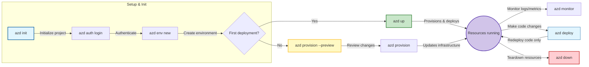
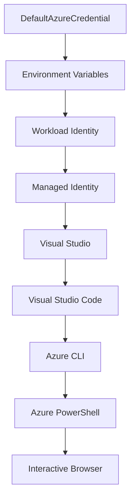

# AZD Alapok - Alapvető Fogalmak és Alapismeretek

**Fejezet navigáció:**
- **📚 Tanfolyam főoldal**: [AZD kezdőknek](../../README.md)
- **📖 Aktuális fejezet**: 1. fejezet - Alapok és Gyors Kezdés
- **⬅️ Előző**: [Tanfolyam áttekintés](../../README.md#-chapter-1-foundation--quick-start)
- **➡️ Következő**: [Telepítés és beállítás](installation.md)
- **🚀 Következő fejezet**: [2. fejezet: AI-első fejlesztés](../chapter-02-ai-development/microsoft-foundry-integration.md)

## Bevezetés

> Átvizsgálva `azd 1.37.2` (2026. november). A Bash parancsok idézett helyőrzőket használnak, amelyeket ki kell cserélned. A sablon workflow-k `.` használatával inicializálják az aktuális könyvtárat; könyvtár argumentum hiányában a sablon inicializálása alkönyvtárat hoz létre, és nem változtatja meg a shell munkakönyvtárát. A haladó snippetek illusztratívak, nem teljes projektek.

Ez a lecke bemutatja az Azure Developer CLI-t (azd), egy erőteljes parancssori eszközt, amely felgyorsítja a helyi fejlesztéstől az Azure telepítéséig tartó utadat. Megtanulod az alapfogalmakat, az alapvető funkciókat, és megérted, hogyan egyszerűsíti az azd a felhőalapú alkalmazások telepítését.

## Tanulási célok

A lecke végére képes leszel:
- Megérteni, mi az Azure Developer CLI és mi a fő célja
- Megismerni a sablonok, környezetek és szolgáltatások alapfogalmait
- Felfedezni a kulcsfontosságú funkciókat, beleértve a sablon-alapú fejlesztést és az Infrastructure as Code-ot
- Megérteni az azd projektstruktúrát és a workflow-t
- Felkészülni az azd telepítésére és konfigurálására a fejlesztői környezetedben

## Tanulási eredmények

A lecke elvégzése után képes leszel:
- Elmagyarázni az azd szerepét a modern felhőfejlesztési munkafolyamatokban
- Azonosítani az azd projektstruktúra összetevőit
- Leírni, hogyan működnek együtt a sablonok, környezetek és szolgáltatások
- Megérteni az Infrastructure as Code előnyeit az azd-vel
- Felismerni az eltérő azd parancsokat és azok céljait

## Mi az Azure Developer CLI (azd)?

Az Azure Developer CLI (azd) egy parancssori eszköz, amely a helyi fejlesztéstől az Azure telepítésig tartó utadat gyorsítja. Megkönnyíti a felhőalapú natív alkalmazások építését, telepítését és kezelését az Azure-on.

### Mit telepíthetsz az azd-vel?

Az azd számos munkaterhelést támogat – és a lista folyamatosan bővül. Ma az azd-vel telepíthetsz:

| Munkaterhelés típusa | Példák | Ugyanaz a workflow? |
|---------------|----------|----------------|
| **Hagyományos alkalmazások** | Webalkalmazások, REST API-k, statikus oldalak | ✅ `azd up` |
| **Szolgáltatások és mikroszolgáltatások** | Container Apps, Function Apps, többszolgáltatásos backendek | ✅ `azd up` |
| **AI-által támogatott alkalmazások** | Csevegőalkalmazások Microsoft Foundry modellekkel, RAG megoldások AI Search-sel | ✅ `azd up` |
| **Intelligens ügynökök** | Foundry által hosztolt ügynökök, többügynökös összehangolás | ✅ `azd up` |

A kulcsfontosságú felismerés, hogy **az azd életciklusa ugyanaz marad, bármilyen típusú telepítést végzel**. Inicializálsz egy projektet, előállítod az infrastruktúrát, telepíted a kódot, figyeled az alkalmazást, és törlöd a környezetet – legyen az egyszerű weboldal vagy fejlett AI ügynök.

Ez a folytonosság a tervezés része. azd az AI képességeket egy másik szolgáltatásnak tekinti, amelyet az alkalmazás használhat, nem pedig valami alapvetően különbözőnek. Egy csevegési végpont Microsoft Foundry modellekkel az azd szemszögéből csak egy másik konfigurálandó és telepítendő szolgáltatás.

### 🎯 Miért használjuk az AZD-t? Egy valós összehasonlítás

Hasonlítsuk össze egy egyszerű webalkalmazás adatbázissal való telepítését:

#### ❌ AZD NÉLKÜL: Kézi Azure telepítés (30+ perc)

**Illusztratív Bash összehasonlítás, nem futtatható alkalmazásindító.** Feltételezi a meglévő alkalmazáskódot, egyedi erőforrásneveket, Azure CLI hitelesítést, és szükséges CLI kiterjesztéseket. Használd az alábbi sablon gyakorlatot a támogatott végpont-igút követve.

```bash
# Step 1: Create resource group
az group create --name myapp-rg --location eastus

# Step 2: Create App Service Plan
az appservice plan create --name myapp-plan \
  --resource-group myapp-rg \
  --sku B1 --is-linux

# Step 3: Create Web App
az webapp create --name myapp-web-unique123 \
  --resource-group myapp-rg \
  --plan myapp-plan \
  --runtime "NODE:22-lts"

# Step 4: Create Cosmos DB account (10-15 minutes)
az cosmosdb create --name myapp-cosmos-unique123 \
  --resource-group myapp-rg \
  --kind MongoDB

# Step 5: Create database
az cosmosdb mongodb database create \
  --account-name myapp-cosmos-unique123 \
  --resource-group myapp-rg \
  --name tododb

# Step 6: Create collection
az cosmosdb mongodb collection create \
  --account-name myapp-cosmos-unique123 \
  --resource-group myapp-rg \
  --database-name tododb \
  --name todos

# Step 7: Get connection string
CONN_STR=$(az cosmosdb keys list \
  --name myapp-cosmos-unique123 \
  --resource-group myapp-rg \
  --type connection-strings \
  --query "connectionStrings[0].connectionString" -o tsv)

# Step 8: Configure app settings
az webapp config appsettings set \
  --name myapp-web-unique123 \
  --resource-group myapp-rg \
  --settings MONGODB_URI="$CONN_STR"

# Step 9: Enable logging
az webapp log config --name myapp-web-unique123 \
  --resource-group myapp-rg \
  --application-logging filesystem \
  --detailed-error-messages true

# Step 10: Set up Application Insights
az monitor app-insights component create \
  --app myapp-insights \
  --location eastus \
  --resource-group myapp-rg

# Step 11: Link App Insights to Web App
INSTRUMENTATION_KEY=$(az monitor app-insights component show \
  --app myapp-insights \
  --resource-group myapp-rg \
  --query "instrumentationKey" -o tsv)

az webapp config appsettings set \
  --name myapp-web-unique123 \
  --resource-group myapp-rg \
  --settings APPINSIGHTS_INSTRUMENTATIONKEY="$INSTRUMENTATION_KEY"

# Step 12: Build application locally
npm install
npm run build

# Step 13: Create deployment package
zip -r app.zip . -x "*.git*" "node_modules/*"

# Step 14: Deploy application
az webapp deployment source config-zip \
  --resource-group myapp-rg \
  --name myapp-web-unique123 \
  --src app.zip

# Step 15: Wait and pray it works 🙏
# (No automated validation, manual testing required)
```

**Problémák:**
- ❌ Több mint 15 parancs megjegyzése és sorrendben végrehajtása
- ❌ 30-45 perc kézi munka
- ❌ Könnyen hibázhatsz (gépelési hibák, helytelen paraméterek)
- ❌ A hitelesítő adatok explicit kezelést igényelnek; a hibakeresési naplók és a shell követése feltárhatja azokat
- ❌ Nincs automatikus visszagörgetés hibák esetén
- ❌ Nehéz reprodukálni a csapat többi tagja számára
- ❌ Minden alkalommal más (nem reprodukálható)

#### ✅ AZD-VEL: Automatikus telepítés (5 parancs, 10-15 perc)

```bash
# Step 1: Initialize from template
azd init --template todo-nodejs-mongo .

# Step 2: Authenticate
azd auth login

# Step 3: Select the environment created during init
azd env select dev

# Step 4: Preview changes (optional but recommended)
azd provision --preview

# Step 5: Deploy everything
azd up

# ✨ Done! Everything is deployed, configured, and monitored
```

**Előnyök:**
- ✅ **5 parancs** vs. több mint 15 kézi lépés
- ✅ **10-15 perc** összesen (főleg az Azure várása)
- ✅ **Kevesebb kézi hiba** - következetes, sablon-alapú folyamat
- ✅ **Biztonságos titkos kezelés** - sok sablon Azure által kezelt titkos tárolót használ
- ✅ **Ismételhető telepítések** - minden alkalommal ugyanaz a folyamat
- ✅ **Ismételhető infrastruktúra definíciók** - kvótákhoz, régió elérhetőséghez és sablon verziókhoz kötött
- ✅ **Csapatra kész** - bárki telepíthet ugyanazzal a parancssal
- ✅ **Infrastructure as Code** - verziókövetett Bicep sablonok
- ✅ **Sablon által definiált monitoring** - Application Insights, ha benne van a sablonban

### Idő és megbízhatóság

A fentiek becsült idők, nem benchmarkok. azd csökkenti a koordinálandó parancsokat, de nem garantálja a telepítés időtartamát, nem szünteti meg a hibákat, és nem biztosít automatikus alkalmazás/adata bázis visszagörgetést. Tartsd a működő verziókat verziókezelésben és teszteld a helyreállítási eljárásokat.

## Alapfogalmak

### Sablonok
A sablonok az azd alapjai. Tartalmazzák:
- **Alkalmazáskód** - A forráskódod és a függőségek
- **Infrastruktúra definíciók** - Azure erőforrások Bicep vagy Terraform formátumban
- **Konfigurációs fájlok** - Beállítások és környezeti változók
- **Telepítési szkriptek** - Automatizált telepítési munkafolyamatok

### Környezetek
A környezetek eltérő telepítési célokat jelentenek:
- **Fejlesztés** - Teszteléshez és fejlesztéshez
- **Előkészítés** - Éles előtti környezet
- **Éles** - Élő, éles környezet

Minden környezet megőrzi:
- A környezet nevét és értékeit; az erőforrás-elhatárolás az infrastruktúra sablontól függ
- Konfigurációs beállításokat
- Telepítési állapotot

### Szolgáltatások
A szolgáltatások az `azure.yaml` deployolható alkalmazás összetevőit írják le:
- **Frontend** - Webalkalmazások, SPA-k
- **Backend** - API-k, mikroszolgáltatások

Az adatbázisok és tárolók jellemzően infrastruktúra erőforrásokként kerülnek előállításra, nem pedig kitalált szolgáltatásszolgáltatóként, mint például az `host: postgres`.

## Kulcsfontosságú funkciók

### 1. Sablon-alapú fejlesztés
```bash
# Browse available templates
azd template list

# Initialize from a template
azd init --template "<template-name>" .
```

### 2. Infrastructure as Code
- **Bicep** - Az Azure domain-specifikus nyelve
- **Terraform** - Multi-cloud infrastruktúra eszköz
- A Bicep ARM sablonokra fordít; a natív ARM JSON nem külön beépített `infra.provider`.

### 3. Integrált munkafolyamatok
```bash
# Complete deployment workflow
azd up            # Provision + Deploy this is hands off for first time setup

# 🧪 NEW: Preview infrastructure changes before deployment (SAFE)
azd provision --preview    # Simulate infrastructure deployment without making changes

azd provision     # Create Azure resources if you update the infrastructure use this
azd deploy        # Deploy application code or redeploy application code once update
azd down          # Clean up resources
```

#### 🛡️ Biztonságos infrastruktúra tervezés előnézettel
Az `azd provision --preview` parancs áttörést jelent a biztonságos telepítéshez:
- **Próbaelemzés** - Megmutatja, mit fognak létrehozni, módosítani vagy törölni
- **Nincs infrastruktúra alkalmazás** - Áttekinti a szolgáltató változásokat; először nézd meg a projekt hook-ok parancsait, mert azok mellékhatásokat okozhatnak
- **Csapat együttműködés** - Oszd meg az előnézet eredményeket telepítés előtt
- **Költségtervezési input** - Vizsgáld meg a javasolt SKU-kat, majd árazzad őket az Azure Árkalkulátorral; az előnézet nem számolja a költségeket

```bash
# Example preview workflow
azd provision --preview           # See what will change
# Review the output, discuss with team
azd provision                     # Apply changes with confidence
```

### 📊 Vizualizáció: AZD fejlesztési munkafolyamat



**Munkafolyamat magyarázat:**
1. **Init** - Sablonnal vagy új projekttel indít
2. **Auth** - Azure autentikáció
3. **Környezet** - Izolált telepítési környezet létrehozása
4. **Preview** - 🆕 Mindig előnézet az infrastruktúra változásokról (biztonságos gyakorlat)
5. **Provision** - Azure erőforrások létrehozása/frissítése
6. **Deploy** - Alkalmazáskód feltöltése
7. **Monitor** - Az alkalmazás teljesítményének megfigyelése
8. **Iterate** - Változtatások végrehajtása és kód újratelepítése
9. **Cleanup** - Erőforrások eltávolítása, ha kész vagy

### 4. Környezet kezelés
```bash
# Create and manage environments
azd env new "<environment-name>"
azd env select "<environment-name>"
azd env list
```

### 5. Kiterjesztések és AI parancsok

Az azd kiterjesztési rendszert használ, hogy magán túlmenő képességeket adjon hozzá. Ez különösen hasznos az AI munkaterhelésekhez:

```bash
# List available extensions
azd extension list

# Install the GA Foundry bundle (requires azd >= 1.37.0)
azd ext install microsoft.foundry

# Initialize an AI agent project interactively
azd ai agent init

# Test a deployed agent (shows latency and time-to-first-byte)
azd ai agent invoke

# Start the MCP server for AI-assisted development (Alpha)
azd mcp start
```

**Az ügynök életciklusa, elejétől végéig.** A GA `microsoft.foundry` csomag tartalmazza az `azure.ai.agents` és további hat core kiterjesztést. Az `azure.ai.evaluations` külön telepítendő értékeléshez. Használd az `azd >= 1.37.0` a workflow-hoz. Nem kell mindez az első napon:

| Fázis | Parancs | Mit csinál? |
|-------|---------|--------------|
| **Sablon létrehozás** | `azd ai agent init --template <path-to-azure.yaml>` | Egy aktuális ügynök projekt sablon átvétele |
| **Helyi futtatás** | `azd ai agent run`, majd `azd ai agent invoke --local "Test prompt"` egy másik terminálban | Helyi aktivitás ellenőrzése Agent Inspector-ban; modell hívások továbbra is Azure-t használnak |
| **Telepítés** | `azd deploy` | Kód-mód hosztolt ügynököknek, forrás feltöltése távoli Foundry buildhez |
| **Tesztelés** | `azd ai agent invoke` | Ügynök meghívása és válaszidő megtekintése |
| **Mérés** | `azd ai eval init`, `generate`, `run start` | Konfigurálás, telepítés, értékelések futtatása külön kiterjesztéssel |
| **Fejlesztés** | `azd ai agent optimize --eval <evaluation-name> --optimize-model <optimizer-deployment>` | Kompatibilis értékelés újrafelhasználása az optimalizáláshoz |
| **Ellenőrzés** | `azd ai agent endpoint show` | Élő végpont konfiguráció megtekintése |
| **Takarítás** | `azd ai agent delete` | Egy hosztolt ügynök és minden verziójának törlése |

> Kezdd a [GA hosztolt ügynök útmutatójával](../chapter-02-ai-development/microsoft-foundry-integration.md#hosted-agent-walkthrough-ga), amely lefedi az előfeltételeket, előállítást, és biztonságos takarítást. A kiterjesztések részletesebben a [AZD AI CLI Parancsok](../chapter-08-production/production-ai-practices.md#azd-ai-cli-commands-and-extensions) referencia fejezetben vannak.

## 📁 Projekt struktúra

Egy tipikus azd projektstruktúra:
```
my-app/
├── .azure/                  # Local environments and selected-environment config
│   ├── config.json
│   └── dev/.env
├── .devcontainer/          # Development container config
├── .github/workflows/      # GitHub Actions
├── .vscode/               # VS Code settings
├── infra/                 # Infrastructure code
│   ├── main.bicep        # Main infrastructure template
│   ├── main.parameters.json
│   └── modules/          # Reusable modules
├── src/                  # Application source code
│   ├── api/             # Backend services
│   └── web/             # Frontend application
├── azure.yaml           # azd project configuration
└── README.md
```

## 🔧 Konfigurációs fájlok

### azure.yaml
A fő projekt konfigurációs fájl:
```yaml
name: my-awesome-app
metadata:
  template: my-template@1.0.0

services:
  web:
    project: ./src/web
    language: js
    host: appservice
  api:
    project: ./src/api
    language: js
    host: appservice

hooks:
  preprovision:
    shell: pwsh
    run: echo "Preparing to provision..."
```

### .azure/config.json
Projekt-lokális alapértelmezett környezet választás (illusztratív; az azd kezeli):
```json
{
  "defaultEnvironment": "dev"
}
```

## 🎪 Gyakori workflow-k kézzel fogható gyakorlatokkal

> **💡 Tanulási tipp:** Kövesd ezeket a gyakorlatokat sorrendben, hogy fokozatosan fejleszd AZD képességeidet.

### 🎯 Gyakorlat 1: Első projekted inicializálása

**Cél:** Hozz létre egy AZD projektet és fedezd fel a struktúráját

**Lépések:**
```bash
# Use a proven template
mkdir azd-basics-practice
cd azd-basics-practice
# Choose "dev" for the environment name when prompted
azd init --template todo-nodejs-mongo .

# Explore the generated files
ls -la  # View all files including hidden ones

# Key files created:
# - azure.yaml (main config)
# - infra/ (infrastructure code)
# - src/ (application code)
```

**✅ Siker:** Megvannak az azure.yaml, infra/, és src/ könyvtárak

---

### 🎯 Gyakorlat 2: Telepítés Azure-ba

**Cél:** Végezd el a teljes telepítést

**Lépések:**
```bash
# 1. Authenticate
azd auth login

# 2. Select the dev environment created in Exercise 1
azd env select dev
azd env set AZURE_LOCATION eastus

# 3. Preview changes (RECOMMENDED)
azd provision --preview

# 4. Deploy everything
azd up

# 5. Verify deployment
azd show    # View your app URL
```

**Várt idő:** 10-15 perc  
**✅ Siker:** Az alkalmazás URL-je megnyílik a böngészőben

---

### 🎯 Gyakorlat 3: Több környezet

**Cél:** Telepítés dev és staging környezetbe

**Lépések:**
```bash
# Already have dev, create staging
azd env new staging
azd env set AZURE_LOCATION westus2
azd up

# Switch between them
azd env list
azd env select dev
```

**✅ Siker:** Két külön erőforrás csoport az Azure Portalban

**Takarítás:** A 3. gyakorlat második számlázható telepítést hoz létre. Mindkettőt töröld, ha végeztél:

```bash
azd down --environment dev
azd down --environment staging
```

---

### 🛡️ Destruktív takarítás: `azd down --force --purge`

Amikor szándékosan törölni akarod a kiválasztott környezet Azure erőforrásait:

```bash
azd down --force --purge
```

**Mit csinál:**
- `--force`: Nincsenek megerősítő felugró ablakok
- `--purge`: Továbbá végleg törli a támogatott, lágy törölt erőforrásokat (például Key Vaultokat), ahol a purge védelem megengedi. Nem törli a helyi `.azure/` könyvtárat.

**Használd, ha:** kész vagy egy eldobható környezettel. Ne tekints destruktív takarításra első válaszként hitelesítési, kvóta vagy konfigurációs hiba esetén.

---

## 🎪 Eredeti munkafolyamat referencia

### Új projekt indítása
```bash
# Method 1: Use existing template
azd init --template todo-nodejs-mongo .

# Method 2: Start from scratch
azd init

# Method 3: Use current directory
azd init .
```

### Fejlesztési ciklus
```bash
# Set up development environment
azd auth login
azd env new dev
azd env select dev

# Deploy everything
azd up

# Make changes and redeploy
azd deploy

# Clean up when done
azd down --force --purge # Deletes this environment's discovered Azure resources; review before forcing deletion.
```

## `azd down --force --purge` megértése
Az `azd down --force --purge` parancs egy erőteljes módja az azd környezeted és minden kapcsolódó erőforrás teljes bontásának. Az egyes kapcsolók jelentése:
```
--force
```
- Kikerüli a megerősítő felugró ablakokat.
- Automatikus vagy szkriptelt használatra alkalmas, ahol a kézi bevitel nem lehetséges.
- Nem lépi át a jogosultságokat, purge védelmet vagy törlési hibákat.

```
--purge
```
Véglegesen törli a támogatott, lágyan törölt Azure-erőforrásokat további megerősítés nélkül. A szennyezés elleni védelem és az engedélyek továbbra is érvényesek. **Nem** távolítja el a helyi környezeteket vagy az `.azure/` mappát.


### Miért használjuk mindkettőt?
Mindkettőt csak akkor használja, ha a kiválasztott környezet Azure-erőforrásait törölni kívánja, és a helyreállítható erőforrásokat is eltávolítani szeretné. Ez egy destruktív takarítás, nem általános javítás vagy helyi állapot visszaállítás.

Különösen hasznos ez kézi erőforrás-törlések után az Azure portálon, vagy amikor sablonokat, környezeteket vagy erőforráscsoport-azonosító konvenciókat vált.


### Több környezet kezelése
```bash
# Create staging environment
azd env new staging
azd env select staging
azd up

# Switch back to dev
azd env select dev

# Compare environments
azd env list
```

## 🔐 Hitelesítés és hitelesítő adatok

Különböztesse meg a telepítési hitelesítést (`azd auth login`) az alkalmazás SDK hitelesítésétől (`DefaultAzureCredential`). Ezek különállóak. Az azd alapértelmezés szerint nem használja az Azure CLI hitelesítő adatait.

### Azure CLI hitelesítés (`az login`)

Futtassa az `azd auth login` az azd számára. Az alábbi Azure CLI parancsok opcionálisak és a `az` parancsokat külön hitelesítik:

```bash
# Interactive login (opens browser)
az login

# Login with specific tenant
az login --tenant "<tenant-id>"

# Login with service principal
az login --service-principal -u "<app-id>" -p "<password>" --tenant "<tenant-id>"

# Check current login status
az account show

# List available subscriptions
az account list --output table

# Set default subscription
az account set --subscription "<subscription-id>"
```

### Hitelesítési folyamat
1. **Interaktív bejelentkezés**: Megnyitja az alapértelmezett böngészőt a hitelesítéshez
2. **Eszközkód folyamat**: Böngésző nélküli környezetekhez
3. **Szolgáltatási főfelhasználó**: Automatizálási és CI/CD esetekhez
4. **Felügyelt azonosító**: Azure-ban futó alkalmazásokhoz

### DefaultAzureCredential lánc

`DefaultAzureCredential` egy hitelesítési típus, amely egyszerűsített autentikációs élményt nyújt azzal, hogy automatikusan több hitelesítési forrást próbál meg egy adott sorrendben:

#### Alkalmazás SDK hitelesítési lánc

A pontos lánc az Azure Identity SDK nyelvétől, verziójától, telepített bővítményektől és opcióktól függ. Ez az ábra fogalmi jellegű, nem egy fix azd hitelesítési sorrend; az újabb SDK-k az Azure Developer CLI hitelesítéseit is tartalmazhatják.


#### 1. Környezeti változók
```bash
# Set environment variables for service principal
export AZURE_CLIENT_ID="<app-id>"
export AZURE_CLIENT_SECRET="<password>"
export AZURE_TENANT_ID="<tenant-id>"
```

#### 2. Munkaterhelés azonosító (Kubernetes/GitHub Actions)
Automatikusan használva:
- Azure Kubernetes Service (AKS) munkaterhelés azonosítóval
- GitHub Actions OIDC szövetséggel
- Egyéb szövetséges identitás forgatókönyvek

#### 3. Felügyelt azonosító
Azure erőforrásokhoz, mint például:
- Virtuális gépek
- App Service
- Azure Functions
- Konténerpéldányok

```bash
# Inspect a deployed Container App's configured identity (requires az login)
az containerapp show --name "<app-name>" --resource-group "<rg-name>" --query identity
```

#### 4. Fejlesztői eszközök integrációja
- **Visual Studio**: Automatikusan használja a bejelentkezett fiókot
- **VS Code**: A támogatás az SDK-tól és annak támogatott közvetítő/bővítmény felállásától függ
- **Azure CLI**: `az login` hitelesítést használ (helyi fejlesztéshez leggyakoribb)

### AZD hitelesítés beállítása

```bash
# Method 1: Direct azd authentication (recommended)
azd auth login

# Method 2: Direct azd authentication
azd auth login --use-device-code  # For headless environments

# Method 3: Check authentication status
azd auth login --check-status

# Method 4: Logout and re-authenticate
azd auth logout
azd auth login
```

### Hitelesítési jó gyakorlatok

#### Helyi fejlesztéshez
```bash
# 1. Log in to azd
azd auth login

# 2. Select the subscription for this initialized environment
azd env set AZURE_SUBSCRIPTION_ID "<subscription-id>"

# 3. Check azd sign-in details (read the status message)
azd auth login --check-status
```

#### CI/CD pipeline-okhoz
```yaml
# Partial GitHub Actions steps: assumes checkout, azd installation,
# required AZURE_* environment values, and pipeline secret configuration.
- name: Deploy with azd
  run: |
    azd auth login --client-id ${{ secrets.AZURE_CLIENT_ID }} \
                    --client-secret ${{ secrets.AZURE_CLIENT_SECRET }} \
                    --tenant-id ${{ secrets.AZURE_TENANT_ID }}
    azd up --no-prompt
```

#### Üzemeltetési környezetekhez
- Használj **felügyelt azonosítót**, ha Azure erőforrásokon fut
- Automatizálási esetekhez használj **szolgáltatási főfelhasználót**
- Kerüld el a hitelesítési adatok kódba vagy konfigurációs fájlba való mentését
- Használj **Azure Key Vault**-ot érzékeny konfigurációhoz

### Gyakori hitelesítési problémák és megoldások

#### Probléma: "Nem található előfizetés"
```bash
# Solution: Set default subscription
az account list --output table
az account set --subscription "<subscription-id>"
azd env set AZURE_SUBSCRIPTION_ID "<subscription-id>"
```

#### Probléma: "Elégtelen jogosultságok"
```bash
# Solution: Check and assign required roles
az role assignment list --assignee $(az account show --query user.name --output tsv)

# Common required roles:
# - Contributor (for resource management)
# - User Access Administrator (for role assignments)
```

#### Probléma: "Token lejárt"
```bash
# Solution: Re-authenticate
az logout
az login
azd auth logout
azd auth login
```

### Hitelesítés különféle forgatókönyvekben

#### Helyi fejlesztés
```bash
# Personal development account
az login
azd auth login
```

#### Csapatfejlesztés
```bash
# Use specific tenant for organization
az login --tenant contoso.onmicrosoft.com
azd auth login --tenant-id "<tenant-id>"
```

#### Többbérlős forgatókönyvek
```bash
# Switch between tenants
az login --tenant tenant1.onmicrosoft.com
azd auth login --tenant-id "<tenant-1-id>"
# Select an environment configured with tenant 1's subscription
azd env select tenant1-dev
# Deploy to tenant 1
azd up

az login --tenant tenant2.onmicrosoft.com  
azd auth login --tenant-id "<tenant-2-id>"
azd env select tenant2-dev
# Deploy to tenant 2
azd up
```

### Biztonsági szempontok

1. **Hitelesítési adatok tárolása**: Soha ne tárolj hitelesítő adatokat forráskódban
2. **Hatókör korlátozása**: Használj minimális jogosultság elvét szolgáltatási főfelhasználók számára
3. **Token forgatás**: Rendszeresen cseréld a szolgáltatási főfelhasználói titkokat
4. **Audit naplózás**: Kövesd nyomon a hitelesítési és telepítési tevékenységeket
5. **Hálózati biztonság**: Használj privát végpontokat, amikor lehetséges

### Hibakeresés hitelesítéskor

```bash
# Debug authentication issues
azd auth login --check-status
az account show
az account get-access-token

# Common diagnostic commands
whoami                          # Current user context
az ad signed-in-user show      # Microsoft Entra ID user details
az group list                  # Test resource access
```

## Parancs felfedezés

### Felfedezés
```bash
azd template list              # Browse templates
azd template list --help       # Template discovery options
azd init --help               # Initialization options
```

### Projekt menedzsment
```bash
azd show                     # Project overview
azd env list                # Available environments and selected default
azd config show            # Configuration settings
```

### Monitorozás
```bash
azd monitor                  # Open Azure portal monitoring
azd monitor --logs           # View application logs
azd monitor --live           # View live metrics
azd pipeline config          # Set up CI/CD
```

## Legjobb gyakorlatok

### 1. Használj értelmes neveket
```bash
# Good
azd env new production-east
azd init --template todo-nodejs-mongo .

# Avoid
azd env new env1
azd init --template template1 .
```

### 2. Használj sablonokat
- Kezdd létező sablonokkal
- Testre szabhatod az igényeid szerint
- Hozz létre újrahasznosítható sablonokat szervezeted számára

### 3. Környezetek izolálása
- Használj külön környezeteket fejlesztéshez/próbához/üzemeltetéshez
- Soha ne telepítsd közvetlenül a gyártásba helyi gépről
- Használj CI/CD pipeline-okat gyártási telepítésre

### 4. Konfiguráció menedzsment
- Használj felügyelt azonosítót és Key Vault-ot titkokhoz; egyszerű `azd env set` értékek helyi egyszerű szövegesek
- Tartsd verziókezelés alatt a konfigurációt
- Dokumentáld a környezet-specifikus beállításokat

## Tanulási Ütemterv

### Kezdő (1-2. hét)
1. Telepítsd az azd-t és hitelesítsd magad
2. Telepíts egy egyszerű sablont
3. Értsd meg a projekt szerkezetét
4. Tanuld meg a fő parancsokat (up, down, deploy)

### Középhaladó (3-4. hét)
1. Testre szabhatod a sablonokat
2. Kezelhetsz több környezetet
3. Értsd meg az infrastruktúra kódot
4. Állíts be CI/CD pipeline-okat

### Haladó (5. hét+)
1. Készíts egyedi sablonokat
2. Haladó infrastruktúra minták
3. Több régiós telepítések
4. Vállalati szintű konfigurációk

## Következő lépések

**📖 Folytasd az 1. fejezet tanulását:**
- [Telepítés & Beállítás](installation.md) - Telepítsd és konfiguráld az azd-t
- [Az első projekted](first-project.md) - Fejezd be a gyakorlati oktatóanyagot
- [Konfigurációs útmutató](../chapter-03-configuration/configuration.md) - Haladó beállítási opciók

**🎯 Készen állsz a következő fejezetre?**
- [2. fejezet: AI-első fejlesztés](../chapter-02-ai-development/microsoft-foundry-integration.md) - Kezdd el az AI alkalmazások építését

## További források

- [Azure Developer CLI áttekintés](https://learn.microsoft.com/en-us/azure/developer/azure-developer-cli/)
- [Sablon galéria](https://azure.github.io/awesome-azd/)
- [Közösségi példák](https://github.com/Azure-Samples)

---

## 🙋 Gyakran Ismételt Kérdések

### Általános kérdések

**K: Mi a különbség az AZD és az Azure CLI között?**

V: Az Azure CLI (`az`) egyedi Azure erőforrások kezelésére szolgál. Az AZD (`azd`) egész alkalmazások kezelésére:

```bash
# Azure CLI - Low-level resource management
az webapp create --name myapp --resource-group rg
az sql server create --name myserver --resource-group rg
# ...many more commands needed

# AZD - Application-level management
azd up  # Deploys entire app with all resources
```

**Így gondolj rá:**
- `az` = Egyéni Lego téglákkal dolgozol
- `azd` = Teljes Lego készletekkel dolgozol

---

**K: Kell-e ismernem a Bicep-et vagy a Terraformot az AZD használatához?**

V: Nem! Kezdd sablonokkal:
```bash
# Use existing template - no IaC knowledge needed
azd init --template todo-nodejs-mongo .
azd up
```

Később megtanulhatod a Bicep-et az infrastruktúra testreszabására. A sablonok működő példákat adnak tanuláshoz.

---

**K: Mennyibe kerül az AZD sablonok futtatása?**

V: A költségek régió, SKU, működési idő, adatbázis mód és modellhasználat szerint változnak. Egy fejlesztői környezet jelentős havi díjakat generálhat még tétlen állapotban is; ne feltételezz univerzális 50-150 dolláros tartományt:

```bash
# Preview resource changes (not prices)
azd provision --preview

# Always cleanup when not using
azd down --force --purge  # Removes all resources
```

**Pro tipp:** Használj ingyenes szinteket, ahol elérhetők:
- App Service: F1 (ingyenes) szint
- Azure OpenAI: általános havi ingyenes token keret nincs garantálva; ellenőrizd az aktuális modellt és árazást
- Cosmos DB: jogosult provisioned-throughput fiókok választhatnak ingyenes szintet; a szerver nélküli sablonok nem automatikusan jogosultak

---

**K: Használhatom az AZD-t meglévő Azure erőforrásokkal?**

V: Igen, de egyszerűbb tiszta lappal kezdeni. Az AZD akkor működik a legjobban, ha teljes életciklust kezel. Meglévő erőforrások esetén:

```bash
# Option 1: Import existing resources (advanced)
azd init
# Then modify infra/ to reference existing resources

# Option 2: Start fresh (recommended)
azd init --template "<verified-template-name>" .
azd up  # Creates new environment
```

---

**K: Hogyan oszthatom meg a projektemet a csapattársaimmal?**

V: Kötelezd a AZD projektet Git-re (de NEM a .azure mappát):

```bash
# Already in .gitignore by default
.azure/        # Contains secrets and environment data
*.env          # Environment variables

# Team members then:
git clone "<your-repo>"
# Change into the cloned repository before running the remaining commands.
azd auth login
azd env new "<their-name>-dev"
azd up
```

Mindenki ugyanazt az infrastruktúrát kapja ugyanabból a sablonból.

---

### Hibakeresési kérdések

**K: Az "azd up" félig hibával leállt. Mit tegyek?**

V: Nézd meg a hibát, javítsd ki, majd próbáld újra:

```bash
# Capture detailed diagnostics (redact sensitive values before sharing)
azd up --debug

# Common fixes:

# 1. If quota exceeded:
azd env set AZURE_LOCATION "westus2"  # Try different region

# 2. If resource name conflict:
azd down --force --purge  # Clean slate
azd up  # Retry

# 3. If auth expired:
az login
azd auth login
azd up
```

**Leggyakoribb hiba:** Hibás Azure előfizetés kiválasztva
```bash
az account list --output table
az account set --subscription "<correct-subscription>"
azd env set AZURE_SUBSCRIPTION_ID "<correct-subscription-id>"
```

---

**K: Hogyan telepíthetem csak a kódváltozásokat reprovisionálás nélkül?**

V: Használd a `azd deploy`-t a `azd up` helyett:

```bash
azd up          # First time: provision + deploy (slow)

# Make code changes...

azd deploy      # Subsequent times: deploy only (fast)
```

Sebesség összehasonlítás:
- `azd up`: 10-15 perc (infrastruktúrát telepít)
- `azd deploy`: 2-5 perc (csak kód)

---

**K: Testre szabhatom az infrastruktúra sablonokat?**

V: Igen! Szerkeszd a Bicep fájlokat az `infra/` helyen:

```bash
# After azd init
cd infra/
code main.bicep  # Edit in VS Code

# Preview changes
azd provision --preview

# Apply changes
azd provision
```

**Tipp:** Kezdd kicsiben - először változtasd meg az SKU-kat:
```bicep
// infra/main.bicep
sku: {
  name: 'B1'  // Change to 'P1V2' for production
}
```

---

**K: Hogyan törölhetek mindent, amit az AZD létrehozott?**

V: Egy parancs eltávolít minden erőforrást:

```bash
azd down --force --purge

# This deletes:
# - Azure resources/resource groups discovered for the selected environment
# - Supported soft-deleted resources, if purge protection allows
# Local .azure files remain; shared/external resources may remain too.
```

**Mindig futtasd ezt, amikor:**
- Befejezted egy sablon tesztelését
- Más projektre váltasz
- Tiszta lappal akarsz kezdeni

**Költség ellenőrzés:** Erősítsd meg az Azure-ban a törlést, és ellenőrizd megtartott/megosztott erőforrásokat. A korábban keletkezett díjak továbbra is érvényesek.

---

**K: Mi van, ha véletlenül töröltem erőforrásokat az Azure Portálon?**

V: Az AZD állapota kicsúszhat a szinkronból. Tisztítsd meg az állapotot:

```bash
# 1. Delete remaining resources only if that is your intent
azd down --force --purge

# 2. Start fresh
azd up

# Alternative: Let AZD detect and fix
azd provision  # Will create missing resources
```

---

### Haladó kérdések

**K: Használhatom az AZD-t CI/CD pipeline-okban?**

V: Igen! GitHub Actions példa:

```yaml
# .github/workflows/deploy.yml
name: Deploy with AZD

on:
  push:
    branches: [main]

jobs:
  deploy:
    runs-on: ubuntu-latest
    steps:
      - uses: actions/checkout@v4
      
      - name: Install azd
        run: curl -fsSL https://aka.ms/install-azd.sh | bash
      
      - name: Azure Login
        run: |
          azd auth login \
            --client-id ${{ secrets.AZURE_CLIENT_ID }} \
            --client-secret ${{ secrets.AZURE_CLIENT_SECRET }} \
            --tenant-id ${{ secrets.AZURE_TENANT_ID }}
      
      - name: Deploy
        env:
          AZURE_ENV_NAME: dev
          AZURE_LOCATION: ${{ vars.AZURE_LOCATION }}
          AZURE_SUBSCRIPTION_ID: ${{ vars.AZURE_SUBSCRIPTION_ID }}
        run: azd up --no-prompt
```

---

**K: Hogyan kezelem a titkokat és érzékeny adatokat?**

V: Használd explicit módon a Key Vault-ot. `azd env set` egyszerű értékeket ír a helyi környezeti fájlba; nem hoz automatikusan létre kulcstartót, nem rendel szerepeket, és nem injektál titkokat az alkalmazásba.

```bash
# Interactive: create/select a Key Vault secret and save its reference
azd env set-secret DATABASE_PASSWORD
```

Megfelelő kulcstartó jogosultságokra van szükség. Infrastruktúrának/alkalmazásnak még mindig össze kell kötni a titkot a fogyasztóval és engedélyeznie kell a futtatási azonosítónak a hozzáférést. Ne írd ki a feloldott titkok értékeit a naplókba.

**Sose kötelezd el:**
- `.azure/` mappa (környezeti adatok)
- `.env` fájlok (helyi titkok)
- Kapcsolati adatsorok

---

**K: Telepíthetek több régióba?**

V: Igen, hozz létre környezetet régiónként:

```bash
# East US environment
azd env new prod-eastus
azd env set AZURE_LOCATION eastus
azd up

# West Europe environment
azd env new prod-westeurope
azd env set AZURE_LOCATION westeurope
azd up

# Each environment is independent
azd env list
```

Több régiós alkalmazásokhoz testreszabhatod a Bicep sablonokat több régióba egyidejű telepítéshez.

---

**K: Hol kérhetek segítséget, ha elakadok?**

1. **AZD dokumentáció:** https://learn.microsoft.com/azure/developer/azure-developer-cli/
2. **GitHub Issues:** https://github.com/Azure/azure-dev/issues
3. **Discord:** [Azure Discord](https://discord.gg/microsoft-azure) - #azure-developer-cli csatorna
4. **Stack Overflow:** Címke `azure-developer-cli`
5. **Ez a tanfolyam:** [Hibakeresési útmutató](../chapter-07-troubleshooting/common-issues.md)

**Pro tipp:** Kérdezés előtt futtasd:
```bash
azd show       # Shows current state
azd version    # Shows your version
```
Ezt az információt add meg a kérdésedhez gyorsabb segítséghez.

---

## 🎓 Mi a következő lépés?

Most már érted az AZD alapjait. Válaszd az utadat:

### 🎯 Kezdőknek:
1. **Következő:** [Telepítés & Beállítás](installation.md) - Telepítsd az AZD-t a gépedre
2. **Aztán:** [Az első projekted](first-project.md) - Telepítsd az első alkalmazásodat
3. **Gyakorlás:** Teljesítsd a 3 gyakorlatot ebben a leckében

### 🚀 AI fejlesztőknek:
1. **Ugorj a következőre:** [2. fejezet: AI-első fejlesztés](../chapter-02-ai-development/microsoft-foundry-integration.md)
2. **Telepíts:** Egy üres projektmappában kezdd a `azd init --template get-started-with-ai-chat .`-val
3. **Tanulj:** Építs miközben telepítesz

### 🏗️ Tapasztalt fejlesztőknek:
1. **Ismételd át:** [Konfigurációs útmutató](../chapter-03-configuration/configuration.md) - Haladó beállítások
2. **Fedezd fel:** [Infrastruktúra kód formájában](../chapter-04-infrastructure/provisioning.md) - Bicep mélyreható
3. **Építs:** Készíts egyedi sablonokat a stack-edhez

---

**Fejezet navigáció:**
- **📚 Tanfolyam főoldal**: [AZD kezdőknek](../../README.md)
- **📖 Aktuális fejezet**: 1. fejezet - Alapok & Gyors kezdet  
- **⬅️ Előző**: [Tanfolyam áttekintés](../../README.md#-chapter-1-foundation--quick-start)
- **➡️ Következő**: [Telepítés & Beállítás](installation.md)
- **🚀 Következő fejezet**: [2. fejezet: AI-első fejlesztés](../chapter-02-ai-development/microsoft-foundry-integration.md)

---

<!-- CO-OP TRANSLATOR DISCLAIMER START -->
**Jogi nyilatkozat**:
Ez a dokumentum az AI fordítási szolgáltatás, a [Co-op Translator](https://github.com/Azure/co-op-translator) segítségével készült. Bár az pontosságra törekszünk, kérjük, vegye figyelembe, hogy az automatikus fordítások hibákat vagy pontatlanságokat tartalmazhatnak. Az eredeti dokumentum az anyanyelvén tekintendő hiteles forrásnak. Fontos információk esetén professzionális emberi fordítást javasolunk. Nem vállalunk felelősséget semmilyen félreértésért vagy téves értelmezésért, amely ebből a fordításból ered.
<!-- CO-OP TRANSLATOR DISCLAIMER END -->