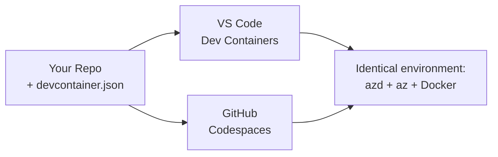

# Dev konténerek és GitHub Codespaces az azd-hez

**Fejezet navigáció:**
- **📚 Tanfolyam kezdőlap**: [AZD kezdőknek](../../README.md)
- **📖 Aktuális fejezet**: 1. fejezet - Alapok és gyors kezdet
- **⬅️ Előző**: [Hozd a saját alkalmazásod](bring-your-own-app.md)
- **🚀 Következő fejezet**: [2. fejezet: AI-első fejlesztés](../chapter-02-ai-development/README.md)

> Parancs- és konfiguráció-ellenőrzés célpontja: `azd 1.37.2` (2026. november). Konténerépítések és Azure telepítések nem voltak végrehajtva ezen ellenőrzés részeként.

## Bevezetés

Az azd, a megfelelő nyelvi futtatókörnyezet, a Docker és az Azure CLI telepítése minden gépen nehézkes — és ez az első számú oka annak, hogy egy "nálam működik" oktatóanyag nem működik másnál. Egy **dev konténer** ezt úgy oldja meg, hogy az egész eszközláncodat egy fájlban írja le. Bárki, aki megnyitja a projektet VS Code-ban vagy GitHub Codespaces-ben, pontosan ugyanazt a környezetet kapja, az azd már telepítve van. Ez a lecke megmutatja, hogyan adj hozzá egyet.

## Tanulási célok

A lecke végére:
- Megérted, mi az a dev konténer és miért segít az azd-vel
- Hozzáadsz egy minimális `.devcontainer/devcontainer.json` fájlt egy projekthez
- Beilleszted az azd-t, az Azure CLI-t és a Dockert Dev Container *funkcióként*
- Megnyitod a projektet GitHub Codespaces-ben vagy VS Code-ban

## Tanulási eredmények

A lecke elvégzése után képes leszel:
- Szerződni egy `devcontainer.json` fájlt egy azd projekthez
- Az azd és az Azure eszközöket telepítés nélkül hozzáadni
- `azd up` futtatása konténerből vagy Codespace-ből

---

## Mi az a Dev konténer?

A dev konténer egy Docker-alapú fejlesztőkörnyezet, amelyet egy `.devcontainer/devcontainer.json` fájl definiál a repódban. Ha megnyitod a projektet:

- **VS Code** (a Dev Containers kiegészítővel) felépíti a konténert és kapcsolódik hozzá.
- **GitHub Codespaces** ugyanazt a konténert építi fel a felhőben, és böngésző-alapú szerkesztőt biztosít.

Akárhogy is, minden közreműködő azonos eszközöket kap — nincs "telepítetted az azd-t?" hibaelhárítás.



---

## 1. lépés: Készítsd el a devcontainer fájlt

Készítsd el a `.devcontainer/devcontainer.json` fájlt a projekt gyökerében:

```json
{
  "name": "azd-project",
  "image": "mcr.microsoft.com/devcontainers/base:bookworm",
  "features": {
    "ghcr.io/devcontainers/features/azure-cli:1": {},
    "ghcr.io/azure/azure-dev/azd:0": { "version": "1.37.2" },
    "ghcr.io/devcontainers/features/docker-in-docker:2": {},
    "ghcr.io/devcontainers/features/node:1": {}
  },
  "customizations": {
    "vscode": {
      "extensions": [
        "ms-azuretools.azure-dev",
        "ms-azuretools.vscode-bicep"
      ]
    }
  },
  "forwardPorts": [3000],
  "postCreateCommand": "azd version"
}
```

Mit csinál mindegyik rész:

| Kulcs | Cél |
|-----|---------|
| `image` | A konténer alap operációs rendszere |
| `features` | Előre összeállított telepítők — itt: Azure CLI, **azd**, Docker, és Node.js |
| `customizations.vscode.extensions` | Automatikusan telepíti az azd és Bicep VS Code kiegészítőket |
| `forwardPorts` | Kinyitja az alkalmazás portját a böngésződnek |
| `postCreateCommand` | Egyszer lefut a konténerépítés után (itt egy egészségellenőrzés) |

> A funkció verziója (`azd:0`) és a telepített CLI verzió eltérő. Állítsd be a funkció `version` opcióját `"1.37.2"`-ra a CLI rögzítéséhez; ne használj CLI verziót címkeként.

---

## 2. lépés: Illeszd a funkciót az alkalmazásod nyelvéhez

Cseréld le a `node` funkciót arra, amit az alkalmazásod használ:

```jsonc
// Python project
"ghcr.io/devcontainers/features/python:1": {},

// .NET project
"ghcr.io/devcontainers/features/dotnet:2": {},

// Java project
"ghcr.io/devcontainers/features/java:1": {},

// Go project
"ghcr.io/devcontainers/features/go:1": {}
```

Tartsd meg a `docker-in-docker`-t, amikor helyben készítesz képeket. Egy konfigurált távoli ACR build (`docker.remoteBuild: true`) alternatíva; az hoszttípus önmagában nem mindig igényel helyi Dockert.

---

## 3. lépés: Nyisd meg

**VS Code-ban:**
1. Telepítsd a **Dev Containers** kiegészítőt.
2. Nyisd meg a projekt mappáját.
3. Kattints a **Reopen in Container**-re, amikor kéri (vagy futtasd a *Dev Containers: Reopen in Container* parancsot).

**GitHub Codespaces-ben:**
1. Pushold a repót GitHubra.
2. Kattints a **Code → Codespaces → Create codespace on main** lehetőségre.
3. Várd meg, míg a konténer összeáll — az azd használatra kész a terminálban.

---

## 4. lépés: Telepítés a konténerből

A konténer előre telepíti az azd-t, így a normál munkafolyamat egyszerűen működik:

```bash
azd auth login --use-device-code   # device code is handy inside Codespaces
azd up
```

> **Miért `--use-device-code`?** Egy távoli konténerben vagy Codespace-ben nincs helyi böngésző átirányításhoz, ezért az eszközkódos bejelentkezés a megbízható út. Egy kódot fogsz beilleszteni egy böngészőfülbe a bejelentkezés befejezéséhez.

---

## Gyakori buktatók

| Buktató | Megoldás |
|---------|-----|
| `azd up` nem tud képet építeni | Add hozzá a `docker-in-docker` funkciót |
| Böngészős bejelentkezés beragad Codespaces-ben | Használd a `azd auth login --use-device-code` |
| Az eszközök különböznek a csapattagok között | Rögzítsd a CLI-t az azd funkció `version` opcióján keresztül és rögzítsd a nyelvi futtatókörnyezeteket |
| Az alkalmazás nem érhető el a böngészőben | Add hozzá a portot az `forwardPorts`-hez |

---

## Összefoglalás

- Egy dev konténer reprodukálhatóvá teszi az azd eszközláncodat mindenki számára.
- Add hozzá az azd-t, az Azure CLI-t és a Dockert Dev Container *funkciókon* keresztül.
- Illeszd a nyelvi funkciót az alkalmazásodhoz, és tartsd meg a `docker-in-docker`-t konténer hosztoknak.
- Használj eszközkódos bejelentkezést Codespaces alatt.

---

## 🔗 Navigáció

| Irány | Erőforrás |
|-----------|----------|
| **Előző** | [Hozd a saját alkalmazásod](bring-your-own-app.md) |
| **Fejezet kezdőlap** | [1. fejezet: Alapok és gyors kezdet](README.md) |
| **Következő fejezet** | [2. fejezet: AI-első fejlesztés](../chapter-02-ai-development/README.md) |

## 📖 Kapcsolódó források

- [Telepítés és beállítás](installation.md)
- [Parancs gyors referenciasheet](../../resources/cheat-sheet.md)
- [Hivatalos Dev Containers specifikáció](https://containers.dev/)
- [azd Dev Container funkció](https://github.com/Azure/azure-dev/tree/main/ext/devcontainer)

---

<!-- CO-OP TRANSLATOR DISCLAIMER START -->
**Jogi nyilatkozat**:
Ez a dokumentum az AI fordítási szolgáltatás, a [Co-op Translator](https://github.com/Azure/co-op-translator) segítségével készült. Bár az pontosságra törekszünk, kérjük, vegye figyelembe, hogy az automatikus fordítások hibákat vagy pontatlanságokat tartalmazhatnak. Az eredeti dokumentum az anyanyelvén tekintendő hiteles forrásnak. Fontos információk esetén professzionális emberi fordítást javasolunk. Nem vállalunk felelősséget semmilyen félreértésért vagy téves értelmezésért, amely ebből a fordításból ered.
<!-- CO-OP TRANSLATOR DISCLAIMER END -->